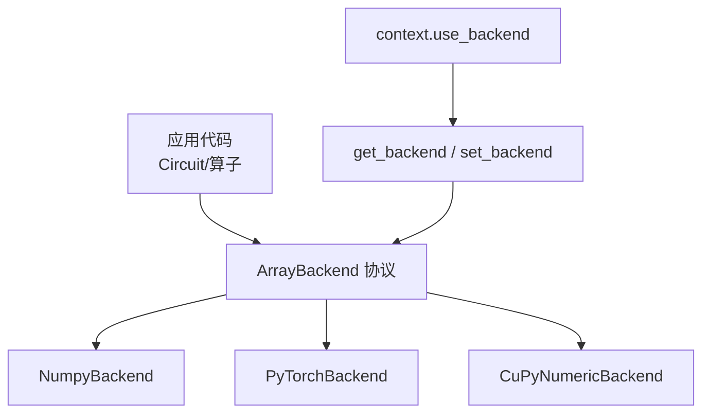
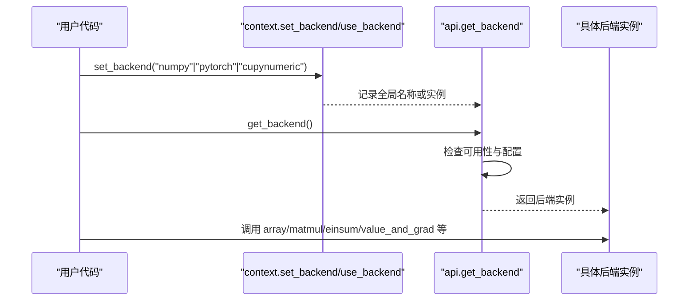
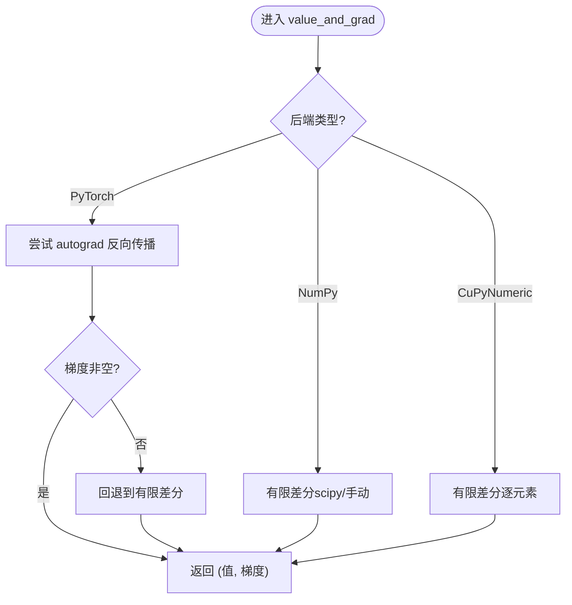
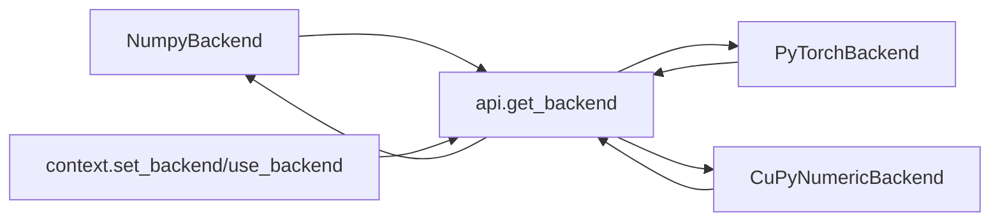

# 数值后端优化

<cite>
**本文引用的文件**
- [src/tyxonq/numerics/backends/numpy_backend.py](file://src/tyxonq/numerics/backends/numpy_backend.py)
- [src/tyxonq/numerics/backends/pytorch_backend.py](file://src/tyxonq/numerics/backends/pytorch_backend.py)
- [src/tyxonq/numerics/backends/cupynumeric_backend.py](file://src/tyxonq/numerics/backends/cupynumeric_backend.py)
- [src/tyxonq/numerics/api.py](file://src/tyxonq/numerics/api.py)
- [src/tyxonq/numerics/context.py](file://src/tyxonq/numerics/context.py)
- [src/tyxonq/numerics/__init__.py](file://src/tyxonq/numerics/__init__.py)
- [examples/numeric_backend_switching.py](file://examples/numeric_backend_switching.py)
- [examples/framework_performance_comparison.py](file://examples/framework_performance_comparison.py)
- [examples/gradient_benchmark.py](file://examples/gradient_benchmark.py)
- [examples/memory_optimization_checkpointing.py](file://examples/memory_optimization_checkpointing.py)
- [docs/source/quantum_chemistry/runtimes/runtime_optimization.rst](file://docs/source/quantum_chemistry/runtimes/runtime_optimization.rst)
</cite>

## 目录
1. [简介](#简介)
2. [项目结构](#项目结构)
3. [核心组件](#核心组件)
4. [架构总览](#架构总览)
5. [详细组件分析](#详细组件分析)
6. [依赖关系分析](#依赖关系分析)
7. [性能考量](#性能考量)
8. [故障排查指南](#故障排查指南)
9. [结论](#结论)
10. [附录](#附录)

## 简介
本指南面向希望在 TyxonQ 中通过数值后端（NumPy、PyTorch、CuPyNumeric）获得最佳性能的读者。内容涵盖：
- 各后端的性能特征与适用场景
- CPU/GPU 环境下的对比建议
- 自动微分在不同后端中的实现差异与优化策略
- 内存使用模式与缓存机制的优化建议
- 切换与优化数值后端配置的具体示例路径

## 项目结构
TyxonQ 的数值系统采用“统一协议 + 多后端”的设计：
- ArrayBackend 协议定义统一的数组/张量接口
- 三个具体后端实现：NumpyBackend、PyTorchBackend、CuPyNumericBackend
- API 层提供 get_backend/set_backend 等工厂与上下文管理
- 示例脚本演示后端切换、性能对比与梯度计算

图表来源
- [src/tyxonq/numerics/api.py:19-122](file://src/tyxonq/numerics/api.py#L19-L122)
- [src/tyxonq/numerics/context.py:18-50](file://src/tyxonq/numerics/context.py#L18-L50)

章节来源
- [src/tyxonq/numerics/api.py:19-122](file://src/tyxonq/numerics/api.py#L19-L122)
- [src/tyxonq/numerics/context.py:18-50](file://src/tyxonq/numerics/context.py#L18-L50)

## 核心组件
- ArrayBackend 协议：统一数组创建、线性代数、随机数、自动微分桥接等能力
- NumpyBackend：纯 CPU，参考实现，支持有限差分梯度
- PyTorchBackend：CPU/GPU，原生 autograd，可选 JIT 编译
- CuPyNumericBackend：GPU 加速的 NumPy 风格 API，部分操作回退到 CPU

关键要点
- 默认 dtype：complex128（量子态），float64（参数/测量）
- 可通过 set_dtype 切换精度以平衡速度与精度
- 自动微分：PyTorch 使用 autograd；NumPy/CuPyNumeric 使用有限差分或回退实现

章节来源
- [src/tyxonq/numerics/backends/numpy_backend.py:27-46](file://src/tyxonq/numerics/backends/numpy_backend.py#L27-L46)
- [src/tyxonq/numerics/backends/pytorch_backend.py:35-53](file://src/tyxonq/numerics/backends/pytorch_backend.py#L35-L53)
- [src/tyxonq/numerics/backends/cupynumeric_backend.py:33-53](file://src/tyxonq/numerics/backends/cupynumeric_backend.py#L33-L53)

## 架构总览
后端选择流程与上下文管理：

图表来源
- [src/tyxonq/numerics/context.py:18-50](file://src/tyxonq/numerics/context.py#L18-L50)
- [src/tyxonq/numerics/api.py:179-252](file://src/tyxonq/numerics/api.py#L179-L252)

章节来源
- [src/tyxonq/numerics/api.py:179-252](file://src/tyxonq/numerics/api.py#L179-L252)
- [src/tyxonq/numerics/context.py:18-50](file://src/tyxonq/numerics/context.py#L18-L50)

## 详细组件分析

### NumPy 后端
- 特点：纯 CPU，稳定可靠，适合小电路与原型验证
- 自动微分：基于有限差分（jacfwd/hessian/value_and_grad），无计算图
- 性能：小规模问题开销低；大规模矩阵运算受限于 CPU 与 BLAS 实现
- 内存：直接操作 ndarray，易于预测与控制

优化建议
- 对小规模问题优先使用 NumPy，避免框架启动开销
- 使用 float32/complex64 降低内存与带宽压力
- 对重复计算可结合外部缓存（如 lru_cache）

章节来源
- [src/tyxonq/numerics/backends/numpy_backend.py:255-454](file://src/tyxonq/numerics/backends/numpy_backend.py#L255-L454)

### PyTorch 后端
- 特点：原生 autograd，支持 GPU 加速，可选 torch.compile 提升热点路径性能
- 自动微分：autograd 反向传播，支持高阶导数（hessian/jacobian）
- 性能：在 VQA/梯度优化场景中通常最快；GPU 下批处理优势明显
- 内存：注意 requires_grad 链保持与 detach 时机，避免不必要的图保留

优化建议
- 开启 torch.compile（若可用）以提升循环/函数执行效率
- 合理设置 dtype（float32/complex64）以换取速度
- 使用 vmap（若可用）进行批量求值；否则利用后端提供的 vectorize_or_fallback

章节来源
- [src/tyxonq/numerics/backends/pytorch_backend.py:77-131](file://src/tyxonq/numerics/backends/pytorch_backend.py#L77-L131)
- [src/tyxonq/numerics/backends/pytorch_backend.py:377-444](file://src/tyxonq/numerics/backends/pytorch_backend.py#L377-L444)
- [src/tyxonq/numerics/backends/pytorch_backend.py:446-564](file://src/tyxonq/numerics/backends/pytorch_backend.py#L446-L564)

### CuPyNumeric 后端
- 特点：GPU 加速的 NumPy 风格 API，适合大规模状态向量/矩阵运算
- 自动微分：当前未提供原生 autograd，value_and_grad 回退为有限差分
- 性能：在大矩阵乘法、einsum 等上受益于 GPU；但 SVD 等操作可能回退到 CPU
- 内存：GPU 显存占用需关注，频繁 host-device 拷贝会显著影响性能

优化建议
- 尽量将数据驻留在 GPU，减少 to_numpy 等跨设备拷贝
- 对不支持 GPU 的操作（如 SVD）评估是否必须，或改用近似方法
- 使用 complex64/float32 以降低显存占用并提高吞吐

章节来源
- [src/tyxonq/numerics/backends/cupynumeric_backend.py:55-80](file://src/tyxonq/numerics/backends/cupynumeric_backend.py#L55-L80)
- [src/tyxonq/numerics/backends/cupynumeric_backend.py:209-216](file://src/tyxonq/numerics/backends/cupynumeric_backend.py#L209-L216)
- [src/tyxonq/numerics/backends/cupynumeric_backend.py:260-297](file://src/tyxonq/numerics/backends/cupynumeric_backend.py#L260-L297)

### 自动微分在各后端的实现差异
- NumPy：有限差分（中心差分/前向差分），无计算图，适用于任意 Python 函数
- PyTorch：autograd 反向传播，高效且可扩展至高阶导数；失败时回退到有限差分
- CuPyNumeric：有限差分为主，部分实现回退到 CPU/Numpy

图表来源
- [src/tyxonq/numerics/backends/pytorch_backend.py:446-564](file://src/tyxonq/numerics/backends/pytorch_backend.py#L446-L564)
- [src/tyxonq/numerics/backends/numpy_backend.py:386-454](file://src/tyxonq/numerics/backends/numpy_backend.py#L386-L454)
- [src/tyxonq/numerics/backends/cupynumeric_backend.py:260-297](file://src/tyxonq/numerics/backends/cupynumeric_backend.py#L260-L297)

章节来源
- [src/tyxonq/numerics/backends/pytorch_backend.py:446-564](file://src/tyxonq/numerics/backends/pytorch_backend.py#L446-L564)
- [src/tyxonq/numerics/backends/numpy_backend.py:386-454](file://src/tyxonq/numerics/backends/numpy_backend.py#L386-L454)
- [src/tyxonq/numerics/backends/cupynumeric_backend.py:260-297](file://src/tyxonq/numerics/backends/cupynumeric_backend.py#L260-L297)

### 向量化的安全回退
vectorize_or_fallback 提供统一的向量化策略：
- off：禁用向量化，直接调用原函数
- auto：优先使用后端 vmap（如 PyTorch），失败则按首维迭代
- force：强制尝试 vmap，异常时回退

章节来源
- [src/tyxonq/numerics/api.py:124-176](file://src/tyxonq/numerics/api.py#L124-L176)

## 依赖关系分析
- api.get_backend 根据名称解析并返回对应后端实例，缺失依赖时抛出明确错误
- context 维护全局后端实例或名称，use_backend 提供临时切换
- NumericBackend 作为类级代理，将所有调用转发给当前后端

图表来源
- [src/tyxonq/numerics/api.py:179-252](file://src/tyxonq/numerics/api.py#L179-L252)
- [src/tyxonq/numerics/context.py:18-50](file://src/tyxonq/numerics/context.py#L18-L50)

章节来源
- [src/tyxonq/numerics/api.py:179-252](file://src/tyxonq/numerics/api.py#L179-L252)
- [src/tyxonq/numerics/context.py:18-50](file://src/tyxonq/numerics/context.py#L18-L50)

## 性能考量
- 选择原则
  - 小规模/原型：NumPy（启动快、依赖少）
  - VQA/梯度优化：PyTorch（autograd + 可选 GPU/JIT）
  - 大规模状态向量：CuPyNumeric（GPU 加速，注意回退点）
- CPU vs GPU
  - GPU 在大批量矩阵运算、批处理上有优势；但需注意 host-device 拷贝成本
  - 小问题在 CPU 上可能更快（避免初始化与传输开销）
- 精度与速度
  - float32/complex64 能显著提升吞吐并降低内存占用，误差通常在可接受范围
- 缓存与复用
  - 对重复计算（如 Hamiltonian 构建、算符应用）使用 LRU/字典缓存
  - 在梯度循环中缓存中间结果，避免重复构建

章节来源
- [examples/numeric_backend_switching.py:187-246](file://examples/numeric_backend_switching.py#L187-L246)
- [examples/framework_performance_comparison.py:254-408](file://examples/framework_performance_comparison.py#L254-L408)
- [docs/source/quantum_chemistry/runtimes/runtime_optimization.rst:22-95](file://docs/source/quantum_chemistry/runtimes/runtime_optimization.rst#L22-L95)

## 故障排查指南
- 后端不可用
  - 现象：请求 pytorch/cupynumeric 时报错
  - 原因：依赖未安装或模块不可导入
  - 解决：安装相应依赖或使用 numpy 回退
- 梯度为 None
  - 现象：PyTorch 路径出现梯度为 None
  - 原因：计算图断裂或参数未参与计算
  - 解决：确保参数 requires_grad=True，避免 in-place 修改破坏图
- 性能不达标
  - 现象：GPU 模式下仍慢
  - 原因：频繁 to_numpy/host-device 拷贝、SVD 等回退到 CPU
  - 解决：减少拷贝、使用 batch/vmap、替换回退操作或调整算法

章节来源
- [src/tyxonq/numerics/api.py:236-252](file://src/tyxonq/numerics/api.py#L236-L252)
- [src/tyxonq/numerics/backends/pytorch_backend.py:497-507](file://src/tyxonq/numerics/backends/pytorch_backend.py#L497-L507)
- [src/tyxonq/numerics/backends/cupynumeric_backend.py:209-216](file://src/tyxonq/numerics/backends/cupynumeric_backend.py#L209-L216)

## 结论
- 对于 VQA/梯度优化，推荐优先使用 PyTorch 后端以获得最佳性能与易用性
- 小规模任务或无需自动微分时，NumPy 更轻量
- 大规模状态向量/矩阵运算可考虑 CuPyNumeric，但需关注回退点与显存
- 合理使用 dtype、缓存、JIT/vmap 与内存优化（如 checkpointing）可进一步提升性能

## 附录

### 如何选择合适的数值后端
- 目标：最小化运行时间、控制内存占用、保证数值稳定性
- 步骤
  - 明确问题规模与是否需要自动微分
  - 首选 PyTorch（GPU 可用时），否则 NumPy
  - 大规模矩阵/状态向量：尝试 CuPyNumeric，监控回退点
  - 通过示例脚本进行基准测试与一致性校验

章节来源
- [examples/numeric_backend_switching.py:187-318](file://examples/numeric_backend_switching.py#L187-L318)

### 不同后端在 CPU/GPU 下的性能对比
- 使用示例脚本进行端到端对比（包含 shot-based、NumPy 梯度、PyTorch autograd）
- 关注平均步耗时、最终能量与加速比

章节来源
- [examples/framework_performance_comparison.py:75-408](file://examples/framework_performance_comparison.py#L75-L408)

### 自动微分优化策略
- PyTorch：使用 autograd，必要时启用 torch.compile；谨慎管理 requires_grad 与 retain_graph
- NumPy/CuPyNumeric：有限差分，注意步长 eps 与复杂度 O(n) 次函数求值
- 混合策略：在 PyTorch 失败时回退到有限差分，保证鲁棒性

章节来源
- [src/tyxonq/numerics/backends/pytorch_backend.py:377-444](file://src/tyxonq/numerics/backends/pytorch_backend.py#L377-L444)
- [src/tyxonq/numerics/backends/pytorch_backend.py:446-564](file://src/tyxonq/numerics/backends/pytorch_backend.py#L446-L564)
- [src/tyxonq/numerics/backends/numpy_backend.py:386-454](file://src/tyxonq/numerics/backends/numpy_backend.py#L386-L454)
- [src/tyxonq/numerics/backends/cupynumeric_backend.py:260-297](file://src/tyxonq/numerics/backends/cupynumeric_backend.py#L260-L297)

### 内存使用模式与缓存机制优化
- 缓存策略
  - 全局 LRU 缓存用于重复的算符应用/求解
  - 局部字典缓存用于梯度循环中的中间结果
- 检查点（Checkpointing）
  - 深电路/大比特数场景下，使用梯度检查点降低内存峰值
- 实践建议
  - 预构建 Hamiltonian/门矩阵，避免重复分配
  - 减少 host-device 拷贝，尽量在 GPU 内完成计算

章节来源
- [docs/source/quantum_chemistry/runtimes/runtime_optimization.rst:22-95](file://docs/source/quantum_chemistry/runtimes/runtime_optimization.rst#L22-L95)
- [examples/memory_optimization_checkpointing.py:200-228](file://examples/memory_optimization_checkpointing.py#L200-L228)

### 切换与优化数值后端配置（示例路径）
- 切换后端
  - 使用 tq.set_backend("numpy"|"pytorch"|"cupynumeric")
  - 使用 tq.get_backend() 获取当前后端实例
- 精度设置
  - 后端 set_dtype("complex64"|"complex128") 切换默认精度
- 向量化
  - vectorize_or_fallback(fn, backend, policy="auto"/"force"/"off")
- 示例参考
  - 后端切换与一致性验证：[examples/numeric_backend_switching.py](file://examples/numeric_backend_switching.py)
  - 框架性能对比（含三种 TyxonQ 模式）：[examples/framework_performance_comparison.py](file://examples/framework_performance_comparison.py)
  - 梯度基准（counts/autograd/FD）：[examples/gradient_benchmark.py](file://examples/gradient_benchmark.py)

章节来源
- [src/tyxonq/numerics/__init__.py:20-36](file://src/tyxonq/numerics/__init__.py#L20-L36)
- [src/tyxonq/numerics/api.py:179-252](file://src/tyxonq/numerics/api.py#L179-L252)
- [examples/numeric_backend_switching.py:86-184](file://examples/numeric_backend_switching.py#L86-L184)
- [examples/framework_performance_comparison.py:254-408](file://examples/framework_performance_comparison.py#L254-L408)
- [examples/gradient_benchmark.py:140-186](file://examples/gradient_benchmark.py#L140-L186)