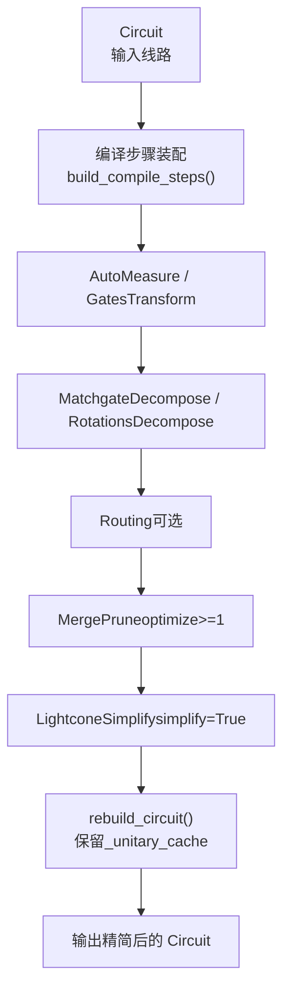
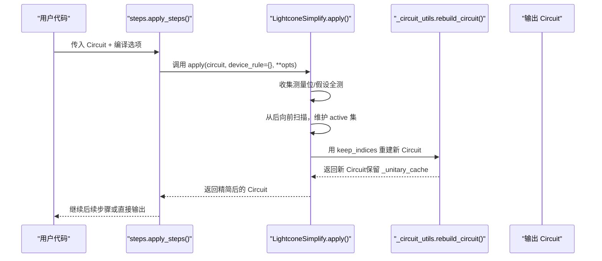
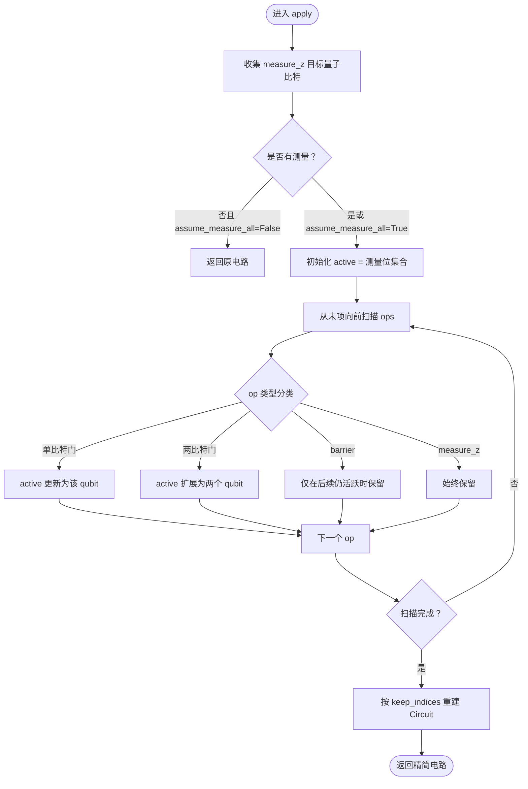
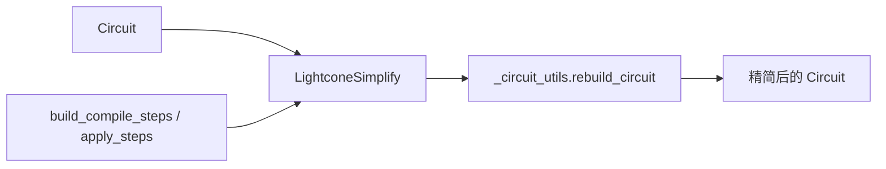

# 光锥简化

<cite>
**本文引用的文件**
- [src/tyxonq/compiler/gate_compiler/stages/simplify/lightcone.py](file://src/tyxonq/compiler/gate_compiler/stages/simplify/lightcone.py)
- [src/tyxonq/compiler/gate_compiler/_circuit_utils.py](file://src/tyxonq/compiler/gate_compiler/_circuit_utils.py)
- [src/tyxonq/compiler/gate_compiler/steps.py](file://src/tyxonq/compiler/gate_compiler/steps.py)
- [examples/compiler_lightcone_optimization.py](file://examples/compiler_lightcone_optimization.py)
- [tests_core_module/test_compiler_simplify_lightcone.py](file://tests_core_module/test_compiler_simplify_lightcone.py)
</cite>

## 目录
1. [简介](#简介)
2. [项目结构](#项目结构)
3. [核心组件](#核心组件)
4. [架构总览](#架构总览)
5. [详细组件分析](#详细组件分析)
6. [依赖关系分析](#依赖关系分析)
7. [性能考量](#性能考量)
8. [故障排查指南](#故障排查指南)
9. [结论](#结论)
10. [附录](#附录)

## 简介
本文件系统性阐述 TyxonQ 中的“光锥简化”（Lightcone Simplification）优化：其原理、实现机制与使用方式。重点包括：
- 如何识别受测量影响的量子比特，并基于向后切片构建“光锥”依赖集合；
- 如何在保持操作索引顺序的前提下裁剪无关算子；
- assume_measure_all 参数的作用与配置方法；
- 不同门类型（单量子比特门、双量子比特门、测量/投影/重置等）在光锥分析中的处理策略；
- 通过示例展示优化前后电路对比与性能收益；
- 提供最佳实践与基准测试参考。

## 项目结构
TyxonQ 的光锥简化作为编译流水线的一个“化简阶段”，位于 gate_compiler 的 stages/simplify 子模块中，并通过 steps 装配到编译流程中。相关关键位置如下：
- 光锥简化实现：src/tyxonq/compiler/gate_compiler/stages/simplify/lightcone.py
- 重建线路工具（保留酉矩阵缓存）：src/tyxonq/compiler/gate_compiler/_circuit_utils.py
- 编译步骤装配与执行：src/tyxonq/compiler/gate_compiler/steps.py
- 示例与基准：examples/compiler_lightcone_optimization.py
- 单元测试覆盖：tests_core_module/test_compiler_simplify_lightcone.py

图表来源
- [src/tyxonq/compiler/gate_compiler/steps.py:27-90](file://src/tyxonq/compiler/gate_compiler/steps.py#L27-L90)
- [src/tyxonq/compiler/gate_compiler/stages/simplify/lightcone.py:12-97](file://src/tyxonq/compiler/gate_compiler/stages/simplify/lightcone.py#L12-L97)
- [src/tyxonq/compiler/gate_compiler/_circuit_utils.py:28-72](file://src/tyxonq/compiler/gate_compiler/_circuit_utils.py#L28-L72)

章节来源
- [src/tyxonq/compiler/gate_compiler/steps.py:27-90](file://src/tyxonq/compiler/gate_compiler/steps.py#L27-L90)
- [src/tyxonq/compiler/gate_compiler/stages/simplify/lightcone.py:12-97](file://src/tyxonq/compiler/gate_compiler/stages/simplify/lightcone.py#L12-L97)
- [src/tyxonq/compiler/gate_compiler/_circuit_utils.py:28-72](file://src/tyxonq/compiler/gate_compiler/_circuit_utils.py#L28-L72)

## 核心组件
- LightconeSimplify：实现光锥简化，负责收集测量位、向后扫描依赖、维护活跃集、生成保留索引并重建电路。
- rebuild_circuit：以新 ops/metadata 重建 Circuit，同时保留非 dataclass 字段 _unitary_cache，避免后续分解步骤因缺失缓存报错。
- build_compile_steps / apply_steps：将 LightconeSimplify 按序接入编译管线，并在需要时启用 simplify 开关。

章节来源
- [src/tyxonq/compiler/gate_compiler/stages/simplify/lightcone.py:12-97](file://src/tyxonq/compiler/gate_compiler/stages/simplify/lightcone.py#L12-L97)
- [src/tyxonq/compiler/gate_compiler/_circuit_utils.py:28-72](file://src/tyxonq/compiler/gate_compiler/_circuit_utils.py#L28-L72)
- [src/tyxonq/compiler/gate_compiler/steps.py:27-105](file://src/tyxonq/compiler/gate_compiler/steps.py#L27-L105)

## 架构总览
光锥简化在编译阶段的“化简”环节执行，位于合并/剪枝之后、输出之前。它不改变门的语义，仅移除对最终测量结果无影响的算子，从而显著降低期望值计算或采样成本。

图表来源
- [src/tyxonq/compiler/gate_compiler/steps.py:94-105](file://src/tyxonq/compiler/gate_compiler/steps.py#L94-L105)
- [src/tyxonq/compiler/gate_compiler/stages/simplify/lightcone.py:15-97](file://src/tyxonq/compiler/gate_compiler/stages/simplify/lightcone.py#L15-L97)
- [src/tyxonq/compiler/gate_compiler/_circuit_utils.py:28-72](file://src/tyxonq/compiler/gate_compiler/_circuit_utils.py#L28-L72)

## 详细组件分析

### LightconeSimplify 算法与数据流
- 输入：Circuit（包含 ops）、device_rule（透传但不影响逻辑）、opts（如 assume_measure_all）。
- 测量位收集：遍历 ops，收集所有 measure_z 的目标量子比特。若未显式测量且 assume_measure_all=False，则直接返回原电路。
- 假设全测：当 assume_measure_all=True 且无显式测量时，将所有量子比特视为被测量。
- 向后切片：从末尾向前扫描每个 op，判断其作用量子比特是否落入 active 集；若是则保留该 op，并根据门类型更新 active 集：
  - 单量子比特门（如 h/rx/ry/rz/phase/s/t/sd/td/x/y/z/i/project_z/reset/barrier/measure_z）：仅作用于指定 qubit，active 集按该 qubit 更新。
  - 双量子比特门（如 cx/cz/swap/rxx/ryy/rzz）：传播依赖至两个 qubit，active 集扩展为这两个 qubit。
  - barrier：不影响依赖，仅在后续仍活跃时保留。
- 索引保持：记录保留操作的原始索引，排序后按原序重建 ops，保证时序不变。
- 电路重建：使用 rebuild_circuit 构造新 Circuit，确保 _unitary_cache 不被丢弃。

图表来源
- [src/tyxonq/compiler/gate_compiler/stages/simplify/lightcone.py:15-97](file://src/tyxonq/compiler/gate_compiler/stages/simplify/lightcone.py#L15-L97)

章节来源
- [src/tyxonq/compiler/gate_compiler/stages/simplify/lightcone.py:15-97](file://src/tyxonq/compiler/gate_compiler/stages/simplify/lightcone.py#L15-L97)

### 不同门类型的处理方式
- 单量子比特门：h, rx, ry, rz, phase, s, t, sd, td, x, y, z, i, project_z, reset, barrier, measure_z。它们只影响自身作用的量子比特，active 集按该 qubit 更新。
- 双量子比特门：cx, cz, swap, rxx, ryy, rzz。它们会在两个量子比特间传播依赖，active 集需同时包含两个 qubit。
- 特殊指令：
  - measure_z：总是保留，用于标记测量点。
  - barrier：不引入依赖，仅在后续仍活跃时保留。
  - project_z/reset：视为单比特操作，若其作用 qubit 在 active 集中则保留。

章节来源
- [src/tyxonq/compiler/gate_compiler/stages/simplify/lightcone.py:42-66](file://src/tyxonq/compiler/gate_compiler/stages/simplify/lightcone.py#L42-L66)

### assume_measure_all 参数说明
- 作用：当电路中没有显式的 measure_z 时，默认不进行裁剪；设置 assume_measure_all=True 后，会将所有量子比特视为“被测量”，从而允许对所有 qubit 进行光锥裁剪（等价于全测场景）。
- 行为验证：
  - 无测量且 assume_measure_all=False：返回原电路，不做任何裁剪。
  - 无测量且 assume_measure_all=True：将所有 qubit 加入 active 集，不会裁剪任何影响任意 qubit 的 op。
- 典型用法：
  - 在期望值计算前，若已知最终会读取全部 qubit 的统计量，可开启 assume_measure_all=True 以统一处理路径。
  - 在部分测量场景中，可通过手动插入 measure_z 标记关注 qubit，再调用 LightconeSimplify().apply(...) 进行裁剪。

章节来源
- [src/tyxonq/compiler/gate_compiler/stages/simplify/lightcone.py:15-37](file://src/tyxonq/compiler/gate_compiler/stages/simplify/lightcone.py#L15-L37)
- [tests_core_module/test_compiler_simplify_lightcone.py:25-35](file://tests_core_module/test_compiler_simplify_lightcone.py#L25-L35)

### 操作索引保持与电路重建
- 索引保持：通过 keep_indices 记录保留操作的原始索引，排序后按原序重建 ops，确保时序与依赖关系不变。
- 电路重建：使用 rebuild_circuit 创建新 Circuit，保留 _unitary_cache，避免后续 MatchgateDecompose 等步骤因缺少矩阵缓存而失败。

章节来源
- [src/tyxonq/compiler/gate_compiler/stages/simplify/lightcone.py:68-97](file://src/tyxonq/compiler/gate_compiler/stages/simplify/lightcone.py#L68-L97)
- [src/tyxonq/compiler/gate_compiler/_circuit_utils.py:28-72](file://src/tyxonq/compiler/gate_compiler/_circuit_utils.py#L28-L72)

### 示例与效果展示
- 示例脚本展示了：
  - 全测量场景下 assume_measure_all=True 的行为（数学等价于不裁剪）；
  - 部分测量场景下，先插入 measure_z 标记关注的 qubit，再进行光锥裁剪，最后移除 measure_z 进行期望值计算；
  - 在不同规模和问题深度下的性能基准，体现光锥简化带来的加速比。
- 建议阅读与运行：examples/compiler_lightcone_optimization.py，其中包含完整的基准与正确性校验流程。

章节来源
- [examples/compiler_lightcone_optimization.py:61-94](file://examples/compiler_lightcone_optimization.py#L61-L94)
- [examples/compiler_lightcone_optimization.py:201-255](file://examples/compiler_lightcone_optimization.py#L201-L255)

## 依赖关系分析
- LightconeSimplify 依赖：
  - Circuit 数据结构（ops、num_qubits 等）；
  - rebuild_circuit 工具函数，用于安全重建并保持 _unitary_cache；
  - DeviceRule（透传，当前实现未使用）。
- 编译管线集成：
  - build_compile_steps 在 optimize>=1 后追加 MergePrune，随后在 simplify=True 时追加 LightconeSimplify；
  - apply_steps 顺序执行各步骤，将 opts（如 assume_measure_all）透传给具体步骤。

图表来源
- [src/tyxonq/compiler/gate_compiler/steps.py:27-90](file://src/tyxonq/compiler/gate_compiler/steps.py#L27-L90)
- [src/tyxonq/compiler/gate_compiler/stages/simplify/lightcone.py:12-97](file://src/tyxonq/compiler/gate_compiler/stages/simplify/lightcone.py#L12-L97)
- [src/tyxonq/compiler/gate_compiler/_circuit_utils.py:28-72](file://src/tyxonq/compiler/gate_compiler/_circuit_utils.py#L28-L72)

章节来源
- [src/tyxonq/compiler/gate_compiler/steps.py:27-105](file://src/tyxonq/compiler/gate_compiler/steps.py#L27-L105)
- [src/tyxonq/compiler/gate_compiler/stages/simplify/lightcone.py:12-97](file://src/tyxonq/compiler/gate_compiler/stages/simplify/lightcone.py#L12-L97)
- [src/tyxonq/compiler/gate_compiler/_circuit_utils.py:28-72](file://src/tyxonq/compiler/gate_compiler/_circuit_utils.py#L28-L72)

## 性能考量
- 时间复杂度：向后扫描一次 ops，每次判断是否为 active 集成员，整体为 O(N)（N 为 op 数量），active 集操作近似 O(1)。
- 空间复杂度：active 集与 keep_indices 占用额外内存，但通常远小于电路规模。
- 实际收益：
  - 部分测量场景下，可大幅减少参与计算的 gates，带来显著的端到端加速；
  - 全测量场景下，assume_measure_all=True 保持数学等价，便于统一处理路径；
  - 结合 MergePrune 等前置优化，进一步降低冗余。
- 注意事项：
  - 确保在期望值计算前正确标记测量位或使用 assume_measure_all；
  - 避免在不必要的场景启用 simplify，以免增加编译开销。

[本节为通用性能讨论，不直接分析具体文件]

## 故障排查指南
- 现象：启用 simplify 后电路未按预期裁剪。
  - 检查是否显式插入了 measure_z 或设置了 assume_measure_all=True；
  - 确认 LightconeSimplify 已加入编译步骤（simplify=True）。
- 现象：后续分解步骤报错缺少矩阵缓存。
  - 确认使用了 rebuild_circuit 重建电路，以保留 _unitary_cache；
  - 避免自行构造新 Circuit 导致缓存丢失。
- 现象：部分测量场景下结果不正确。
  - 确认 measure_z 标记了正确的 qubit；
  - 在裁剪后移除 measure_z 再进行期望值计算。

章节来源
- [src/tyxonq/compiler/gate_compiler/stages/simplify/lightcone.py:15-97](file://src/tyxonq/compiler/gate_compiler/stages/simplify/lightcone.py#L15-L97)
- [src/tyxonq/compiler/gate_compiler/_circuit_utils.py:28-72](file://src/tyxonq/compiler/gate_compiler/_circuit_utils.py#L28-L72)
- [tests_core_module/test_compiler_simplify_lightcone.py:8-75](file://tests_core_module/test_compiler_simplify_lightcone.py#L8-L75)

## 结论
光锥简化是 TyxonQ 编译器中一项精确且高效的优化技术，通过对测量依赖的向后切片，精准裁剪无关算子，显著降低期望值计算与采样的成本。其实现简洁清晰，与编译管线无缝集成，并提供 assume_measure_all 以支持全测量场景的统一处理。配合示例与单元测试，可在多种应用场景中稳定发挥加速作用。

[本节为总结性内容，不直接分析具体文件]

## 附录

### 使用建议与最佳实践
- 在期望值计算前，若仅关注部分 qubit，建议显式插入 measure_z 标记这些 qubit，然后调用 LightconeSimplify().apply(...) 进行裁剪；
- 若确定最终会读取全部 qubit 的统计量，可使用 assume_measure_all=True 统一处理路径；
- 将 simplify 纳入编译步骤（simplify=True），以获得自动化的光锥裁剪；
- 在大规模电路中优先启用 optimize>=1 与 simplify，以获得更好的端到端性能。

[本节为通用指导，不直接分析具体文件]

### 参考示例与测试
- 示例脚本：examples/compiler_lightcone_optimization.py，包含基准测试与正确性校验；
- 单元测试：tests_core_module/test_compiler_simplify_lightcone.py，覆盖裁剪、assume_measure_all、多测量传播、reset/project 保留规则等场景。

章节来源
- [examples/compiler_lightcone_optimization.py:97-159](file://examples/compiler_lightcone_optimization.py#L97-L159)
- [tests_core_module/test_compiler_simplify_lightcone.py:8-75](file://tests_core_module/test_compiler_simplify_lightcone.py#L8-L75)