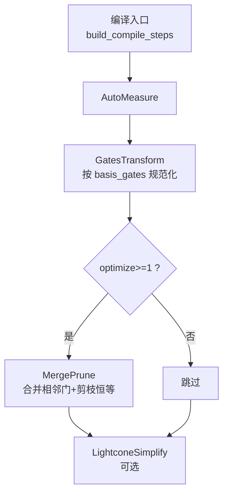
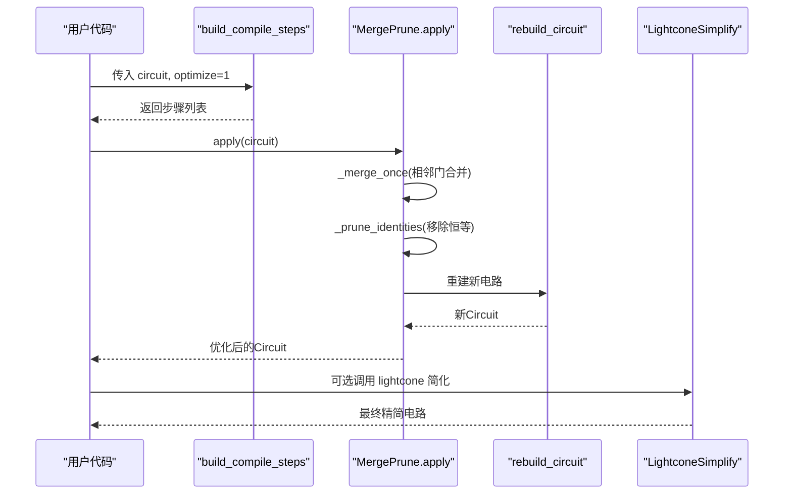
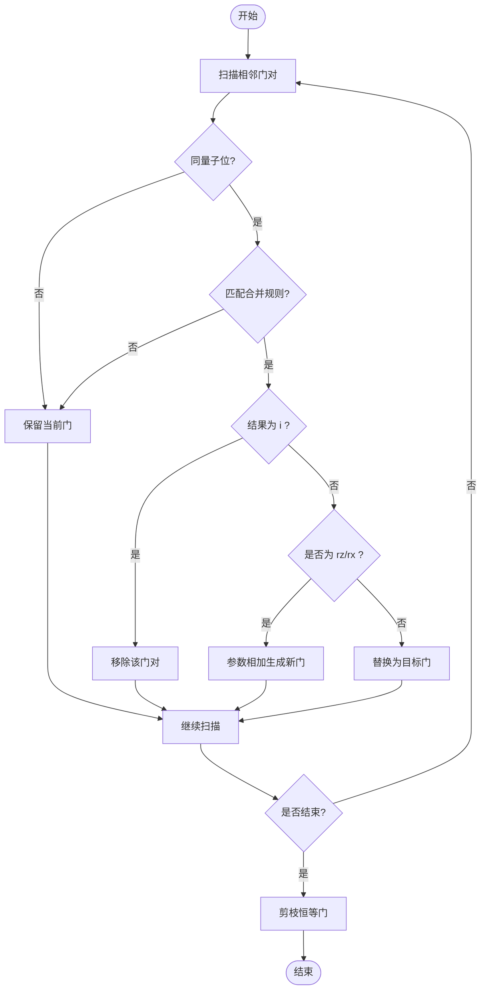
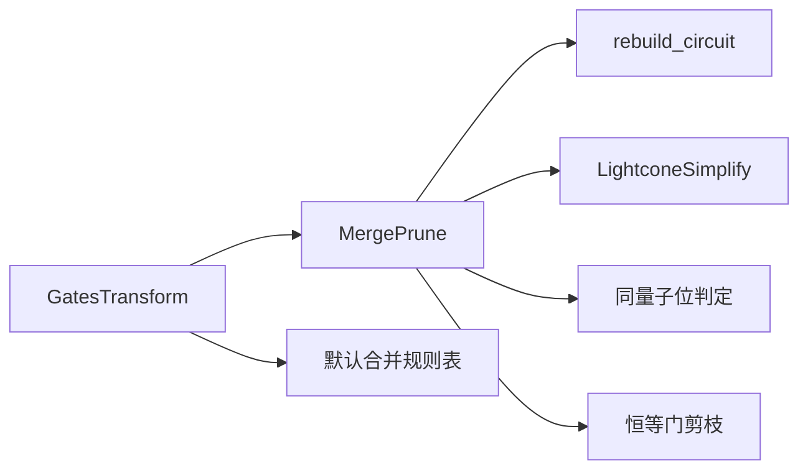

# 合并剪枝优化

<cite>
**本文引用的文件**
- [merge_prune.py](file://src/tyxonq/compiler/gate_compiler/stages/rewrite/merge_prune.py)
- [gates_transform.py](file://src/tyxonq/compiler/gate_compiler/stages/rewrite/gates_transform.py)
- [steps.py](file://src/tyxonq/compiler/gate_compiler/steps.py)
- [lightcone.py](file://src/tyxonq/compiler/gate_compiler/stages/simplify/lightcone.py)
- [_circuit_utils.py](file://src/tyxonq/compiler/gate_compiler/_circuit_utils.py)
- [test_compiler_pipeline.py](file://tests_core_module/test_compiler_pipeline.py)
- [compiler_lightcone_optimization.py](file://examples/compiler_lightcone_optimization.py)
</cite>

## 目录
1. [简介](#简介)
2. [项目结构](#项目结构)
3. [核心组件](#核心组件)
4. [架构总览](#架构总览)
5. [详细组件分析](#详细组件分析)
6. [依赖关系分析](#依赖关系分析)
7. [性能考量](#性能考量)
8. [故障排查指南](#故障排查指南)
9. [结论](#结论)
10. [附录：配置与示例](#附录配置与示例)

## 简介
本文件系统性说明 TyxonQ 中的“合并-剪枝”优化，聚焦相邻门合并与冗余操作移除。内容涵盖：
- 合并策略：同一量子位上相邻门的规则化简（如泡利门抵消、旋转门参数相加）。
- 剪枝机制：移除恒等门等无效操作；结合光锥简化进一步裁剪无关算子。
- 不同门类型的合并规则：S/T/Z/H/X/Y 等泡利族门、Rx/Rz 旋转门参数合并。
- 编译步骤装配与启用方式：通过 optimize 级别控制是否启用 MergePrune。
- 对电路深度与门数量的影响：以规则化简减少门数，配合后续分解/路由/光锥简化降低整体复杂度。
- 配置选项与使用示例：展示如何开启/关闭优化，以及合并前后的对比思路。

## 项目结构
TyxonQ 的合并-剪枝优化位于编译器重写阶段，属于 gate_compiler 的 stages/rewrite 子模块，并通过 steps 装配到编译流水线中。相关关键位置如下：
- 合并与剪枝实现：stages/rewrite/merge_prune.py
- 门基变换（为合并提供统一表示）：stages/rewrite/gates_transform.py
- 编译步骤装配与执行顺序：gate_compiler/steps.py
- 光锥简化（互补的裁剪手段）：stages/simplify/lightcone.py
- 线路重建工具（保留酉矩阵缓存）：_circuit_utils.py
- 测试验证：tests_core_module/test_compiler_pipeline.py
- 示例演示（光锥优化）：examples/compiler_lightcone_optimization.py

图表来源
- [steps.py:27-91](file://src/tyxonq/compiler/gate_compiler/steps.py#L27-L91)
- [merge_prune.py:27-46](file://src/tyxonq/compiler/gate_compiler/stages/rewrite/merge_prune.py#L27-L46)
- [gates_transform.py:12-50](file://src/tyxonq/compiler/gate_compiler/stages/rewrite/gates_transform.py#L12-L50)
- [lightcone.py:12-97](file://src/tyxonq/compiler/gate_compiler/stages/simplify/lightcone.py#L12-L97)

章节来源
- [steps.py:27-91](file://src/tyxonq/compiler/gate_compiler/steps.py#L27-L91)
- [merge_prune.py:27-46](file://src/tyxonq/compiler/gate_compiler/stages/rewrite/merge_prune.py#L27-L46)
- [gates_transform.py:12-50](file://src/tyxonq/compiler/gate_compiler/stages/rewrite/gates_transform.py#L12-L50)
- [lightcone.py:12-97](file://src/tyxonq/compiler/gate_compiler/stages/simplify/lightcone.py#L12-L97)

## 核心组件
- MergePrune：轻量级相邻门合并与恒等门剪枝。默认包含一组门组合到结果门的映射规则，支持 Rx/Rz 参数相加，循环直到无变化。
- GatesTransform：将常见门规范化到指定基集（如 x→rx(π)、y→ry(π)），使后续合并规则更稳定。
- LightconeSimplify：基于测量反向切片的光锥简化，仅保留影响测量结果的算子，作为合并-剪枝的补充。
- rebuild_circuit：在改写 ops 后重建 Circuit，并保留 _unitary_cache，确保后续分解步骤可用。

章节来源
- [merge_prune.py:27-85](file://src/tyxonq/compiler/gate_compiler/stages/rewrite/merge_prune.py#L27-L85)
- [gates_transform.py:12-50](file://src/tyxonq/compiler/gate_compiler/stages/rewrite/gates_transform.py#L12-L50)
- [lightcone.py:12-97](file://src/tyxonq/compiler/gate_compiler/stages/simplify/lightcone.py#L12-L97)
- [_circuit_utils.py:28-72](file://src/tyxonq/compiler/gate_compiler/_circuit_utils.py#L28-L72)

## 架构总览
合并-剪枝优化在编译流水线中的位置与作用：
- 前置：AutoMeasure 保证测量一致性；GatesTransform 将门统一到基集，便于规则匹配。
- 合并-剪枝：MergePrune 在同一量子位上扫描相邻门，依据规则合并或消除，并剔除恒等门。
- 后置：可接 LightconeSimplify 进行光锥裁剪，进一步减少参与计算的算子集合。

图表来源
- [steps.py:27-91](file://src/tyxonq/compiler/gate_compiler/steps.py#L27-L91)
- [merge_prune.py:40-85](file://src/tyxonq/compiler/gate_compiler/stages/rewrite/merge_prune.py#L40-L85)
- [_circuit_utils.py:28-72](file://src/tyxonq/compiler/gate_compiler/_circuit_utils.py#L28-L72)
- [lightcone.py:15-97](file://src/tyxonq/compiler/gate_compiler/stages/simplify/lightcone.py#L15-L97)

## 详细组件分析

### MergePrune：相邻门合并与恒等剪枝
- 目标：在同一量子位上识别相邻门对，按规则合并或消除，并删除恒等门。
- 合并流程要点：
  - 遍历 ops，检查相邻两个门是否作用于同一量子位。
  - 若匹配默认规则表（如 x+x→i、h+h→i、s+s→z、t+t→s 等），则替换为目标门或直接移除（结果为 i 时直接删除）。
  - 对于旋转门（rz/rx），将相邻两门的参数相加，生成新的单门。
  - 重复一轮合并与剪枝，直到没有变化为止。
- 剪枝逻辑：过滤掉所有恒等门（名称为 "i" 的 op）。

图表来源
- [merge_prune.py:48-85](file://src/tyxonq/compiler/gate_compiler/stages/rewrite/merge_prune.py#L48-L85)

章节来源
- [merge_prune.py:12-24](file://src/tyxonq/compiler/gate_compiler/stages/rewrite/merge_prune.py#L12-L24)
- [merge_prune.py:40-85](file://src/tyxonq/compiler/gate_compiler/stages/rewrite/merge_prune.py#L40-L85)

### GatesTransform：门基规范化
- 作用：将常见门转换为指定的基集（如 x→rx(π)、y→ry(π)），以便后续合并规则稳定匹配。
- 行为：
  - 若基集中包含 rx/ry，则将 x/y 转换为对应旋转门。
  - 对 cx/cz/h/rx/ry/rz 原样保留。
  - 对 rxx/rzz/cy 仅在显式请求时保留，否则交由后续分解处理。
  - 其他门（含 unitary）原样保留，交给后续步骤处理。
- 重要性：为 MergePrune 提供一致的输入表示，提升合并命中率。

章节来源
- [gates_transform.py:12-50](file://src/tyxonq/compiler/gate_compiler/stages/rewrite/gates_transform.py#L12-L50)

### LightconeSimplify：光锥裁剪（互补优化）
- 作用：从测量位出发反向追踪依赖，仅保留影响测量结果的算子，从而大幅减少计算量。
- 行为：
  - 收集测量位（若无显式测量且未假设全测，则不裁剪）。
  - 自底向上维护活跃量子位集合，遇到双量子位门传播依赖。
  - 保留必要算子并重建电路，保持元数据与酉矩阵缓存。
- 与合并-剪枝的关系：两者互补，前者关注“哪些门需要”，后者关注“哪些门可合并/消除”。

章节来源
- [lightcone.py:15-97](file://src/tyxonq/compiler/gate_compiler/stages/simplify/lightcone.py#L15-L97)

### 线路重建工具：rebuild_circuit
- 作用：在改写 ops 后重建 Circuit，同时保留非 dataclass 字段 _unitary_cache，避免后续分解失败。
- 关键点：
  - 使用 dataclasses.replace 或类型构造器重建。
  - 显式复制 _unitary_cache，确保后续 matchgate/rotations 分解可用。

章节来源
- [_circuit_utils.py:28-72](file://src/tyxonq/compiler/gate_compiler/_circuit_utils.py#L28-L72)

## 依赖关系分析
- MergePrune 依赖：
  - 默认合并规则表（DEFAULT_MERGE_RULES）定义门对到结果门的映射。
  - 同一量子位判定（_same_wire）用于限制合并范围。
  - 恒等门剪枝（_prune_identities）用于移除冗余。
  - 线路重建（rebuild_circuit）用于输出新电路并保持缓存。
- 装配依赖：
  - steps.build_compile_steps 根据 optimize 级别决定是否插入 MergePrune。
  - gates_transform 在 merge_prune 之前运行，提供规范化输入。
  - lightcone 可在 merge_prune 之后运行，进一步裁剪。

图表来源
- [steps.py:56-91](file://src/tyxonq/compiler/gate_compiler/steps.py#L56-L91)
- [merge_prune.py:12-85](file://src/tyxonq/compiler/gate_compiler/stages/rewrite/merge_prune.py#L12-L85)
- [_circuit_utils.py:28-72](file://src/tyxonq/compiler/gate_compiler/_circuit_utils.py#L28-L72)
- [lightcone.py:15-97](file://src/tyxonq/compiler/gate_compiler/stages/simplify/lightcone.py#L15-L97)

章节来源
- [steps.py:56-91](file://src/tyxonq/compiler/gate_compiler/steps.py#L56-L91)
- [merge_prune.py:12-85](file://src/tyxonq/compiler/gate_compiler/stages/rewrite/merge_prune.py#L12-L85)
- [_circuit_utils.py:28-72](file://src/tyxonq/compiler/gate_compiler/_circuit_utils.py#L28-L72)
- [lightcone.py:15-97](file://src/tyxonq/compiler/gate_compiler/stages/simplify/lightcone.py#L15-L97)

## 性能考量
- 门数量减少：
  - 泡利门抵消（如 x+x→i、y+y→i、z+z→i、h+h→i）直接移除门对。
  - 旋转门参数合并（rz/rx 相邻）将两门合并为一门，减少门计数。
- 电路深度影响：
  - 合并相邻门通常不会增加深度；在某些情况下可减少因中间恒等门导致的额外开销。
  - 与后续分解/路由/光锥简化协同，可显著降低整体复杂度。
- 时间复杂度：
  - MergePrune 单次扫描 O(n)，并在存在变化时迭代，直至收敛。
  - 实际性能取决于相邻门匹配率与规则命中情况。
- 空间开销：
  - 重建电路时保留 _unitary_cache，避免重复计算，提高后续步骤效率。

[本节为通用性能讨论，不直接分析具体文件]

## 故障排查指南
- 现象：后续分解步骤报错“缺少矩阵缓存”。
  - 原因：改写 ops 后未正确重建电路或未保留 _unitary_cache。
  - 解决：使用 rebuild_circuit 重建电路，确保缓存被复制。
- 现象：合并未生效。
  - 可能原因：门未规范化（如 x/y 未转为 rx/ry）、相邻门不在同一量子位、规则未覆盖。
  - 解决：确保 GatesTransform 先于 MergePrune 运行；检查 _same_wire 判定；扩展自定义规则。
- 现象：过度裁剪导致结果错误。
  - 可能原因：误用光锥简化（未设置 assume_measure_all 或测量标记不正确）。
  - 解决：确认测量位集合；必要时关闭 simplify 或调整 assume_measure_all。

章节来源
- [_circuit_utils.py:28-72](file://src/tyxonq/compiler/gate_compiler/_circuit_utils.py#L28-L72)
- [merge_prune.py:48-85](file://src/tyxonq/compiler/gate_compiler/stages/rewrite/merge_prune.py#L48-L85)
- [lightcone.py:15-97](file://src/tyxonq/compiler/gate_compiler/stages/simplify/lightcone.py#L15-L97)

## 结论
TyxonQ 的合并-剪枝优化通过稳定的门基规范化与规则化简，有效减少门数量与冗余操作；结合光锥简化，可进一步裁剪无关算子。该优化在编译流水线中处于关键位置，对电路深度与门数量有积极影响，并与后续分解/路由/仿真步骤协同提升整体性能。通过 optimize 级别可灵活启用/关闭，满足不同场景需求。

[本节为总结性内容，不直接分析具体文件]

## 附录：配置与示例

### 配置选项
- 启用合并-剪枝：
  - 在 build_compile_steps 中设置 optimize≥1，即可追加 MergePrune 步骤。
- 门基选择：
  - 通过 basis_gates 控制 GatesTransform 的规范化行为（如启用 rx/ry 以将 x/y 转换）。
- 光锥简化：
  - 设置 simplify=True 追加 LightconeSimplify；或在期望值计算前手动调用。
  - 当全部量子位参与测量时，可使用 assume_measure_all=True 保持数学等价。

章节来源
- [steps.py:27-91](file://src/tyxonq/compiler/gate_compiler/steps.py#L27-L91)
- [gates_transform.py:29-50](file://src/tyxonq/compiler/gate_compiler/stages/rewrite/gates_transform.py#L29-L50)
- [lightcone.py:15-97](file://src/tyxonq/compiler/gate_compiler/stages/simplify/lightcone.py#L15-L97)

### 合并前后对比思路（示例路径）
- 参考测试用例中对编译步骤序列的断言，了解 optimize 级别对步骤的影响：
  - 启用 optimize=1 时，步骤中包含 rewrite/merge_prune。
- 参考示例脚本中光锥优化的使用方式，理解如何在期望值计算前进行裁剪：
  - 示例展示了在全部测量或部分测量场景下的调用方式。

章节来源
- [test_compiler_pipeline.py:70-88](file://tests_core_module/test_compiler_pipeline.py#L70-L88)
- [compiler_lightcone_optimization.py:80-94](file://examples/compiler_lightcone_optimization.py#L80-L94)
- [compiler_lightcone_optimization.py:210-228](file://examples/compiler_lightcone_optimization.py#L210-L228)