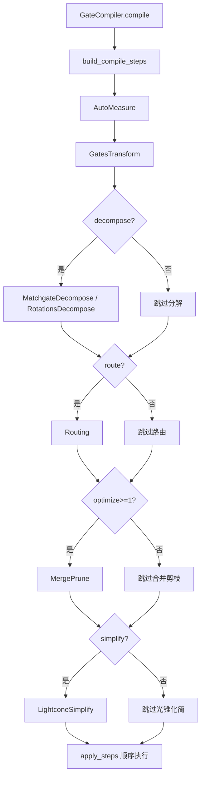
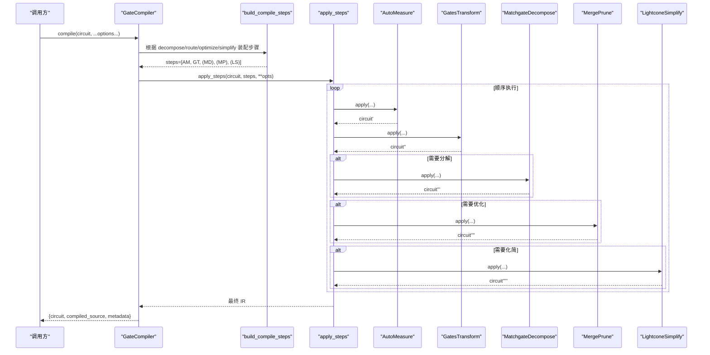
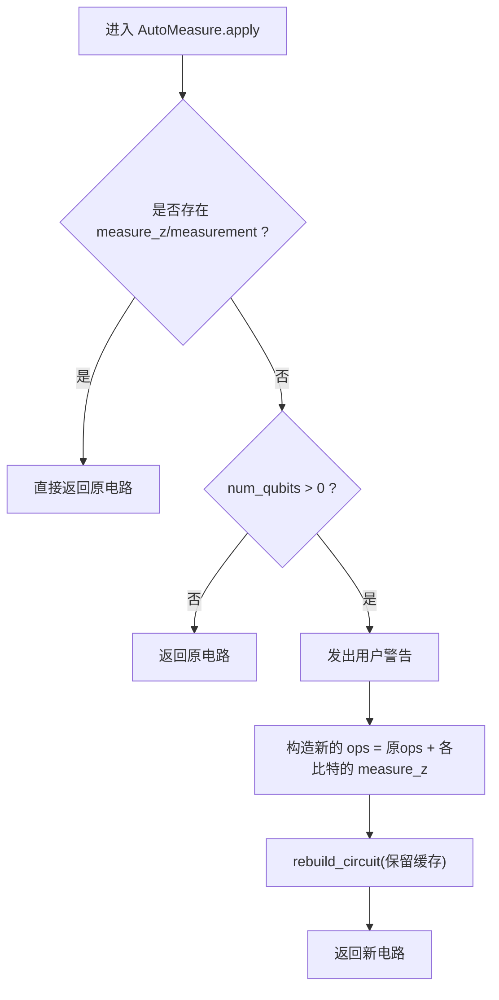
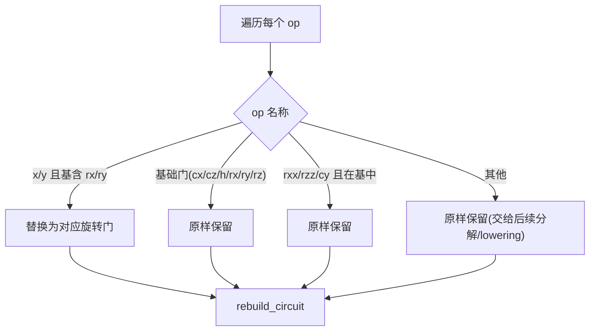
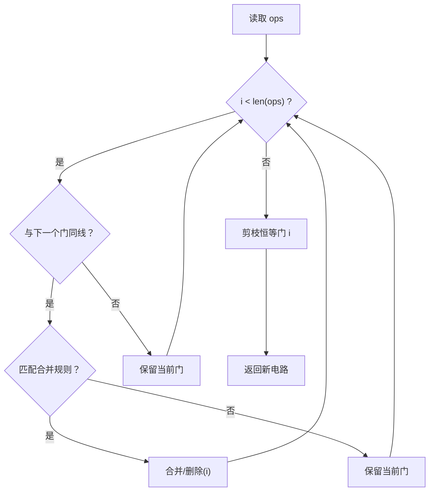
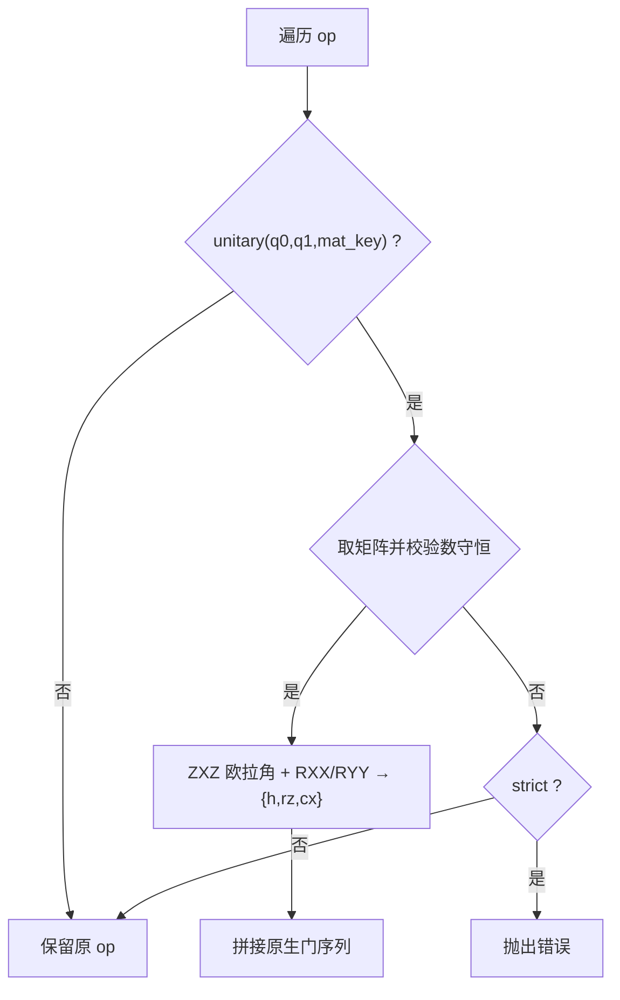
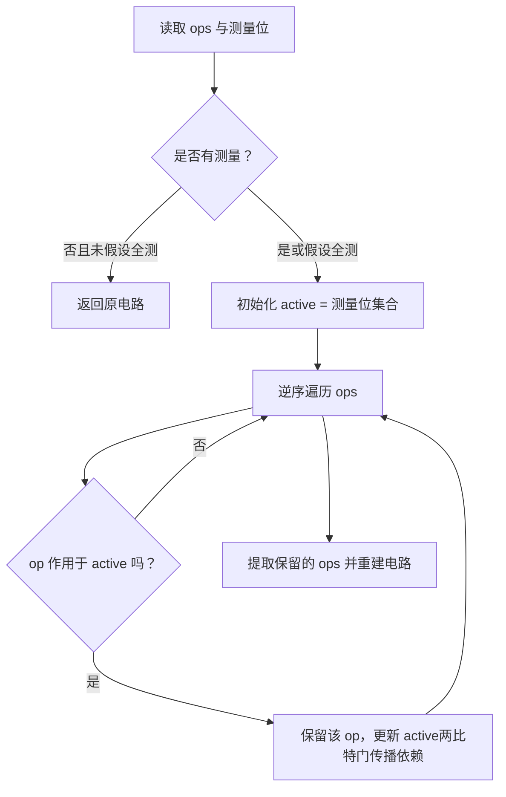
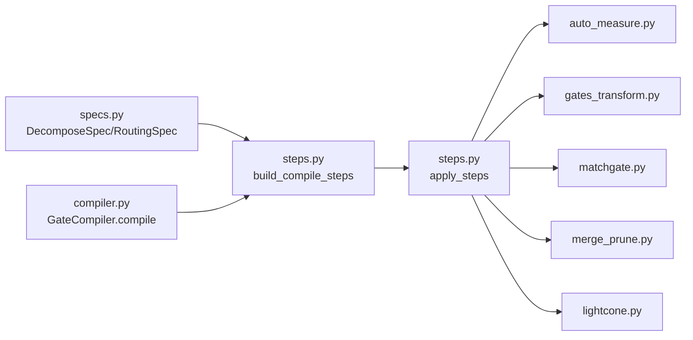

# 电路重写优化

<cite>
**本文引用的文件**
- [gates_transform.py](file://src/tyxonq/compiler/gate_compiler/stages/rewrite/gates_transform.py)
- [merge_prune.py](file://src/tyxonq/compiler/gate_compiler/stages/rewrite/merge_prune.py)
- [auto_measure.py](file://src/tyxonq/compiler/gate_compiler/stages/rewrite/auto_measure.py)
- [matchgate.py](file://src/tyxonq/compiler/gate_compiler/stages/decompose/matchgate.py)
- [lightcone.py](file://src/tyxonq/compiler/gate_compiler/stages/simplify/lightcone.py)
- [steps.py](file://src/tyxonq/compiler/gate_compiler/steps.py)
- [compiler.py](file://src/tyxonq/compiler/gate_compiler/compiler.py)
- [specs.py](file://src/tyxonq/compiler/gate_compiler/specs.py)
- [compiler_lightcone_optimization.py](file://examples/compiler_lightcone_optimization.py)
- [test_compiler_simplify_lightcone.py](file://tests_core_module/test_compiler_simplify_lightcone.py)
</cite>

## 目录
1. [简介](#简介)
2. [项目结构](#项目结构)
3. [核心组件](#核心组件)
4. [架构总览](#架构总览)
5. [详细组件分析](#详细组件分析)
6. [依赖关系分析](#依赖关系分析)
7. [性能考量](#性能考量)
8. [故障排查指南](#故障排查指南)
9. [结论](#结论)
10. [附录：配置与扩展](#附录配置与扩展)

## 简介
本文件系统性阐述 TyxonQ 门级编译器的“电路重写优化”能力，覆盖以下关键技术：
- 门变换（按目标基集规范化）
- 合并与剪枝（相邻同线门合并、恒等门剪枝）
- 自动测量（无显式测量时补全 Z 测量）
- 数守恒两比特 matchgate 分解（fSim 家族到 {rz, rx, h, cx}）
- 光锥化简（基于测量反向切片裁剪无关算符）

同时给出触发条件、应用策略、配置选项、扩展方法，以及重写对性能与精度的影响分析与最佳实践。

## 项目结构
TyxonQ 的门级编译器以“步骤装配 + 顺序执行”的方式组织重写与优化流程。关键位置如下：
- 步骤装配与执行：steps.py
- 统一入口与输出控制：compiler.py
- 规格定义（分解/路由开关与参数）：specs.py
- 重写阶段：
  - 自动测量：stages/rewrite/auto_measure.py
  - 门变换：stages/rewrite/gates_transform.py
  - 合并剪枝：stages/rewrite/merge_prune.py
- 分解阶段：
  - 数守恒两比特 matchgate 分解：stages/decompose/matchgate.py
- 化简阶段：
  - 光锥化简：stages/simplify/lightcone.py
- 示例与测试：
  - 光锥优化示例：examples/compiler_lightcone_optimization.py
  - 光锥单测：tests_core_module/test_compiler_simplify_lightcone.py

图表来源
- [compiler.py:27-73](file://src/tyxonq/compiler/gate_compiler/compiler.py#L27-L73)
- [steps.py:27-91](file://src/tyxonq/compiler/gate_compiler/steps.py#L27-L91)

章节来源
- [compiler.py:14-109](file://src/tyxonq/compiler/gate_compiler/compiler.py#L14-L109)
- [steps.py:1-109](file://src/tyxonq/compiler/gate_compiler/steps.py#L1-L109)

## 核心组件
- 自动测量 AutoMeasure：检测线路是否含显式测量；若无则在所有量子位补 Z 测量，并保留 unitary 缓存。
- 门变换 GatesTransform：按 basis_gates 将 X/Y 映射为旋转门，保留指定门集合中的门，其余交由后续分解或 lowering。
- 合并剪枝 MergePrune：对相邻同线门应用等价规则合并，并删除恒等门。
- 数守恒两比特 matchgate 分解 MatchgateDecompose：识别 fSim/two_mode_fock 类 2-qubit unitary，精确分解为 {rz, rx, h, cx}。
- 光锥化简 LightconeSimplify：从测量点反向追踪依赖，仅保留影响测量的子图，实现零近似误差的裁剪。

章节来源
- [auto_measure.py:13-50](file://src/tyxonq/compiler/gate_compiler/stages/rewrite/auto_measure.py#L13-L50)
- [gates_transform.py:12-50](file://src/tyxonq/compiler/gate_compiler/stages/rewrite/gates_transform.py#L12-L50)
- [merge_prune.py:12-85](file://src/tyxonq/compiler/gate_compiler/stages/rewrite/merge_prune.py#L12-L85)
- [matchgate.py:46-149](file://src/tyxonq/compiler/gate_compiler/stages/decompose/matchgate.py#L46-L149)
- [lightcone.py:12-97](file://src/tyxonq/compiler/gate_compiler/stages/simplify/lightcone.py#L12-L97)

## 架构总览
下图展示 GateCompiler 如何将类型化参数装配为具体步骤，并顺序执行得到优化后的 IR。

图表来源
- [compiler.py:27-109](file://src/tyxonq/compiler/gate_compiler/compiler.py#L27-L109)
- [steps.py:27-105](file://src/tyxonq/compiler/gate_compiler/steps.py#L27-L105)

## 详细组件分析

### 自动测量（AutoMeasure）
- 触发条件：线路 ops/instructions 中不存在任何 measure_z/measurement。
- 行为：在所有量子位追加 measure_z，并发出非致命警告；若已有测量则直接返回原电路。
- 注意事项：使用 rebuild_circuit 重建以保持 _unitary_cache，避免后续分解报错。

图表来源
- [auto_measure.py:27-50](file://src/tyxonq/compiler/gate_compiler/stages/rewrite/auto_measure.py#L27-L50)

章节来源
- [auto_measure.py:13-50](file://src/tyxonq/compiler/gate_compiler/stages/rewrite/auto_measure.py#L13-L50)

### 门变换（GatesTransform）
- 触发条件：始终执行（作为固定第一步）。
- 行为：
  - 将 X→rx(π)、Y→ry(π)，当目标基包含对应旋转门。
  - 保留 cx/cz/h/rx/ry/rz 等基础门。
  - 若基集中显式包含 rxx/rzz/cy，则原样保留。
  - 其他门（含 unitary）原样保留，交由后续分解或 lowering。
- 注意：在 MatchgateDecompose 之前运行，需通过 rebuild_circuit 保留 _unitary_cache。

图表来源
- [gates_transform.py:29-50](file://src/tyxonq/compiler/gate_compiler/stages/rewrite/gates_transform.py#L29-L50)

章节来源
- [gates_transform.py:12-50](file://src/tyxonq/compiler/gate_compiler/stages/rewrite/gates_transform.py#L12-L50)

### 合并与剪枝（MergePrune）
- 触发条件：optimize≥1 时启用。
- 行为：
  - 扫描相邻同线门，按内置等价规则合并（如 s·s→z、t·t→s、x·x→i 等）。
  - 角度型旋转门（rx/rz/ry）合并角度。
  - 生成恒等门 i 后在下一轮剪枝移除。
  - 多轮迭代直至不变。
- 复杂度：线性扫描 + 多轮收敛，通常很快收敛。

图表来源
- [merge_prune.py:40-85](file://src/tyxonq/compiler/gate_compiler/stages/rewrite/merge_prune.py#L40-L85)

章节来源
- [merge_prune.py:12-85](file://src/tyxonq/compiler/gate_compiler/stages/rewrite/merge_prune.py#L12-L85)

### 数守恒两比特 matchgate 分解（MatchgateDecompose）
- 触发条件：decompose=DecomposeSpec(matchgate=True) 或 two_qubit_unitary=True。
- 原理：
  - 判断 4×4 矩阵是否为数守恒 matchgate（跨粒子数子空间耦合为零）。
  - 将 |11> 相位由双比特 Rz 承载，单激发子空间用 ZXZ 欧拉角分解，再映射到 {h, rz, cx}。
  - 零角度块会被剪枝以减少冗余门。
- 严格模式：matchgate_strict=True 时，非 matchgate 的 2-qubit unitary 会抛出异常。

图表来源
- [matchgate.py:46-149](file://src/tyxonq/compiler/gate_compiler/stages/decompose/matchgate.py#L46-L149)
- [matchgate.py:169-197](file://src/tyxonq/compiler/gate_compiler/stages/decompose/matchgate.py#L169-L197)

章节来源
- [matchgate.py:46-149](file://src/tyxonq/compiler/gate_compiler/stages/decompose/matchgate.py#L46-L149)
- [matchgate.py:152-197](file://src/tyxonq/compiler/gate_compiler/stages/decompose/matchgate.py#L152-L197)

### 光锥化简（LightconeSimplify）
- 触发条件：simplify=True。
- 行为：
  - 收集测量位（或 assume_measure_all=True 时视为全部测量）。
  - 从测量位反向切片，沿纠缠门传播依赖，仅保留影响测量的子图。
  - 保持 metadata/instructions/_unitary_cache。
- 效果：对部分测量场景带来显著加速，数学上等价（零近似误差）。

图表来源
- [lightcone.py:15-97](file://src/tyxonq/compiler/gate_compiler/stages/simplify/lightcone.py#L15-L97)

章节来源
- [lightcone.py:12-97](file://src/tyxonq/compiler/gate_compiler/stages/simplify/lightcone.py#L12-L97)

## 依赖关系分析
- 步骤装配器 build_compile_steps 负责按类型化参数组装步骤链，默认顺序为：AutoMeasure → GatesTransform →（可选分解）→（可选路由）→（可选合并剪枝）→（可选光锥化简）。
- GateCompiler 统一处理 options、basis_gates、output 格式选择，并将 device_rule 透传给各步骤。
- specs 提供 DecomposeSpec/RoutingSpec 的类型化开关与默认值，保证“一键开关”与“细粒度控制”并存。

图表来源
- [specs.py:15-58](file://src/tyxonq/compiler/gate_compiler/specs.py#L15-L58)
- [steps.py:27-91](file://src/tyxonq/compiler/gate_compiler/steps.py#L27-L91)
- [compiler.py:27-73](file://src/tyxonq/compiler/gate_compiler/compiler.py#L27-L73)

章节来源
- [specs.py:1-103](file://src/tyxonq/compiler/gate_compiler/specs.py#L1-L103)
- [steps.py:1-109](file://src/tyxonq/compiler/gate_compiler/steps.py#L1-L109)
- [compiler.py:14-109](file://src/tyxonq/compiler/gate_compiler/compiler.py#L14-L109)

## 性能考量
- 自动测量：仅在必要时添加测量，避免重复测量导致的开销。
- 门变换：最小重写，尽量推迟到分解阶段，减少不必要的展开。
- 合并剪枝：消除冗余门与恒等门，降低噪声与执行时间。
- matchgate 分解：对数守恒 2-qubit unitary 进行精确分解，零角度块剪枝减少 CX 数量。
- 光锥化简：对部分测量场景可带来指数级加速（仅仿真/计算相关子图），且数学等价。

[本节为通用指导，不直接分析具体文件]

## 故障排查指南
- 缺少矩阵缓存导致分解失败：
  - 现象：matchgate 分解报“缺少矩阵缓存”。
  - 原因：前置步骤重建电路时丢失了 _unitary_cache。
  - 解决：确保使用 rebuild_circuit 重建（AutoMeasure/GatesTransform/LightconeSimplify 均已采用此方式）。
- 非数守恒 2-qubit unitary 无法分解：
  - 现象：matchgate 分解抛出“不支持的 unitary”或严格模式下报错。
  - 解决：关闭 matchgate 分解或使用更通用的分解路径；或在已知场景开启 strict 以尽早发现错误。
- 自动测量重复：
  - 现象：已存在 measurement instruction 但被再次补测。
  - 解决：AutoMeasure 已检查 instructions 中的 measure，避免重复；若仍出现，检查上层是否自行插入了测量。
- 光锥化简误删：
  - 现象：期望保留的算符被裁剪。
  - 解决：确认测量位是否正确标记；必要时使用 assume_measure_all 验证等价性。

章节来源
- [auto_measure.py:27-50](file://src/tyxonq/compiler/gate_compiler/stages/rewrite/auto_measure.py#L27-L50)
- [matchgate.py:169-197](file://src/tyxonq/compiler/gate_compiler/stages/decompose/matchgate.py#L169-L197)
- [lightcone.py:15-97](file://src/tyxonq/compiler/gate_compiler/stages/simplify/lightcone.py#L15-L97)

## 结论
TyxonQ 的门级重写优化以“步骤化、类型化、可扩展”为核心设计：
- 自动测量保障下游流程一致性；
- 门变换最小化重写，配合分解阶段完成基集落地；
- 合并剪枝消除冗余，提升真机质量；
- matchgate 分解提供物理意义明确的精确降门；
- 光锥化简在不损失精度的前提下显著降低计算成本。
合理组合这些步骤，可在不同硬件与算法场景下取得稳定、高效、可复现的编译结果。

[本节为总结性内容，不直接分析具体文件]

## 附录：配置与扩展

### 配置选项
- GateCompiler.compile 的关键参数：
  - basis_gates：目标基集（None 时使用 GatesTransform 默认；QASM2 输出时自动降级到 qelib1 兼容集）。
  - decompose：bool 或 DecomposeSpec，控制 matchgate/rotations/two_qubit_unitary。
  - route：bool 或 RoutingSpec，控制布局/路由（默认关闭）。
  - optimize：整数级别，≥1 启用 MergePrune。
  - simplify：布尔，启用 LightconeSimplify。
  - device_rule：设备能力描述（耦合图等）。
  - options.output：ir/qasm2/qasm3/qiskit 等输出格式。
- 步骤装配与执行：
  - build_compile_steps：按参数装配步骤列表。
  - apply_steps：顺序执行步骤链。

章节来源
- [compiler.py:27-109](file://src/tyxonq/compiler/gate_compiler/compiler.py#L27-L109)
- [specs.py:15-58](file://src/tyxonq/compiler/gate_compiler/specs.py#L15-L58)
- [steps.py:27-91](file://src/tyxonq/compiler/gate_compiler/steps.py#L27-L91)

### 自定义重写规则的扩展方法
- 新增合并规则：
  - 在 MergePrune 中扩展 rules 字典，传入自定义规则即可生效。
- 自定义门变换：
  - 继承或复用 GatesTransform 逻辑，调整 basis_gates 与保留门集合。
- 自定义分解：
  - 参考 MatchgateDecompose，实现新的分解步骤并在 build_compile_steps 中按需插入。
- 自定义化简：
  - 参考 LightconeSimplify，实现新的依赖分析/裁剪策略，并通过 simplify 开关接入。

章节来源
- [merge_prune.py:35-38](file://src/tyxonq/compiler/gate_compiler/stages/rewrite/merge_prune.py#L35-L38)
- [gates_transform.py:29-50](file://src/tyxonq/compiler/gate_compiler/stages/rewrite/gates_transform.py#L29-L50)
- [matchgate.py:152-197](file://src/tyxonq/compiler/gate_compiler/stages/decompose/matchgate.py#L152-L197)
- [lightcone.py:12-97](file://src/tyxonq/compiler/gate_compiler/stages/simplify/lightcone.py#L12-L97)

### 代码示例与对比（路径引用）
- 光锥优化示例（构建电路、启用/禁用 lightcone、对比性能与正确性）：
  - [compiler_lightcone_optimization.py](file://examples/compiler_lightcone_optimization.py)
- 光锥化简单测（验证裁剪、assume_measure_all、多测量传播、reset/project 保留）：
  - [test_compiler_simplify_lightcone.py](file://tests_core_module/test_compiler_simplify_lightcone.py)

章节来源
- [compiler_lightcone_optimization.py:61-94](file://examples/compiler_lightcone_optimization.py#L61-L94)
- [compiler_lightcone_optimization.py:201-255](file://examples/compiler_lightcone_optimization.py#L201-L255)
- [test_compiler_simplify_lightcone.py:8-76](file://tests_core_module/test_compiler_simplify_lightcone.py#L8-L76)