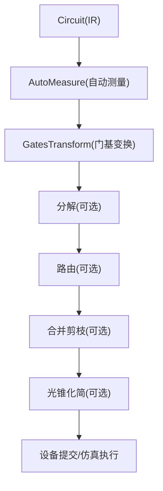
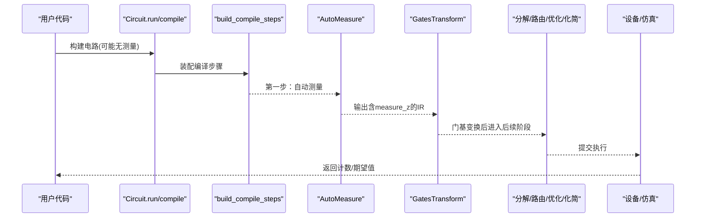
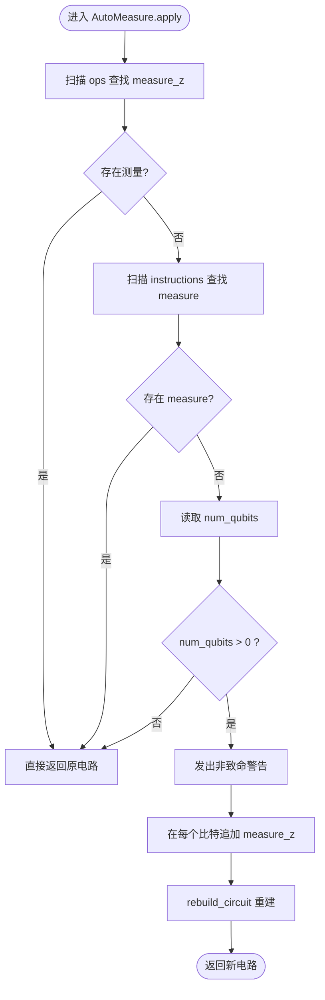
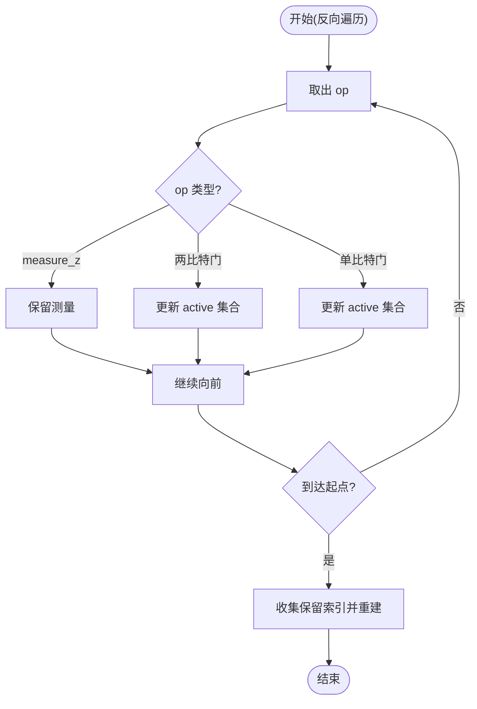
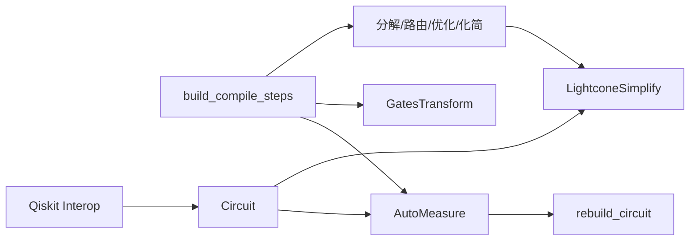

# 自动测量优化

<cite>
**本文引用的文件**
- [auto_measure.py](file://src/tyxonq/compiler/gate_compiler/stages/rewrite/auto_measure.py)
- [steps.py](file://src/tyxonq/compiler/gate_compiler/steps.py)
- [compiler.py](file://src/tyxonq/compiler/gate_compiler/compiler.py)
- [circuit.py](file://src/tyxonq/core/ir/circuit.py)
- [lightcone.py](file://src/tyxonq/compiler/gate_compiler/stages/simplify/lightcone.py)
- [gates_transform.py](file://src/tyxonq/compiler/gate_compiler/stages/rewrite/gates_transform.py)
- [qiskit_interop.py](file://src/tyxonq/compiler/gate_compiler/interop/qiskit_interop.py)
- [test_compiler_pipeline.py](file://tests_core_module/test_compiler_pipeline.py)
</cite>

## 目录
1. [简介](#简介)
2. [项目结构](#项目结构)
3. [核心组件](#核心组件)
4. [架构总览](#架构总览)
5. [详细组件分析](#详细组件分析)
6. [依赖关系分析](#依赖关系分析)
7. [性能考量](#性能考量)
8. [故障排查指南](#故障排查指南)
9. [结论](#结论)
10. [附录：配置与示例对照](#附录配置与示例对照)

## 简介
本文件系统性阐述 TyxonQ 的“自动测量优化”能力，重点解释自动测量插入算法的实现原理、测量点识别、测量依赖分析与位置优化策略；说明何时需要插入测量操作、如何保证正确性与效率，以及测量与后续操作的依赖关系处理。同时给出控制自动测量行为的配置选项，并通过“自动测量前后电路对比”的代码片段路径展示典型场景。最后分析自动测量对量子态演化与结果获取的影响。

## 项目结构
TyxonQ 将自动测量作为编译管线中的“规范化”阶段之一，位于门基变换之前，确保后续分解、路由、优化与化简步骤在统一的 IR 上进行。关键文件与职责如下：
- 自动测量重写器：负责检测并补全缺失的 Z 基测量
- 编译步骤装配器：按固定顺序组装 AutoMeasure、GatesTransform、分解、路由、优化、化简等步骤
- 编译器入口：统一参数归一化并调用步骤装配与执行
- 电路 IR：提供测量指令、绘制时自动补测、运行时的编译与提交流程
- 光锥化简：基于测量依赖反向切片，剔除不影响结果的无关操作
- Qiskit 互操作：从 Qiskit 提取测量映射，保障逻辑比特与物理比特的一致性

图表来源
- [steps.py:27-91](file://src/tyxonq/compiler/gate_compiler/steps.py#L27-L91)
- [compiler.py:57-74](file://src/tyxonq/compiler/gate_compiler/compiler.py#L57-L74)

章节来源
- [steps.py:27-91](file://src/tyxonq/compiler/gate_compiler/steps.py#L27-L91)
- [compiler.py:57-74](file://src/tyxonq/compiler/gate_compiler/compiler.py#L57-L74)

## 核心组件
- 自动测量重写器（AutoMeasure）
  - 功能：当线路不含显式测量时，在所有比特上补 Z 基测量；若已存在测量则跳过；使用 rebuild_circuit 避免丢失缓存
  - 行为：检查 ops 与 instructions 中的测量；发出非致命警告；返回新电路
- 编译步骤装配器（build_compile_steps）
  - 固定顺序：AutoMeasure → GatesTransform → 分解 → 路由 → MergePrune → LightconeSimplify
  - 通过类型化参数控制是否启用各阶段
- 编译器入口（compile/apply_steps）
  - 归一化 optimization_level，装配步骤并顺序执行
- 电路 IR（Circuit）
  - 提供 measure_z、add_measure、draw(to_qiskit add_measures=True)、run 等接口
  - run 中不补测量，归属编译阶段
- 光锥化简（LightconeSimplify）
  - 基于测量依赖反向切片，保留影响测量的操作，剔除冗余
- Qiskit 互操作
  - 从 Qiskit 提取测量顺序到逻辑比特的映射，用于结果对齐

章节来源
- [auto_measure.py:13-50](file://src/tyxonq/compiler/gate_compiler/stages/rewrite/auto_measure.py#L13-L50)
- [steps.py:27-91](file://src/tyxonq/compiler/gate_compiler/steps.py#L27-L91)
- [compiler.py:57-74](file://src/tyxonq/compiler/gate_compiler/compiler.py#L57-L74)
- [circuit.py:853-1042](file://src/tyxonq/core/ir/circuit.py#L853-L1042)
- [lightcone.py:38-97](file://src/tyxonq/compiler/gate_compiler/stages/simplify/lightcone.py#L38-L97)
- [qiskit_interop.py:109-122](file://src/tyxonq/compiler/gate_compiler/interop/qiskit_interop.py#L109-L122)

## 架构总览
下图展示了自动测量在编译管线中的位置及其与后续阶段的交互关系。

图表来源
- [steps.py:27-91](file://src/tyxonq/compiler/gate_compiler/steps.py#L27-L91)
- [compiler.py:57-74](file://src/tyxonq/compiler/gate_compiler/compiler.py#L57-L74)
- [auto_measure.py:27-50](file://src/tyxonq/compiler/gate_compiler/stages/rewrite/auto_measure.py#L27-L50)

## 详细组件分析

### 自动测量插入算法
- 测量点识别
  - 扫描 ops 列表，判断是否存在 ("measure_z", q) 形式的测量
  - 同时检查 instructions 中的 "measure" 指令，避免重复补测
- 插入策略
  - 若无任何测量且 num_qubits > 0，则在每个比特上追加 ("measure_z", q)
  - 使用 rebuild_circuit 重建，以保留 metadata/instructions/_unitary_cache
- 依赖与副作用
  - 仅添加 Z 基测量，不改变前置门的语义
  - 发出非致命警告提示用户
- 复杂度
  - 线性扫描 ops 与 instructions，时间复杂度 O(N)，空间复杂度 O(Q)（Q 为比特数）

图表来源
- [auto_measure.py:27-50](file://src/tyxonq/compiler/gate_compiler/stages/rewrite/auto_measure.py#L27-L50)

章节来源
- [auto_measure.py:27-50](file://src/tyxonq/compiler/gate_compiler/stages/rewrite/auto_measure.py#L27-L50)

### 测量依赖分析与位置优化
- 依赖分析
  - 光锥化简从测量点出发，反向遍历 ops，维护活跃比特集合 active
  - 遇到 entangling gate（如 cx/cz/rxx/ryy/rzz）时，传播依赖到两比特
  - 遇到 measure_z 时，始终保留该测量
- 位置优化
  - 仅保留影响最终测量的操作，剔除无关前驱
  - 通过 rebuild_circuit 重建，保留缓存与元数据
- 与自动测量的协同
  - AutoMeasure 先补齐所有比特的 Z 测量，LightconeSimplify 再根据实际依赖裁剪，达到“最小必要测量集”的效果

图表来源
- [lightcone.py:38-97](file://src/tyxonq/compiler/gate_compiler/stages/simplify/lightcone.py#L38-L97)

章节来源
- [lightcone.py:38-97](file://src/tyxonq/compiler/gate_compiler/stages/simplify/lightcone.py#L38-L97)

### 何时需要插入测量操作
- 默认编译流程会在“规范化”阶段自动补测，适用于以下场景：
  - 用户未显式添加 measure_z 或 add_measure
  - 通过 draw(to_qiskit) 导出时也会自动补测，便于可视化
- 不需要插入的场景：
  - 线路已包含 measure_z 或 instructions 中存在 measure
  - 纯数值路径（statevector/MPS）计算期望值时，通常无需硬件测量

章节来源
- [auto_measure.py:27-50](file://src/tyxonq/compiler/gate_compiler/stages/rewrite/auto_measure.py#L27-L50)
- [circuit.py:1970-1989](file://src/tyxonq/core/ir/circuit.py#L1970-L1989)

### 测量与后续操作的依赖关系处理
- 门基变换（GatesTransform）
  - 将部分门替换为目标基集（如 x→rx(pi), y→ry(pi)），不影响测量语义
- 分解/路由/优化
  - 分解优先于路由，确保 to_qiskit 能正确处理 unitary 操作
  - 路由仅在启用时插入 SWAP 等布局相关操作
  - MergePrune 合并相邻可消去门，减少开销
- 光锥化简
  - 依据测量依赖裁剪无关操作，提升执行效率

章节来源
- [gates_transform.py:27-50](file://src/tyxonq/compiler/gate_compiler/stages/rewrite/gates_transform.py#L27-L50)
- [steps.py:56-91](file://src/tyxonq/compiler/gate_compiler/steps.py#L56-L91)
- [lightcone.py:38-97](file://src/tyxonq/compiler/gate_compiler/stages/simplify/lightcone.py#L38-L97)

### 自动测量对量子态演化和结果获取的影响
- 量子态演化
  - 自动插入的是 Z 基投影测量，会坍缩对应比特的量子态
  - 对于多比特纠缠态，局部测量会影响全局关联统计
- 结果获取
  - 设备路径返回 counts，配合 postprocessing 得到期望值
  - 数值路径可直接计算期望值，无需测量；但 draw/to_qiskit 仍会补测以便可视化
- 一致性
  - 通过光锥化简与测量分组元数据，保证跨设备一致性与可复现性

章节来源
- [circuit.py:853-1042](file://src/tyxonq/core/ir/circuit.py#L853-L1042)
- [whitepaper.rst:40-80](file://docs/source/technical_references/whitepaper.rst#L40-L80)

## 依赖关系分析
- 组件耦合
  - AutoMeasure 依赖 Circuit IR 的 ops/instructions 结构与 rebuild_circuit
  - build_compile_steps 组合多个阶段，形成强顺序依赖
  - LightconeSimplify 依赖测量点信息，进行反向依赖切片
- 外部依赖
  - Qiskit 互操作用于绘制与测量映射
  - 设备驱动通过 device_base.run 提交任务

图表来源
- [auto_measure.py:27-50](file://src/tyxonq/compiler/gate_compiler/stages/rewrite/auto_measure.py#L27-L50)
- [steps.py:56-91](file://src/tyxonq/compiler/gate_compiler/steps.py#L56-L91)
- [lightcone.py:38-97](file://src/tyxonq/compiler/gate_compiler/stages/simplify/lightcone.py#L38-L97)
- [qiskit_interop.py:109-122](file://src/tyxonq/compiler/gate_compiler/interop/qiskit_interop.py#L109-L122)

章节来源
- [steps.py:56-91](file://src/tyxonq/compiler/gate_compiler/steps.py#L56-L91)
- [compiler.py:57-74](file://src/tyxonq/compiler/gate_compiler/compiler.py#L57-L74)

## 性能考量
- 插入成本
  - AutoMeasure 线性扫描，开销极低；仅在首次编译时生效
- 裁剪收益
  - LightconeSimplify 显著减少无关操作，降低执行时间与内存占用
- 缓存利用
  - 使用 rebuild_circuit 保留 _unitary_cache，避免重复分解与矩阵计算
- 并行与批处理
  - 设备层支持批量任务提交；postprocessing 统一处理 counts/expectations

[本节为通用指导，不直接分析具体文件]

## 故障排查指南
- 重复测量问题
  - 若 instructions 中已有 measure，AutoMeasure 不会再次补测；若出现重复，请检查上层是否手动添加了 measure 指令
- 缺少矩阵缓存报错
  - 自定义酉门需保持 _unitary_cache；AutoMeasure 使用 rebuild_circuit 以避免丢失缓存
- 测量顺序不一致
  - 使用 Qiskit 互操作的 positional_logical_mapping 确保测量顺序与逻辑比特一致
- 拓扑发现失败
  - lqcloud 平台拓扑发现失败会回退直译，不影响基本执行；可在 device_rule 中显式提供 coupling_map

章节来源
- [auto_measure.py:27-50](file://src/tyxonq/compiler/gate_compiler/stages/rewrite/auto_measure.py#L27-L50)
- [qiskit_interop.py:109-122](file://src/tyxonq/compiler/gate_compiler/interop/qiskit_interop.py#L109-L122)
- [circuit.py:895-917](file://src/tyxonq/core/ir/circuit.py#L895-L917)

## 结论
TyxonQ 的自动测量优化将“测量补全”置于编译管线的规范化阶段，结合光锥化简实现“最小必要测量集”，在保证正确性的前提下显著提升执行效率。通过类型化参数控制各阶段开关，用户可灵活定制编译行为，适配不同设备与算法需求。

[本节为总结，不直接分析具体文件]

## 附录：配置与示例对照
- 配置选项
  - decompose：控制分解阶段（matchgate/rotations）
  - route：控制路由阶段（qiskit.transpile 委托）
  - optimize：优化级别（>=1 启用 MergePrune）
  - simplify：是否启用 LightconeSimplify
  - basis_gates：目标基集（透传给 GatesTransform）
- 自动测量前后电路对比（代码片段路径）
  - 无测量线路经 AutoMeasure 后，每个比特追加 measure_z
  - 参考测试用例验证步骤顺序与产物
- 测量依赖与结果对齐
  - 使用 Qiskit 互操作提取测量顺序映射，保证结果与逻辑比特一致

章节来源
- [steps.py:27-91](file://src/tyxonq/compiler/gate_compiler/steps.py#L27-L91)
- [test_compiler_pipeline.py:66-103](file://tests_core_module/test_compiler_pipeline.py#L66-L103)
- [qiskit_interop.py:109-122](file://src/tyxonq/compiler/gate_compiler/interop/qiskit_interop.py#L109-L122)