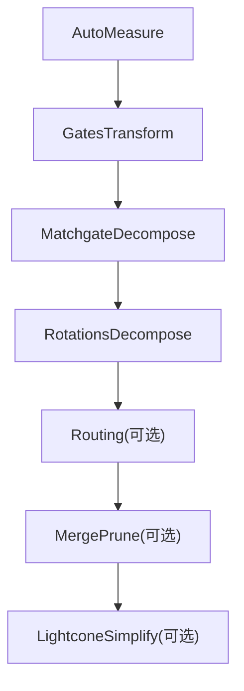
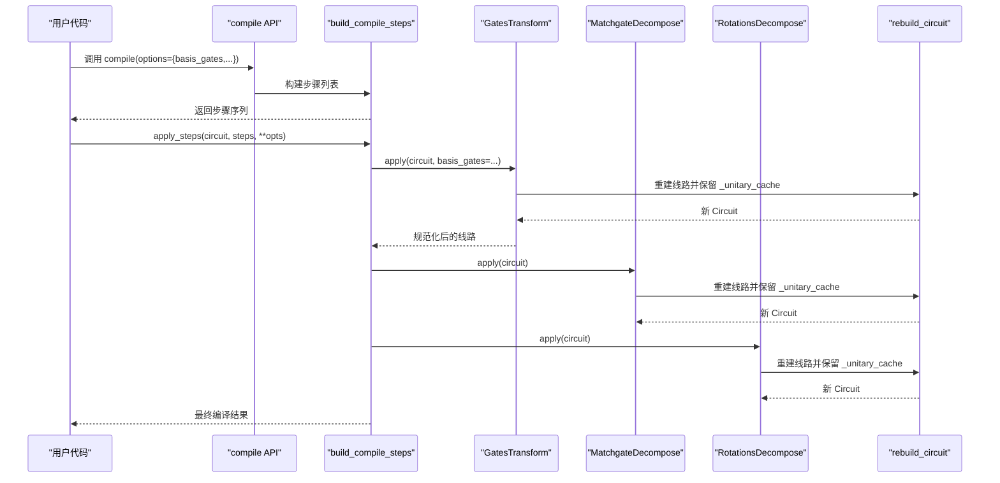
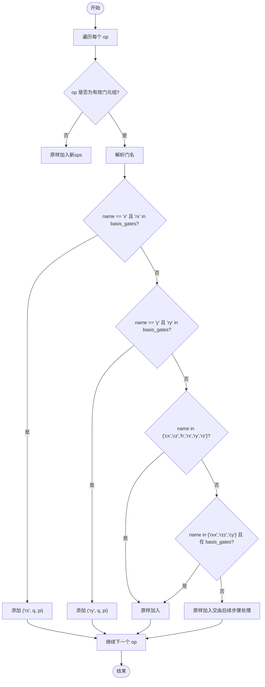
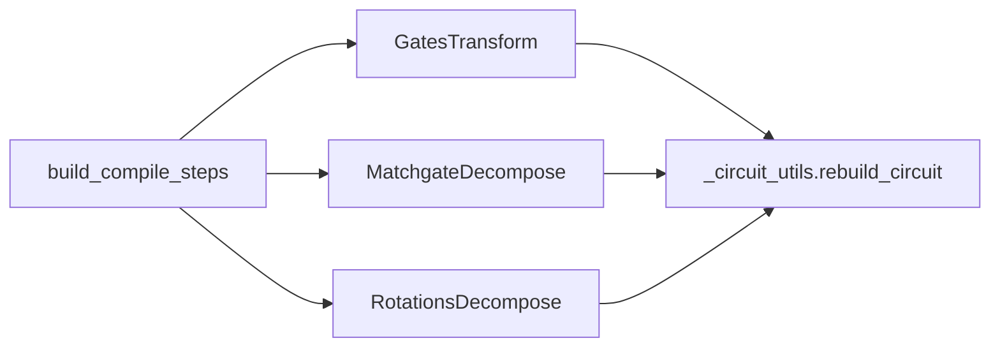

# 门变换优化

<cite>
**本文引用的文件**
- [gates_transform.py](file://src/tyxonq/compiler/gate_compiler/stages/rewrite/gates_transform.py)
- [steps.py](file://src/tyxonq/compiler/gate_compiler/steps.py)
- [matchgate.py](file://src/tyxonq/compiler/gate_compiler/stages/decompose/matchgate.py)
- [rotations.py](file://src/tyxonq/compiler/gate_compiler/stages/decompose/rotations.py)
- [_circuit_utils.py](file://src/tyxonq/compiler/gate_compiler/_circuit_utils.py)
- [compiler.py](file://src/tyxonq/compiler/gate_compiler/compiler.py)
- [api.py](file://src/tyxonq/compiler/api.py)
- [test_decompose_matchgate.py](file://tests_core_module/test_decompose_matchgate.py)
- [test_decompose_rotations.py](file://tests_core_module/test_decompose_rotations.py)
- [circuit_compiler.py](file://examples/circuit_compiler.py)
</cite>

## 目录
1. [简介](#简介)
2. [项目结构](#项目结构)
3. [核心组件](#核心组件)
4. [架构总览](#架构总览)
5. [详细组件分析](#详细组件分析)
6. [依赖关系分析](#依赖关系分析)
7. [性能考量](#性能考量)
8. [故障排查指南](#故障排查指南)
9. [结论](#结论)
10. [附录](#附录)

## 简介
本文件聚焦 TyxonQ 编译流水线中的“门变换优化”步骤，围绕 GatesTransform 类展开，系统解释其实现原理、配置方式与在整体编译流程中的位置与时机。重点包括：
- basis_gates 配置如何影响门替换规则
- X/Y 到 RX/RY 的转换逻辑
- CX/CZ/H/RX/RY/RZ 的保留策略，以及 RXX/RZZ/CY 的条件保留
- _unitary_cache 的重要性及其对后续分解步骤的影响
- 如何在编译选项中自定义门集合
- 通过测试与示例展示变换前后的电路对比
- 该步骤在整个编译管线中的顺序与作用

## 项目结构
门变换优化位于 gate_compiler 子系统的 rewrite 阶段，作为编译步骤链的早期规范化步骤之一，紧随 AutoMeasure 之后，并在 MatchgateDecompose 之前执行。相关核心文件如下：
- gates_transform.py：实现 GatesTransform 的门重写逻辑
- steps.py：装配编译步骤序列（包含 GatesTransform）
- matchgate.py：后续分解步骤，依赖 _unitary_cache
- rotations.py：旋转门进一步分解为原生集
- _circuit_utils.py：提供 rebuild_circuit，确保重建时保留 _unitary_cache
- compiler.py / api.py：暴露 compile API 并透传 basis_gates 等选项

图表来源
- [steps.py:27-91](file://src/tyxonq/compiler/gate_compiler/steps.py#L27-L91)

章节来源
- [steps.py:27-91](file://src/tyxonq/compiler/gate_compiler/steps.py#L27-L91)

## 核心组件
- GatesTransform：按 basis_gates 进行最小化门重写，将 X/Y 映射为 RX/RY（当目标集合包含对应旋转），并选择性保留部分双量子比特门（RXX/RZZ/CY）。
- MatchgateDecompose：将数守恒的 2-qubit unitary（matchgate）分解为原生门集 {rz, rx, h, cx}，依赖 _unitary_cache。
- RotationsDecompose：将参数化旋转门（RX/RY/RXX/RYY/RZZ）进一步分解到 {H, RZ, CX}。
- rebuild_circuit：统一重建线路并保留 _unitary_cache，避免后续步骤因缺失矩阵缓存而失败。

章节来源
- [gates_transform.py:12-50](file://src/tyxonq/compiler/gate_compiler/stages/rewrite/gates_transform.py#L12-L50)
- [matchgate.py:152-197](file://src/tyxonq/compiler/gate_compiler/stages/decompose/matchgate.py#L152-L197)
- [rotations.py:13-73](file://src/tyxonq/compiler/gate_compiler/stages/decompose/rotations.py#L13-L73)
- [_circuit_utils.py:28-72](file://src/tyxonq/compiler/gate_compiler/_circuit_utils.py#L28-L72)

## 架构总览
下图展示了门变换优化在编译流水线中的位置，以及与后续分解步骤的交互关系。

图表来源
- [steps.py:27-105](file://src/tyxonq/compiler/gate_compiler/steps.py#L27-L105)
- [gates_transform.py:29-50](file://src/tyxonq/compiler/gate_compiler/stages/rewrite/gates_transform.py#L29-L50)
- [matchgate.py:169-197](file://src/tyxonq/compiler/gate_compiler/stages/decompose/matchgate.py#L169-L197)
- [rotations.py:29-73](file://src/tyxonq/compiler/gate_compiler/stages/decompose/rotations.py#L29-L73)
- [_circuit_utils.py:28-72](file://src/tyxonq/compiler/gate_compiler/_circuit_utils.py#L28-L72)

## 详细组件分析

### GatesTransform：门重写规则与电路重建
- 输入：Circuit 对象与可选的 basis_gates（默认 ["h","rx","rz","cx","cz"]）
- 处理逻辑：
  - 遍历 ops，若 op 是元组/列表且非空，则解析门名
  - 若门名为 x 且 "rx" 在 basis_gates 中，替换为 rx(pi)
  - 若门名为 y 且 "ry" 在 basis_gates 中，替换为 ry(pi)
  - 原样保留：cx、cz、h、rx、ry、rz
  - 条件保留：rxx/rzz/cy，仅当它们显式出现在 basis_gates 中时才原样保留；否则进入 else 分支原样保留（交由后续分解或 lowering 处理）
  - 其他门（含 unitary）原样保留
- 输出：通过 rebuild_circuit 重建线路，确保 _unitary_cache 被复制，避免后续 MatchgateDecompose 因缺少矩阵缓存报错

图表来源
- [gates_transform.py:29-50](file://src/tyxonq/compiler/gate_compiler/stages/rewrite/gates_transform.py#L29-L50)

章节来源
- [gates_transform.py:12-50](file://src/tyxonq/compiler/gate_compiler/stages/rewrite/gates_transform.py#L12-L50)

### 门替换规则详解
- X → RX(π)：当目标集合包含 "rx" 时执行替换
- Y → RY(π)：当目标集合包含 "ry" 时执行替换
- 保留集合：CX、CZ、H、RX、RY、RZ 始终原样保留
- 条件保留：RXX、RZZ、CY 仅在 basis_gates 显式包含时原样保留；否则进入通用分支原样保留（由后续分解或设备 lowering 决定）
- 其他门（如 unitary）原样保留，保证灵活性

章节来源
- [gates_transform.py:29-50](file://src/tyxonq/compiler/gate_compiler/stages/rewrite/gates_transform.py#L29-L50)

### _unitary_cache 的重要性
- 背景：Circuit 的 dataclass 字段不包含 _unitary_cache，因此直接 replace 或构造不会自动携带该缓存
- 风险：若丢失 _unitary_cache，后续 MatchgateDecompose 在查找矩阵时会抛出“缺少矩阵缓存”错误
- 解决：所有重写步骤统一使用 rebuild_circuit，确保在新线路中复制 _unitary_cache
- 影响：GatesTransform、MatchgateDecompose、RotationsDecompose 均通过 rebuild_circuit 保持缓存一致性

章节来源
- [_circuit_utils.py:1-72](file://src/tyxonq/compiler/gate_compiler/_circuit_utils.py#L1-L72)
- [matchgate.py:169-197](file://src/tyxonq/compiler/gate_compiler/stages/decompose/matchgate.py#L169-L197)

### 配置选项与自定义门集合
- 通过 compile API 的 options.basis_gates 传入自定义门集合
- 默认 basis_gates：["h","rx","rz","cx","cz"]
- 平台方言可能覆盖默认值（例如某些平台偏好特定门集）
- 示例：在 compile 调用中指定 basis_gates=["cx","cz","h","rz"]

章节来源
- [api.py:44-224](file://src/tyxonq/compiler/api.py#L44-L224)
- [compiler.py:31-66](file://src/tyxonq/compiler/gate_compiler/compiler.py#L31-L66)
- [circuit_compiler.py:20-51](file://examples/circuit_compiler.py#L20-L51)

### 在编译流水线中的位置与时机
- 固定顺序：AutoMeasure → GatesTransform → MatchgateDecompose → RotationsDecompose → Routing（可选）→ MergePrune（可选）→ LightconeSimplify（可选）
- GatesTransform 在 MatchgateDecompose 之前执行，确保后续分解能正确访问 _unitary_cache
- 该步骤属于“规范化”阶段，目标是使门集合尽可能贴近目标 basis_gates，同时最小化重写范围

章节来源
- [steps.py:27-91](file://src/tyxonq/compiler/gate_compiler/steps.py#L27-L91)

## 依赖关系分析
- GatesTransform 依赖 rebuild_circuit 以保留 _unitary_cache
- MatchgateDecompose 依赖 _unitary_cache 进行矩阵匹配与分解
- RotationsDecompose 依赖标准恒等式将旋转门分解到 {H, RZ, CX}
- 编译步骤装配由 build_compile_steps 管理，控制各阶段的启用与顺序

图表来源
- [steps.py:27-91](file://src/tyxonq/compiler/gate_compiler/steps.py#L27-L91)
- [_circuit_utils.py:28-72](file://src/tyxonq/compiler/gate_compiler/_circuit_utils.py#L28-L72)

章节来源
- [steps.py:27-91](file://src/tyxonq/compiler/gate_compiler/steps.py#L27-L91)
- [_circuit_utils.py:28-72](file://src/tyxonq/compiler/gate_compiler/_circuit_utils.py#L28-L72)

## 性能考量
- 最小重写原则：仅对 X/Y 进行必要替换，其余门尽量原样保留，减少不必要的门展开
- 零角度剪枝：在后续分解步骤中，零角度块会被跳过，减少冗余门
- 缓存复用：通过 _unitary_cache 避免重复计算矩阵，提升分解效率
- 可组合性：条件保留 RXX/RZZ/CY 允许设备层进一步优化或映射

[本节为一般性指导，不直接分析具体文件]

## 故障排查指南
- 现象：MatchgateDecompose 报“缺少矩阵缓存”
  - 原因：上游步骤未通过 rebuild_circuit 保留 _unitary_cache
  - 解决：确保所有重写步骤使用 rebuild_circuit 重建线路
- 现象：期望的门未被替换
  - 检查：basis_gates 是否包含 "rx"/"ry"；若不含，则 X/Y 不会被替换
- 现象：RXX/RZZ/CY 未按预期保留
  - 检查：basis_gates 是否显式包含这些门；若不包含，将进入通用分支由后续步骤处理

章节来源
- [test_decompose_matchgate.py:175-210](file://tests_core_module/test_decompose_matchgate.py#L175-L210)
- [gates_transform.py:29-50](file://src/tyxonq/compiler/gate_compiler/stages/rewrite/gates_transform.py#L29-L50)

## 结论
GatesTransform 是 TyxonQ 编译流水线中的关键规范化步骤，通过最小化重写策略将 X/Y 转换为 RX/RY，并根据 basis_gates 选择性保留双量子比特门。配合 rebuild_circuit 对 _unitary_cache 的统一管理，确保了后续分解步骤的正确性与稳定性。通过灵活的 basis_gates 配置，用户可以定制目标门集合，满足不同设备或算法的需求。

[本节为总结性内容，不直接分析具体文件]

## 附录

### 配置与使用示例
- 在 compile 调用中设置 basis_gates：
  - 参考示例：在 circuit_compiler.py 中演示不同优化级别与 basis_gates 的使用
- 自定义门集合：
  - 可通过 options.basis_gates 传入任意门集合，GatesTransform 会据此调整替换与保留策略

章节来源
- [circuit_compiler.py:20-51](file://examples/circuit_compiler.py#L20-L51)
- [api.py:44-224](file://src/tyxonq/compiler/api.py#L44-L224)

### 测试验证要点
- 数值等价：RotationsDecompose 将旋转门分解到 {H, RZ, CX}，并通过数值测试验证等价性
- 结构不变量：分解后仅包含原生门集
- 缓存保留：MatchgateDecompose 必须保留 _unitary_cache，否则后续步骤失败

章节来源
- [test_decompose_rotations.py:75-114](file://tests_core_module/test_decompose_rotations.py#L75-L114)
- [test_decompose_matchgate.py:154-210](file://tests_core_module/test_decompose_matchgate.py#L154-L210)