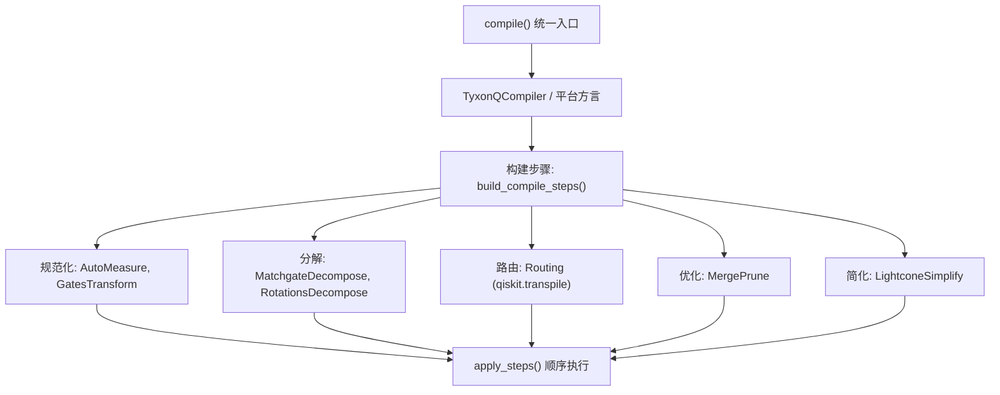
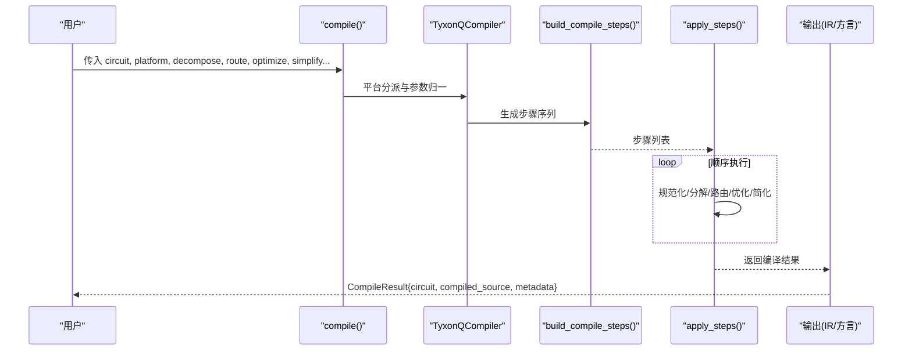
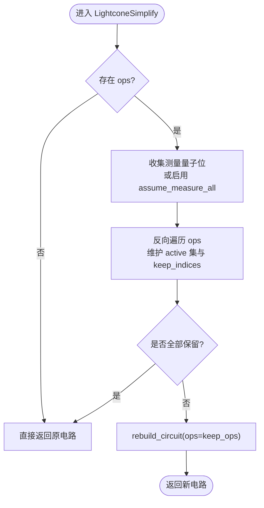
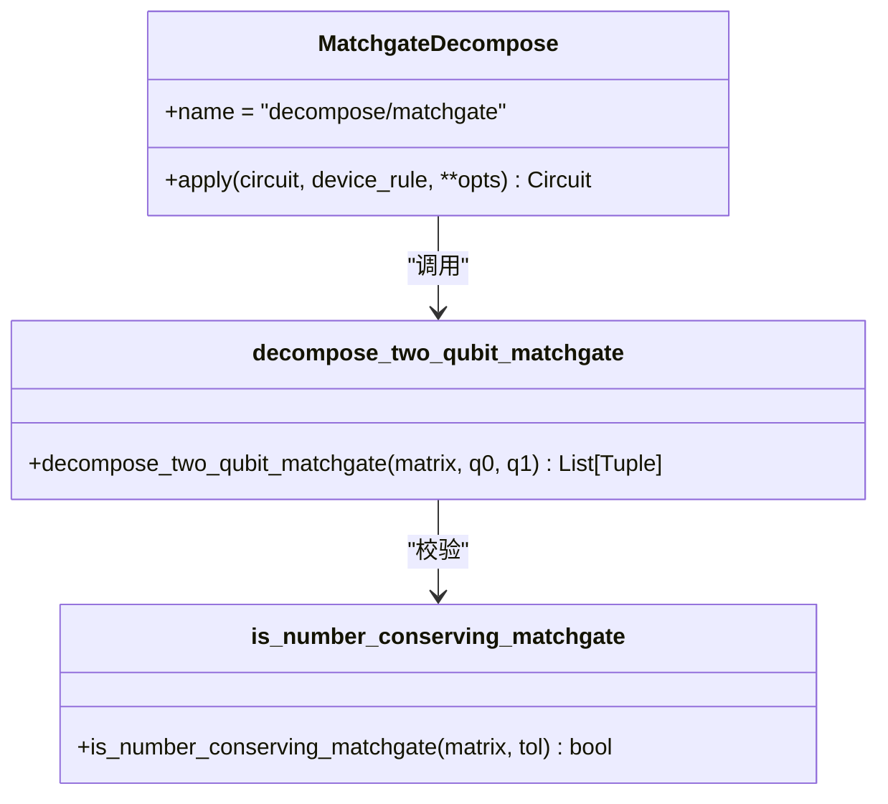
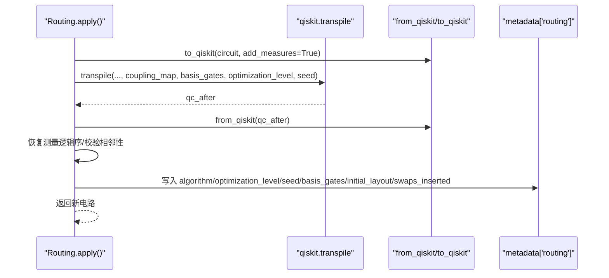
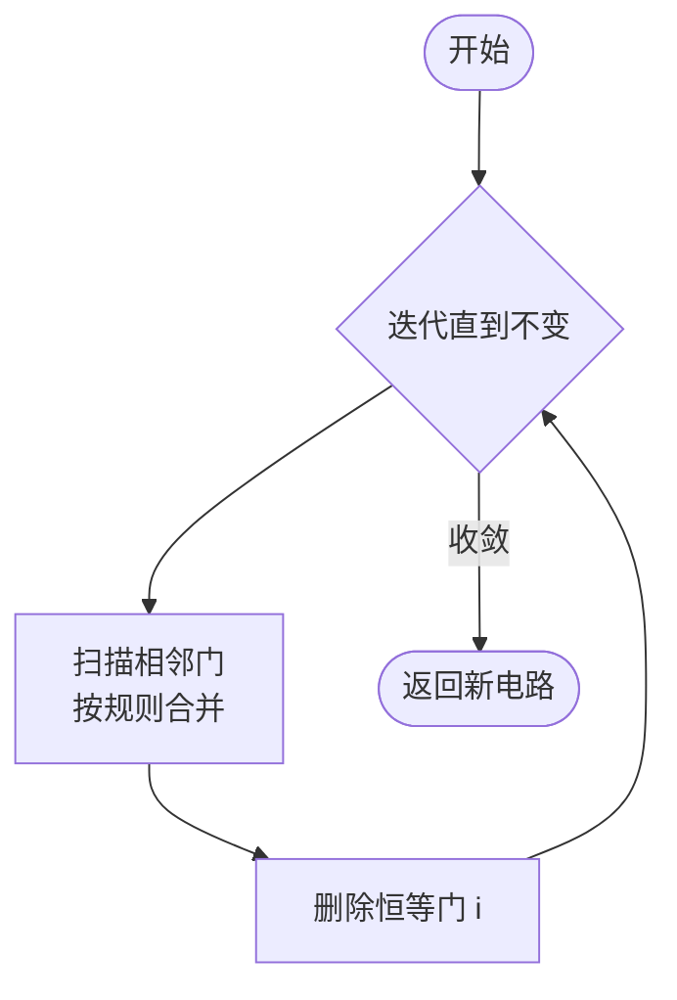
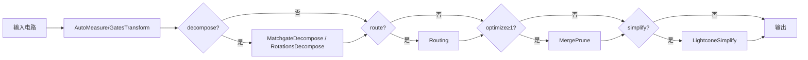
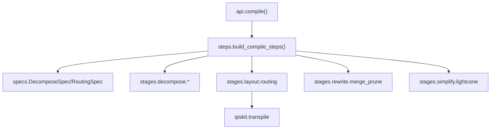

# 编译器优化

<cite>
**本文引用的文件**
- [src/tyxonq/compiler/api.py](file://src/tyxonq/compiler/api.py)
- [src/tyxonq/compiler/gate_compiler/steps.py](file://src/tyxonq/compiler/gate_compiler/steps.py)
- [src/tyxonq/compiler/gate_compiler/specs.py](file://src/tyxonq/compiler/gate_compiler/specs.py)
- [src/tyxonq/compiler/gate_compiler/stages/simplify/lightcone.py](file://src/tyxonq/compiler/gate_compiler/stages/simplify/lightcone.py)
- [src/tyxonq/compiler/gate_compiler/stages/decompose/matchgate.py](file://src/tyxonq/compiler/gate_compiler/stages/decompose/matchgate.py)
- [src/tyxonq/compiler/gate_compiler/stages/rewrite/merge_prune.py](file://src/tyxonq/compiler/gate_compiler/stages/rewrite/merge_prune.py)
- [src/tyxonq/compiler/gate_compiler/stages/layout/routing.py](file://src/tyxonq/compiler/gate_compiler/stages/layout/routing.py)
- [examples/compiler_lightcone_optimization.py](file://examples/compiler_lightcone_optimization.py)
- [examples/performance_optimization_tips.md](file://examples/performance_optimization_tips.md)
</cite>

## 目录
1. [简介](#简介)
2. [项目结构](#项目结构)
3. [核心组件](#核心组件)
4. [架构总览](#架构总览)
5. [详细组件分析](#详细组件分析)
6. [依赖关系分析](#依赖关系分析)
7. [性能考量](#性能考量)
8. [故障排查指南](#故障排查指南)
9. [结论](#结论)
10. [附录](#附录)

## 简介
本指南面向使用 TyxonQ 的开发者与研究者，系统讲解编译器各阶段的优化技术：光锥简化、门分解、路由优化、相邻门合并与恒等剪枝等。文档解释不同编译策略对执行性能的影响，给出编译器配置选项与调优参数说明，提供电路简化与合并的最佳实践，展示如何使用编译器 API 进行自定义优化，并给出基准测试方法与实际案例研究（含优化前后对比）。

## 项目结构
TyxonQ 的编译器以“类型化规格 + 步骤装配”为核心设计：
- 统一入口：compile() 接收平台、输出格式、分解、路由、优化级别、光锥简化等参数，按平台分派到具体编译器或核心 gate_compiler。
- 步骤装配：build_compile_steps() 根据 DecomposeSpec/RoutingSpec/optimize/simplify 生成有序步骤列表，apply_steps() 顺序执行。
- 阶段实现：
  - 规范化与重写：AutoMeasure、GatesTransform、MergePrune
  - 分解：MatchgateDecompose、RotationsDecompose
  - 路由：Routing（委托 qiskit.transpile）
  - 简化：LightconeSimplify（光锥裁剪）
- 平台方言：tyxonq/lqcloud/guodun/pulse 等通过统一接口复用核心步骤。

图表来源
- [src/tyxonq/compiler/api.py:39-340](file://src/tyxonq/compiler/api.py#L39-L340)
- [src/tyxonq/compiler/gate_compiler/steps.py:27-105](file://src/tyxonq/compiler/gate_compiler/steps.py#L27-L105)

章节来源
- [src/tyxonq/compiler/api.py:39-340](file://src/tyxonq/compiler/api.py#L39-L340)
- [src/tyxonq/compiler/gate_compiler/steps.py:27-105](file://src/tyxonq/compiler/gate_compiler/steps.py#L27-L105)

## 核心组件
- 统一编译入口 compile()
  - 支持 platform/output/basis_gates/decompose/route/optimize/simplify/device_rule/options 等类型化参数；自动检测脉冲操作并切换到 pulse 编译；缓存 compiled_source。
- 步骤装配器 build_compile_steps()
  - 固定顺序：AutoMeasure → GatesTransform → 分解（matchgate/rotations）→ 路由（可选）→ 合并剪枝（optimize≥1）→ 光锥简化（simplify）。
- 规格定义 specs.py
  - DecomposeSpec：控制 matchgate/rotations/two_qubit_unitary 分解开关。
  - RoutingSpec：控制 coupling_map/initial_layout/algorithm/optimization_level/seed。
- 关键阶段
  - 光锥简化 LightconeSimplify：基于测量反向切片，仅保留影响测量结果的操作，数学精确且可显著加速期望值计算。
  - 门分解 MatchgateDecompose：将数守恒 2-qubit matchgate/fSim 家族精确分解为 {rz, rx, h, cx}。
  - 路由 Routing：在本地比特子图上调用 qiskit.transpile，插入 SWAP，恢复测量逻辑序，写入 metadata["routing"]。
  - 合并剪枝 MergePrune：按规则合并相邻单比特门并删除恒等门。

章节来源
- [src/tyxonq/compiler/api.py:39-340](file://src/tyxonq/compiler/api.py#L39-L340)
- [src/tyxonq/compiler/gate_compiler/steps.py:27-105](file://src/tyxonq/compiler/gate_compiler/steps.py#L27-L105)
- [src/tyxonq/compiler/gate_compiler/specs.py:15-58](file://src/tyxonq/compiler/gate_compiler/specs.py#L15-L58)
- [src/tyxonq/compiler/gate_compiler/stages/simplify/lightcone.py:12-97](file://src/tyxonq/compiler/gate_compiler/stages/simplify/lightcone.py#L12-L97)
- [src/tyxonq/compiler/gate_compiler/stages/decompose/matchgate.py:152-197](file://src/tyxonq/compiler/gate_compiler/stages/decompose/matchgate.py#L152-L197)
- [src/tyxonq/compiler/gate_compiler/stages/layout/routing.py:289-539](file://src/tyxonq/compiler/gate_compiler/stages/layout/routing.py#L289-L539)
- [src/tyxonq/compiler/gate_compiler/stages/rewrite/merge_prune.py:27-85](file://src/tyxonq/compiler/gate_compiler/stages/rewrite/merge_prune.py#L27-L85)

## 架构总览
TyxonQ 编译器采用“入口分派 + 步骤流水线”的架构。用户通过 compile() 指定目标平台与优化策略，核心 gate_compiler 依据类型化规格装配步骤序列，依次执行规范化、分解、路由、优化与简化，最终返回编译后的 IR 或目标方言代码。平台方言（如 lqcloud、guodun、pulse）复用核心步骤，再完成自身 lowering。

图表来源
- [src/tyxonq/compiler/api.py:39-340](file://src/tyxonq/compiler/api.py#L39-L340)
- [src/tyxonq/compiler/gate_compiler/steps.py:27-105](file://src/tyxonq/compiler/gate_compiler/steps.py#L27-L105)

## 详细组件分析

### 光锥简化（LightconeSimplify）
- 原理：从测量位出发反向追踪依赖，仅保留会影响测量结果的算符；无测量时可通过 assume_measure_all=True 假设全量测量。
- 复杂度：线性扫描 ops，维护 active 集合与 keep_indices；重建线路时使用 rebuild_circuit 保留 metadata/instructions/_unitary_cache。
- 适用场景：期望值计算、部分测量、变分算法中大量无关算符的裁剪。
- 性能收益：示例显示在部分测量场景下可获得数量级加速，且数学等价。

图表来源
- [src/tyxonq/compiler/gate_compiler/stages/simplify/lightcone.py:12-97](file://src/tyxonq/compiler/gate_compiler/stages/simplify/lightcone.py#L12-L97)

章节来源
- [src/tyxonq/compiler/gate_compiler/stages/simplify/lightcone.py:12-97](file://src/tyxonq/compiler/gate_compiler/stages/simplify/lightcone.py#L12-L97)
- [examples/compiler_lightcone_optimization.py:61-159](file://examples/compiler_lightcone_optimization.py#L61-L159)

### 门分解（MatchgateDecompose）
- 原理：识别数守恒 2-qubit matchgate（fSim 家族），将其精确分解为 {rz, rx, h, cx}；非 matchgate 的 unitary 默认保留，strict 模式会报错。
- 关键点：ZXZ 欧拉角分解、partial-iSWAP 用 RXX/RYY 表达、|11> 相位由 Rz⊗Rz 承载；零角度块会被剪枝以减少冗余门。
- 集成方式：作为分解步骤被 steps 装配，供各方言复用。

图表来源
- [src/tyxonq/compiler/gate_compiler/stages/decompose/matchgate.py:46-149](file://src/tyxonq/compiler/gate_compiler/stages/decompose/matchgate.py#L46-L149)
- [src/tyxonq/compiler/gate_compiler/stages/decompose/matchgate.py:152-197](file://src/tyxonq/compiler/gate_compiler/stages/decompose/matchgate.py#L152-L197)

章节来源
- [src/tyxonq/compiler/gate_compiler/stages/decompose/matchgate.py:46-149](file://src/tyxonq/compiler/gate_compiler/stages/decompose/matchgate.py#L46-L149)
- [src/tyxonq/compiler/gate_compiler/stages/decompose/matchgate.py:152-197](file://src/tyxonq/compiler/gate_compiler/stages/decompose/matchgate.py#L152-L197)

### 路由优化（Routing）
- 原理：在本地比特子图上调用 qiskit.transpile 完成布局与 SWAP 插入；保持测量逻辑序；写入 metadata["routing"]；回填 initial_layout 供运行期下发。
- 安全策略：若自由路由失败或产物含 IR 不认的门，回退到保守门集合重试；对跨连通块的两比特门提前报错提示。
- 可复现性：默认 seed=0 保证结果稳定。

图表来源
- [src/tyxonq/compiler/gate_compiler/stages/layout/routing.py:312-375](file://src/tyxonq/compiler/gate_compiler/stages/layout/routing.py#L312-L375)
- [src/tyxonq/compiler/gate_compiler/stages/layout/routing.py:378-539](file://src/tyxonq/compiler/gate_compiler/stages/layout/routing.py#L378-L539)

章节来源
- [src/tyxonq/compiler/gate_compiler/stages/layout/routing.py:289-539](file://src/tyxonq/compiler/gate_compiler/stages/layout/routing.py#L289-L539)

### 合并与剪枝（MergePrune）
- 原理：按规则合并相邻同线单比特门（如 s·s→z、t·t→s、x·x→i 等），并删除恒等门 i。
- 效果：减少门数、降低噪声累积与执行时间。

图表来源
- [src/tyxonq/compiler/gate_compiler/stages/rewrite/merge_prune.py:27-85](file://src/tyxonq/compiler/gate_compiler/stages/rewrite/merge_prune.py#L27-L85)

章节来源
- [src/tyxonq/compiler/gate_compiler/stages/rewrite/merge_prune.py:27-85](file://src/tyxonq/compiler/gate_compiler/stages/rewrite/merge_prune.py#L27-L85)

### 编译步骤装配与执行
- 顺序：AutoMeasure → GatesTransform → 分解（matchgate/rotations）→ 路由（可选）→ 合并剪枝（optimize≥1）→ 光锥简化（simplify）。
- 作用：将高层/参数化门降至目标基集，必要时进行拓扑路由，最后做轻量优化与光锥裁剪。

图表来源
- [src/tyxonq/compiler/gate_compiler/steps.py:27-90](file://src/tyxonq/compiler/gate_compiler/steps.py#L27-L90)

章节来源
- [src/tyxonq/compiler/gate_compiler/steps.py:27-90](file://src/tyxonq/compiler/gate_compiler/steps.py#L27-L90)

## 依赖关系分析
- 入口层：api.compile() 负责平台分派、参数归一、脉冲模式检测与缓存。
- 核心层：steps.build_compile_steps() 依赖 specs 中的 DecomposeSpec/RoutingSpec 决定步骤组合。
- 阶段层：各 stage 模块相互独立，通过统一的 CompileStep 协议串联。
- 外部依赖：Routing 依赖 qiskit.transpile；其他阶段均为纯 Python 实现。

图表来源
- [src/tyxonq/compiler/api.py:39-340](file://src/tyxonq/compiler/api.py#L39-L340)
- [src/tyxonq/compiler/gate_compiler/steps.py:27-90](file://src/tyxonq/compiler/gate_compiler/steps.py#L27-L90)
- [src/tyxonq/compiler/gate_compiler/specs.py:15-58](file://src/tyxonq/compiler/gate_compiler/specs.py#L15-L58)
- [src/tyxonq/compiler/gate_compiler/stages/layout/routing.py:312-375](file://src/tyxonq/compiler/gate_compiler/stages/layout/routing.py#L312-L375)

章节来源
- [src/tyxonq/compiler/api.py:39-340](file://src/tyxonq/compiler/api.py#L39-L340)
- [src/tyxonq/compiler/gate_compiler/steps.py:27-90](file://src/tyxonq/compiler/gate_compiler/steps.py#L27-L90)
- [src/tyxonq/compiler/gate_compiler/specs.py:15-58](file://src/tyxonq/compiler/gate_compiler/specs.py#L15-L58)
- [src/tyxonq/compiler/gate_compiler/stages/layout/routing.py:312-375](file://src/tyxonq/compiler/gate_compiler/stages/layout/routing.py#L312-L375)

## 性能考量
- 光锥简化：在期望值计算中，仅保留影响测量位的算符，避免全态演化；示例显示在部分测量场景下可获得显著加速，且数学等价。
- 门分解：matchgate 分解可将高层两比特门降为原生门，减少平台特定开销；旋转门分解需权衡平台原生支持度，避免不必要的展开。
- 路由优化：仅在需要时路由；默认 optimization_level=0 只做布局与 SWAP 插入，避免引入 IR 不识别的门；seed 固定保证可复现。
- 合并剪枝：减少相邻重复门与恒等门，降低噪声与执行时间。
- 应用层建议：避免重复电路执行，优先一次性获取状态向量或使用 Hamiltonian 对象批量计算期望值（参见性能技巧文档）。

章节来源
- [examples/compiler_lightcone_optimization.py:97-159](file://examples/compiler_lightcone_optimization.py#L97-L159)
- [examples/performance_optimization_tips.md:1-223](file://examples/performance_optimization_tips.md#L1-L223)

## 故障排查指南
- 路由失败
  - 现象：qiskit.transpile 报方向错误或产物含 IR 不识别的门。
  - 处理：启用保守门集合重试；检查 decomposition 是否已将 unitary 降到原生门；确认耦合图与 initial_layout 选择合理。
- 路由后仍不相邻
  - 现象：产物仍存在不相邻两比特门。
  - 处理：提高 optimization_level 或显式指定 basis_gates；确保所选物理比特连通且覆盖所有逻辑比特。
- 测量序错乱
  - 现象：计数键比特序与预期不一致。
  - 处理：Routing 已按经典比特映射恢复测量序；若仍异常，核对 qiskit 版本行为与测量插入点。
- 光锥简化无效
  - 现象：未观察到门数减少。
  - 处理：确认存在测量或设置 assume_measure_all=True；检查是否误用了全测量场景（此时光锥为恒等变换）。

章节来源
- [src/tyxonq/compiler/gate_compiler/stages/layout/routing.py:312-375](file://src/tyxonq/compiler/gate_compiler/stages/layout/routing.py#L312-L375)
- [src/tyxonq/compiler/gate_compiler/stages/layout/routing.py:459-539](file://src/tyxonq/compiler/gate_compiler/stages/layout/routing.py#L459-L539)
- [src/tyxonq/compiler/gate_compiler/stages/simplify/lightcone.py:12-97](file://src/tyxonq/compiler/gate_compiler/stages/simplify/lightcone.py#L12-L97)

## 结论
TyxonQ 编译器通过类型化规格与模块化步骤，实现了灵活而强大的优化能力。光锥简化在期望值计算中带来巨大收益；matchgate 分解将高层两比特门精确降至原生门；路由在本地子图上稳健工作并提供可复现结果；合并剪枝进一步压缩电路。结合合理的编译策略与最佳实践，可在保真度不变的前提下显著提升性能。

## 附录

### 编译器配置选项与调优参数
- compile() 关键参数
  - platform：目标平台（tyxonq/pulse/lqcloud/guodun/qiskit 别名）
  - output：输出格式（ir/qasm2/qasm3/qiskit/方言专属）
  - basis_gates：目标基集，透传给规范化/分解与方言
  - decompose：bool 或 DecomposeSpec，控制 matchgate/rotations/two_qubit_unitary
  - route：bool 或 RoutingSpec，控制布局与路由
  - optimize：优化级别（≥1 启用合并剪枝）
  - simplify：是否启用光锥简化
  - device_rule：设备能力描述（coupling_map/num_qubits 等）
  - options：平台专属选项（如 pulse 的 device_params/calibrations/mode）
- DecomposeSpec
  - matchgate：默认开启，分解数守恒 2-qubit matchgate
  - rotations：默认关闭，按需展开旋转门
  - two_qubit_unitary：默认关闭，通用 KAK 分解后续增量
- RoutingSpec
  - coupling_map：物理耦合图
  - initial_layout：初始布局（None 时用恒等或自动挑选）
  - algorithm：当前仅支持 "qiskit"
  - optimization_level：默认 0，仅布局与 SWAP 插入
  - seed：默认 0，保证可复现

章节来源
- [src/tyxonq/compiler/api.py:39-340](file://src/tyxonq/compiler/api.py#L39-L340)
- [src/tyxonq/compiler/gate_compiler/specs.py:15-58](file://src/tyxonq/compiler/gate_compiler/specs.py#L15-L58)

### 电路简化与合并最佳实践
- 先分解后路由：确保路由阶段面对的是目标基集，避免不可识别门导致失败。
- 合理使用路由：仅在存在拓扑约束时启用；尽量在同一连通块内选择物理比特。
- 启用合并剪枝：optimize≥1 可减少冗余门，降低噪声。
- 使用光锥简化：对期望值计算务必启用 simplify，或在构造带 measure_z 标记的电路后裁剪。
- 避免重复执行：参考性能技巧，缓存状态向量或使用 Hamiltonian 对象批量计算。

章节来源
- [src/tyxonq/compiler/gate_compiler/steps.py:27-90](file://src/tyxonq/compiler/gate_compiler/steps.py#L27-L90)
- [src/tyxonq/compiler/gate_compiler/stages/layout/routing.py:289-539](file://src/tyxonq/compiler/gate_compiler/stages/layout/routing.py#L289-L539)
- [src/tyxonq/compiler/gate_compiler/stages/rewrite/merge_prune.py:27-85](file://src/tyxonq/compiler/gate_compiler/stages/rewrite/merge_prune.py#L27-L85)
- [examples/performance_optimization_tips.md:1-223](file://examples/performance_optimization_tips.md#L1-L223)

### 使用编译器 API 进行自定义优化
- 基本用法：通过 compile() 传入 decompose/route/optimize/simplify 等参数，获得编译后的 IR 或目标方言。
- 自定义步骤：实现 CompileStep 协议（apply(circuit, **opts) -> Circuit），加入步骤链以实现特定变换。
- 平台方言：lqcloud/guodun/pulse 等平台复用核心步骤，并在其 lowering 阶段完成方言适配。

章节来源
- [src/tyxonq/compiler/api.py:39-340](file://src/tyxonq/compiler/api.py#L39-L340)
- [src/tyxonq/compiler/gate_compiler/steps.py:27-105](file://src/tyxonq/compiler/gate_compiler/steps.py#L27-L105)

### 基准测试方法评估编译效果
- 光锥优化基准：示例脚本展示了在不同问题规模与层数下的加速比与正确性验证。
- 建议流程：
  - 构建代表性电路（如 HEA/brickwall ansatz）。
  - 分别以 simplify=True/False 或 route=True/False 编译。
  - 使用 tq.utils.benchmark 统计 staging/run 时间，比较总耗时与数值一致性。
  - 记录 metadata["routing"] 中的 swaps_inserted、initial_layout 等信息用于诊断。

章节来源
- [examples/compiler_lightcone_optimization.py:97-159](file://examples/compiler_lightcone_optimization.py#L97-L159)
- [src/tyxonq/compiler/gate_compiler/stages/layout/routing.py:516-531](file://src/tyxonq/compiler/gate_compiler/stages/layout/routing.py#L516-L531)

### 实际案例研究：优化前后性能对比
- 光锥简化案例：示例展示了在部分测量场景下，光锥裁剪带来的显著加速，同时保证数值一致。
- 性能技巧案例：通过缓存状态向量与使用 Hamiltonian 对象，将多次电路执行优化为一次，获得 10x+ 加速。

章节来源
- [examples/compiler_lightcone_optimization.py:201-255](file://examples/compiler_lightcone_optimization.py#L201-L255)
- [examples/performance_optimization_tips.md:1-223](file://examples/performance_optimization_tips.md#L1-L223)