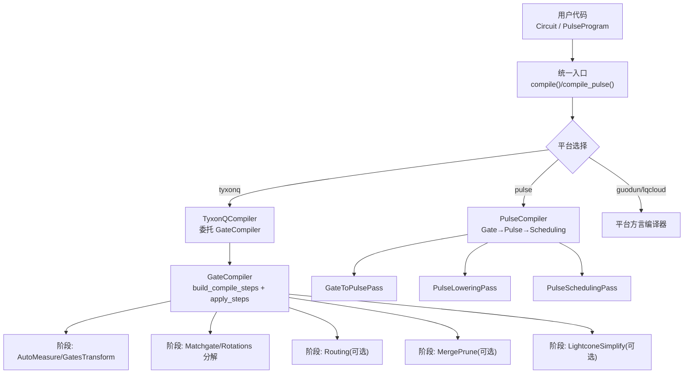
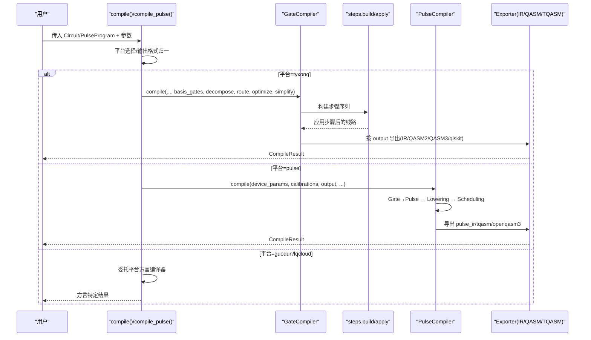
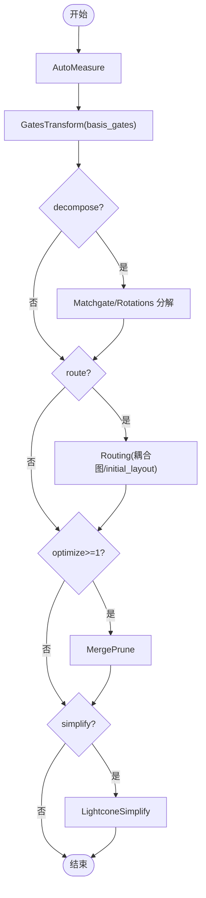
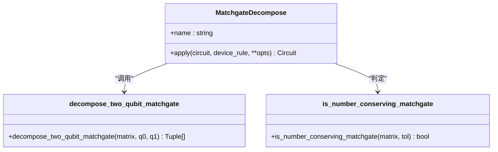
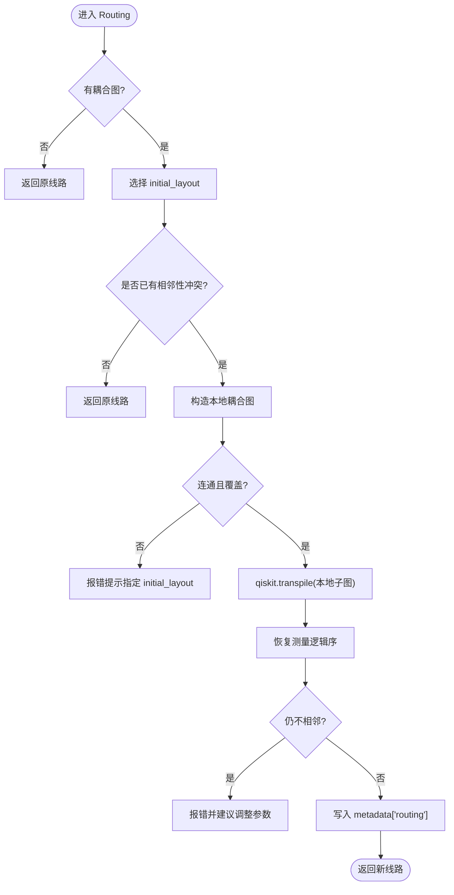
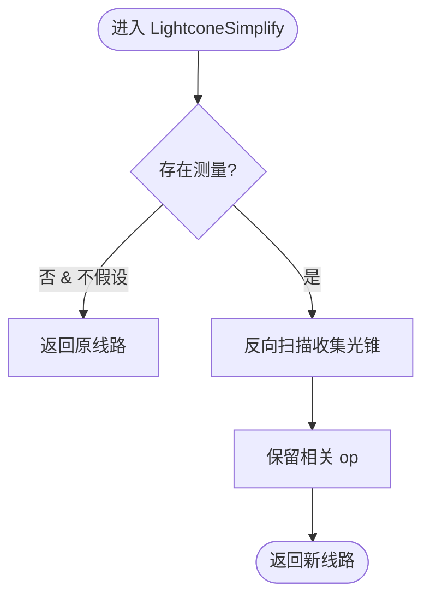
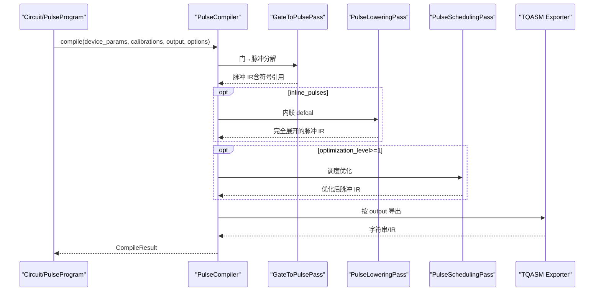
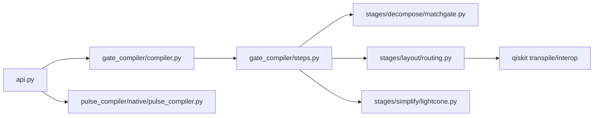

# 编译器流水线

<cite>
**本文引用的文件**
- [src/tyxonq/compiler/api.py](file://src/tyxonq/compiler/api.py)
- [src/tyxonq/compiler/gate_compiler/compiler.py](file://src/tyxonq/compiler/gate_compiler/compiler.py)
- [src/tyxonq/compiler/gate_compiler/steps.py](file://src/tyxonq/compiler/gate_compiler/steps.py)
- [src/tyxonq/compiler/pulse_compiler/native/pulse_compiler.py](file://src/tyxonq/compiler/pulse_compiler/native/pulse_compiler.py)
- [src/tyxonq/compiler/gate_compiler/stages/decompose/matchgate.py](file://src/tyxonq/compiler/gate_compiler/stages/decompose/matchgate.py)
- [src/tyxonq/compiler/gate_compiler/stages/layout/routing.py](file://src/tyxonq/compiler/gate_compiler/stages/layout/routing.py)
- [src/tyxonq/compiler/gate_compiler/stages/simplify/lightcone.py](file://src/tyxonq/compiler/gate_compiler/stages/simplify/lightcone.py)
- [src/tyxonq/compiler/platforms/tyxonq/__init__.py](file://src/tyxonq/compiler/platforms/tyxonq/__init__.py)
- [examples/circuit_compiler.py](file://examples/circuit_compiler.py)
- [examples/vqe_parallel_pmap.py](file://examples/vqe_parallel_pmap.py)
- [examples/incremental_twoqubit.py](file://examples/incremental_twoqubit.py)
</cite>

## 目录
1. [简介](#简介)
2. [项目结构](#项目结构)
3. [核心组件](#核心组件)
4. [架构总览](#架构总览)
5. [详细组件分析](#详细组件分析)
6. [依赖关系分析](#依赖关系分析)
7. [性能考虑](#性能考虑)
8. [故障排查指南](#故障排查指南)
9. [结论](#结论)
10. [附录](#附录)

## 简介
本文件系统性梳理 TyxonQ 编译器的流水线设计，覆盖门级与脉冲级两条编译路径、阶段执行顺序与数据传递、平台分派与配置控制、自定义阶段开发方法、并行与增量编译实践，以及性能监控与调试要点。读者可据此理解从高层量子线路到目标设备可执行表示的完整转换过程，并掌握扩展与优化编译流程的方法。

## 项目结构
TyxonQ 编译器采用“统一入口 + 平台适配器 + 通用核心 + 阶段化 Pass”的分层组织：
- 统一入口：提供 compile() 与 compile_pulse()，负责平台选择、参数归一化、输出格式处理与结果封装。
- 平台适配器：如 TyxonQCompiler、GuodunCompiler、LQCloudCompiler，将通用能力委托给门电路核心或进行方言翻译。
- 门电路通用核心：GateCompiler 通过步骤装配器 build_compile_steps 生成 CompileStep 序列，并由 apply_steps 顺序执行。
- 脉冲编译器：PulseCompiler 将门级电路转换为脉冲原语、内联校准、调度优化，并导出 TQASM/OpenQASM3。
- 阶段模块：分解（matchgate/rotations）、重写（自动测量、门集合变换、合并剪枝）、路由（布局与 SWAP 插入）、化简（光锥裁剪）。

图表来源
- [src/tyxonq/compiler/api.py:39-340](file://src/tyxonq/compiler/api.py#L39-L340)
- [src/tyxonq/compiler/gate_compiler/compiler.py:27-109](file://src/tyxonq/compiler/gate_compiler/compiler.py#L27-L109)
- [src/tyxonq/compiler/gate_compiler/steps.py:27-105](file://src/tyxonq/compiler/gate_compiler/steps.py#L27-L105)
- [src/tyxonq/compiler/pulse_compiler/native/pulse_compiler.py:24-197](file://src/tyxonq/compiler/pulse_compiler/native/pulse_compiler.py#L24-L197)

章节来源
- [src/tyxonq/compiler/api.py:39-340](file://src/tyxonq/compiler/api.py#L39-L340)
- [src/tyxonq/compiler/gate_compiler/compiler.py:27-109](file://src/tyxonq/compiler/gate_compiler/compiler.py#L27-L109)
- [src/tyxonq/compiler/gate_compiler/steps.py:27-105](file://src/tyxonq/compiler/gate_compiler/steps.py#L27-L105)
- [src/tyxonq/compiler/pulse_compiler/native/pulse_compiler.py:24-197](file://src/tyxonq/compiler/pulse_compiler/native/pulse_compiler.py#L24-L197)

## 核心组件
- 统一编译入口
  - compile(): 接收 Circuit/PulseProgram，按 platform/output/basis_gates/decompose/route/optimize/simplify/device_rule/options 等类型化参数装配并执行编译；支持 tyxonq/pulse/guodun/lqcloud/qiskit 等平台别名与输出格式。
  - compile_pulse(): 面向 PulseProgram 的统一入口，自动补足 device_params，调用 compile(platform="pulse") 并返回统一结构。
- 门电路通用核心
  - GateCompiler.compile(): 根据 options 与显式参数归一化 basis_gates/optimization_level，构建步骤列表并顺序执行；按 output 选择 IR/QASM2/QASM3/qiskit 导出。
- 步骤装配与执行
  - build_compile_steps(): 按类型化参数装配固定顺序的步骤：AutoMeasure → GatesTransform → (MatchgateDecompose/RotationsDecompose) → Routing(可选) → MergePrune(可选) → LightconeSimplify(可选)。
  - apply_steps(): 对每个步骤调用 step.apply(circuit, **opts)，串联得到最终线路。
- 脉冲编译器
  - PulseCompiler.compile(): 三阶段流水线 GateToPulsePass → PulseLoweringPass(可选 inline) → PulseSchedulingPass(按优化级别)；支持多种输出格式（pulse_ir/tqasm/openqasm3/tyxonq_homebrew_tqasm）。

章节来源
- [src/tyxonq/compiler/api.py:39-340](file://src/tyxonq/compiler/api.py#L39-L340)
- [src/tyxonq/compiler/gate_compiler/compiler.py:27-109](file://src/tyxonq/compiler/gate_compiler/compiler.py#L27-L109)
- [src/tyxonq/compiler/gate_compiler/steps.py:27-105](file://src/tyxonq/compiler/gate_compiler/steps.py#L27-L105)
- [src/tyxonq/compiler/pulse_compiler/native/pulse_compiler.py:24-197](file://src/tyxonq/compiler/pulse_compiler/native/pulse_compiler.py#L24-L197)

## 架构总览
下图展示从用户输入到目标输出的端到端编译流，包括平台分派、门级与脉冲级两条路径、以及各阶段的输入输出契约。

图表来源
- [src/tyxonq/compiler/api.py:39-340](file://src/tyxonq/compiler/api.py#L39-L340)
- [src/tyxonq/compiler/gate_compiler/compiler.py:27-109](file://src/tyxonq/compiler/gate_compiler/compiler.py#L27-L109)
- [src/tyxonq/compiler/gate_compiler/steps.py:27-105](file://src/tyxonq/compiler/gate_compiler/steps.py#L27-L105)
- [src/tyxonq/compiler/pulse_compiler/native/pulse_compiler.py:24-197](file://src/tyxonq/compiler/pulse_compiler/native/pulse_compiler.py#L24-L197)

## 详细组件分析

### 门级编译流水线（GateCompiler）
- 阶段顺序与职责
  - AutoMeasure：无测量时补 Z 测量，保证后续路由/导出一致性。
  - GatesTransform：按 basis_gates 重写门集合，确保下游兼容（如 qasm2 需 qelib1 兼容基）。
  - Decompose：matchgate/rotations 分解，将高层 unitary 降至原生门集。
  - Routing（可选）：基于耦合图与 initial_layout，在本地比特子图上委托 qiskit.transpile 完成布局与 SWAP 插入，恢复测量逻辑序。
  - MergePrune（可选）：相邻门合并与恒等剪枝。
  - LightconeSimplify（可选）：基于测量光锥裁剪不影响结果的算符。
- 输入输出
  - 输入：Circuit IR、basis_gates、decompose/route/optimize/simplify、device_rule、options。
  - 输出：IR 或 QASM2/QASM3/qiskit 对象，附带 metadata（output、options、device_rule、steps、basis_gates、optimization_level）。
- 关键实现要点
  - 类型化参数驱动步骤装配，避免空占位步骤。
  - qasm2 输出时自动降级到 qelib1 兼容基，避免非兼容门。
  - 路由阶段在本地比特子图上进行，保持产物比特数一致，并在 metadata 中记录路由信息。

图表来源
- [src/tyxonq/compiler/gate_compiler/steps.py:27-105](file://src/tyxonq/compiler/gate_compiler/steps.py#L27-L105)
- [src/tyxonq/compiler/gate_compiler/compiler.py:27-109](file://src/tyxonq/compiler/gate_compiler/compiler.py#L27-L109)

章节来源
- [src/tyxonq/compiler/gate_compiler/steps.py:27-105](file://src/tyxonq/compiler/gate_compiler/steps.py#L27-L105)
- [src/tyxonq/compiler/gate_compiler/compiler.py:27-109](file://src/tyxonq/compiler/gate_compiler/compiler.py#L27-L109)

### 分解阶段：matchgate 分解
- 目标：将 2-qubit 数守恒 matchgate（fSim 家族）精确分解为 {rz, rx, h, cx} 等原生门序列。
- 原理：利用 fSim = iSWAP型相互作用 + CPhase，结合 ZXZ 欧拉角分解与 RXX/RYY 到 RZZ 的等价转换，剔除冗余门。
- 集成方式：作为 DecomposeSpec(matchgate=True) 触发的步骤，默认开启；strict 模式在非 matchgate 时报错。
- 正确性保障：离线数值校验保真度 1.0，零角度块剪枝减少噪声敏感门数。

图表来源
- [src/tyxonq/compiler/gate_compiler/stages/decompose/matchgate.py:46-197](file://src/tyxonq/compiler/gate_compiler/stages/decompose/matchgate.py#L46-L197)

章节来源
- [src/tyxonq/compiler/gate_compiler/stages/decompose/matchgate.py:46-197](file://src/tyxonq/compiler/gate_compiler/stages/decompose/matchgate.py#L46-L197)

### 路由阶段：布局与 SWAP 插入
- 目标：将两比特门映射到设备物理比特，必要时插入 SWAP 满足耦合约束。
- 策略：
  - 在本地比特子图上进行路由，避免全设备耦合图导致的膨胀。
  - 若已满足相邻性则跳过路由，保证零回归。
  - 自动选择连通且覆盖全部逻辑比特的物理比特子图。
  - 恢复测量逻辑序，保证计数键与未路由时一致。
  - 保守门集合兜底重试，提升鲁棒性。
- 输出：新线路 ops 与 metadata["routing"]（算法、优化级别、seed、basis_gates、initial_layout、final_layout、num_physical_qubits、local_coupling_map、swaps_inserted）。

图表来源
- [src/tyxonq/compiler/gate_compiler/stages/layout/routing.py:289-539](file://src/tyxonq/compiler/gate_compiler/stages/layout/routing.py#L289-L539)

章节来源
- [src/tyxonq/compiler/gate_compiler/stages/layout/routing.py:289-539](file://src/tyxonq/compiler/gate_compiler/stages/layout/routing.py#L289-L539)

### 化简阶段：光锥裁剪
- 目标：仅保留影响测量的算符，裁剪无关操作以减少门数。
- 机制：自测量点反向扫描，维护活跃量子比特集合，遇到两比特门传播依赖；无测量时可按 assume_measure_all 假设所有比特被测量。
- 输出：新线路 ops，保留 metadata/instructions/_unitary_cache。

图表来源
- [src/tyxonq/compiler/gate_compiler/stages/simplify/lightcone.py:12-97](file://src/tyxonq/compiler/gate_compiler/stages/simplify/lightcone.py#L12-L97)

章节来源
- [src/tyxonq/compiler/gate_compiler/stages/simplify/lightcone.py:12-97](file://src/tyxonq/compiler/gate_compiler/stages/simplify/lightcone.py#L12-L97)

### 脉冲级编译流水线（PulseCompiler）
- 阶段顺序：
  - GateToPulsePass：将标准门转换为脉冲原语（参考 defcal/波形库）。
  - PulseLoweringPass：内联 defcal（可选 inline_pulses），便于序列化与云端提交。
  - PulseSchedulingPass：脉冲时序优化与资源分配（按 optimization_level 启用）。
- 输出格式：
  - pulse_ir：TyxonQ 原生脉冲 IR。
  - tqasm/tqasm0.2：TQASM 0.2（homebrew_s2 专用）。
  - openqasm3/openqasm3.0：OpenQASM 3 带脉冲扩展。
- 设备参数与校准：
  - device_params：qubit_freq、anharmonicity、T1/T2、coupling_map 等。
  - calibrations：自定义 gate→pulse 校准映射。
  - supported_waveforms：波形类型过滤与验证。

图表来源
- [src/tyxonq/compiler/pulse_compiler/native/pulse_compiler.py:24-197](file://src/tyxonq/compiler/pulse_compiler/native/pulse_compiler.py#L24-L197)

章节来源
- [src/tyxonq/compiler/pulse_compiler/native/pulse_compiler.py:24-197](file://src/tyxonq/compiler/pulse_compiler/native/pulse_compiler.py#L24-L197)

### 平台适配与分派
- TyxonQ 平台适配器：薄包装，直接委托 GateCompiler。
- Guodun/LQCloud 平台：先经 GateCompiler 核心完成通用编译，再翻译为方言（QCIS/SDK 对象等）。
- 智能推断：检测到脉冲操作或显式脉冲模式时，platform=tyxonq 自动切换到 pulse 编译；homebrew_s2 设备强制特定输出格式。

章节来源
- [src/tyxonq/compiler/platforms/tyxonq/__init__.py:1-19](file://src/tyxonq/compiler/platforms/tyxonq/__init__.py#L1-L19)
- [src/tyxonq/compiler/api.py:140-340](file://src/tyxonq/compiler/api.py#L140-L340)

## 依赖关系分析
- 组件耦合
  - api.py 依赖 gate_compiler.compiler、pulse_compiler.native.pulse_compiler 及平台适配器。
  - gate_compiler.steps 依赖各 stages 的具体实现，按需延迟导入以降低启动开销。
  - routing 依赖 qiskit transpile 与 interop to/from qiskit。
  - matchgate 分解为纯函数+步骤封装，供各方言复用。
- 外部依赖
  - qiskit：用于路由与互操作。
  - numpy：数值计算（matchgate 分解）。
- 潜在循环依赖
  - 通过延迟导入与协议解耦避免循环；步骤装配仅在需要时触发具体 stage 导入。

图表来源
- [src/tyxonq/compiler/api.py:39-340](file://src/tyxonq/compiler/api.py#L39-L340)
- [src/tyxonq/compiler/gate_compiler/compiler.py:27-109](file://src/tyxonq/compiler/gate_compiler/compiler.py#L27-L109)
- [src/tyxonq/compiler/gate_compiler/steps.py:27-105](file://src/tyxonq/compiler/gate_compiler/steps.py#L27-L105)
- [src/tyxonq/compiler/gate_compiler/stages/layout/routing.py:289-539](file://src/tyxonq/compiler/gate_compiler/stages/layout/routing.py#L289-L539)

章节来源
- [src/tyxonq/compiler/api.py:39-340](file://src/tyxonq/compiler/api.py#L39-L340)
- [src/tyxonq/compiler/gate_compiler/steps.py:27-105](file://src/tyxonq/compiler/gate_compiler/steps.py#L27-L105)
- [src/tyxonq/compiler/gate_compiler/stages/layout/routing.py:289-539](file://src/tyxonq/compiler/gate_compiler/stages/layout/routing.py#L289-L539)

## 性能考虑
- 编译期优化
  - 合理设置 optimize 级别以启用 MergePrune，减少冗余门。
  - 使用 simplify 启用光锥裁剪，降低无效操作数量。
  - 针对 qasm2 输出，确保 basis_gates 为 qelib1 兼容集，避免额外转换开销。
- 运行期优化
  - 状态向量缓存：避免重复 circuit.state() 调用导致多次执行。
  - Hamiltonian 一次性计算：将多个期望值合并为单次矩阵运算。
  - 批量评估：使用 vmap/jit 对多参数集并行求值。
- 示例参考
  - 性能优化技巧文档提供了避免重复电路执行、Hamiltonian 一次性计算、模板函数与批量计算的实践。
  - 并行 VQE 示例展示了 torch.func.vmap/grad 的批量化梯度与值计算。

章节来源
- [examples/performance_optimization_tips.md:1-223](file://examples/performance_optimization_tips.md#L1-L223)
- [examples/vqe_parallel_pmap.py:1-164](file://examples/vqe_parallel_pmap.py#L1-L164)

## 故障排查指南
- 路由失败
  - 现象：qiskit.transpile 报方向错误或产物含不支持门。
  - 处理：启用保守门集合重试；检查 initial_layout 是否覆盖同一连通块；确认耦合图有效。
  - 参考：路由阶段会在失败时给出明确错误与建议。
- 分解失败
  - 现象：非数守恒 matchgate 无法分解。
  - 处理：关闭 strict 模式或改用其他分解策略；检查 unitary 矩阵来源。
- 脉冲编译缺少设备参数
  - 现象：未提供 device_params 时自动填充默认测试参数并发出警告。
  - 处理：显式提供真实设备参数以避免仿真偏差。
- 输出格式不匹配
  - 现象：homebrew_s2 设备强制特定输出格式。
  - 处理：遵循平台规则，自动切换输出格式。

章节来源
- [src/tyxonq/compiler/gate_compiler/stages/layout/routing.py:311-539](file://src/tyxonq/compiler/gate_compiler/stages/layout/routing.py#L311-L539)
- [src/tyxonq/compiler/gate_compiler/stages/decompose/matchgate.py:152-197](file://src/tyxonq/compiler/gate_compiler/stages/decompose/matchgate.py#L152-L197)
- [src/tyxonq/compiler/api.py:237-291](file://src/tyxonq/compiler/api.py#L237-L291)

## 结论
TyxonQ 编译器通过统一入口、平台适配与通用核心的分层设计，实现了灵活可扩展的门级与脉冲级编译流水线。类型化参数驱动的步骤装配确保了编译能力的可组合性与可观测性；路由与分解等关键阶段在保证正确性的同时兼顾性能与鲁棒性。借助示例中的并行与增量实践，用户可在大规模优化任务中获得显著加速。

## 附录

### 编译阶段执行顺序与依赖关系
- 固定顺序：AutoMeasure → GatesTransform → Decompose（matchgate/rotations）→ Routing（可选）→ MergePrune（可选）→ LightconeSimplify（可选）。
- 依赖关系：
  - 分解先于路由，因为 to_qiskit 不识别 unitary 等高阶 op。
  - 路由依赖有效的耦合图与 initial_layout。
  - 化简依赖测量信息或 assume_measure_all。

章节来源
- [src/tyxonq/compiler/gate_compiler/steps.py:27-105](file://src/tyxonq/compiler/gate_compiler/steps.py#L27-L105)

### 各优化阶段输入输出格式与数据传递
- 输入：Circuit IR、basis_gates、decompose/route/optimize/simplify、device_rule、options。
- 中间数据：metadata（output、options、device_rule、steps、basis_gates、optimization_level、routing）。
- 输出：IR 或 QASM2/QASM3/qiskit；脉冲编译输出 pulse_ir/tqasm/openqasm3。
- 数据传递：步骤通过 **opts 共享参数，避免强耦合；metadata 在各阶段复制并扩展。

章节来源
- [src/tyxonq/compiler/gate_compiler/compiler.py:27-109](file://src/tyxonq/compiler/gate_compiler/compiler.py#L27-L109)
- [src/tyxonq/compiler/pulse_compiler/native/pulse_compiler.py:24-197](file://src/tyxonq/compiler/pulse_compiler/native/pulse_compiler.py#L24-L197)

### 编译器配置与阶段控制方法
- 类型化参数：
  - basis_gates：目标原生门集合。
  - decompose：bool 或 DecomposeSpec，控制 matchgate/rotations。
  - route：bool 或 RoutingSpec，控制布局与 SWAP。
  - optimize：0-3，控制合并剪枝与调度。
  - simplify：是否启用光锥裁剪。
  - device_rule：设备能力描述（耦合图、比特数等）。
  - options：平台专属逃生舱（如 mode、dt、inline_pulses）。
- 平台别名：tyxonq/pulse/guodun/lqcloud/qiskit；homebrew_s2 设备自动设定输出格式。

章节来源
- [src/tyxonq/compiler/api.py:39-340](file://src/tyxonq/compiler/api.py#L39-L340)

### 自定义编译阶段开发指南
- 实现 CompileStep 协议：定义 apply(circuit, **opts) -> Circuit。
- 注册到步骤装配器：在 build_compile_steps 中按条件追加步骤。
- 注意事项：
  - 步骤应幂等且可组合。
  - 通过 **opts 获取参数，避免硬编码。
  - 更新 metadata 以记录阶段行为。
- 参考现有阶段：matchgate、routing、lightcone 的实现模式。

章节来源
- [src/tyxonq/compiler/gate_compiler/steps.py:27-105](file://src/tyxonq/compiler/gate_compiler/steps.py#L27-L105)
- [src/tyxonq/compiler/gate_compiler/stages/decompose/matchgate.py:152-197](file://src/tyxonq/compiler/gate_compiler/stages/decompose/matchgate.py#L152-L197)
- [src/tyxonq/compiler/gate_compiler/stages/layout/routing.py:289-539](file://src/tyxonq/compiler/gate_compiler/stages/layout/routing.py#L289-L539)
- [src/tyxonq/compiler/gate_compiler/stages/simplify/lightcone.py:12-97](file://src/tyxonq/compiler/gate_compiler/stages/simplify/lightcone.py#L12-L97)

### 编译器 API 使用示例
- 门级编译：
  - 使用 Circuit.compile() 或 compile()，指定 platform/output/basis_gates/options。
  - 示例路径：[examples/circuit_compiler.py:20-51](file://examples/circuit_compiler.py#L20-L51)
- 脉冲级编译：
  - 使用 compile_pulse() 或直接调用 PulseCompiler.compile()。
  - 示例路径：[src/tyxonq/compiler/api.py:343-463](file://src/tyxonq/compiler/api.py#L343-L463)

章节来源
- [examples/circuit_compiler.py:20-51](file://examples/circuit_compiler.py#L20-L51)
- [src/tyxonq/compiler/api.py:343-463](file://src/tyxonq/compiler/api.py#L343-L463)

### 并行编译与增量编译
- 并行编译：
  - 使用 torch.func.vmap/grad 对多参数集进行批量化求值与梯度计算。
  - 示例路径：[examples/vqe_parallel_pmap.py:126-164](file://examples/vqe_parallel_pmap.py#L126-L164)
- 增量编译：
  - 通过结构掩码逐步增加两比特相互作用，复用基础电路结构。
  - 示例路径：[examples/incremental_twoqubit.py:25-83](file://examples/incremental_twoqubit.py#L25-L83)

章节来源
- [examples/vqe_parallel_pmap.py:126-164](file://examples/vqe_parallel_pmap.py#L126-L164)
- [examples/incremental_twoqubit.py:25-83](file://examples/incremental_twoqubit.py#L25-L83)

### 性能监控与调试工具
- 编译元数据：CompileResult.metadata 包含 steps、basis_gates、optimization_level、routing 等信息，可用于追踪编译过程。
- 路由日志：metadata["routing"] 记录算法、优化级别、种子、初始布局、交换次数等。
- 波形验证：PulseCompiler.validate_waveforms() 检测支持的波形类型并给出警告。
- 示例参考：
  - 性能对比与统计打印：[examples/performance_layerwise_optimization.py:269-299](file://examples/performance_layerwise_optimization.py#L269-L299)

章节来源
- [src/tyxonq/compiler/gate_compiler/compiler.py:76-83](file://src/tyxonq/compiler/gate_compiler/compiler.py#L76-L83)
- [src/tyxonq/compiler/gate_compiler/stages/layout/routing.py:516-539](file://src/tyxonq/compiler/gate_compiler/stages/layout/routing.py#L516-L539)
- [src/tyxonq/compiler/pulse_compiler/native/pulse_compiler.py:250-316](file://src/tyxonq/compiler/pulse_compiler/native/pulse_compiler.py#L250-L316)
- [examples/performance_layerwise_optimization.py:269-299](file://examples/performance_layerwise_optimization.py#L269-L299)