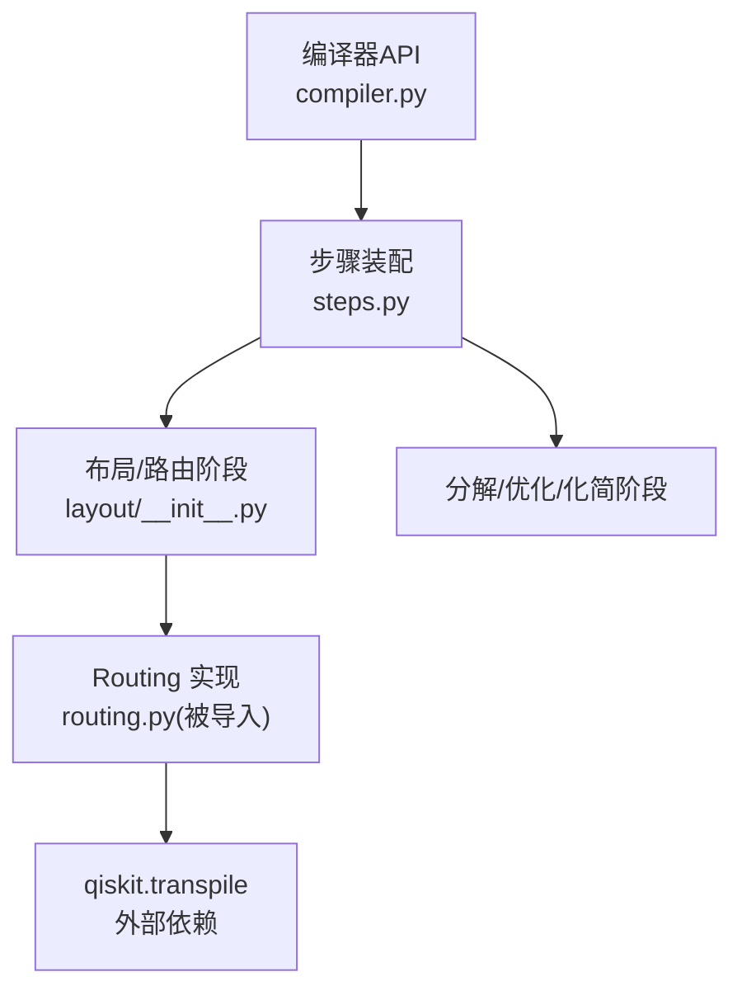
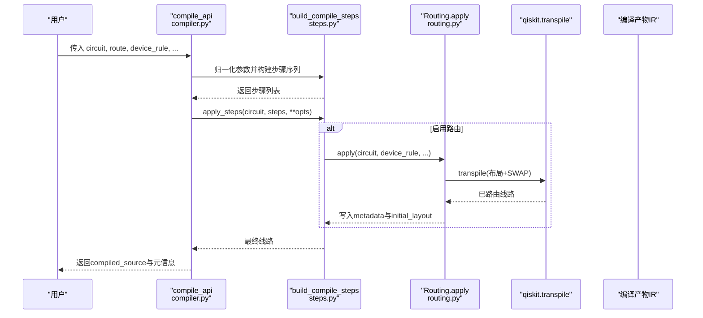
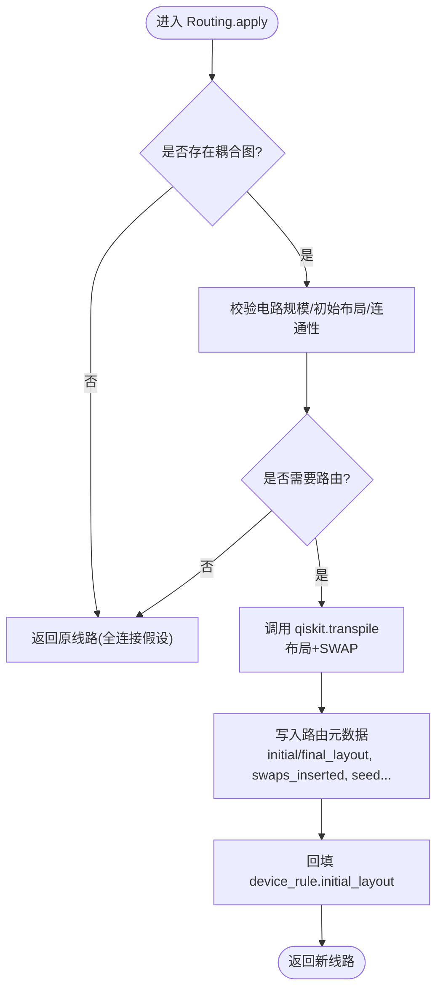
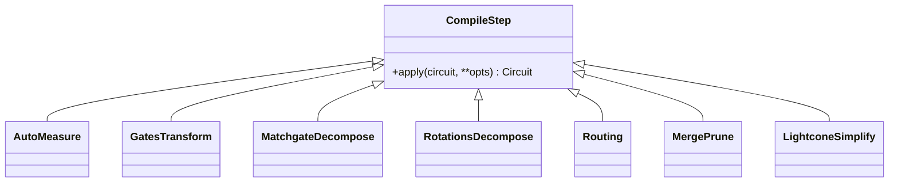
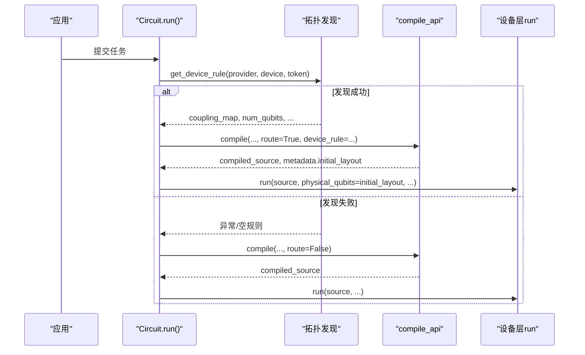
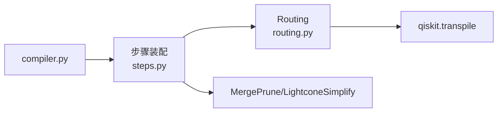

# 路由优化

<cite>
**本文引用的文件**
- [src/tyxonq/compiler/gate_compiler/stages/layout/__init__.py](file://src/tyxonq/compiler/gate_compiler/stages/layout/__init__.py)
- [src/tyxonq/compiler/gate_compiler/steps.py](file://src/tyxonq/compiler/gate_compiler/steps.py)
- [src/tyxonq/compiler/gate_compiler/compiler.py](file://src/tyxonq/compiler/gate_compiler/compiler.py)
- [tests_core_module/test_compiler_routing.py](file://tests_core_module/test_compiler_routing.py)
- [tests_core_module/test_lqcloud_run_routing_wiring.py](file://tests_core_module/test_lqcloud_run_routing_wiring.py)
</cite>

## 目录
1. [简介](#简介)
2. [项目结构](#项目结构)
3. [核心组件](#核心组件)
4. [架构总览](#架构总览)
5. [详细组件分析](#详细组件分析)
6. [依赖关系分析](#依赖关系分析)
7. [性能考量](#性能考量)
8. [故障排查指南](#故障排查指南)
9. [结论](#结论)
10. [附录](#附录)

## 简介
本指南聚焦 TyxonQ 的量子比特布局与路由优化，系统阐述：
- 量子比特布局选择与 SWAP 网络生成机制
- 不同路由策略的性能特点与适用场景
- 层式优化与全局优化的区别及选择方法
- 路由配置参数调优建议
- 路由质量评估指标与优化目标函数
- 实际案例研究与性能基准测试思路
- 代码级示例路径（以源码引用形式提供）

## 项目结构
TyxonQ 的路由能力位于编译器“布局/路由”阶段，通过类型化步骤装配并顺序执行。关键位置如下：
- 布局/路由模块入口：声明 Routing 步骤及其职责
- 编译步骤装配：按固定顺序组装分解、路由、优化、化简等步骤
- 编译器 API：将用户选项归一为步骤参数并执行
- 单测覆盖：验证路由正确性、可复现性、失败降级、测量逻辑序保持、与运行期接线联动

图表来源
- [src/tyxonq/compiler/gate_compiler/compiler.py:57-74](file://src/tyxonq/compiler/gate_compiler/compiler.py#L57-L74)
- [src/tyxonq/compiler/gate_compiler/steps.py:27-91](file://src/tyxonq/compiler/gate_compiler/steps.py#L27-L91)
- [src/tyxonq/compiler/gate_compiler/stages/layout/__init__.py:1-15](file://src/tyxonq/compiler/gate_compiler/stages/layout/__init__.py#L1-L15)

章节来源
- [src/tyxonq/compiler/gate_compiler/stages/layout/__init__.py:1-15](file://src/tyxonq/compiler/gate_compiler/stages/layout/__init__.py#L1-L15)
- [src/tyxonq/compiler/gate_compiler/steps.py:27-91](file://src/tyxonq/compiler/gate_compiler/steps.py#L27-L91)
- [src/tyxonq/compiler/gate_compiler/compiler.py:57-74](file://src/tyxonq/compiler/gate_compiler/compiler.py#L57-L74)

## 核心组件
- Routing 步骤：负责将逻辑比特映射到物理比特，并在需要时插入 SWAP 以满足设备耦合图约束；默认委托 qiskit.transpile 完成布局与路由。
- 编译步骤装配器：按固定顺序构建步骤列表（规范化→分解→路由→优化→化简），未启用的能力不追加占位步骤。
- 编译器 API：将用户传入的 route、decompose、optimize、simplify、device_rule 等参数归一化后交给步骤装配器。

章节来源
- [src/tyxonq/compiler/gate_compiler/stages/layout/__init__.py:1-15](file://src/tyxonq/compiler/gate_compiler/stages/layout/__init__.py#L1-L15)
- [src/tyxonq/compiler/gate_compiler/steps.py:27-91](file://src/tyxonq/compiler/gate_compiler/steps.py#L27-L91)
- [src/tyxonq/compiler/gate_compiler/compiler.py:57-74](file://src/tyxonq/compiler/gate_compiler/compiler.py#L57-L74)

## 架构总览
下图展示从调用 compile_api 到最终产出可运行 IR 的关键流程，突出路由在其中的位置与作用。

图表来源
- [src/tyxonq/compiler/gate_compiler/compiler.py:57-74](file://src/tyxonq/compiler/gate_compiler/compiler.py#L57-L74)
- [src/tyxonq/compiler/gate_compiler/steps.py:27-91](file://src/tyxonq/compiler/gate_compiler/steps.py#L27-L91)

## 详细组件分析

### 路由步骤（Routing）
- 功能要点
  - 仅在确实需要时进行路由（如存在非相邻双比特门或拓扑受限）。
  - 保持源 IR 不变，产物仍在本地下标空间，避免膨胀到设备比特数。
  - 写入路由元数据（算法、优化级别、初始/最终布局、种子、本地耦合图等），并将 initial_layout 回填给 device_rule，供后续运行期使用。
  - 保证测量逻辑序：第 i 个经典比特对应“持有逻辑比特 i 的物理比特”。
  - 支持显式 seed 以保证可复现；seed=None 恢复随机搜索但结果仍需合法。
  - 对不支持的门集合或算法给出明确错误提示，必要时回退到保守门集合重试。
- 典型行为（由单测覆盖）
  - 无耦合图视为全连接，直接返回原对象。
  - 已满足相邻性的电路不路由。
  - 单比特电路跳过路由。
  - 路由后所有双比特门均落在耦合边上。
  - 当初始布局导致连通子图不完整时自动挑选合适布局。
  - 拓扑不连通且存在跨块双比特门时抛出可操作错误。
  - 输入超过设备可用比特数时抛出错误。
  - 显式 basis_gates 失败时不进行静默替换。
  - unitary 等高阶矩阵门需先分解再路由。

图表来源
- [tests_core_module/test_compiler_routing.py:47-105](file://tests_core_module/test_compiler_routing.py#L47-L105)
- [tests_core_module/test_compiler_routing.py:107-168](file://tests_core_module/test_compiler_routing.py#L107-L168)
- [tests_core_module/test_compiler_routing.py:171-192](file://tests_core_module/test_compiler_routing.py#L171-L192)
- [tests_core_module/test_compiler_routing.py:194-243](file://tests_core_module/test_compiler_routing.py#L194-L243)
- [tests_core_module/test_compiler_routing.py:245-359](file://tests_core_module/test_compiler_routing.py#L245-L359)

章节来源
- [tests_core_module/test_compiler_routing.py:47-105](file://tests_core_module/test_compiler_routing.py#L47-L105)
- [tests_core_module/test_compiler_routing.py:107-168](file://tests_core_module/test_compiler_routing.py#L107-L168)
- [tests_core_module/test_compiler_routing.py:171-192](file://tests_core_module/test_compiler_routing.py#L171-L192)
- [tests_core_module/test_compiler_routing.py:194-243](file://tests_core_module/test_compiler_routing.py#L194-L243)
- [tests_core_module/test_compiler_routing.py:245-359](file://tests_core_module/test_compiler_routing.py#L245-L359)

### 编译步骤装配与执行
- 固定顺序：规范化 → 分解 → 路由 → 优化 → 化简
- 未启用的能力不追加占位步骤，保持流水线简洁
- 路由步骤延迟导入，避免不必要的依赖加载
- optimize>=1 时追加合并/剪枝优化；simplify 为真时追加光锥化简

图表来源
- [src/tyxonq/compiler/gate_compiler/steps.py:27-91](file://src/tyxonq/compiler/gate_compiler/steps.py#L27-L91)

章节来源
- [src/tyxonq/compiler/gate_compiler/steps.py:27-91](file://src/tyxonq/compiler/gate_compiler/steps.py#L27-L91)

### 与运行期的接线联动（lqcloud）
- run() 会尝试发现设备拓扑（带 TTL 缓存），若成功则启用路由；若失败则告警并继续直译提交，确保离线韧性。
- 若用户显式提供了 physical_qubits，则作为运行期 initial_layout 下发；否则使用路由选定的布局。
- 路由完成后，会将 initial_layout 回填至 device_rule，run() 据此下发 physical_qubits。

图表来源
- [tests_core_module/test_lqcloud_run_routing_wiring.py:50-114](file://tests_core_module/test_lqcloud_run_routing_wiring.py#L50-L114)
- [tests_core_module/test_lqcloud_run_routing_wiring.py:116-164](file://tests_core_module/test_lqcloud_run_routing_wiring.py#L116-L164)

章节来源
- [tests_core_module/test_lqcloud_run_routing_wiring.py:50-114](file://tests_core_module/test_lqcloud_run_routing_wiring.py#L50-L114)
- [tests_core_module/test_lqcloud_run_routing_wiring.py:116-164](file://tests_core_module/test_lqcloud_run_routing_wiring.py#L116-L164)

## 依赖关系分析
- 路由对外依赖 qiskit.transpile 完成布局与 SWAP 插入；内部通过工具函数处理边集、连通性、布局挑选等。
- 编译步骤之间松耦合：每个步骤仅关注自身职责，通过统一的 apply 协议串联。
- 运行时与编译期解耦：run() 只关心最终 source 与 physical_qubits，不感知具体路由细节。

图表来源
- [src/tyxonq/compiler/gate_compiler/steps.py:27-91](file://src/tyxonq/compiler/gate_compiler/steps.py#L27-L91)
- [src/tyxonq/compiler/gate_compiler/compiler.py:57-74](file://src/tyxonq/compiler/gate_compiler/compiler.py#L57-L74)

章节来源
- [src/tyxonq/compiler/gate_compiler/steps.py:27-91](file://src/tyxonq/compiler/gate_compiler/steps.py#L27-L91)
- [src/tyxonq/compiler/gate_compiler/compiler.py:57-74](file://src/tyxonq/compiler/gate_compiler/compiler.py#L57-L74)

## 性能考量
- 何时路由：仅在检测到非相邻双比特门或拓扑受限时才触发，避免不必要开销。
- 可复现性：默认 seed=0 保证相同输入产生相同输出；seed=None 用于探索多样性。
- 失败回退：自由路由失败时回退到保守门集合重试，提升鲁棒性。
- 优化级别：optimize>=1 时启用合并/剪枝，减少冗余门；simplify 开启光锥化简进一步压缩。
- 运行期韧性：拓扑发现失败不会阻断提交，保证离线可用性。

[本节为通用指导，不直接分析具体文件]

## 故障排查指南
- 常见错误与建议
  - “不连通”：设备拓扑拆分为多个连通块且存在跨块双比特门，需调整布局或修改拓扑。
  - “超过设备可用比特数”：电路比特数大于设备可用比特数，需缩减电路或更换设备。
  - “初始布局长度/重复/超出范围”：检查 initial_layout 的合法性。
  - “路由算法不支持”：确认 algorithm 参数是否受支持。
  - “需要先分解”：遇到 unitary 等高阶矩阵门，请先启用分解步骤。
  - “自由路由失败”：回退到保守门集合重试；若仍失败，检查 basis_gates 设置。
- 定位手段
  - 查看路由元数据中的 swaps_inserted、initial_layout、final_layout、local_coupling_map、seed 等信息。
  - 结合单测用例快速验证期望行为与边界条件。

章节来源
- [tests_core_module/test_compiler_routing.py:194-243](file://tests_core_module/test_compiler_routing.py#L194-L243)
- [tests_core_module/test_compiler_routing.py:245-359](file://tests_core_module/test_compiler_routing.py#L245-L359)

## 结论
TyxonQ 的路由优化以“最小侵入、最大兼容”为原则：在不改动源 IR 的前提下，通过类型化步骤装配与外部转译器协作，完成布局选择与 SWAP 插入，并通过丰富的元数据记录与健壮的错误处理保障可复现性与可维护性。配合运行期的拓扑发现与接线联动，形成从编译到执行的闭环。

[本节为总结性内容，不直接分析具体文件]

## 附录

### 路由策略与适用场景
- 默认策略（基于 qiskit.transpile，优化级别 0）：适合大多数场景，兼顾速度与质量；可通过 seed 控制可复现性。
- 保守门集合回退：当自由路由无法处理当前门集合时自动启用，提高成功率。
- 自定义 initial_layout：适用于已知拓扑形态（如线性链）或希望固定物理比特映射的场景。

章节来源
- [tests_core_module/test_compiler_routing.py:171-192](file://tests_core_module/test_compiler_routing.py#L171-L192)
- [tests_core_module/test_compiler_routing.py:194-243](file://tests_core_module/test_compiler_routing.py#L194-L243)

### 层式优化 vs 全局优化
- 层式优化（如分解、合并/剪枝、光锥化简）：针对局部结构进行变换，成本低、收益稳定。
- 全局优化（如布局选择、SWAP 插入）：考虑整体拓扑约束，成本较高但影响全局可行性。
- 选择方法：优先启用必要的分解与化简；在存在拓扑限制时再启用路由；根据需求调整 optimize 级别。

章节来源
- [src/tyxonq/compiler/gate_compiler/steps.py:27-91](file://src/tyxonq/compiler/gate_compiler/steps.py#L27-L91)

### 路由配置参数调优指南
- route：布尔或 RoutingSpec；False 时不追加路由步骤，True 时启用路由。
- device_rule：包含 coupling_map、num_qubits、initial_layout 等；为空时视为全连接。
- optimization_level：影响后续优化步骤；与 options.optimization_level 归一。
- seed：控制布局/SWAP 搜索的可复现性；None 表示随机搜索。
- basis_gates：目标原生门集合；显式指定失败时不进行静默替换。

章节来源
- [src/tyxonq/compiler/gate_compiler/compiler.py:57-74](file://src/tyxonq/compiler/gate_compiler/compiler.py#L57-L74)
- [tests_core_module/test_compiler_routing.py:245-359](file://tests_core_module/test_compiler_routing.py#L245-L359)

### 路由质量评估指标与优化目标
- 指标
  - swaps_inserted：插入的 SWAP 数量，越少越好。
  - final_layout/initial_layout：物理布局合理性，影响后续执行效率。
  - local_coupling_map：路由后的本地耦合图，应满足连通性与覆盖性。
  - 概率分布一致性：路由前后物理等价，经“物理→逻辑”置换后统计一致。
- 目标函数
  - 最小化 SWAP 数量
  - 最大化布局连通性
  - 保持测量逻辑序与物理等价性

章节来源
- [tests_core_module/test_compiler_routing.py:92-105](file://tests_core_module/test_compiler_routing.py#L92-L105)
- [tests_core_module/test_compiler_routing.py:107-168](file://tests_core_module/test_compiler_routing.py#L107-L168)

### 实际案例与基准测试思路
- 案例
  - 4 比特“缺一条边”的全连接拓扑：迫使插入 SWAP 以满足相邻性。
  - 线性链拓扑承载跨度较大的两比特门：验证 SWAP 插入与连通性。
  - 拓扑不连通且存在跨块门：验证错误提示与可操作性。
- 基准思路
  - 对比不同 seed 下的 swaps_inserted 与路由时间
  - 对比不同 optimize 级别下的门计数与深度
  - 对比不同 initial_layout 对 SWAP 数量的影响

章节来源
- [tests_core_module/test_compiler_routing.py:19-41](file://tests_core_module/test_compiler_routing.py#L19-L41)
- [tests_core_module/test_compiler_routing.py:194-243](file://tests_core_module/test_compiler_routing.py#L194-L243)

### 代码示例路径（以源码引用形式）
- 基本路由与相邻性验证
  - [tests_core_module/test_compiler_routing.py:74-89](file://tests_core_module/test_compiler_routing.py#L74-L89)
- 元数据与 initial_layout 回填
  - [tests_core_module/test_compiler_routing.py:92-105](file://tests_core_module/test_compiler_routing.py#L92-L105)
- 测量逻辑序保持与物理等价性
  - [tests_core_module/test_compiler_routing.py:107-168](file://tests_core_module/test_compiler_routing.py#L107-L168)
- 可复现性与种子记录
  - [tests_core_module/test_compiler_routing.py:171-192](file://tests_core_module/test_compiler_routing.py#L171-L192)
- 拓扑与布局挑选（线性链、断连、自动挑选）
  - [tests_core_module/test_compiler_routing.py:194-243](file://tests_core_module/test_compiler_routing.py#L194-L243)
- 参数校验与失败路径（尺寸越界、布局非法、算法不支持、basis_gates 失败）
  - [tests_core_module/test_compiler_routing.py:245-359](file://tests_core_module/test_compiler_routing.py#L245-L359)
- 与编译流水线集成（route 开关、步骤顺序、Circuit.compile 缓存）
  - [tests_core_module/test_compiler_routing.py:416-464](file://tests_core_module/test_compiler_routing.py#L416-L464)
- 运行期接线联动（拓扑发现失败不阻断、physical_qubits 透传）
  - [tests_core_module/test_lqcloud_run_routing_wiring.py:50-164](file://tests_core_module/test_lqcloud_run_routing_wiring.py#L50-L164)