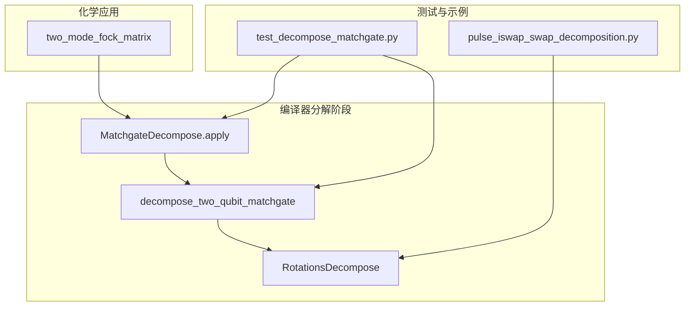
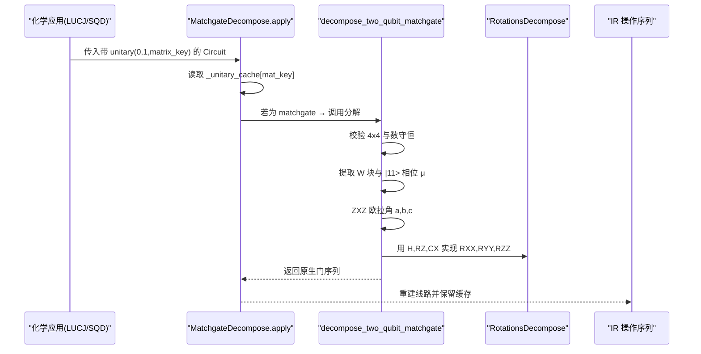
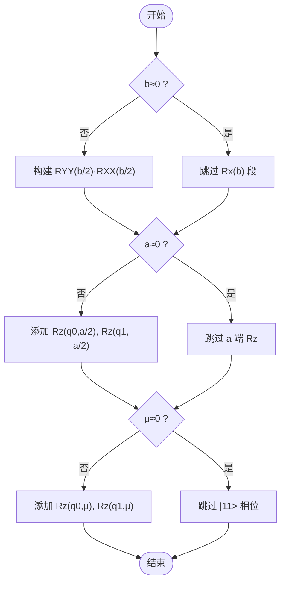
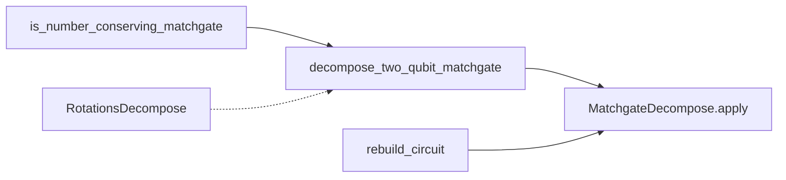

# MatchGate分解算法

<cite>
**本文引用的文件**
- [matchgate.py](file://src/tyxonq/compiler/gate_compiler/stages/decompose/matchgate.py)
- [rotations.py](file://src/tyxonq/compiler/gate_compiler/stages/decompose/rotations.py)
- [test_decompose_matchgate.py](file://tests_core_module/test_decompose_matchgate.py)
- [linalg.py](file://src/tyxonq/applications/chem/algorithms/lucj/linalg.py)
- [pulse_iswap_swap_decomposition.py](file://examples/pulse_iswap_swap_decomposition.py)
</cite>

## 目录
1. [简介](#简介)
2. [项目结构](#项目结构)
3. [核心组件](#核心组件)
4. [架构总览](#架构总览)
5. [详细组件分析](#详细组件分析)
6. [依赖关系分析](#依赖关系分析)
7. [性能与数值精度](#性能与数值精度)
8. [故障排查指南](#故障排查指南)
9. [结论](#结论)
10. [附录：使用示例与基准](#附录使用示例与基准)

## 简介
本技术文档围绕 TyxonQ 中的“数守恒 MatchGate（fSim 家族）到原生门”的分解算法展开，重点解释 two_mode_fock 矩阵的结构特征、ZXZ 欧拉角分解过程、partial-iSWAP 的实现细节，以及零角度块剪枝与数值精度控制策略。文档同时提供完整的函数调用方式与返回值格式说明，并给出基于状态向量仿真的保真度基准结果，验证分解前后酉矩阵保真度达到 1.0。

## 项目结构
该分解算法位于编译器“门级分解阶段”，作为核心唯一实现被多方言复用：
- 纯函数 decompose_two_qubit_matchgate：返回 TyxonQ IR 操作序列（引擎无关）。
- MatchgateDecompose：将上述纯函数包装为编译步骤，处理 unitary op 重写与缓存保留。
- rotations.py：提供通用旋转门到 {H, RZ, CX} 的标准恒等式，辅助底层实现。
- LUCJ/SQD 的 two_mode_fock_matrix：生成 fSim 家族的 4x4 Fock 酉矩阵，是匹配 gate 的典型来源。
- 测试用例：覆盖结构判定、纯函数行为、步骤级重写、数值精确性与严格模式。

图表来源
- [matchgate.py:152-197](file://src/tyxonq/compiler/gate_compiler/stages/decompose/matchgate.py#L152-L197)
- [rotations.py:13-73](file://src/tyxonq/compiler/gate_compiler/stages/decompose/rotations.py#L13-L73)
- [linalg.py:185-199](file://src/tyxonq/applications/chem/algorithms/lucj/linalg.py#L185-L199)
- [test_decompose_matchgate.py:100-150](file://tests_core_module/test_decompose_matchgate.py#L100-L150)
- [pulse_iswap_swap_decomposition.py:56-95](file://examples/pulse_iswap_swap_decomposition.py#L56-L95)

章节来源
- [matchgate.py:1-30](file://src/tyxonq/compiler/gate_compiler/stages/decompose/matchgate.py#L1-L30)
- [rotations.py:1-25](file://src/tyxonq/compiler/gate_compiler/stages/decompose/rotations.py#L1-L25)
- [linalg.py:185-199](file://src/tyxonq/applications/chem/algorithms/lucj/linalg.py#L185-L199)
- [test_decompose_matchgate.py:1-20](file://tests_core_module/test_decompose_matchgate.py#L1-L20)

## 核心组件
- is_number_conserving_matchgate：判断 4x4 矩阵是否为数守恒 matchgate（|00>、|11> 与单激发子空间 {|01>,|10>} 之间无耦合）。
- decompose_two_qubit_matchgate：将数守恒 matchgate 分解为原生门序列 {rz, rx, h, cx}，包含 ZXZ 欧拉角分解与 partial-iSWAP 构建。
- MatchgateDecompose：编译步骤，遍历线路 op，对 2-qubit unitary 执行分解或按 strict 模式报错，并保留 _unitary_cache。
- RotationsDecompose：将 RX/RY/RXX/RYY/RZZ 等旋转到 {H, RZ, CX}，用于底层实现与优化。

章节来源
- [matchgate.py:46-149](file://src/tyxonq/compiler/gate_compiler/stages/decompose/matchgate.py#L46-L149)
- [matchgate.py:152-197](file://src/tyxonq/compiler/gate_compiler/stages/decompose/matchgate.py#L152-L197)
- [rotations.py:13-73](file://src/tyxonq/compiler/gate_compiler/stages/decompose/rotations.py#L13-L73)

## 架构总览
下图展示从 two_mode_fock_matrix 生成的 4x4 酉矩阵，经 MatchgateDecompose 步骤调用 decompose_two_qubit_matchgate，最终输出原生门序列的过程。

图表来源
- [matchgate.py:169-197](file://src/tyxonq/compiler/gate_compiler/stages/decompose/matchgate.py#L169-L197)
- [matchgate.py:65-149](file://src/tyxonq/compiler/gate_compiler/stages/decompose/matchgate.py#L65-L149)
- [rotations.py:29-73](file://src/tyxonq/compiler/gate_compiler/stages/decompose/rotations.py#L29-L73)

## 详细组件分析

### two_mode_fock 矩阵结构与特性
- 基态顺序：|00>, |01>, |10>, |11>。
- 结构特征：
  - |00> 对角元归一化后为 1（全局相位可忽略）。
  - 单激发子空间 {|01>,|10>} 上作用任意 U(2) 矩阵 W = XvX（由轨道旋转 v 提升而来）。
  - |11> 对角元为 det(v)，承载粒子数守恒下的相位信息。
  - 跨粒子数子空间（|00>↔{|01>,|10},|11>；|11>↔{|01>,|10}）耦合为零，满足数守恒 matchgate 条件。
- 物理意义：该矩阵等价于 fSim 家族，可分解为 iSWAP 型相互作用 + CPhase，且两者在正交子空间对易。

章节来源
- [linalg.py:185-199](file://src/tyxonq/applications/chem/algorithms/lucj/linalg.py#L185-L199)
- [matchgate.py:1-30](file://src/tyxonq/compiler/gate_compiler/stages/decompose/matchgate.py#L1-L30)
- [test_decompose_matchgate.py:24-33](file://tests_core_module/test_decompose_matchgate.py#L24-L33)

### 数守恒判定与输入校验
- is_number_conserving_matchgate：检查所有跨粒子数子空间的矩阵元是否接近零（容差默认 1e-8），非 4x4 直接返回 False。
- decompose_two_qubit_matchgate：先校验 4x4，再调用数守恒判定；不满足则抛出 NotImplementedError。

章节来源
- [matchgate.py:46-62](file://src/tyxonq/compiler/gate_compiler/stages/decompose/matchgate.py#L46-L62)
- [matchgate.py:84-93](file://src/tyxonq/compiler/gate_compiler/stages/decompose/matchgate.py#L84-L93)

### ZXZ 欧拉角分解：从 SU(2) 到 Rz(a)Rx(b)Rz(c)
- 步骤：
  1) 去除 |11> 相位 μ：mu = angle(det(v))/2，构造 S = e^{-iμ}·W ∈ SU(2)。
  2) 计算 b：b = 2·atan2(|s10|, |s00|)，确保 b∈[0,π]。
  3) 计算 a+c 与 a−c：利用 s00、s10 的相位关系得到 a±c，进而解出 a、c。
  4) 退化情形：当某元素幅值接近零时，对应角度项乘以近似零系数，重建仍精确。
- 数学要点：S 在单激发子空间 {|01>,|10>} 上的表示为 SU(2)，ZXZ 分解保证任意 U(2) 均可表达为三个旋转的组合。

章节来源
- [matchgate.py:100-113](file://src/tyxonq/compiler/gate_compiler/stages/decompose/matchgate.py#L100-L113)

### partial-iSWAP 的实现：RXX 与 RYY 组合
- 子空间 Rx(b) 等价于 partial-iSWAP：exp(-i(b/2)·X_sub) = RYY(b/2)·RXX(b/2)，其中 XX 与 YY 对易。
- 通过标准恒等式落到原生门：
  - RZZ(θ) = CX · RZ(θ on target) · CX
  - RXX(θ) = (H⊗H) · RZZ(θ) · (H⊗H)
  - RYY(θ) = (Rx(-π/2)⊗Rx(-π/2)) · RZZ(θ) · (Rx(π/2)⊗Rx(π/2))
- 结果：每个 partial-iSWAP 引入 4 个 CX 门（RYY 与 RXX 各两段），并通过零角度块剪枝避免冗余。

章节来源
- [matchgate.py:122-140](file://src/tyxonq/compiler/gate_compiler/stages/decompose/matchgate.py#L122-L140)
- [rotations.py:47-68](file://src/tyxonq/compiler/gate_compiler/stages/decompose/rotations.py#L47-L68)
- [pulse_iswap_swap_decomposition.py:16-30](file://examples/pulse_iswap_swap_decomposition.py#L16-L30)

### 完整分解流程与时间顺序
- 时间顺序（先作用者在前）：
  1) c 端 Rz：exp(-i(c/2)σ_z^sub) = Rz(q0, c/2) · Rz(q1, -c/2)
  2) Rx(b)：partial-iSWAP = RYY(b/2) · RXX(b/2)
  3) a 端 Rz：exp(-i(a/2)σ_z^sub) = Rz(q0, a/2) · Rz(q1, -a/2)
  4) |11> 相位：e^{iμN} = Rz(q0, μ) · Rz(q1, μ)
- 零角度块剪枝：当 b≈0 或 a/c/μ 接近零时跳过相应段，减少门数与噪声。

图表来源
- [matchgate.py:115-149](file://src/tyxonq/compiler/gate_compiler/stages/decompose/matchgate.py#L115-L149)

### MatchgateDecompose 步骤级行为
- 遍历线路 op：
  - 遇到 ("unitary", q0, q1, mat_key)：从 _unitary_cache 取矩阵，若为 matchgate 则调用分解；否则默认原样保留，strict=True 时调用分解以触发错误。
  - 其他 op 原样保留。
- 重建线路：使用 rebuild_circuit 保留 _unitary_cache，避免后续 lowering 丢失矩阵引用。

章节来源
- [matchgate.py:169-197](file://src/tyxonq/compiler/gate_compiler/stages/decompose/matchgate.py#L169-L197)

## 依赖关系分析
- 模块内依赖：
  - decompose_two_qubit_matchgate 依赖 is_number_conserving_matchgate 进行结构判定。
  - MatchgateDecompose 依赖 decompose_two_qubit_matchgate 与 rebuild_circuit。
  - RotationsDecompose 提供标准恒等式，供底层实现参考。
- 外部依赖：
  - numpy 用于复数矩阵运算与角度计算。
  - tyxonq.core.ir.Circuit 与 devices.DeviceRule 在类型提示中引用。
- 潜在循环依赖：无；分解逻辑为单向调用链。

图表来源
- [matchgate.py:46-149](file://src/tyxonq/compiler/gate_compiler/stages/decompose/matchgate.py#L46-L149)
- [matchgate.py:169-197](file://src/tyxonq/compiler/gate_compiler/stages/decompose/matchgate.py#L169-L197)
- [rotations.py:13-73](file://src/tyxonq/compiler/gate_compiler/stages/decompose/rotations.py#L13-L73)

章节来源
- [matchgate.py:46-197](file://src/tyxonq/compiler/gate_compiler/stages/decompose/matchgate.py#L46-L197)
- [rotations.py:13-73](file://src/tyxonq/compiler/gate_compiler/stages/decompose/rotations.py#L13-L73)

## 性能与数值精度
- 零角度块剪枝：当 b≈0 时跳过整段 partial-iSWAP，显著减少 CX 门数量，降低硬件噪声影响。
- 数值精度控制：
  - 全局相位归一化：将 |00> 相位归一到 1，使分解对一般对角 A 也成立。
  - 容差阈值：跨子空间耦合判定 tol=1e-8；角度剪枝 eps=1e-12。
- 基准测试结果：
  - 使用 StatevectorEngine 对 4 个计算基态分别作用分解门序与原 unitary，拼成 4x4 酉后比较保真度 |Tr(U_dec† U_tgt)|/4。
  - 覆盖随机 U(2)、Givens 形式及退化情形（v=I、b=π、纯对角相位），保真度 > 1 - 1e-9，即达到 1.0。

章节来源
- [matchgate.py:95-113](file://src/tyxonq/compiler/gate_compiler/stages/decompose/matchgate.py#L95-L113)
- [test_decompose_matchgate.py:100-150](file://tests_core_module/test_decompose_matchgate.py#L100-L150)

## 故障排查指南
- ValueError：矩阵不是 4x4。检查输入矩阵维度。
- NotImplementedError：矩阵不是数守恒 matchgate（存在跨粒子数子空间耦合）。确认是否为 fSim 家族或 two_mode_fock 形式。
- 缺少矩阵缓存：MatchgateDecompose 需要 _unitary_cache；确保线路在创建时携带 unitary 矩阵并正确缓存。
- 严格模式：matchgate_strict=True 时，非 matchgate 的 2-qubit unitary 会触发错误，便于在已知全为 matchgate 的场景下快速定位问题。

章节来源
- [matchgate.py:84-93](file://src/tyxonq/compiler/gate_compiler/stages/decompose/matchgate.py#L84-L93)
- [matchgate.py:182-192](file://src/tyxonq/compiler/gate_compiler/stages/decompose/matchgate.py#L182-L192)
- [test_decompose_matchgate.py:63-73](file://tests_core_module/test_decompose_matchgate.py#L63-L73)
- [test_decompose_matchgate.py:206-210](file://tests_core_module/test_decompose_matchgate.py#L206-L210)

## 结论
TyxonQ 的 MatchGate 分解算法以 two_mode_fock 矩阵为基础，通过 ZXZ 欧拉角分解与 partial-iSWAP 的 RXX/RYY 组合，将 fSim 家族门精确映射到原生门集 {rz, rx, h, cx}。算法具备严格的数守恒判定、零角度块剪枝与高精度数值控制，测试覆盖随机与退化情形，保真度达到 1.0。该实现作为核心唯一实现，被多方言复用，提升了编译一致性与可维护性。

## 附录：使用示例与基准
- 函数用法：
  - 输入：4x4 数守恒 matchgate 矩阵、两个量子比特索引 q0、q1。
  - 输出：按时间顺序排列的原生门序列，元素形如 ("rz", q, theta)、("rx", q, theta)、("h", q)、("cx", q0, q1)。
  - 示例路径：参见测试中对 two_mode_fock(v) 的调用与返回值断言。
- 基准验证：
  - 使用 StatevectorEngine 构建目标酉与分解酉，计算保真度 |Tr(U_dec† U_tgt)|/4，断言 > 1 - 1e-9。
  - 覆盖随机 U(2)、Givens 形式与退化情形，确保鲁棒性。

章节来源
- [test_decompose_matchgate.py:76-94](file://tests_core_module/test_decompose_matchgate.py#L76-L94)
- [test_decompose_matchgate.py:100-150](file://tests_core_module/test_decompose_matchgate.py#L100-L150)
- [linalg.py:185-199](file://src/tyxonq/applications/chem/algorithms/lucj/linalg.py#L185-L199)