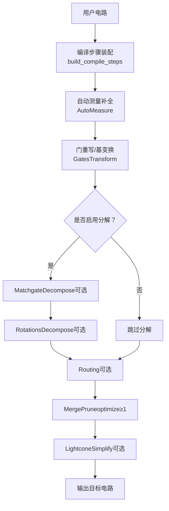
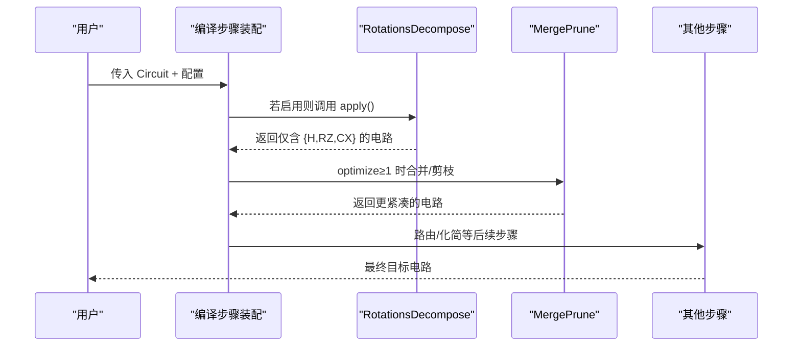
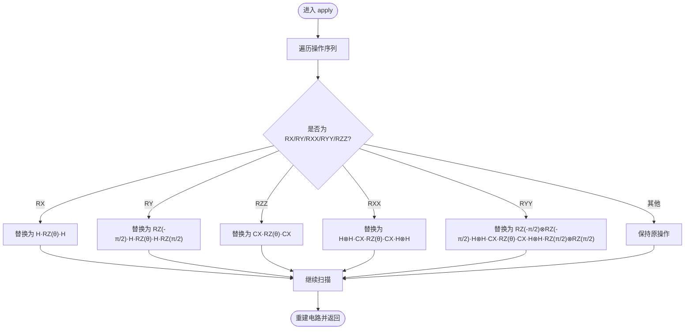
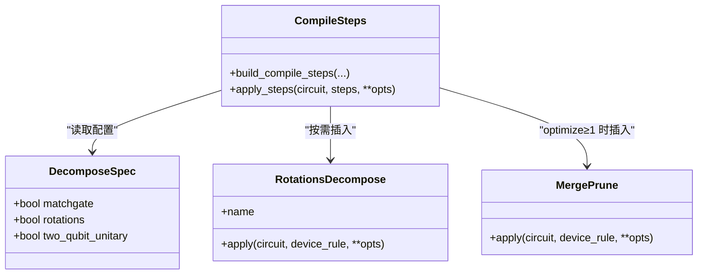
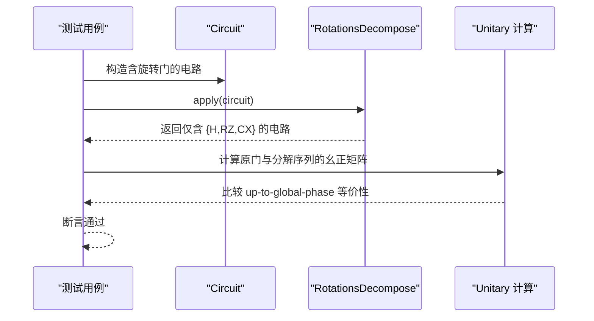
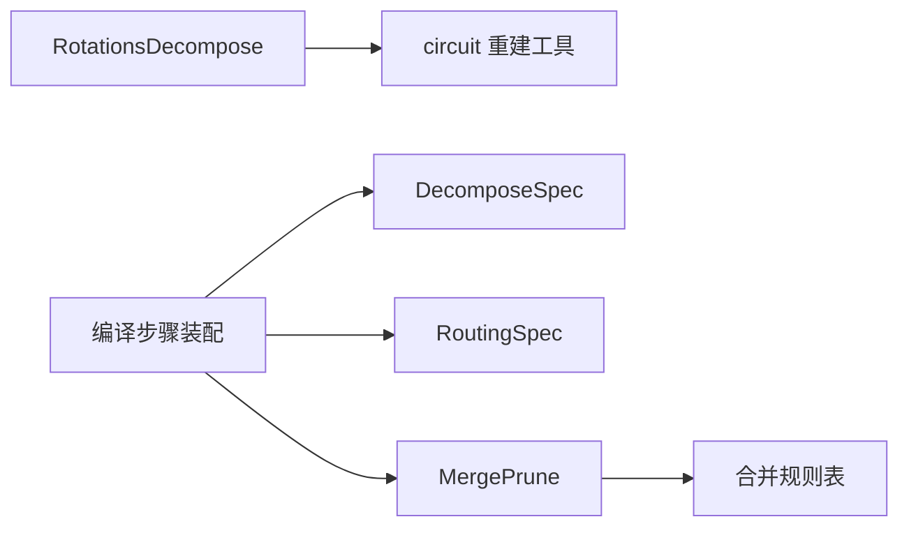

# 旋转门分解

<cite>
**本文引用的文件**
- [rotations.py](file://src/tyxonq/compiler/gate_compiler/stages/decompose/rotations.py)
- [test_decompose_rotations.py](file://tests_core_module/test_decompose_rotations.py)
- [steps.py](file://src/tyxonq/compiler/gate_compiler/steps.py)
- [specs.py](file://src/tyxonq/compiler/gate_compiler/specs.py)
- [__init__.py（decompose）](file://src/tyxonq/compiler/gate_compiler/stages/decompose/__init__.py)
- [merge_prune.py](file://src/tyxonq/compiler/gate_compiler/stages/rewrite/merge_prune.py)
</cite>

## 目录
1. [简介](#简介)
2. [项目结构](#项目结构)
3. [核心组件](#核心组件)
4. [架构总览](#架构总览)
5. [详细组件分析](#详细组件分析)
6. [依赖关系分析](#依赖关系分析)
7. [性能与精度考量](#性能与精度考量)
8. [故障排查指南](#故障排查指南)
9. [结论](#结论)
10. [附录：配置与参数调优](#附录配置与参数调优)

## 简介
本指南聚焦 TyxonQ 中的“旋转门分解”策略，系统说明如何将 RX、RY、RXX、RYY、RZZ 等参数化旋转门分解到核心原生集合 {H, RZ, CX}，并解释其在编译流水线中的位置、与其他步骤的协作方式、数值等价性保障以及可配置的优化选项。文档同时给出与平台约束相关的建议、误差传播分析与基准测试思路，帮助读者在不同目标硬件上选择合适的分解策略与参数。

## 项目结构
旋转门分解位于编译器 gate compiler 的分解阶段，由类型化的编译规格装配到编译步骤序列中，并在后续路由、优化、化简等步骤之前执行，以确保下游工具能正确识别基本门集。

图表来源
- [steps.py:27-91](file://src/tyxonq/compiler/gate_compiler/steps.py#L27-L91)
- [specs.py:15-30](file://src/tyxonq/compiler/gate_compiler/specs.py#L15-L30)
- [__init__.py（decompose）:1-8](file://src/tyxonq/compiler/gate_compiler/stages/decompose/__init__.py#L1-L8)

章节来源
- [steps.py:27-91](file://src/tyxonq/compiler/gate_compiler/steps.py#L27-L91)
- [specs.py:15-30](file://src/tyxonq/compiler/gate_compiler/specs.py#L15-L30)
- [__init__.py（decompose）:1-8](file://src/tyxonq/compiler/gate_compiler/stages/decompose/__init__.py#L1-L8)

## 核心组件
- RotationsDecompose：将 RX、RY、RXX、RYY、RZZ 按标准恒等式分解为 {H, RZ, CX}；对 RZ 直接透传，避免无谓展开。
- 编译步骤装配：通过 DecomposeSpec 控制是否启用 RotationsDecompose，并与 MatchgateDecompose、路由、优化、化简协同工作。
- MergePrune：在分解后合并相邻同线单比特门、消除单位元，减少门数与深度。

章节来源
- [rotations.py:13-73](file://src/tyxonq/compiler/gate_compiler/stages/decompose/rotations.py#L13-L73)
- [steps.py:27-91](file://src/tyxonq/compiler/gate_compiler/steps.py#L27-L91)
- [merge_prune.py:27-88](file://src/tyxonq/compiler/gate_compiler/stages/rewrite/merge_prune.py#L27-L88)

## 架构总览
旋转门分解作为“分解阶段”的一部分，遵循固定顺序：先规范化（自动测量、门重写），再分解（matchgate、旋转门），然后路由（如需）、优化（合并剪枝）、化简（光锥简化）。该顺序确保：
- 分解后的门集稳定且可被下游工具识别；
- 路由前已消除高层参数化旋转门，避免兼容性问题；
- 优化步骤可在分解产物上进一步压缩电路。

图表来源
- [steps.py:27-91](file://src/tyxonq/compiler/gate_compiler/steps.py#L27-L91)
- [rotations.py:29-73](file://src/tyxonq/compiler/gate_compiler/stages/decompose/rotations.py#L29-L73)
- [merge_prune.py:40-46](file://src/tyxonq/compiler/gate_compiler/stages/rewrite/merge_prune.py#L40-L46)

## 详细组件分析

### 旋转门分解规则（RotationsDecompose）
- 单量子比特旋转门
  - RX(θ) → H · RZ(θ) · H
  - RY(θ) → RZ(-π/2) · H · RZ(θ) · H · RZ(π/2)
- 双量子比特旋转门
  - RZZ(θ) → CX(q0,q1) · RZ(θ on q1) · CX(q0,q1)
  - RXX(θ) → H⊗H · CX(q0,q1) · RZ(θ on q1) · CX(q0,q1) · H⊗H
  - RYY(θ) → (RZ(-π/2)⊗RZ(-π/2)) · (H⊗H) · CX(q0,q1) · RZ(θ on q1) · CX(q0,q1) · (H⊗H) · (RZ(π/2)⊗RZ(π/2))
- RZ 透传：由于 RZ 已是核心原生门，不进行额外分解。

图表来源
- [rotations.py:29-73](file://src/tyxonq/compiler/gate_compiler/stages/decompose/rotations.py#L29-L73)

章节来源
- [rotations.py:13-73](file://src/tyxonq/compiler/gate_compiler/stages/decompose/rotations.py#L13-L73)

### 编译步骤装配与集成
- 通过 DecomposeSpec 控制是否启用 RotationsDecompose；默认关闭 rotations，因为许多平台原生支持旋转门，展开会增加门数。
- 当 decompose=True 或 DecomposeSpec(rotations=True) 时，会在 GatesTransform 之后、路由之前插入 RotationsDecompose。
- 若 optimize≥1，则在分解后追加 MergePrune，进行相邻门合并与单位元剪枝。

图表来源
- [specs.py:15-30](file://src/tyxonq/compiler/gate_compiler/specs.py#L15-L30)
- [steps.py:27-91](file://src/tyxonq/compiler/gate_compiler/steps.py#L27-L91)
- [merge_prune.py:27-88](file://src/tyxonq/compiler/gate_compiler/stages/rewrite/merge_prune.py#L27-L88)

章节来源
- [specs.py:15-30](file://src/tyxonq/compiler/gate_compiler/specs.py#L15-L30)
- [steps.py:27-91](file://src/tyxonq/compiler/gate_compiler/steps.py#L27-L91)

### 数值等价性与测试覆盖
- 测试断言：分解后的每个操作均属于 {H, RZ, CX}；分解序列与原门的幺正矩阵在“全局相位差”意义下相等。
- 测试覆盖：单量子比特旋转（RX、RY）与双量子比特旋转（RXX、RYY、RZZ）的多组角度参数；RZ 透传验证。

图表来源
- [test_decompose_rotations.py:32-72](file://tests_core_module/test_decompose_rotations.py#L32-L72)
- [test_decompose_rotations.py:75-114](file://tests_core_module/test_decompose_rotations.py#L75-L114)

章节来源
- [test_decompose_rotations.py:75-114](file://tests_core_module/test_decompose_rotations.py#L75-L114)

### 与其他分解步骤的协作
- MatchgateDecompose：处理数守恒的双量子比特门（如 two_mode_fock/fSim），与 RotationsDecompose 互补。
- 顺序保证：分解先于路由，避免下游工具无法识别 unitary 操作；分解后再进行合并剪枝，提升效率。

章节来源
- [__init__.py（decompose）:1-8](file://src/tyxonq/compiler/gate_compiler/stages/decompose/__init__.py#L1-L8)
- [steps.py:27-91](file://src/tyxonq/compiler/gate_compiler/steps.py#L27-L91)

## 依赖关系分析
- RotationsDecompose 依赖电路重建工具以保留缓存，避免后续 lowering 丢失矩阵引用。
- 编译步骤装配依赖 DecomposeSpec/RoutingSpec 的类型化配置，确保行为可预测且可组合。
- MergePrune 依赖简单的邻接合并规则表，对分解产物进行轻量优化。

图表来源
- [rotations.py:6-24](file://src/tyxonq/compiler/gate_compiler/stages/decompose/rotations.py#L6-L24)
- [steps.py:27-91](file://src/tyxonq/compiler/gate_compiler/steps.py#L27-L91)
- [specs.py:15-58](file://src/tyxonq/compiler/gate_compiler/specs.py#L15-L58)
- [merge_prune.py:12-24](file://src/tyxonq/compiler/gate_compiler/stages/rewrite/merge_prune.py#L12-L24)

章节来源
- [rotations.py:6-24](file://src/tyxonq/compiler/gate_compiler/stages/decompose/rotations.py#L6-L24)
- [steps.py:27-91](file://src/tyxonq/compiler/gate_compiler/steps.py#L27-L91)
- [specs.py:15-58](file://src/tyxonq/compiler/gate_compiler/specs.py#L15-L58)
- [merge_prune.py:12-24](file://src/tyxonq/compiler/gate_compiler/stages/rewrite/merge_prune.py#L12-L24)

## 性能与精度考量
- 门数与深度：分解会引入额外的 H、RZ、CX，增加门数与深度；但可通过 MergePrune 合并相邻单比特门、消除单位元，降低开销。
- 数值精度：分解基于标准恒等式，测试覆盖多组角度参数，保证 up-to-global-phase 等价；浮点误差主要来自三角函数与矩阵乘法，通常远小于测量噪声。
- 平台约束：
  - 若目标硬件原生支持 RX/RY/RXX/RYY/RZZ，建议关闭 rotations 以避免无谓展开。
  - 若目标硬件仅支持 {H, RZ, CX}，则必须启用 rotations 以保证兼容性。
- 误差传播：分解过程不改变幺正等价类，误差主要来源于后续仿真/执行；建议在关键路径上评估分解前后的误差差异（例如期望值偏差、保真度）。

[本节为通用指导，无需特定文件来源]

## 故障排查指南
- 现象：分解后仍出现非 {H, RZ, CX} 的门
  - 检查是否启用了 RotationsDecompose；确认输入操作名是否为 rx/ry/rxx/ryy/rzz（大小写不敏感）。
  - 参考测试断言：分解结果应全部落在原生集合内。
- 现象：分解后数值不等价
  - 使用测试中的“up-to-global-phase”等价性检查方法，对比原门与分解序列的幺正矩阵。
  - 关注浮点精度与全局相位差异；允许微小误差。
- 现象：优化未生效
  - 确认 optimize≥1 以启用 MergePrune；检查相邻门是否在同一量子比特上以便合并。

章节来源
- [test_decompose_rotations.py:75-114](file://tests_core_module/test_decompose_rotations.py#L75-L114)
- [merge_prune.py:40-88](file://src/tyxonq/compiler/gate_compiler/stages/rewrite/merge_prune.py#L40-L88)

## 结论
TyxonQ 的旋转门分解以标准恒等式为基础，提供稳定、可验证的 {H, RZ, CX} 目标集，并通过类型化规格与编译步骤装配实现灵活控制。结合 MergePrune 的轻量优化，可在不同硬件平台上平衡兼容性与性能。推荐根据目标平台能力选择是否启用 rotations，并利用测试与基准评估分解效果。

[本节为总结性内容，无需特定文件来源]

## 附录：配置与参数调优
- 启用/关闭旋转门分解
  - 使用 DecomposeSpec(rotations=True/False) 控制；默认 False。
  - 当 decompose=True 时，默认 matchgate 开启、rotations 关闭。
- 优化级别
  - optimize≥1 时启用 MergePrune，合并相邻单比特门、剪枝单位元。
- 路由相关
  - RoutingSpec.optimization_level 默认 0，避免 qiskit transpile 生成 IR 词汇表外的门；必要时可调整 seed 以复现结果。
- 阈值与精度
  - 当前实现未暴露显式分解阈值；数值等价性由恒等式保证并通过测试覆盖。
  - 若需自定义阈值，可在上层封装中对角度进行舍入或裁剪，再送入编译流程。

章节来源
- [specs.py:15-58](file://src/tyxonq/compiler/gate_compiler/specs.py#L15-L58)
- [steps.py:27-91](file://src/tyxonq/compiler/gate_compiler/steps.py#L27-L91)