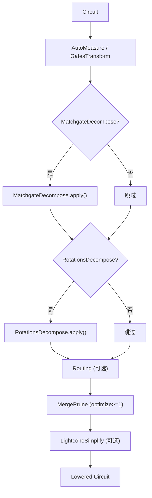
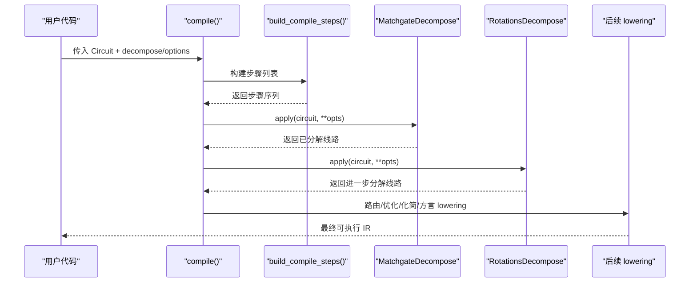
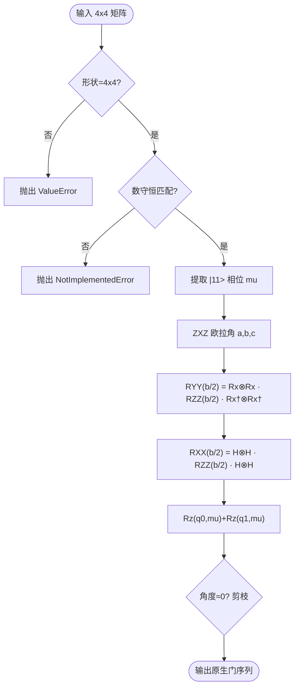
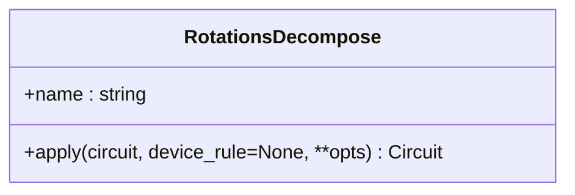
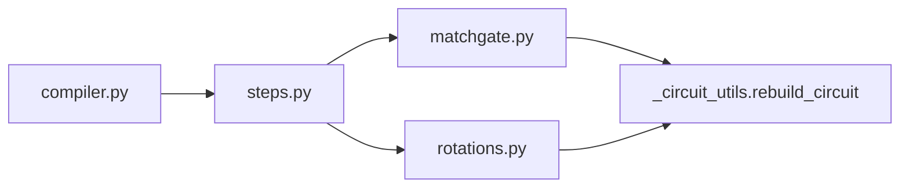

# 门分解优化

<cite>
**本文引用的文件**
- [matchgate.py](file://src/tyxonq/compiler/gate_compiler/stages/decompose/matchgate.py)
- [rotations.py](file://src/tyxonq/compiler/gate_compiler/stages/decompose/rotations.py)
- [specs.py](file://src/tyxonq/compiler/gate_compiler/specs.py)
- [steps.py](file://src/tyxonq/compiler/gate_compiler/steps.py)
- [compiler.py](file://src/tyxonq/compiler/gate_compiler/compiler.py)
- [test_decompose_matchgate.py](file://tests_core_module/test_decompose_matchgate.py)
- [test_decompose_rotations.py](file://tests_core_module/test_decompose_rotations.py)
- [pulse_iswap_swap_decomposition.py](file://examples/pulse_iswap_swap_decomposition.py)
</cite>

## 目录
1. [简介](#简介)
2. [项目结构](#项目结构)
3. [核心组件](#核心组件)
4. [架构总览](#架构总览)
5. [详细组件分析](#详细组件分析)
6. [依赖关系分析](#依赖关系分析)
7. [性能考量](#性能考量)
8. [故障排查指南](#故障排查指南)
9. [结论](#结论)
10. [附录：配置与参数调优](#附录配置与参数调优)

## 简介
本指南聚焦 TyxonQ 的门分解优化，系统阐述 MatchGate 分解算法的实现原理、旋转门分解策略、目标硬件约束、配置选项与参数调优方法，并通过测试与示例展示分解前后电路的变化。文档同时覆盖数值精度控制与误差处理策略，并给出基准测试思路与性能分析要点，帮助读者在真实硬件或模拟器上获得稳定、高效的编译结果。

## 项目结构
TyxonQ 的门分解位于编译器“gate_compiler”的 stages/decompose 子模块中，包含两类关键步骤：
- MatchGate 分解：将数守恒的 2-qubit matchgate（two_mode_fock/fSim 家族）精确分解到原生门集 {rz, rx, h, cx}。
- 旋转门分解：将参数化旋转门 rx/ry/rxx/ryy/rzz 分解到 {h, rz, cx}。

这些步骤通过类型化的 DecomposeSpec 装配进编译流水线，并在 apply_steps 中顺序执行。

图表来源
- [steps.py:27-91](file://src/tyxonq/compiler/gate_compiler/steps.py#L27-L91)
- [compiler.py:57-74](file://src/tyxonq/compiler/gate_compiler/compiler.py#L57-L74)

章节来源
- [steps.py:27-91](file://src/tyxonq/compiler/gate_compiler/steps.py#L27-L91)
- [compiler.py:57-74](file://src/tyxonq/compiler/gate_compiler/compiler.py#L57-L74)

## 核心组件
- MatchGate 分解
  - 功能：识别并分解数守恒的 2-qubit matchgate（two_mode_fock/fSim），输出原生门序列。
  - 关键点：ZXZ 欧拉角分解单激发子空间 U(2)，iSWAP 型相互作用用 RXX/RYY 实现，相位由 Rz 承载；零角度块剪枝以节省门数。
  - 严格模式：可强制非 matchgate 报错，便于已知全为 matchgate 的场景（如 LUCJ）。
- 旋转门分解
  - 功能：将 rx/ry/rxx/ryy/rzz 等参数化门等价转换为 {h, rz, cx}。
  - 关键点：保持数值等价（允许全局相位差），rz 作为原生门透传。
- 编译规格与装配
  - DecomposeSpec：统一开关 matchgate、rotations、two_qubit_unitary 的分解行为。
  - steps.build_compile_steps：按固定顺序装配步骤，默认开启 matchgate，关闭 rotations（避免无谓展开）。
  - compiler.compile：归一化优化级别，组装并执行步骤。

章节来源
- [matchgate.py:1-205](file://src/tyxonq/compiler/gate_compiler/stages/decompose/matchgate.py#L1-L205)
- [rotations.py:1-76](file://src/tyxonq/compiler/gate_compiler/stages/decompose/rotations.py#L1-L76)
- [specs.py:15-31](file://src/tyxonq/compiler/gate_compiler/specs.py#L15-L31)
- [steps.py:27-91](file://src/tyxonq/compiler/gate_compiler/steps.py#L27-L91)
- [compiler.py:57-74](file://src/tyxonq/compiler/gate_compiler/compiler.py#L57-L74)

## 架构总览
下图展示了从高层 unitary 到原生门的完整分解路径，以及各阶段如何协作。

图表来源
- [steps.py:27-91](file://src/tyxonq/compiler/gate_compiler/steps.py#L27-L91)
- [compiler.py:57-74](file://src/tyxonq/compiler/gate_compiler/compiler.py#L57-L74)

## 详细组件分析

### MatchGate 分解（数守恒 2-qubit 门）
- 物理依据
  - fSim 可分解为 iSWAP 型相互作用与 CPhase，两者作用在正交子空间且对易。
  - two_mode_fock(v) 是 fSim 家族的 2-qubit matchgate，可通过 ZXZ 欧拉角与 RXX/RYY 组合精确降到 {rz, rx, h, cx}。
- 实现要点
  - is_number_conserving_matchgate：检查跨粒子数子空间耦合是否为零，确保可分解性。
  - decompose_two_qubit_matchgate：提取 |11> 相位 mu，计算 SU(2) 子空间的 ZXZ 角 a,b,c；构造 partial-iSWAP（RYY·RXX），并用 cx+rz 实现 RZZ；零角度块剪枝。
  - MatchgateDecompose：扫描线路中的 ("unitary", q0, q1, mat_key)，若矩阵为 matchgate 则替换为原生门序列；支持 strict 模式；保留 _unitary_cache。
- 复杂度与优化
  - 每个 matchgate 最多产生 4 个 CX（partial-iSWAP 的 RYY 和 RXX 各 2 个 CX），其余为单比特门；零角度块剪枝减少冗余。
- 错误处理
  - 非 4x4 矩阵抛出 ValueError。
  - 非 matchgate 在非 strict 模式下原样保留；strict 模式调用纯函数抛出 NotImplementedError。
  - 缺少矩阵缓存时抛出 ValueError。

图表来源
- [matchgate.py:46-149](file://src/tyxonq/compiler/gate_compiler/stages/decompose/matchgate.py#L46-L149)

章节来源
- [matchgate.py:46-149](file://src/tyxonq/compiler/gate_compiler/stages/decompose/matchgate.py#L46-L149)
- [test_decompose_matchgate.py:39-150](file://tests_core_module/test_decompose_matchgate.py#L39-L150)

### 旋转门分解（rx/ry/rxx/ryy/rzz → {h,rz,cx}）
- 规则
  - RX(θ) => H·RZ(θ)·H
  - RY(θ) => S†·H·RZ(θ)·H·S（S=RZ(π/2)）
  - RZZ(θ) => CX·RZ(target, θ)·CX
  - RXX(θ) => H⊗H·CX·RZ(target, θ)·CX·H⊗H
  - RYY(θ) => (S†⊗S†)·H⊗H·CX·RZ(target, θ)·CX·H⊗H·(HS⊗HS)
- 实现要点
  - RotationsDecompose.apply 遍历 op，按上述恒等式替换；rz 作为原生门透传。
  - 使用 rebuild_circuit 保留 _unitary_cache，避免后续 lowering 丢失矩阵引用。
- 数值等价
  - 测试验证分解后与原门幺正等价（允许全局相位差），且结果全部落在 {h, rz, cx}。

图表来源
- [rotations.py:13-73](file://src/tyxonq/compiler/gate_compiler/stages/decompose/rotations.py#L13-L73)

章节来源
- [rotations.py:13-73](file://src/tyxonq/compiler/gate_compiler/stages/decompose/rotations.py#L13-L73)
- [test_decompose_rotations.py:75-114](file://tests_core_module/test_decompose_rotations.py#L75-L114)

### 编译规格与装配（DecomposeSpec 与步骤顺序）
- DecomposeSpec
  - matchgate：默认 True，分解数守恒 2-qubit matchgate。
  - rotations：默认 False，避免不必要的门展开。
  - two_qubit_unitary：当前经 matchgate 覆盖数守恒子集，通用 KAK 分解为后续增量。
- 步骤装配
  - build_compile_steps 固定顺序：规范化 → 分解（matchgate/rotations）→ 路由（可选）→ 优化（merge/prune）→ 化简（lightcone）。
  - 未启用的能力不追加占位步骤，降低开销。
- 入口
  - compiler.compile 归一化 optimization_level，并调用 build_compile_steps 与 apply_steps。

章节来源
- [specs.py:15-31](file://src/tyxonq/compiler/gate_compiler/specs.py#L15-L31)
- [steps.py:27-91](file://src/tyxonq/compiler/gate_compiler/steps.py#L27-L91)
- [compiler.py:57-74](file://src/tyxonq/compiler/gate_compiler/compiler.py#L57-L74)

## 依赖关系分析
- 模块内依赖
  - matchgate.py 依赖 _circuit_utils.rebuild_circuit 重建线路并保留缓存。
  - rotations.py 同样依赖 rebuild_circuit。
  - steps.py 动态导入具体步骤类，避免未启用时的额外依赖。
- 外部依赖
  - 路由步骤委托 qiskit.transpile（当启用 route=True 或 RoutingSpec）。
- 耦合与内聚
  - 分解步骤职责单一、内聚度高；通过统一的 CompileStep 协议解耦。
  - 步骤间通过线路对象传递状态，低耦合。

图表来源
- [matchgate.py:39-39](file://src/tyxonq/compiler/gate_compiler/stages/decompose/matchgate.py#L39-L39)
- [rotations.py:6-6](file://src/tyxonq/compiler/gate_compiler/stages/decompose/rotations.py#L6-L6)
- [steps.py:56-89](file://src/tyxonq/compiler/gate_compiler/steps.py#L56-L89)
- [compiler.py:57-74](file://src/tyxonq/compiler/gate_compiler/compiler.py#L57-L74)

章节来源
- [steps.py:56-89](file://src/tyxonq/compiler/gate_compiler/steps.py#L56-L89)
- [compiler.py:57-74](file://src/tyxonq/compiler/gate_compiler/compiler.py#L57-L74)

## 性能考量
- 门计数与深度
  - 每个 matchgate 最多引入 4 个 CX；零角度块剪枝可减少冗余 CX。
  - 旋转门分解将高维门拆为 {h,rz,cx}，可能增加门数但提升兼容性。
- 优化级别
  - optimize>=1 触发 MergePrune，合并相邻门并剪枝无用操作。
  - simplify=True 触发 LightconeSimplify，基于光锥进行局部化简。
- 路由影响
  - 启用 route 会插入 SWAP 以满足拓扑约束，可能显著增加门数与深度；建议结合设备耦合图与 initial_layout 调优。
- 数值精度
  - 分解过程采用浮点运算；测试以保真度阈值 > 1 - 1e-9 验证数值等价。
  - 对于高精度需求，可在上游数据与参数中使用 float64 或更高精度后端。

[本节提供一般性指导，无需特定文件引用]

## 故障排查指南
- 常见错误
  - 非 4x4 矩阵：decompose_two_qubit_matchgate 抛出 ValueError。
  - 非 matchgate：非 strict 模式原样保留；strict 模式抛出 NotImplementedError。
  - 缺少矩阵缓存：MatchgateDecompose 抛出 ValueError，提示缺少矩阵缓存。
- 定位方法
  - 检查 circuit._unitary_cache 是否存在且包含对应 mat_key。
  - 确认输入的 2-qubit unitary 是否为数守恒 matchgate（is_number_conserving_matchgate）。
  - 若需严格校验，设置 matchgate_strict=True。
- 调试建议
  - 打印分解前后的 op 名称集合，确认是否落入期望的原生门集。
  - 使用 statevector 引擎对比分解前后酉矩阵的保真度。

章节来源
- [matchgate.py:84-93](file://src/tyxonq/compiler/gate_compiler/stages/decompose/matchgate.py#L84-L93)
- [matchgate.py:169-197](file://src/tyxonq/compiler/gate_compiler/stages/decompose/matchgate.py#L169-L197)
- [test_decompose_matchgate.py:63-73](file://tests_core_module/test_decompose_matchgate.py#L63-L73)
- [test_decompose_matchgate.py:206-210](file://tests_core_module/test_decompose_matchgate.py#L206-L210)

## 结论
TyxonQ 的门分解优化以 MatchGate 分解为核心特色，将数守恒的 2-qubit matchgate 精确降至原生门集，并通过旋转门分解统一参数化门到 {h,rz,cx}。类型化的 DecomposeSpec 与步骤装配机制提供了灵活、可扩展的编译流程。配合严格的数值测试与示例，开发者可在不同硬件与仿真环境下获得稳定、高效的电路编译结果。

[本节总结性内容，无需特定文件引用]

## 附录：配置与参数调优
- 启用/禁用分解
  - decompose=True：默认开启 matchgate，关闭 rotations。
  - decompose=DecomposeSpec(matchgate=False, rotations=True)：仅启用旋转门分解。
  - decompose=False：完全关闭分解步骤。
- 严格模式
  - 在 MatchgateDecompose.apply 中传入 matchgate_strict=True，强制非 matchgate 报错。
- 优化与化简
  - optimize=1 或更高：启用 MergePrune。
  - simplify=True：启用 LightconeSimplify。
- 路由配置
  - route=True 或 RoutingSpec：启用路由；可设置 coupling_map、initial_layout、algorithm="qiskit"、optimization_level=0（避免 qiskit 生成不可读回的门）、seed=0（保证可复现）。
- 示例参考
  - 脉冲级 iSWAP/SWAP 分解示例展示了门到脉冲的转换与导出流程，可作为端到端参考。

章节来源
- [specs.py:15-31](file://src/tyxonq/compiler/gate_compiler/specs.py#L15-L31)
- [specs.py:61-76](file://src/tyxonq/compiler/gate_compiler/specs.py#L61-L76)
- [steps.py:27-91](file://src/tyxonq/compiler/gate_compiler/steps.py#L27-L91)
- [pulse_iswap_swap_decomposition.py:56-336](file://examples/pulse_iswap_swap_decomposition.py#L56-L336)