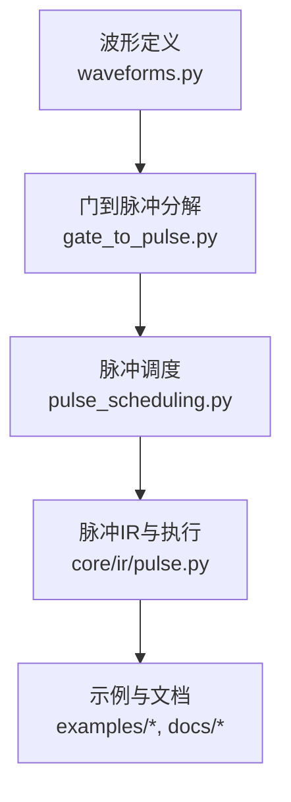
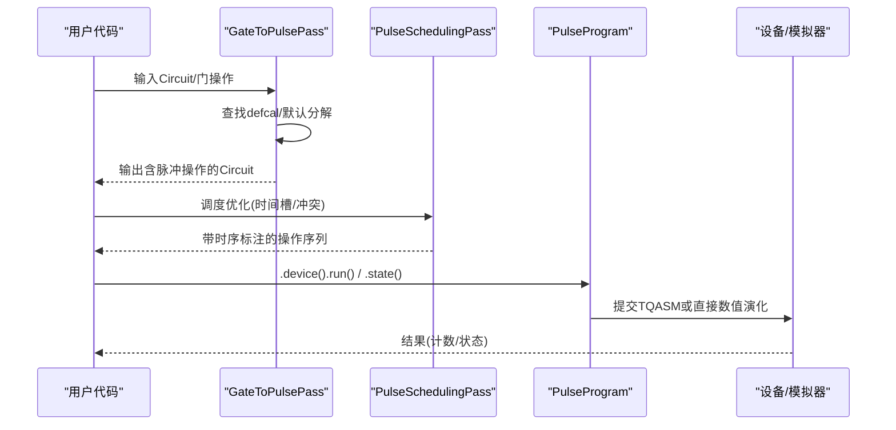
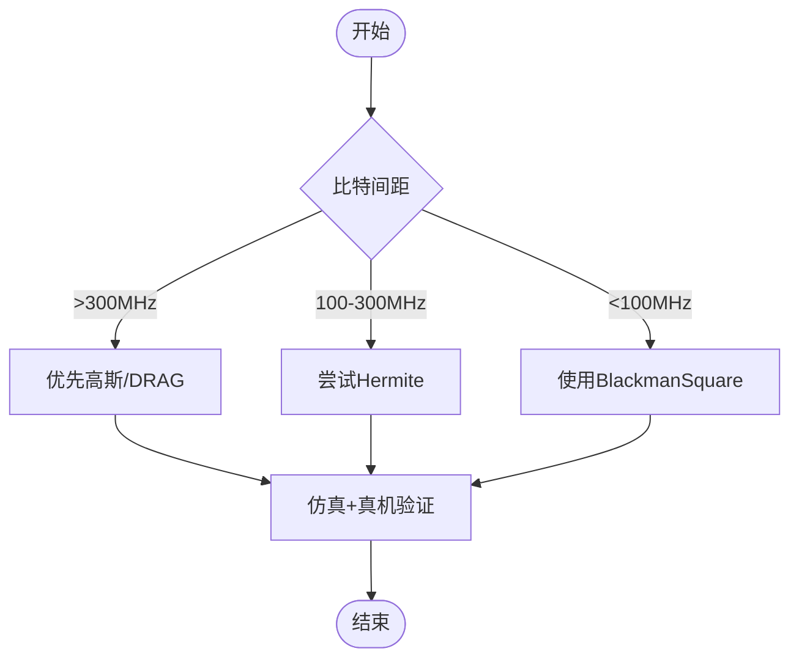
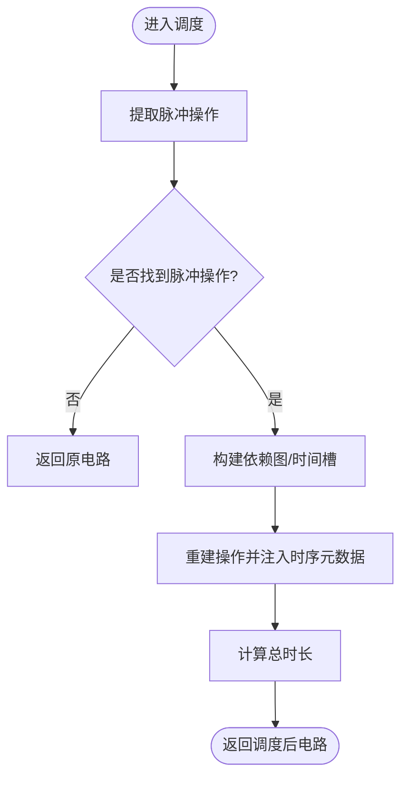
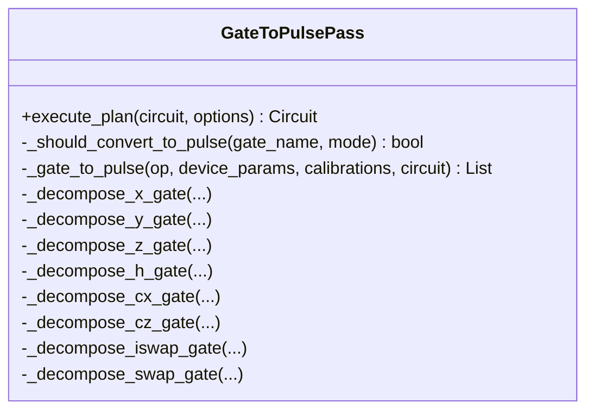
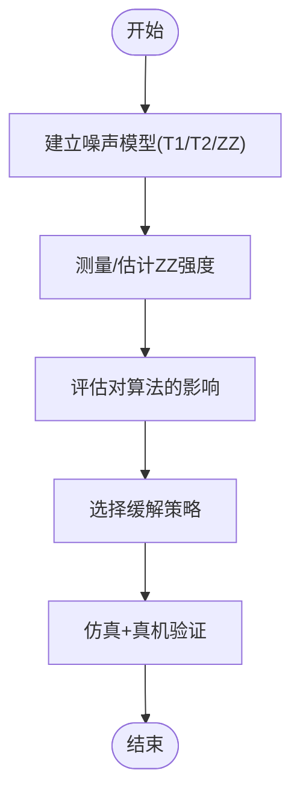
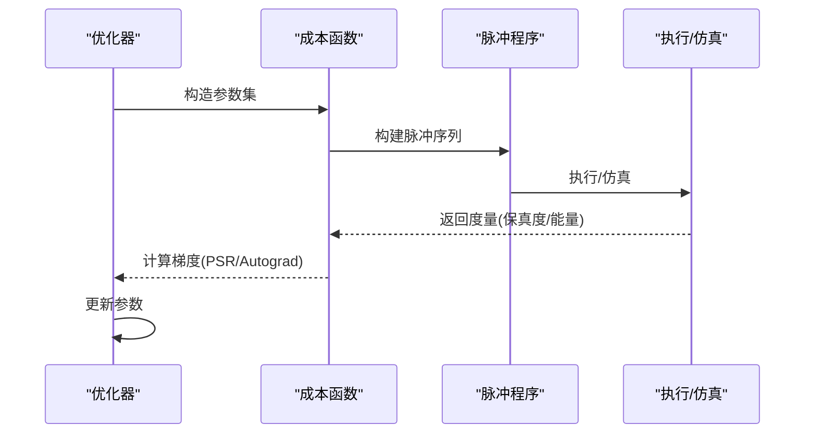
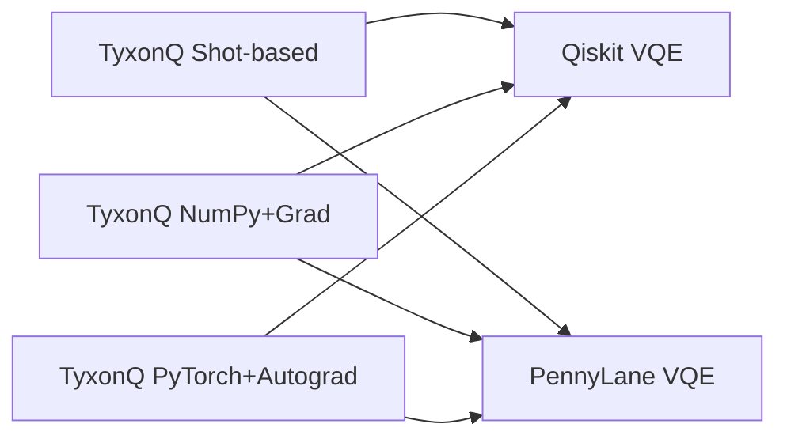
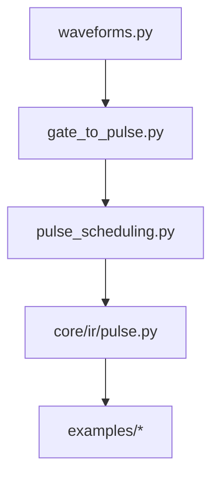

# 脉冲编程性能优化

<cite>
**本文引用的文件**
- [src/tyxonq/compiler/pulse_compiler/native/gate_to_pulse.py](file://src/tyxonq/compiler/pulse_compiler/native/gate_to_pulse.py)
- [src/tyxonq/compiler/pulse_compiler/native/pulse_scheduling.py](file://src/tyxonq/compiler/pulse_compiler/native/pulse_scheduling.py)
- [src/tyxonq/core/ir/pulse.py](file://src/tyxonq/core/ir/pulse.py)
- [src/tyxonq/waveforms.py](file://src/tyxonq/waveforms.py)
- [examples/pulse_optimization_advanced.py](file://examples/pulse_optimization_advanced.py)
- [examples/pulse_noise_modeling.py](file://examples/pulse_noise_modeling.py)
- [examples/framework_performance_comparison.py](file://examples/framework_performance_comparison.py)
- [docs/source/user_guide/pulse/advanced_waveforms.rst](file://docs/source/user_guide/pulse/advanced_waveforms.rst)
- [docs/source/tutorials/advanced/pulse_advanced_waveforms.rst](file://docs/source/tutorials/advanced/pulse_advanced_waveforms.rst)
- [docs/source/technical_references/performance_optimization.rst](file://docs/source/technical_references/performance_optimization.rst)
</cite>

## 目录
1. [引言](#引言)
2. [项目结构](#项目结构)
3. [核心组件](#核心组件)
4. [架构总览](#架构总览)
5. [详细组件分析](#详细组件分析)
6. [依赖关系分析](#依赖关系分析)
7. [性能考量](#性能考量)
8. [故障排查指南](#故障排查指南)
9. [结论](#结论)
10. [附录](#附录)

## 引言
本指南面向需要在真实或仿真量子硬件上高效执行脉冲级程序的用户与工程师，聚焦以下目标：
- 波形设计与优化的性能影响（Hermite、BlackmanSquare等）
- 脉冲调度算法的优化策略（并行化、冲突消解、虚拟Z合并）
- 脉冲序列压缩与简化（门到脉冲分解、时序重排、元数据复用）
- 噪声建模与误差缓解的性能考虑（T1/T2、ZZ串扰、采样方差）
- 脉冲级优化的实际案例（单/双量子比特门优化、形状搜索）
- 基准测试方法与与门级编程的性能对比

## 项目结构
围绕脉冲编程的关键路径包括：
- 波形定义与参数化：waveforms 模块提供多种包络类型
- 门到脉冲分解：GateToPulsePass 将抽象门转换为具体脉冲序列
- 脉冲调度：PulseSchedulingPass 进行时间槽分配与资源冲突处理
- 脉冲IR与执行：PulseProgram/PulseSchedule 提供高层API与底层调度表示
- 示例与文档：演示优化流程、噪声建模与框架对比

**图表来源**
- [src/tyxonq/waveforms.py:1-157](file://src/tyxonq/waveforms.py#L1-L157)
- [src/tyxonq/compiler/pulse_compiler/native/gate_to_pulse.py:1-200](file://src/tyxonq/compiler/pulse_compiler/native/gate_to_pulse.py#L1-L200)
- [src/tyxonq/compiler/pulse_compiler/native/pulse_scheduling.py:1-120](file://src/tyxonq/compiler/pulse_compiler/native/pulse_scheduling.py#L1-L120)
- [src/tyxonq/core/ir/pulse.py:71-138](file://src/tyxonq/core/ir/pulse.py#L71-L138)

**章节来源**
- [src/tyxonq/waveforms.py:1-157](file://src/tyxonq/waveforms.py#L1-L157)
- [src/tyxonq/compiler/pulse_compiler/native/gate_to_pulse.py:1-200](file://src/tyxonq/compiler/pulse_compiler/native/gate_to_pulse.py#L1-L200)
- [src/tyxonq/compiler/pulse_compiler/native/pulse_scheduling.py:1-120](file://src/tyxonq/compiler/pulse_compiler/native/pulse_scheduling.py#L1-L120)
- [src/tyxonq/core/ir/pulse.py:71-138](file://src/tyxonq/core/ir/pulse.py#L71-L138)

## 核心组件
- 波形库：Gaussian、Drag、Flattop、Hermite、BlackmanSquare 等，支持参数化与QASM导出
- 门到脉冲分解：优先使用用户校准（defcal），否则回退到物理默认分解（如CR实现CX）
- 脉冲调度：按量子比特可用性分配时间槽，支持不同优化级别
- 脉冲IR：PulseProgram/PulseSchedule 提供链式API、数值模拟与设备执行入口

**章节来源**
- [src/tyxonq/waveforms.py:103-157](file://src/tyxonq/waveforms.py#L103-L157)
- [src/tyxonq/compiler/pulse_compiler/native/gate_to_pulse.py:137-193](file://src/tyxonq/compiler/pulse_compiler/native/gate_to_pulse.py#L137-L193)
- [src/tyxonq/compiler/pulse_compiler/native/pulse_scheduling.py:24-87](file://src/tyxonq/compiler/pulse_compiler/native/pulse_scheduling.py#L24-L87)
- [src/tyxonq/core/ir/pulse.py:71-138](file://src/tyxonq/core/ir/pulse.py#L71-L138)

## 架构总览
从高级门到可执行脉冲的编译与执行链路如下：

**图表来源**
- [src/tyxonq/compiler/pulse_compiler/native/gate_to_pulse.py:64-116](file://src/tyxonq/compiler/pulse_compiler/native/gate_to_pulse.py#L64-L116)
- [src/tyxonq/compiler/pulse_compiler/native/pulse_scheduling.py:43-87](file://src/tyxonq/compiler/pulse_compiler/native/pulse_scheduling.py#L43-L87)
- [src/tyxonq/core/ir/pulse.py:424-493](file://src/tyxonq/core/ir/pulse.py#L424-L493)

## 详细组件分析

### 波形设计与优化
- Hermite：多项式调制的高斯包络，适合中等串扰场景；在仿真中显示更低的旁瓣泄漏
- BlackmanSquare：平顶+Blackman窗，具备极佳的频谱抑制能力，适用于密集耦合多比特系统
- 选择建议：根据量子比特间距与串扰敏感度选择；生产部署前需在真机验证

**图表来源**
- [docs/source/user_guide/pulse/advanced_waveforms.rst:169-241](file://docs/source/user_guide/pulse/advanced_waveforms.rst#L169-L241)
- [docs/source/tutorials/advanced/pulse_advanced_waveforms.rst:443-463](file://docs/source/tutorials/advanced/pulse_advanced_waveforms.rst#L443-L463)

**章节来源**
- [src/tyxonq/waveforms.py:103-157](file://src/tyxonq/waveforms.py#L103-L157)
- [docs/source/user_guide/pulse/advanced_waveforms.rst:169-241](file://docs/source/user_guide/pulse/advanced_waveforms.rst#L169-L241)
- [docs/source/tutorials/advanced/pulse_advanced_waveforms.rst:443-463](file://docs/source/tutorials/advanced/pulse_advanced_waveforms.rst#L443-L463)

### 脉冲调度算法与优化策略
- 时间槽分配：基于量子比特可用时间计算最早启动时间，避免资源冲突
- 优化级别：
  - Level 0：无调度（顺序执行）
  - Level 1：基础并行（无冲突）
  - Level 2：高级调度+脉冲合并
  - Level 3：全量优化（含校准感知路由）
- 元数据注入：为操作附加start_time/duration，便于后续分析与可视化

**图表来源**
- [src/tyxonq/compiler/pulse_compiler/native/pulse_scheduling.py:43-87](file://src/tyxonq/compiler/pulse_compiler/native/pulse_scheduling.py#L43-L87)
- [src/tyxonq/compiler/pulse_compiler/native/pulse_scheduling.py:104-148](file://src/tyxonq/compiler/pulse_compiler/native/pulse_scheduling.py#L104-L148)
- [src/tyxonq/compiler/pulse_compiler/native/pulse_scheduling.py:173-238](file://src/tyxonq/compiler/pulse_compiler/native/pulse_scheduling.py#L173-L238)

**章节来源**
- [src/tyxonq/compiler/pulse_compiler/native/pulse_scheduling.py:24-87](file://src/tyxonq/compiler/pulse_compiler/native/pulse_scheduling.py#L24-L87)
- [src/tyxonq/compiler/pulse_compiler/native/pulse_scheduling.py:104-148](file://src/tyxonq/compiler/pulse_compiler/native/pulse_scheduling.py#L104-L148)
- [src/tyxonq/compiler/pulse_compiler/native/pulse_scheduling.py:173-238](file://src/tyxonq/compiler/pulse_compiler/native/pulse_scheduling.py#L173-L238)

### 门到脉冲分解与序列压缩
- 优先级：用户defcal → 电路元数据校准 → 默认物理分解
- 典型分解：
  - X/Y：DRAG脉冲（相位偏移实现Y）
  - Z/RZ：虚拟Z（帧更新，零耗时）
  - H：RY(π/2)+RX(π)
  - CX：预旋转 + CR脉冲 + 可选回波 + 后旋转
  - CZ/iSWAP/SWAP：通过CX链分解
- 压缩手段：相邻RZ合并、共享脉冲库键、减少重复生成

**图表来源**
- [src/tyxonq/compiler/pulse_compiler/native/gate_to_pulse.py:38-116](file://src/tyxonq/compiler/pulse_compiler/native/gate_to_pulse.py#L38-L116)
- [src/tyxonq/compiler/pulse_compiler/native/gate_to_pulse.py:194-313](file://src/tyxonq/compiler/pulse_compiler/native/gate_to_pulse.py#L194-L313)
- [src/tyxonq/compiler/pulse_compiler/native/gate_to_pulse.py:381-495](file://src/tyxonq/compiler/pulse_compiler/native/gate_to_pulse.py#L381-L495)

**章节来源**
- [src/tyxonq/compiler/pulse_compiler/native/gate_to_pulse.py:137-193](file://src/tyxonq/compiler/pulse_compiler/native/gate_to_pulse.py#L137-L193)
- [src/tyxonq/compiler/pulse_compiler/native/gate_to_pulse.py:194-313](file://src/tyxonq/compiler/pulse_compiler/native/gate_to_pulse.py#L194-L313)
- [src/tyxonq/compiler/pulse_compiler/native/gate_to_pulse.py:381-495](file://src/tyxonq/compiler/pulse_compiler/native/gate_to_pulse.py#L381-L495)

### 噪声建模与误差缓解
- 主要噪声源：T1/T2退相干、测量误差、ZZ串扰、AC Stark频移、泄漏到|2⟩
- ZZ串扰机制：控制脉冲边带耦合邻近比特，产生条件Z相位
- 缓解策略：频率失谐、ZZ抵消、复合门、后处理校正、电路布局优化、动态解耦
- 评估方法：在不同仿真模式（理想/含采样/三能级/含串扰）下比较精度与速度

**图表来源**
- [examples/pulse_noise_modeling.py:46-163](file://examples/pulse_noise_modeling.py#L46-L163)
- [examples/pulse_noise_modeling.py:166-229](file://examples/pulse_noise_modeling.py#L166-L229)
- [examples/pulse_noise_modeling.py:290-453](file://examples/pulse_noise_modeling.py#L290-L453)

**章节来源**
- [examples/pulse_noise_modeling.py:46-163](file://examples/pulse_noise_modeling.py#L46-L163)
- [examples/pulse_noise_modeling.py:166-229](file://examples/pulse_noise_modeling.py#L166-L229)
- [examples/pulse_noise_modeling.py:290-453](file://examples/pulse_noise_modeling.py#L290-L453)

### 脉冲级优化案例
- 参数平移规则（PSR）与自动微分（Autograd）结合
- 单量子比特门优化：DRAG参数扫描与梯度下降
- 双量子比特门优化：CX序列参数调优
- 波形形状搜索：Constant/Gaussian/DRAG对比
- 多参数同时优化：网格搜索+局部优化

**图表来源**
- [examples/pulse_optimization_advanced.py:42-115](file://examples/pulse_optimization_advanced.py#L42-L115)
- [examples/pulse_optimization_advanced.py:117-203](file://examples/pulse_optimization_advanced.py#L117-L203)
- [examples/pulse_optimization_advanced.py:206-327](file://examples/pulse_optimization_advanced.py#L206-L327)
- [examples/pulse_optimization_advanced.py:330-453](file://examples/pulse_optimization_advanced.py#L330-L453)

**章节来源**
- [examples/pulse_optimization_advanced.py:42-115](file://examples/pulse_optimization_advanced.py#L42-L115)
- [examples/pulse_optimization_advanced.py:117-203](file://examples/pulse_optimization_advanced.py#L117-L203)
- [examples/pulse_optimization_advanced.py:206-327](file://examples/pulse_optimization_advanced.py#L206-L327)
- [examples/pulse_optimization_advanced.py:330-453](file://examples/pulse_optimization_advanced.py#L330-L453)

### 基准测试与门级编程对比
- TyxonQ三种执行模式：
  - Shot-based Sampling：最接近真机，包含统计噪声与完整编译流程
  - Exact Statevector：精确解析解，无采样噪声
  - Exact + JIT：JIT加速的精确求解
- 对比维度：API风格、执行性能、优化特性（JIT/autograd）、可扩展性
- 与Qiskit/PennyLane对比：相同VQE任务下的每步时间与收敛行为

**图表来源**
- [examples/framework_performance_comparison.py:1-41](file://examples/framework_performance_comparison.py#L1-L41)
- [examples/framework_performance_comparison.py:71-408](file://examples/framework_performance_comparison.py#L71-L408)
- [examples/framework_performance_comparison.py:411-575](file://examples/framework_performance_comparison.py#L411-L575)

**章节来源**
- [examples/framework_performance_comparison.py:71-408](file://examples/framework_performance_comparison.py#L71-L408)
- [examples/framework_performance_comparison.py:411-575](file://examples/framework_performance_comparison.py#L411-L575)

## 依赖关系分析
- 低耦合：波形模块独立于编译器；门到脉冲分解依赖波形库与设备参数
- 中间层：调度器依赖IR表示，注入时序元数据
- 执行层：PulseProgram统一接入数值模拟与设备驱动

**图表来源**
- [src/tyxonq/waveforms.py:1-157](file://src/tyxonq/waveforms.py#L1-L157)
- [src/tyxonq/compiler/pulse_compiler/native/gate_to_pulse.py:1-200](file://src/tyxonq/compiler/pulse_compiler/native/gate_to_pulse.py#L1-L200)
- [src/tyxonq/compiler/pulse_compiler/native/pulse_scheduling.py:1-120](file://src/tyxonq/compiler/pulse_compiler/native/pulse_scheduling.py#L1-L120)
- [src/tyxonq/core/ir/pulse.py:71-138](file://src/tyxonq/core/ir/pulse.py#L71-L138)

**章节来源**
- [src/tyxonq/waveforms.py:1-157](file://src/tyxonq/waveforms.py#L1-L157)
- [src/tyxonq/compiler/pulse_compiler/native/gate_to_pulse.py:1-200](file://src/tyxonq/compiler/pulse_compiler/native/gate_to_pulse.py#L1-L200)
- [src/tyxonq/compiler/pulse_compiler/native/pulse_scheduling.py:1-120](file://src/tyxonq/compiler/pulse_compiler/native/pulse_scheduling.py#L1-L120)
- [src/tyxonq/core/ir/pulse.py:71-138](file://src/tyxonq/core/ir/pulse.py#L71-L138)

## 性能考量
- 波形选择对串扰与保真度的影响：BlackmanSquare在密集耦合系统中优势显著
- 调度优化提升吞吐：合理的时间槽分配减少等待与冲突
- 分解策略降低深度：虚拟Z合并、CX链分解、共享脉冲库键
- 噪声建模指导设计：在三能级与含串扰模式下评估稳健性
- 基准方法：区分阶段计时（编译/执行），关注关键指标（电路执行次数、总shots、门数、内存、墙钟时间）

**章节来源**
- [docs/source/technical_references/performance_optimization.rst:10-18](file://docs/source/technical_references/performance_optimization.rst#L10-L18)
- [docs/source/technical_references/performance_optimization.rst:372-405](file://docs/source/technical_references/performance_optimization.rst#L372-L405)

## 故障排查指南
- 波形不识别：升级至支持新波形类型的版本；检查StatevectorEngine反序列化逻辑
- 预期串扰抑制未出现：受限于AWG带宽、传输线滤波、量子比特响应非理想性；需实测对比
- Blackman宽度优化：先仿真扫描宽度比例，再在真机用过程层析验证
- 调度无效：确认存在脉冲操作且优化级别≥1；检查max_parallel设置

**章节来源**
- [docs/source/user_guide/pulse/advanced_waveforms.rst:369-425](file://docs/source/user_guide/pulse/advanced_waveforms.rst#L369-L425)
- [src/tyxonq/compiler/pulse_compiler/native/pulse_scheduling.py:59-71](file://src/tyxonq/compiler/pulse_compiler/native/pulse_scheduling.py#L59-L71)

## 结论
通过合理的波形设计、高效的门到脉冲分解、精细的脉冲调度以及噪声建模与缓解策略，可在TyxonQ中实现显著的脉冲级性能提升。结合基准测试与框架对比，可量化优化收益并指导工程落地。

## 附录
- 快速实践建议：
  - 单比特门：优先DRAG/Hermite，必要时切换BlackmanSquare
  - 双比特门：采用CR序列，加入回波抑制杂项项
  - 调度：开启Level 2及以上，观察总时长与并行度
  - 噪声：在三能级与含串扰模式下评估稳健性
  - 基准：记录阶段计时与关键指标，对比门级与脉冲级路径

[无需来源：本节为总结性内容]