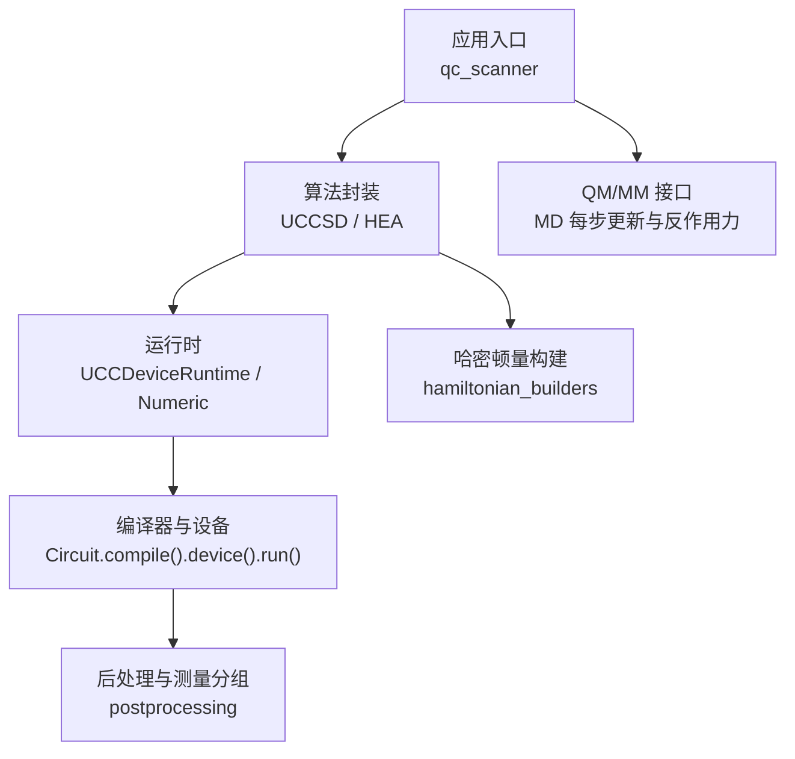
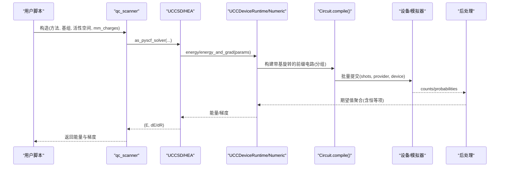
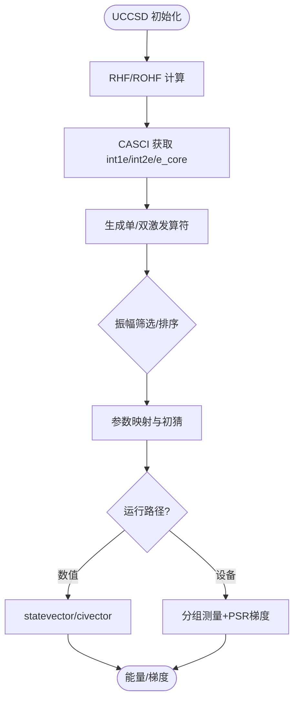
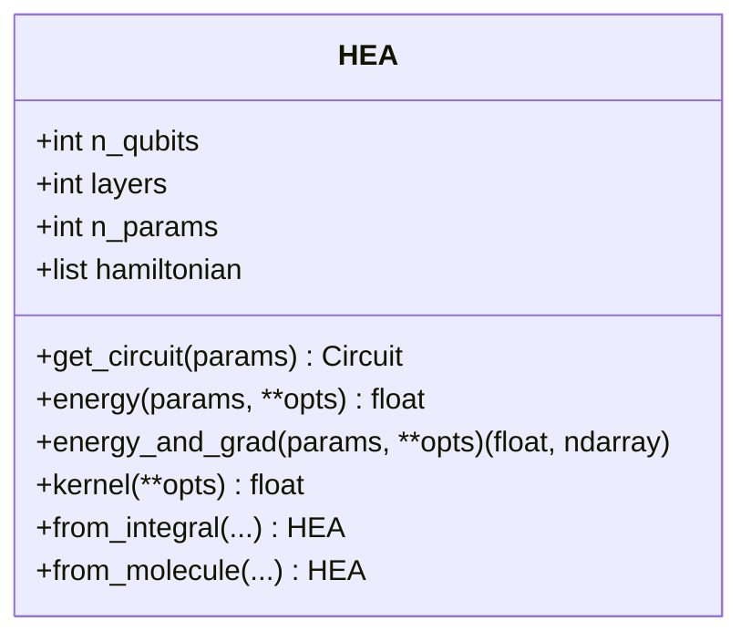
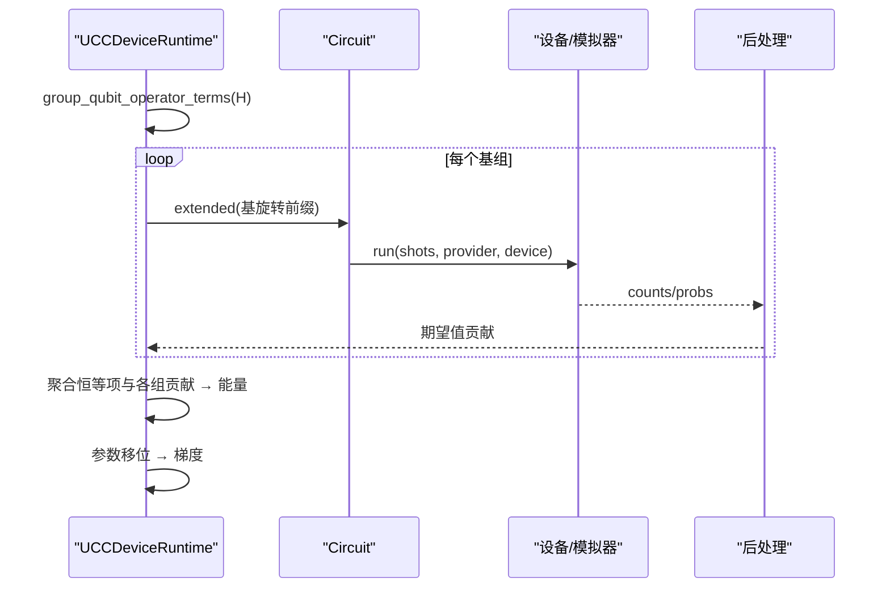
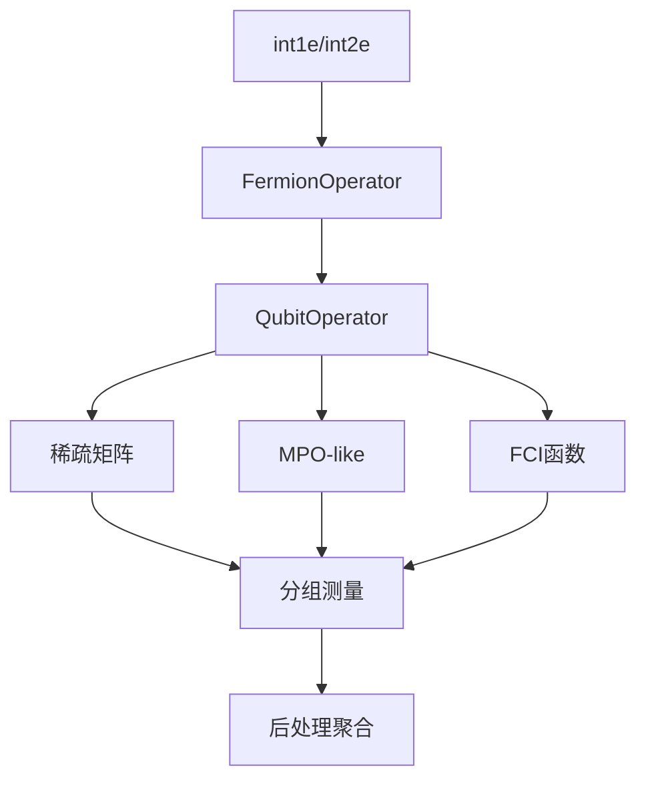
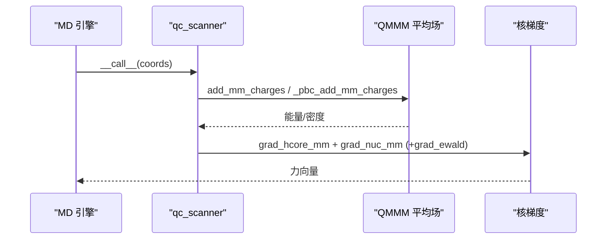
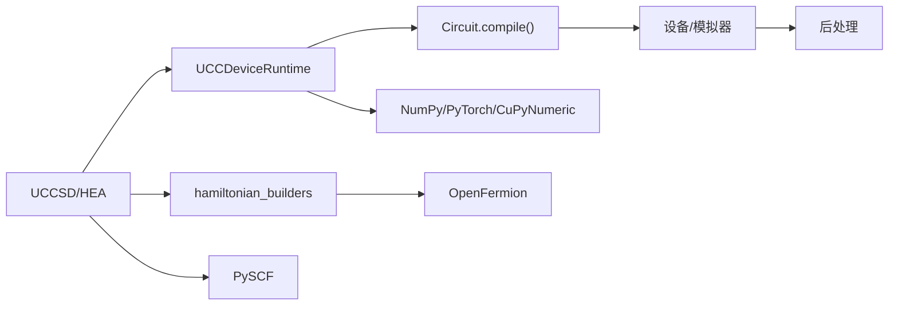

# 量子化学性能优化

<cite>
**本文引用的文件**
- [README.md](file://README.md)
- [performance_optimization.rst](file://docs/source/technical_references/performance_optimization.rst)
- [performance_optimization_tips.md](file://examples/performance_optimization_tips.md)
- [hamiltonian_builders.py](file://src/tyxonq/applications/chem/hamiltonian_builders.py)
- [uccsd.py](file://src/tyxonq/applications/chem/algorithms/vqe/uccsd.py)
- [hea.py](file://src/tyxonq/applications/chem/algorithms/vqe/hea.py)
- [ucc_device_runtime.py](file://src/tyxonq/applications/chem/algorithms/vqe/runtimes/ucc_device_runtime.py)
- [scanner.py](file://src/tyxonq/applications/chem/interfaces/scanner.py)
- [md_qmmm_device_hardware.py](file://examples/qmmm/md_qmmm_device_hardware.py)
- [compiler_lightcone_optimization.py](file://examples/compiler_lightcone_optimization.py)
- [vqe_shot_noise.py](file://examples/vqe_shot_noise.py)
- [vqe_noisyopt.py](file://examples/vqe_noisyopt.py)
- [memory_optimization_checkpointing.py](file://examples/memory_optimization_checkpointing.py)
- [TYXONQ_TECHNICAL_WHITEPAPER.md](file://TYXONQ_TECHNICAL_WHITEPAPER.md)
</cite>

## 目录
1. [简介](#简介)
2. [项目结构](#项目结构)
3. [核心组件](#核心组件)
4. [架构总览](#架构总览)
5. [详细组件分析](#详细组件分析)
6. [依赖关系分析](#依赖关系分析)
7. [性能考量与调优策略](#性能考量与调优策略)
8. [故障排查指南](#故障排查指南)
9. [结论](#结论)
10. [附录](#附录)

## 简介
本指南面向量子化学计算的性能优化，聚焦 VQE、UCCSD、HEA 等算法在 TyxonQ 中的高效实现路径；系统阐述哈密顿量构建与测量分组、采样调度、编译期光锥剪枝、数值后端选择、内存管理与并行化策略；给出分子动力学（QM/MM）耦合的端到端性能调优建议；总结常见瓶颈与解决方案，并提供大规模分子计算的优化案例与不同算法间的性能对比基准。

## 项目结构
TyxonQ 将“量子化学”作为应用层模块，围绕算法（VQE/UCCSD/HEA）、运行时（设备/数值）、哈密顿量构建、以及 MD/QM-MM 接口组织代码：
- 算法层：UCCSD、ROUCCSD、HEA 提供统一的能量/梯度/优化接口，支持 device/numeric 双路径
- 运行时层：UCCDeviceRuntime 负责设备路径的分组测量、参数移位梯度、批量执行与后处理聚合
- 哈密顿量层：从积分到稀疏/MPO/FCI函数的一体化构建，兼容多种编码
- 扫描器层：qc_scanner 统一对接 PySCF 梯度与 QM/MM 环境，屏蔽底层求解器差异
- 示例与文档：覆盖测量分组、光锥优化、噪声优化、内存检查点、真机链路等

**图表来源**
- [scanner.py:93-187](file://src/tyxonq/applications/chem/interfaces/scanner.py#L93-L187)
- [uccsd.py:155-264](file://src/tyxonq/applications/chem/algorithms/vqe/uccsd.py#L155-L264)
- [hea.py:125-247](file://src/tyxonq/applications/chem/algorithms/vqe/hea.py#L125-L247)
- [ucc_device_runtime.py:25-95](file://src/tyxonq/applications/chem/algorithms/vqe/runtimes/ucc_device_runtime.py#L25-L95)
- [hamiltonian_builders.py:46-153](file://src/tyxonq/applications/chem/hamiltonian_builders.py#L46-L153)

**章节来源**
- [README.md:177-206](file://README.md#L177-L206)
- [performance_optimization.rst:10-18](file://docs/source/technical_references/performance_optimization.rst#L10-L18)

## 核心组件
- UCCSD/ROUCCSD：基于活性空间与振幅筛选的变分态制备，支持 device/numeric 双路径与 PySCF 求解器适配
- HEA：硬件高效 ansatz，浅电路、门集友好，适合真机采样优化
- UCCDeviceRuntime：按基分组测量、缓存前缀操作、批量提交、参数移位梯度（含针对偶次谐波的改进两步移位规则）
- 哈密顿量构建：从 RHF/CASCI 积分生成 FermionOperator/QubitOperator，输出稀疏矩阵/MPO/FCI函数
- qc_scanner：统一能量/梯度扫描，支持静电嵌入与周期性边界，复用 PySCF 核梯度

**章节来源**
- [uccsd.py:18-154](file://src/tyxonq/applications/chem/algorithms/vqe/uccsd.py#L18-L154)
- [hea.py:28-124](file://src/tyxonq/applications/chem/algorithms/vqe/hea.py#L28-L124)
- [ucc_device_runtime.py:25-95](file://src/tyxonq/applications/chem/algorithms/vqe/runtimes/ucc_device_runtime.py#L25-L95)
- [hamiltonian_builders.py:46-153](file://src/tyxonq/applications/chem/hamiltonian_builders.py#L46-L153)
- [scanner.py:93-187](file://src/tyxonq/applications/chem/interfaces/scanner.py#L93-L187)

## 架构总览
下图展示从分子积分到能量/梯度的完整数据流，涵盖设备路径与数值路径的分发、测量分组与后处理、以及 QM/MM 环境的注入。

**图表来源**
- [scanner.py:56-90](file://src/tyxonq/applications/chem/interfaces/scanner.py#L56-L90)
- [ucc_device_runtime.py:132-185](file://src/tyxonq/applications/chem/algorithms/vqe/runtimes/ucc_device_runtime.py#L132-L185)
- [ucc_device_runtime.py:240-313](file://src/tyxonq/applications/chem/algorithms/vqe/runtimes/ucc_device_runtime.py#L240-L313)
- [ucc_device_runtime.py:315-447](file://src/tyxonq/applications/chem/algorithms/vqe/runtimes/ucc_device_runtime.py#L315-L447)

## 详细组件分析

### UCCSD 性能要点
- 活性空间与振幅筛选：通过 t2 振幅阈值丢弃小贡献激发，显著降低参数量与电路深度
- 参数映射与初始猜测：MP2/CCSD 初始化提升收敛速度；排序与去重减少冗余参数
- 设备/数值双路径：数值路径用于快速迭代与梯度验证；设备路径用于真实噪声与硬件链路验证

**图表来源**
- [uccsd.py:155-264](file://src/tyxonq/applications/chem/algorithms/vqe/uccsd.py#L155-L264)
- [uccsd.py:268-341](file://src/tyxonq/applications/chem/algorithms/vqe/uccsd.py#L268-L341)

**章节来源**
- [uccsd.py:18-154](file://src/tyxonq/applications/chem/algorithms/vqe/uccsd.py#L18-L154)
- [uccsd.py:155-264](file://src/tyxonq/applications/chem/algorithms/vqe/uccsd.py#L155-L264)

### HEA 性能要点
- 浅电路与门集友好：RY-only 结构配合 CNOT 链，适合 NISQ 设备
- 映射选择：parity 可节省两比特；JW/BK 适用于不同硬件拓扑
- 设备路径默认 shots=0 解析回退以加速优化；真机建议高 shots 起步（≥8192）

**图表来源**
- [hea.py:125-247](file://src/tyxonq/applications/chem/algorithms/vqe/hea.py#L125-L247)
- [hea.py:379-433](file://src/tyxonq/applications/chem/algorithms/vqe/hea.py#L379-L433)
- [hea.py:435-494](file://src/tyxonq/applications/chem/algorithms/vqe/hea.py#L435-L494)

**章节来源**
- [hea.py:28-124](file://src/tyxonq/applications/chem/algorithms/vqe/hea.py#L28-L124)
- [hea.py:231-266](file://src/tyxonq/applications/chem/algorithms/vqe/hea.py#L231-L266)
- [hea.py:294-337](file://src/tyxonq/applications/chem/algorithms/vqe/hea.py#L294-L337)

### 设备运行时与测量分组
- 分组测量：对 QubitOperator 按基分组，为每组添加基旋转前缀并 Z 测量，大幅减少电路执行次数
- 前缀缓存：按基组合缓存旋转序列，避免重复构建
- 参数移位梯度：采用针对偶次谐波的两步移位规则，提高梯度精度与稳定性

**图表来源**
- [ucc_device_runtime.py:65-88](file://src/tyxonq/applications/chem/algorithms/vqe/runtimes/ucc_device_runtime.py#L65-L88)
- [ucc_device_runtime.py:132-185](file://src/tyxonq/applications/chem/algorithms/vqe/runtimes/ucc_device_runtime.py#L132-L185)
- [ucc_device_runtime.py:240-313](file://src/tyxonq/applications/chem/algorithms/vqe/runtimes/ucc_device_runtime.py#L240-L313)
- [ucc_device_runtime.py:315-447](file://src/tyxonq/applications/chem/algorithms/vqe/runtimes/ucc_device_runtime.py#L315-L447)

**章节来源**
- [ucc_device_runtime.py:25-95](file://src/tyxonq/applications/chem/algorithms/vqe/runtimes/ucc_device_runtime.py#L25-L95)
- [ucc_device_runtime.py:132-185](file://src/tyxonq/applications/chem/algorithms/vqe/runtimes/ucc_device_runtime.py#L132-L185)
- [ucc_device_runtime.py:240-313](file://src/tyxonq/applications/chem/algorithms/vqe/runtimes/ucc_device_runtime.py#L240-L313)
- [ucc_device_runtime.py:315-447](file://src/tyxonq/applications/chem/algorithms/vqe/runtimes/ucc_device_runtime.py#L315-L447)

### 哈密顿量构建与测量优化
- 积分→算符：从 RHF/CASCI 得到 int1e/int2e，构建 FermionOperator 并转换为 QubitOperator
- 多形态输出：稀疏矩阵、MPO、FCI函数，适配不同后端与算法
- 测量优化：分组与方差加权调度，减少总 shot 数并保持目标精度

**图表来源**
- [hamiltonian_builders.py:46-153](file://src/tyxonq/applications/chem/hamiltonian_builders.py#L46-L153)
- [hamiltonian_builders.py:206-245](file://src/tyxonq/applications/chem/hamiltonian_builders.py#L206-L245)

**章节来源**
- [hamiltonian_builders.py:46-153](file://src/tyxonq/applications/chem/hamiltonian_builders.py#L46-L153)
- [hamiltonian_builders.py:206-245](file://src/tyxonq/applications/chem/hamiltonian_builders.py#L206-L245)

### 分子动力学（QM/MM）性能调优
- 扫描器复用：qc_scanner 惰性构建几何与平均场，冻结子空间跨几何复用
- 静电嵌入：每步 set_mm_charges 更新 MM 电荷/坐标，走上游重入路径不重建平均场（非周期）或重跑 SCF（周期）
- 反作用力：mm_gradient 复用 PySCF 核梯度与 Ewald 分量，直接供 MD 驱动使用

**图表来源**
- [scanner.py:192-267](file://src/tyxonq/applications/chem/interfaces/scanner.py#L192-L267)
- [scanner.py:331-411](file://src/tyxonq/applications/chem/interfaces/scanner.py#L331-L411)

**章节来源**
- [scanner.py:93-187](file://src/tyxonq/applications/chem/interfaces/scanner.py#L93-L187)
- [scanner.py:192-267](file://src/tyxonq/applications/chem/interfaces/scanner.py#L192-L267)
- [scanner.py:331-411](file://src/tyxonq/applications/chem/interfaces/scanner.py#L331-L411)
- [md_qmmm_device_hardware.py:90-124](file://examples/qmmm/md_qmmm_device_hardware.py#L90-L124)
- [md_qmmm_device_hardware.py:163-193](file://examples/qmmm/md_qmmm_device_hardware.py#L163-L193)

## 依赖关系分析
- 算法与运行时：UCCSD/HEA 依赖 UCCDeviceRuntime 进行设备路径测量与梯度；数值路径依赖 statevector/civector
- 编译与设备：Circuit.compile() 串联 normalize→decompose→route→optimize→lightcone；平台方言导出至原生格式
- 后处理：counts/probabilities 经 expval_pauli_sum 聚合为能量；支持误差缓解与指标统计
- 外部库：OpenFermion（算符）、PySCF（积分/梯度）、NumPy/PyTorch/CuPyNumeric（数值后端）

**图表来源**
- [ucc_device_runtime.py:132-185](file://src/tyxonq/applications/chem/algorithms/vqe/runtimes/ucc_device_runtime.py#L132-L185)
- [hamiltonian_builders.py:46-153](file://src/tyxonq/applications/chem/hamiltonian_builders.py#L46-L153)
- [README.md:197-206](file://README.md#L197-L206)

**章节来源**
- [README.md:197-206](file://README.md#L197-L206)
- [ucc_device_runtime.py:132-185](file://src/tyxonq/applications/chem/algorithms/vqe/runtimes/ucc_device_runtime.py#L132-L185)
- [hamiltonian_builders.py:46-153](file://src/tyxonq/applications/chem/hamiltonian_builders.py#L46-L153)

## 性能考量与调优策略

### 通用原则
- 选择合适路径：开发阶段用数值路径快速迭代，验证阶段用设备路径评估噪声与硬件行为
- 利用测量分组：编译器驱动的分组可将电路执行次数降低 5–10x
- 合理后端：NumPy（开发）、PyTorch（梯度）、CuPyNumeric（GPU 大规模）
- 最小化电路深度：启用 lightcone 简化、门分解与路由优化
- 优化采样分配：方差加权调度可减少总 shot 数 2–3x

**章节来源**
- [performance_optimization.rst:10-18](file://docs/source/technical_references/performance_optimization.rst#L10-L18)
- [performance_optimization.rst:19-99](file://docs/source/technical_references/performance_optimization.rst#L19-L99)
- [performance_optimization.rst:100-172](file://docs/source/technical_references/performance_optimization.rst#L100-L172)

### 设备路径优化
- 测量分组与前缀缓存：按基分组并缓存旋转前缀，批量提交
- 参数移位梯度：采用两步移位规则（π/8, π/4），匹配 UCC 能量表面偶次谐波特性
- 硬件特定编译：结合平台方言与 Qiskit transpiler 优化门集与连通性

**章节来源**
- [ucc_device_runtime.py:65-88](file://src/tyxonq/applications/chem/algorithms/vqe/runtimes/ucc_device_runtime.py#L65-L88)
- [ucc_device_runtime.py:315-447](file://src/tyxonq/applications/chem/algorithms/vqe/runtimes/ucc_device_runtime.py#L315-L447)
- [README.md:197-206](file://README.md#L197-L206)

### 数值路径优化
- 后端选择：根据问题规模与任务选择 NumPy/PyTorch/CuPyNumeric
- 状态向量模拟：n≤12 用 statevector；n>20 低纠缠用 MPS
- 张量收缩优化：自动使用 opt_einsum，复杂网络可获得 2–10x 加速

**章节来源**
- [performance_optimization.rst:100-172](file://docs/source/technical_references/performance_optimization.rst#L100-L172)

### 量子化学优化
- 活性空间近似：选取化学重要轨道，显著减少 qubit 数
- Ansatz 选择：UCCSD（高精度、成本高）、HEA（浅电路、硬件友好）、k-UpCCGSD/pUCCD（生产级）
- 梯度计算：设备路径用参数移位；数值路径用 autograd 快速迭代
- 云端卸载：将 HF/积分等经典核卸载到 GPU 节点，获得 5–20x 加速

**章节来源**
- [performance_optimization.rst:173-278](file://docs/source/technical_references/performance_optimization.rst#L173-L278)

### 内存管理
- 状态向量内存：O(2^n) 增长，n>25 考虑 MPS
- 批处理：分批执行与清理，避免 OOM
- 缓存策略：Hamiltonians、MPO、CI 映射缓存，长任务定期清理

**章节来源**
- [performance_optimization.rst:279-325](file://docs/source/technical_references/performance_optimization.rst#L279-L325)

### 并行执行
- 电路级并行：batch_run（若设备支持）
- 采样级并行：模拟器多线程（OMP_NUM_THREADS）
- 参数优化并行：多初值并行优化

**章节来源**
- [performance_optimization.rst:326-371](file://docs/source/technical_references/performance_optimization.rst#L326-L371)

### 基准与剖析
- 计时框架：分离 staging 与 execution 时间
- 关键指标：电路执行次数、总 shot、门计数、内存、墙钟时间
- 工具：cProfile/snakeviz、PyTorch profiler

**章节来源**
- [performance_optimization.rst:372-432](file://docs/source/technical_references/performance_optimization.rst#L372-L432)

### 常见陷阱与最佳实践
- 未使用测量分组：导致 5–10x 慢
- 均匀采样：浪费 2–3x shot
- 错误后端：NumPy 用于大系统易 OOM
- 深层 UCCSD 上真机：当前设备难以承受
- 忽略活性空间：全分子 qubit 过多
- 无缓存清理：长任务内存泄漏
- 串行执行：错过并行机会

**章节来源**
- [performance_optimization.rst:433-454](file://docs/source/technical_references/performance_optimization.rst#L433-L454)

### 典型优化案例
- 避免重复电路执行：缓存状态向量，一次性计算所有 Pauli 项期望，获得 10–15x 加速
- 模板 Hamiltonian：使用内置模板函数构建 TFIM/Hamiltonian，减少手动开销
- 批量观测测量：一次性 state() 后批量 expectation_pauli，避免多次 state()

**章节来源**
- [performance_optimization_tips.md:15-114](file://examples/performance_optimization_tips.md#L15-L114)
- [performance_optimization_tips.md:116-149](file://examples/performance_optimization_tips.md#L116-L149)

### 不同算法性能对比
- UCCSD：高精度但成本高，适合小分子与活性空间；设备路径需较高 shots
- HEA：浅电路、硬件友好，采样优化建议 ≥8192 shots；真机首选
- 数值路径 vs 设备路径：autograd 比参数移位快 10–100x；设备路径更贴近真实噪声

**章节来源**
- [performance_optimization.rst:202-253](file://docs/source/technical_references/performance_optimization.rst#L202-L253)
- [md_qmmm_device_hardware.py:196-223](file://examples/qmmm/md_qmmm_device_hardware.py#L196-L223)

### 与经典方法的基准测试
- 云端 GPU 卸载：HF/积分等经典核在 GPU 上 5–20x 加速
- 数值路径与 PySCF 参考：确保一致性并用于回归测试

**章节来源**
- [performance_optimization.rst:254-278](file://docs/source/technical_references/performance_optimization.rst#L254-L278)

## 故障排查指南
- 设备路径梯度为零：确认使用两步移位规则（π/8, π/4），避免 ±π/2 导致的偶次谐波零梯度
- 真机结果不稳定：提高 shots（HEA ≥8192），限制优化器 maxfun，避免带噪线搜索过度消耗
- 嵌入能量位移异常：检查 mm_charges 单位与 rcut 设置，确保每步更新生效
- 内存溢出：切换 MPS 或减小活性空间；批处理并清理缓存
- 性能退化：启用 measurement_rewrite、shot_scheduler、lightcone；避免重复 circuit.expectation

**章节来源**
- [ucc_device_runtime.py:90-129](file://src/tyxonq/applications/chem/algorithms/vqe/runtimes/ucc_device_runtime.py#L90-L129)
- [md_qmmm_device_hardware.py:72-88](file://examples/qmmm/md_qmmm_device_hardware.py#L72-L88)
- [scanner.py:331-411](file://src/tyxonq/applications/chem/interfaces/scanner.py#L331-L411)
- [performance_optimization.rst:433-454](file://docs/source/technical_references/performance_optimization.rst#L433-L454)

## 结论
TyxonQ 通过“编译器驱动测量优化 + 设备/数值双路径 + 多后端 + QM/MM 集成”提供了完整的量子化学性能优化栈。实践中应优先启用测量分组与采样调度，选择合适的 ansatz 与活性空间，利用 autograd 快速迭代并在设备路径验证噪声影响；对于 MD 场景，务必正确配置静电嵌入与 rcut，并使用冻结子空间保证能量面光滑。遵循上述策略可实现显著的端到端加速与资源节约。

## 附录
- 示例参考：
  - 光锥优化：[compiler_lightcone_optimization.py](file://examples/compiler_lightcone_optimization.py)
  - 噪声优化与对比：[vqe_shot_noise.py](file://examples/vqe_shot_noise.py)、[vqe_noisyopt.py](file://examples/vqe_noisyopt.py)
  - 内存检查点：[memory_optimization_checkpointing.py](file://examples/memory_optimization_checkpointing.py)
  - 真机链路（QM/MM）：[md_qmmm_device_hardware.py](file://examples/qmmm/md_qmmm_device_hardware.py)
- 技术白皮书：[TYXONQ_TECHNICAL_WHITEPAPER.md](file://TYXONQ_TECHNICAL_WHITEPAPER.md)