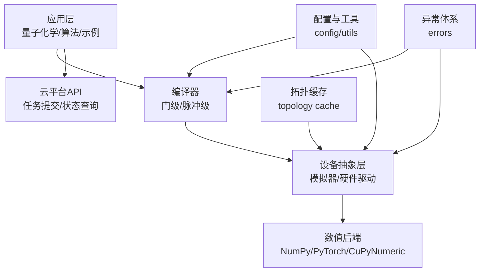
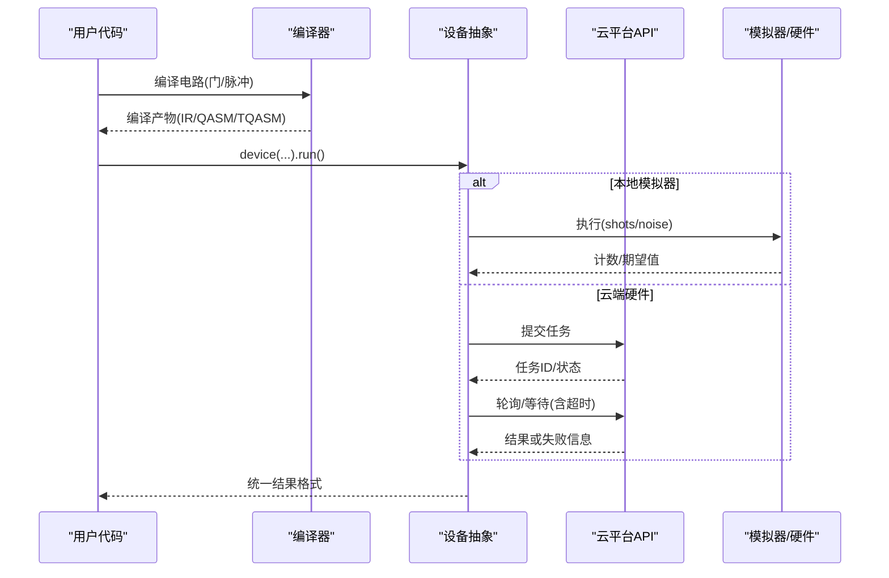
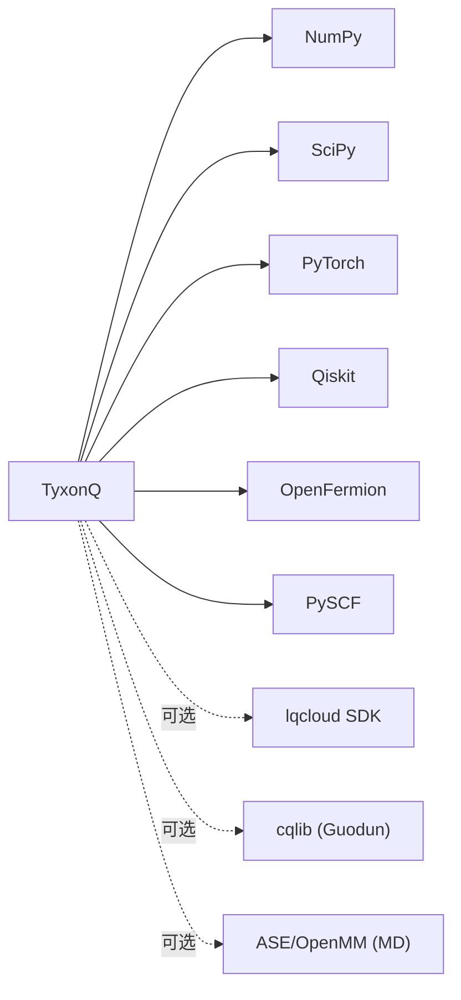

# 故障排除和FAQ

<cite>
**本文引用的文件**
- [README.md](file://README.md)
- [pyproject.toml](file://pyproject.toml)
- [docs/source/faq.rst](file://docs/source/faq.rst)
- [docs/source/getting_started/installation.rst](file://docs/source/getting_started/installation.rst)
- [src/tyxonq/core/errors.py](file://src/tyxonq/core/errors.py)
- [src/tyxonq/config.py](file://src/tyxonq/config.py)
- [src/tyxonq/utils.py](file://src/tyxonq/utils.py)
- [src/tyxonq/devices/base.py](file://src/tyxonq/devices/base.py)
- [src/tyxonq/devices/hardware/topology.py](file://src/tyxonq/devices/hardware/topology.py)
- [docs/source/user_guide/core/index.rst](file://docs/source/user_guide/core/index.rst)
- [docs/source/cloud_services/task_submission.rst](file://docs/source/cloud_services/task_submission.rst)
- [docs/source/api/devices/index.rst](file://docs/source/api/devices/index.rst)
- [docs/source/user_guide/advanced/index.rst](file://docs/source/user_guide/advanced/index.rst)
- [tests_core_module/test_device_topology_cache.py](file://tests_core_module/test_device_topology_cache.py)
</cite>

## 目录
1. [简介](#简介)
2. [项目结构](#项目结构)
3. [核心组件](#核心组件)
4. [架构总览](#架构总览)
5. [详细组件分析](#详细组件分析)
6. [依赖关系分析](#依赖关系分析)
7. [性能注意事项](#性能注意事项)
8. [故障排除指南](#故障排除指南)
9. [结论](#结论)
10. [附录](#附录)

## 简介
本文件面向TyxonQ用户，聚焦安装、配置、运行时错误、性能诊断与优化、平台兼容性、调试与日志、内存泄漏检测、社区支持与问题报告、测试验证、备份恢复与升级迁移等常见问题的系统化排查与解决。内容基于仓库中的源码与文档整理，确保可追溯、可操作。

## 项目结构
TyxonQ采用模块化设计：核心IR、编译器、设备抽象（模拟器与硬件驱动）、数值后端、后处理、云平台API、量子化学应用、脉冲编程等模块清晰分层。顶层入口通过链式API将编译、设备选择、后处理与执行串联起来；底层提供异常体系、配置归一化、工具函数与设备拓扑缓存等支撑能力。

图表来源
- [src/tyxonq/config.py:1-97](file://src/tyxonq/config.py#L1-L97)
- [src/tyxonq/devices/base.py:541-574](file://src/tyxonq/devices/base.py#L541-L574)
- [src/tyxonq/devices/hardware/topology.py:92-117](file://src/tyxonq/devices/hardware/topology.py#L92-L117)
- [src/tyxonq/core/errors.py:1-17](file://src/tyxonq/core/errors.py#L1-L17)

章节来源
- [README.md:1-523](file://README.md#L1-L523)
- [pyproject.toml:1-91](file://pyproject.toml#L1-L91)

## 核心组件
- 异常体系：定义基础异常与细分类型，便于统一捕获与定位问题。
- 配置系统：集中管理包名、默认dtype、后端名称归一化与向量化策略校验。
- 工具函数：提供基准测试、参数别名、函数组合等通用能力。
- 设备基类：异步任务等待、超时告警、任务清理等运行期保障。
- 拓扑缓存：设备拓扑的磁盘/内存缓存与降级策略，保证离线可用性。

章节来源
- [src/tyxonq/core/errors.py:1-17](file://src/tyxonq/core/errors.py#L1-L17)
- [src/tyxonq/config.py:1-97](file://src/tyxonq/config.py#L1-L97)
- [src/tyxonq/utils.py:1-209](file://src/tyxonq/utils.py#L1-L209)
- [src/tyxonq/devices/base.py:541-574](file://src/tyxonq/devices/base.py#L541-L574)
- [src/tyxonq/devices/hardware/topology.py:92-117](file://src/tyxonq/devices/hardware/topology.py#L92-L117)

## 架构总览
TyxonQ的执行链路包括：电路构建→编译（门级/脉冲级）→设备选择（模拟器/硬件）→后处理→结果返回。云平台API负责任务提交与状态轮询；设备抽象层屏蔽不同硬件差异；数值后端统一数组计算接口。

图表来源
- [docs/source/cloud_services/task_submission.rst:491-547](file://docs/source/cloud_services/task_submission.rst#L491-L547)
- [src/tyxonq/devices/base.py:541-574](file://src/tyxonq/devices/base.py#L541-L574)

## 详细组件分析

### 异常体系与错误分类
TyxonQ定义了清晰的异常层次：
- TyxonQError：基础异常
- CompilationError：编译失败或输出无效
- DeviceExecutionError：设备执行失败（超时、连接问题等）
- VectorizationFallbackWarning：向量化禁用或回退提示

使用建议：
- 在调用链外层捕获TyxonQError以统一处理
- 针对CompilationError检查电路合法性、目标设备支持集
- 针对DeviceExecutionError检查网络、令牌、设备状态与超时设置

章节来源
- [src/tyxonq/core/errors.py:1-17](file://src/tyxonq/core/errors.py#L1-L17)
- [docs/source/user_guide/core/index.rst:261-308](file://docs/source/user_guide/core/index.rst#L261-L308)

### 配置与后端归一化
配置模块提供：
- 支持的数值后端：numpy、pytorch、cupynumeric
- 后端名称归一化：如cpu→numpy、gpu→cupynumeric、torch/pt→pytorch
- 默认dtype：complex64/float32
- 向量化策略校验：auto/force/off

常见问题：
- 后端名称拼写不一致导致无法识别：使用归一化工具或标准名称
- 向量化策略非法：仅允许auto/force/off

章节来源
- [src/tyxonq/config.py:1-97](file://src/tyxonq/config.py#L1-L97)

### 设备执行与超时处理
设备基类对异步任务等待提供超时保护，并在超时时发出RuntimeWarning，提示可能是真机排队或执行耗时过长，而非线路或编译错误。同时提供任务移除接口，便于资源释放。

建议：
- 合理设置wait与timeout参数
- 遇到超时先检查设备状态与队列长度
- 批量任务中定期清理任务句柄，避免资源堆积

章节来源
- [src/tyxonq/devices/base.py:541-574](file://src/tyxonq/devices/base.py#L541-L574)

### 拓扑缓存与离线容错
设备拓扑缓存机制：
- 优先从内存缓存读取
- 缺失时尝试从磁盘缓存加载
- 网络抓取失败时降级为陈旧缓存并告警
- 写入失败（只读环境）不影响本次编译，仅记录警告

建议：
- 首次运行允许联网获取拓扑，后续离线可用
- 若缓存损坏，删除对应文件让系统重新抓取
- 可通过环境变量重定向缓存目录用于测试或隔离

章节来源
- [src/tyxonq/devices/hardware/topology.py:92-117](file://src/tyxonq/devices/hardware/topology.py#L92-L117)
- [tests_core_module/test_device_topology_cache.py:168-313](file://tests_core_module/test_device_topology_cache.py#L168-L313)

### 云平台任务提交与错误处理
云任务提交常见错误：
- 提交失败：检查设备状态、令牌有效性、电路合法性
- 执行失败：根据错误关键词判断原因（qubits/depth/timeout）
- 超时：增大等待超时或简化电路

建议：
- 提交前校验设备属性与优化标志（如o=7）
- 捕获ConnectionError与RuntimeError并给出明确提示
- 使用get_result的wait与timeout参数控制等待行为

章节来源
- [docs/source/cloud_services/task_submission.rst:491-547](file://docs/source/cloud_services/task_submission.rst#L491-L547)

### 设备API错误处理
设备API层提供统一的异常捕获与回退策略：
- TimeoutError：设备队列超时
- ConnectionError：网络错误，可回退到本地模拟器

建议：
- 在网络不稳定时自动回退到statevector进行快速验证
- 记录错误上下文以便复现与上报

章节来源
- [docs/source/api/devices/index.rst:443-469](file://docs/source/api/devices/index.rst#L443-L469)

## 依赖关系分析
TyxonQ的核心依赖包括NumPy、SciPy、PyTorch、Qiskit、OpenFermion、PySCF等。可选依赖涵盖云平台SDK、分子动力学接口等。版本约束在pyproject.toml中声明，确保兼容性与稳定性。

图表来源
- [pyproject.toml:25-66](file://pyproject.toml#L25-L66)

章节来源
- [pyproject.toml:1-91](file://pyproject.toml#L1-L91)

## 性能注意事项
- 数值后端选择：小电路NumPy更快；大电路或梯度计算建议使用PyTorch/CuPyNumeric以获得GPU加速
- 编译优化：使用较高优化级别减少门数与深度
- 采样次数：测试阶段减少shots，生产阶段按需增加以提升统计精度
- MPS后端：低纠缠电路可使用MPS降低内存占用
- 层wise优化：参考示例脚本对比编译时间与运行时间权衡

章节来源
- [docs/source/faq.rst:397-423](file://docs/source/faq.rst#L397-L423)
- [examples/performance_layerwise_optimization.py:269-299](file://examples/performance_layerwise_optimization.py#L269-L299)

## 故障排除指南

### 安装与环境问题
- 安装方式：pip安装或源码开发模式
- 系统要求：Python 3.10/3.11/3.12；推荐8GB+内存
- 平台差异：Linux/macOS/Windows均有支持；部分功能需额外依赖（如QCOS需要Python 3.11）
- 依赖缺失：按提示安装Qiskit、PyTorch、PySCF等可选依赖

章节来源
- [docs/source/getting_started/installation.rst:1-85](file://docs/source/getting_started/installation.rst#L1-L85)
- [README.md:109-120](file://README.md#L109-L120)

### 配置问题
- 后端名称不正确：使用标准名称或通过归一化工具转换
- 令牌未设置：云端执行前必须设置API密钥
- 优化标志误用：脉冲级编程需关闭优化，避免破坏脉冲序列

章节来源
- [src/tyxonq/config.py:50-69](file://src/tyxonq/config.py#L50-L69)
- [docs/source/faq.rst:331-346](file://docs/source/faq.rst#L331-L346)
- [README.md:130-145](file://README.md#L130-L145)

### 运行时错误
- 编译失败：检查电路合法性、目标设备支持集、优化选项
- 设备执行失败：检查网络连接、令牌、设备状态、超时设置
- 量子化学输入错误：几何结构不合理、基组无效、电荷自旋不匹配

章节来源
- [docs/source/quantum_chemistry/molecule/index.rst:451-492](file://docs/source/quantum_chemistry/molecule/index.rst#L451-L492)
- [docs/source/cloud_services/task_submission.rst:491-547](file://docs/source/cloud_services/task_submission.rst#L491-L547)

### 性能问题诊断
- 使用benchmark工具测量编译与运行时间
- 监控CPU/GPU内存变化，识别瓶颈
- 调整shots、后端、优化级别与电路结构

章节来源
- [src/tyxonq/utils.py:181-209](file://src/tyxonq/utils.py#L181-L209)
- [docs/source/user_guide/advanced/index.rst:714-759](file://docs/source/user_guide/advanced/index.rst#L714-L759)

### 平台与环境兼容性
- Python版本：严格遵循>=3.10,<3.13
- GPU支持：PyTorch/CuPyNumeric需正确安装CUDA驱动与库
- 云平台：QCOS需Python 3.11；其他平台按各自SDK要求

章节来源
- [pyproject.toml:1-24](file://pyproject.toml#L1-L24)
- [README.md:115-120](file://README.md#L115-L120)

### 调试技巧与日志分析
- 启用DEBUG日志：便于追踪编译与执行过程
- 捕获异常堆栈：记录完整traceback与上下文
- 设备拓扑缓存：检查缓存文件是否损坏或过期

章节来源
- [docs/source/faq.rst:361-369](file://docs/source/faq.rst#L361-L369)
- [src/tyxonq/devices/hardware/topology.py:92-117](file://src/tyxonq/devices/hardware/topology.py#L92-L117)

### 内存泄漏检测与性能瓶颈识别
- 使用上下文管理器临时持有大型电路，自动清理中间状态
- 批量处理中定期gc.collect与clear_cache
- 监控进程内存与GPU显存变化，定位增长点

章节来源
- [docs/source/user_guide/advanced/index.rst:42-73](file://docs/source/user_guide/advanced/index.rst#L42-L73)

### 社区支持与问题报告
- GitHub Issues：提交问题时包含Python版本、TyxonQ版本、最小可复现实例、错误堆栈
- 讨论区：一般性问题与设计讨论
- 官方渠道：网站与支持邮箱

章节来源
- [docs/source/faq.rst:382-396](file://docs/source/faq.rst#L382-L396)
- [README.md:499-505](file://README.md#L499-L505)

### 测试套件验证安装与功能
- 运行核心测试：pytest -v tests_core_module
- 运行示例测试：pytest -v tests_examples
- 运行化学应用测试：pytest -v tests_applications_chem
- 标记跳过在线测试：默认跳过live标记用例

章节来源
- [pyproject.toml:84-91](file://pyproject.toml#L84-L91)

### 备份与恢复策略
- 拓扑缓存：磁盘缓存文件可作为设备拓扑的备份；损坏时可删除重建
- 环境变量：通过环境变量重定向缓存目录，便于隔离与迁移
- 会话缓存：内存缓存随进程结束释放，无需手动清理

章节来源
- [src/tyxonq/devices/hardware/topology.py:92-117](file://src/tyxonq/devices/hardware/topology.py#L92-L117)
- [tests_core_module/test_device_topology_cache.py:1-28](file://tests_core_module/test_device_topology_cache.py#L1-L28)

### 升级与迁移指导
- 版本约束：遵循pyproject.toml中的Python与依赖版本范围
- 增量升级：优先升级核心依赖，再升级TyxonQ
- 兼容性检查：运行测试套件验证关键路径
- 回滚策略：保留旧版本环境，出现问题时快速切换

章节来源
- [pyproject.toml:1-24](file://pyproject.toml#L1-L24)

## 结论
通过系统化的异常体系、配置归一化、设备抽象与拓扑缓存机制，TyxonQ提供了稳定且可扩展的量子计算框架。用户在安装、配置、运行过程中遇到问题时，可依据本文档逐步排查，结合日志、测试与社区资源快速定位与解决。性能优化与内存管理建议有助于提升大规模任务的效率与稳定性。

## 附录
- 快速入门与示例：参考README与examples目录
- 开发者指南：贡献流程、测试规范与代码审查标准
- 技术白皮书：深入理解架构设计与创新点

章节来源
- [README.md:177-190](file://README.md#L177-L190)
- [docs/source/developer_guide/contributing.rst:445-491](file://docs/source/developer_guide/contributing.rst#L445-L491)