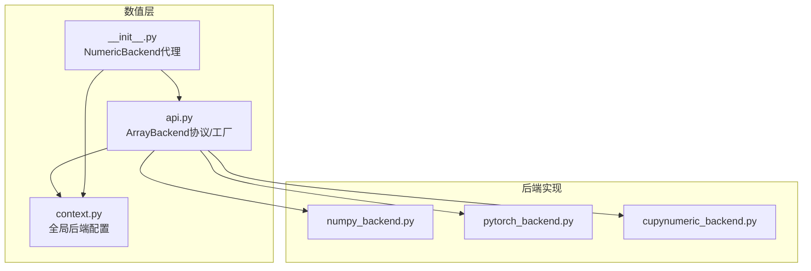
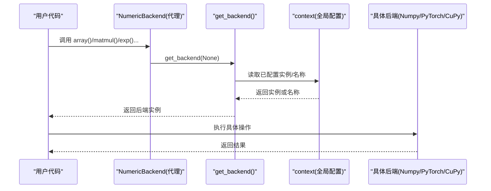
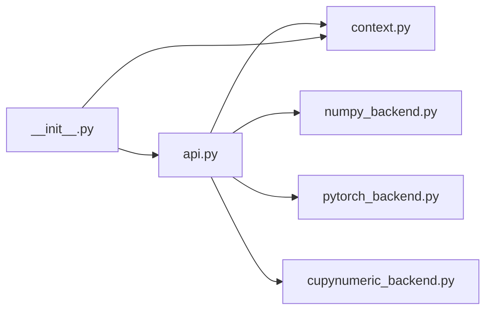

# ArrayBackend协议

<cite>
**本文引用的文件**
- [api.py](file://src/tyxonq/numerics/api.py)
- [numpy_backend.py](file://src/tyxonq/numerics/backends/numpy_backend.py)
- [pytorch_backend.py](file://src/tyxonq/numerics/backends/pytorch_backend.py)
- [cupynumeric_backend.py](file://src/tyxonq/numerics/backends/cupynumeric_backend.py)
- [context.py](file://src/tyxonq/numerics/context.py)
- [__init__.py](file://src/tyxonq/numerics/__init__.py)
- [numeric_backend_switching.py](file://examples/numeric_backend_switching.py)
</cite>

## 目录
1. [简介](#简介)
2. [项目结构](#项目结构)
3. [核心组件](#核心组件)
4. [架构总览](#架构总览)
5. [详细组件分析](#详细组件分析)
6. [依赖关系分析](#依赖关系分析)
7. [性能考虑](#性能考虑)
8. [故障排查指南](#故障排查指南)
9. [结论](#结论)
10. [附录：实现自定义后端与最佳实践](#附录：实现自定义后端与最佳实践)

## 简介
ArrayBackend协议是TyxonQ数值计算层的统一抽象，旨在屏蔽不同数值库（NumPy、PyTorch、CuPyNumeric等）的差异，为量子电路模拟、优化与自动微分提供一致的数组/张量接口。通过该协议，上层代码无需关心底层使用何种数值库，即可在CPU/GPU之间切换、启用自动微分或JIT编译，并保持API一致性与结果一致性。

## 项目结构
数值模块位于 src/tyxonq/numerics，核心由以下部分组成：
- api.py：定义ArrayBackend协议、向量化工具、后端工厂get_backend
- backends/*：具体后端实现（NumPy、PyTorch、CuPyNumeric）
- context.py：全局后端配置与上下文管理
- __init__.py：暴露NumericBackend类级代理与便捷函数（set_backend、set_dtype等）
- examples/numeric_backend_switching.py：演示如何切换后端并对比性能

图表来源
- [api.py:19-122](file://src/tyxonq/numerics/api.py#L19-L122)
- [context.py:18-50](file://src/tyxonq/numerics/context.py#L18-L50)
- [__init__.py:20-58](file://src/tyxonq/numerics/__init__.py#L20-L58)

章节来源
- [api.py:19-122](file://src/tyxonq/numerics/api.py#L19-L122)
- [context.py:18-50](file://src/tyxonq/numerics/context.py#L18-L50)
- [__init__.py:20-58](file://src/tyxonq/numerics/__init__.py#L20-L58)

## 核心组件
- ArrayBackend协议：定义统一的数组创建、转换、代数运算、线性代数、随机数、自动微分桥接等接口。
- NumericBackend类级代理：以类方法形式访问当前后端，避免显式实例化。
- get_backend工厂：根据名称或全局配置返回具体后端实例。
- 具体后端：NumpyBackend、PyTorchBackend、CuPyNumericBackend分别实现协议。
- 上下文管理：use_backend/set_backend控制全局默认后端。

章节来源
- [api.py:19-122](file://src/tyxonq/numerics/api.py#L19-L122)
- [__init__.py:67-473](file://src/tyxonq/numerics/__init__.py#L67-L473)
- [context.py:18-50](file://src/tyxonq/numerics/context.py#L18-L50)

## 架构总览
ArrayBackend作为稳定契约，将上层算法与底层数值库解耦。get_backend负责解析与实例化；NumericBackend提供便捷的类级调用；各后端实现协议方法，并在必要时提供可选能力（如vmap、jit、value_and_grad）。

图表来源
- [__init__.py:67-473](file://src/tyxonq/numerics/__init__.py#L67-L473)
- [api.py:179-252](file://src/tyxonq/numerics/api.py#L179-L252)
- [context.py:18-50](file://src/tyxonq/numerics/context.py#L18-L50)

## 详细组件分析

### ArrayBackend协议详解
ArrayBackend定义了统一接口，分为必需方法与可选方法两类：

- 必需属性与方法
  - name：后端标识字符串
  - dtype常量：complex64/complex128/float32/float64/int8/int32/int64/bool/int
  - 创建与转换：array、asarray、to_numpy
  - 代数与数组操作：matmul、einsum、reshape、moveaxis、sum、mean、abs、real、imag、conj、diag、zeros、ones、zeros_like、ones_like、eye、kron、square
  - 扩展数组操作：stack、concatenate、arange、linspace、transpose、norm、cast、sign、outer
  - 初等数学：exp、sin、cos、sqrt、log、log2
  - 离散操作/采样：choice、bincount、nonzero
  - 线性代数：svd、eigh、eig、solve、inv、expm、tensordot
  - 随机数：rng、normal
  - 自动微分桥接：requires_grad、detach

- 可选方法
  - vmap(fn)：按首维向量化
  - jit(fn)：后端特定JIT封装
  - value_and_grad(fn, argnums)：值与梯度联合计算

这些方法覆盖了量子计算中常见的张量构建、矩阵乘法、张量收缩、特征分解、指数映射、随机采样以及梯度计算等需求。

章节来源
- [api.py:19-122](file://src/tyxonq/numerics/api.py#L19-L122)

### NumpyBackend实现要点
- 纯CPU实现，依赖NumPy与SciPy（矩阵指数）
- 提供完整的协议方法，包括有限差分实现的jacfwd/hessian/value_and_grad
- 支持dtype设置（complex64/complex128），默认状态态用复数、参数用实数
- 无原生自动微分，requires_grad/detach为占位实现

章节来源
- [numpy_backend.py:8-457](file://src/tyxonq/numerics/backends/numpy_backend.py#L8-L457)

### PyTorchBackend实现要点
- 基于PyTorch张量，支持GPU加速与自动微分
- 关键路径严格保留requires_grad，确保梯度流不被中断
- 提供torch.func.jacfwd/hessian（若可用），否则回退到有限差分
- 支持vmap（torch.func.vmap）与jit（torch.compile）
- 提供完整的线性代数与随机数接口

章节来源
- [pytorch_backend.py:13-567](file://src/tyxonq/numerics/backends/pytorch_backend.py#L13-L567)

### CuPyNumericBackend实现要点
- 面向GPU加速的NumPy风格后端
- 部分操作（如SVD）回退到NumPy处理
- 提供基础协议方法，自动微分通过有限差分近似
- 适合大规模状态向量运算

章节来源
- [cupynumeric_backend.py:13-300](file://src/tyxonq/numerics/backends/cupynumeric_backend.py#L13-L300)

### NumericBackend类级代理
- 以类方法形式直接调用当前后端的对应方法，简化使用
- 暴露dtype常量、常用数学/线性代数/随机数/自动微分桥接
- 内部委托给get_backend(None)获取当前后端

章节来源
- [__init__.py:67-473](file://src/tyxonq/numerics/__init__.py#L67-L473)

### 后端选择与上下文管理
- set_backend(name_or_instance)：设置全局后端（字符串名或实例）
- use_backend(...)：上下文管理器临时切换后端
- get_backend(name=None)：优先使用已配置实例，其次名称，最后回退到NumPy

章节来源
- [context.py:18-50](file://src/tyxonq/numerics/context.py#L18-L50)
- [api.py:179-252](file://src/tyxonq/numerics/api.py#L179-L252)
- [__init__.py:20-58](file://src/tyxonq/numerics/__init__.py#L20-L58)

## 依赖关系分析
- api.py依赖context.py进行全局配置解析，并导入具体后端实现
- 各后端实现相互独立，仅遵循ArrayBackend协议
- NumericBackend代理集中转发到当前后端，降低耦合度

图表来源
- [api.py:1-14](file://src/tyxonq/numerics/api.py#L1-L14)
- [__init__.py:1-17](file://src/tyxonq/numerics/__init__.py#L1-L17)

章节来源
- [api.py:1-14](file://src/tyxonq/numerics/api.py#L1-L14)
- [__init__.py:1-17](file://src/tyxonq/numerics/__init__.py#L1-L17)

## 性能考虑
- NumPy：轻量、适合小规模电路与原型开发；无原生自动微分，梯度通过有限差分
- PyTorch：支持GPU与自动微分，适合VQA训练与梯度优化；可结合torch.compile进行JIT
- CuPyNumeric：面向GPU的NumPy风格后端，适合大规模状态向量运算；部分算子回退CPU
- 向量化工具vectorize_or_fallback：优先使用后端vmap，失败时回退到逐元素应用，保证鲁棒性
- 精度与类型：通过set_dtype统一设置复数/实数类型，平衡精度与内存占用

章节来源
- [api.py:124-176](file://src/tyxonq/numerics/api.py#L124-L176)
- [__init__.py:39-58](file://src/tyxonq/numerics/__init__.py#L39-L58)
- [numeric_backend_switching.py:187-246](file://examples/numeric_backend_switching.py#L187-L246)

## 故障排查指南
- 后端不可用：当请求的backend未安装或不可用时，get_backend会抛出RuntimeError；请检查依赖或回退到NumPy
- 梯度断裂：在PyTorch后端，确保array/asarray等方法不破坏requires_grad；示例中已强调保持梯度链
- 数值不一致：不同后端可能存在浮点误差；建议使用allclose/isclose进行容差比较
- JIT/vmap不支持：某些后端可能不提供vmap/jit；工具会自动回退到普通执行

章节来源
- [api.py:179-252](file://src/tyxonq/numerics/api.py#L179-L252)
- [pytorch_backend.py:77-128](file://src/tyxonq/numerics/backends/pytorch_backend.py#L77-L128)
- [numpy_backend.py:136-142](file://src/tyxonq/numerics/backends/numpy_backend.py#L136-L142)

## 结论
ArrayBackend协议为TyxonQ提供了稳定、可扩展的统一数值接口，屏蔽了不同数值库差异，使上层算法可以专注于量子计算逻辑。通过get_backend与NumericBackend代理，用户可以无缝切换后端、利用GPU加速与自动微分，并获得一致的结果与性能特性。

## 附录：实现自定义后端与最佳实践

### 如何实现自定义后端
- 实现ArrayBackend协议的所有必需方法与属性（name、dtype常量、创建/转换、代数/线性代数/随机数/自动微分桥接）
- 可选实现vmap/jit/value_and_grad以提升性能与功能
- 注册到get_backend或通过上下文管理使用

参考文档中的最小实现示例路径：
- [docs/source/user_guide/advanced/index.rst:242-295](file://docs/source/user_guide/advanced/index.rst#L242-L295)

### 使用示例与流程
- 切换后端：使用tq.set_backend("numpy"/"pytorch"/"cupynumeric")
- 获取后端：K = tq.get_backend()
- 创建数组与运算：K.array/K.zeros/K.matmul/K.einsum/K.exp等
- 自动微分：PyTorch后端下，参数设为requires_grad=True，调用backward或使用value_and_grad
- 性能对比：参考示例脚本进行基准测试

参考示例路径：
- [examples/numeric_backend_switching.py:86-184](file://examples/numeric_backend_switching.py#L86-L184)
- [examples/numeric_backend_switching.py:187-246](file://examples/numeric_backend_switching.py#L187-L246)
- [examples/numeric_backend_switching.py:249-283](file://examples/numeric_backend_switching.py#L249-L283)

### 最佳实践
- 明确dtype：使用set_dtype统一复数/实数类型，避免隐式转换带来的精度问题
- 谨慎处理梯度：在PyTorch后端，确保所有参与计算的张量正确标记requires_grad，避免中间步骤断开图
- 合理使用向量化：优先使用后端vmap；若无，则依赖vectorize_or_fallback的安全回退
- 性能调优：小电路用NumPy快速迭代；需要梯度/GPU时用PyTorch；大规模状态向量用CuPyNumeric
- 结果验证：跨后端比较时使用allclose/isclose容忍浮点误差

章节来源
- [__init__.py:39-58](file://src/tyxonq/numerics/__init__.py#L39-L58)
- [api.py:124-176](file://src/tyxonq/numerics/api.py#L124-L176)
- [pytorch_backend.py:77-128](file://src/tyxonq/numerics/backends/pytorch_backend.py#L77-L128)
- [numpy_backend.py:136-142](file://src/tyxonq/numerics/backends/numpy_backend.py#L136-L142)
- [examples/numeric_backend_switching.py:86-184](file://examples/numeric_backend_switching.py#L86-L184)