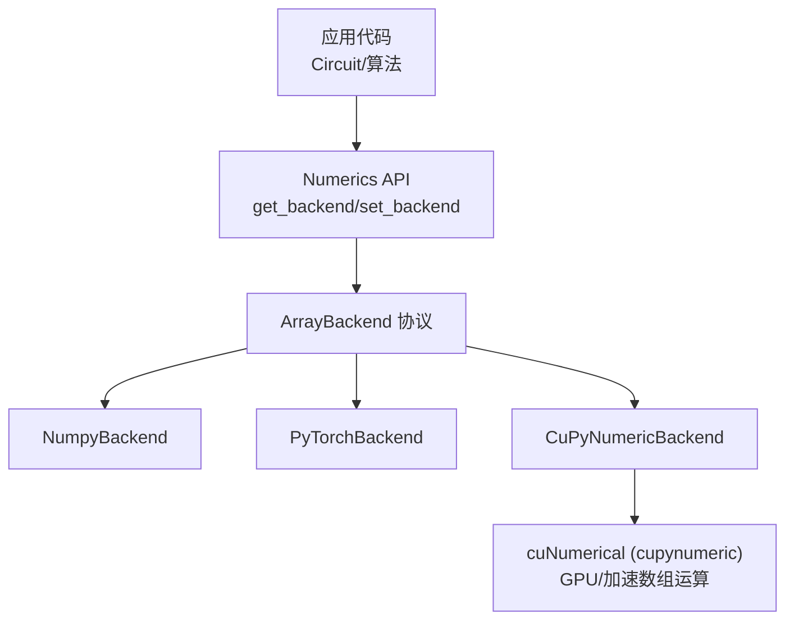
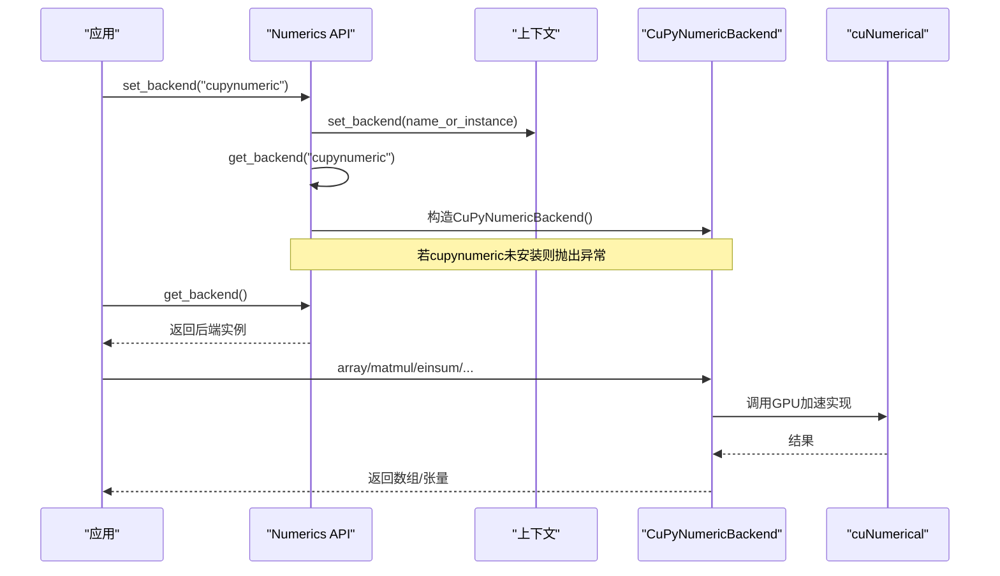
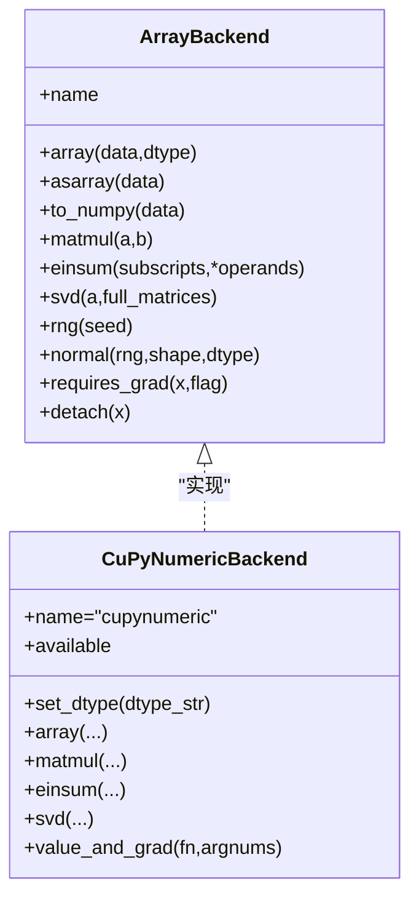
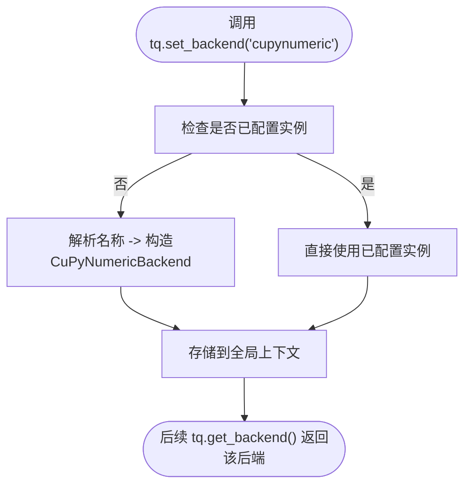
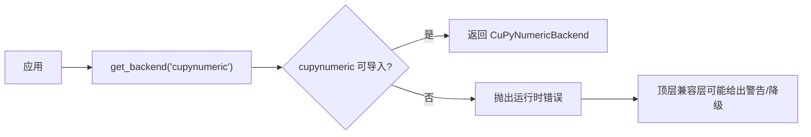

# CuPyNumeric后端

<cite>
**本文引用的文件**
- [cupynumeric_backend.py](file://src/tyxonq/numerics/backends/cupynumeric_backend.py)
- [api.py](file://src/tyxonq/numerics/api.py)
- [context.py](file://src/tyxonq/numerics/context.py)
- [__init__.py（numerics）](file://src/tyxonq/numerics/__init__.py)
- [numpy_backend.py](file://src/tyxonq/numerics/backends/numpy_backend.py)
- [pytorch_backend.py](file://src/tyxonq/numerics/backends/pytorch_backend.py)
- [config.py](file://src/tyxonq/config.py)
- [numeric_backend_switching.py](file://examples/numeric_backend_switching.py)
- [sample_benchmark.py](file://examples/sample_benchmark.py)
- [index.rst（用户指南：数值后端）](file://docs/source/user_guide/numerics/index.rst)
</cite>

## 目录
1. [简介](#简介)
2. [项目结构](#项目结构)
3. [核心组件](#核心组件)
4. [架构总览](#架构总览)
5. [详细组件分析](#详细组件分析)
6. [依赖关系分析](#依赖关系分析)
7. [性能与GPU加速](#性能与gpu加速)
8. [安装、配置与使用指南](#安装配置与使用指南)
9. [故障排查](#故障排查)
10. [结论](#结论)
11. [附录](#附录)

## 简介
本文件聚焦于TyxonQ中的CuPyNumeric后端，系统性说明其如何基于cuNumerical实现ArrayBackend协议，提供CUDA GPU加速的数值计算能力。文档涵盖：
- 后端接口与协议一致性
- CUDA GPU加速的优势与适用场景
- 与传统NumPy/CuPy的差异与兼容性
- 安装、配置与使用步骤
- GPU资源管理与性能调优建议
- 在大规模量子模拟中的表现与对比基准思路

## 项目结构
TyxonQ将数值后端抽象为统一的ArrayBackend协议，并通过工厂函数与全局上下文管理进行切换。CuPyNumeric后端位于numerics/backends下，与其他后端（NumPy、PyTorch）并列，遵循相同API。

图表来源
- [api.py:19-113](file://src/tyxonq/numerics/api.py#L19-L113)
- [cupynumeric_backend.py:13-31](file://src/tyxonq/numerics/backends/cupynumeric_backend.py#L13-L31)
- [__init__.py（numerics）:20-58](file://src/tyxonq/numerics/__init__.py#L20-L58)

章节来源
- [api.py:19-113](file://src/tyxonq/numerics/api.py#L19-L113)
- [__init__.py（numerics）:20-58](file://src/tyxonq/numerics/__init__.py#L20-L58)

## 核心组件
- ArrayBackend协议：定义统一的数组创建、线性代数、随机数、自动微分桥接等接口。
- CuPyNumericBackend：基于cuNumerical的实现，暴露dtype常量、数组操作、数学函数、采样辅助、SVD回退到NumPy等。
- 后端工厂与上下文：get_backend/set_backend/use_backend统一选择并缓存当前后端；支持按名称或实例设置。
- NumericBackend类级代理：以类方法形式访问当前后端，屏蔽具体实现差异。

章节来源
- [api.py:19-113](file://src/tyxonq/numerics/api.py#L19-L113)
- [api.py:179-252](file://src/tyxonq/numerics/api.py#L179-L252)
- [context.py:18-50](file://src/tyxonq/numerics/context.py#L18-L50)
- [__init__.py（numerics）:67-472](file://src/tyxonq/numerics/__init__.py#L67-L472)
- [cupynumeric_backend.py:13-297](file://src/tyxonq/numerics/backends/cupynumeric_backend.py#L13-L297)

## 架构总览
TyxonQ通过“协议+工厂+上下文”的解耦设计，使上层量子计算逻辑无需关心底层数组库。CuPyNumeric后端在可用时提供GPU加速；不可用时可优雅降级或提示。

图表来源
- [api.py:179-252](file://src/tyxonq/numerics/api.py#L179-L252)
- [context.py:18-50](file://src/tyxonq/numerics/context.py#L18-L50)
- [cupynumeric_backend.py:55-216](file://src/tyxonq/numerics/backends/cupynumeric_backend.py#L55-L216)

## 详细组件分析

### CuPyNumericBackend实现要点
- 协议一致性：实现ArrayBackend所需的核心方法（array/asarray/matmul/einsum/reshape/sum/mean/exp/sin/cos/sqrt/kron等），以及随机数、采样辅助、SVD等。
- dtype管理：支持complex64/complex128及对应实数类型，便于在精度与显存之间权衡。
- SVD回退：当cuNumerical不提供高效SVD时，回退到NumPy实现以保证功能正确性。
- 梯度支持：提供requires_grad/detach占位；value_and_grad采用有限差分回退策略，避免强依赖自动微分。

图表来源
- [api.py:19-113](file://src/tyxonq/numerics/api.py#L19-L113)
- [cupynumeric_backend.py:13-297](file://src/tyxonq/numerics/backends/cupynumeric_backend.py#L13-L297)

章节来源
- [cupynumeric_backend.py:13-297](file://src/tyxonq/numerics/backends/cupynumeric_backend.py#L13-L297)

### 后端选择与上下文管理
- set_backend/get_backend：支持字符串名称或实例；内部维护全局默认后端。
- use_backend：上下文管理器，临时切换后端，退出后恢复。
- NumericBackend类级代理：所有常用操作通过类方法转发至当前后端，简化调用。

图表来源
- [api.py:179-252](file://src/tyxonq/numerics/api.py#L179-L252)
- [context.py:18-50](file://src/tyxonq/numerics/context.py#L18-L50)
- [__init__.py（numerics）:20-58](file://src/tyxonq/numerics/__init__.py#L20-L58)

章节来源
- [api.py:179-252](file://src/tyxonq/numerics/api.py#L179-L252)
- [context.py:18-50](file://src/tyxonq/numerics/context.py#L18-L50)
- [__init__.py（numerics）:20-58](file://src/tyxonq/numerics/__init__.py#L20-L58)

### 与NumPy/PyTorch后端的对比
- NumPy：CPU参考实现，稳定易用，适合小规模电路与调试。
- PyTorch：原生自动微分、JIT编译、GPU加速，适合VQA优化与大规模批处理。
- CuPyNumeric：面向NumPy风格API的GPU加速，适合大规模状态向量与密集线性代数。

章节来源
- [numpy_backend.py:8-457](file://src/tyxonq/numerics/backends/numpy_backend.py#L8-L457)
- [pytorch_backend.py:13-567](file://src/tyxonq/numerics/backends/pytorch_backend.py#L13-L567)
- [__init__.py（numerics）:67-123](file://src/tyxonq/numerics/__init__.py#L67-L123)

## 依赖关系分析
- 可选依赖：cuNumerical（导入失败时标记为不可用）。
- 工厂层：根据名称动态加载后端；若请求的backend不可用则抛出明确错误。
- 兼容层：顶层模块对cupynumeric缺失提供友好降级与警告。

图表来源
- [api.py:245-250](file://src/tyxonq/numerics/api.py#L245-L250)
- [config.py:27-66](file://src/tyxonq/config.py#L27-L66)

章节来源
- [api.py:245-250](file://src/tyxonq/numerics/api.py#L245-L250)
- [config.py:27-66](file://src/tyxonq/config.py#L27-L66)

## 性能与GPU加速
- 优势场景：
  - 大规模态矢量演化、密集矩阵乘/求和、批量参数扫描。
  - 需要NumPy风格API但希望利用GPU加速的计算路径。
- 注意事项：
  - cuNumerical的某些算子（如SVD）可能回退到CPU/NumPy实现，需关注热点路径。
  - 数据迁移成本：频繁在CPU/GPU间拷贝会抵消加速收益。
  - 精度选择：complex64可降低显存占用与提升吞吐，complex128提高精度但增加内存带宽压力。
- 调优建议：
  - 优先批量化与向量化计算，减少Python循环。
  - 合理设置dtype，平衡精度与性能。
  - 避免在热路径中频繁转换数据类型或设备。
  - 结合JIT/编译器特性（如PyTorch后端）进一步优化。

章节来源
- [cupynumeric_backend.py:209-216](file://src/tyxonq/numerics/backends/cupynumeric_backend.py#L209-L216)
- [index.rst（用户指南：数值后端）:171-240](file://docs/source/user_guide/numerics/index.rst#L171-L240)

## 安装、配置与使用指南

### 安装
- 确保系统具备CUDA驱动与工具链。
- 安装cuNumerical（cupynumeric）依赖。
- 验证导入：import cupynumeric as cn 应成功。

### 配置与切换
- 全局设置：tq.set_backend("cupynumeric")
- 获取后端：K = tq.get_backend()
- 上下文切换：with tq.use_backend("cupynumeric"): ...
- 设置dtype：tq.set_dtype("complex64"/"complex128")

### 基本用法
- 创建数组与执行运算：K.array/K.ones/K.matmul/K.einsum等
- 期望值计算：结合Circuit.expectation_*与后端栈式聚合
- 示例脚本：参见示例中的演示与对比流程

章节来源
- [api.py:179-252](file://src/tyxonq/numerics/api.py#L179-L252)
- [context.py:18-50](file://src/tyxonq/numerics/context.py#L18-L50)
- [__init__.py（numerics）:20-58](file://src/tyxonq/numerics/__init__.py#L20-L58)
- [numeric_backend_switching.py:155-184](file://examples/numeric_backend_switching.py#L155-L184)

## 故障排查
- 导入失败：若cupynumeric未安装，get_backend("cupynumeric")将抛出运行时错误；可在顶层捕获并回退到NumPy。
- 设备不可用：确认CUDA驱动与cuNumeral版本匹配；必要时检查环境变量。
- 性能不达预期：检查是否存在频繁的CPU/GPU数据拷贝；评估dtype与批大小；关注SVD等回退路径。
- 梯度计算：CuPyNumeric后端默认使用有限差分回退；如需精确梯度，考虑切换到PyTorch后端。

章节来源
- [api.py:245-250](file://src/tyxonq/numerics/api.py#L245-L250)
- [cupynumeric_backend.py:250-297](file://src/tyxonq/numerics/backends/cupynumeric_backend.py#L250-L297)

## 结论
CuPyNumeric后端为TyxonQ提供了基于cuNumeral的GPU加速数值计算能力，严格遵循ArrayBackend协议，可与NumPy/PyTorch后端无缝切换。在大规模量子模拟与密集线性代数场景中，配合合理的dtype与批处理策略，可获得显著的性能收益。对于需要自动微分的任务，可优先考虑PyTorch后端；对于纯数值加速且偏好NumPy风格API的场景，CuPyNumeric后端是优选。

## 附录

### 与CuPy的关系与兼容性
- 本后端基于cuNumerical（cupynumeric），而非直接依赖CuPy；两者均提供GPU加速，但API与生态不同。
- TyxonQ通过ArrayBackend屏蔽差异，上层代码无需感知具体后端实现。

章节来源
- [api.py:19-113](file://src/tyxonq/numerics/api.py#L19-L113)
- [cupynumeric_backend.py:5-10](file://src/tyxonq/numerics/backends/cupynumeric_backend.py#L5-L10)

### 基准测试与对比思路
- 使用示例脚本对不同后端进行计时与一致性校验。
- 推荐维度：不同qubit数、层数、shots、重复次数；记录均值与标准差。
- 注意预热轮次剔除，保证测量稳定性。

章节来源
- [numeric_backend_switching.py:187-246](file://examples/numeric_backend_switching.py#L187-L246)
- [sample_benchmark.py:51-90](file://examples/sample_benchmark.py#L51-L90)