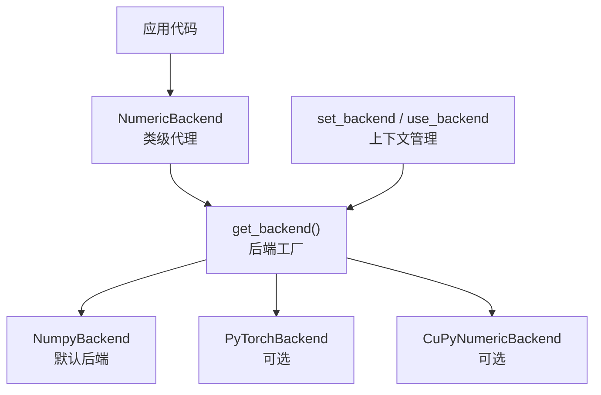
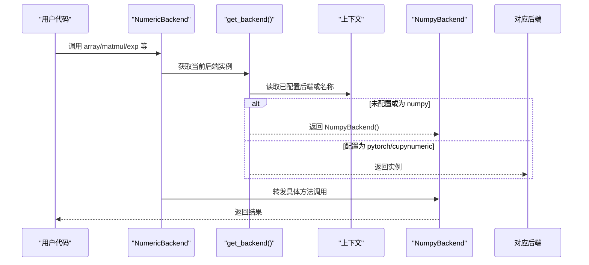
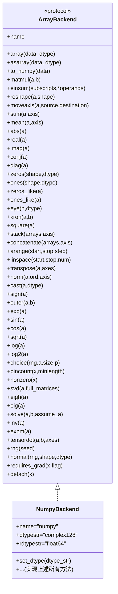
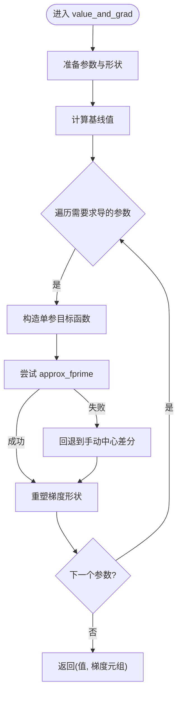
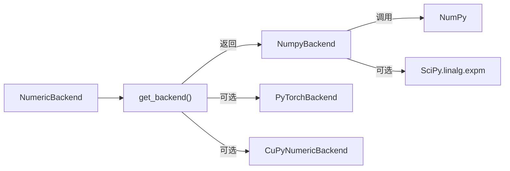

# NumPy后端

<cite>
**本文引用的文件**
- [numpy_backend.py](file://src/tyxonq/numerics/backends/numpy_backend.py)
- [api.py](file://src/tyxonq/numerics/api.py)
- [__init__.py](file://src/tyxonq/numerics/__init__.py)
- [context.py](file://src/tyxonq/numerics/context.py)
- [pytorch_backend.py](file://src/tyxonq/numerics/backends/pytorch_backend.py)
- [numeric_backend_switching.py](file://examples/numeric_backend_switching.py)
- [test_numerics.py](file://tests_core_module/test_numerics.py)
</cite>

## 目录
1. [简介](#简介)
2. [项目结构](#项目结构)
3. [核心组件](#核心组件)
4. [架构总览](#架构总览)
5. [详细组件分析](#详细组件分析)
6. [依赖关系分析](#依赖关系分析)
7. [性能与内存管理](#性能与内存管理)
8. [使用示例与配置选项](#使用示例与配置选项)
9. [与其他后端的对比与迁移建议](#与其他后端的对比与迁移建议)
10. [复杂数据类型与广播机制](#复杂数据类型与广播机制)
11. [故障排查指南](#故障排查指南)
12. [结论](#结论)

## 简介
本文件系统性说明 TyxonQ 的 NumPy 后端：它作为默认后端的特点、实现的 ArrayBackend 协议方法、内存管理与性能特征、CPU 环境下的适用场景与限制，以及使用方法、配置项、与其他后端的对比和迁移建议。NumPy 后端提供稳定、可移植的 CPU 数值计算能力，是原型开发与中小规模量子电路仿真的首选。

## 项目结构
TyxonQ 的数值子系统位于 numerics 包中，采用“统一协议 + 多后端实现”的设计：
- 协议与工厂：ArrayBackend 协议定义、get_backend/set_backend/use_backend 等接口
- 后端实现：NumpyBackend、PyTorchBackend（可选）、CuPyNumeric（可选）
- 上下文管理：全局默认后端切换与临时上下文
- 类级代理：NumericBackend 提供便捷的全局访问入口

图表来源
- [api.py:179-252](file://src/tyxonq/numerics/api.py#L179-L252)
- [__init__.py:20-58](file://src/tyxonq/numerics/__init__.py#L20-L58)
- [context.py:18-50](file://src/tyxonq/numerics/context.py#L18-L50)

章节来源
- [api.py:179-252](file://src/tyxonq/numerics/api.py#L179-L252)
- [__init__.py:20-58](file://src/tyxonq/numerics/__init__.py#L20-L58)
- [context.py:18-50](file://src/tyxonq/numerics/context.py#L18-L50)

## 核心组件
- ArrayBackend 协议：统一数组/张量操作接口，涵盖创建、代数、数学函数、线性代数、随机数、自动微分桥接等
- NumpyBackend：基于 NumPy 的具体实现，提供完整协议方法
- NumericBackend：类级代理，将调用转发到当前后端实例
- get_backend/set_backend/use_backend：后端选择与生命周期管理

章节来源
- [api.py:19-122](file://src/tyxonq/numerics/api.py#L19-L122)
- [numpy_backend.py:8-457](file://src/tyxonq/numerics/backends/numpy_backend.py#L8-L457)
- [__init__.py:67-473](file://src/tyxonq/numerics/__init__.py#L67-L473)
- [context.py:18-50](file://src/tyxonq/numerics/context.py#L18-L50)

## 架构总览
下图展示从用户代码到具体后端的调用路径，以及默认后端的选择策略。

图表来源
- [__init__.py:67-473](file://src/tyxonq/numerics/__init__.py#L67-L473)
- [api.py:179-252](file://src/tyxonq/numerics/api.py#L179-L252)
- [context.py:18-50](file://src/tyxonq/numerics/context.py#L18-L50)

## 详细组件分析

### NumpyBackend 协议方法总览
NumpyBackend 实现了 ArrayBackend 协议的全部关键方法，覆盖以下类别：
- 类型与创建：complex64/128、float32/64、int*、bool、array、asarray、to_numpy、zeros/ones/eye/zeros_like/ones_like、arange/linspace、stack/concatenate、transpose、reshape/moveaxis
- 代数与数组运算：matmul/dot/einsum、sum/mean/abs/real/imag/conj/diag/kron/square/outer、norm、cast、sign、allclose/isclose
- 数学函数：exp/sin/cos/sqrt/log/log2
- 线性代数：svd/eigh/eig/solve/inv/expm/tensordot
- 随机数：rng/normal/choice/bincount/nonzero
- 自动微分桥接：requires_grad/detach（无梯度追踪，仅透传）
- K-like 辅助：jit（返回原函数）、jacfwd/hessian/value_and_grad（基于有限差分与 scipy.optimize.approx_fprime）

图表来源
- [api.py:19-122](file://src/tyxonq/numerics/api.py#L19-L122)
- [numpy_backend.py:8-457](file://src/tyxonq/numerics/backends/numpy_backend.py#L8-L457)

章节来源
- [numpy_backend.py:8-457](file://src/tyxonq/numerics/backends/numpy_backend.py#L8-L457)
- [api.py:19-122](file://src/tyxonq/numerics/api.py#L19-L122)

### 自动微分与梯度近似（NumPy 后端）
- requires_grad/detach：在 NumPy 后端不改变行为，仅透传数据
- jacfwd/hessian/value_and_grad：通过有限差分与 scipy.optimize.approx_fprime 实现，适合无原生自动微分的场景；注意复杂度与数值稳定性

图表来源
- [numpy_backend.py:386-454](file://src/tyxonq/numerics/backends/numpy_backend.py#L386-L454)

章节来源
- [numpy_backend.py:255-454](file://src/tyxonq/numerics/backends/numpy_backend.py#L255-L454)

## 依赖关系分析
- NumpyBackend 直接依赖 NumPy 与可选的 SciPy（矩阵指数 expm）
- 工厂 get_backend 根据配置或名称返回后端实例，默认回退到 NumPy
- NumericBackend 作为类级代理，将所有方法调用转发至当前后端

图表来源
- [numpy_backend.py:229-232](file://src/tyxonq/numerics/backends/numpy_backend.py#L229-L232)
- [api.py:179-252](file://src/tyxonq/numerics/api.py#L179-L252)

章节来源
- [api.py:179-252](file://src/tyxonq/numerics/api.py#L179-L252)
- [numpy_backend.py:229-232](file://src/tyxonq/numerics/backends/numpy_backend.py#L229-L232)

## 性能与内存管理
- 性能特点
  - 纯 CPU 执行，依赖 BLAS/LAPACK 优化（取决于 NumPy/SciPy 底层实现）
  - 小中型问题（如 <12 量子比特态矢量）表现良好，启动开销低
  - 对于大规模并行或 GPU 加速需求，建议使用 PyTorch/CuPyNumeric 后端
- 内存管理
  - 多数操作返回视图或新数组，注意避免不必要的拷贝（例如 stack/concatenate 会分配新内存）
  - copy 方法显式复制；asarray/array 尽量复用已有缓冲（NumPy 内部策略）
  - 大型矩阵指数 expm 可能占用较多内存与时间，应谨慎使用或分块处理
- 基准参考
  - 示例脚本展示了不同后端在同一任务上的耗时对比，便于评估

章节来源
- [numeric_backend_switching.py:187-246](file://examples/numeric_backend_switching.py#L187-L246)
- [numpy_backend.py:132-138](file://src/tyxonq/numerics/backends/numpy_backend.py#L132-L138)
- [numpy_backend.py:229-232](file://src/tyxonq/numerics/backends/numpy_backend.py#L229-L232)

## 使用示例与配置选项
- 设置默认后端
  - set_backend("numpy")：设置全局默认后端为 NumPy
  - use_backend(...)：临时切换后端，退出上下文恢复
- 获取后端实例
  - get_backend(None)：返回当前配置的后端，若未配置则回退到 NumPy
  - get_backend("numpy")：显式请求 NumPy 后端
- 数据类型配置
  - set_dtype("complex64"/"complex128")：设置复数与实数默认精度
- 基本用法
  - 通过 NumericBackend 或直接使用后端实例进行数组创建、矩阵乘法、数学函数、线性代数等操作
- 示例参考
  - 示例脚本演示了在不同后端下构建 VQE 电路、计算期望值、梯度与性能对比

章节来源
- [__init__.py:20-58](file://src/tyxonq/numerics/__init__.py#L20-L58)
- [context.py:18-50](file://src/tyxonq/numerics/context.py#L18-L50)
- [api.py:179-252](file://src/tyxonq/numerics/api.py#L179-L252)
- [numeric_backend_switching.py:86-152](file://examples/numeric_backend_switching.py#L86-L152)

## 与其他后端的对比与迁移建议
- 对比要点
  - NumPy：轻量、稳定、CPU 专用；适合原型与小规模仿真
  - PyTorch：支持 GPU、自动微分、JIT；适合带梯度的优化与大模型
  - CuPyNumeric：面向 GPU 的 NumPy 兼容后端，适合大规模状态向量运算
- 迁移建议
  - 保持对 ArrayBackend 协议的调用，无需修改业务逻辑即可切换后端
  - 涉及梯度时优先使用 PyTorch 后端；若仅需 CPU 且无梯度需求，可使用 NumPy
  - 大数据集或高并发场景考虑 GPU 后端，并关注内存与设备间数据传输成本
- 一致性验证
  - 示例脚本包含跨后端结果一致性检查，确保数值等价性

章节来源
- [numeric_backend_switching.py:187-283](file://examples/numeric_backend_switching.py#L187-L283)
- [api.py:179-252](file://src/tyxonq/numerics/api.py#L179-L252)

## 复杂数据类型与广播机制
- 数据类型
  - 默认复数类型为 complex128，实数为 float64；可通过 set_dtype 切换为 complex64/float32
  - 支持 int8/int32/int64/bool 等常用类型
- 广播
  - 基于 NumPy 广播规则，自动对齐维度；注意 reshape/moveaxis/transpose 对维度的影响
  - 使用 einsum 可精确控制多维索引与收缩，避免隐式广播带来的歧义
- 最佳实践
  - 明确指定 dtype 以避免隐式转换
  - 对大数组优先使用原地操作或视图，减少内存峰值

章节来源
- [numpy_backend.py:11-46](file://src/tyxonq/numerics/backends/numpy_backend.py#L11-L46)
- [numpy_backend.py:48-66](file://src/tyxonq/numerics/backends/numpy_backend.py#L48-L66)
- [numpy_backend.py:83-84](file://src/tyxonq/numerics/backends/numpy_backend.py#L83-L84)

## 故障排查指南
- 常见问题
  - 后端不可用：当请求 PyTorch/CuPyNumeric 但未安装时，get_backend 会抛出运行时错误
  - 梯度为 None：在 NumPy 后端不支持自动微分，需使用有限差分或切换到 PyTorch
  - 性能瓶颈：大规模矩阵指数或重复栈/拼接操作可能导致内存与时间开销上升
- 定位方法
  - 使用示例脚本中的性能对比流程，确认问题是否由后端选择引起
  - 检查 set_dtype 与数据类型一致性，避免隐式转换导致的精度损失
  - 对关键路径添加 to_numpy 输出以验证中间结果

章节来源
- [api.py:236-252](file://src/tyxonq/numerics/api.py#L236-L252)
- [numpy_backend.py:255-454](file://src/tyxonq/numerics/backends/numpy_backend.py#L255-L454)
- [numeric_backend_switching.py:187-246](file://examples/numeric_backend_switching.py#L187-L246)

## 结论
NumPy 后端作为 TyxonQ 的默认后端，提供了稳定、易用的 CPU 数值计算能力，覆盖了完整的 ArrayBackend 协议方法，适用于原型开发、小规模量子电路仿真与教学场景。对于需要 GPU 加速、自动微分或更大规模计算的任务，建议切换到 PyTorch 或 CuPyNumeric 后端。通过统一的协议与上下文管理，可在不同后端之间无缝迁移，同时保持代码一致性与结果可比性。