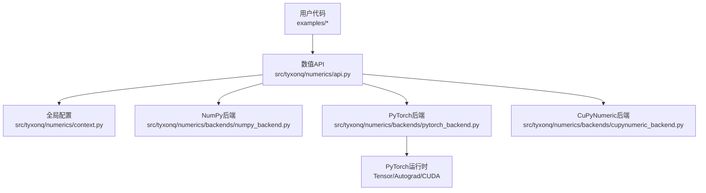
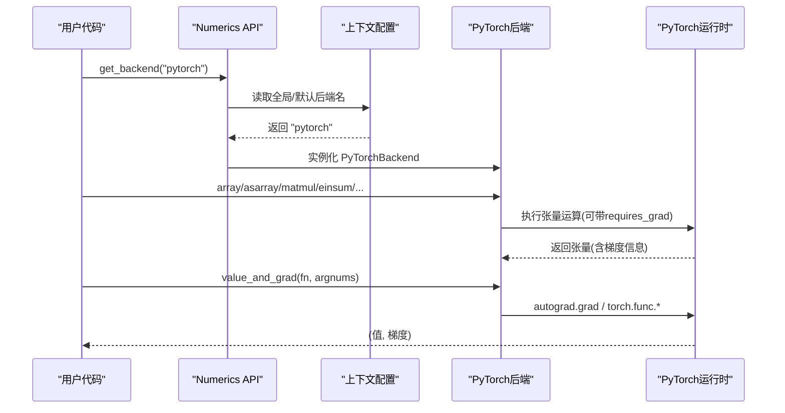
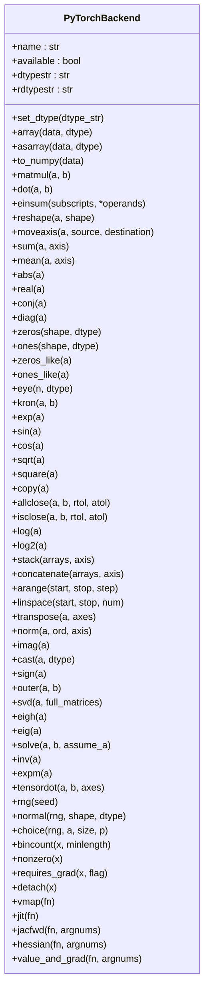
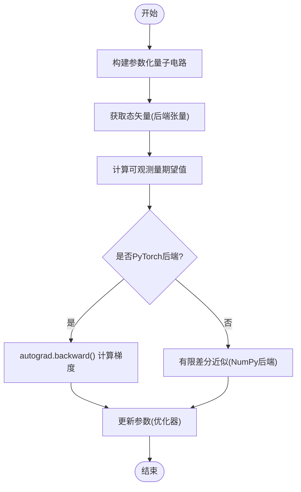
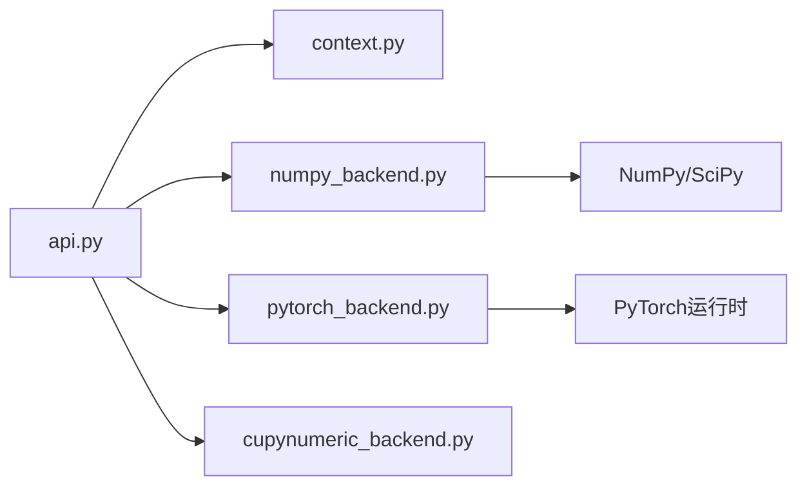

# PyTorch后端

<cite>
**本文引用的文件**
- [pytorch_backend.py](file://src/tyxonq/numerics/backends/pytorch_backend.py)
- [numpy_backend.py](file://src/tyxonq/numerics/backends/numpy_backend.py)
- [api.py](file://src/tyxonq/numerics/api.py)
- [context.py](file://src/tyxonq/numerics/context.py)
- [numeric_backend_switching.py](file://examples/numeric_backend_switching.py)
- [hybrid_quantum_classical_training.py](file://examples/hybrid_quantum_classical_training.py)
- [test_circuit_state_autograd.py](file://tests_core_module/test_circuit_state_autograd.py)
- [autograd_vs_counts.py](file://examples/autograd_vs_counts.py)
</cite>

## 目录
1. [简介](#简介)
2. [项目结构](#项目结构)
3. [核心组件](#核心组件)
4. [架构总览](#架构总览)
5. [详细组件分析](#详细组件分析)
6. [依赖关系分析](#依赖关系分析)
7. [性能与GPU优化](#性能与gpu优化)
8. [故障排查指南](#故障排查指南)
9. [结论](#结论)
10. [附录：配置与使用示例](#附录：配置与使用示例)

## 简介
本文件系统性说明 TyxonQ 的 PyTorch 后端，重点覆盖：
- 如何通过 ArrayBackend 协议统一接口对接 PyTorch Tensor 与 Autograd。
- GPU 加速能力与 CUDA 集成方式（设备选择、内存管理）。
- 自动微分在量子计算中的应用，尤其是变分算法（VQE/QAOA等）中的梯度计算。
- 与 NumPy 后端的兼容性与数据转换方法。
- 配置与使用示例、常见问题与性能优化建议。

## 项目结构
TyxonQ 数值后端位于 src/tyxonq/numerics 下，提供统一的 ArrayBackend 协议与多后端实现（NumPy、PyTorch、可选 CuPyNumeric），并通过上下文管理器进行全局后端切换。示例与测试展示了如何在实际任务中切换后端并验证结果一致性。

图表来源
- [api.py:179-252](file://src/tyxonq/numerics/api.py#L179-L252)
- [context.py:18-50](file://src/tyxonq/numerics/context.py#L18-L50)
- [pytorch_backend.py:13-567](file://src/tyxonq/numerics/backends/pytorch_backend.py#L13-L567)
- [numpy_backend.py:8-457](file://src/tyxonq/numerics/backends/numpy_backend.py#L8-L457)

章节来源
- [api.py:179-252](file://src/tyxonq/numerics/api.py#L179-L252)
- [context.py:18-50](file://src/tyxonq/numerics/context.py#L18-L50)

## 核心组件
- ArrayBackend 协议：定义统一的数组创建、线性代数、随机数、自动微分桥接等方法签名，屏蔽底层框架差异。
- PyTorchBackend：基于 torch.Tensor 的实现，支持 dtype 管理、自动微分、JIT、vmap、jacfwd/hessian/value_and_grad 等。
- NumpyBackend：纯 CPU 参考实现，提供有限差分近似作为 autograd 替代路径。
- 后端工厂与上下文：get_backend() 根据名称或全局配置返回具体后端；use_backend() 提供临时上下文切换。

章节来源
- [api.py:19-122](file://src/tyxonq/numerics/api.py#L19-L122)
- [api.py:179-252](file://src/tyxonq/numerics/api.py#L179-L252)
- [context.py:18-50](file://src/tyxonq/numerics/context.py#L18-L50)
- [pytorch_backend.py:13-567](file://src/tyxonq/numerics/backends/pytorch_backend.py#L13-L567)
- [numpy_backend.py:8-457](file://src/tyxonq/numerics/backends/numpy_backend.py#L8-L457)

## 架构总览
PyTorch 后端通过 ArrayBackend 协议暴露一致的 API，上层量子电路与算子调用后端提供的张量操作与数学函数。当使用 PyTorch 后端时，所有中间张量保持 requires_grad 以构建计算图，从而支持端到端自动微分。GPU 加速通过 torch.Tensor 的设备语义实现，可在 CPU/GPU 间无缝迁移。

图表来源
- [api.py:179-252](file://src/tyxonq/numerics/api.py#L179-L252)
- [context.py:18-50](file://src/tyxonq/numerics/context.py#L18-L50)
- [pytorch_backend.py:446-564](file://src/tyxonq/numerics/backends/pytorch_backend.py#L446-L564)

## 详细组件分析

### PyTorchBackend 类与方法
- 类型与默认精度：complex128/float64 为默认，可通过 set_dtype 切换 complex64/float32。
- 张量创建与转换：
  - array/asarray：保留 requires_grad，避免打断梯度链；非张量输入使用 torch.as_tensor。
  - to_numpy：detach().cpu().numpy()，用于将结果转回 NumPy。
- 线性代数与数组操作：matmul/dot/einsum/reshape/moveaxis/sum/mean/abs/real/conj/diag/zeros/ones/eye/kron/square/log/exp/sqrt/stack/concatenate/arange/linspace/transpose/norm/imag/cast/sign/outer/svd/eigh/eig/solve/inv/expm/tensordot。
- 随机数：rng/normal/choice/bincount/nonzero。
- 自动微分桥接：
  - requires_grad/detach：标记/分离梯度。
  - vmap/jit：尝试使用 torch.func.vmap 与 torch.compile。
  - jacfwd/hessian：优先使用 torch.func.jacfwd/hessian（需 PyTorch >= 2.0），否则给出警告并提供不可用提示。
  - value_and_grad：封装 autograd.grad，失败时回退到有限差分。

图表来源
- [pytorch_backend.py:13-567](file://src/tyxonq/numerics/backends/pytorch_backend.py#L13-L567)

章节来源
- [pytorch_backend.py:13-567](file://src/tyxonq/numerics/backends/pytorch_backend.py#L13-L567)

### 自动微分在量子计算中的应用
- 变分算法（如 VQE）需要参数化量子电路的期望值对参数的梯度。PyTorch 后端通过保持 requires_grad 和 autograd 图，使 c.state() 返回的态矢量参与反向传播，从而得到精确解析梯度。
- 测试用例覆盖了单参、多参、批处理以及复杂电路的梯度正确性，并与 NumPy 后端对比行为差异。

图表来源
- [test_circuit_state_autograd.py:78-152](file://tests_core_module/test_circuit_state_autograd.py#L78-L152)
- [pytorch_backend.py:446-564](file://src/tyxonq/numerics/backends/pytorch_backend.py#L446-L564)
- [numpy_backend.py:386-454](file://src/tyxonq/numerics/backends/numpy_backend.py#L386-L454)

章节来源
- [test_circuit_state_autograd.py:78-152](file://tests_core_module/test_circuit_state_autograd.py#L78-L152)
- [pytorch_backend.py:446-564](file://src/tyxonq/numerics/backends/pytorch_backend.py#L446-L564)
- [numpy_backend.py:386-454](file://src/tyxonq/numerics/backends/numpy_backend.py#L386-L454)

### GPU 支持与 CUDA 集成
- 设备选择：通过 torch.Tensor 的 .to(device) 或后端张量的设备语义进行 CPU/GPU 切换。示例中检测 CUDA 可用性并设置 DEVICE。
- 内存管理：
  - 避免不必要的 detach().cpu() 拷贝，减少主机-GPU 数据传输。
  - 批量处理时尽量在同一设备上运行，减少跨设备同步。
  - 使用 torch.cuda.empty_cache() 在长时间训练中按需释放显存（由用户代码控制）。
- JIT 与向量化：
  - jit() 尝试使用 torch.compile 编译函数以提升性能。
  - vmap() 尝试使用 torch.func.vmap 进行批量向量化，若不可用则回退到逐元素调用。

章节来源
- [hybrid_quantum_classical_training.py:55-61](file://examples/hybrid_quantum_classical_training.py#L55-L61)
- [pytorch_backend.py:364-382](file://src/tyxonq/numerics/backends/pytorch_backend.py#L364-L382)

### 与 NumPy 后端的兼容性与数据转换
- 统一接口：ArrayBackend 保证不同后端具有相同的方法签名，便于代码在 NumPy/PyTorch 之间切换。
- 数据转换：
  - PyTorch -> NumPy：to_numpy() 会 detach 并移动到 CPU 再转为 ndarray。
  - NumPy -> PyTorch：asarray/array 会将输入转换为 torch.Tensor，必要时进行 dtype 映射。
- 行为差异：
  - NumPy 后端无原生 autograd，value_and_grad 使用有限差分近似；PyTorch 后端使用 autograd 获得精确梯度。
  - 测试验证了在不同后端下结果一致性与类型差异。

章节来源
- [api.py:19-122](file://src/tyxonq/numerics/api.py#L19-L122)
- [pytorch_backend.py:130-131](file://src/tyxonq/numerics/backends/pytorch_backend.py#L130-L131)
- [numpy_backend.py:48-66](file://src/tyxonq/numerics/backends/numpy_backend.py#L48-L66)
- [test_circuit_state_autograd.py:232-244](file://tests_core_module/test_circuit_state_autograd.py#L232-L244)

## 依赖关系分析
- 模块耦合：
  - api.py 依赖 context.py 获取全局配置，并动态导入各后端实现。
  - pytorch_backend.py 依赖 torch（可选），提供完整张量与 autograd 能力。
  - numpy_backend.py 依赖 numpy/scipy，提供有限差分近似。
- 外部依赖：
  - PyTorch：自动微分、JIT、CUDA 加速。
  - NumPy/SciPy：CPU 参考实现与有限差分。
  - 可选 CuPyNumeric：GPU 加速的 NumPy 风格后端。

图表来源
- [api.py:1-13](file://src/tyxonq/numerics/api.py#L1-L13)
- [context.py:1-53](file://src/tyxonq/numerics/context.py#L1-L53)
- [pytorch_backend.py:1-10](file://src/tyxonq/numerics/backends/pytorch_backend.py#L1-L10)
- [numpy_backend.py:1-6](file://src/tyxonq/numerics/backends/numpy_backend.py#L1-L6)

章节来源
- [api.py:1-13](file://src/tyxonq/numerics/api.py#L1-L13)
- [context.py:1-53](file://src/tyxonq/numerics/context.py#L1-L53)

## 性能与GPU优化
- 推荐实践：
  - 使用 PyTorch 后端进行需要梯度的任务（VQA、QAOA），利用 autograd 获得高效精确梯度。
  - 开启 torch.compile（jit）以优化热点函数；注意首次编译开销。
  - 使用 vmap 进行批量计算，减少 Python 循环开销；不可用时回退到逐样本处理。
  - 合理管理设备：尽量在同一设备上完成全部计算，避免频繁 host-device 传输。
  - 控制精度：小问题可用 complex64/float32 提升速度；大系统或高精度需求使用 complex128/float64。
- 内存优化：
  - 避免不必要的 detach().cpu() 拷贝；仅在输出阶段转换。
  - 分批训练时及时释放不再使用的中间张量。
  - 长训练中使用 torch.cuda.empty_cache() 定期清理显存碎片。
- 基准与对比：
  - 示例 numeric_backend_switching.py 提供了多后端性能对比与一致性验证流程。
  - 示例 hybrid_quantum_classical_training.py 展示了端到端 GPU 训练流水线。

章节来源
- [numeric_backend_switching.py:187-246](file://examples/numeric_backend_switching.py#L187-L246)
- [hybrid_quantum_classical_training.py:231-303](file://examples/hybrid_quantum_classical_training.py#L231-L303)
- [pytorch_backend.py:364-382](file://src/tyxonq/numerics/backends/pytorch_backend.py#L364-L382)

## 故障排查指南
- 常见错误与定位：
  - “Gradient is None”：计算图断裂，检查是否在 asarray/array 中丢失 requires_grad，或过早 detach。
  - “torch.func.jacfwd/hessian 不可用”：PyTorch < 2.0 时降级为不可用提示，升级 PyTorch 或改用有限差分。
  - “CUDA 不可用”：检查驱动与安装；示例中已包含设备检测逻辑。
- 调试步骤：
  - 确认当前后端：print(get_backend().name)。
  - 检查张量设备与 dtype：确保矩阵乘法等操作在同一设备与兼容 dtype。
  - 逐步缩小范围：先在小规模电路上验证 autograd 是否工作，再扩展到更大问题。
- 回退策略：
  - value_and_grad 在 autograd 失败时自动回退到有限差分，但性能较低；优先修复计算图问题。

章节来源
- [pytorch_backend.py:446-564](file://src/tyxonq/numerics/backends/pytorch_backend.py#L446-L564)
- [hybrid_quantum_classical_training.py:55-61](file://examples/hybrid_quantum_classical_training.py#L55-L61)

## 结论
TyxonQ 的 PyTorch 后端通过 ArrayBackend 协议实现了与 NumPy 后端一致的接口，同时充分利用 PyTorch 的 Tensor、Autograd、JIT 与 CUDA 能力，为变分量子算法提供高效、可扩展的数值基础。结合上下文管理与示例代码，用户可以轻松切换后端、启用 GPU 加速，并在保持代码可移植性的前提下获得最佳性能。

## 附录：配置与使用示例
- 切换后端：
  - 全局设置：set_backend("pytorch") 或 set_backend("numpy")。
  - 临时上下文：use_backend(...) 在块内生效。
- 获取后端实例：get_backend() 返回当前后端对象。
- 示例参考：
  - 多后端演示与性能对比：[numeric_backend_switching.py](file://examples/numeric_backend_switching.py)
  - 端到端 GPU 训练流水线：[hybrid_quantum_classical_training.py](file://examples/hybrid_quantum_classical_training.py)
  - 自动微分与计数路径对比：[autograd_vs_counts.py](file://examples/autograd_vs_counts.py)
  - 电路状态自动微分测试：[test_circuit_state_autograd.py](file://tests_core_module/test_circuit_state_autograd.py)

章节来源
- [context.py:18-50](file://src/tyxonq/numerics/context.py#L18-L50)
- [api.py:179-252](file://src/tyxonq/numerics/api.py#L179-L252)
- [numeric_backend_switching.py:86-152](file://examples/numeric_backend_switching.py#L86-L152)
- [hybrid_quantum_classical_training.py:231-303](file://examples/hybrid_quantum_classical_training.py#L231-L303)
- [autograd_vs_counts.py:50-74](file://examples/autograd_vs_counts.py#L50-L74)
- [test_circuit_state_autograd.py:78-152](file://tests_core_module/test_circuit_state_autograd.py#L78-L152)