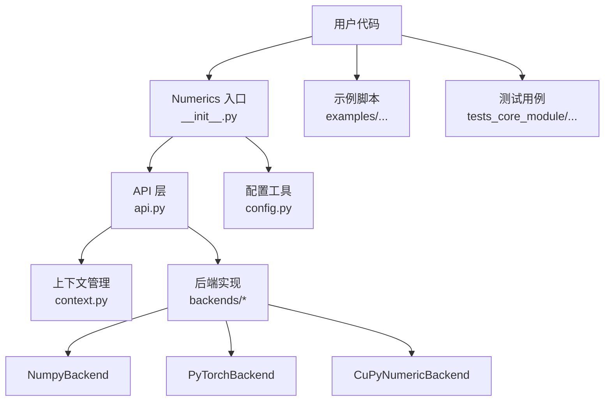
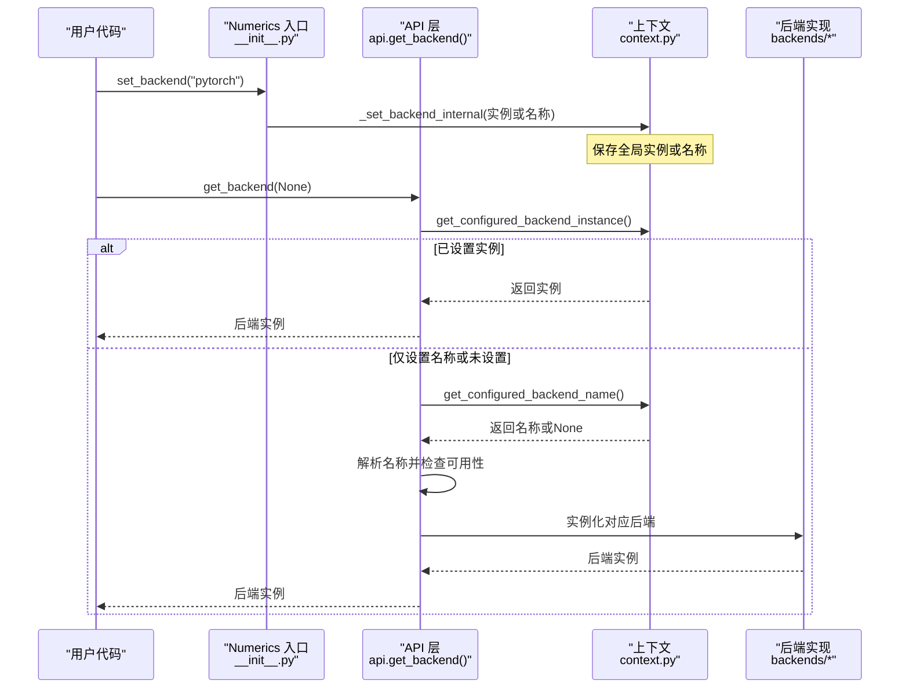
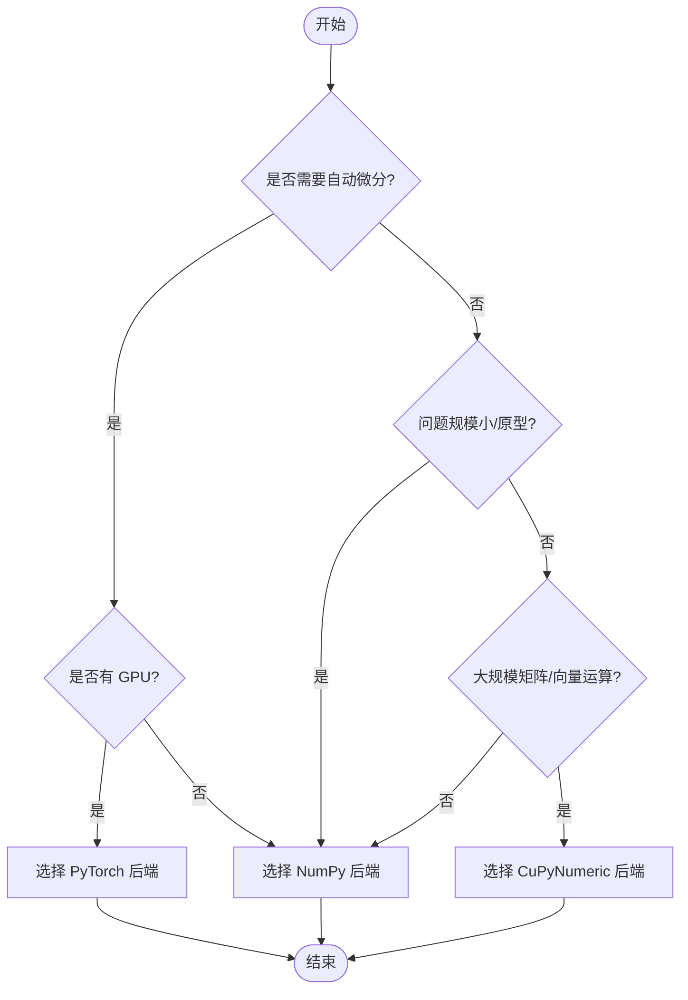
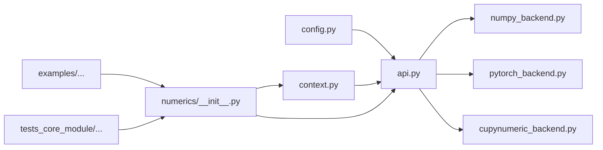

# 后端切换和管理

<cite>
**本文引用的文件**
- [src/tyxonq/numerics/__init__.py](file://src/tyxonq/numerics/__init__.py)
- [src/tyxonq/numerics/api.py](file://src/tyxonq/numerics/api.py)
- [src/tyxonq/numerics/context.py](file://src/tyxonq/numerics/context.py)
- [src/tyxonq/numerics/backends/numpy_backend.py](file://src/tyxonq/numerics/backends/numpy_backend.py)
- [src/tyxonq/numerics/backends/pytorch_backend.py](file://src/tyxonq/numerics/backends/pytorch_backend.py)
- [src/tyxonq/numerics/backends/cupynumeric_backend.py](file://src/tyxonq/numerics/backends/cupynumeric_backend.py)
- [src/tyxonq/config.py](file://src/tyxonq/config.py)
- [examples/numeric_backend_switching.py](file://examples/numeric_backend_switching.py)
- [tests_core_module/test_numerics.py](file://tests_core_module/test_numerics.py)
</cite>

## 目录
1. [简介](#简介)
2. [项目结构](#项目结构)
3. [核心组件](#核心组件)
4. [架构总览](#架构总览)
5. [详细组件分析](#详细组件分析)
6. [依赖关系分析](#依赖关系分析)
7. [性能考量](#性能考量)
8. [故障排查指南](#故障排查指南)
9. [结论](#结论)
10. [附录](#附录)

## 简介
本文件系统性说明 TyxonQ 的数值后端切换与管理机制，覆盖以下内容：
- 如何在运行时动态切换不同的数值后端（NumPy、PyTorch、CuPyNumeric）
- get_backend() 的使用方法、参数与返回值语义
- 全局后端配置的设置与管理（set_backend、use_backend）
- 后端可用性检查与错误处理机制
- 后端切换的最佳实践与注意事项
- 多后端混合使用指导原则
- 不同后端间的数据转换方法
- 后端选择的决策树与性能对比分析

## 项目结构
TyxonQ 的数值后端系统位于 numerics 包中，采用“统一协议 + 多实现 + 上下文管理”的设计：
- api.py：定义 ArrayBackend 协议、工厂函数 get_backend()、向量化包装 vectorize_or_fallback()
- context.py：全局后端实例/名称存储与 use_backend 上下文管理器
- backends/*：具体后端实现（numpy、pytorch、cupynumeric）
- __init__.py：暴露高层 API（get_backend、set_backend、set_dtype、NumericBackend 类代理）
- config.py：后端名规范化、默认 dtype、支持的后端列表等常量与工具
- examples/numeric_backend_switching.py：端到端演示与性能对比
- tests_core_module/test_numerics.py：单元测试覆盖后端工厂、向量化策略、上下文切换

图表来源
- [src/tyxonq/numerics/__init__.py:1-17](file://src/tyxonq/numerics/__init__.py#L1-L17)
- [src/tyxonq/numerics/api.py:19-177](file://src/tyxonq/numerics/api.py#L19-L177)
- [src/tyxonq/numerics/context.py:13-50](file://src/tyxonq/numerics/context.py#L13-L50)
- [src/tyxonq/config.py:22-69](file://src/tyxonq/config.py#L22-L69)

章节来源
- [src/tyxonq/numerics/__init__.py:1-17](file://src/tyxonq/numerics/__init__.py#L1-L17)
- [src/tyxonq/config.py:22-69](file://src/tyxonq/config.py#L22-L69)

## 核心组件
- ArrayBackend 协议：统一数组/张量操作接口，要求 name、array/asarray/to_numpy、代数运算、随机数、可选 vmap/jit/value_and_grad 等
- get_backend(name=None)：后端工厂，按名称或全局配置返回后端实例；未指定时优先读取全局配置，否则回退到 NumPy
- set_backend(name_or_instance)：设置全局后端（字符串名称或后端实例）
- use_backend(...)：上下文管理器，临时切换后端并在退出时恢复
- NumericBackend：类级代理，所有方法通过 get_backend(None) 委托给当前后端
- vectorize_or_fallback(fn, backend, policy="auto")：根据策略尝试 vmap，失败则回退到逐元素执行

章节来源
- [src/tyxonq/numerics/api.py:19-177](file://src/tyxonq/numerics/api.py#L19-L177)
- [src/tyxonq/numerics/__init__.py:20-58](file://src/tyxonq/numerics/__init__.py#L20-L58)
- [src/tyxonq/numerics/context.py:18-50](file://src/tyxonq/numerics/context.py#L18-L50)

## 架构总览
下图展示了从用户调用到后端实现的完整流程，包括全局配置优先级、可用性与回退逻辑。

图表来源
- [src/tyxonq/numerics/api.py:179-252](file://src/tyxonq/numerics/api.py#L179-L252)
- [src/tyxonq/numerics/context.py:18-50](file://src/tyxonq/numerics/context.py#L18-L50)

章节来源
- [src/tyxonq/numerics/api.py:179-252](file://src/tyxonq/numerics/api.py#L179-L252)
- [src/tyxonq/numerics/context.py:18-50](file://src/tyxonq/numerics/context.py#L18-L50)

## 详细组件分析

### get_backend() 使用方法与参数选项
- 参数 name：
  - None：优先使用全局配置的实例；若无实例则读取全局名称；若仍无则回退到 NumPy
  - "numpy"：始终返回 NumPy 后端
  - "pytorch"：需要 torch 可导入且后端 available=True，否则抛出 RuntimeError
  - "cupynumeric"：需要 cupynumeric 可导入且后端 available=True，否则抛出 RuntimeError
- 返回值：ArrayBackend 实例，提供统一的数组/张量操作接口
- 行为要点：
  - 自动检测依赖是否安装
  - 对 PyTorch/CuPyNumeric 进行 availability 标志检查
  - 最终回退到 NumPy 保证可用性

章节来源
- [src/tyxonq/numerics/api.py:179-252](file://src/tyxonq/numerics/api.py#L179-L252)

### 全局后端配置的设置与管理
- set_backend(name_or_instance)：
  - 传入字符串：解析为后端名称并延迟实例化
  - 传入后端实例：直接固定该实例
- use_backend(...)：
  - 在 with 块内临时切换后端，退出后自动恢复之前的全局状态
- 内部存储：
  - _CURRENT_BACKEND_INSTANCE：当前后端实例
  - _CURRENT_BACKEND_NAME：当前后端名称（用于延迟解析）

章节来源
- [src/tyxonq/numerics/__init__.py:20-36](file://src/tyxonq/numerics/__init__.py#L20-L36)
- [src/tyxonq/numerics/context.py:18-50](file://src/tyxonq/numerics/context.py#L18-L50)

### 后端可用性检查和错误处理机制
- PyTorch 后端：
  - 模块导入失败时，PyTorchBackend 被置为 None
  - get_backend("pytorch") 会检查 PyTorchBackend 是否为 None 或 available=False，抛出 RuntimeError
- CuPyNumeric 后端：
  - 模块导入失败时，CuPyNumericBackend 被置为 None
  - get_backend("cupynumeric") 会检查模块是否可导入及 available 标志，抛出 RuntimeError
- 回退策略：
  - 当请求的后端不可用时，get_backend 最终回退到 NumPy，确保程序继续运行

章节来源
- [src/tyxonq/numerics/api.py:1-14](file://src/tyxonq/numerics/api.py#L1-L14)
- [src/tyxonq/numerics/api.py:236-252](file://src/tyxonq/numerics/api.py#L236-L252)
- [src/tyxonq/numerics/backends/pytorch_backend.py:5-17](file://src/tyxonq/numerics/backends/pytorch_backend.py#L5-L17)
- [src/tyxonq/numerics/backends/cupynumeric_backend.py:5-17](file://src/tyxonq/numerics/backends/cupynumeric_backend.py#L5-L17)

### 后端切换的最佳实践与注意事项
- 推荐做法
  - 使用 tq.set_backend("pytorch") 或 tq.set_backend("numpy") 在启动时设定全局后端
  - 使用 tq.use_backend(...) 在局部代码块中临时切换，避免污染全局状态
  - 使用 tq.set_dtype("complex64"/"complex128") 控制复数与实数精度
- 注意事项
  - 切换后端前确保目标后端依赖已安装，否则会抛出异常
  - 注意梯度链保持：PyTorch 后端需确保 requires_grad 不被意外断开
  - 跨后端数据转换时，使用后端提供的 to_numpy()/asarray() 等方法
  - 大规模计算优先选择 GPU 后端（PyTorch/CuPy），小规模/原型开发用 NumPy

章节来源
- [src/tyxonq/numerics/__init__.py:20-58](file://src/tyxonq/numerics/__init__.py#L20-L58)
- [src/tyxonq/numerics/backends/pytorch_backend.py:77-128](file://src/tyxonq/numerics/backends/pytorch_backend.py#L77-L128)
- [examples/numeric_backend_switching.py:86-184](file://examples/numeric_backend_switching.py#L86-L184)

### 多后端混合使用的指导原则
- 同一计算图内尽量保持单一后端，避免频繁跨后端拷贝导致性能下降
- 如需混合：
  - 将数据显式转换为目标后端类型（如 np.asarray -> torch.as_tensor）
  - 使用后端提供的 matmul/dot/einsum 等操作，确保设备与 dtype 一致
- 梯度传播：
  - 仅在支持自动微分的后端（如 PyTorch）中使用 value_and_grad/jacfwd/hessian
  - 其他后端可使用有限差分近似（NumPy/CuPyNumeric 提供 fallback）

章节来源
- [src/tyxonq/numerics/backends/pytorch_backend.py:356-362](file://src/tyxonq/numerics/backends/pytorch_backend.py#L356-L362)
- [src/tyxonq/numerics/backends/numpy_backend.py:255-259](file://src/tyxonq/numerics/backends/numpy_backend.py#L255-L259)
- [src/tyxonq/numerics/backends/cupynumeric_backend.py:250-254](file://src/tyxonq/numerics/backends/cupynumeric_backend.py#L250-L254)

### 在不同后端间进行数据转换的方法
- 通用转换
  - 后端实例的 array()/asarray()：创建或转换为后端原生数组/张量
  - to_numpy()：将后端数据转换为 NumPy 数组
- 特定后端
  - PyTorch：torch.as_tensor/tensor，注意保留 requires_grad
  - CuPyNumeric：cupynumeric.array/asarray，SVD 等线性代数可能回退到 NumPy
- 精度控制
  - set_dtype("complex64"/"complex128") 统一复数与实数精度

章节来源
- [src/tyxonq/numerics/backends/numpy_backend.py:48-66](file://src/tyxonq/numerics/backends/numpy_backend.py#L48-L66)
- [src/tyxonq/numerics/backends/pytorch_backend.py:77-128](file://src/tyxonq/numerics/backends/pytorch_backend.py#L77-L128)
- [src/tyxonq/numerics/backends/cupynumeric_backend.py:55-70](file://src/tyxonq/numerics/backends/cupynumeric_backend.py#L55-L70)

### 后端选择的决策树

[此图为概念性流程图，不直接映射到具体源码文件]

### 性能对比分析
- NumPy：CPU 计算，适合小规模电路与快速原型
- PyTorch：支持 GPU 加速与自动微分，适合 VQA 训练与 JIT 编译优化
- CuPyNumeric：GPU 加速的 NumPy-like API，适合大规模状态向量运算
- 示例脚本提供了基准测试与一致性验证，可在本地运行以评估实际性能差异

章节来源
- [examples/numeric_backend_switching.py:187-246](file://examples/numeric_backend_switching.py#L187-L246)
- [examples/numeric_backend_switching.py:249-283](file://examples/numeric_backend_switching.py#L249-L283)

## 依赖关系分析
- Numerics 入口依赖 API 层与上下文管理
- API 层依赖各后端实现，并通过可用性检查决定实例化
- 配置模块提供后端名规范化与默认 dtype
- 示例与测试依赖上述模块进行端到端验证

图表来源
- [src/tyxonq/config.py:22-69](file://src/tyxonq/config.py#L22-L69)
- [src/tyxonq/numerics/api.py:1-14](file://src/tyxonq/numerics/api.py#L1-L14)
- [src/tyxonq/numerics/context.py:13-50](file://src/tyxonq/numerics/context.py#L13-L50)
- [src/tyxonq/numerics/__init__.py:1-17](file://src/tyxonq/numerics/__init__.py#L1-L17)

章节来源
- [src/tyxonq/config.py:22-69](file://src/tyxonq/config.py#L22-L69)
- [src/tyxonq/numerics/api.py:1-14](file://src/tyxonq/numerics/api.py#L1-L14)

## 性能考量
- 选择合适后端：
  - 小规模/原型：NumPy
  - 需要梯度/GPU：PyTorch
  - 大规模矩阵运算/GPU：CuPyNumeric
- 向量化策略：
  - vectorize_or_fallback 支持 "auto"/"force"/"off"
  - 优先使用后端提供的 vmap，失败则回退到逐元素执行
- 精度与内存：
  - 使用 set_dtype 控制复数/实数精度，平衡精度与内存占用
- JIT 编译：
  - PyTorch 支持 torch.compile 加速（若可用）

章节来源
- [src/tyxonq/numerics/api.py:124-177](file://src/tyxonq/numerics/api.py#L124-L177)
- [src/tyxonq/numerics/backends/pytorch_backend.py:377-382](file://src/tyxonq/numerics/backends/pytorch_backend.py#L377-L382)
- [examples/numeric_backend_switching.py:187-246](file://examples/numeric_backend_switching.py#L187-L246)

## 故障排查指南
- 常见错误
  - 后端不可用：检查依赖是否安装（torch、cupynumeric）
  - 梯度丢失：确保 PyTorch 后端中 requires_grad 未被断开
  - 数据类型不匹配：使用后端提供的 cast/asarray 进行转换
- 调试建议
  - 使用 use_backend 隔离问题代码段
  - 打印后端名称与默认 dtype，确认配置正确
  - 参考测试用例验证基本功能

章节来源
- [src/tyxonq/numerics/api.py:236-252](file://src/tyxonq/numerics/api.py#L236-L252)
- [src/tyxonq/numerics/backends/pytorch_backend.py:77-128](file://src/tyxonq/numerics/backends/pytorch_backend.py#L77-L128)
- [tests_core_module/test_numerics.py:128-143](file://tests_core_module/test_numerics.py#L128-L143)

## 结论
TyxonQ 的数值后端系统通过统一协议与灵活的全局配置，实现了在不同计算框架间的无缝切换。开发者可根据任务需求选择合适的后端，并利用向量化、JIT 与自动微分等特性优化性能。遵循最佳实践与故障排查指南，可有效提升开发与部署效率。

## 附录
- 快速上手
  - 设置全局后端：tq.set_backend("pytorch")
  - 获取后端实例：K = tq.get_backend()
  - 临时切换：with tq.use_backend("numpy"): ...
  - 设置精度：tq.set_dtype("complex64")
- 参考示例
  - 运行 examples/numeric_backend_switching.py 查看后端演示与性能对比

章节来源
- [examples/numeric_backend_switching.py:86-184](file://examples/numeric_backend_switching.py#L86-L184)
- [src/tyxonq/numerics/__init__.py:20-58](file://src/tyxonq/numerics/__init__.py#L20-L58)