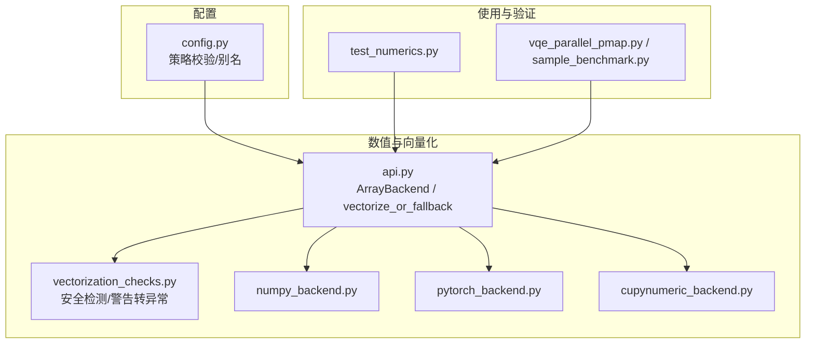
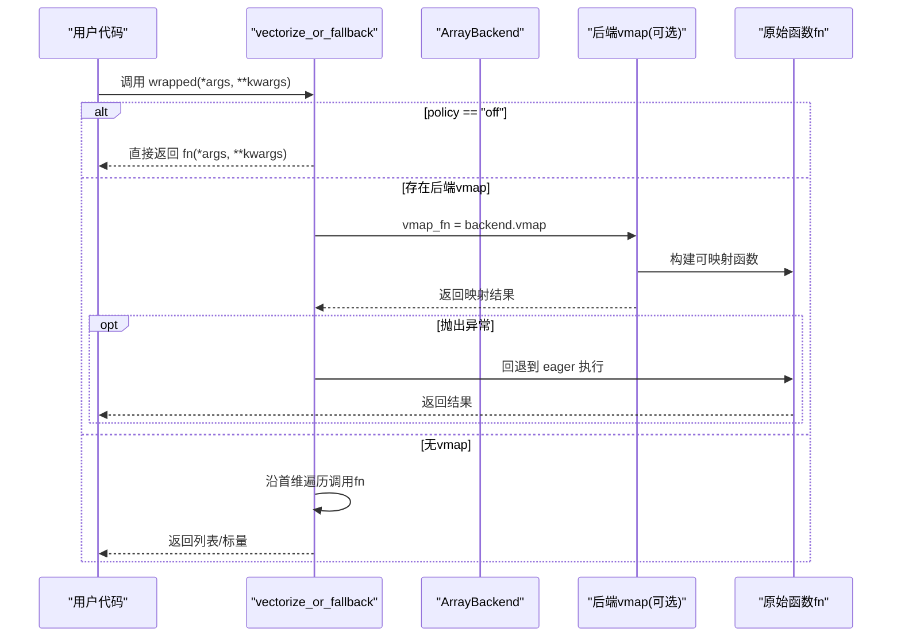
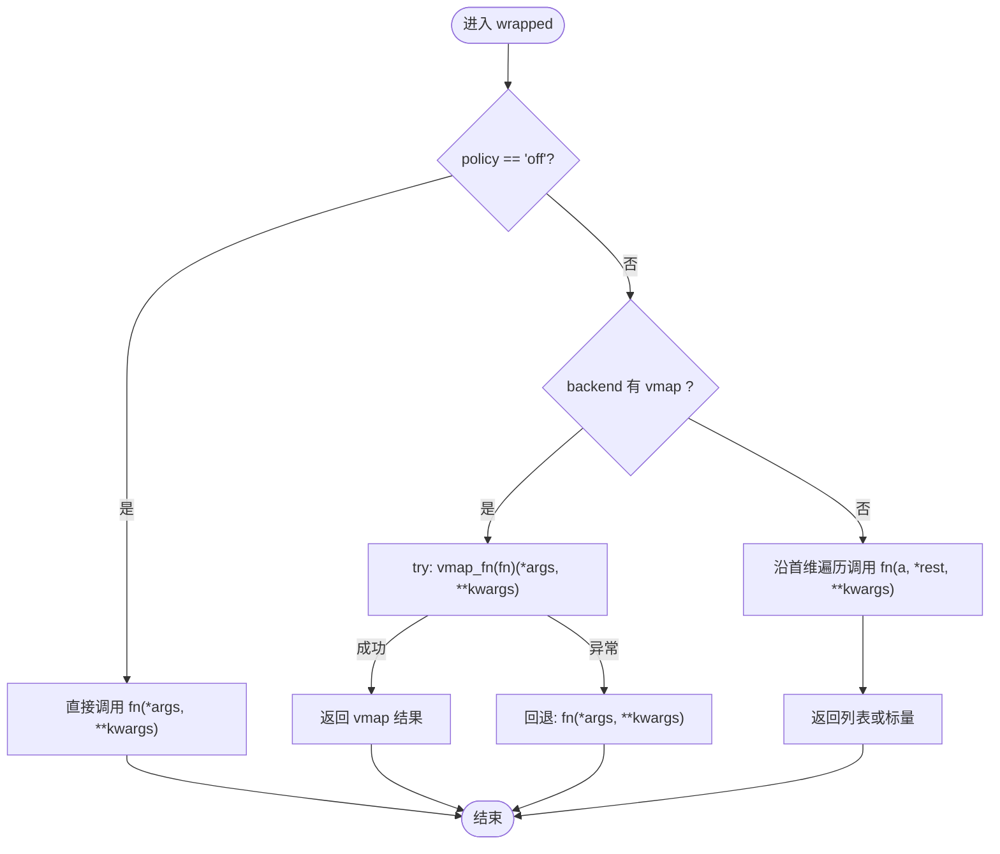
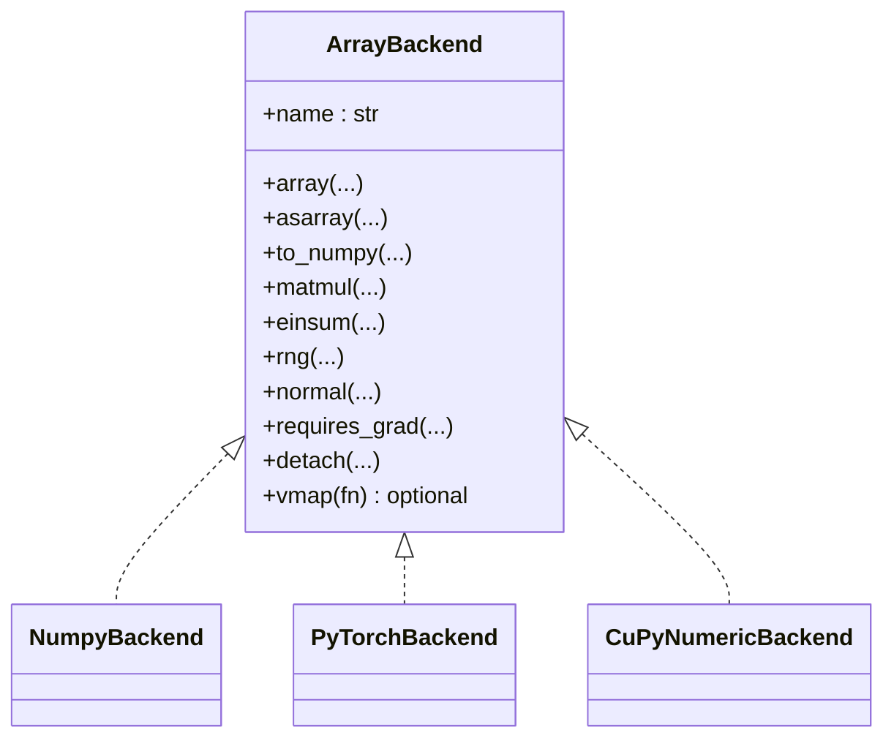
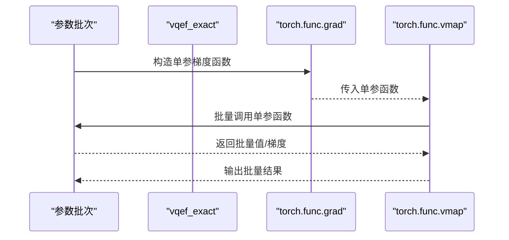
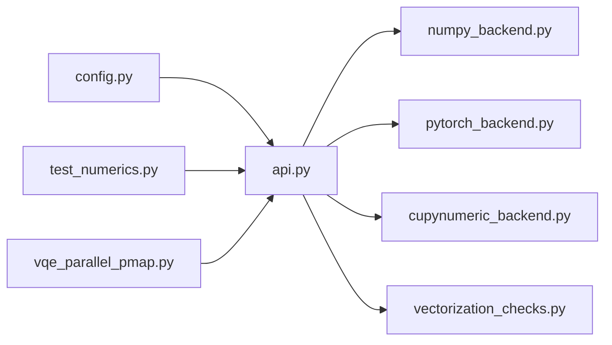

# 向量化支持

<cite>
**本文引用的文件**
- [src/tyxonq/numerics/api.py](file://src/tyxonq/numerics/api.py)
- [src/tyxonq/numerics/vectorization_checks.py](file://src/tyxonq/numerics/vectorization_checks.py)
- [src/tyxonq/numerics/backends/numpy_backend.py](file://src/tyxonq/numerics/backends/numpy_backend.py)
- [src/tyxonq/numerics/backends/pytorch_backend.py](file://src/tyxonq/numerics/backends/pytorch_backend.py)
- [src/tyxonq/numerics/backends/cupynumeric_backend.py](file://src/tyxonq/numerics/backends/cupynumeric_backend.py)
- [src/tyxonq/config.py](file://src/tyxonq/config.py)
- [tests_core_module/test_numerics.py](file://tests_core_module/test_numerics.py)
- [examples/vqe_parallel_pmap.py](file://examples/vqe_parallel_pmap.py)
- [examples/sample_benchmark.py](file://examples/sample_benchmark.py)
</cite>

## 目录
1. [简介](#简介)
2. [项目结构](#项目结构)
3. [核心组件](#核心组件)
4. [架构总览](#架构总览)
5. [详细组件分析](#详细组件分析)
6. [依赖关系分析](#依赖关系分析)
7. [性能考量](#性能考量)
8. [故障排查指南](#故障排查指南)
9. [结论](#结论)
10. [附录](#附录)

## 简介
本文件系统性阐述 TyxonQ 的向量化支持，包括向量执行策略、实现机制与最佳实践。重点覆盖：
- vectorize_or_fallback() 的工作原理、参数与回退机制
- 向量化策略 auto、force、off 的选择与影响
- vmap 的作用及后端特定实现（PyTorch）
- 批量计算与并行处理示例
- 错误处理与回退路径
- 性能基准与分析工具建议

## 项目结构
TyxonQ 的数值与向量化能力集中在 numerics 模块中，通过统一的 ArrayBackend 协议抽象不同后端（NumPy、PyTorch、CuPyNumeric），并提供 vectorize_or_fallback 作为通用向量化包装器。配置层提供策略校验与默认值。测试与示例展示了用法与性能对比。

图表来源
- [src/tyxonq/numerics/api.py:19-176](file://src/tyxonq/numerics/api.py#L19-L176)
- [src/tyxonq/numerics/vectorization_checks.py:8-53](file://src/tyxonq/numerics/vectorization_checks.py#L8-L53)
- [src/tyxonq/config.py:48-76](file://src/tyxonq/config.py#L48-L76)
- [tests_core_module/test_numerics.py:62-80](file://tests_core_module/test_numerics.py#L62-L80)
- [examples/vqe_parallel_pmap.py:126-145](file://examples/vqe_parallel_pmap.py#L126-L145)

章节来源
- [src/tyxonq/numerics/api.py:19-176](file://src/tyxonq/numerics/api.py#L19-L176)
- [src/tyxonq/config.py:48-76](file://src/tyxonq/config.py#L48-L76)

## 核心组件
- ArrayBackend 协议：统一数组/张量接口，包含创建、代数运算、随机数、可选自动微分桥接，以及可选的 vmap 方法用于向量化。
- vectorize_or_fallback(fn, backend, policy, enable_checks)：根据策略选择是否向量化；若后端提供 vmap 则优先使用；否则沿首维做轻量级循环映射；任何异常时回退到 eager 执行。
- 后端实现：
  - NumPy 后端：完整基础算子集合，无 vmap，提供有限差分梯度等辅助。
  - PyTorch 后端：完整基础算子集合，提供 vmap（基于 torch.func.vmap）、autograd 相关方法。
  - CuPyNumeric 后端：GPU/加速后端，部分线性代数回退到 CPU。
- 向量化安全检查：safe_for_vectorization 通过试运行捕获告警/异常判断是否适合 vmap；warn_as_error 将匹配告警转为异常并记录。

章节来源
- [src/tyxonq/numerics/api.py:19-176](file://src/tyxonq/numerics/api.py#L19-L176)
- [src/tyxonq/numerics/backends/numpy_backend.py:8-263](file://src/tyxonq/numerics/backends/numpy_backend.py#L8-L263)
- [src/tyxonq/numerics/backends/pytorch_backend.py:13-375](file://src/tyxonq/numerics/backends/pytorch_backend.py#L13-L375)
- [src/tyxonq/numerics/backends/cupynumeric_backend.py:13-259](file://src/tyxonq/numerics/backends/cupynumeric_backend.py#L13-L259)
- [src/tyxonq/numerics/vectorization_checks.py:8-53](file://src/tyxonq/numerics/vectorization_checks.py#L8-L53)

## 架构总览
TyxonQ 的向量化采用“策略 + 后端”解耦设计：
- 策略层：policy 控制行为（auto/force/off），在调用处决定尝试 vmap 或直接 eager。
- 后端层：ArrayBackend 暴露 vmap（可选）与统一算子集；PyTorch 提供原生 vmap，其他后端走通用回退或 eager。
- 安全层：可选的安全检查（如 safe_for_vectorization）可在封装前评估函数是否适合 vmap。

图表来源
- [src/tyxonq/numerics/api.py:124-176](file://src/tyxonq/numerics/api.py#L124-L176)
- [src/tyxonq/numerics/backends/pytorch_backend.py:365-374](file://src/tyxonq/numerics/backends/pytorch_backend.py#L365-L374)

## 详细组件分析

### vectorize_or_fallback() 工作原理与使用方法
- 策略 off：直接返回原函数，不尝试任何向量化。
- 策略 auto/force：若后端提供 vmap，则尝试 vmap 执行；任何异常均回退到 eager 执行，保证鲁棒性。
- 无 vmap：对第一个位置参数进行迭代，逐元素调用 fn，形成列表式结果；若非可迭代则直接 eager 执行。
- 典型用法：
  - 为任意纯函数添加向量化能力，无需修改内部逻辑。
  - 结合后端切换，在不同硬件/库上获得一致的行为。

图表来源
- [src/tyxonq/numerics/api.py:124-176](file://src/tyxonq/numerics/api.py#L124-L176)

章节来源
- [src/tyxonq/numerics/api.py:124-176](file://src/tyxonq/numerics/api.py#L124-L176)
- [tests_core_module/test_numerics.py:62-80](file://tests_core_module/test_numerics.py#L62-L80)

### 向量化策略：auto、force、off 的选择与影响
- off：禁用向量化，始终 eager 执行。适用于调试、避免 vmap 兼容性问题。
- auto：优先尝试后端 vmap；失败则回退。推荐默认策略，兼顾性能与稳定性。
- force：当前实现中与 auto 类似（优先 vmap，失败回退）。未来可扩展为强制 vmap 并在失败时抛错以快速定位问题。
- 策略校验：is_valid_vectorization_policy 确保仅接受合法策略值。

章节来源
- [src/tyxonq/config.py:72-76](file://src/tyxonq/config.py#L72-L76)
- [src/tyxonq/numerics/api.py:124-176](file://src/tyxonq/numerics/api.py#L124-L176)

### vmap 的作用与后端特定实现
- 作用：将标量函数转换为沿首维批处理的函数，减少 Python 层循环开销，提升吞吐。
- PyTorch 后端：
  - 提供 vmap 包装，底层使用 torch.func.vmap。
  - 当不可用时提供空操作回退，保证兼容性。
- NumPy/CuPyNumeric 后端：
  - 未提供 vmap，vectorize_or_fallback 会走通用首维遍历回退。
  - CuPyNumeric 某些线性代数（如 SVD）回退到 CPU 实现。

图表来源
- [src/tyxonq/numerics/api.py:19-41](file://src/tyxonq/numerics/api.py#L19-L41)
- [src/tyxonq/numerics/backends/numpy_backend.py:8-263](file://src/tyxonq/numerics/backends/numpy_backend.py#L8-L263)
- [src/tyxonq/numerics/backends/pytorch_backend.py:13-375](file://src/tyxonq/numerics/backends/pytorch_backend.py#L13-L375)
- [src/tyxonq/numerics/backends/cupynumeric_backend.py:13-259](file://src/tyxonq/numerics/backends/cupynumeric_backend.py#L13-L259)

章节来源
- [src/tyxonq/numerics/backends/pytorch_backend.py:365-374](file://src/tyxonq/numerics/backends/pytorch_backend.py#L365-L374)
- [src/tyxonq/numerics/backends/cupynumeric_backend.py:208-216](file://src/tyxonq/numerics/backends/cupynumeric_backend.py#L208-L216)

### 向量化编程最佳实践与性能优化技巧
- 优先使用 auto 策略，让框架自动选择最优路径。
- 尽量将函数设计为无副作用、纯函数，便于 vmap 高效映射。
- 避免在 vmap 内触发大量内存分配或类型转换；必要时在函数内部预先准备常量。
- 对于大型批处理，优先使用 PyTorch 后端以获得原生 vmap 加速。
- 使用安全检测 safe_for_vectorization 在关键路径前评估函数是否适合 vmap。
- 合理设置 dtype 与设备（device），减少跨设备/类型拷贝。
- 利用后端的 value_and_grad/jacfwd/hessian 等工具进行高效梯度计算（PyTorch 路径优先）。

[本节为通用指导，不直接分析具体文件]

### 批量计算与并行处理示例
- 使用 PyTorch 的 vmap 对多组参数进行批量求值与梯度计算，显著降低 Python 循环开销。
- 示例展示了 exact 期望值路径下的批量更新，以及 counts 路径的单样本评估。

图表来源
- [examples/vqe_parallel_pmap.py:126-145](file://examples/vqe_parallel_pmap.py#L126-L145)

章节来源
- [examples/vqe_parallel_pmap.py:126-145](file://examples/vqe_parallel_pmap.py#L126-L145)

### 错误处理与回退机制
- vectorize_or_fallback 在任何 vmap 异常时回退到 eager 执行，确保程序健壮性。
- safe_for_vectorization 通过试运行捕获告警/异常，保守标记不适合 vmap 的函数。
- warn_as_error 可将匹配告警转为异常并记录，便于在测试或严格模式下发现问题。

章节来源
- [src/tyxonq/numerics/api.py:157-163](file://src/tyxonq/numerics/api.py#L157-L163)
- [src/tyxonq/numerics/vectorization_checks.py:8-26](file://src/tyxonq/numerics/vectorization_checks.py#L8-L26)
- [src/tyxonq/numerics/vectorization_checks.py:29-53](file://src/tyxonq/numerics/vectorization_checks.py#L29-L53)

## 依赖关系分析
- ArrayBackend 是所有后端的统一契约；vectorize_or_fallback 依赖该契约决定是否使用 vmap。
- PyTorch 后端提供 vmap 与 autograd 工具链；NumPy/CuPyNumeric 提供基础算子与有限差分近似。
- 配置层提供策略校验与后端名称规范化，确保策略与后端选择的一致性。
- 测试覆盖策略行为、工厂方法与安全检查；示例展示实际批量计算流程。

图表来源
- [src/tyxonq/numerics/api.py:1-176](file://src/tyxonq/numerics/api.py#L1-L176)
- [src/tyxonq/config.py:48-76](file://src/tyxonq/config.py#L48-L76)
- [tests_core_module/test_numerics.py:62-80](file://tests_core_module/test_numerics.py#L62-L80)
- [examples/vqe_parallel_pmap.py:126-145](file://examples/vqe_parallel_pmap.py#L126-L145)

章节来源
- [src/tyxonq/numerics/api.py:1-176](file://src/tyxonq/numerics/api.py#L1-L176)
- [src/tyxonq/config.py:48-76](file://src/tyxonq/config.py#L48-L76)

## 性能考量
- 使用 PyTorch 后端配合 vmap 可获得显著的批量计算加速，尤其在高维参数空间。
- 在无 vmap 的后端，vectorize_or_fallback 的首维遍历仍优于手写循环，但性能不及原生 vmap。
- 注意数据类型与设备一致性，避免不必要的拷贝与转换。
- 对于大规模采样或测量，可使用示例中的 benchmark 脚本对比不同后端耗时。

[本节为通用指导，不直接分析具体文件]

## 故障排查指南
- 现象：vmap 执行报错或结果异常
  - 检查函数是否为纯函数，是否存在副作用或状态依赖。
  - 使用 safe_for_vectorization 提前检测告警/异常。
  - 临时将 policy 设为 off 确认 eager 路径正确性。
- 现象：性能不达预期
  - 确认是否使用了 PyTorch 后端与 vmap。
  - 检查批大小与函数复杂度，必要时拆分任务或使用分层优化。
- 现象：后端不可用
  - 检查依赖安装与可用性标志（如 torch、cupynumeric）。
  - 使用 get_backend 获取实例并打印 name 确认。

章节来源
- [src/tyxonq/numerics/vectorization_checks.py:8-53](file://src/tyxonq/numerics/vectorization_checks.py#L8-L53)
- [src/tyxonq/numerics/api.py:179-252](file://src/tyxonq/numerics/api.py#L179-L252)

## 结论
TyxonQ 的向量化支持通过策略与后端解耦，提供了灵活且健壮的批量计算能力。vectorize_or_fallback 在保证稳定性的前提下最大化利用后端 vmap；PyTorch 后端提供原生 vmap 与自动微分工具，适合高性能场景。结合安全检查与示例实践，可在不同硬件与库环境下获得一致的向量化体验。

[本节为总结，不直接分析具体文件]

## 附录
- 常用工具与建议
  - 使用 set_backend/use_backend 动态切换全局后端。
  - 在关键路径前调用 safe_for_vectorization 进行预检。
  - 使用示例脚本进行后端性能对比与回归测试。

[本节为补充信息，不直接分析具体文件]