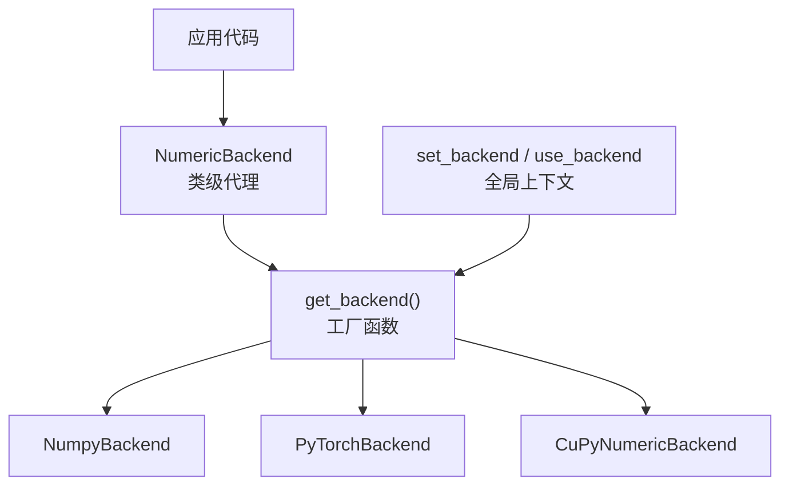
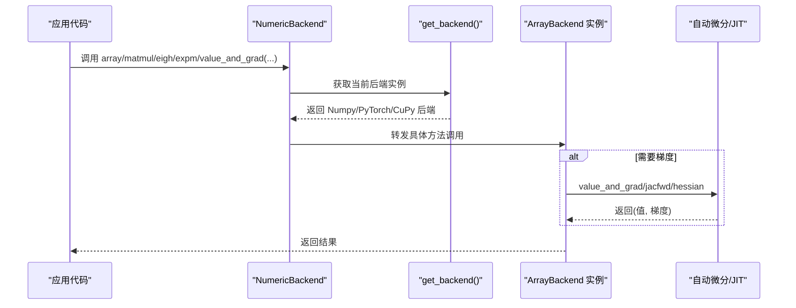
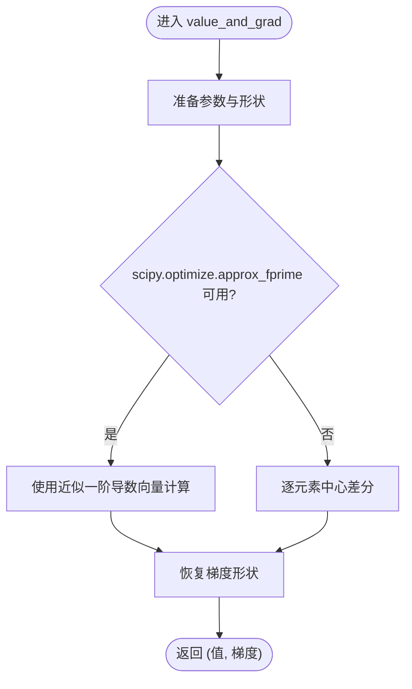
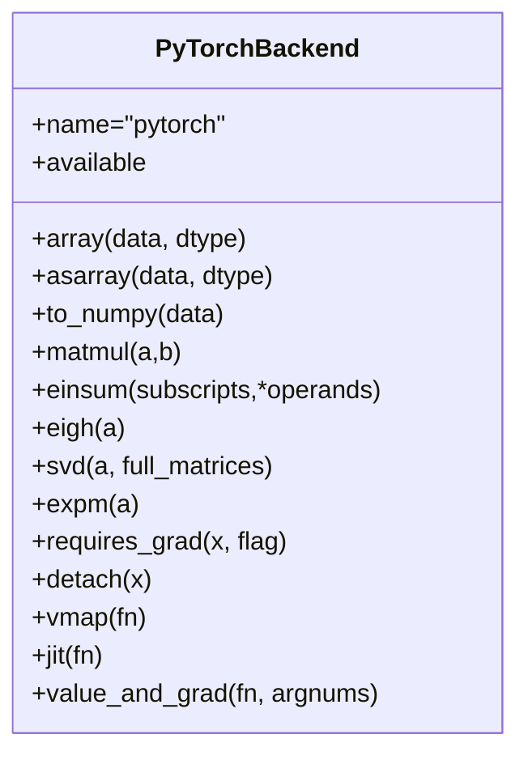
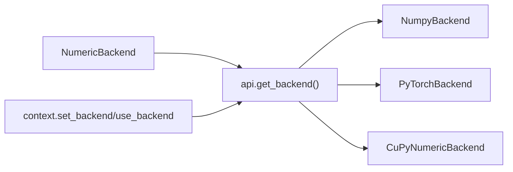

# 数值后端

<cite>
**本文引用的文件**
- [src/tyxonq/numerics/__init__.py](file://src/tyxonq/numerics/__init__.py)
- [src/tyxonq/numerics/api.py](file://src/tyxonq/numerics/api.py)
- [src/tyxonq/numerics/context.py](file://src/tyxonq/numerics/context.py)
- [src/tyxonq/numerics/backends/numpy_backend.py](file://src/tyxonq/numerics/backends/numpy_backend.py)
- [src/tyxonq/numerics/backends/pytorch_backend.py](file://src/tyxonq/numerics/backends/pytorch_backend.py)
- [src/tyxonq/numerics/backends/cupynumeric_backend.py](file://src/tyxonq/numerics/backends/cupynumeric_backend.py)
- [examples/numeric_backend_switching.py](file://examples/numeric_backend_switching.py)
- [examples/framework_performance_comparison.py](file://examples/framework_performance_comparison.py)
- [docs/source/developer_guide/custom_backends.rst](file://docs/source/developer_guide/custom_backends.rst)
</cite>

## 目录
1. [简介](#简介)
2. [项目结构](#项目结构)
3. [核心组件](#核心组件)
4. [架构总览](#架构总览)
5. [详细组件分析](#详细组件分析)
6. [依赖关系分析](#依赖关系分析)
7. [性能考量](#性能考量)
8. [故障排查指南](#故障排查指南)
9. [结论](#结论)
10. [附录](#附录)

## 简介
本文件系统性阐述 TyxonQ 数值后端系统，重点解释 ArrayBackend 协议的设计与实现，并深入解析 NumPy、PyTorch、CuPyNumeric 三大后端的特性、适用场景、内存与精度差异。同时提供后端切换方法、自定义后端开发指南、并行与分布式计算实践建议，以及基于示例的性能基准与优化策略。

## 项目结构
TyxonQ 的数值后端位于 numerics 模块，采用“统一协议 + 多实现”的分层设计：
- 协议与工厂：ArrayBackend 协议定义统一接口；get_backend 负责按名称或全局配置返回具体后端实例。
- 上下文管理：通过 set_backend/use_backend 设置全局默认后端，支持临时上下文切换。
- 类级代理：NumericBackend 提供无需实例化的便捷访问，所有调用转发到当前后端。
- 后端实现：NumpyBackend、PyTorchBackend、CuPyNumericBackend 分别实现协议，提供数组创建、线性代数、随机数、自动微分（可选）等能力。

图表来源
- [src/tyxonq/numerics/__init__.py:20-58](file://src/tyxonq/numerics/__init__.py#L20-L58)
- [src/tyxonq/numerics/api.py:179-252](file://src/tyxonq/numerics/api.py#L179-L252)
- [src/tyxonq/numerics/context.py:18-50](file://src/tyxonq/numerics/context.py#L18-L50)

章节来源
- [src/tyxonq/numerics/__init__.py:20-58](file://src/tyxonq/numerics/__init__.py#L20-L58)
- [src/tyxonq/numerics/api.py:179-252](file://src/tyxonq/numerics/api.py#L179-L252)
- [src/tyxonq/numerics/context.py:18-50](file://src/tyxonq/numerics/context.py#L18-L50)

## 核心组件
- ArrayBackend 协议：定义统一的数组/张量接口，包括 dtype 常量、数组创建与转换、代数运算、线性代数、随机数、自动微分桥接等。
- get_backend：根据名称或全局配置返回后端实例，支持可选依赖的可用性检查与回退。
- NumericBackend：类级代理，暴露常用操作（如 array、matmul、eigh、expm、value_and_grad 等），内部委托给当前后端。
- 上下文管理：set_backend/use_backend 支持进程级默认后端与局部作用域切换。

章节来源
- [src/tyxonq/numerics/api.py:19-122](file://src/tyxonq/numerics/api.py#L19-L122)
- [src/tyxonq/numerics/__init__.py:67-473](file://src/tyxonq/numerics/__init__.py#L67-L473)
- [src/tyxonq/numerics/context.py:18-50](file://src/tyxonq/numerics/context.py#L18-L50)

## 架构总览
下图展示从应用调用到具体后端执行的完整流程，包括自动微分路径与 JIT/vmap 的可选加速路径。

图表来源
- [src/tyxonq/numerics/__init__.py:67-473](file://src/tyxonq/numerics/__init__.py#L67-L473)
- [src/tyxonq/numerics/api.py:179-252](file://src/tyxonq/numerics/api.py#L179-L252)
- [src/tyxonq/numerics/backends/pytorch_backend.py:446-564](file://src/tyxonq/numerics/backends/pytorch_backend.py#L446-L564)

## 详细组件分析

### ArrayBackend 协议与工厂
- 协议职责：抽象不同数值库的差异，统一 dtype、数组创建、代数/线性代数、随机数、自动微分桥接等。
- 工厂逻辑：优先使用全局配置的后端实例或名称；若未指定则回退到 NumPy；对 PyTorch/CuPy 进行可选依赖检测。
- 向量化策略：vectorize_or_fallback 在可用 vmap 时尝试向量化执行，否则沿首维做轻量级循环回退。

章节来源
- [src/tyxonq/numerics/api.py:19-122](file://src/tyxonq/numerics/api.py#L19-L122)
- [src/tyxonq/numerics/api.py:124-177](file://src/tyxonq/numerics/api.py#L124-L177)
- [src/tyxonq/numerics/api.py:179-252](file://src/tyxonq/numerics/api.py#L179-L252)

### NumPy 后端
- 特点：CPU 计算、稳定可靠、兼容性好；提供有限差分实现的 value_and_grad、jacfwd、hessian，适合无 autograd 环境。
- 内存与精度：默认 complex128/float64，精度高但内存占用较大；可通过 set_dtype("complex64") 降低内存与提升速度。
- 适用场景：原型验证、小规模电路、调试与回归测试。

图表来源
- [src/tyxonq/numerics/backends/numpy_backend.py:386-454](file://src/tyxonq/numerics/backends/numpy_backend.py#L386-L454)

章节来源
- [src/tyxonq/numerics/backends/numpy_backend.py:8-457](file://src/tyxonq/numerics/backends/numpy_backend.py#L8-L457)

### PyTorch 后端
- 自动微分：完整支持 requires_grad/detach，value_and_grad 优先走 autograd，失败时回退到有限差分；支持 jacfwd/hessian（需 PyTorch >= 2.0）。
- GPU 加速：利用 torch 的 tensor 与 linalg 算子，可迁移至 CUDA 设备以获得显著加速。
- JIT：提供 jit(fn) 包装，尝试使用 torch.compile 编译函数以提升性能。
- 注意事项：确保 in-place 操作不破坏计算图；dtype/device 一致性；避免不必要的 detach 导致梯度断裂。

图表来源
- [src/tyxonq/numerics/backends/pytorch_backend.py:13-567](file://src/tyxonq/numerics/backends/pytorch_backend.py#L13-L567)

章节来源
- [src/tyxonq/numerics/backends/pytorch_backend.py:13-567](file://src/tyxonq/numerics/backends/pytorch_backend.py#L13-L567)

### CuPyNumeric 后端
- 特点：NumPy 风格 API，底层由 cupynumeric 驱动，可在 GPU 上获得高性能；部分算子（如 SVD）回退到 CPU 实现。
- 自动微分：不提供原生 autograd，value_and_grad 通过有限差分实现（将数据转回 numpy 计算）。
- 适用场景：大规模状态向量运算、GPU 加速需求且不需要自动微分的场景。

章节来源
- [src/tyxonq/numerics/backends/cupynumeric_backend.py:13-300](file://src/tyxonq/numerics/backends/cupynumeric_backend.py#L13-L300)

### 后端切换与上下文管理
- 全局切换：tq.set_backend("numpy"/"pytorch"/"cupynumeric") 或传入后端实例。
- 临时切换：with tq.use_backend(...): 在块内生效，退出后恢复。
- 类型与精度：通过 set_dtype("complex64"/"complex128") 调整默认复数/实数精度。

章节来源
- [src/tyxonq/numerics/__init__.py:20-58](file://src/tyxonq/numerics/__init__.py#L20-L58)
- [src/tyxonq/numerics/context.py:18-50](file://src/tyxonq/numerics/context.py#L18-L50)

## 依赖关系分析
- 耦合性：NumericBackend 与 api.get_backend 强耦合于当前后端实例；各后端实现彼此独立，仅遵循 ArrayBackend 协议。
- 外部依赖：PyTorch/CuPy 为可选依赖，get_backend 在不可用时抛出明确错误；NumPy 始终可用。
- 潜在循环：无直接循环依赖；数值模块与上层量子模拟引擎通过协议解耦。

图表来源
- [src/tyxonq/numerics/__init__.py:20-58](file://src/tyxonq/numerics/__init__.py#L20-L58)
- [src/tyxonq/numerics/api.py:179-252](file://src/tyxonq/numerics/api.py#L179-L252)
- [src/tyxonq/numerics/context.py:18-50](file://src/tyxonq/numerics/context.py#L18-L50)

章节来源
- [src/tyxonq/numerics/api.py:179-252](file://src/tyxonq/numerics/api.py#L179-L252)
- [src/tyxonq/numerics/context.py:18-50](file://src/tyxonq/numerics/context.py#L18-L50)

## 性能考量
- 精度与内存：
  - NumPy：默认 complex128/float64，精度高、内存大；可降为 complex64/float32 以节省内存并提速。
  - PyTorch：同精度下 GPU 加速明显；autograd 带来额外开销但通常仍优于有限差分。
  - CuPyNumeric：GPU 加速良好，但部分算子回退 CPU，需注意热点路径。
- 自动微分 vs 有限差分：
  - PyTorch autograd 在 VQA/优化任务中通常更快更稳定。
  - NumPy/CuPy 的有限差分实现简单但 O(n) 次函数评估，规模大时较慢。
- JIT/向量化：
  - PyTorch 支持 torch.compile；NumPy/CuPy 不支持 JIT，可使用 vectorize_or_fallback 尝试 vmap。
- 示例基准：
  - numeric_backend_switching.py 演示三种后端在同一问题上的运行时间与结果一致性。
  - framework_performance_comparison.py 对比 TyxonQ 三种模式（shot-based、NumPy+value_and_grad、PyTorch+Autograd）及与其他框架的性能。

章节来源
- [examples/numeric_backend_switching.py:187-246](file://examples/numeric_backend_switching.py#L187-L246)
- [examples/framework_performance_comparison.py:75-408](file://examples/framework_performance_comparison.py#L75-L408)

## 故障排查指南
- 后端不可用：
  - 请求 PyTorch/CuPy 但未安装时会抛出运行时错误；请检查依赖或回退到 NumPy。
- 梯度为 None：
  - 在 PyTorch 后端，若计算图被破坏（如不当 detach/in-place 修改），autograd.grad 可能返回 None；应检查数据流与 requires_grad 设置。
- 精度不一致：
  - 不同后端浮点误差可能导致微小差异；建议使用 allclose/isclose 比较而非严格相等。
- 性能异常：
  - 确认是否频繁跨设备/数据类型拷贝；尽量保持 dtype/device 一致；对热点函数使用 jit 或 vmap。

章节来源
- [src/tyxonq/numerics/api.py:179-252](file://src/tyxonq/numerics/api.py#L179-L252)
- [src/tyxonq/numerics/backends/pytorch_backend.py:446-564](file://src/tyxonq/numerics/backends/pytorch_backend.py#L446-L564)
- [src/tyxonq/numerics/backends/numpy_backend.py:386-454](file://src/tyxonq/numerics/backends/numpy_backend.py#L386-L454)

## 结论
TyxonQ 的数值后端通过 ArrayBackend 协议实现了高度解耦与可扩展性。NumPy 后端适合原型与调试；PyTorch 后端提供自动微分与 GPU 加速，是 VQA/优化的首选；CuPyNumeric 后端在大规模 GPU 数值计算中表现优异。通过 set_backend/use_backend 灵活切换，结合 dtype 管理与 JIT/vmap 优化，可在性能、精度与内存之间取得平衡。

## 附录

### 后端选择指导原则
- 小电路/快速迭代：NumPy（复杂128 保证精度，必要时降至 complex64）。
- 需要梯度/优化：PyTorch（autograd + GPU + JIT）。
- 大规模状态向量/GPU：CuPyNumeric（注意 SVD 等回退路径）。
- 生产部署：优先 PyTorch（生态完善、工具链丰富）。

### 自定义数值后端开发指南
- 实现 ArrayBackend 协议：至少实现 name、array/asarray/to_numpy、基础代数与线性代数、随机数、requires_grad/detach（可选）。
- 注册与切换：通过 get_backend(name) 返回实例；或在 context 中设置全局实例。
- 参考实现：对照 NumpyBackend/PyTorchBackend/CuPyNumericBackend 的方法签名与行为。

章节来源
- [docs/source/developer_guide/custom_backends.rst:87-120](file://docs/source/developer_guide/custom_backends.rst#L87-L120)
- [src/tyxonq/numerics/api.py:19-122](file://src/tyxonq/numerics/api.py#L19-L122)

### 并行与分布式计算
- 并行：利用 PyTorch 的 vmap/torch.func 或 CuPy 的并行原语；对批量参数化电路使用 vectorize_or_fallback。
- 分布式：CuPyNumeric 基于 Legate/CuPy 生态，可在多 GPU/节点扩展；注意数据布局与通信开销。
- 最佳实践：批量化输入、避免频繁 host-device 拷贝、合并小算子、使用半精度/单精度权衡。

### 性能基准与优化建议
- 基准脚本：
  - examples/numeric_backend_switching.py：对比三后端时间、结果一致性。
  - examples/framework_performance_comparison.py：对比 TyxonQ 三种模式与 Qiskit/PennyLane。
- 优化建议：
  - 使用 PyTorch backend + autograd 替代有限差分。
  - 对热点函数使用 jit(fn)/torch.compile。
  - 合理选择 dtype（complex64/float32）以降低内存与提高吞吐。
  - 减少不必要的数据复制与类型转换。

章节来源
- [examples/numeric_backend_switching.py:187-246](file://examples/numeric_backend_switching.py#L187-L246)
- [examples/framework_performance_comparison.py:75-408](file://examples/framework_performance_comparison.py#L75-L408)