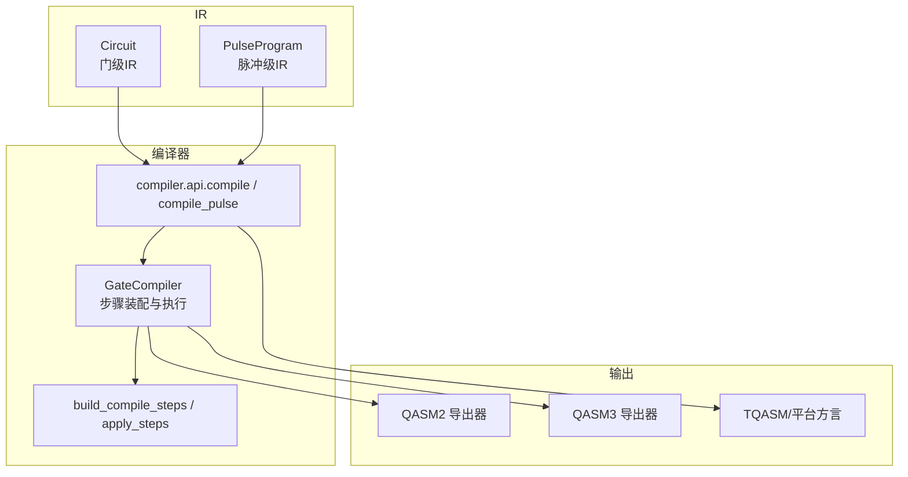
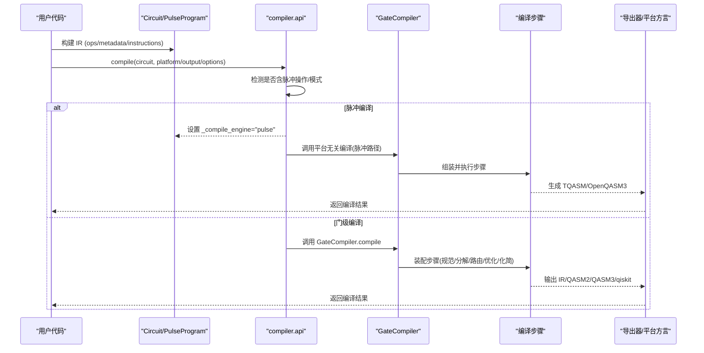
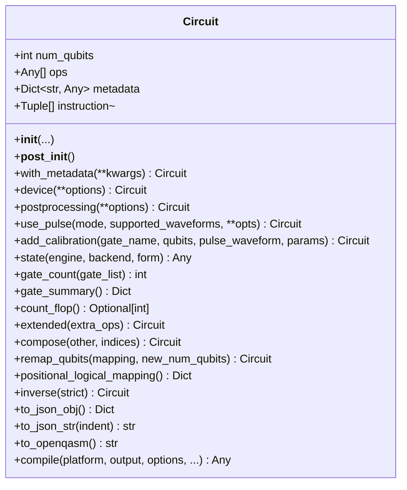
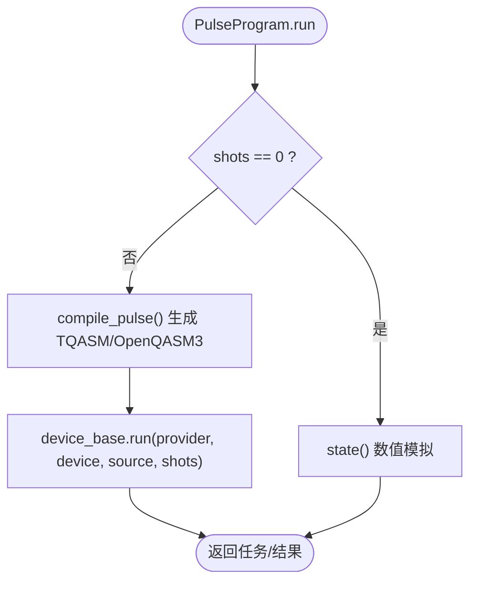
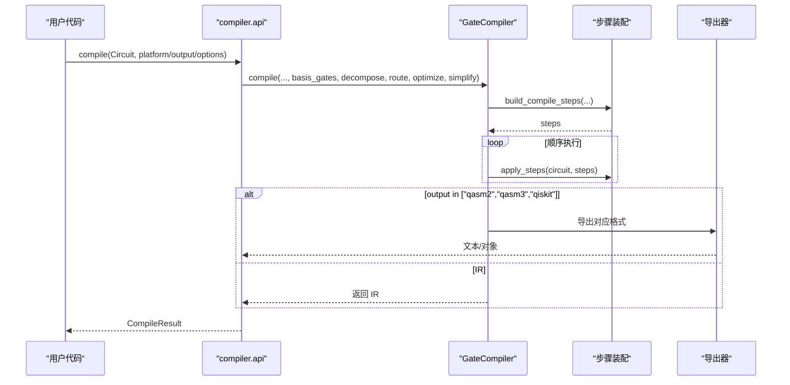
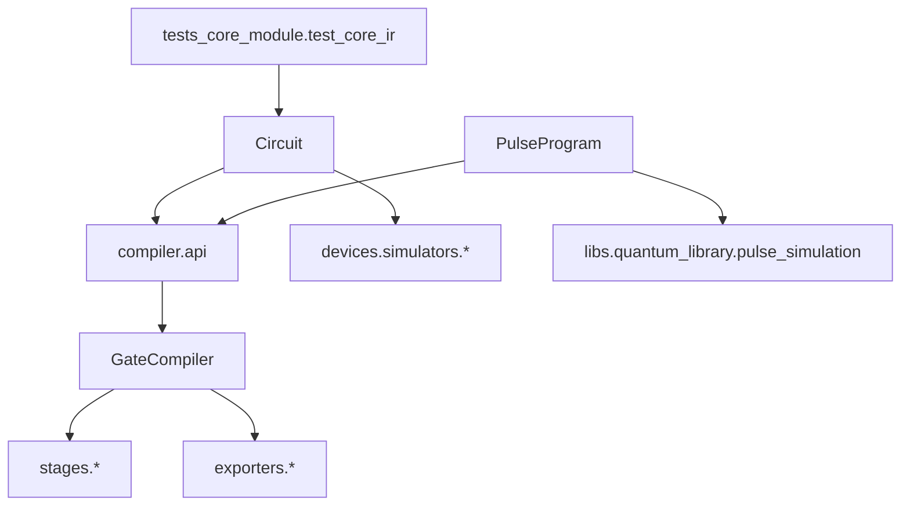

# 中间表示(IR)

<cite>
**本文引用的文件**
- [circuit.py](file://src/tyxonq/core/ir/circuit.py)
- [pulse.py](file://src/tyxonq/core/ir/pulse.py)
- [types.py](file://src/tyxonq/core/types.py)
- [api.py](file://src/tyxonq/compiler/api.py)
- [compiler.py](file://src/tyxonq/compiler/gate_compiler/compiler.py)
- [steps.py](file://src/tyxonq/compiler/gate_compiler/steps.py)
- [test_core_ir.py](file://tests_core_module/test_core_ir.py)
</cite>

## 目录
1. [简介](#简介)
2. [项目结构](#项目结构)
3. [核心组件](#核心组件)
4. [架构总览](#架构总览)
5. [详细组件分析](#详细组件分析)
6. [依赖关系分析](#依赖关系分析)
7. [性能考量](#性能考量)
8. [故障排查指南](#故障排查指南)
9. [结论](#结论)
10. [附录](#附录)

## 简介
本文件系统性阐述 TyxonQ 的中间表示（IR）设计与实现，重点围绕 Circuit 类作为量子线路 IR 的核心载体，解释其 ops、metadata、instructions 的结构与作用；说明 IR 如何为编译器提供统一抽象层，支持不同后端与优化策略；并介绍 IR 的验证机制、转换规则与兼容性保证。最后通过编译阶段序列图展示从高级电路表示到底层硬件指令的转换过程，并提供代码级示例路径以便快速定位实现。

## 项目结构
TyxonQ 将 IR 定义在 core/ir 下，Circuit 负责门级线路 IR，PulseProgram 负责脉冲级 IR；编译器位于 compiler 模块，提供统一的 compile/compile_pulse 入口与平台无关的门级编译核心 GateCompiler。测试覆盖 IR 的基本构造、校验、序列化与可视化。

图表来源
- [circuit.py:48-183](file://src/tyxonq/core/ir/circuit.py#L48-L183)
- [pulse.py:8-153](file://src/tyxonq/core/ir/pulse.py#L8-L153)
- [api.py:39-340](file://src/tyxonq/compiler/api.py#L39-L340)
- [compiler.py:14-110](file://src/tyxonq/compiler/gate_compiler/compiler.py#L14-L110)
- [steps.py:27-109](file://src/tyxonq/compiler/gate_compiler/steps.py#L27-L109)

章节来源
- [circuit.py:48-183](file://src/tyxonq/core/ir/circuit.py#L48-L183)
- [pulse.py:8-153](file://src/tyxonq/core/ir/pulse.py#L8-L153)
- [api.py:39-340](file://src/tyxonq/compiler/api.py#L39-L340)
- [compiler.py:14-110](file://src/tyxonq/compiler/gate_compiler/compiler.py#L14-L110)
- [steps.py:27-109](file://src/tyxonq/compiler/gate_compiler/steps.py#L27-L109)

## 核心组件
- Circuit：门级 IR，承载 num_qubits、ops、metadata、instructions，并提供链式配置、状态获取、编译接口等。
- PulseProgram：脉冲级 IR，承载 qubit 级别的波形操作与设备参数，提供独立编译与执行路径。
- Problem：领域问题包装，用于应用/编译器输入的统一描述。
- 编译器 API：统一入口 compile/compile_pulse，自动选择门级或脉冲级编译流程，并分发到平台适配器。
- GateCompiler：平台无关的门级编译核心，按类型化参数装配编译步骤并顺序执行。

章节来源
- [circuit.py:48-183](file://src/tyxonq/core/ir/circuit.py#L48-L183)
- [pulse.py:71-153](file://src/tyxonq/core/ir/pulse.py#L71-L153)
- [types.py:6-19](file://src/tyxonq/core/types.py#L6-L19)
- [api.py:39-340](file://src/tyxonq/compiler/api.py#L39-L340)
- [compiler.py:14-110](file://src/tyxonq/compiler/gate_compiler/compiler.py#L14-L110)

## 架构总览
TyxonQ 的 IR 体系以 Circuit/PulseProgram 为双轨抽象，上层应用构建 IR，编译器根据 IR 内容与选项决定编译路径：
- 若检测到脉冲操作或显式脉冲模式，则走脉冲编译路径，生成 TQASM/OpenQASM3 等可执行格式。
- 否则走门级编译路径，经规范化、分解、路由、优化、化简等步骤，最终输出 IR/QASM2/QASM3/qiskit 对象。
- 平台适配器（如 lqcloud、guodun）复用 GateCompiler 核心，再翻译为自身方言。

图表来源
- [api.py:100-340](file://src/tyxonq/compiler/api.py#L100-L340)
- [compiler.py:27-110](file://src/tyxonq/compiler/gate_compiler/compiler.py#L27-L110)
- [steps.py:27-109](file://src/tyxonq/compiler/gate_compiler/steps.py#L27-L109)

## 详细组件分析

### Circuit：门级 IR 的实现
- 数据结构
  - num_qubits：量子比特数，必须非负。
  - ops：操作序列，元素为元组/列表，首项为字符串操作名，后续为参数（整数视为量子比特索引）。
  - metadata：任意键值对，用于携带额外信息（如噪声模型、校准信息等）。
  - instructions：指令列表，形如 (name, (indices,))，用于测量、屏障等结构化指令。
- 初始化与验证
  - __post_init__ 会校验 num_qubits、每个 op 的类型与范围、instruction 的格式与索引范围。
- 链式配置
  - device/postprocessing/use_pulse/add_calibration 等方法支持链式配置，内部维护 _device_opts/_compile_opts/_post_opts。
- 分析与工具
  - gate_count/gate_summary/count_flop/compose/remap_qubits/inverse/positional_logical_mapping 等提供轻量分析能力。
- JSON 序列化
  - to_json_obj/to_json_str 提供最小化的 provider-agnostic 序列化。
- 编译接口
  - compile 委托 compiler.api.compile，支持 platform/output/basis_gates/decompose/route/optimize/simplify/device_rule/options 等类型化参数。
  - to_openqasm 便捷导出 OpenQASM2。

图表来源
- [circuit.py:48-183](file://src/tyxonq/core/ir/circuit.py#L48-L183)
- [circuit.py:184-779](file://src/tyxonq/core/ir/circuit.py#L184-L779)

章节来源
- [circuit.py:48-183](file://src/tyxonq/core/ir/circuit.py#L48-L183)
- [circuit.py:184-779](file://src/tyxonq/core/ir/circuit.py#L184-L779)

### PulseProgram：脉冲级 IR
- 数据结构
  - num_qubits、ops（(qubit, waveform, params)）、device_params、metadata。
  - 链式配置 _compile_opts/_device_opts/_post_opts 与缓存字段。
- 验证
  - __post_init__ 校验 num_qubits、ops 结构与 qubit 索引范围。
- 链式 API
  - drag/gaussian/constant/cosine_drag 等便捷方法添加波形；set_device_params/with_metadata 配置设备与元数据。
- 编译与执行
  - compile 调用 compile_pulse，输出 pulse_ir/tqasm/openqasm3 等；run 支持数值模拟或直接提交设备驱动。
  - state 进行脉冲哈密顿演化数值模拟。
  - to_circuit 可选地将脉冲程序转为 Circuit（仅兼容/调试用途）。

图表来源
- [pulse.py:360-493](file://src/tyxonq/core/ir/pulse.py#L360-L493)
- [api.py:343-463](file://src/tyxonq/compiler/api.py#L343-L463)

章节来源
- [pulse.py:71-153](file://src/tyxonq/core/ir/pulse.py#L71-L153)
- [pulse.py:360-493](file://src/tyxonq/core/ir/pulse.py#L360-L493)
- [api.py:343-463](file://src/tyxonq/compiler/api.py#L343-L463)

### 编译器 API 与 GateCompiler：统一抽象层
- 统一入口
  - compile：接收 Circuit/PulseProgram，自动检测脉冲操作或模式，选择平台与输出格式，缓存编译源代码。
  - compile_pulse：脉冲程序的专用入口，封装默认 device_params 与输出格式，并复用 compile 逻辑。
- GateCompiler
  - 平台无关的门级编译核心，依据类型化参数装配编译步骤（AutoMeasure→GatesTransform→MatchgateDecompose/RotationsDecompose→Routing→MergePrune→LightconeSimplify），顺序执行。
  - 输出 IR/QASM2/QASM3/qiskit，并在 metadata 中记录步骤、basis_gates、优化级别等信息。

图表来源
- [api.py:39-340](file://src/tyxonq/compiler/api.py#L39-L340)
- [compiler.py:27-110](file://src/tyxonq/compiler/gate_compiler/compiler.py#L27-L110)
- [steps.py:27-109](file://src/tyxonq/compiler/gate_compiler/steps.py#L27-L109)

章节来源
- [api.py:39-340](file://src/tyxonq/compiler/api.py#L39-L340)
- [compiler.py:27-110](file://src/tyxonq/compiler/gate_compiler/compiler.py#L27-L110)
- [steps.py:27-109](file://src/tyxonq/compiler/gate_compiler/steps.py#L27-L109)

### IR 的验证机制、转换规则与兼容性保证
- 验证
  - Circuit.__post_init__ 校验 num_qubits≥0、op 为 tuple/list、名称为字符串、整数参数为有效 qubit 索引；instructions 格式与索引范围同样校验。
  - PulseProgram.__post_init__ 校验 num_qubits≥0、ops 三元组结构与 qubit 索引范围。
- 转换规则
  - 门级：AutoMeasure（无测量补 Z 测量）、GatesTransform（按 basis_gates 重写）、MatchgateDecompose/RotationsDecompose（分解）、Routing（拓扑路由）、MergePrune（相邻合并/恒等剪枝）、LightconeSimplify（光锥化简）。
  - 脉冲级：compile_pulse 自动补足 device_params，按目标设备选择 TQASM/OpenQASM3 风格，inline_pulses 控制是否内联波形。
- 兼容性
  - Circuit.to_json_obj/to_json_str 提供最小化跨 provider 序列化。
  - Circuit.to_openqasm 便捷导出 OpenQASM2。
  - compile 支持 platform="qiskit" 互操作，未指定 output 时默认输出 qiskit 对象。
  - homebrew_s2 设备特殊处理：门电路强制 qasm2，脉冲电路强制 tyxonq_homebrew_tqasm。

章节来源
- [circuit.py:155-183](file://src/tyxonq/core/ir/circuit.py#L155-L183)
- [pulse.py:139-153](file://src/tyxonq/core/ir/pulse.py#L139-L153)
- [steps.py:27-109](file://src/tyxonq/compiler/gate_compiler/steps.py#L27-L109)
- [api.py:169-186](file://src/tyxonq/compiler/api.py#L169-L186)
- [circuit.py:757-779](file://src/tyxonq/core/ir/circuit.py#L757-L779)

### IR 在不同编译阶段的作用
- 高级电路表示：Circuit/PulseProgram 由用户构建，包含 ops/metadata/instructions。
- 规范化与分解：确保所有门落入目标基集，必要时分解两量子比特幺正或旋转。
- 路由与优化：按设备耦合图映射物理比特，合并相邻门、剪枝恒等操作。
- 化简：裁剪不影响测量的算符，降低深度。
- 导出：输出 IR 或目标语言（QASM2/QASM3/TQASM/qiskit），供后端执行。

图表来源
- [steps.py:27-109](file://src/tyxonq/compiler/gate_compiler/steps.py#L27-L109)
- [compiler.py:27-110](file://src/tyxonq/compiler/gate_compiler/compiler.py#L27-L110)
- [api.py:39-340](file://src/tyxonq/compiler/api.py#L39-L340)

## 依赖关系分析
- Circuit 依赖 compiler.api.compile 进行编译，依赖 devices.simulators.* 进行状态获取。
- PulseProgram 依赖 compiler.api.compile_pulse 与 libs.quantum_library.pulse_simulation 进行数值模拟。
- GateCompiler 依赖 stages.* 中的具体步骤实现，以及 exporters.* 进行格式导出。
- 测试用例验证了 IR 的构造、校验、序列化与可视化。

图表来源
- [circuit.py:48-183](file://src/tyxonq/core/ir/circuit.py#L48-L183)
- [pulse.py:71-153](file://src/tyxonq/core/ir/pulse.py#L71-L153)
- [api.py:39-340](file://src/tyxonq/compiler/api.py#L39-L340)
- [compiler.py:27-110](file://src/tyxonq/compiler/gate_compiler/compiler.py#L27-L110)
- [test_core_ir.py:1-93](file://tests_core_module/test_core_ir.py#L1-L93)

章节来源
- [circuit.py:48-183](file://src/tyxonq/core/ir/circuit.py#L48-L183)
- [pulse.py:71-153](file://src/tyxonq/core/ir/pulse.py#L71-L153)
- [api.py:39-340](file://src/tyxonq/compiler/api.py#L39-L340)
- [compiler.py:27-110](file://src/tyxonq/compiler/gate_compiler/compiler.py#L27-L110)
- [test_core_ir.py:1-93](file://tests_core_module/test_core_ir.py#L1-L93)

## 性能考量
- 门级估算：Circuit.count_flop 提供基于态矢量模拟的启发式 FLOP 估计，便于快速评估复杂度。
- 优化级别：optimize>=1 启用 MergePrune，减少门数量与深度。
- 光锥化简：simplify=True 裁剪不影响测量的算符，进一步降低开销。
- 脉冲数值模拟：PulseProgram.state 使用后端张量库进行演化，注意内存与时间复杂度随 qubit 数指数增长。

章节来源
- [circuit.py:623-644](file://src/tyxonq/core/ir/circuit.py#L623-L644)
- [steps.py:81-89](file://src/tyxonq/compiler/gate_compiler/steps.py#L81-L89)
- [pulse.py:496-586](file://src/tyxonq/core/ir/pulse.py#L496-L586)

## 故障排查指南
- 常见错误
  - num_qubits 为负：构造时抛出 ValueError。
  - op 非法：非 tuple/list 或为空，或操作名非字符串，或 qubit 索引越界。
  - instruction 非法：非 (name, (indices,)) 格式或索引越界。
  - 未知引擎：state(engine=...) 传入不支持的引擎名称。
- 排查建议
  - 检查 Circuit.num_qubits 与所有 op 中的整数是否为有效 qubit 索引。
  - 确认 instructions 的 name 与 indices 格式正确。
  - 对于脉冲程序，确保 device_params 已提供（缺省时会自动补充默认值并警告）。
  - 查看 compile 返回的 metadata 中的 steps、basis_gates、optimization_level 以确认编译路径。

章节来源
- [circuit.py:155-183](file://src/tyxonq/core/ir/circuit.py#L155-L183)
- [circuit.py:538-541](file://src/tyxonq/core/ir/circuit.py#L538-L541)
- [api.py:247-262](file://src/tyxonq/compiler/api.py#L247-L262)
- [compiler.py:76-83](file://src/tyxonq/compiler/gate_compiler/compiler.py#L76-L83)

## 结论
TyxonQ 的 IR 系统以 Circuit 和 PulseProgram 为核心，提供统一且可扩展的抽象层，屏蔽后端差异，支持多种优化策略与目标格式。严格的验证机制与清晰的转换规则保证了 IR 的正确性与兼容性。通过类型化参数驱动的编译步骤装配，编译器能够灵活组合分解、路由、优化与化简，满足不同硬件平台的约束与需求。

## 附录
- 代码示例路径（不直接展示代码内容）
  - 构造与校验：[test_core_ir.py:9-29](file://tests_core_module/test_core_ir.py#L9-L29)
  - 计数与摘要：[test_core_ir.py:31-46](file://tests_core_module/test_core_ir.py#L31-L46)
  - 组合与重映射：[test_core_ir.py:48-70](file://tests_core_module/test_core_ir.py#L48-L70)
  - 指令与序列化：[test_core_ir.py:72-81](file://tests_core_module/test_core_ir.py#L72-L81)
  - 可视化：[test_core_ir.py:83-93](file://tests_core_module/test_core_ir.py#L83-L93)
  - 脉冲程序链式 API：[pulse.py:191-299](file://src/tyxonq/core/ir/pulse.py#L191-L299)
  - 脉冲编译与执行：[pulse.py:360-493](file://src/tyxonq/core/ir/pulse.py#L360-L493)
  - 门级编译步骤装配：[steps.py:27-109](file://src/tyxonq/compiler/gate_compiler/steps.py#L27-L109)
  - 统一编译入口：[api.py:39-340](file://src/tyxonq/compiler/api.py#L39-L340)