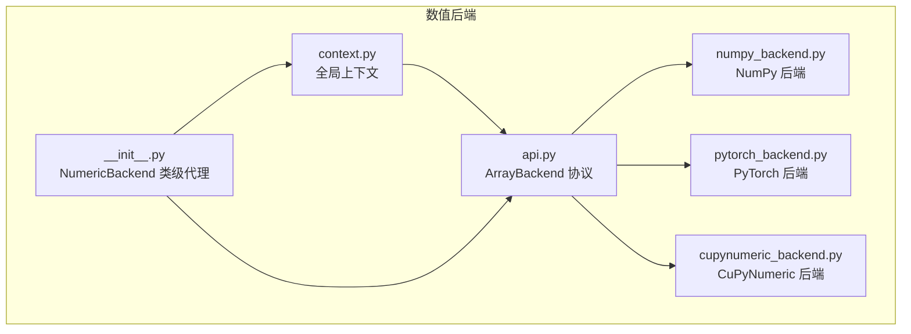
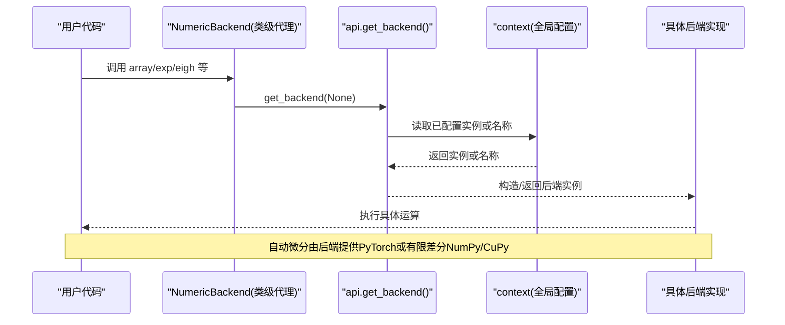
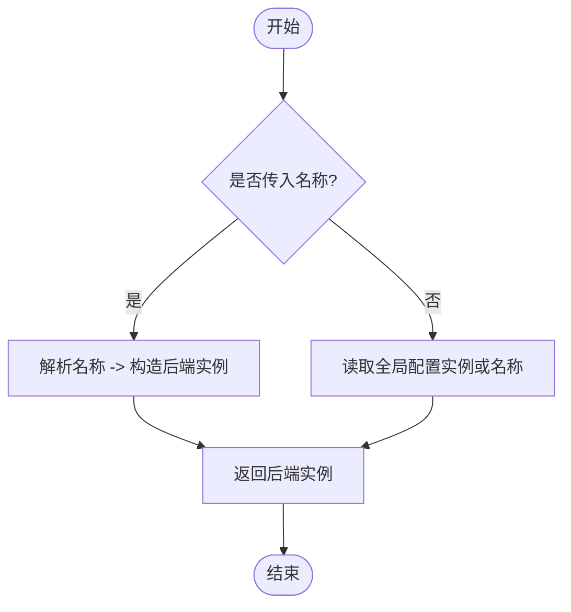
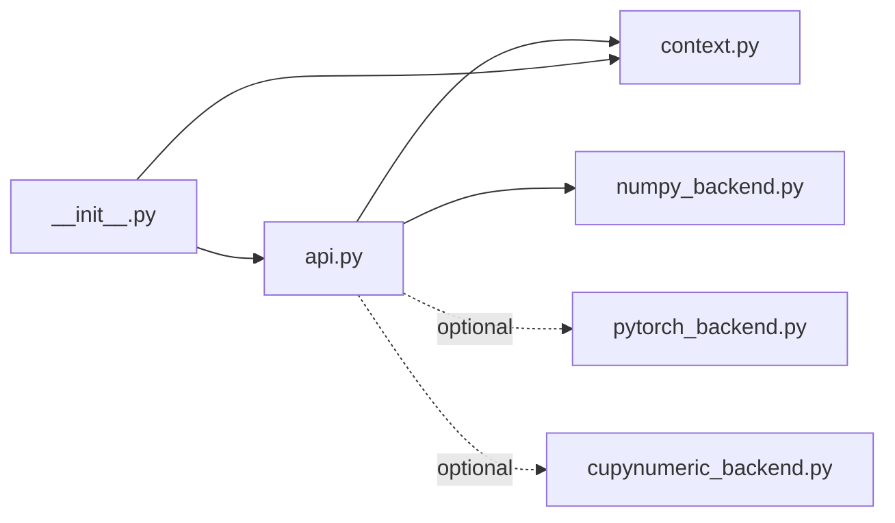

# 数值后端系统

<cite>
**本文引用的文件**
- [src/tyxonq/numerics/__init__.py](file://src/tyxonq/numerics/__init__.py)
- [src/tyxonq/numerics/api.py](file://src/tyxonq/numerics/api.py)
- [src/tyxonq/numerics/context.py](file://src/tyxonq/numerics/context.py)
- [src/tyxonq/numerics/backends/numpy_backend.py](file://src/tyxonq/numerics/backends/numpy_backend.py)
- [src/tyxonq/numerics/backends/pytorch_backend.py](file://src/tyxonq/numerics/backends/pytorch_backend.py)
- [src/tyxonq/numerics/backends/cupynumeric_backend.py](file://src/tyxonq/numerics/backends/cupynumeric_backend.py)
- [examples/numeric_backend_switching.py](file://examples/numeric_backend_switching.py)
- [examples/framework_performance_comparison.py](file://examples/framework_performance_comparison.py)
</cite>

## 目录
1. [简介](#简介)
2. [项目结构](#项目结构)
3. [核心组件](#核心组件)
4. [架构总览](#架构总览)
5. [详细组件分析](#详细组件分析)
6. [依赖关系分析](#依赖关系分析)
7. [性能与内存管理](#性能与内存管理)
8. [故障排查指南](#故障排查指南)
9. [结论](#结论)
10. [附录：使用示例与最佳实践](#附录使用示例与最佳实践)

## 简介
本文件系统性阐述 TyxonQ 的数值后端系统，重点解释 ArrayBackend 协议的设计与实现，并深入对比 NumPy、PyTorch、CuPyNumeric 三种后端的特性、适用场景、切换机制、性能差异与内存管理策略。同时介绍自动微分支持、GPU 加速与并行计算能力，给出在不同后端之间无缝切换的方法、针对特定后端的优化技巧、基准测试结果解读以及最佳实践建议。

## 项目结构
TyxonQ 的数值后端位于 numerics 模块中，采用“协议 + 多实现 + 全局上下文”的分层设计：
- 协议定义：ArrayBackend（统一接口）
- 后端实现：NumpyBackend、PyTorchBackend、CuPyNumericBackend
- 上下文与工厂：get_backend/set_backend/use_backend、NumericBackend 类级代理
- 示例与基准：演示与对比脚本

图表来源
- [src/tyxonq/numerics/api.py:19-122](file://src/tyxonq/numerics/api.py#L19-L122)
- [src/tyxonq/numerics/context.py:13-50](file://src/tyxonq/numerics/context.py#L13-L50)
- [src/tyxonq/numerics/__init__.py:67-472](file://src/tyxonq/numerics/__init__.py#L67-L472)

章节来源
- [src/tyxonq/numerics/api.py:19-122](file://src/tyxonq/numerics/api.py#L19-L122)
- [src/tyxonq/numerics/context.py:13-50](file://src/tyxonq/numerics/context.py#L13-L50)
- [src/tyxonq/numerics/__init__.py:67-472](file://src/tyxonq/numerics/__init__.py#L67-L472)

## 核心组件
- ArrayBackend 协议：定义统一的数组/张量接口，包括创建、代数运算、线性代数、随机数、自动微分桥接等。
- 后端实现：
  - NumpyBackend：纯 CPU，完整数学与线性代数，有限差分梯度工具。
  - PyTorchBackend：CPU/GPU，原生自动微分，可选 JIT（torch.compile），vmap 封装。
  - CuPyNumericBackend：基于 cupynumeric 的 GPU/加速后端，部分操作回退到 NumPy。
- 上下文与工厂：
  - get_backend：按名称或配置返回后端实例，支持懒加载与可用性检查。
  - set_backend/use_backend：设置全局默认后端或临时切换。
  - NumericBackend：类级代理，提供便捷的全局访问方式（如 NumericBackend.array、exp、eigh 等）。

章节来源
- [src/tyxonq/numerics/api.py:19-255](file://src/tyxonq/numerics/api.py#L19-L255)
- [src/tyxonq/numerics/context.py:13-50](file://src/tyxonq/numerics/context.py#L13-L50)
- [src/tyxonq/numerics/__init__.py:67-472](file://src/tyxonq/numerics/__init__.py#L67-L472)

## 架构总览
下图展示从用户代码到具体后端实现的调用路径，以及自动微分与 JIT 的集成点。

图表来源
- [src/tyxonq/numerics/__init__.py:67-472](file://src/tyxonq/numerics/__init__.py#L67-L472)
- [src/tyxonq/numerics/api.py:179-255](file://src/tyxonq/numerics/api.py#L179-L255)
- [src/tyxonq/numerics/context.py:13-50](file://src/tyxonq/numerics/context.py#L13-L50)

## 详细组件分析

### ArrayBackend 协议
- 职责：抽象出跨框架的统一数组接口，屏蔽底层实现差异。
- 关键方法：array/asarray/to_numpy、matmul/einsum/reshape/moveaxis、sum/mean/abs/real/imag/conj/diag/zeros/ones/eye/kron/square、stack/concatenate/arange/linspace/transpose/norm/cast/sign/outer、svd/eigh/eig/solve/inv/expm/tensordot、rng/normal、requires_grad/detach、可选 vmap。
- 设计要点：
  - 最小必要接口，便于扩展新后端。
  - 自动微分桥接（requires_grad/detach）为可选能力，不同后端以各自方式实现。
  - 向量化工具 vectorize_or_fallback 提供安全降级策略。

章节来源
- [src/tyxonq/numerics/api.py:19-122](file://src/tyxonq/numerics/api.py#L19-L122)
- [src/tyxonq/numerics/api.py:124-177](file://src/tyxonq/numerics/api.py#L124-L177)

### NumPy 后端（NumpyBackend）
- 特性：
  - CPU 计算，稳定参考实现。
  - 完整的数学与线性代数函数（含 expm 通过 scipy.linalg.expm）。
  - 提供有限差分梯度工具（jacfwd/hessian/value_and_grad），不依赖外部自动微分库。
- 适用场景：
  - 小规模电路、原型验证、无 GPU 环境。
- 内存与精度：
  - 默认 complex128/float64，可通过 set_dtype 切换为 complex64/float32 以降低内存占用。
- 自动微分：
  - 通过 value_and_grad 进行有限差分；不支持反向传播图。

章节来源
- [src/tyxonq/numerics/backends/numpy_backend.py:8-457](file://src/tyxonq/numerics/backends/numpy_backend.py#L8-L457)

### PyTorch 后端（PyTorchBackend）
- 特性：
  - CPU/GPU 加速，原生自动微分（autograd）。
  - 支持 torch.compile（JIT）与 torch.func.vmap（向量化）。
  - 严格保持 requires_grad 链，避免在转换时丢失梯度信息。
- 适用场景：
  - VQA/优化任务、需要高效梯度计算、GPU 可用。
- 内存与精度：
  - 支持 dtype 映射与设备迁移；注意 tensor 拷贝与共享语义。
- 自动微分：
  - value_and_grad 优先使用 autograd，失败时回退到有限差分。

章节来源
- [src/tyxonq/numerics/backends/pytorch_backend.py:13-567](file://src/tyxonq/numerics/backends/pytorch_backend.py#L13-L567)

### CuPyNumeric 后端（CuPyNumericBackend）
- 特性：
  - 基于 cupynumeric 的 GPU/加速后端，API 近似 NumPy。
  - 部分操作（如 SVD）回退到 NumPy 主机端计算。
- 适用场景：
  - 大规模状态向量/矩阵运算且具备 GPU 环境。
- 内存与精度：
  - 默认 complex128/float64，可切换至 lower precision。
- 自动微分：
  - 不提供原生自动微分；value_and_grad 通过有限差分实现。

章节来源
- [src/tyxonq/numerics/backends/cupynumeric_backend.py:13-300](file://src/tyxonq/numerics/backends/cupynumeric_backend.py#L13-L300)

### 后端切换机制
- 全局默认后端：set_backend(name_or_instance) 设置字符串名或实例；use_backend(...) 提供上下文管理器临时切换。
- 获取后端：get_backend(name=None) 优先使用已配置实例，否则解析名称；未安装依赖时抛出明确错误。
- 类级代理：NumericBackend 将所有常用操作委托给当前后端，无需显式实例化。

图表来源
- [src/tyxonq/numerics/api.py:179-255](file://src/tyxonq/numerics/api.py#L179-L255)
- [src/tyxonq/numerics/context.py:13-50](file://src/tyxonq/numerics/context.py#L13-L50)
- [src/tyxonq/numerics/__init__.py:20-58](file://src/tyxonq/numerics/__init__.py#L20-L58)

章节来源
- [src/tyxonq/numerics/api.py:179-255](file://src/tyxonq/numerics/api.py#L179-L255)
- [src/tyxonq/numerics/context.py:13-50](file://src/tyxonq/numerics/context.py#L13-L50)
- [src/tyxonq/numerics/__init__.py:20-58](file://src/tyxonq/numerics/__init__.py#L20-L58)

## 依赖关系分析
- 模块耦合：
  - api.py 依赖 context.py 获取全局配置，并导入各后端实现（可选导入以避免硬依赖）。
  - __init__.py 暴露 NumericBackend 类级代理，统一对外 API。
- 外部依赖：
  - PyTorch 后端依赖 torch（可选）。
  - CuPyNumeric 后端依赖 cupynumeric（可选）。
  - NumPy 后端依赖 numpy/scipy（用于 expm 等）。

图表来源
- [src/tyxonq/numerics/api.py:1-14](file://src/tyxonq/numerics/api.py#L1-L14)
- [src/tyxonq/numerics/context.py:1-16](file://src/tyxonq/numerics/context.py#L1-L16)
- [src/tyxonq/numerics/__init__.py:1-17](file://src/tyxonq/numerics/__init__.py#L1-L17)

章节来源
- [src/tyxonq/numerics/api.py:1-14](file://src/tyxonq/numerics/api.py#L1-L14)
- [src/tyxonq/numerics/context.py:1-16](file://src/tyxonq/numerics/context.py#L1-L16)
- [src/tyxonq/numerics/__init__.py:1-17](file://src/tyxonq/numerics/__init__.py#L1-L17)

## 性能与内存管理
- 性能特征：
  - NumPy：适合小问题与开发调试；梯度通过有限差分，开销较大。
  - PyTorch：推荐用于带梯度的优化任务；可利用 GPU 与 JIT 提升吞吐。
  - CuPyNumeric：适合大规模矩阵/向量运算的 GPU 加速；部分算子回退到 CPU。
- 内存管理：
  - 精度控制：通过 set_dtype 选择 complex64/complex128 与对应实数精度，平衡精度与内存。
  - 数据拷贝：PyTorch 的 as_tensor/tensor 可能共享或复制数据；注意避免不必要的 clone。
  - 设备迁移：PyTorch 需确保同设备运算；CuPyNumeric 某些操作会触发 host-device 往返。
- 自动微分：
  - PyTorch：原生反向传播，效率高；value_and_grad 失败时回退有限差分。
  - NumPy/CuPy：有限差分，复杂度 O(n) 次函数评估；适合小规模参数空间。
- 并行与向量化：
  - PyTorch：vmap（torch.func.vmap）与 torch.compile 可用于批处理与编译优化。
  - NumPy/CuPy：无内置 vmap；vectorize_or_fallback 提供轻量级前轴迭代。

章节来源
- [src/tyxonq/numerics/backends/pytorch_backend.py:364-383](file://src/tyxonq/numerics/backends/pytorch_backend.py#L364-L383)
- [src/tyxonq/numerics/backends/numpy_backend.py:261-457](file://src/tyxonq/numerics/backends/numpy_backend.py#L261-L457)
- [src/tyxonq/numerics/backends/cupynumeric_backend.py:208-297](file://src/tyxonq/numerics/backends/cupynumeric_backend.py#L208-L297)
- [src/tyxonq/numerics/api.py:124-177](file://src/tyxonq/numerics/api.py#L124-L177)

## 故障排查指南
- 常见错误与处理：
  - 后端不可用：当请求 pytorch/cupynumeric 但未安装时，get_backend 抛出 RuntimeError。
  - 梯度为 None：PyTorch 路径中若计算图断裂，value_and_grad 会捕获异常并回退有限差分。
  - 设备不一致：PyTorch matmul/dot 会尝试对齐 dtype/device；仍出错时需手动 to(device)。
- 诊断建议：
  - 打印后端类型与默认 dtype，确认切换生效。
  - 对关键张量检查 requires_grad 与 device。
  - 在小规模数据上复现问题，逐步定位。

章节来源
- [src/tyxonq/numerics/api.py:179-255](file://src/tyxonq/numerics/api.py#L179-L255)
- [src/tyxonq/numerics/backends/pytorch_backend.py:446-567](file://src/tyxonq/numerics/backends/pytorch_backend.py#L446-L567)

## 结论
TyxonQ 的数值后端系统通过 ArrayBackend 协议实现了跨框架的统一接口，结合全局上下文与类级代理，使得在不同后端间无缝切换成为可能。NumPy 适合开发与小规模任务；PyTorch 在自动微分与 GPU 加速方面优势明显，是 VQA/优化的首选；CuPyNumeric 则在大规模矩阵运算上提供 GPU 加速。通过合理的精度设置、设备管理与向量化/JIT 优化，可在不同场景下获得良好性能与稳定性。

## 附录：使用示例与最佳实践
- 后端切换示例：
  - 使用 tq.set_backend("numpy"/"pytorch"/"cupynumeric") 切换全局后端。
  - 使用 tq.use_backend(...) 在局部作用域内临时切换。
  - 通过 tq.get_backend() 获取当前后端实例，进行数组创建与运算。
- 精度与内存：
  - 使用 tq.set_dtype("complex64"/"complex128") 调整默认精度，降低内存占用。
- 自动微分与优化：
  - PyTorch 后端配合 autograd 与优化器（如 Adam）进行端到端训练。
  - 使用 NumericBackend.value_and_grad 获取值与梯度（NumPy/CuPy 为有限差分）。
- 性能优化：
  - 预构建 Hamiltonian/矩阵，避免重复创建。
  - 使用 torch.compile（PyTorch）与 vmap 进行批处理与编译优化。
  - 合理选择 dtype 与设备，减少不必要的数据拷贝与迁移。
- 基准测试参考：
  - 示例脚本展示了不同后端与模式下的性能对比与一致性验证。

章节来源
- [examples/numeric_backend_switching.py:1-323](file://examples/numeric_backend_switching.py#L1-L323)
- [examples/framework_performance_comparison.py:75-408](file://examples/framework_performance_comparison.py#L75-L408)