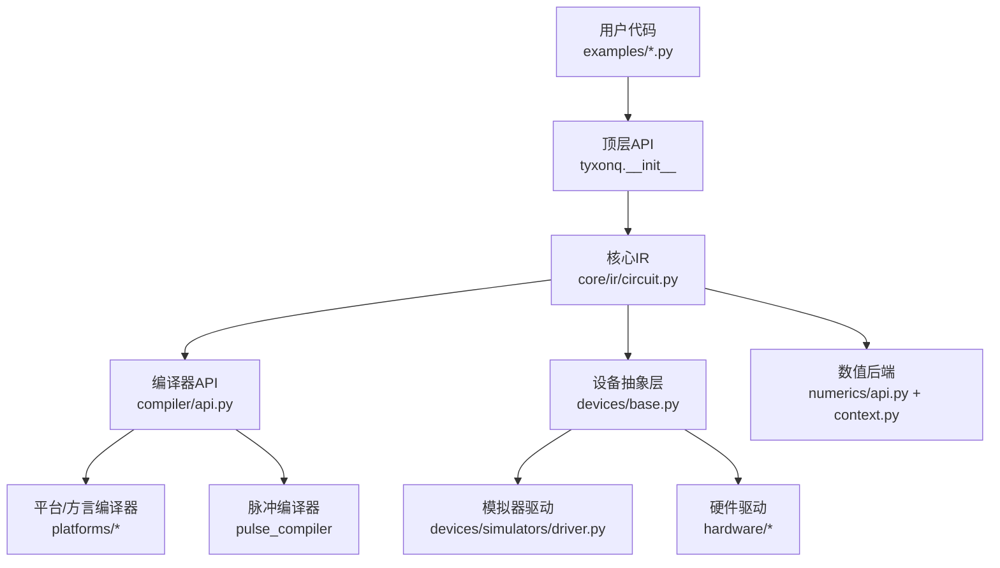
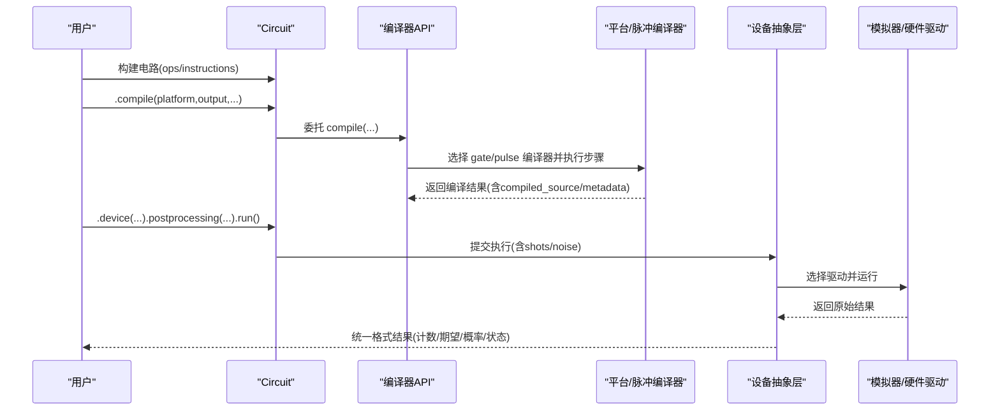
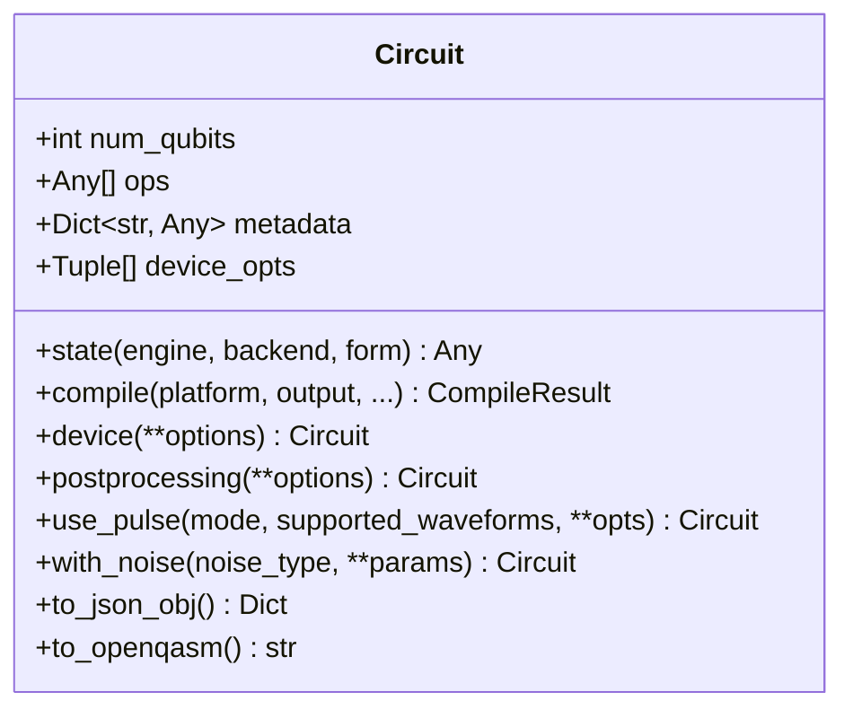
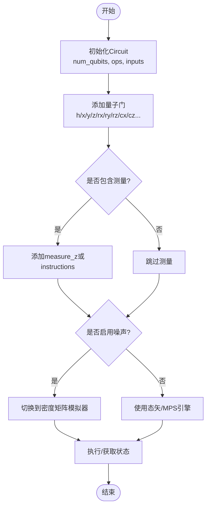
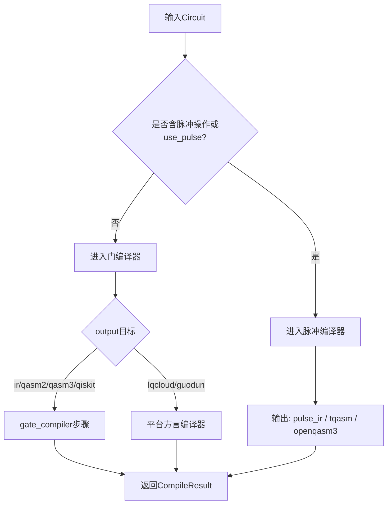
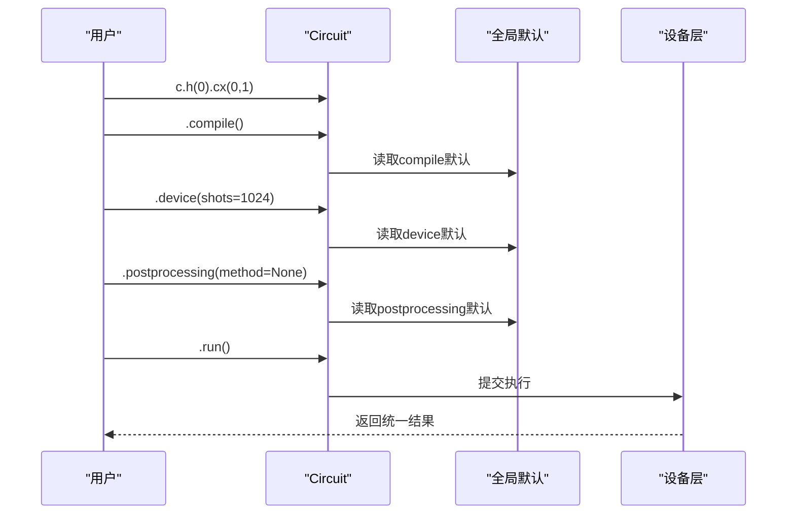
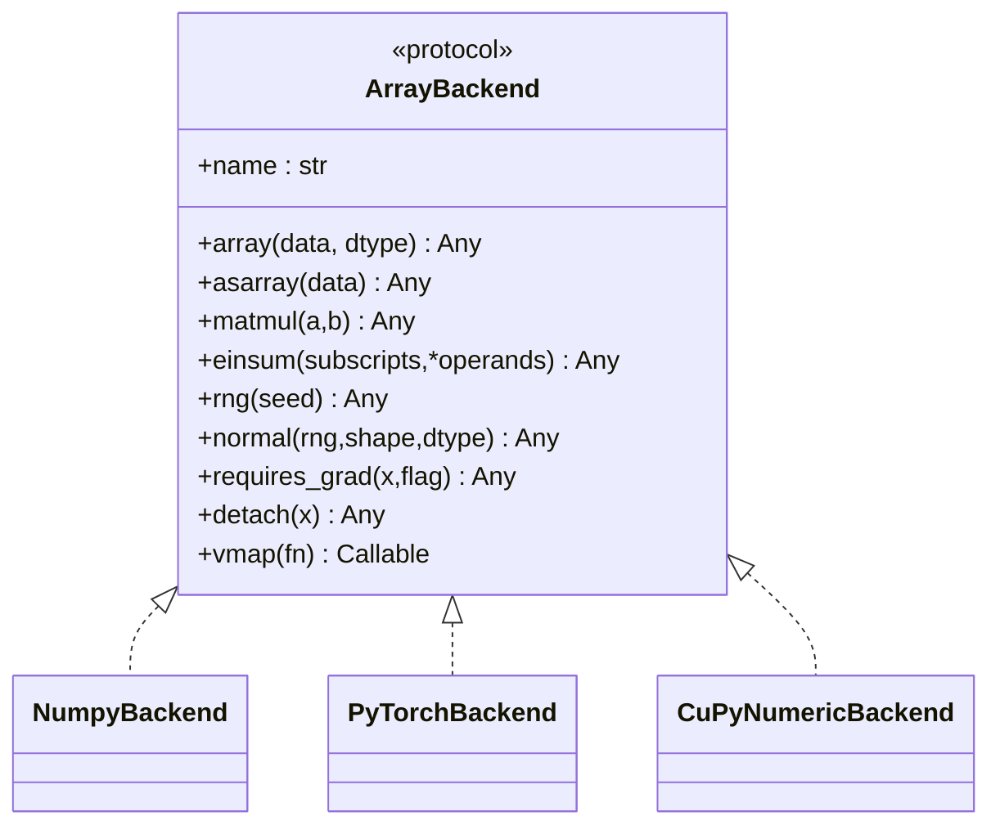
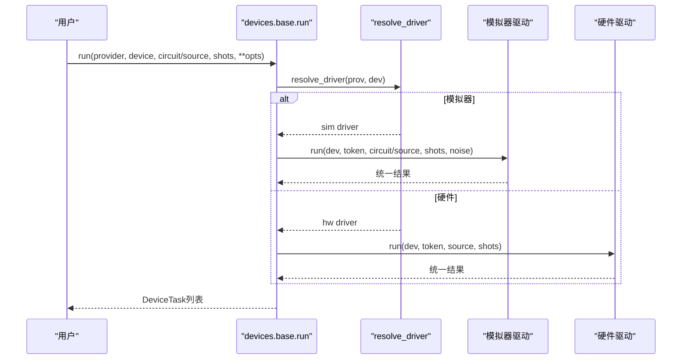
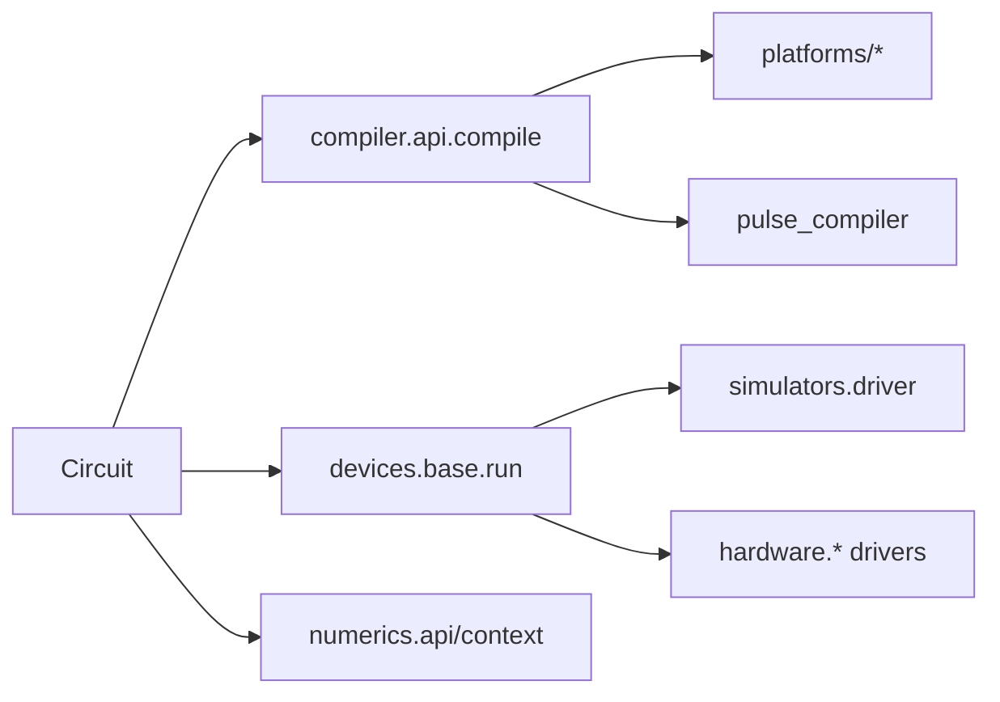

# 核心概念

<cite>
**本文引用的文件**
- [src/tyxonq/__init__.py](file://src/tyxonq/__init__.py)
- [src/tyxonq/core/__init__.py](file://src/tyxonq/core/__init__.py)
- [src/tyxonq/core/types.py](file://src/tyxonq/core/types.py)
- [src/tyxonq/core/ir/circuit.py](file://src/tyxonq/core/ir/circuit.py)
- [src/tyxonq/compiler/api.py](file://src/tyxonq/compiler/api.py)
- [src/tyxonq/devices/base.py](file://src/tyxonq/devices/base.py)
- [src/tyxonq/devices/simulators/driver.py](file://src/tyxonq/devices/simulators/driver.py)
- [src/tyxonq/numerics/api.py](file://src/tyxonq/numerics/api.py)
- [src/tyxonq/numerics/context.py](file://src/tyxonq/numerics/context.py)
- [examples/basic_chain_api.py](file://examples/basic_chain_api.py)
- [examples/circuit_chain_demo.py](file://examples/circuit_chain_demo.py)
- [examples/numeric_backend_switching.py](file://examples/numeric_backend_switching.py)
</cite>

## 目录
1. [简介](#简介)
2. [项目结构](#项目结构)
3. [核心组件](#核心组件)
4. [架构总览](#架构总览)
5. [详细组件分析](#详细组件分析)
6. [依赖关系分析](#依赖关系分析)
7. [性能考量](#性能考量)
8. [故障排查指南](#故障排查指南)
9. [结论](#结论)
10. [附录：代码示例与最佳实践](#附录代码示例与最佳实践)

## 简介
本章节面向量子计算初学者与有经验的开发者，系统阐述 TyxonQ 的核心概念与抽象设计。内容覆盖：
- 量子电路（Circuit）的中间表示（IR）、量子门操作、测量与状态初始化
- 编译器的工作流程与优势
- 链式 API 的设计模式与调用流程
- 数值后端（ArrayBackend）的统一接口与选择策略（NumPy、PyTorch、CuPyNumeric）
- 设备抽象层对模拟器与真实硬件的统一调度
- 丰富的代码示例路径，帮助读者快速上手并深入理解

## 项目结构
TyxonQ 采用分层模块化设计，核心 IR、编译器、设备抽象与数值后端解耦清晰：
- 核心 IR：Circuit/Hamiltonian/Pulse 等数据结构位于 core/ir
- 编译器：gate/pulse 编译管线在 compiler/ 下，支持多平台输出
- 设备层：devices/base 提供统一运行入口，simulators/hardware 分别实现本地仿真与云端/真机驱动
- 数值后端：numerics 提供 ArrayBackend 协议与后端切换能力
- 顶层入口：tyxonq.__init__ 暴露便捷 API（如 set_backend、device/postprocessing/compile 默认值）

图表来源
- [src/tyxonq/__init__.py:136-183](file://src/tyxonq/__init__.py#L136-L183)
- [src/tyxonq/core/ir/circuit.py:48-139](file://src/tyxonq/core/ir/circuit.py#L48-L139)
- [src/tyxonq/compiler/api.py:39-98](file://src/tyxonq/compiler/api.py#L39-L98)
- [src/tyxonq/devices/base.py:294-445](file://src/tyxonq/devices/base.py#L294-L445)
- [src/tyxonq/devices/simulators/driver.py:86-141](file://src/tyxonq/devices/simulators/driver.py#L86-L141)
- [src/tyxonq/numerics/api.py:179-252](file://src/tyxonq/numerics/api.py#L179-L252)
- [src/tyxonq/numerics/context.py:18-50](file://src/tyxonq/numerics/context.py#L18-L50)

章节来源
- [src/tyxonq/__init__.py:136-183](file://src/tyxonq/__init__.py#L136-L183)
- [src/tyxonq/core/__init__.py:1-11](file://src/tyxonq/core/__init__.py#L1-L11)

## 核心组件
- 量子电路 IR（Circuit）：以 num_qubits 与 ops/instructions 描述电路，支持元数据、初始态、噪声配置、脉冲编译开关等
- 编译器（Compiler API）：统一入口 compile()，按 platform/output 分派到不同平台或脉冲编译器，支持分解、路由、优化、光锥简化
- 设备抽象（Device Layer）：统一 run()/expval()，自动注入噪声、处理 shots、归一化结果格式，屏蔽模拟器与硬件差异
- 数值后端（ArrayBackend）：统一数组/张量接口，支持 NumPy/PyTorch/CuPyNumeric 切换，提供 vmap 向量化与自动微分桥接
- 顶层便捷 API：set_backend/get_backend/set_dtype、device/postprocessing/compile 全局默认值管理

章节来源
- [src/tyxonq/core/ir/circuit.py:48-139](file://src/tyxonq/core/ir/circuit.py#L48-L139)
- [src/tyxonq/compiler/api.py:39-98](file://src/tyxonq/compiler/api.py#L39-L98)
- [src/tyxonq/devices/base.py:294-445](file://src/tyxonq/devices/base.py#L294-L445)
- [src/tyxonq/numerics/api.py:19-122](file://src/tyxonq/numerics/api.py#L19-L122)
- [src/tyxonq/__init__.py:146-183](file://src/tyxonq/__init__.py#L146-L183)

## 架构总览
TyxonQ 将“线路构建 → 编译 → 执行 → 后处理”解耦为独立阶段，通过类型化参数与统一协议串联：
- 线路构建：Circuit 对象累积 ops/instructions，支持 compose/remap/extended 等操作
- 编译阶段：compile() 根据 platform/output 选择 gate/pulse 编译器，执行分解、路由、优化、简化
- 执行阶段：devices/base.run() 解析 provider/device，选择模拟器或硬件驱动，注入噪声与 shots，返回统一任务对象
- 后处理：postprocessing 选项控制读误校正、期望值聚合等

图表来源
- [src/tyxonq/core/ir/circuit.py:783-839](file://src/tyxonq/core/ir/circuit.py#L783-L839)
- [src/tyxonq/compiler/api.py:140-340](file://src/tyxonq/compiler/api.py#L140-L340)
- [src/tyxonq/devices/base.py:294-445](file://src/tyxonq/devices/base.py#L294-L445)
- [src/tyxonq/devices/simulators/driver.py:86-141](file://src/tyxonq/devices/simulators/driver.py#L86-L141)

## 详细组件分析

### 量子电路（Circuit）与 IR
- 数据结构：num_qubits、ops（操作序列）、instructions（显式测量指令）、metadata（元数据）
- 初始态：inputs 支持态矢/密度矩阵，仅数值模拟可用
- 链式配置：device()/postprocessing()/use_pulse()/with_noise() 等可链式设置
- 分析与导出：gate_count/gate_summary/count_flop、to_json_obj/to_json_str、to_openqasm
- 组合与变换：compose/extended/remap_qubits/inverse

图表来源
- [src/tyxonq/core/ir/circuit.py:48-139](file://src/tyxonq/core/ir/circuit.py#L48-L139)
- [src/tyxonq/core/ir/circuit.py:184-298](file://src/tyxonq/core/ir/circuit.py#L184-L298)
- [src/tyxonq/core/ir/circuit.py:427-541](file://src/tyxonq/core/ir/circuit.py#L427-L541)
- [src/tyxonq/core/ir/circuit.py:575-767](file://src/tyxonq/core/ir/circuit.py#L575-L767)
- [src/tyxonq/core/ir/circuit.py:771-839](file://src/tyxonq/core/ir/circuit.py#L771-L839)

章节来源
- [src/tyxonq/core/ir/circuit.py:48-139](file://src/tyxonq/core/ir/circuit.py#L48-L139)
- [src/tyxonq/core/ir/circuit.py:184-298](file://src/tyxonq/core/ir/circuit.py#L184-L298)
- [src/tyxonq/core/ir/circuit.py:427-541](file://src/tyxonq/core/ir/circuit.py#L427-L541)
- [src/tyxonq/core/ir/circuit.py:575-767](file://src/tyxonq/core/ir/circuit.py#L575-L767)
- [src/tyxonq/core/ir/circuit.py:771-839](file://src/tyxonq/core/ir/circuit.py#L771-L839)

### 量子门、测量与状态初始化
- 量子门：通过 ops 中的 (gate_name, qubit_indices, params...) 描述；支持单/双量子比特门及参数旋转
- 测量：measure_z 与 instructions 中显式 measure 指令；positional_logical_mapping 用于位置到逻辑映射
- 状态初始化：inputs 指定初始态（态矢或密度矩阵），仅在数值模拟中使用
- 噪声：with_noise 自动切换到密度矩阵模拟器并注入噪声模型

图表来源
- [src/tyxonq/core/ir/circuit.py:65-139](file://src/tyxonq/core/ir/circuit.py#L65-L139)
- [src/tyxonq/core/ir/circuit.py:241-298](file://src/tyxonq/core/ir/circuit.py#L241-L298)
- [src/tyxonq/core/ir/circuit.py:711-730](file://src/tyxonq/core/ir/circuit.py#L711-L730)

章节来源
- [src/tyxonq/core/ir/circuit.py:65-139](file://src/tyxonq/core/ir/circuit.py#L65-L139)
- [src/tyxonq/core/ir/circuit.py:241-298](file://src/tyxonq/core/ir/circuit.py#L241-L298)
- [src/tyxonq/core/ir/circuit.py:711-730](file://src/tyxonq/core/ir/circuit.py#L711-L730)

### 编译器（Compiler）设计与工作流程
- 统一入口：compile(circuit, platform, output, basis_gates, decompose, route, optimize, simplify, device_rule, options)
- 平台分派：
  - tyxonq：核心 gate 编译器，输出 ir/qasm2/qasm3/qiskit
  - pulse：脉冲级编译，生成 TQASM/OpenQASM3 或 native pulse_ir
  - lqcloud/guodun：硬件平台方言
- 智能推断：检测到脉冲操作或 use_pulse() 时自动启用 pulse 编译
- 优化步骤：分解 matchgate/旋转、相邻门合并、恒等剪枝、光锥简化、路由（耦合图）

图表来源
- [src/tyxonq/compiler/api.py:39-98](file://src/tyxonq/compiler/api.py#L39-L98)
- [src/tyxonq/compiler/api.py:140-340](file://src/tyxonq/compiler/api.py#L140-L340)

章节来源
- [src/tyxonq/compiler/api.py:39-98](file://src/tyxonq/compiler/api.py#L39-L98)
- [src/tyxonq/compiler/api.py:140-340](file://src/tyxonq/compiler/api.py#L140-L340)

### 链式 API 设计模式与调用流程
- 模式：c.compile().device(...).postprocessing(...).run()
- 自动补全：未设置的 stage 会从全局默认值补齐
- 全局默认：tq.device()/tq.postprocessing()/tq.compile() 设置全局默认
- 云集成：top-level run/submit_task/set_token 便捷封装

图表来源
- [src/tyxonq/core/ir/circuit.py:184-239](file://src/tyxonq/core/ir/circuit.py#L184-L239)
- [src/tyxonq/__init__.py:146-183](file://src/tyxonq/__init__.py#L146-L183)
- [examples/basic_chain_api.py:22-75](file://examples/basic_chain_api.py#L22-L75)

章节来源
- [src/tyxonq/core/ir/circuit.py:184-239](file://src/tyxonq/core/ir/circuit.py#L184-L239)
- [src/tyxonq/__init__.py:146-183](file://src/tyxonq/__init__.py#L146-L183)
- [examples/basic_chain_api.py:22-75](file://examples/basic_chain_api.py#L22-L75)

### 数值后端（ArrayBackend）与选择策略
- 协议：ArrayBackend 定义统一的数组创建、代数运算、随机、线性代数、自动微分桥接等接口
- 后端实现：
  - NumPy：CPU 参考实现，轻量稳定
  - PyTorch：支持 GPU、自动微分、JIT（torch.compile）
  - CuPyNumeric：GPU 加速的 NumPy-like API（可选）
- 选择方式：tq.set_backend("numpy"/"pytorch"/"cupynumeric") 或传入实例；get_backend(name) 获取当前后端
- 向量化：vectorize_or_fallback 提供 vmap 优先、回退 eager 的策略

图表来源
- [src/tyxonq/numerics/api.py:19-122](file://src/tyxonq/numerics/api.py#L19-L122)
- [src/tyxonq/numerics/api.py:179-252](file://src/tyxonq/numerics/api.py#L179-L252)
- [src/tyxonq/numerics/context.py:18-50](file://src/tyxonq/numerics/context.py#L18-L50)

章节来源
- [src/tyxonq/numerics/api.py:19-122](file://src/tyxonq/numerics/api.py#L19-L122)
- [src/tyxonq/numerics/api.py:179-252](file://src/tyxonq/numerics/api.py#L179-L252)
- [src/tyxonq/numerics/context.py:18-50](file://src/tyxonq/numerics/context.py#L18-L50)

### 设备抽象层：模拟器与真实硬件的统一接口
- 统一入口：devices.base.run()/expval()，自动注入噪声、处理 shots、归一化结果
- 驱动解析：resolve_driver(provider, device) 选择 simulator/hardware 驱动
- 模拟器：statevector/matrix_product_state/density_matrix 三种引擎，支持 shots==0 解析期望值
- 硬件：tyxonq/lqcloud/guodun/quafu/qcos/ibm 等平台驱动，提交已编译 source

图表来源
- [src/tyxonq/devices/base.py:146-258](file://src/tyxonq/devices/base.py#L146-L258)
- [src/tyxonq/devices/base.py:294-445](file://src/tyxonq/devices/base.py#L294-L445)
- [src/tyxonq/devices/simulators/driver.py:86-141](file://src/tyxonq/devices/simulators/driver.py#L86-L141)

章节来源
- [src/tyxonq/devices/base.py:146-258](file://src/tyxonq/devices/base.py#L146-L258)
- [src/tyxonq/devices/base.py:294-445](file://src/tyxonq/devices/base.py#L294-L445)
- [src/tyxonq/devices/simulators/driver.py:86-141](file://src/tyxonq/devices/simulators/driver.py#L86-L141)

## 依赖关系分析
- Circuit 依赖 compiler.api.compile 进行编译，依赖 devices.base.run 进行执行
- 编译器依赖 platforms/* 与 pulse_compiler 完成具体方言转换
- 设备层依赖 hardware.config 与各驱动模块，模拟器驱动内部选择 engine
- 数值后端被 Circuit.state/expval 与示例广泛使用，通过 context 全局管理

图表来源
- [src/tyxonq/core/ir/circuit.py:783-839](file://src/tyxonq/core/ir/circuit.py#L783-L839)
- [src/tyxonq/compiler/api.py:140-340](file://src/tyxonq/compiler/api.py#L140-L340)
- [src/tyxonq/devices/base.py:294-445](file://src/tyxonq/devices/base.py#L294-L445)
- [src/tyxonq/numerics/api.py:179-252](file://src/tyxonq/numerics/api.py#L179-L252)

章节来源
- [src/tyxonq/core/ir/circuit.py:783-839](file://src/tyxonq/core/ir/circuit.py#L783-L839)
- [src/tyxonq/compiler/api.py:140-340](file://src/tyxonq/compiler/api.py#L140-L340)
- [src/tyxonq/devices/base.py:294-445](file://src/tyxonq/devices/base.py#L294-L445)
- [src/tyxonq/numerics/api.py:179-252](file://src/tyxonq/numerics/api.py#L179-L252)

## 性能考量
- 模拟器选择：
  - statevector：适合中小规模精确模拟，内存 O(2^n)
  - matrix_product_state（MPS）：低纠缠态高效近似，内存 O(nχ)
  - density_matrix：支持噪声与混合态，开销更高
- 编译器优化：
  - 分解与路由：减少原生门不匹配导致的额外开销
  - 光锥简化：裁剪不影响测量的算符，降低深度
- 数值后端：
  - NumPy：轻量、稳定，适合原型与小规模
  - PyTorch：GPU 加速、自动微分、JIT，适合 VQA 训练
  - CuPyNumeric：GPU 加速的 NumPy-like，适合大规模态矢运算
- 批处理与 shots：
  - 批量电路提交保持顺序，shots 可为标量或对齐列表
  - shots==0 走解析期望值路径，避免采样噪声

[本节为通用指导，无需特定文件引用]

## 故障排查指南
- 运行时错误：
  - 未提供 circuit 或 source：devices.base.run 会抛出 ValueError
  - 不支持的 provider/device：resolve_driver 抛出 ValueError
  - 脉冲编译缺少 device_params：自动补足默认测试参数并发出警告
- 结果异常：
  - 异步任务超时：get_task_details 发出 RuntimeWarning，建议增大 timeout
  - 噪声配置未生效：确认 use_noise/noise 注入逻辑与设备类型
- 调试建议：
  - 使用 gate_summary/count_flop 检查电路规模
  - 使用 to_json_obj 序列化电路便于复现
  - 切换后端验证一致性（NumPy vs PyTorch）

章节来源
- [src/tyxonq/devices/base.py:294-445](file://src/tyxonq/devices/base.py#L294-L445)
- [src/tyxonq/devices/base.py:497-557](file://src/tyxonq/devices/base.py#L497-L557)
- [src/tyxonq/compiler/api.py:247-262](file://src/tyxonq/compiler/api.py#L247-L262)

## 结论
TyxonQ 通过清晰的 IR、灵活的编译器、统一的设备抽象与可扩展的数值后端，提供了从算法原型到硬件部署的一体化工作流。链式 API 与全局默认机制降低了使用门槛，同时保留足够的细粒度控制以满足高级需求。选择合适的模拟器、编译器优化与数值后端，可在精度、性能与可移植性之间取得平衡。

[本节为总结，无需特定文件引用]

## 附录：代码示例与最佳实践
- 基础链式 API 与全局默认：
  - [examples/basic_chain_api.py:22-75](file://examples/basic_chain_api.py#L22-L75)
- 全面链式演示（门操作、组合、JSON、QASM、脉冲）：
  - [examples/circuit_chain_demo.py:27-277](file://examples/circuit_chain_demo.py#L27-L277)
- 数值后端切换与对比：
  - [examples/numeric_backend_switching.py:86-184](file://examples/numeric_backend_switching.py#L86-L184)
  - [examples/numeric_backend_switching.py:187-246](file://examples/numeric_backend_switching.py#L187-L246)
- 电路状态获取与引擎选择：
  - [src/tyxonq/core/ir/circuit.py:427-541](file://src/tyxonq/core/ir/circuit.py#L427-L541)
- 编译器统一入口与平台分派：
  - [src/tyxonq/compiler/api.py:39-98](file://src/tyxonq/compiler/api.py#L39-L98)
  - [src/tyxonq/compiler/api.py:140-340](file://src/tyxonq/compiler/api.py#L140-L340)
- 设备抽象与模拟器驱动：
  - [src/tyxonq/devices/base.py:294-445](file://src/tyxonq/devices/base.py#L294-L445)
  - [src/tyxonq/devices/simulators/driver.py:86-141](file://src/tyxonq/devices/simulators/driver.py#L86-L141)
- 数值后端协议与选择：
  - [src/tyxonq/numerics/api.py:19-122](file://src/tyxonq/numerics/api.py#L19-L122)
  - [src/tyxonq/numerics/api.py:179-252](file://src/tyxonq/numerics/api.py#L179-L252)
  - [src/tyxonq/numerics/context.py:18-50](file://src/tyxonq/numerics/context.py#L18-L50)