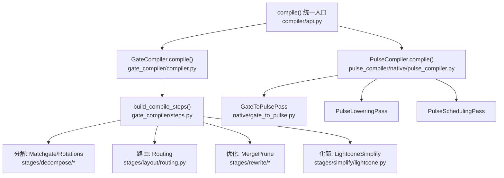
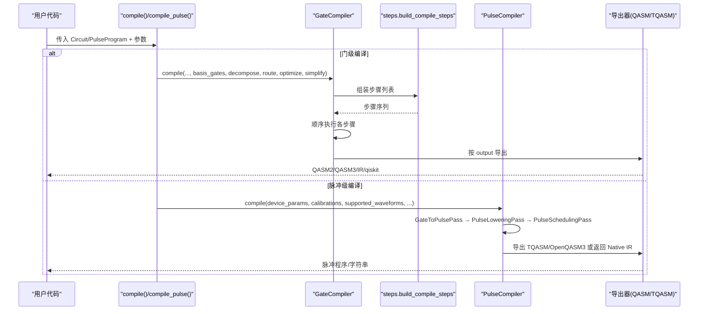
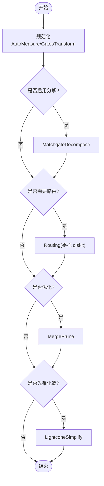
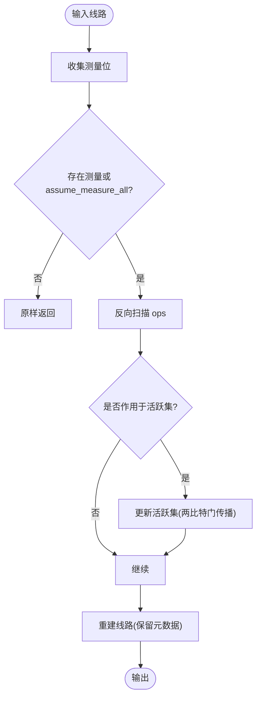
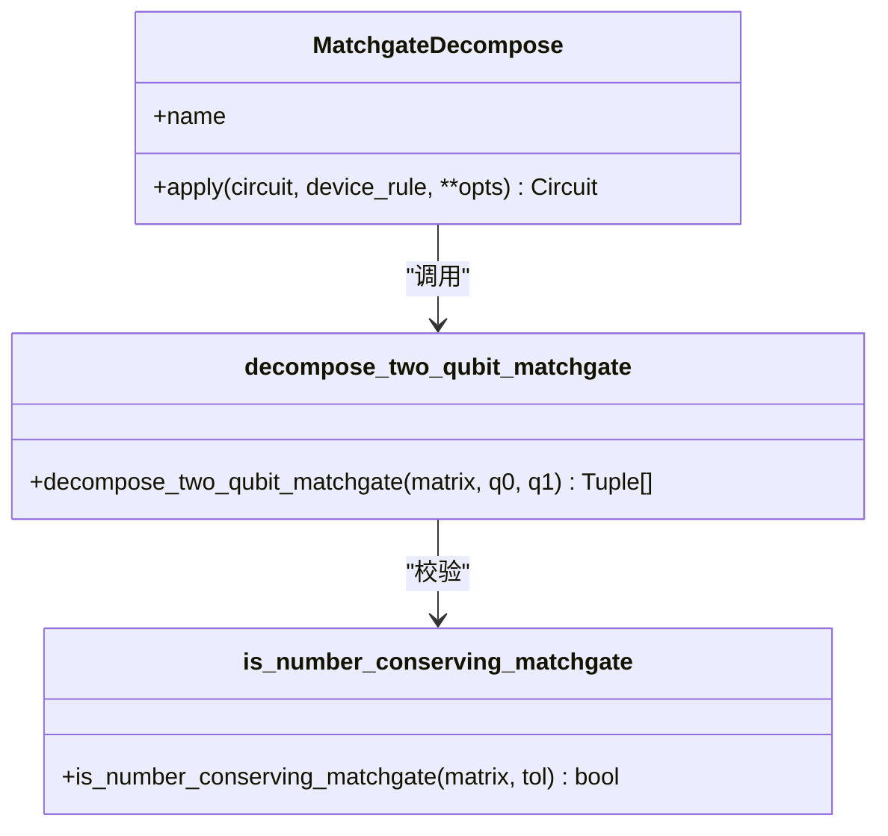
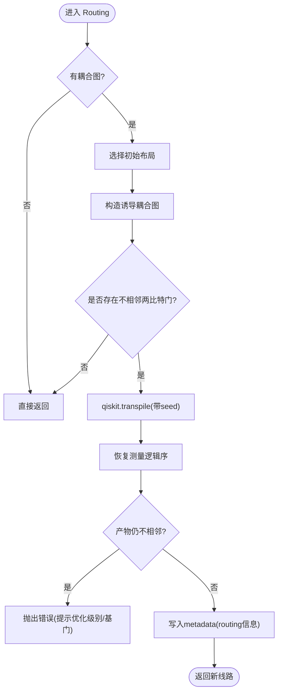
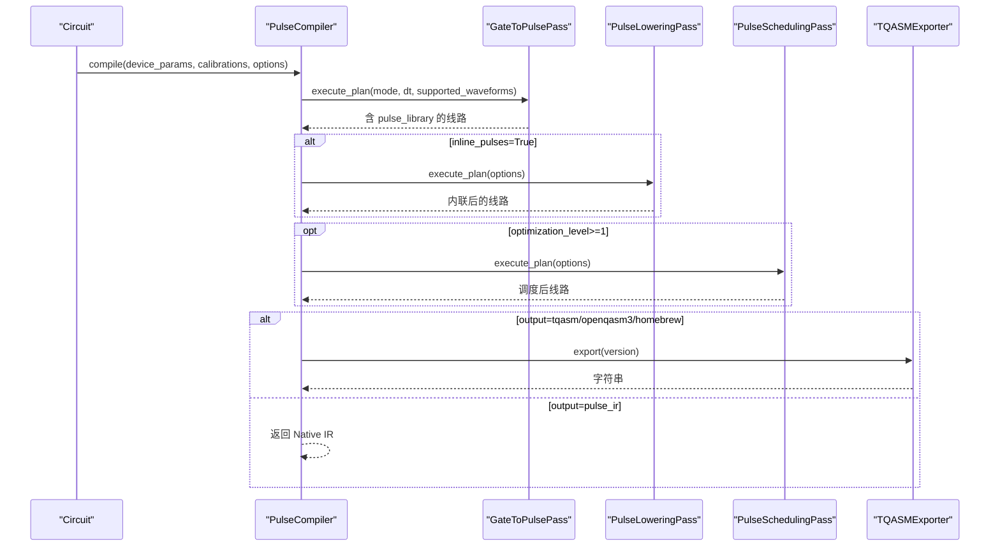
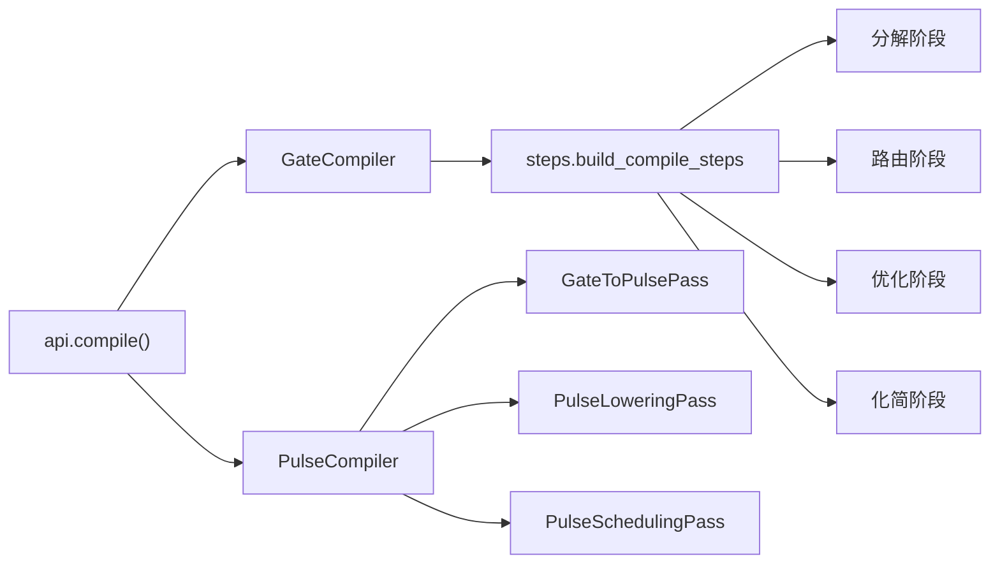

# 编译器架构

<cite>
**本文引用的文件**
- [src/tyxonq/compiler/api.py](file://src/tyxonq/compiler/api.py)
- [src/tyxonq/compiler/gate_compiler/compiler.py](file://src/tyxonq/compiler/gate_compiler/compiler.py)
- [src/tyxonq/compiler/gate_compiler/steps.py](file://src/tyxonq/compiler/gate_compiler/steps.py)
- [src/tyxonq/compiler/gate_compiler/stages/simplify/lightcone.py](file://src/tyxonq/compiler/gate_compiler/stages/simplify/lightcone.py)
- [src/tyxonq/compiler/gate_compiler/stages/decompose/matchgate.py](file://src/tyxonq/compiler/gate_compiler/stages/decompose/matchgate.py)
- [src/tyxonq/compiler/gate_compiler/stages/layout/routing.py](file://src/tyxonq/compiler/gate_compiler/stages/layout/routing.py)
- [src/tyxonq/compiler/pulse_compiler/native/pulse_compiler.py](file://src/tyxonq/compiler/pulse_compiler/native/pulse_compiler.py)
- [src/tyxonq/compiler/pulse_compiler/native/gate_to_pulse.py](file://src/tyxonq/compiler/pulse_compiler/native/gate_to_pulse.py)
- [examples/compiler_lightcone_optimization.py](file://examples/compiler_lightcone_optimization.py)
</cite>

## 目录
1. [简介](#简介)
2. [项目结构](#项目结构)
3. [核心组件](#核心组件)
4. [架构总览](#架构总览)
5. [详细组件分析](#详细组件分析)
6. [依赖关系分析](#依赖关系分析)
7. [性能考量](#性能考量)
8. [故障排查指南](#故障排查指南)
9. [结论](#结论)
10. [附录：配置与扩展](#附录：配置与扩展)

## 简介
本文件系统性阐述 TyxonQ 的双阶段编译器设计：门级编译器（Gate Compiler）与脉冲级编译器（Pulse Compiler）。前者负责将高级电路表示逐步转换为更接近目标平台或原生门的中间表示，并支持路由、化简等优化；后者进一步将门级电路分解为可执行的脉冲序列，完成波形生成、调度与序列化输出。文档覆盖编译流程、关键优化策略（光锥简化、路由优化、门分解）、可扩展性设计（如何添加新阶段与规则）、配置选项与自定义方法，并通过示例路径展示使用方式。

## 项目结构
TyxonQ 的编译器位于 src/tyxonq/compiler 下，分为两大子系统：
- 门级编译器：gate_compiler，包含统一入口 GateCompiler、步骤装配器 steps、以及若干编译阶段（分解、重写、布局/路由、化简），并提供导出器与互操作模块。
- 脉冲级编译器：pulse_compiler，包含主编译器 PulseCompiler 及若干 Pass（Gate→Pulse、Lowering、Scheduling），以及 TQASM/OpenQASM3 导出器。

图表来源
- [src/tyxonq/compiler/api.py:39-340](file://src/tyxonq/compiler/api.py#L39-L340)
- [src/tyxonq/compiler/gate_compiler/compiler.py:27-109](file://src/tyxonq/compiler/gate_compiler/compiler.py#L27-L109)
- [src/tyxonq/compiler/gate_compiler/steps.py:27-105](file://src/tyxonq/compiler/gate_compiler/steps.py#L27-L105)
- [src/tyxonq/compiler/pulse_compiler/native/pulse_compiler.py:81-197](file://src/tyxonq/compiler/pulse_compiler/native/pulse_compiler.py#L81-L197)

章节来源
- [src/tyxonq/compiler/api.py:39-340](file://src/tyxonq/compiler/api.py#L39-L340)
- [src/tyxonq/compiler/gate_compiler/compiler.py:27-109](file://src/tyxonq/compiler/gate_compiler/compiler.py#L27-L109)
- [src/tyxonq/compiler/gate_compiler/steps.py:27-105](file://src/tyxonq/compiler/gate_compiler/steps.py#L27-L105)
- [src/tyxonq/compiler/pulse_compiler/native/pulse_compiler.py:81-197](file://src/tyxonq/compiler/pulse_compiler/native/pulse_compiler.py#L81-L197)

## 核心组件
- 统一编译入口 compile()：根据 platform/output/basis_gates/decompose/route/optimize/simplify 等类型化参数，自动选择门级或脉冲级编译路径，并缓存编译产物。
- GateCompiler：设备无关的门级核心编译器，按类型化参数装配步骤列表并顺序执行，最终按 output 导出 IR/QASM2/QASM3/qiskit。
- PulseCompiler：脉冲级编译器，串联 Gate→Pulse、Lowering、Scheduling 三阶段，支持 inline_pulses、supported_waveforms、device_params 等配置。
- 编译步骤协议 CompileStep：每个阶段实现 apply(circuit, **opts)，便于组合与扩展。

章节来源
- [src/tyxonq/compiler/api.py:39-340](file://src/tyxonq/compiler/api.py#L39-L340)
- [src/tyxonq/compiler/gate_compiler/compiler.py:27-109](file://src/tyxonq/compiler/gate_compiler/compiler.py#L27-L109)
- [src/tyxonq/compiler/pulse_compiler/native/pulse_compiler.py:24-197](file://src/tyxonq/compiler/pulse_compiler/native/pulse_compiler.py#L24-L197)

## 架构总览
TyxonQ 采用“双阶段 + 多阶段流水线”的架构：
- 第一阶段：门级编译（Gate Compiler）
  - 规范化（AutoMeasure、GatesTransform）
  - 分解（Matchgate、Rotations）
  - 路由（Routing，可选，委托 qiskit.transpile）
  - 优化（MergePrune，可选）
  - 化简（LightconeSimplify，可选）
- 第二阶段：脉冲级编译（Pulse Compiler）
  - Gate→Pulse 分解（基于 defcal/默认物理模型）
  - Lowering（defcal 内联）
  - Scheduling（时序优化、资源分配）

图表来源
- [src/tyxonq/compiler/api.py:39-340](file://src/tyxonq/compiler/api.py#L39-L340)
- [src/tyxonq/compiler/gate_compiler/compiler.py:27-109](file://src/tyxonq/compiler/gate_compiler/compiler.py#L27-L109)
- [src/tyxonq/compiler/pulse_compiler/native/pulse_compiler.py:81-197](file://src/tyxonq/compiler/pulse_compiler/native/pulse_compiler.py#L81-L197)

## 详细组件分析

### 门级编译器：GateCompiler 与步骤装配
- GateCompiler.compile 接收类型化参数，归一化 basis_gates、optimization_level，构建步骤列表并执行，最后按 output 选择导出器。
- steps.build_compile_steps 固定顺序装配：AutoMeasure → GatesTransform → (可选) Matchgate/Rotations → (可选) Routing → (可选) MergePrune → (可选) LightconeSimplify。
- apply_steps 顺序执行每个 CompileStep.apply，保证无副作用地变换线路。

图表来源
- [src/tyxonq/compiler/gate_compiler/compiler.py:27-109](file://src/tyxonq/compiler/gate_compiler/compiler.py#L27-L109)
- [src/tyxonq/compiler/gate_compiler/steps.py:27-105](file://src/tyxonq/compiler/gate_compiler/steps.py#L27-L105)

章节来源
- [src/tyxonq/compiler/gate_compiler/compiler.py:27-109](file://src/tyxonq/compiler/gate_compiler/compiler.py#L27-L109)
- [src/tyxonq/compiler/gate_compiler/steps.py:27-105](file://src/tyxonq/compiler/gate_compiler/steps.py#L27-L105)

### 光锥简化：LightconeSimplify
- 从测量量子位出发反向切片，仅保留影响测量结果的操作，显著减少期望值计算开销。
- 支持 assume_measure_all 模式，用于全量测量场景下的等价裁剪。
- 通过 rebuild_circuit 保持 metadata/instructions/_unitary_cache 等上下文信息。

图表来源
- [src/tyxonq/compiler/gate_compiler/stages/simplify/lightcone.py:12-97](file://src/tyxonq/compiler/gate_compiler/stages/simplify/lightcone.py#L12-L97)

章节来源
- [src/tyxonq/compiler/gate_compiler/stages/simplify/lightcone.py:12-97](file://src/tyxonq/compiler/gate_compiler/stages/simplify/lightcone.py#L12-L97)
- [examples/compiler_lightcone_optimization.py:61-159](file://examples/compiler_lightcone_optimization.py#L61-L159)

### 门分解：MatchgateDecompose
- 针对数守恒 matchgate（fSim/two_mode_fock 家族）进行精确分解到 {rz, rx, h, cx}。
- 利用 ZXZ 欧拉角与 RXX/RYY 到 RZZ 的转换，得到最小门集实现。
- 对非 matchgate 的 2-qubit unitary 可选择严格模式报错或原样保留。

图表来源
- [src/tyxonq/compiler/gate_compiler/stages/decompose/matchgate.py:46-197](file://src/tyxonq/compiler/gate_compiler/stages/decompose/matchgate.py#L46-L197)

章节来源
- [src/tyxonq/compiler/gate_compiler/stages/decompose/matchgate.py:46-197](file://src/tyxonq/compiler/gate_compiler/stages/decompose/matchgate.py#L46-L197)

### 路由优化：Routing
- 仅在需要时路由：若无耦合图或已满足相邻性则跳过。
- 在“本地下标空间”路由：限制耦合图到所选物理比特并重编号，避免产物膨胀。
- 恢复测量逻辑序：以经典比特映射为准重排 measure_z，确保计数键一致。
- 保守门集合兜底：若自由路由失败，回退到安全基重试。
- 产物必须可复现：固定 seed_transpiler，保证确定性。

图表来源
- [src/tyxonq/compiler/gate_compiler/stages/layout/routing.py:289-539](file://src/tyxonq/compiler/gate_compiler/stages/layout/routing.py#L289-L539)

章节来源
- [src/tyxonq/compiler/gate_compiler/stages/layout/routing.py:289-539](file://src/tyxonq/compiler/gate_compiler/stages/layout/routing.py#L289-L539)

### 脉冲级编译器：PulseCompiler
- 三阶段流水线：GateToPulsePass → PulseLoweringPass → PulseSchedulingPass。
- 支持 inline_pulses（完全内联，适合云端/序列化）与 supported_waveforms（波形约束验证）。
- 输出格式：pulse_ir（Native IR）、tqasm/tqasm0.2（homebrew_s2）、openqasm3/qasm3。

图表来源
- [src/tyxonq/compiler/pulse_compiler/native/pulse_compiler.py:81-197](file://src/tyxonq/compiler/pulse_compiler/native/pulse_compiler.py#L81-L197)

章节来源
- [src/tyxonq/compiler/pulse_compiler/native/pulse_compiler.py:81-197](file://src/tyxonq/compiler/pulse_compiler/native/pulse_compiler.py#L81-L197)

### 门到脉冲分解：GateToPulsePass
- 优先级：用户 defcal → 元数据校准 → 默认物理分解。
- 单比特旋转：DRAG 脉冲；Z 旋转：虚拟 Z（帧更新，零时间）；Hadamard：RY+RX 序列。
- 两比特门：CX 通过交叉共振（CR）脉冲序列实现；CZ 通过 H·CX·H；iSWAP/SWAP 通过 CX 链。
- 将生成的波形存入 circuit.metadata["pulse_library"]，并以引用形式插入 ("pulse", qubit, key, params)。

章节来源
- [src/tyxonq/compiler/pulse_compiler/native/gate_to_pulse.py:38-800](file://src/tyxonq/compiler/pulse_compiler/native/gate_to_pulse.py#L38-L800)

## 依赖关系分析
- GateCompiler 依赖 steps 装配器与各 stage 实现；steps 按需延迟导入以避免不必要的依赖加载。
- Routing 依赖 qiskit.transpile 进行布局与 SWAP 插入，并通过 to_qiskit/from_qiskit 与 IR 互转。
- PulseCompiler 依赖 GateToPulsePass、PulseLoweringPass、PulseSchedulingPass 形成流水线。
- 统一入口 api.compile 根据 platform/output 智能分派到 GateCompiler 或 PulseCompiler，并处理 homebrew_s2 等特殊输出格式。

图表来源
- [src/tyxonq/compiler/api.py:39-340](file://src/tyxonq/compiler/api.py#L39-L340)
- [src/tyxonq/compiler/gate_compiler/steps.py:27-105](file://src/tyxonq/compiler/gate_compiler/steps.py#L27-L105)
- [src/tyxonq/compiler/pulse_compiler/native/pulse_compiler.py:81-197](file://src/tyxonq/compiler/pulse_compiler/native/pulse_compiler.py#L81-L197)

章节来源
- [src/tyxonq/compiler/api.py:39-340](file://src/tyxonq/compiler/api.py#L39-L340)
- [src/tyxonq/compiler/gate_compiler/steps.py:27-105](file://src/tyxonq/compiler/gate_compiler/steps.py#L27-L105)
- [src/tyxonq/compiler/pulse_compiler/native/pulse_compiler.py:81-197](file://src/tyxonq/compiler/pulse_compiler/native/pulse_compiler.py#L81-L197)

## 性能考量
- 光锥简化：在期望值计算中，仅保留影响测量位的算子，带来指数级加速潜力，尤其适用于部分测量场景。
- 路由优化：在本地下标空间路由，避免产物膨胀；保守门集合兜底提升鲁棒性；固定 seed 保证可复现。
- 门分解：matchgate 精确分解到 {rz, rx, h, cx}，减少高阶门带来的噪声与开销。
- 脉冲调度：inline_pulses 与 waveform 约束可减少传输与执行成本；虚拟 Z 零时间优化降低总时长。

[本节提供通用指导，不直接分析具体文件]

## 故障排查指南
- 路由失败：
  - 检查 coupling_map 与 initial_layout 是否合法且连通；必要时显式指定同一连通块内的物理比特。
  - 若自由路由失败，尝试提高 optimization_level 或指定保守 basis_gates。
  - 参考错误信息中的建议（如先启用分解再路由）。
- 分解失败：
  - 非 matchgate 的 2-qubit unitary 在严格模式下会报错；可关闭严格模式或改用其他分解策略。
- 脉冲编译问题：
  - 缺少 device_params 时会警告并填充默认测试参数；请提供真实设备参数以获得准确结果。
  - 若 output 为 tqasm/openqasm3，会自动设置 inline_pulses=True；如需 Python 对象灵活性，可关闭内联。
  - 使用 supported_waveforms 进行波形合法性校验，避免硬件不支持的波形。

章节来源
- [src/tyxonq/compiler/gate_compiler/stages/layout/routing.py:312-375](file://src/tyxonq/compiler/gate_compiler/stages/layout/routing.py#L312-L375)
- [src/tyxonq/compiler/gate_compiler/stages/decompose/matchgate.py:169-197](file://src/tyxonq/compiler/gate_compiler/stages/decompose/matchgate.py#L169-L197)
- [src/tyxonq/compiler/api.py:237-291](file://src/tyxonq/compiler/api.py#L237-L291)

## 结论
TyxonQ 的双阶段编译器以“门级 + 脉冲级”分层解耦，配合类型化参数驱动的模块化步骤装配，实现了高内聚、低耦合的可扩展架构。光锥简化、路由优化与精确门分解共同保障性能与正确性；脉冲级流水线则打通从抽象门到可执行波形的完整链路。通过统一的 compile/compile_pulse 入口与平台适配器机制，用户可灵活配置与扩展编译流程，适配不同硬件与云后端。

[本节总结性内容，不直接分析具体文件]

## 附录：配置与扩展

### 配置选项
- 门级编译（compile）：
  - platform：目标平台（tyxonq/pulse/lqcloud/guodun/qiskit 别名）
  - output：ir/qasm2/qasm3/qiskit/平台专属
  - basis_gates：目标原生门集合
  - decompose：bool | DecomposeSpec（控制 matchgate/rotations/two_qubit_unitary）
  - route：bool | RoutingSpec（控制路由算法、initial_layout、coupling_map、optimization_level、seed）
  - optimize：0-3（>=1 启用合并/剪枝）
  - simplify：是否启用光锥化简
  - device_rule：设备能力描述（num_qubits/coupling_map 等）
  - options：平台专属逃生舱（如 mode、dt、max_pulse_duration、inline_pulses、supported_waveforms）
- 脉冲级编译（compile_pulse）：
  - output：pulse_ir/tqasm/openqasm3
  - device_params：qubit_freq/anharmonicity/T1/T2/coupling_map
  - calibrations：自定义校准
  - options：mode/dt/max_pulse_duration/inline_pulses/supported_waveforms

章节来源
- [src/tyxonq/compiler/api.py:39-340](file://src/tyxonq/compiler/api.py#L39-L340)
- [src/tyxonq/compiler/api.py:343-463](file://src/tyxonq/compiler/api.py#L343-L463)
- [src/tyxonq/compiler/pulse_compiler/native/pulse_compiler.py:81-197](file://src/tyxonq/compiler/pulse_compiler/native/pulse_compiler.py#L81-L197)

### 扩展方法
- 新增门级编译阶段：
  - 实现 CompileStep 协议（定义 apply 方法），并在 steps.build_compile_steps 中按顺序追加。
  - 通过类型化参数（如 new_feature=True）控制是否启用该阶段。
- 新增脉冲级 Pass：
  - 在 PulseCompiler.__init__ 中注册新的 Pass，并在 compile 流水线中合适位置调用 execute_plan。
  - 通过 options 传递参数，保持与现有 Pass 一致的接口。
- 自定义波形与校准：
  - 使用 GateToPulsePass 的 defcal_library 或 circuit.metadata["pulse_calibrations"] 注入自定义校准。
  - 通过 supported_waveforms 限制允许的波形类型，确保硬件兼容性。

章节来源
- [src/tyxonq/compiler/gate_compiler/steps.py:27-105](file://src/tyxonq/compiler/gate_compiler/steps.py#L27-L105)
- [src/tyxonq/compiler/pulse_compiler/native/pulse_compiler.py:63-142](file://src/tyxonq/compiler/pulse_compiler/native/pulse_compiler.py#L63-L142)
- [src/tyxonq/compiler/pulse_compiler/native/gate_to_pulse.py:137-193](file://src/tyxonq/compiler/pulse_compiler/native/gate_to_pulse.py#L137-L193)

### 使用示例（路径）
- 光锥优化示例：[examples/compiler_lightcone_optimization.py:61-159](file://examples/compiler_lightcone_optimization.py#L61-L159)
- 门级编译入口与参数：[src/tyxonq/compiler/api.py:39-340](file://src/tyxonq/compiler/api.py#L39-L340)
- 脉冲级编译入口与参数：[src/tyxonq/compiler/api.py:343-463](file://src/tyxonq/compiler/api.py#L343-L463)