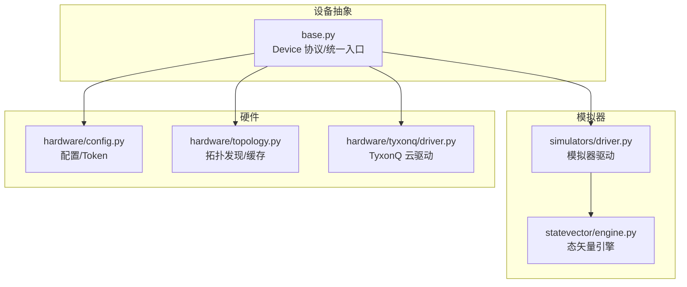
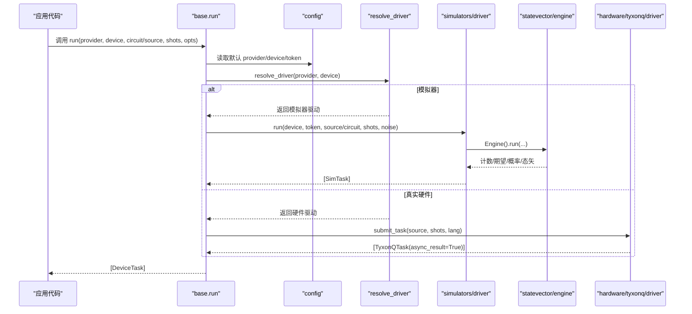
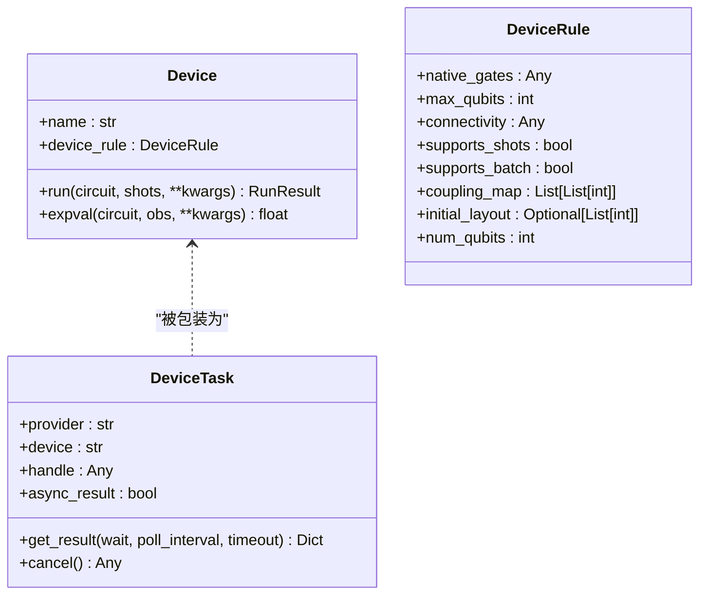
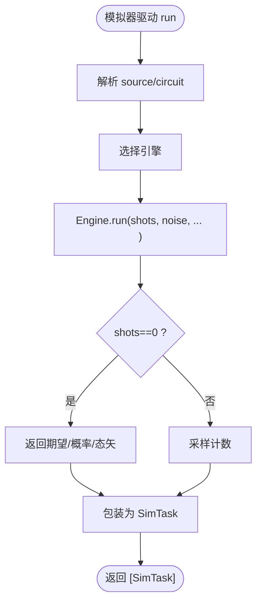
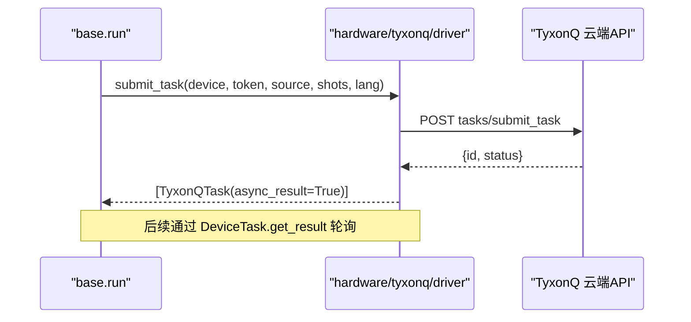
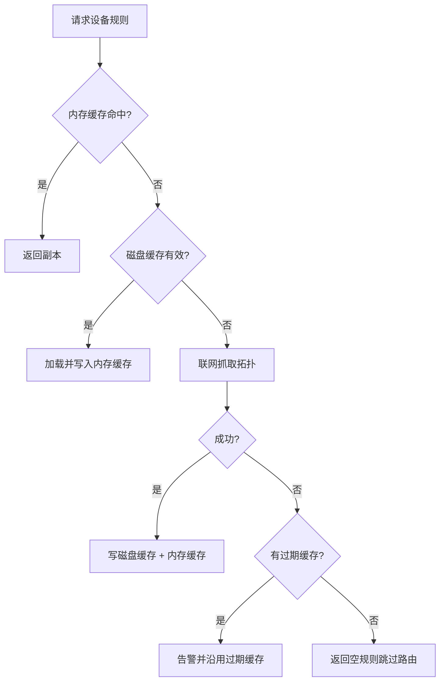
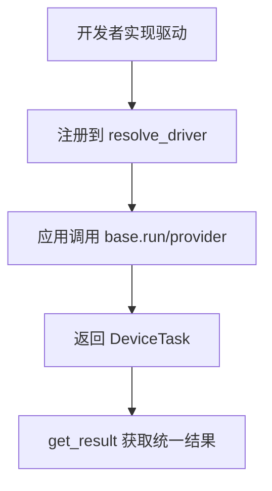
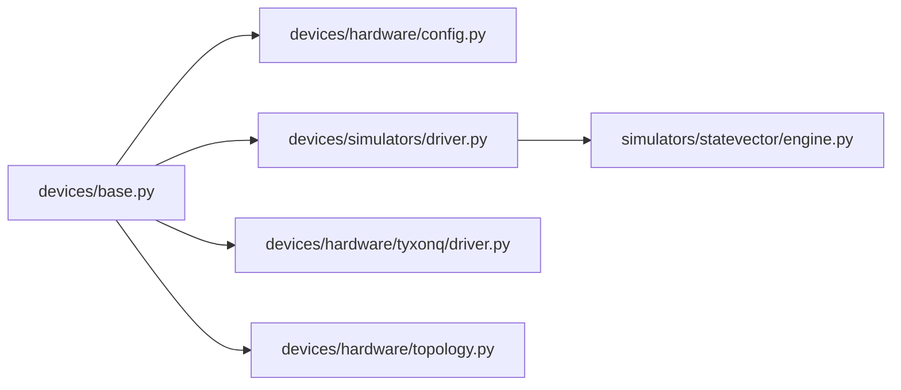

# 设备抽象层

<cite>
**本文引用的文件**
- [src/tyxonq/devices/base.py](file://src/tyxonq/devices/base.py)
- [src/tyxonq/devices/__init__.py](file://src/tyxonq/devices/__init__.py)
- [src/tyxonq/devices/simulators/driver.py](file://src/tyxonq/devices/simulators/driver.py)
- [src/tyxonq/devices/hardware/config.py](file://src/tyxonq/devices/hardware/config.py)
- [src/tyxonq/devices/hardware/topology.py](file://src/tyxonq/devices/hardware/topology.py)
- [src/tyxonq/devices/hardware/tyxonq/driver.py](file://src/tyxonq/devices/hardware/tyxonq/driver.py)
- [src/tyxonq/devices/simulators/statevector/engine.py](file://src/tyxonq/devices/simulators/statevector/engine.py)
- [src/tyxonq/plugins/registry.py](file://src/tyxonq/plugins/registry.py)
- [examples/cloud_api_devices.py](file://examples/cloud_api_devices.py)
</cite>

## 目录
1. [简介](#简介)
2. [项目结构](#项目结构)
3. [核心组件](#核心组件)
4. [架构总览](#架构总览)
5. [详细组件分析](#详细组件分析)
6. [依赖关系分析](#依赖关系分析)
7. [性能考量](#性能考量)
8. [故障排查指南](#故障排查指南)
9. [结论](#结论)
10. [附录](#附录)

## 简介
本文件系统性阐述 TyxonQ 的设备抽象层与统一设备接口设计理念，覆盖以下主题：
- Device 协议与统一任务封装（DeviceTask）
- 模拟器与真实硬件的统一访问方式
- 设备发现机制、配置管理与连接池（以拓扑缓存为中心）
- 设备选择策略、负载均衡与故障转移思路
- 自定义设备驱动开发指南（含模拟器与硬件集成）
- 设备的注册、配置与使用示例路径

TyxonQ 通过“驱动层 + 统一入口”的方式屏蔽不同后端差异，使上层电路执行、结果聚合与后处理无需关心具体 provider。

## 项目结构
设备子系统位于 src/tyxonq/devices 下，按“基类/协议 + 模拟器驱动 + 硬件驱动 + 配置/拓扑”组织：
- base.py：定义 Device 协议、DeviceRule、RunResult、统一运行入口 run/expval、任务包装 DeviceTask、设备发现 list_all_devices
- simulators/driver.py：模拟器驱动，负责选择引擎（statevector/density_matrix/matrix_product_state）、提交任务、统一输出
- hardware/config.py：默认 provider/device、token 管理、端点配置
- hardware/topology.py：跨 provider 的拓扑发现与 TTL 缓存（内存+磁盘），为编译器路由提供耦合图
- hardware/tyxonq/driver.py：TyxonQ 云平台驱动，提交任务、轮询状态、获取详情
- devices/simulators/statevector/engine.py：态矢量仿真引擎，支持噪声、脉冲、ZZ串扰、三能级等高级特性
- plugins/registry.py：插件式扩展点（当前占位，预留 get_device/get_compiler）

图表来源
- [src/tyxonq/devices/base.py:97-108](file://src/tyxonq/devices/base.py#L97-L108)
- [src/tyxonq/devices/simulators/driver.py:20-38](file://src/tyxonq/devices/simulators/driver.py#L20-L38)
- [src/tyxonq/devices/hardware/config.py:7-19](file://src/tyxonq/devices/hardware/config.py#L7-L19)
- [src/tyxonq/devices/hardware/topology.py:164-258](file://src/tyxonq/devices/hardware/topology.py#L164-L258)
- [src/tyxonq/devices/hardware/tyxonq/driver.py:80-141](file://src/tyxonq/devices/hardware/tyxonq/driver.py#L80-L141)

章节来源
- [src/tyxonq/devices/base.py:97-108](file://src/tyxonq/devices/base.py#L97-L108)
- [src/tyxonq/devices/simulators/driver.py:20-38](file://src/tyxonq/devices/simulators/driver.py#L20-L38)
- [src/tyxonq/devices/hardware/config.py:7-19](file://src/tyxonq/devices/hardware/config.py#L7-L19)
- [src/tyxonq/devices/hardware/topology.py:164-258](file://src/tyxonq/devices/hardware/topology.py#L164-L258)
- [src/tyxonq/devices/hardware/tyxonq/driver.py:80-141](file://src/tyxonq/devices/hardware/tyxonq/driver.py#L80-L141)

## 核心组件
- Device 协议：声明 name、device_rule、run、expval，作为所有设备实现的统一契约
- DeviceRule：描述设备能力（native_gates、max_qubits、connectivity、coupling_map、initial_layout、num_qubits）
- RunResult：结构化返回（samples、expectations、metadata）
- DeviceTask：统一任务句柄，封装 provider/device/handle/async_result，并提供 get_result/cancel
- 统一入口 run/expval：根据 provider/device 选择驱动，注入噪声参数，归一化 shots，统一返回任务列表
- 设备发现 list_all_devices：聚合模拟器与硬件可用设备列表
- 配置管理 config：默认 provider/device、token 存取、端点配置
- 拓扑发现 topology：跨 provider 的耦合图发现与 TTL 缓存（内存+磁盘），供编译器路由使用

章节来源
- [src/tyxonq/devices/base.py:12-57](file://src/tyxonq/devices/base.py#L12-L57)
- [src/tyxonq/devices/base.py:60-108](file://src/tyxonq/devices/base.py#L60-L108)
- [src/tyxonq/devices/base.py:294-470](file://src/tyxonq/devices/base.py#L294-L470)
- [src/tyxonq/devices/base.py:475-493](file://src/tyxonq/devices/base.py#L475-L493)
- [src/tyxonq/devices/hardware/config.py:7-75](file://src/tyxonq/devices/hardware/config.py#L7-L75)
- [src/tyxonq/devices/hardware/topology.py:164-258](file://src/tyxonq/devices/hardware/topology.py#L164-L258)

## 架构总览
TyxonQ 设备抽象层采用“统一入口 + 驱动分派 + 引擎实现”的分层设计：
- 统一入口（base.run/expval）负责解析 provider/device、token、shots、噪声注入，并调用对应驱动
- 驱动层（simulators/driver、hardware/*/driver）负责与具体后端交互（本地引擎或云端 API）
- 引擎层（如 statevector engine）实现量子计算内核（幺正演化、测量采样、期望值计算）
- 配置与拓扑模块提供认证、默认设置与设备拓扑缓存，支撑编译期路由与运行期调度

图表来源
- [src/tyxonq/devices/base.py:294-445](file://src/tyxonq/devices/base.py#L294-L445)
- [src/tyxonq/devices/simulators/driver.py:86-141](file://src/tyxonq/devices/simulators/driver.py#L86-L141)
- [src/tyxonq/devices/simulators/statevector/engine.py:46-451](file://src/tyxonq/devices/simulators/statevector/engine.py#L46-L451)
- [src/tyxonq/devices/hardware/tyxonq/driver.py:80-141](file://src/tyxonq/devices/hardware/tyxonq/driver.py#L80-L141)

## 详细组件分析

### Device 协议与统一任务封装
- Device 协议要求实现 run 与 expval，暴露 name 与 device_rule
- DeviceTask 将不同驱动的异步/同步任务统一为一致的 get_result/cancel 接口，并在内部进行结果格式归一化（result/result_meta/expectations/probabilities/metadata）
- base.run 对 shots 做规范化（真机不允许 0），对模拟器注入噪声参数，并对 batch 电路顺序保持提交与收集

图表来源
- [src/tyxonq/devices/base.py:12-57](file://src/tyxonq/devices/base.py#L12-L57)
- [src/tyxonq/devices/base.py:60-108](file://src/tyxonq/devices/base.py#L60-L108)

章节来源
- [src/tyxonq/devices/base.py:12-57](file://src/tyxonq/devices/base.py#L12-L57)
- [src/tyxonq/devices/base.py:60-108](file://src/tyxonq/devices/base.py#L60-L108)

### 模拟器驱动与引擎
- 模拟器驱动 driver 根据 device 字符串选择引擎（statevector/density_matrix/matrix_product_state）
- 统一输入：支持 QASM2/QASM3/TQASM 字符串自动转换为 IR；也接受 IR/Circuit 对象
- 统一输出：计数 result、期望 expectations、概率 probabilities、态矢 statevector、元数据 metadata
- 引擎 statevector 支持：
  - 幺正门统一分发（resolve_unitary）
  - 测量采样与期望值计算
  - 可选噪声（去极化、读出矩阵、Z衰减）
  - 脉冲操作（两能级/三能级模型）、ZZ串扰（local/global 两种模式）

图表来源
- [src/tyxonq/devices/simulators/driver.py:20-38](file://src/tyxonq/devices/simulators/driver.py#L20-L38)
- [src/tyxonq/devices/simulators/driver.py:86-141](file://src/tyxonq/devices/simulators/driver.py#L86-L141)
- [src/tyxonq/devices/simulators/statevector/engine.py:46-451](file://src/tyxonq/devices/simulators/statevector/engine.py#L46-L451)

章节来源
- [src/tyxonq/devices/simulators/driver.py:20-38](file://src/tyxonq/devices/simulators/driver.py#L20-L38)
- [src/tyxonq/devices/simulators/driver.py:86-141](file://src/tyxonq/devices/simulators/driver.py#L86-L141)
- [src/tyxonq/devices/simulators/statevector/engine.py:46-451](file://src/tyxonq/devices/simulators/statevector/engine.py#L46-L451)

### 真实硬件驱动（以 TyxonQ 云为例）
- 提交任务：submit_task 校验源格式（homebrew_s2/s3 需 QASM2），构造 payload，POST 到云端
- 任务查询：get_task_details 拉取任务详情，统一为 result/result_meta/uni_status/error
- 任务取消：remove_task 调用云端接口
- 设备列表：list_devices 从云端获取设备 id 并加上 provider 前缀

图表来源
- [src/tyxonq/devices/hardware/tyxonq/driver.py:80-141](file://src/tyxonq/devices/hardware/tyxonq/driver.py#L80-L141)
- [src/tyxonq/devices/hardware/tyxonq/driver.py:145-214](file://src/tyxonq/devices/hardware/tyxonq/driver.py#L145-L214)

章节来源
- [src/tyxonq/devices/hardware/tyxonq/driver.py:80-141](file://src/tyxonq/devices/hardware/tyxonq/driver.py#L80-L141)
- [src/tyxonq/devices/hardware/tyxonq/driver.py:145-214](file://src/tyxonq/devices/hardware/tyxonq/driver.py#L145-L214)

### 设备发现机制与配置管理
- 设备发现：list_all_devices 聚合模拟器设备与 provider 硬件设备列表
- 配置管理：config.set_token/get_token/set_default/get_default_provider/get_default_device，支持环境变量回退
- 拓扑发现：topology.get_device_rule 提供两级缓存（会话内内存 + 磁盘 TTL），失败时降级并告警，确保编译不中断

图表来源
- [src/tyxonq/devices/base.py:475-493](file://src/tyxonq/devices/base.py#L475-L493)
- [src/tyxonq/devices/hardware/config.py:24-75](file://src/tyxonq/devices/hardware/config.py#L24-L75)
- [src/tyxonq/devices/hardware/topology.py:180-258](file://src/tyxonq/devices/hardware/topology.py#L180-L258)

章节来源
- [src/tyxonq/devices/base.py:475-493](file://src/tyxonq/devices/base.py#L475-L493)
- [src/tyxonq/devices/hardware/config.py:24-75](file://src/tyxonq/devices/hardware/config.py#L24-L75)
- [src/tyxonq/devices/hardware/topology.py:180-258](file://src/tyxonq/devices/hardware/topology.py#L180-L258)

### 设备选择策略、负载均衡与故障转移
- 设备选择：base.resolve_driver 根据 provider 动态导入对应驱动；device_descriptor 支持多种命名约定（provider::device、简写映射）
- 负载均衡：当前未内置多设备轮询/权重分配；可通过上层策略在 provider 维度选择不同设备（例如 lqcloud::AGate-100 vs AGate-200）
- 故障转移：
  - 拓扑发现失败时降级为无拓扑（跳过路由），避免编译中断
  - 任务轮询超时发出 RuntimeWarning，允许上层重试或切换设备
  - 可结合外部编排器实现失败重试与设备切换

章节来源
- [src/tyxonq/devices/base.py:112-258](file://src/tyxonq/devices/base.py#L112-L258)
- [src/tyxonq/devices/hardware/topology.py:224-258](file://src/tyxonq/devices/hardware/topology.py#L224-L258)
- [src/tyxonq/devices/base.py:497-557](file://src/tyxonq/devices/base.py#L497-L557)

### 自定义设备驱动开发指南
- 目标：实现一个符合 Device 协议的驱动，或通过现有驱动接口接入新后端
- 步骤建议：
  1) 新增 provider 分支于 base.resolve_driver，返回你的驱动模块
  2) 在你的驱动中实现 list_devices、run/submit_task、get_task_details、remove_task（如需要）
  3) 若为模拟器，参考 simulators/driver 选择引擎并统一输出格式
  4) 若为硬件，参考 hardware/tyxonq/driver 实现任务提交与状态轮询
  5) 通过 config.set_token/get_token 管理认证
  6) 如需拓扑信息，实现 fetch_topology 并通过 topology.get_device_rule 暴露给编译器
- 插件系统：plugins.registry 提供 get_device/get_compiler 的动态加载占位，便于未来扩展

图表来源
- [src/tyxonq/devices/base.py:146-258](file://src/tyxonq/devices/base.py#L146-L258)
- [src/tyxonq/plugins/registry.py:36-62](file://src/tyxonq/plugins/registry.py#L36-L62)

章节来源
- [src/tyxonq/devices/base.py:146-258](file://src/tyxonq/devices/base.py#L146-L258)
- [src/tyxonq/plugins/registry.py:36-62](file://src/tyxonq/plugins/registry.py#L36-L62)

## 依赖关系分析
- base 依赖 config 获取默认 provider/device/token
- base 通过 resolve_driver 动态导入各 provider 驱动
- 模拟器驱动依赖各自引擎（statevector/density_matrix/mps）
- 硬件驱动依赖 requests 与 ENDPOINTS 配置
- 拓扑模块依赖各 provider 的具体实现（目前 lqcloud 已落地）

图表来源
- [src/tyxonq/devices/base.py:294-445](file://src/tyxonq/devices/base.py#L294-L445)
- [src/tyxonq/devices/simulators/driver.py:86-141](file://src/tyxonq/devices/simulators/driver.py#L86-L141)
- [src/tyxonq/devices/hardware/tyxonq/driver.py:80-141](file://src/tyxonq/devices/hardware/tyxonq/driver.py#L80-L141)
- [src/tyxonq/devices/hardware/topology.py:164-258](file://src/tyxonq/devices/hardware/topology.py#L164-L258)

章节来源
- [src/tyxonq/devices/base.py:294-445](file://src/tyxonq/devices/base.py#L294-L445)
- [src/tyxonq/devices/simulators/driver.py:86-141](file://src/tyxonq/devices/simulators/driver.py#L86-L141)
- [src/tyxonq/devices/hardware/tyxonq/driver.py:80-141](file://src/tyxonq/devices/hardware/tyxonq/driver.py#L80-L141)
- [src/tyxonq/devices/hardware/topology.py:164-258](file://src/tyxonq/devices/hardware/topology.py#L164-L258)

## 性能考量
- 模拟器：
  - 态矢量模拟复杂度 O(2^n)，适合中小规模；大系统考虑 MPS/密度矩阵
  - 噪声注入会引入额外计算（去极化、读出矩阵、Z衰减）
  - ZZ串扰全局模式代价高，仅适用于小规模高精度验证
- 真实硬件：
  - 任务提交与轮询存在网络延迟；合理设置 poll_interval 与 timeout
  - 批量提交可减少往返开销（驱动支持 list/tuple 的 source/shots）
- 拓扑缓存：
  - 内存+磁盘两级缓存减少重复网络请求；TTL 控制新鲜度

[本节为通用指导，不直接分析具体文件]

## 故障排查指南
- 任务等待超时：get_task_details 在 wait=True 且超时时发出 RuntimeWarning，提示可能为空/不完整结果，建议增大超时或重试
- 拓扑发现失败：返回空规则并告警，编译器跳过路由；检查网络、凭证或 provider 是否实现拓扑抓取
- 模拟器不支持 op：statevector engine 遇到未知 op 会抛出 ValueError，检查 gates 表或升级库版本
- 真机噪声参数：base.run 会在提交前丢弃模拟器专属噪声键，避免驱动报错

章节来源
- [src/tyxonq/devices/base.py:497-557](file://src/tyxonq/devices/base.py#L497-L557)
- [src/tyxonq/devices/hardware/topology.py:224-258](file://src/tyxonq/devices/hardware/topology.py#L224-L258)
- [src/tyxonq/devices/simulators/statevector/engine.py:335-342](file://src/tyxonq/devices/simulators/statevector/engine.py#L335-L342)

## 结论
TyxonQ 设备抽象层通过统一的 Device 协议、驱动分派与任务封装，实现了模拟器与真实硬件的一致访问体验。配置与拓扑模块提供了稳定的认证与设备能力发现机制。当前版本未内置多设备负载均衡，但为上层编排留出了扩展空间。开发者可基于现有驱动模式快速集成新的模拟器或硬件后端。

[本节为总结性内容，不直接分析具体文件]

## 附录

### 常用 API 与用法路径
- 统一运行：base.run（支持 circuit 或 source，batch 支持）
- 解析设备描述：device_descriptor（支持 provider::device、简写映射）
- 设备发现：list_all_devices（聚合模拟器与硬件）
- 配置管理：set_token/get_token/set_default/get_default_provider/get_default_device
- 拓扑规则：get_device_rule（带 TTL 缓存）
- 示例：examples/cloud_api_devices.py 展示如何列出云端设备

章节来源
- [src/tyxonq/devices/base.py:112-258](file://src/tyxonq/devices/base.py#L112-L258)
- [src/tyxonq/devices/base.py:294-470](file://src/tyxonq/devices/base.py#L294-L470)
- [src/tyxonq/devices/base.py:475-493](file://src/tyxonq/devices/base.py#L475-L493)
- [src/tyxonq/devices/hardware/config.py:24-75](file://src/tyxonq/devices/hardware/config.py#L24-L75)
- [src/tyxonq/devices/hardware/topology.py:180-258](file://src/tyxonq/devices/hardware/topology.py#L180-L258)
- [examples/cloud_api_devices.py:16-21](file://examples/cloud_api_devices.py#L16-L21)