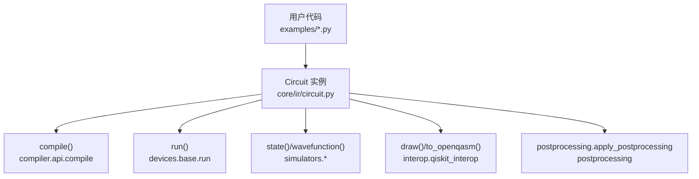
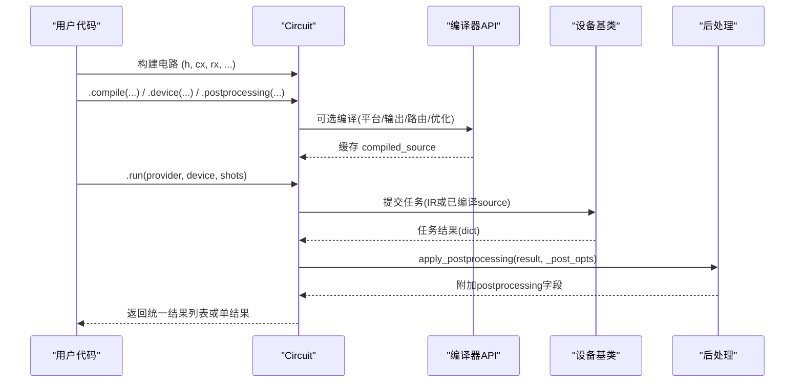
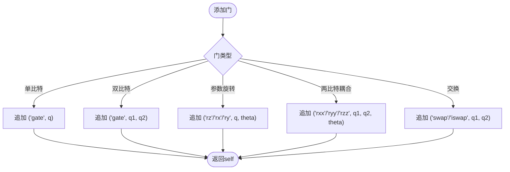
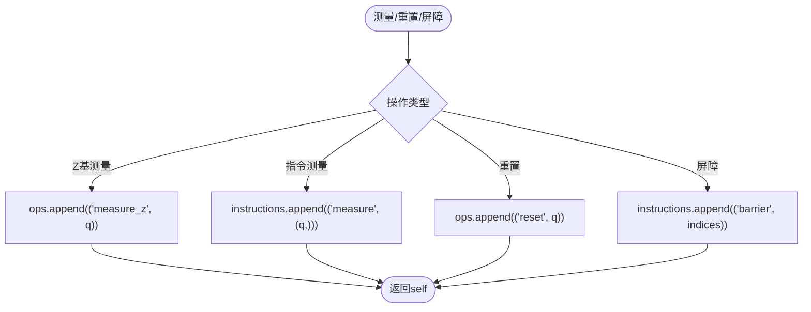
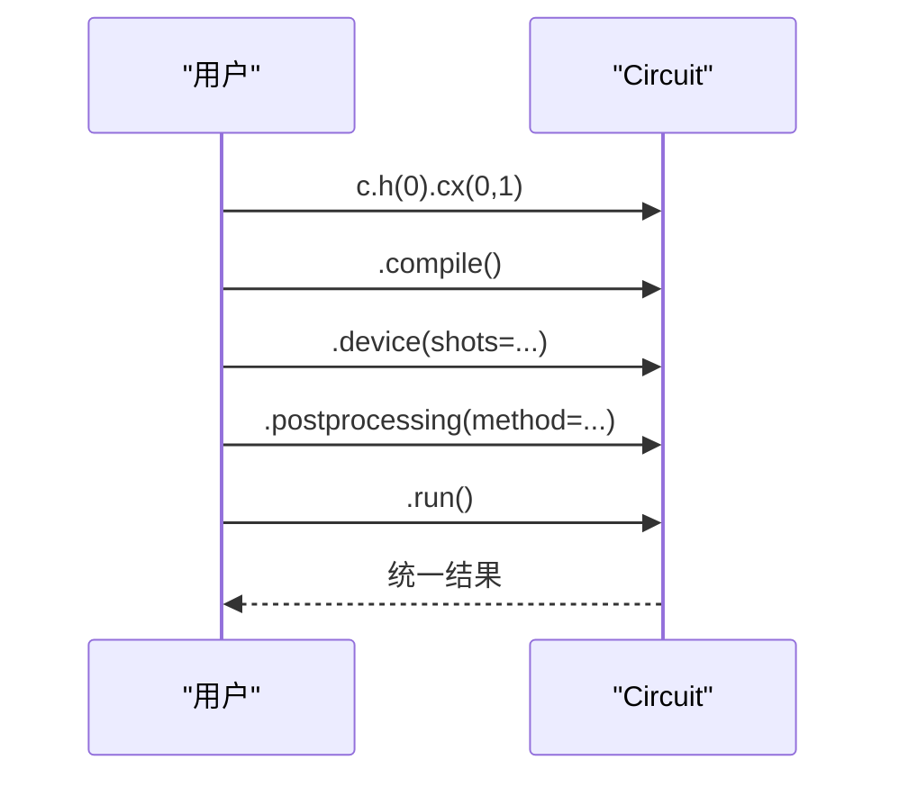
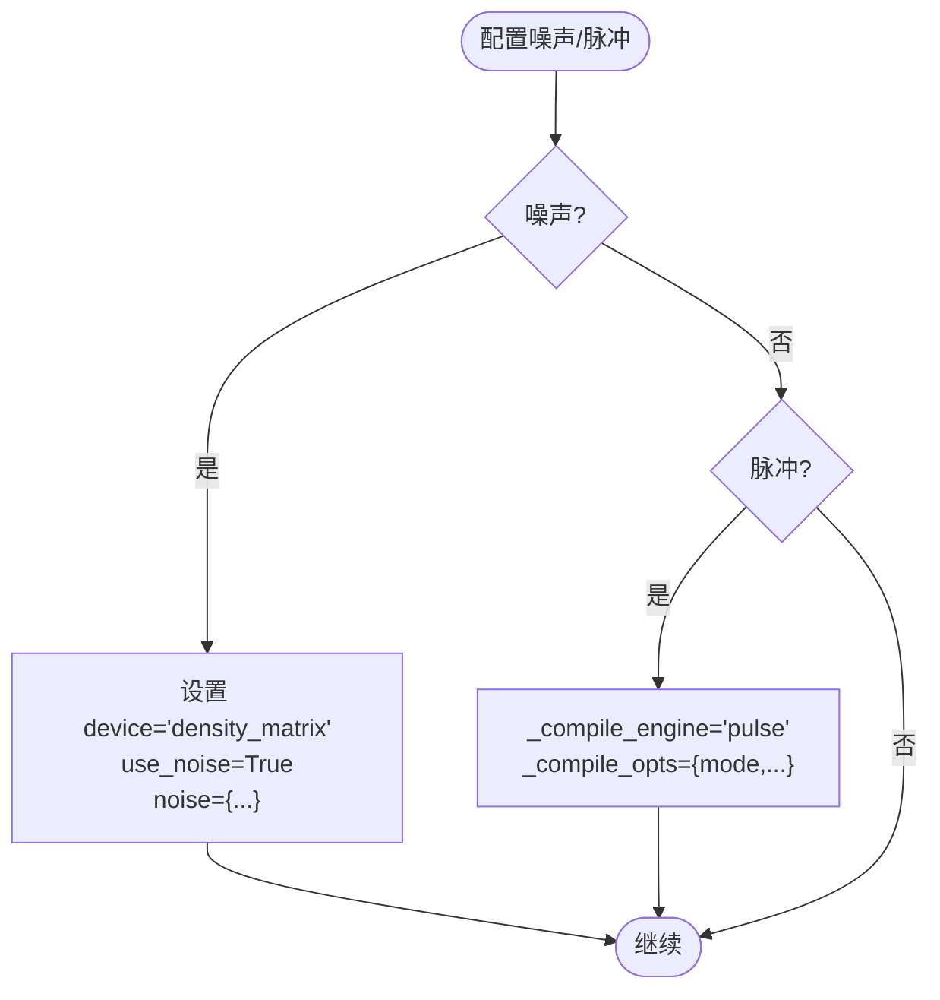
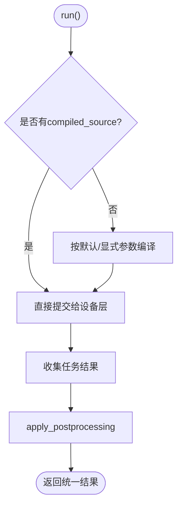
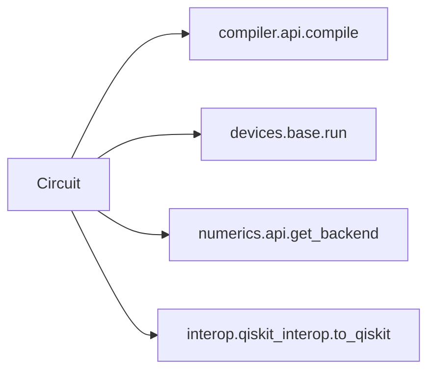

# 量子电路基础

<cite>
**本文引用的文件**
- [circuit.py](file://src/tyxonq/core/ir/circuit.py)
- [basic_chain_api.py](file://examples/basic_chain_api.py)
- [circuit_chain_demo.py](file://examples/circuit_chain_demo.py)
- [simple_qaoa.py](file://examples/simple_qaoa.py)
- [vqe_simple_hamiltonian.py](file://examples/vqe_simple_hamiltonian.py)
- [noisy_circuit_simple_api.py](file://examples/noisy_circuit_simple_api.py)
</cite>

## 目录
1. [简介](#简介)
2. [项目结构](#项目结构)
3. [核心组件](#核心组件)
4. [架构总览](#架构总览)
5. [详细组件分析](#详细组件分析)
6. [依赖关系分析](#依赖关系分析)
7. [性能考量](#性能考量)
8. [故障排查指南](#故障排查指南)
9. [结论](#结论)
10. [附录](#附录)

## 简介
本文件面向量子计算初学者与有经验的开发者，系统性讲解 TyxonQ 中 Circuit 类的核心概念与实现：从量子比特初始化、量子门操作、测量与重置等指令，到链式 API 的设计理念与调用模式；并覆盖电路元数据管理、指令序列、执行选项配置。通过从简单 Hadamard 门到复杂变分量子算法（如 QAOA、VQE）的示例路径，帮助读者快速上手并深入理解实现细节。

## 项目结构
TyxonQ 将量子电路的中间表示（IR）集中在 core/ir/circuit.py，提供统一的 Circuit 类；示例位于 examples/ 下，演示链式 API、噪声模型、QAOA、VQE 等典型用法。编译与设备执行通过 compiler.api 与 devices.base 进行解耦，Circuit 仅暴露简洁的 compile/run/state/draw 等接口。

图表来源
- [circuit.py:783-850](file://src/tyxonq/core/ir/circuit.py#L783-L850)
- [circuit.py:853-1042](file://src/tyxonq/core/ir/circuit.py#L853-L1042)
- [circuit.py:427-541](file://src/tyxonq/core/ir/circuit.py#L427-L541)
- [circuit.py:771-778](file://src/tyxonq/core/ir/circuit.py#L771-L778)

章节来源
- [circuit.py:48-183](file://src/tyxonq/core/ir/circuit.py#L48-L183)
- [basic_chain_api.py:22-41](file://examples/basic_chain_api.py#L22-L41)
- [circuit_chain_demo.py:46-68](file://examples/circuit_chain_demo.py#L46-L68)

## 核心组件
- Circuit 类：最小化的量子电路 IR，包含 num_qubits、ops（操作序列）、metadata（元数据）、instructions（指令序列），以及用于执行与后处理的默认选项。
- 链式配置阶段：device()、postprocessing()、use_pulse()、with_noise() 等返回 self，支持流畅构建。
- 执行入口：run() 负责选择 provider/device/shots，必要时先 compile()，再提交至设备层，最后应用 postprocessing。
- 状态与期望值：state()/wavefunction() 获取态矢量或密度矩阵；expectation()/expval() 计算 Pauli 算符期望。
- 可视化与序列化：draw()、to_openqasm()、to_json_obj()/from_json_obj()。

章节来源
- [circuit.py:48-183](file://src/tyxonq/core/ir/circuit.py#L48-L183)
- [circuit.py:190-298](file://src/tyxonq/core/ir/circuit.py#L190-L298)
- [circuit.py:427-541](file://src/tyxonq/core/ir/circuit.py#L427-L541)
- [circuit.py:771-850](file://src/tyxonq/core/ir/circuit.py#L771-L850)
- [circuit.py:853-1042](file://src/tyxonq/core/ir/circuit.py#L853-L1042)
- [circuit.py:1694-1955](file://src/tyxonq/core/ir/circuit.py#L1694-L1955)

## 架构总览
下图展示了从构建电路到执行与后处理的关键流程，体现链式 API 如何统一配置与执行。

图表来源
- [circuit.py:783-850](file://src/tyxonq/core/ir/circuit.py#L783-L850)
- [circuit.py:853-1042](file://src/tyxonq/core/ir/circuit.py#L853-L1042)

## 详细组件分析

### 量子比特初始化与基本门
- 初始化：Circuit(num_qubits) 创建 n 个量子比特的空电路。
- 常用门：h(), x(), y(), z(), s(), sdg(), t(), tdg(), rx(), ry(), rz(), cx(), cz(), cy(), rxx(), ryy(), rzz(), iswap(), swap() 等，均追加 ops 并返回 self，便于链式调用。
- 任意幺正：unitary(qubits, matrix) 支持 1/2 量子比特自定义幺正矩阵，内部校验维度并缓存矩阵。

图表来源
- [circuit.py:1102-1195](file://src/tyxonq/core/ir/circuit.py#L1102-L1195)
- [circuit.py:1500-1692](file://src/tyxonq/core/ir/circuit.py#L1500-L1692)
- [circuit.py:1197-1277](file://src/tyxonq/core/ir/circuit.py#L1197-L1277)

章节来源
- [circuit.py:1102-1195](file://src/tyxonq/core/ir/circuit.py#L1102-L1195)
- [circuit.py:1500-1692](file://src/tyxonq/core/ir/circuit.py#L1500-L1692)
- [circuit.py:1197-1277](file://src/tyxonq/core/ir/circuit.py#L1197-L1277)

### 测量、重置与屏障
- 测量：measure_z(q) 在 ops 中添加 Z 基测量；add_measure(*qubits) 记录指令序列 instructions。
- 重置：reset(q) 投影到 |0⟩（仿真用，硬件逻辑电路通常不支持）。
- 屏障：add_barrier(*qubits) 插入 barrier 指令，可用于调度/布局控制。
- 中途测量：mid_measurement(q, keep) 实现投影与后选择；measure_reference(q, with_prob) 仿真时即时采样并返回结果与概率。

图表来源
- [circuit.py:1082-1099](file://src/tyxonq/core/ir/circuit.py#L1082-L1099)
- [circuit.py:1351-1495](file://src/tyxonq/core/ir/circuit.py#L1351-L1495)

章节来源
- [circuit.py:1082-1099](file://src/tyxonq/core/ir/circuit.py#L1082-L1099)
- [circuit.py:1351-1495](file://src/tyxonq/core/ir/circuit.py#L1351-L1495)

### 链式 API 设计与调用模式
- 设计理念：所有配置方法返回 self，形成 fluent interface，减少样板代码，提升可读性。
- 典型调用：c.compile().device(...).postprocessing(...).run()；也可省略部分步骤，由全局默认自动补全。
- 全局默认：可通过 tq.device()/tq.compile() 设置全局默认，后续电路无需重复指定。

图表来源
- [basic_chain_api.py:22-41](file://examples/basic_chain_api.py#L22-L41)
- [circuit_chain_demo.py:46-68](file://examples/circuit_chain_demo.py#L46-L68)

章节来源
- [basic_chain_api.py:22-41](file://examples/basic_chain_api.py#L22-L41)
- [circuit_chain_demo.py:46-68](file://examples/circuit_chain_demo.py#L46-L68)

### 噪声建模与脉冲编程
- 简化噪声 API：with_noise("depolarizing"/"amplitude_damping"/"phase_damping"/"pauli", ...) 自动切换 density_matrix 模拟器并注入噪声参数。
- 脉冲编程：use_pulse(mode="hybrid"/"pulse_only"/"auto_lower", supported_waveforms, device_params, inline_pulses, output="pulse_ir"/"tqasm")；add_calibration(gate_name, qubits, pulse_waveform, params) 为特定门添加校准。

图表来源
- [circuit.py:241-298](file://src/tyxonq/core/ir/circuit.py#L241-L298)
- [circuit.py:300-425](file://src/tyxonq/core/ir/circuit.py#L300-L425)

章节来源
- [circuit.py:241-298](file://src/tyxonq/core/ir/circuit.py#L241-L298)
- [circuit.py:300-425](file://src/tyxonq/core/ir/circuit.py#L300-L425)
- [noisy_circuit_simple_api.py:15-62](file://examples/noisy_circuit_simple_api.py#L15-L62)

### 元数据管理与指令序列
- metadata：可存储任意键值对，例如描述、版本、校准信息等；with_metadata(**kwargs) 浅合并生成新实例。
- instructions：显式指令序列（如 measure/reset/barrier），用于布局/调度/可视化工具解析。
- 工具方法：extended()、compose()、remap_qubits()、positional_logical_mapping()、inverse() 等辅助构建与分析。

章节来源
- [circuit.py:184-188](file://src/tyxonq/core/ir/circuit.py#L184-L188)
- [circuit.py:666-730](file://src/tyxonq/core/ir/circuit.py#L666-L730)
- [circuit.py:757-767](file://src/tyxonq/core/ir/circuit.py#L757-L767)

### 执行选项与运行流程
- run(provider, device, shots, wait_async_result, **opts)：
  - 若已有 _compiled_source，直接提交；否则根据 _compile_engine/output/target/options 编译。
  - 针对特定 provider（如 lqcloud/guodun/qcos）走差异化编译与拓扑发现。
  - 统一收集任务结果，并应用 postprocessing。
- compile(platform, output, basis_gates, decompose, route, optimize, simplify, device_rule, target, options, compile_engine)：
  - 无参时为链式 no-op；否则转发到 compiler.api.compile，并缓存 compiled_source。

图表来源
- [circuit.py:853-1042](file://src/tyxonq/core/ir/circuit.py#L853-L1042)
- [circuit.py:783-850](file://src/tyxonq/core/ir/circuit.py#L783-L850)

章节来源
- [circuit.py:783-850](file://src/tyxonq/core/ir/circuit.py#L783-L850)
- [circuit.py:853-1042](file://src/tyxonq/core/ir/circuit.py#L853-L1042)

### 状态获取与期望值计算
- state(engine, backend, form)：
  - 根据 device 配置自动选择 statevector/mps/density_matrix 引擎；支持 numpy/pytorch 后端；form 控制返回格式。
- expectation()/expval(*pauli_ops)：
  - 根据设备配置选择相应引擎计算期望；支持多观测量的 Hamiltonian 矩阵方法以获得显著加速。

章节来源
- [circuit.py:427-541](file://src/tyxonq/core/ir/circuit.py#L427-L541)
- [circuit.py:1694-1955](file://src/tyxonq/core/ir/circuit.py#L1694-L1955)

### 从入门到进阶：示例路径
- 基础链式 API：参考 basic_chain_api.py 中的 demo_basic_chain/demo_global_defaults/demo_auto_completion。
- 全面演示：参考 circuit_chain_demo.py 中的各 demo（组合、重映射、JSON 序列化、QASM 编译等）。
- QAOA：参考 simple_qaoa.py 中的 build_qaoa_circuit 与 counts-based/autograd 两条路径。
- VQE：参考 vqe_simple_hamiltonian.py 中的 TFIM 哈密顿量构建、硬件高效 Ansatz、能量优化循环。
- 噪声：参考 noisy_circuit_simple_api.py 中的 with_noise 简化 API。

章节来源
- [basic_chain_api.py:22-124](file://examples/basic_chain_api.py#L22-L124)
- [circuit_chain_demo.py:27-276](file://examples/circuit_chain_demo.py#L27-L276)
- [simple_qaoa.py:48-83](file://examples/simple_qaoa.py#L48-L83)
- [vqe_simple_hamiltonian.py:55-152](file://examples/vqe_simple_hamiltonian.py#L55-L152)
- [noisy_circuit_simple_api.py:15-62](file://examples/noisy_circuit_simple_api.py#L15-L62)

## 依赖关系分析
- Circuit 与编译器：compile() 委托 compiler.api.compile，支持多种平台与输出格式。
- Circuit 与设备：run() 通过 devices.base.run 提交任务，支持 simulator、lqcloud、guodun、qcos 等 provider。
- Circuit 与数值后端：state()/expectation() 使用 numerics.api.get_backend 获取当前后端（numpy/pytorch/CuPyNumeric）。
- Circuit 与可视化：draw() 通过 interop.qiskit_interop.to_qiskit 转换并调用 QuantumCircuit.draw。

图表来源
- [circuit.py:783-850](file://src/tyxonq/core/ir/circuit.py#L783-L850)
- [circuit.py:853-1042](file://src/tyxonq/core/ir/circuit.py#L853-L1042)
- [circuit.py:427-541](file://src/tyxonq/core/ir/circuit.py#L427-L541)
- [circuit.py:1971-1989](file://src/tyxonq/core/ir/circuit.py#L1971-L1989)

章节来源
- [circuit.py:783-850](file://src/tyxonq/core/ir/circuit.py#L783-L850)
- [circuit.py:853-1042](file://src/tyxonq/core/ir/circuit.py#L853-L1042)
- [circuit.py:427-541](file://src/tyxonq/core/ir/circuit.py#L427-L541)
- [circuit.py:1971-1989](file://src/tyxonq/core/ir/circuit.py#L1971-L1989)

## 性能考量
- 多观测值期望：避免多次调用 expectation()，优先使用 Hamiltonian 矩阵一次性计算，可获得 10–15 倍加速。
- 模拟器选择：大系统使用 MPS（matrix_product_state）降低内存占用；含噪声场景使用 density_matrix。
- 编译缓存：相同请求的 compile() 会复用 cached compiled_source，避免重复编译。
- 估计复杂度：count_flop() 提供粗略 FLOP 估算，便于评估 statevector 模拟成本。

章节来源
- [circuit.py:1694-1755](file://src/tyxonq/core/ir/circuit.py#L1694-L1755)
- [circuit.py:623-644](file://src/tyxonq/core/ir/circuit.py#L623-L644)
- [circuit.py:817-850](file://src/tyxonq/core/ir/circuit.py#L817-L850)

## 故障排查指南
- 量子位索引越界：构造或添加门时检查 qubit 索引是否在 [0, num_qubits)。
- 无效 op/instruction：确保 ops 元素为 (name, args...) 且 name 为字符串；instructions 为 (name, (indices,))。
- 未知 engine：state() 的 engine 参数需为 statevector/mps/density_matrix。
- Provider 拓扑失败：lqcloud 拓扑发现失败会回退直译并提交，不影响整体流程。
- reset 警告：reset 为仿真操作，硬件逻辑电路通常不支持。

章节来源
- [circuit.py:155-183](file://src/tyxonq/core/ir/circuit.py#L155-L183)
- [circuit.py:427-541](file://src/tyxonq/core/ir/circuit.py#L427-L541)
- [circuit.py:892-917](file://src/tyxonq/core/ir/circuit.py#L892-L917)
- [circuit.py:1488-1495](file://src/tyxonq/core/ir/circuit.py#L1488-L1495)

## 结论
Circuit 类以最小 IR 为核心，结合链式 API 与模块化编译/执行/后处理，提供了从入门到高级应用的完整工作流。通过清晰的元数据与指令管理、灵活的噪声与脉冲支持、以及高效的期望值计算，既能满足教学与快速原型，也能支撑大规模算法与硬件部署。建议初学者从基础链式 API 入手，逐步过渡到 QAOA/VQE 等复杂电路，并结合性能优化建议提升效率。

## 附录
- 快速上手路径：
  - 基础：basic_chain_api.py
  - 全面：circuit_chain_demo.py
  - 算法：simple_qaoa.py、vqe_simple_hamiltonian.py
  - 噪声：noisy_circuit_simple_api.py
- 关键方法速查：
  - 构建：h/x/y/z/rx/ry/rz/cx/cz/iswap/swap/unitary/kraus
  - 测量：measure_z/add_measure/mid_measurement/reset/add_barrier
  - 配置：device/postprocessing/use_pulse/with_noise
  - 执行：compile/run/submit_task/get_result/cancel
  - 分析：state/wavefunction/expectation/expval/gate_count/gate_summary/count_flop
  - 可视化/序列化：draw/to_openqasm/to_json_obj/from_json_obj