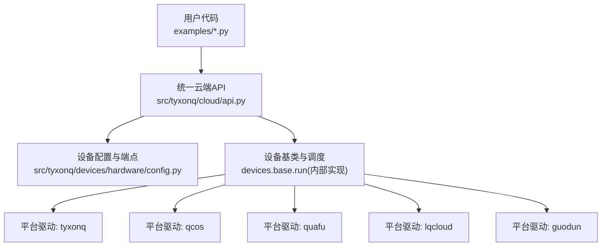
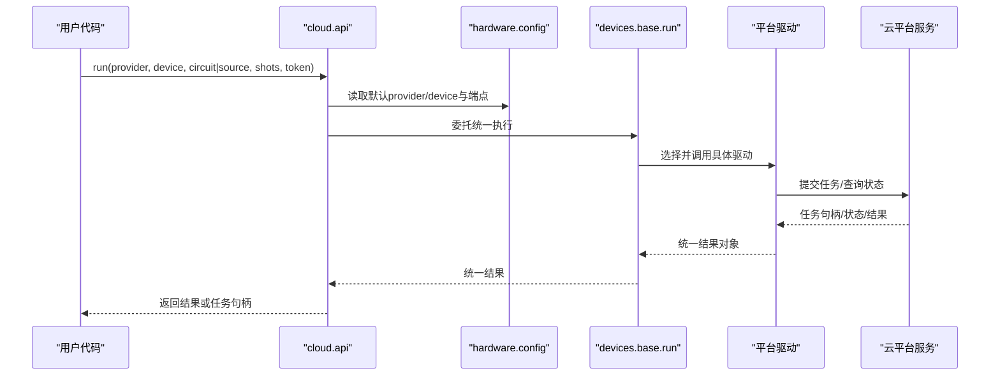
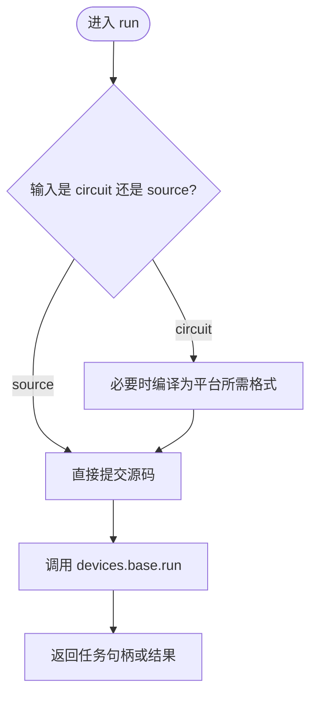
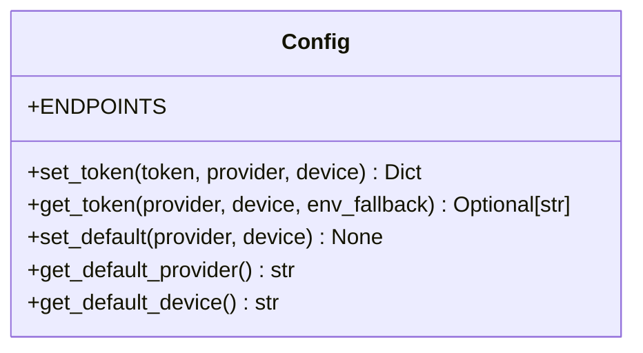
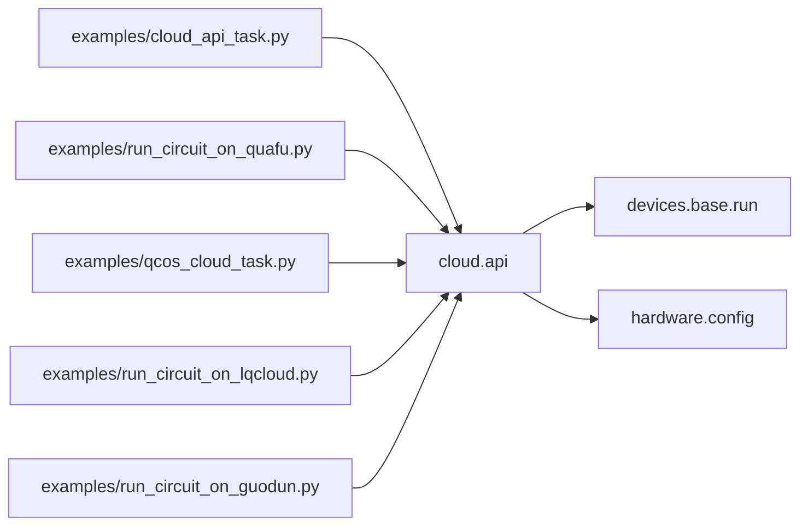

# 云平台示例

<cite>
**本文引用的文件**
- [README.md](file://README.md)
- [cloud/api.py](file://src/tyxonq/cloud/api.py)
- [devices/hardware/config.py](file://src/tyxonq/devices/hardware/config.py)
- [examples/cloud_api_devices.py](file://examples/cloud_api_devices.py)
- [examples/cloud_api_task.py](file://examples/cloud_api_task.py)
- [examples/run_circuit_on_quafu.py](file://examples/run_circuit_on_quafu.py)
- [examples/run_circuit_on_lqcloud.py](file://examples/run_circuit_on_lqcloud.py)
- [examples/qcos_cloud_task.py](file://examples/qcos_cloud_task.py)
- [examples/run_circuit_on_guodun.py](file://examples/run_circuit_on_guodun.py)
- [docs/source/cloud_services/getting_started.rst](file://docs/source/cloud_services/getting_started.rst)
- [docs/quafu_provider.md](file://docs/quafu_provider.md)
- [docs/qcos_provider.md](file://docs/qcos_provider.md)
- [docs/guodun_provider.md](file://docs/guodun_provider.md)
</cite>

## 目录
1. [简介](#简介)
2. [项目结构](#项目结构)
3. [核心组件](#核心组件)
4. [架构总览](#架构总览)
5. [详细组件分析](#详细组件分析)
6. [依赖关系分析](#依赖关系分析)
7. [性能与生产实践](#性能与生产实践)
8. [故障排查指南](#故障排查指南)
9. [结论](#结论)
10. [附录：各平台特性与限制速查](#附录：各平台特性与限制速查)

## 简介
本文件面向需要在 TyxonQ 中连接并使用多家量子云平台的开发者，提供从设备查询、任务提交到结果获取的完整工作流说明。覆盖 TyxonQ 云、中国移动 QCOS（WuYue）、Quafu、LQCloud、国盾（Guodun）等主流平台，并给出认证配置、任务管理、批量处理、错误处理与重试、性能监控等生产环境最佳实践。文档以代码级来源为依据，确保可追溯与可复现。

## 项目结构
TyxonQ 将“统一云端入口”与“各平台驱动”解耦：
- 统一入口位于 cloud API 层，负责令牌、默认设备、设备列表、任务提交与结果获取的统一封装。
- 硬件配置与端点信息集中在 devices/hardware/config.py。
- 各平台示例脚本展示了不同 provider 的典型用法与注意事项。
- 文档侧提供各 provider 的接入指引与差异说明。

图表来源
- [cloud/api.py:42-73](file://src/tyxonq/cloud/api.py#L42-L73)
- [cloud/api.py:75-131](file://src/tyxonq/cloud/api.py#L75-L131)
- [devices/hardware/config.py:11-19](file://src/tyxonq/devices/hardware/config.py#L11-L19)

章节来源
- [README.md:147-155](file://README.md#L147-L155)
- [cloud/api.py:1-160](file://src/tyxonq/cloud/api.py#L1-L160)
- [devices/hardware/config.py:1-78](file://src/tyxonq/devices/hardware/config.py#L1-L78)

## 核心组件
- 统一云端 API
  - set_token/set_default：设置认证令牌与默认 provider/device。
  - list_devices：列出可用设备（按 provider 过滤）。
  - submit_task/run：提交单条或批量任务；支持 circuit 或 source（如 QASM/TQASM）。
  - get_task_details/result/cancel：查询任务详情、结果与取消任务。
- 设备配置
  - ENDPOINTS：定义各 provider 的基础 URL 与版本。
  - 令牌解析优先级：内存中的 provider/device 键 > 环境变量回退。
- 示例脚本
  - 展示如何列出设备、提交任务、轮询结果、以及不同 provider 的特殊要求（如 Quafu 需要显式编译为 QASM2）。

章节来源
- [cloud/api.py:22-73](file://src/tyxonq/cloud/api.py#L22-L73)
- [cloud/api.py:75-131](file://src/tyxonq/cloud/api.py#L75-L131)
- [devices/hardware/config.py:24-50](file://src/tyxonq/devices/hardware/config.py#L24-L50)
- [examples/cloud_api_devices.py:16-21](file://examples/cloud_api_devices.py#L16-L21)
- [examples/cloud_api_task.py:30-59](file://examples/cloud_api_task.py#L30-L59)

## 架构总览
TyxonQ 通过统一的 chain API 与 cloud API 屏蔽底层差异，将电路或源码提交至目标 provider 的驱动执行，返回统一格式的结果。

图表来源
- [cloud/api.py:75-131](file://src/tyxonq/cloud/api.py#L75-L131)
- [devices/hardware/config.py:11-19](file://src/tyxonq/devices/hardware/config.py#L11-L19)

## 详细组件分析

### 统一云端 API（cloud.api）
- 功能要点
  - 令牌与默认值：set_token/set_default 维护内存中的 provider/device 映射。
  - 设备列表：list_devices 基于 base 能力枚举可用设备。
  - 任务提交：submit_task/run 直接委托 devices.base.run，保持行为一致。
  - 任务管理：get_task_details/result/cancel 分别委托 base 与 core 模块。
- 关键路径
  - run() 是主入口，接受 circuit 或 source，支持批量与异步等待。
  - get_task_details 支持 wait/poll_interval/timeout 参数用于轮询。

图表来源
- [cloud/api.py:75-131](file://src/tyxonq/cloud/api.py#L75-L131)
- [cloud/api.py:42-73](file://src/tyxonq/cloud/api.py#L42-L73)

章节来源
- [cloud/api.py:1-160](file://src/tyxonq/cloud/api.py#L1-L160)

### 设备配置与端点（devices/hardware/config）
- 端点配置
  - tyxonq：基础 URL 与 API 版本可从环境变量覆盖。
  - qcos：基础 URL 指向移动云 ecloud。
- 令牌管理
  - set_token 同时保存 device-scoped 与 provider-scoped 键，便于灵活查找。
  - get_token 优先内存键，其次环境变量回退。

图表来源
- [devices/hardware/config.py:11-19](file://src/tyxonq/devices/hardware/config.py#L11-L19)
- [devices/hardware/config.py:24-50](file://src/tyxonq/devices/hardware/config.py#L24-L50)
- [devices/hardware/config.py:53-65](file://src/tyxonq/devices/hardware/config.py#L53-L65)

章节来源
- [devices/hardware/config.py:1-78](file://src/tyxonq/devices/hardware/config.py#L1-L78)

### 平台示例与差异

#### TyxonQ 云
- 典型流程
  - 设置令牌与默认设备后，使用 Chain API 或 cloud API 提交任务。
  - 支持 gate-level 与 pulse-level（TQASM），可通过优化标志控制映射与分解。
- 参考示例
  - 设备列表与任务提交：[examples/cloud_api_devices.py:16-21](file://examples/cloud_api_devices.py#L16-L21)、[examples/cloud_api_task.py:30-59](file://examples/cloud_api_task.py#L30-L59)。
  - 快速开始与最佳实践：[docs/source/cloud_services/getting_started.rst:102-199](file://docs/source/cloud_services/getting_started.rst#L102-L199)。

章节来源
- [examples/cloud_api_devices.py:16-21](file://examples/cloud_api_devices.py#L16-L21)
- [examples/cloud_api_task.py:30-59](file://examples/cloud_api_task.py#L30-L59)
- [docs/source/cloud_services/getting_started.rst:102-199](file://docs/source/cloud_services/getting_started.rst#L102-L199)

#### 中国移动 QCOS（WuYue）
- 认证方式
  - access_key / secret_key 通过环境变量或 run() 参数传入。
  - 旧版 sdk_code 不再支持。
- 运行选项
  - timeout/wait_async_result/auto_retry/task_name/calculate_type 等。
  - calculate_type 对模拟器必填（单点/分布式）。
- 参考示例
  - 提交 Bell 态到 FullAmpSim：[examples/qcos_cloud_task.py:28-57](file://examples/qcos_cloud_task.py#L28-L57)。
  - Provider 文档：[docs/qcos_provider.md:32-116](file://docs/qcos_provider.md#L32-L116)。

章节来源
- [examples/qcos_cloud_task.py:28-57](file://examples/qcos_cloud_task.py#L28-L57)
- [docs/qcos_provider.md:32-116](file://docs/qcos_provider.md#L32-L116)

#### Quafu（BAQIS）
- 认证方式
  - 支持显式 token、内存 provider-scoped token、TYXONQ_QUAFU_TOKEN、上游 QPU_API_TOKEN。
- 特殊要求
  - 必须显式编译为 QASM2（compile_engine="qiskit", output="qasm2"）。
  - shots 需为 1024 的倍数（服务器可能四舍五入或拒绝）。
  - 支持 server-side 重编译（compiler 可选）。
- 参考示例
  - 在线设备列表与提交：[examples/run_circuit_on_quafu.py:22-51](file://examples/run_circuit_on_quafu.py#L22-L51)。
  - Provider 文档：[docs/quafu_provider.md:1-113](file://docs/quafu_provider.md#L1-L113)。

章节来源
- [examples/run_circuit_on_quafu.py:22-51](file://examples/run_circuit_on_quafu.py#L22-L51)
- [docs/quafu_provider.md:1-113](file://docs/quafu_provider.md#L1-L113)

#### LQCloud
- 认证方式
  - 通过 TYXONQ_LQCLOUD_API_KEY 或 LQCLOUD_API_KEY 环境变量设置。
- 运行选项
  - physical_qubits 指定逻辑比特到物理比特的映射。
  - 支持离线模式先检查转换后的指令统计。
- 参考示例
  - 构建线路、离线检查、在线提交与结果打印：[examples/run_circuit_on_lqcloud.py:18-113](file://examples/run_circuit_on_lqcloud.py#L18-L113)。

章节来源
- [examples/run_circuit_on_lqcloud.py:18-113](file://examples/run_circuit_on_lqcloud.py#L18-L113)

#### 国盾（Guodun）
- 认证方式
  - 通过 TYXONQ_GUODUN_TOKEN 或 tq.set_token(provider="guodun")。
- 运行特点
  - 编译器输出 QCIS（门级与脉冲级），需显式测量。
  - 提交前会校验禁用比特/耦合器与 CZ 边。
- 参考示例
  - 本地生成 QCIS 与在线提交（仅打印 query ID）：[examples/run_circuit_on_guodun.py:70-120](file://examples/run_circuit_on_guodun.py#L70-L120)。
  - Provider 文档：[docs/guodun_provider.md:1-169](file://docs/guodun_provider.md#L1-L169)。

章节来源
- [examples/run_circuit_on_guodun.py:70-120](file://examples/run_circuit_on_guodun.py#L70-L120)
- [docs/guodun_provider.md:1-169](file://docs/guodun_provider.md#L1-L169)

## 依赖关系分析
- 统一入口 cloud.api 依赖 devices.base 进行实际执行，config 提供端点与默认值。
- 各平台示例脚本通过 tq.api 或 Circuit.run 调用统一接口，再交由对应 provider 驱动执行。
- 文档侧对各 provider 的差异进行了补充说明（如 Quafu 的 QASM2 要求、QCOS 的 calculate_type 等）。

图表来源
- [cloud/api.py:75-131](file://src/tyxonq/cloud/api.py#L75-L131)
- [examples/cloud_api_task.py:30-59](file://examples/cloud_api_task.py#L30-L59)
- [examples/run_circuit_on_quafu.py:22-51](file://examples/run_circuit_on_quafu.py#L22-L51)
- [examples/qcos_cloud_task.py:28-57](file://examples/qcos_cloud_task.py#L28-L57)
- [examples/run_circuit_on_lqcloud.py:52-113](file://examples/run_circuit_on_lqcloud.py#L52-L113)
- [examples/run_circuit_on_guodun.py:70-120](file://examples/run_circuit_on_guodun.py#L70-L120)

章节来源
- [cloud/api.py:1-160](file://src/tyxonq/cloud/api.py#L1-L160)
- [examples/cloud_api_task.py:1-65](file://examples/cloud_api_task.py#L1-L65)
- [examples/run_circuit_on_quafu.py:1-56](file://examples/run_circuit_on_quafu.py#L1-L56)
- [examples/qcos_cloud_task.py:1-62](file://examples/qcos_cloud_task.py#L1-L62)
- [examples/run_circuit_on_lqcloud.py:1-114](file://examples/run_circuit_on_lqcloud.py#L1-L114)
- [examples/run_circuit_on_guodun.py:1-125](file://examples/run_circuit_on_guodun.py#L1-L125)

## 性能与生产实践
- 批处理与并发
  - 使用 run()/submit_task 支持批量提交；结合异步等待（wait_async_result=True）提升吞吐。
- 超时与重试
  - QCOS 支持 auto_retry；其他 provider 建议在上层实现指数退避重试。
- 资源与配额
  - Quafu 有每日提交上限；注意合理拆分任务与错峰提交。
- 观测与监控
  - 使用 get_task_details 轮询 uni_status 与 result_meta，记录耗时与失败原因。
- 优化开关
  - TyxonQ 云支持 o=1/2/4/7 等优化标志（映射、分解、初始布局）。

章节来源
- [docs/source/cloud_services/getting_started.rst:456-499](file://docs/source/cloud_services/getting_started.rst#L456-L499)
- [docs/qcos_provider.md:104-136](file://docs/qcos_provider.md#L104-L136)
- [docs/quafu_provider.md:99-104](file://docs/quafu_provider.md#L99-L104)

## 故障排查指南
- 认证失败
  - 确认令牌格式与 provider 正确；TyxonQ 云建议使用 username;priority 格式。
- 设备不可用
  - 使用 list_devices 检查权限与在线状态；按需申请访问。
- 任务超时
  - 调整 timeout；复杂电路适当增加超时或减少深度。
- 编译错误
  - Quafu 需显式编译为 QASM2；检查 gates 是否在芯片原生集合内。
- 结果异常
  - 核对 total shots 是否等于提交 shots；检查 uni_status 与 error 字段。

章节来源
- [docs/source/cloud_services/getting_started.rst:501-556](file://docs/source/cloud_services/getting_started.rst#L501-L556)
- [docs/quafu_provider.md:48-88](file://docs/quafu_provider.md#L48-L88)
- [docs/qcos_provider.md:138-167](file://docs/qcos_provider.md#L138-L167)

## 结论
TyxonQ 通过统一云端 API 与多 provider 驱动，实现了跨平台的量子任务提交与管理。借助示例脚本与文档，用户可以快速完成认证配置、设备查询、任务提交与结果处理。在生产环境中，应重视批处理、超时重试、配额管理与结果监控，以获得稳定高效的云端量子计算体验。

## 附录：各平台特性与限制速查
- TyxonQ 云
  - 支持 gate-level 与 pulse-level；提供优化标志；适合快速上手与实验验证。
- QCOS（WuYue）
  - 支持真实硬件与全幅仿真；calculate_type 对模拟器必填；支持自动重试。
- Quafu
  - 必须显式编译为 QASM2；shots 需为 1024 倍数；有每日提交配额限制。
- LQCloud
  - 支持逻辑到物理比特映射；可离线检查转换结果；适合在提交前做预检。
- 国盾（Guodun）
  - 输出 QCIS；需显式测量；提交前会校验禁用比特/耦合器与 CZ 边。

章节来源
- [docs/source/cloud_services/getting_started.rst:102-199](file://docs/source/cloud_services/getting_started.rst#L102-L199)
- [docs/qcos_provider.md:32-116](file://docs/qcos_provider.md#L32-L116)
- [docs/quafu_provider.md:48-113](file://docs/quafu_provider.md#L48-L113)
- [examples/run_circuit_on_lqcloud.py:18-113](file://examples/run_circuit_on_lqcloud.py#L18-L113)
- [docs/guodun_provider.md:30-97](file://docs/guodun_provider.md#L30-L97)