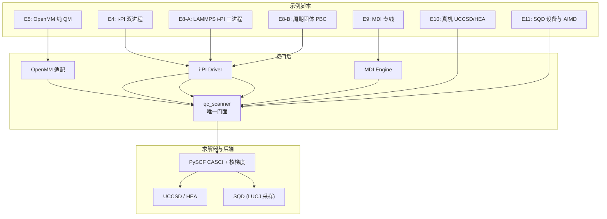
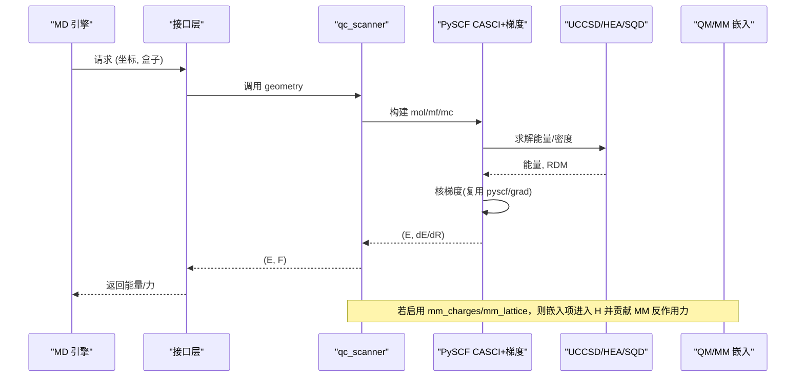
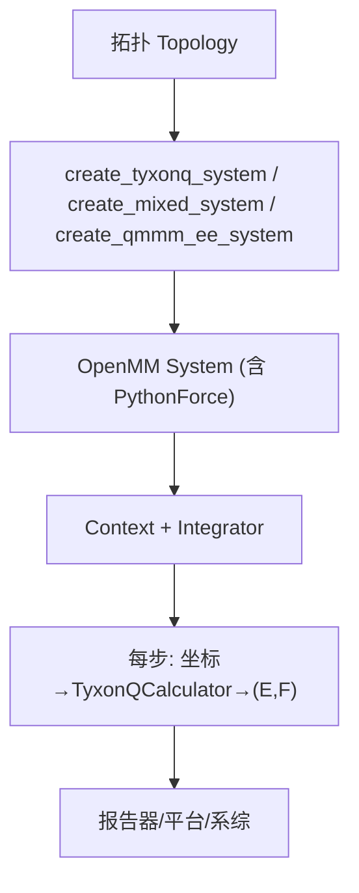
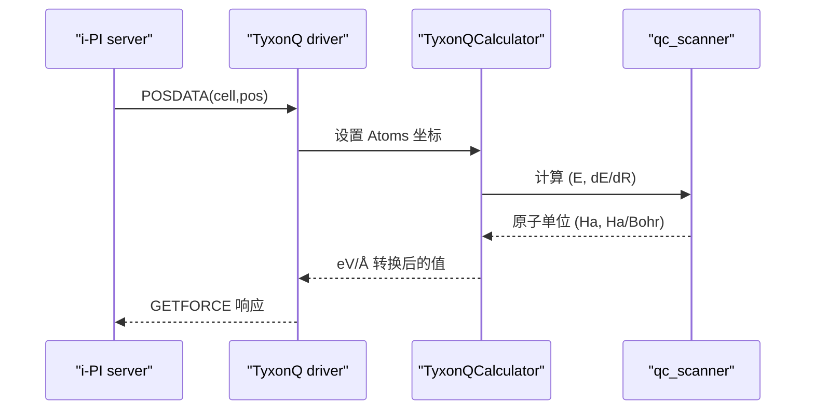
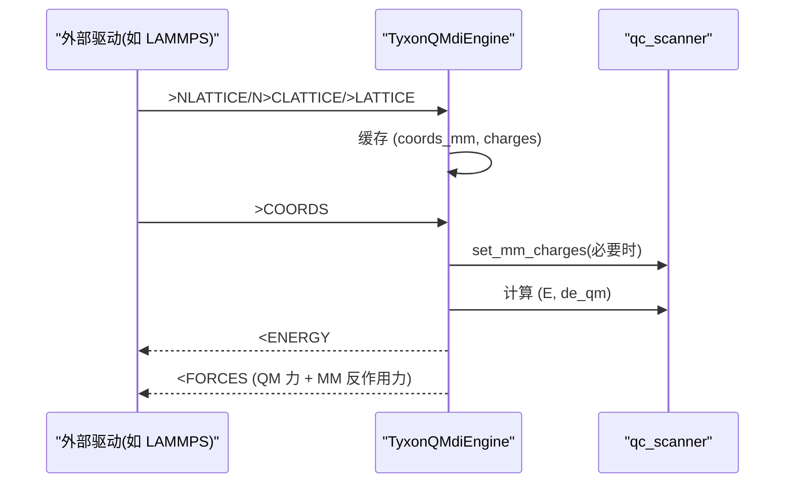
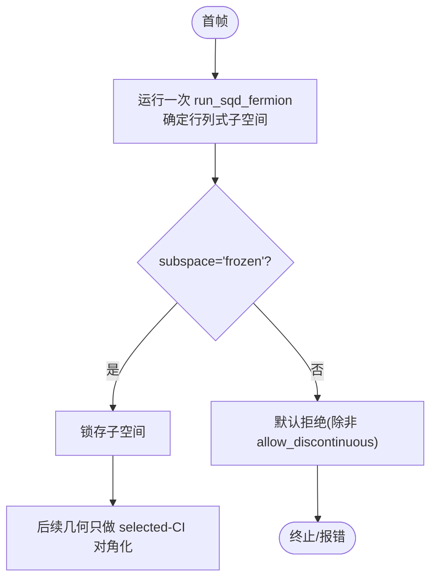
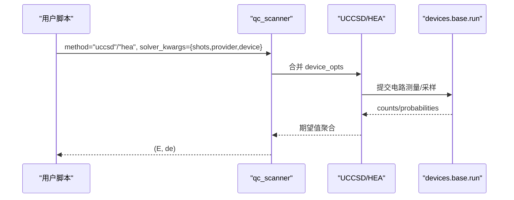
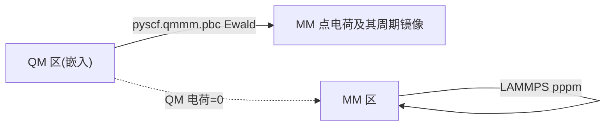
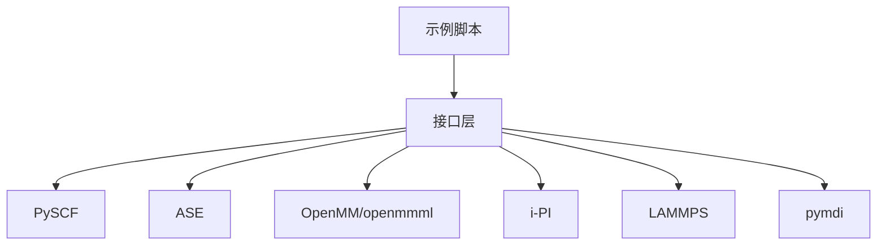

# 分子动力学示例

<cite>
**本文引用的文件**
- [md_openmm_pure_qm.py](file://examples/qmmm/md_openmm_pure_qm.py)
- [md_qmmm_device_hardware.py](file://examples/qmmm/md_qmmm_device_hardware.py)
- [md_qmmm_sqd_device.py](file://examples/qmmm/md_qmmm_sqd_device.py)
- [md_mdi_qmmm_embedded.py](file://examples/qmmm/md_mdi_qmmm_embedded.py)
- [md_ipi_driver_server.py](file://examples/qmmm/md_ipi_driver_server.py)
- [openmm_potential.py](file://src/tyxonq/applications/chem/interfaces/openmm_potential.py)
- [ipi_driver.py](file://src/tyxonq/applications/chem/interfaces/ipi_driver.py)
- [scanner.py](file://src/tyxonq/applications/chem/interfaces/scanner.py)
- [mdi_engine.py](file://src/tyxonq/applications/chem/interfaces/mdi_engine.py)
- [input.xml](file://examples/qmmm/md_lammps_qmmm_embedded/in/input.xml)
- [README.md](file://examples/qmmm/md_lammps_qmmm_pbc/README.md)
- [MD_INTEGRATION_PLAN.md](file://MD_INTEGRATION_PLAN.md)
- [MD_INTEGRATION_RESEARCH.md](file://MD_INTEGRATION_RESEARCH.md)
</cite>

## 目录
1. [简介](#简介)
2. [项目结构](#项目结构)
3. [核心组件](#核心组件)
4. [架构总览](#架构总览)
5. [详细组件分析](#详细组件分析)
6. [依赖关系分析](#依赖关系分析)
7. [性能考量](#性能考量)
8. [故障排查指南](#故障排查指南)
9. [结论](#结论)
10. [附录](#附录)

## 简介
本文件面向“TyxonQ 分子动力学示例”的专业文档，聚焦量子力学/分子力学（QM/MM）集成与分子动力学模拟。内容涵盖：
- MD 引擎集成：OpenMM、i-PI、LAMMPS、PySCF 原生 AIMD
- OpenMM 接口：纯 QM System、机械嵌入、静电嵌入（簇体系）
- SQD 求解器：采样冻结子空间驱动势能面、AIMD、静电嵌入与设备采样档
- IP 驱动器：i-PI 的 TyxonQDriver 适配
- MDI 引擎：静电嵌入专线（两进程 TCP）
- 周期性边界条件处理：pyscf.qmmm.pbc Ewald 嵌入 + LAMMPS pppm 分工
- 力场计算方法：UCCSD、HEA、SQD 在 PySCF CASCI 梯度栈上的统一接入
- 完整 MD 工作流：初始结构准备 → 势能面计算 → 轨迹分析与性质提取
- 将量子精度引入大规模 MD 的策略与真实硬件执行要点

## 项目结构
仓库围绕“单一门面 qc_scanner”构建，向上对接 ASE/OpenMM/i-PI/LAMMPS/MDI 等生态，向下复用 PySCF 核梯度与 QM/MM 能力。示例脚本覆盖从纯 QM 到 QM/MM、从经典到路径积分、从数值到真机的全链路。

图示来源
- [scanner.py:1-424](file://src/tyxonq/applications/chem/interfaces/scanner.py#L1-L424)
- [openmm_potential.py:1-257](file://src/tyxonq/applications/chem/interfaces/openmm_potential.py#L1-L257)
- [ipi_driver.py:1-142](file://src/tyxonq/applications/chem/interfaces/ipi_driver.py#L1-L142)
- [mdi_engine.py:1-231](file://src/tyxonq/applications/chem/interfaces/mdi_engine.py#L1-L231)

章节来源
- [MD_INTEGRATION_PLAN.md:25-63](file://MD_INTEGRATION_PLAN.md#L25-L63)
- [MD_INTEGRATION_RESEARCH.md:153-207](file://MD_INTEGRATION_RESEARCH.md#L153-L207)

## 核心组件
- qc_scanner：唯一对外入口，产出 PySCF 兼容的能量/梯度扫描器；支持方法 sqd/uccsd/rouccsd/hea；提供 mm_charges/mm_lattice/rcut_* 等 QM/MM 参数；提供 as_pyscf_scanner 供 PySCF MD 使用。
- OpenMM 适配：create_tyxonq_system（纯 QM）、create_mixed_system（机械嵌入）、create_qmmm_ee_system（簇静电嵌入）。
- i-PI Driver：TyxonQDriver 继承 ASEDriver，把 TyxonQCalculator 暴露为 i-PI forcefield。
- MDI Engine：TyxonQMdiEngine 实现 MDI 命令表，支持 >NLATTICE/>CLATTICE/>LATTICE 推送 MM 点电荷，返回全原子力（QM 梯度 ⊕ MM 反作用力）。
- 算法族：UCCSD/HEA（VQE 族）与 SQD（采样冻结子空间），均通过 fcisolver 鸭子类型接入 CASCI 梯度。

章节来源
- [scanner.py:56-91](file://src/tyxonq/applications/chem/interfaces/scanner.py#L56-L91)
- [scanner.py:93-188](file://src/tyxonq/applications/chem/interfaces/scanner.py#L93-L188)
- [openmm_potential.py:73-99](file://src/tyxonq/applications/chem/interfaces/openmm_potential.py#L73-L99)
- [openmm_potential.py:101-143](file://src/tyxonq/applications/chem/interfaces/openmm_potential.py#L101-L143)
- [openmm_potential.py:145-239](file://src/tyxonq/applications/chem/interfaces/openmm_potential.py#L145-L239)
- [ipi_driver.py:90-142](file://src/tyxonq/applications/chem/interfaces/ipi_driver.py#L90-L142)
- [mdi_engine.py:52-126](file://src/tyxonq/applications/chem/interfaces/mdi_engine.py#L52-L126)

## 架构总览
TyxonQ 以 qc_scanner 为中心，将不同 MD 引擎（OpenMM、i-PI、PySCF、LAMMPS、MDI）统一到同一能量/梯度契约。QM/MM 静电嵌入通过 pyscf.qmmm（分子）或 pyscf.qmmm.pbc（周期）注入哈密顿量，并返回 MM 反作用力用于双向耦合。

图示来源
- [scanner.py:192-267](file://src/tyxonq/applications/chem/interfaces/scanner.py#L192-L267)
- [scanner.py:280-320](file://src/tyxonq/applications/chem/interfaces/scanner.py#L280-L320)
- [scanner.py:331-411](file://src/tyxonq/applications/chem/interfaces/scanner.py#L331-L411)

## 详细组件分析

### OpenMM 直连与 QM/MM 嵌入
- 纯 QM：create_tyxonq_system 基于 openmmml.MLPotential('ase') 将 TyxonQCalculator 挂入 OpenMM System，每步回调取 (E, F)。
- 机械嵌入：create_mixed_system 删除 QM 内部键合项，QM–MM 相互作用走经典力场。
- 静电嵌入（簇）：create_qmmm_ee_system 将 MM 点电荷注入 QM 哈密顿量，防双计数（QM 电荷置零、QM 内部非键项清零），PythonForce 回调返回全原子力 = QM 梯度 ⊕ MM 反作用力。

图示来源
- [openmm_potential.py:73-99](file://src/tyxonq/applications/chem/interfaces/openmm_potential.py#L73-L99)
- [openmm_potential.py:101-143](file://src/tyxonq/applications/chem/interfaces/openmm_potential.py#L101-L143)
- [openmm_potential.py:145-239](file://src/tyxonq/applications/chem/interfaces/openmm_potential.py#L145-L239)
- [md_openmm_pure_qm.py:67-135](file://examples/qmmm/md_openmm_pure_qm.py#L67-L135)

章节来源
- [md_openmm_pure_qm.py:1-159](file://examples/qmmm/md_openmm_pure_qm.py#L1-L159)
- [openmm_potential.py:1-257](file://src/tyxonq/applications/chem/interfaces/openmm_potential.py#L1-L257)

### i-PI 驱动与多进程 MD
- TyxonQDriver 继承 ASEDriver，解析 -o 参数串，构造 TyxonQCalculator，并通过 socket 接收 POSDATA/GETFORCE。
- 示例 E4 演示经典 NVT 与 PIMD（仅改 input.xml 的 nbeads 与恒温器），展示 i-PI 独占能力。

图示来源
- [ipi_driver.py:58-142](file://src/tyxonq/applications/chem/interfaces/ipi_driver.py#L58-L142)
- [md_ipi_driver_server.py:83-194](file://examples/qmmm/md_ipi_driver_server.py#L83-L194)

章节来源
- [md_ipi_driver_server.py:1-251](file://examples/qmmm/md_ipi_driver_server.py#L1-L251)
- [ipi_driver.py:1-142](file://src/tyxonq/applications/chem/interfaces/ipi_driver.py#L1-L142)

### MDI 静电嵌入专线
- 命令表：注册 @DEFAULT 节点与必要命令；>COORDS 更新几何，>NLATTICE/>CLATTICE/>LATTICE 推送 MM 点电荷缓存，<ENERGY/<FORCES 返回结果。
- 力组装：QM 梯度（含嵌入）⊕ MM 反作用力（mm_gradient），全程原子单位。

图示来源
- [mdi_engine.py:105-179](file://src/tyxonq/applications/chem/interfaces/mdi_engine.py#L105-L179)
- [mdi_engine.py:183-216](file://src/tyxonq/applications/chem/interfaces/mdi_engine.py#L183-L216)
- [md_mdi_qmmm_embedded.py:79-127](file://examples/qmmm/md_mdi_qmmm_embedded.py#L79-L127)

章节来源
- [md_mdi_qmmm_embedded.py:1-137](file://examples/qmmm/md_mdi_qmmm_embedded.py#L1-L137)
- [mdi_engine.py:1-231](file://src/tyxonq/applications/chem/interfaces/mdi_engine.py#L1-L231)

### SQD 求解器与冻结子空间策略
- 子空间策略：
  - frozen：首帧采样确定行列式子空间后锁存，能量面光滑，解析梯度可用，是 MD 的唯一推荐模式。
  - refresh/adaptive：随机子空间导致能量非几何函数，默认拒绝；需显式 allow_discontinuous=True。
- 设备采样档：SQD 的设备选项挂在 lucj_sampler(runtime/provider/device/shots)，而非 solver_kwargs。

图示来源
- [scanner.py:10-17](file://src/tyxonq/applications/chem/interfaces/scanner.py#L10-L17)
- [scanner.py:121-130](file://src/tyxonq/applications/chem/interfaces/scanner.py#L121-L130)
- [md_qmmm_sqd_device.py:17-28](file://examples/qmmm/md_qmmm_sqd_device.py#L17-L28)

章节来源
- [md_qmmm_sqd_device.py:1-318](file://examples/qmmm/md_qmmm_sqd_device.py#L1-L318)
- [scanner.py:93-188](file://src/tyxonq/applications/chem/interfaces/scanner.py#L93-L188)

### 真机执行与选项穿透
- UCCSD/HEA：shots/provider/device 经 solver_kwargs 打包成 device_opts 透传到 kernel，最终到达 devices.base.run。
- HEA 建议高 shots（≥8192）以保证带噪优化收敛性；UCCSD 可从 2048 起步。
- 真机切换模板：仅需 provider/device 与 token，其余代码不变。

图示来源
- [scanner.py:64-90](file://src/tyxonq/applications/chem/interfaces/scanner.py#L64-L90)
- [md_qmmm_device_hardware.py:66-88](file://examples/qmmm/md_qmmm_device_hardware.py#L66-L88)
- [md_qmmm_device_hardware.py:91-159](file://examples/qmmm/md_qmmm_device_hardware.py#L91-L159)

章节来源
- [md_qmmm_device_hardware.py:1-255](file://examples/qmmm/md_qmmm_device_hardware.py#L1-L255)

### 周期性边界条件（PBC）与力场分工
- 阶段 B（pbc Ewald 嵌入）：QM-MM 周期静电由 pyscf.qmmm.pbc 负责；MM-MM 周期静电由 LAMMPS kspace_style pppm 负责；QM 原子电荷置 0 避免双计数。
- 关键守卫：rcut_ewald < 最小盒边；rcut_hcore 必须大于 QM 区半径且小于半盒边；mm_lattice 必须对角。

图示来源
- [README.md:1-102](file://examples/qmmm/md_lammps_qmmm_pbc/README.md#L1-L102)
- [scanner.py:135-172](file://src/tyxonq/applications/chem/interfaces/scanner.py#L135-L172)
- [scanner.py:235-260](file://src/tyxonq/applications/chem/interfaces/scanner.py#L235-L260)

章节来源
- [README.md:1-102](file://examples/qmmm/md_lammps_qmmm_pbc/README.md#L1-L102)
- [scanner.py:135-172](file://src/tyxonq/applications/chem/interfaces/scanner.py#L135-L172)

## 依赖关系分析
- 模块耦合：
  - 接口层（scanner/openmm_potential/ipi_driver/mdi_engine）高度内聚于 qc_scanner 契约。
  - 示例脚本对接口层薄封装，保持可替换性与可测试性。
- 外部依赖：
  - PySCF（CASCI/梯度/QM/MM）
  - ASE（OpenMM 与 i-PI 的计算器枢纽）
  - OpenMM + openmmml（纯 QM 与机械/静电嵌入）
  - i-PI（高级采样/PIMD）
  - LAMMPS（fix ipi/kspace pppm）
  - pymdi（MDI 协议）

图示来源
- [MD_INTEGRATION_PLAN.md:25-63](file://MD_INTEGRATION_PLAN.md#L25-L63)
- [MD_INTEGRATION_RESEARCH.md:153-207](file://MD_INTEGRATION_RESEARCH.md#L153-L207)

章节来源
- [MD_INTEGRATION_PLAN.md:72-108](file://MD_INTEGRATION_PLAN.md#L72-L108)
- [MD_INTEGRATION_RESEARCH.md:153-207](file://MD_INTEGRATION_RESEARCH.md#L153-L207)

## 性能考量
- 冻结 SQD 是主 MD 引擎：在较大活性空间下显著快于 UCCSD（CAS(8,8) 上约 37× 差异），成本几乎不随活性空间增长。
- 子空间策略决定稳定性：refresh/adaptive 会引入力噪声（~4.3e-3 Ha/Bohr），不适合 MD；frozen 保证能量面光滑与解析梯度可用。
- 设备采样档成本模型：每次 energy_and_grad 要提交大量电路；真机上 HEA 建议 ≥8192 shots，UCCSD 可从 2048 起步。
- 周期嵌入参数：rcut_ewald 与 rcut_hcore 需满足严格约束，否则上游断言或截断误差影响物理正确性。

章节来源
- [MD_INTEGRATION_RESEARCH.md:480-501](file://MD_INTEGRATION_RESEARCH.md#L480-L501)
- [MD_INTEGRATION_RESEARCH.md:436-467](file://MD_INTEGRATION_RESEARCH.md#L436-L467)
- [md_qmmm_device_hardware.py:72-88](file://examples/qmmm/md_qmmm_device_hardware.py#L72-L88)
- [README.md:33-49](file://examples/qmmm/md_lammps_qmmm_pbc/README.md#L33-L49)

## 故障排查指南
- 依赖缺失：各适配层惰性导入，缺失时给出安装指引（如 pip install 'tyxonq[md]'、pip install -U ipi、pip install 'pymdi>=1.4'）。
- 单位与符号：
  - PySCF/MDI 用原子单位（Bohr/Hartree/e），ASE 用 Å/eV，OpenMM 用 nm/kJ/mol；注意换算与力符号（PySCF 梯度为正，ASE 力为负）。
- 子空间策略错误：
  - subspace != "frozen" 且未允许不连续时会抛错；确保 MD 使用 frozen。
- 周期嵌入参数违规：
  - mm_lattice 非对角、rcut_ewald >= 盒边、rcut_hcore <= QM 区半径或 >= 半盒边会触发 ValueError。
- 真机采样偏差：
  - HEA 嵌入档低 shots 可能导致优化停滞；提高 shots 或使用梯度累积/自适应策略。

章节来源
- [openmm_potential.py:38-57](file://src/tyxonq/applications/chem/interfaces/openmm_potential.py#L38-L57)
- [ipi_driver.py:37-44](file://src/tyxonq/applications/chem/interfaces/ipi_driver.py#L37-L44)
- [mdi_engine.py:35-49](file://src/tyxonq/applications/chem/interfaces/mdi_engine.py#L35-L49)
- [scanner.py:121-172](file://src/tyxonq/applications/chem/interfaces/scanner.py#L121-L172)
- [scanner.py:331-411](file://src/tyxonq/applications/chem/interfaces/scanner.py#L331-L411)
- [md_qmmm_device_hardware.py:72-88](file://examples/qmmm/md_qmmm_device_hardware.py#L72-L88)

## 结论
TyxonQ 通过 qc_scanner 将多种量子方法（UCCSD/HEA/SQD）与主流 MD 生态（OpenMM、i-PI、LAMMPS、PySCF、MDI）统一起来，实现了从纯 QM 到 QM/MM、从簇到周期体系的端到端工作流。冻结 SQD 作为主 MD 引擎兼顾效率与精度；设备采样档打通了真实硬件路径；周期嵌入明确了 QM/MM 力场分工与参数守卫。按本指南配置与验证，即可在真实硬件上执行高精度 QM/MM 分子动力学。

## 附录
- 典型工作流步骤
  - 初始结构准备：定义 QM 几何与 MM 环境（电荷/位置/盒子）
  - 势能面计算：选择方法（sqd/uccsd/hea）、子空间策略、是否嵌入
  - 动力学运行：OpenMM Verlet、i-PI NVT/PIMD、PySCF NVE、LAMMPS fix ipi
  - 轨迹分析与性质提取：读取 properties/trajectory，统计能量漂移、温度、势能与动能分布
- 参考输入与脚本
  - i-PI 输入片段：[input.xml:1-57](file://examples/qmmm/md_lammps_qmmm_embedded/in/input.xml#L1-L57)
  - 周期固体说明：[README.md:1-102](file://examples/qmmm/md_lammps_qmmm_pbc/README.md#L1-L102)
  - 示例脚本：见“本文引用的文件”列表