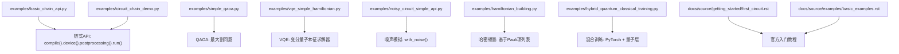
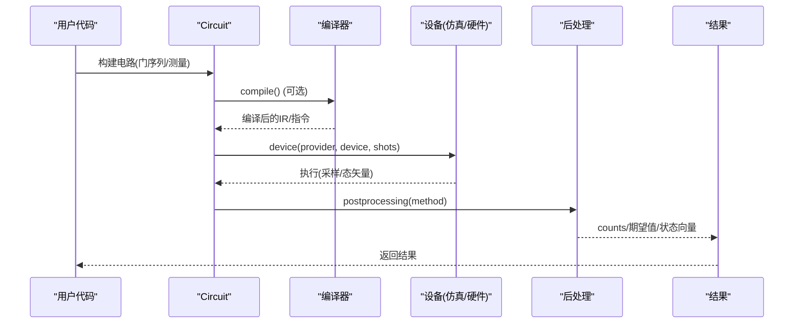
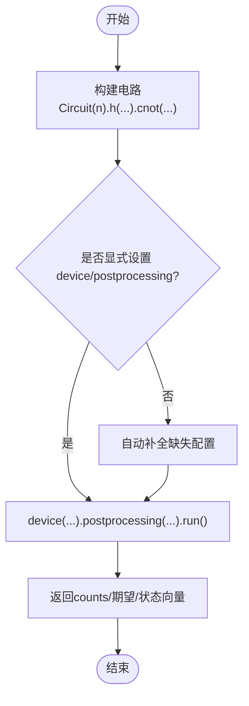
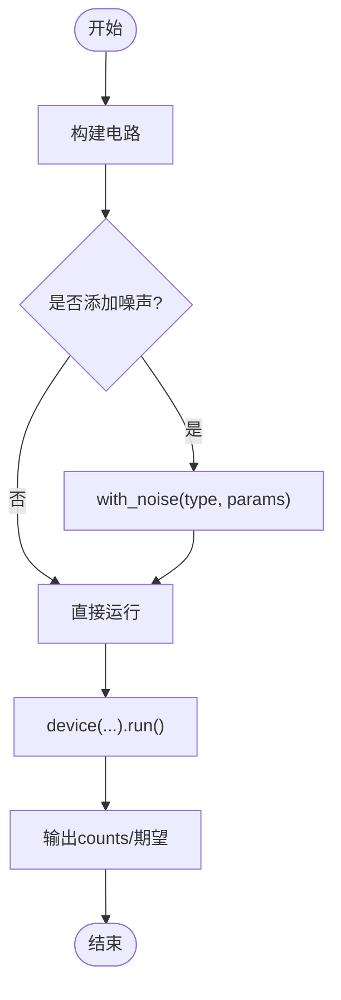
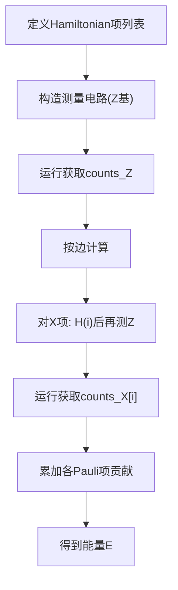
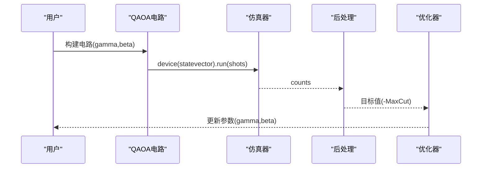
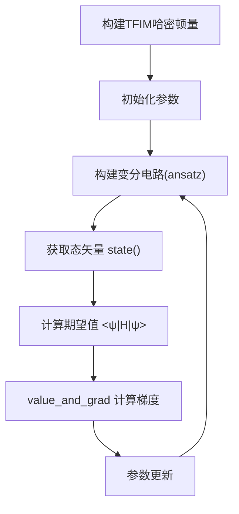
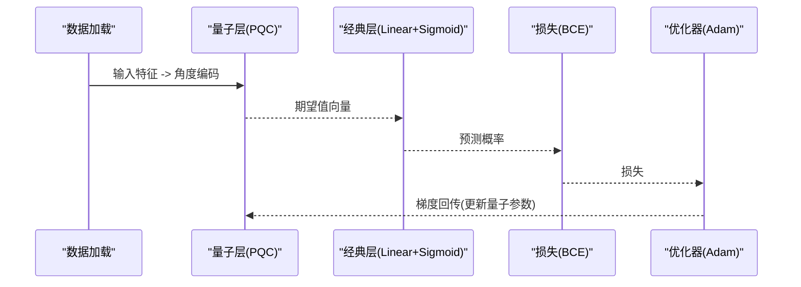
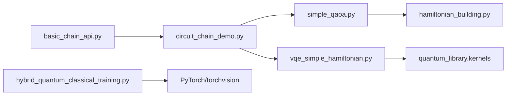

# 基础示例

<cite>
**本文引用的文件**
- [examples/basic_chain_api.py](file://examples/basic_chain_api.py)
- [examples/circuit_chain_demo.py](file://examples/circuit_chain_demo.py)
- [examples/simple_qaoa.py](file://examples/simple_qaoa.py)
- [examples/vqe_simple_hamiltonian.py](file://examples/vqe_simple_hamiltonian.py)
- [examples/noisy_circuit_simple_api.py](file://examples/noisy_circuit_simple_api.py)
- [examples/hamiltonian_building.py](file://examples/hamiltonian_building.py)
- [examples/hybrid_quantum_classical_training.py](file://examples/hybrid_quantum_classical_training.py)
- [docs/source/examples/basic_examples.rst](file://docs/source/examples/basic_examples.rst)
- [docs/source/getting_started/first_circuit.rst](file://docs/source/getting_started/first_circuit.rst)
</cite>

## 目录
1. [简介](#简介)
2. [项目结构](#项目结构)
3. [核心组件](#核心组件)
4. [架构总览](#架构总览)
5. [详细组件分析](#详细组件分析)
6. [依赖关系分析](#依赖关系分析)
7. [性能考虑](#性能考虑)
8. [故障排查指南](#故障排查指南)
9. [结论](#结论)
10. [附录](#附录)

## 简介
本章节面向初学者，系统讲解 TyxonQ 的基础用法与核心概念：链式 API、量子电路构建、测量与后处理、噪声模拟、以及两个入门级量子算法（VQE 与 QAOA）。通过逐步示例与图示，帮助读者快速上手并理解“电路→编译→设备→后处理→运行”的完整流程。

## 项目结构
TyxonQ 仓库将示例集中在 examples 目录，配套文档在 docs/source 下。本指南重点覆盖以下示例文件：
- 链式 API 与全局配置：basic_chain_api.py、circuit_chain_demo.py
- 简单量子算法：simple_qaoa.py、vqe_simple_hamiltonian.py
- 噪声与哈密顿量：noisy_circuit_simple_api.py、hamiltonian_building.py
- 混合训练：hybrid_quantum_classical_training.py
- 官方入门文档：docs/source/getting_started/first_circuit.rst、docs/source/examples/basic_examples.rst



图表来源
- [examples/basic_chain_api.py:22-41](file://examples/basic_chain_api.py#L22-L41)
- [examples/circuit_chain_demo.py:46-68](file://examples/circuit_chain_demo.py#L46-L68)
- [examples/simple_qaoa.py:48-83](file://examples/simple_qaoa.py#L48-L83)
- [examples/vqe_simple_hamiltonian.py:87-152](file://examples/vqe_simple_hamiltonian.py#L87-L152)
- [examples/noisy_circuit_simple_api.py:15-34](file://examples/noisy_circuit_simple_api.py#L15-L34)
- [examples/hamiltonian_building.py:18-77](file://examples/hamiltonian_building.py#L18-L77)
- [examples/hybrid_quantum_classical_training.py:131-181](file://examples/hybrid_quantum_classical_training.py#L131-L181)
- [docs/source/getting_started/first_circuit.rst:23-68](file://docs/source/getting_started/first_circuit.rst#L23-L68)
- [docs/source/examples/basic_examples.rst:11-37](file://docs/source/examples/basic_examples.rst#L11-L37)

章节来源
- [examples/basic_chain_api.py:22-41](file://examples/basic_chain_api.py#L22-L41)
- [examples/circuit_chain_demo.py:46-68](file://examples/circuit_chain_demo.py#L46-L68)
- [docs/source/getting_started/first_circuit.rst:23-68](file://docs/source/getting_started/first_circuit.rst#L23-L68)
- [docs/source/examples/basic_examples.rst:11-37](file://docs/source/examples/basic_examples.rst#L11-L37)

## 核心组件
- 链式 API：统一入口为 Circuit 对象，支持 .compile().device().postprocessing().run() 的链式调用；也支持部分链式调用与自动补全。
- 设备与后端：可通过 device(provider, device, shots) 指定仿真或硬件；tq.set_backend 切换数值后端（numpy/pytorch）。
- 噪声：with_noise(...) 简化噪声注入，支持去极化、振幅阻尼、相位阻尼、Pauli 信道等。
- 哈密顿量：可用 Pauli 项列表表示，并通过测量计数估计期望值。
- 算法示例：QAOA（最大割）与 VQE（横场伊辛模型），展示参数化电路、优化目标与梯度计算路径。

章节来源
- [examples/basic_chain_api.py:22-41](file://examples/basic_chain_api.py#L22-L41)
- [examples/circuit_chain_demo.py:46-68](file://examples/circuit_chain_demo.py#L46-L68)
- [examples/noisy_circuit_simple_api.py:15-34](file://examples/noisy_circuit_simple_api.py#L15-L34)
- [examples/hamiltonian_building.py:18-77](file://examples/hamiltonian_building.py#L18-L77)
- [examples/simple_qaoa.py:48-83](file://examples/simple_qaoa.py#L48-L83)
- [examples/vqe_simple_hamiltonian.py:87-152](file://examples/vqe_simple_hamiltonian.py#L87-L152)

## 架构总览
下图展示了从电路构建到执行与后处理的典型数据流，适用于所有示例。



图表来源
- [examples/basic_chain_api.py:33-38](file://examples/basic_chain_api.py#L33-L38)
- [examples/circuit_chain_demo.py:51-66](file://examples/circuit_chain_demo.py#L51-L66)
- [docs/source/getting_started/first_circuit.rst:214-248](file://docs/source/getting_started/first_circuit.rst#L214-L248)

## 详细组件分析

### 链式 API 与全局配置
- 基本链式调用：创建 Bell 态电路，使用 compile().device().postprocessing().run() 完成执行。
- 全局默认：通过 tq.device(...) 设置全局默认设备与shots，后续 circuit.run() 可直接复用。
- 自动补全：仅设置部分选项时，未设置的步骤会被智能补齐。
- 多后端：tq.set_backend("numpy"/"pytorch") 切换数值后端，便于比较与集成。



图表来源
- [examples/basic_chain_api.py:22-41](file://examples/basic_chain_api.py#L22-L41)
- [examples/circuit_chain_demo.py:46-68](file://examples/circuit_chain_demo.py#L46-L68)

章节来源
- [examples/basic_chain_api.py:22-41](file://examples/basic_chain_api.py#L22-L41)
- [examples/circuit_chain_demo.py:46-68](file://examples/circuit_chain_demo.py#L46-L68)

### 量子电路构建与操作
- 基础门：H、X、Y、Z、S、T、RX、RY、RZ、CNOT/CX、CZ、SWAP 等。
- 测量与重置：measure_z、reset、add_measure、add_barrier 等。
- 组合与重映射：compose、remap_qubits、extended 等。
- JSON 序列化：to_json_obj/to_json_str/from_json_str。
- QASM 导出：compile(output="qasm2"/"qasm3", compile_engine="qiskit")。

```mermaid
classDiagram
class Circuit {
+num_qubits
+ops
+instructions
+h(qubit)
+cnot(control,target)
+rx/qubit,theta)
+measure_z(qubit)
+reset(qubit)
+compose(other,indices)
+remap_qubits(map,new_num_qubits)
+to_json_obj()
+from_json_str(json)
+compile(output,compile_engine)
+run()
}
```

图表来源
- [examples/circuit_chain_demo.py:27-43](file://examples/circuit_chain_demo.py#L27-L43)
- [examples/circuit_chain_demo.py:142-185](file://examples/circuit_chain_demo.py#L142-L185)
- [examples/circuit_chain_demo.py:188-227](file://examples/circuit_chain_demo.py#L188-L227)

章节来源
- [examples/circuit_chain_demo.py:27-43](file://examples/circuit_chain_demo.py#L27-L43)
- [examples/circuit_chain_demo.py:142-185](file://examples/circuit_chain_demo.py#L142-L185)
- [examples/circuit_chain_demo.py:188-227](file://examples/circuit_chain_demo.py#L188-L227)

### 噪声模拟（简化 API）
- 旧 API：device(use_noise=True, noise={...})
- 新 API：with_noise("depolarizing", p=...) 等，更简洁且可链式组合。
- 支持噪声类型：去极化、振幅阻尼、相位阻尼、Pauli 信道等。



图表来源
- [examples/noisy_circuit_simple_api.py:15-34](file://examples/noisy_circuit_simple_api.py#L15-L34)
- [examples/noisy_circuit_simple_api.py:36-62](file://examples/noisy_circuit_simple_api.py#L36-L62)

章节来源
- [examples/noisy_circuit_simple_api.py:15-34](file://examples/noisy_circuit_simple_api.py#L15-L34)
- [examples/noisy_circuit_simple_api.py:36-62](file://examples/noisy_circuit_simple_api.py#L36-L62)

### 哈密顿量构建与期望估计
- 以 Pauli 项列表表示哈密顿量，如 TFIM：ZZ 耦合 + X 局域场。
- 通过 Z 基测量计数估计 ZZ 期望；对 X 项先做 H 旋转再测 Z。
- 能量 = Σ coeff * <P_i>，其中 P_i 为 Pauli 算符乘积。



图表来源
- [examples/hamiltonian_building.py:18-77](file://examples/hamiltonian_building.py#L18-L77)

章节来源
- [examples/hamiltonian_building.py:18-77](file://examples/hamiltonian_building.py#L18-L77)

### 简单量子算法：QAOA（最大割）
- 电路构建：初始 H 层，交替应用 ZZ 相互作用（CX-RZ-CX）和 RX 旋转，重复 nlayers 次。
- 目标函数：从 counts 计算 MaxCut 期望值，取负作为优化目标。
- 两种路径：
  - 计数路径：statevector 仿真 + 计数统计。
  - Autograd 路径：PyTorch 后端 + 量子库内核直接构建态矢量，避免采样。



图表来源
- [examples/simple_qaoa.py:48-83](file://examples/simple_qaoa.py#L48-L83)
- [examples/simple_qaoa.py:88-149](file://examples/simple_qaoa.py#L88-L149)

章节来源
- [examples/simple_qaoa.py:48-83](file://examples/simple_qaoa.py#L48-L83)
- [examples/simple_qaoa.py:88-149](file://examples/simple_qaoa.py#L88-L149)

### 简单量子算法：VQE（横场伊辛模型）
- 哈密顿量：TFIM H = -J Σ Z_i Z_{i+1} - h Σ X_i，使用 heisenberg_hamiltonian 构建。
- 变分电路：硬件高效 ansatz（Hadamard 初始化 + CNOT 阶梯纠缠 + RY/RZ 旋转）。
- 能量计算：state() 获取态矢量，矩阵乘法求期望值；或使用 value_and_grad 进行自动微分。
- 优化：梯度下降迭代，跟踪能量收敛与误差。



图表来源
- [examples/vqe_simple_hamiltonian.py:55-82](file://examples/vqe_simple_hamiltonian.py#L55-L82)
- [examples/vqe_simple_hamiltonian.py:87-152](file://examples/vqe_simple_hamiltonian.py#L87-L152)
- [examples/vqe_simple_hamiltonian.py:157-255](file://examples/vqe_simple_hamiltonian.py#L157-L255)

章节来源
- [examples/vqe_simple_hamiltonian.py:55-82](file://examples/vqe_simple_hamiltonian.py#L55-L82)
- [examples/vqe_simple_hamiltonian.py:87-152](file://examples/vqe_simple_hamiltonian.py#L87-L152)
- [examples/vqe_simple_hamiltonian.py:157-255](file://examples/vqe_simple_hamiltonian.py#L157-L255)

### 混合量子-经典训练（PyTorch + GPU）
- 数据：MNIST 二分类（1 vs 5），降采样至 3x3 并二值化。
- 量子层：参数化编码（RX）、变分层（CNOT 阶梯 + RX/RY）、测量（Z 期望）。
- 经典层：线性层 + Sigmoid，端到端反向传播。
- 优势：GPU 加速、自动微分、真实 ML 工作流演示。



图表来源
- [examples/hybrid_quantum_classical_training.py:131-181](file://examples/hybrid_quantum_classical_training.py#L131-L181)
- [examples/hybrid_quantum_classical_training.py:186-226](file://examples/hybrid_quantum_classical_training.py#L186-L226)
- [examples/hybrid_quantum_classical_training.py:231-303](file://examples/hybrid_quantum_classical_training.py#L231-L303)

章节来源
- [examples/hybrid_quantum_classical_training.py:131-181](file://examples/hybrid_quantum_classical_training.py#L131-L181)
- [examples/hybrid_quantum_classical_training.py:186-226](file://examples/hybrid_quantum_classical_training.py#L186-L226)
- [examples/hybrid_quantum_classical_training.py:231-303](file://examples/hybrid_quantum_classical_training.py#L231-L303)

## 依赖关系分析
- 示例间依赖：
  - basic_chain_api.py 与 circuit_chain_demo.py 共享链式 API 模式。
  - simple_qaoa.py 与 hamiltonian_building.py 都涉及 Hamiltonian 与计数期望。
  - vqe_simple_hamiltonian.py 使用量子库内核与自动微分。
  - hybrid_quantum_classical_training.py 依赖 PyTorch 与 torchvision。
- 外部依赖：
  - networkx（QAOA 图构建）
  - torch/torchvision（混合训练）
  - qiskit（QASM 导出，可选）



图表来源
- [examples/basic_chain_api.py:22-41](file://examples/basic_chain_api.py#L22-L41)
- [examples/circuit_chain_demo.py:46-68](file://examples/circuit_chain_demo.py#L46-L68)
- [examples/simple_qaoa.py:48-83](file://examples/simple_qaoa.py#L48-L83)
- [examples/hamiltonian_building.py:18-77](file://examples/hamiltonian_building.py#L18-L77)
- [examples/vqe_simple_hamiltonian.py:87-152](file://examples/vqe_simple_hamiltonian.py#L87-L152)
- [examples/hybrid_quantum_classical_training.py:131-181](file://examples/hybrid_quantum_classical_training.py#L131-L181)

章节来源
- [examples/basic_chain_api.py:22-41](file://examples/basic_chain_api.py#L22-L41)
- [examples/circuit_chain_demo.py:46-68](file://examples/circuit_chain_demo.py#L46-L68)
- [examples/simple_qaoa.py:48-83](file://examples/simple_qaoa.py#L48-L83)
- [examples/hamiltonian_building.py:18-77](file://examples/hamiltonian_building.py#L18-L77)
- [examples/vqe_simple_hamiltonian.py:87-152](file://examples/vqe_simple_hamiltonian.py#L87-L152)
- [examples/hybrid_quantum_classical_training.py:131-181](file://examples/hybrid_quantum_classical_training.py#L131-L181)

## 性能考虑
- 设备选择：
  - statevector：纯态精确仿真，速度快，适合小系统。
  - density_matrix：支持噪声与混合态，开销更大。
  - MPS：适合大系统低纠缠场景。
- 采样次数：调试用少量 shots，生产环境提高 shots 以降低统计误差。
- 后端选择：NumPy 稳定，PyTorch 支持 GPU 与自动微分。
- 编译优化：使用 compile(output="qasm2"/"qasm3") 或 compiler 管线进行门合并、光锥简化等。

[本节为通用指导，不直接分析具体文件]

## 故障排查指南
- 常见问题与解决：
  - 电路过深：使用编译优化减少门数量。
  - 内存不足：改用 MPS 模拟器或降低 qubits/shots。
  - 执行缓慢：减少 shots 测试，或切换到 statevector。
  - 噪声模拟失败：确认 with_noise 参数与设备支持。
  - 后端不可用：检查 PyTorch 安装，必要时回退 NumPy。
- 调试技巧：
  - 打印 gate_summary/instructions 检查电路结构。
  - 逐步执行：先 run() 无噪声，再加噪声对比。
  - 可视化：导出 QASM 或用工具查看电路。

章节来源
- [docs/source/examples/basic_examples.rst:441-472](file://docs/source/examples/basic_examples.rst#L441-L472)
- [examples/noisy_circuit_simple_api.py:15-34](file://examples/noisy_circuit_simple_api.py#L15-L34)
- [examples/circuit_chain_demo.py:188-227](file://examples/circuit_chain_demo.py#L188-L227)

## 结论
通过本指南的示例与图示，读者应能掌握 TyxonQ 的链式 API、电路构建、噪声模拟、哈密顿量表达与两个基础量子算法（VQE、QAOA）。建议从 basic_chain_api 与 first_circuit 起步，逐步过渡到复杂算法与混合训练。遇到问题时优先检查设备配置、shots 与后端设置，并利用编译与可视化工具定位问题。

[本节为总结性内容，不直接分析具体文件]

## 附录
- 快速上手路径：
  1) 阅读 docs/source/getting_started/first_circuit.rst，完成第一个 Bell 态电路。
  2) 运行 examples/basic_chain_api.py，熟悉链式 API 与全局默认。
  3) 尝试 examples/circuit_chain_demo.py，探索高级门、组合与序列化。
  4) 学习 examples/hamiltonian_building.py，理解 Hamiltonian 与计数期望。
  5) 实践 examples/simple_qaoa.py 与 examples/vqe_simple_hamiltonian.py。
  6) 进阶：examples/hybrid_quantum_classical_training.py 体验端到端训练。

章节来源
- [docs/source/getting_started/first_circuit.rst:23-68](file://docs/source/getting_started/first_circuit.rst#L23-L68)
- [examples/basic_chain_api.py:22-41](file://examples/basic_chain_api.py#L22-L41)
- [examples/circuit_chain_demo.py:46-68](file://examples/circuit_chain_demo.py#L46-L68)
- [examples/hamiltonian_building.py:18-77](file://examples/hamiltonian_building.py#L18-L77)
- [examples/simple_qaoa.py:48-83](file://examples/simple_qaoa.py#L48-L83)
- [examples/vqe_simple_hamiltonian.py:87-152](file://examples/vqe_simple_hamiltonian.py#L87-L152)
- [examples/hybrid_quantum_classical_training.py:131-181](file://examples/hybrid_quantum_classical_training.py#L131-L181)