# 性能基准示例

<cite>
**本文引用的文件**   
- [examples/sample_benchmark.py](file://examples/sample_benchmark.py)
- [examples/gradient_benchmark.py](file://examples/gradient_benchmark.py)
- [examples/framework_performance_comparison.py](file://examples/framework_performance_comparison.py)
- [examples/memory_optimization_checkpointing.py](file://examples/memory_optimization_checkpointing.py)
- [examples/performance_layerwise_optimization.py](file://examples/performance_layerwise_optimization.py)
- [examples/barren_plateau_benchmark.py](file://examples/barren_plateau_benchmark.py)
- [examples/mps_approximation_benchmark.py](file://examples/mps_approximation_benchmark.py)
- [examples/defcal_performance_analysis.py](file://examples/defcal_performance_analysis.py)
- [examples/vqeh2o_benchmark.py](file://examples/vqeh2o_benchmark.py)
- [examples/vqetfim_benchmark.py](file://examples/vqetfim_benchmark.py)
- [examples/sample_value_gradient.py](file://examples/sample_value_gradient.py)
- [examples/performance_optimization_tips.md](file://examples/performance_optimization_tips.md)
</cite>

## 目录
1. [简介](#简介)
2. [项目结构](#项目结构)
3. [核心组件](#核心组件)
4. [架构总览](#架构总览)
5. [详细组件分析](#详细组件分析)
6. [依赖关系分析](#依赖关系分析)
7. [性能考量与优化建议](#性能考量与优化建议)
8. [故障排查指南](#故障排查指南)
9. [结论](#结论)
10. [附录](#附录)

## 简介
本技术文档围绕 TyxonQ 的性能基准示例，系统阐述采样性能、梯度计算、框架对比测试、内存优化策略与分层优化等主题。文档面向不同技术背景的读者，提供：
- 性能指标定义（时间、吞吐、精度、内存）
- 测试环境配置与可复现实验方法
- 基准测试设计原则（控制变量、重复试验、统计显著性）
- 性能分析工具使用与瓶颈识别技巧
- 算法与参数选择策略（如后端、shots、bond dimension、JIT 编译粒度）

## 项目结构
TyxonQ 的示例集中在 examples 目录，涵盖多种基准场景：
- 采样基准：sample_benchmark.py
- 梯度基准：gradient_benchmark.py、sample_value_gradient.py
- 框架对比：framework_performance_comparison.py
- 内存优化：memory_optimization_checkpointing.py
- 分层优化：performance_layerwise_optimization.py
- 退相干/噪声与 barren plateau：barren_plateau_benchmark.py
- MPS 近似：mps_approximation_benchmark.py
- Defcal 校准与脉冲编译：defcal_performance_analysis.py
- VQE 分子与自旋模型：vqeh2o_benchmark.py、vqetfim_benchmark.py
- 性能优化最佳实践：performance_optimization_tips.md

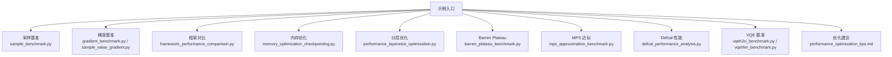

**章节来源**
- [examples/sample_benchmark.py:1-91](file://examples/sample_benchmark.py#L1-L91)
- [examples/gradient_benchmark.py:1-320](file://examples/gradient_benchmark.py#L1-L320)
- [examples/framework_performance_comparison.py:1-805](file://examples/framework_performance_comparison.py#L1-L805)
- [examples/memory_optimization_checkpointing.py:1-280](file://examples/memory_optimization_checkpointing.py#L1-L280)
- [examples/performance_layerwise_optimization.py:1-337](file://examples/performance_layerwise_optimization.py#L1-L337)
- [examples/barren_plateau_benchmark.py:1-592](file://examples/barren_plateau_benchmark.py#L1-L592)
- [examples/mps_approximation_benchmark.py:1-184](file://examples/mps_approximation_benchmark.py#L1-L184)
- [examples/defcal_performance_analysis.py:1-392](file://examples/defcal_performance_analysis.py#L1-L392)
- [examples/vqeh2o_benchmark.py:1-163](file://examples/vqeh2o_benchmark.py#L1-L163)
- [examples/vqetfim_benchmark.py:1-124](file://examples/vqetfim_benchmark.py#L1-L124)
- [examples/performance_optimization_tips.md:1-223](file://examples/performance_optimization_tips.md#L1-L223)

## 核心组件
- 采样性能基准：通过链式 API 构建电路，使用 statevector 模拟执行并统计多次运行的平均时间与标准差，比较不同数值后端（numpy、pytorch、cupynumeric）。
- 梯度计算基准：对比 TyxonQ counts + parameter-shift 与 Qiskit 路径；同时展示基于 statevector 的有限差分 QFI 与 PyTorch autograd Hessian。
- 框架对比测试：统一 VQE 场景（TFIM），对比 TyxonQ 三种模式（shot-based、NumPy value_and_grad、PyTorch autograd）与 Qiskit、PennyLane。
- 内存优化策略：演示深度电路训练中的梯度检查点（checkpointing），权衡内存与计算时间。
- 分层优化技术：在含噪声的深度电路中，按层强制状态计算以打断计算图，显著降低 JIT 编译时间。
- Barren Plateau 分析：对比理想 autograd、parameter-shift（含 shots）、parameter-shift + noise，量化梯度消失现象。
- MPS 近似：评估矩阵乘积态在不同 bond dimension 下的近似质量与资源消耗。
- Defcal 性能：评估硬件感知编译的开销与可扩展性，对比带/不带 defcal 的编译与测量结果。
- VQE 基准：分子与自旋模型的精确路径与 counts 路径的时间对比。

**章节来源**
- [examples/sample_benchmark.py:16-67](file://examples/sample_benchmark.py#L16-L67)
- [examples/gradient_benchmark.py:30-109](file://examples/gradient_benchmark.py#L30-L109)
- [examples/framework_performance_comparison.py:75-408](file://examples/framework_performance_comparison.py#L75-L408)
- [examples/memory_optimization_checkpointing.py:46-107](file://examples/memory_optimization_checkpointing.py#L46-L107)
- [examples/performance_layerwise_optimization.py:62-184](file://examples/performance_layerwise_optimization.py#L62-L184)
- [examples/barren_plateau_benchmark.py:142-345](file://examples/barren_plateau_benchmark.py#L142-L345)
- [examples/mps_approximation_benchmark.py:43-108](file://examples/mps_approximation_benchmark.py#L43-L108)
- [examples/defcal_performance_analysis.py:72-139](file://examples/defcal_performance_analysis.py#L72-L139)
- [examples/vqeh2o_benchmark.py:86-146](file://examples/vqeh2o_benchmark.py#L86-L146)
- [examples/vqetfim_benchmark.py:21-103](file://examples/vqetfim_benchmark.py#L21-L103)

## 架构总览
下图展示了典型基准流程：从电路构建到设备执行、后处理与性能统计。

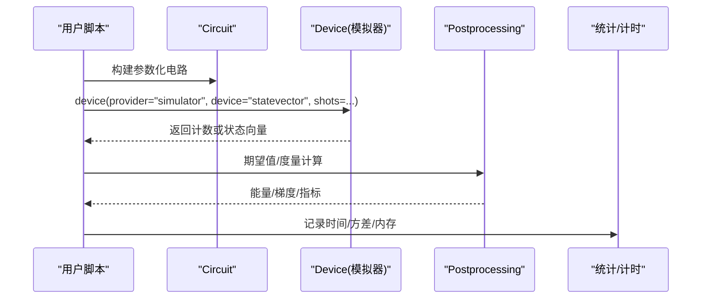

**图表来源**
- [examples/sample_benchmark.py:32-40](file://examples/sample_benchmark.py#L32-L40)
- [examples/gradient_benchmark.py:64-77](file://examples/gradient_benchmark.py#L64-L77)
- [examples/framework_performance_comparison.py:156-189](file://examples/framework_performance_comparison.py#L156-L189)

## 详细组件分析

### 采样性能基准（sample_benchmark.py）
- 目标：比较不同后端在相同电路与 shots 下的执行时间分布。
- 关键流程：
  - 随机构造含 entangling 层的电路
  - 使用 statevector 模拟器执行并获取计数
  - 多次运行取均值与标准差
- 指标：
  - 平均执行时间、标准差
  - 后端名称与版本（用于可复现性）
- 适用场景：快速验证后端差异、评估 shots 对吞吐的影响

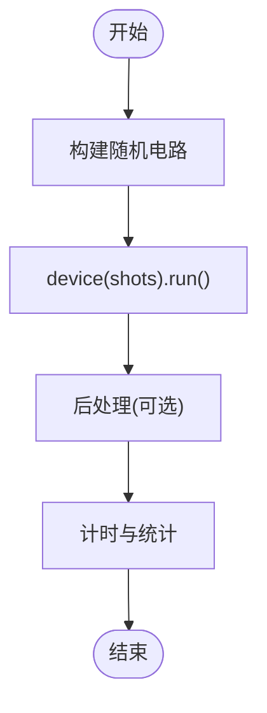

**图表来源**
- [examples/sample_benchmark.py:16-40](file://examples/sample_benchmark.py#L16-L40)

**章节来源**
- [examples/sample_benchmark.py:51-86](file://examples/sample_benchmark.py#L51-L86)

### 梯度计算基准（gradient_benchmark.py）
- 目标：对比 TyxonQ counts + parameter-shift 与 Qiskit 路径；展示 statevector 上的有限差分 QFI 与 PyTorch autograd Hessian。
- 关键流程：
  - 构建 ansatz，计算期望值（counts 或 statevector）
  - 使用 parameter-shift 规则估计梯度
  - 可选：Qiskit Gradient/QFI/Hessian
- 指标：
  - 单次梯度计算耗时（阶段+运行）
  - 数值误差（与解析或高精度参考对比）
- 适用场景：VQE 优化器选型、梯度方法对比

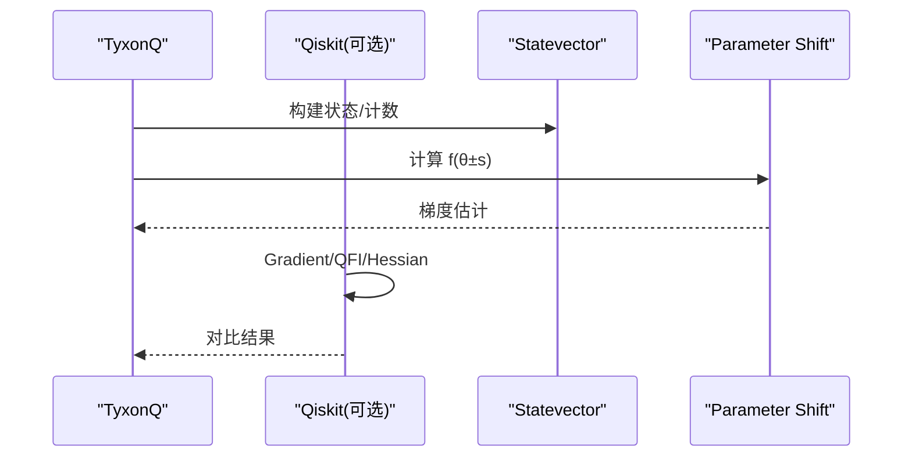

**图表来源**
- [examples/gradient_benchmark.py:95-109](file://examples/gradient_benchmark.py#L95-L109)
- [examples/gradient_benchmark.py:140-186](file://examples/gradient_benchmark.py#L140-L186)
- [examples/gradient_benchmark.py:191-280](file://examples/gradient_benchmark.py#L191-L280)

**章节来源**
- [examples/gradient_benchmark.py:30-109](file://examples/gradient_benchmark.py#L30-L109)
- [examples/gradient_benchmark.py:140-186](file://examples/gradient_benchmark.py#L140-L186)
- [examples/gradient_benchmark.py:191-280](file://examples/gradient_benchmark.py#L191-L280)

### 框架对比测试（framework_performance_comparison.py）
- 目标：统一 VQE 场景（TFIM），对比 TyxonQ 三种模式与 Qiskit、PennyLane。
- 关键流程：
  - Mode 1：Shot-based Sampling（完整编译→设备→后处理）
  - Mode 2：NumPy Backend + NumericBackend.value_and_grad（有限差分）
  - Mode 3：PyTorch Backend + Autograd（推荐最佳实践）
  - 对比 Qiskit/PennyLane 实现
- 指标：
  - 每步优化时间、收敛能量
  - 相对加速比
- 适用场景：框架选型、端到端性能评估

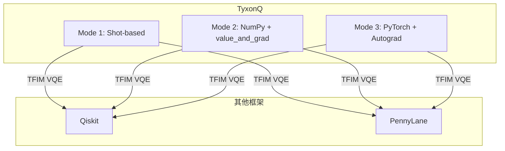

**图表来源**
- [examples/framework_performance_comparison.py:131-252](file://examples/framework_performance_comparison.py#L131-L252)
- [examples/framework_performance_comparison.py:255-408](file://examples/framework_performance_comparison.py#L255-L408)
- [examples/framework_performance_comparison.py:415-575](file://examples/framework_performance_comparison.py#L415-L575)

**章节来源**
- [examples/framework_performance_comparison.py:75-408](file://examples/framework_performance_comparison.py#L75-L408)
- [examples/framework_performance_comparison.py:415-575](file://examples/framework_performance_comparison.py#L415-L575)

### 内存优化策略（memory_optimization_checkpointing.py）
- 目标：演示深度电路训练中梯度检查点的内存节省与时间权衡。
- 关键流程：
  - 标准反向传播 vs 检查点反向传播
  - 展示 O(depth × 2^n) 内存增长与 O(√depth × 2^n) 或 O(log depth × 2^n) 的折中
- 指标：
  - 内存占用估算
  - 单步优化时间
- 适用场景：深电路、大比特数、内存受限环境

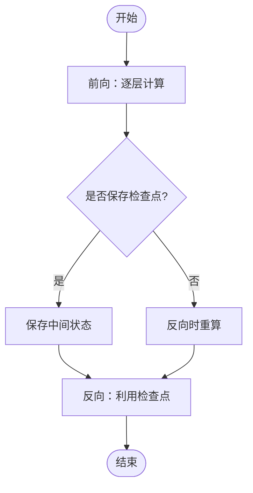

**图表来源**
- [examples/memory_optimization_checkpointing.py:46-107](file://examples/memory_optimization_checkpointing.py#L46-L107)
- [examples/memory_optimization_checkpointing.py:200-229](file://examples/memory_optimization_checkpointing.py#L200-L229)

**章节来源**
- [examples/memory_optimization_checkpointing.py:110-142](file://examples/memory_optimization_checkpointing.py#L110-L142)
- [examples/memory_optimization_checkpointing.py:144-198](file://examples/memory_optimization_checkpointing.py#L144-L198)

### 分层优化技术（performance_layerwise_optimization.py）
- 目标：在含噪声的深度电路中，通过按层强制状态计算打断计算图，显著降低 JIT 编译时间。
- 关键流程：
  - 标准方法：单一计算图（长编译时间）
  - 优化方法：每层/每段强制 c.state()，重建 Circuit(inputs=state)
- 指标：
  - 编译时间、运行时间、结果一致性
- 适用场景：深度电路、大量噪声通道、蒙特卡洛轨迹

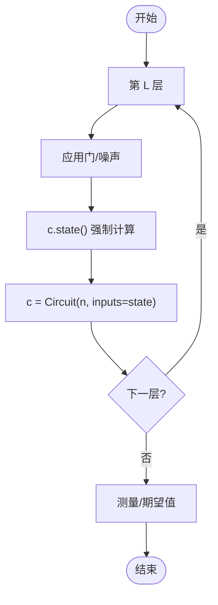

**图表来源**
- [examples/performance_layerwise_optimization.py:108-184](file://examples/performance_layerwise_optimization.py#L108-L184)

**章节来源**
- [examples/performance_layerwise_optimization.py:62-106](file://examples/performance_layerwise_optimization.py#L62-L106)
- [examples/performance_layerwise_optimization.py:187-227](file://examples/performance_layerwise_optimization.py#L187-L227)

### Barren Plateau 分析（barren_plateau_benchmark.py）
- 目标：量化梯度消失现象，对比 ideal autograd、parameter-shift（含 shots）、parameter-shift + noise。
- 关键流程：
  - 随机电路与参数采样
  - 三种梯度方法统计梯度方差
- 指标：
  - 梯度均值/标准差
  - 理论缩放 O(1/2^(n/2))
- 适用场景：算法可训练性评估、噪声影响分析

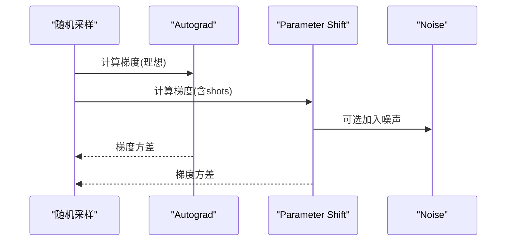

**图表来源**
- [examples/barren_plateau_benchmark.py:142-209](file://examples/barren_plateau_benchmark.py#L142-L209)
- [examples/barren_plateau_benchmark.py:212-345](file://examples/barren_plateau_benchmark.py#L212-L345)

**章节来源**
- [examples/barren_plateau_benchmark.py:421-480](file://examples/barren_plateau_benchmark.py#L421-L480)

### MPS 近似（mps_approximation_benchmark.py）
- 目标：评估 MPS 在不同 bond dimension 下的近似质量与资源消耗。
- 关键流程：
  - 构建变分电路，分别用 exact 与 MPS 模拟
  - 计算能量相对误差与保真度
- 指标：
  - 保真度、能量相对误差
  - 内存与计算成本随 bond dimension 变化
- 适用场景：低纠缠态高效模拟、高纠缠态资源权衡

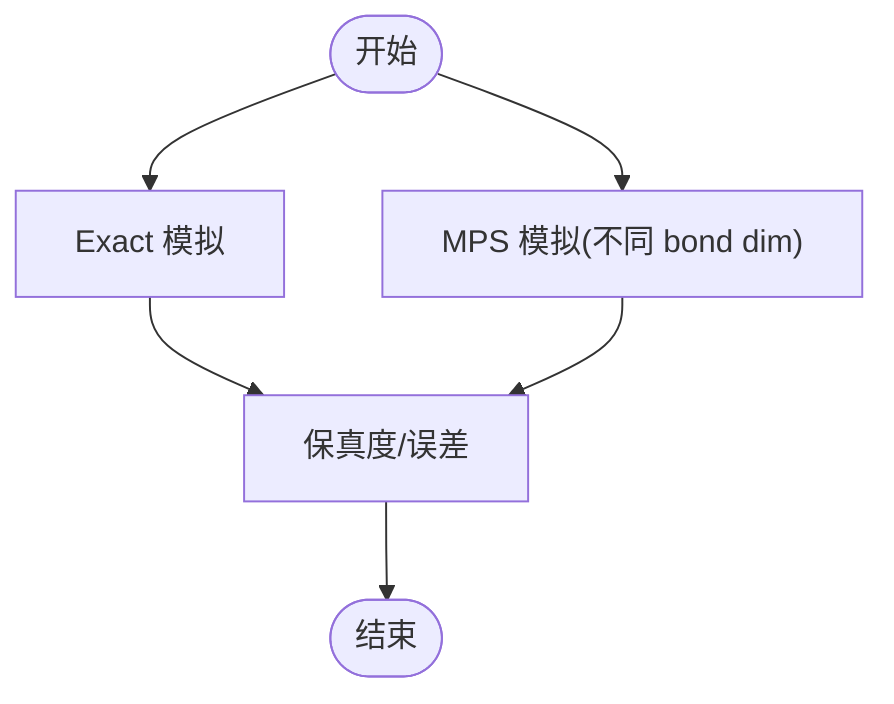

**图表来源**
- [examples/mps_approximation_benchmark.py:43-108](file://examples/mps_approximation_benchmark.py#L43-L108)
- [examples/mps_approximation_benchmark.py:150-172](file://examples/mps_approximation_benchmark.py#L150-L172)

**章节来源**
- [examples/mps_approximation_benchmark.py:111-184](file://examples/mps_approximation_benchmark.py#L111-L184)

### Defcal 性能（defcal_performance_analysis.py）
- 目标：评估硬件感知编译的开销与可扩展性，对比带/不带 defcal 的编译与测量结果。
- 关键流程：
  - 创建 DefcalLibrary 并添加校准
  - 编译电路（with/without defcal）
  - 测量统计与理想仿真
- 指标：
  - 编译时间、吞吐量（gates/ms）
  - 测量概率分布、保真度
- 适用场景：硬件异构性、校准复用、部署前验证

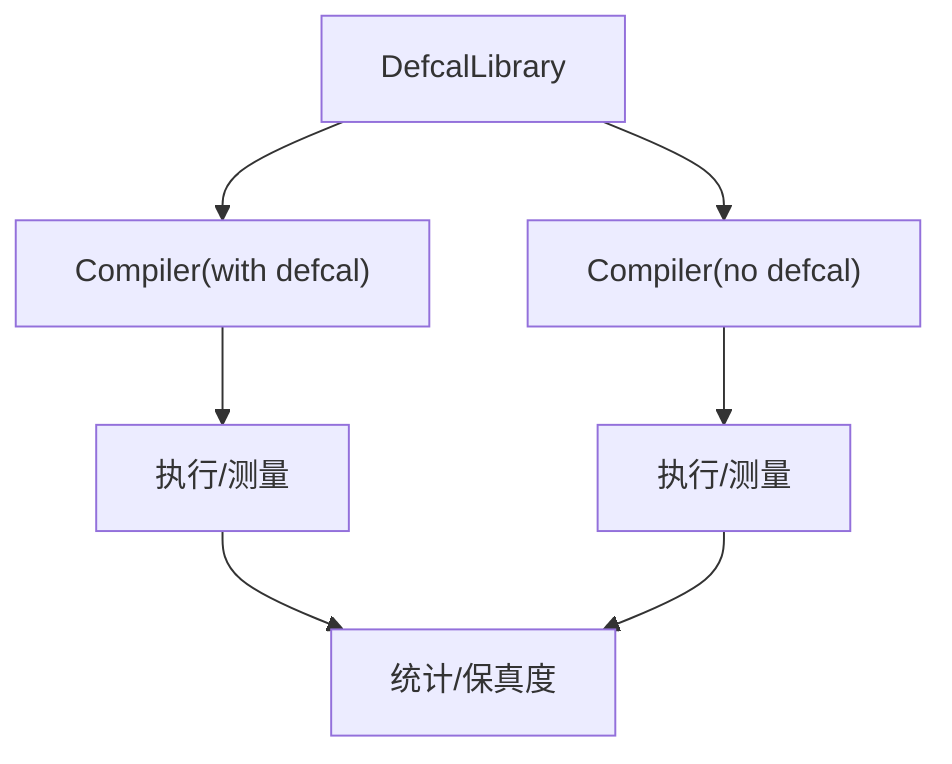

**图表来源**
- [examples/defcal_performance_analysis.py:37-67](file://examples/defcal_performance_analysis.py#L37-L67)
- [examples/defcal_performance_analysis.py:72-139](file://examples/defcal_performance_analysis.py#L72-L139)

**章节来源**
- [examples/defcal_performance_analysis.py:145-219](file://examples/defcal_performance_analysis.py#L145-L219)
- [examples/defcal_performance_analysis.py:285-335](file://examples/defcal_performance_analysis.py#L285-L335)

### VQE 基准（vqeh2o_benchmark.py、vqetfim_benchmark.py）
- 目标：分子与自旋模型的精确路径与 counts 路径的时间对比。
- 关键流程：
  - 分子：OpenFermion 转换 Pauli 项，直接数值路径求和
  - 自旋：counts 路径与 exact 路径对比
- 指标：
  - 阶段时间与运行时间
  - 能量值一致性
- 适用场景：算法实现选择、资源规划

**章节来源**
- [examples/vqeh2o_benchmark.py:86-146](file://examples/vqeh2o_benchmark.py#L86-L146)
- [examples/vqetfim_benchmark.py:21-103](file://examples/vqetfim_benchmark.py#L21-L103)

### 采样与梯度（sample_value_gradient.py）
- 目标：使用链式 API 计算 Pauli-sum 观测量的期望与梯度（parameter-shift vs finite-difference）。
- 关键流程：
  - 构建电路与基旋转
  - 基于计数的期望值计算
  - 梯度估计与差异对比
- 指标：
  - 时间对比、梯度差异（max/L2）
- 适用场景：梯度方法验证、shots 影响分析

**章节来源**
- [examples/sample_value_gradient.py:51-107](file://examples/sample_value_gradient.py#L51-L107)
- [examples/sample_value_gradient.py:113-138](file://examples/sample_value_gradient.py#L113-L138)

## 依赖关系分析
- 后端依赖：numpy、pytorch、cupynumeric（可选）
- 框架对比：Qiskit、PennyLane（可选）
- 量子库：tyxonq.libs.quantum_library（kernels、noise、hamiltonians）
- 编译器：tyxonq.compiler.pulse_compiler（DefcalLibrary、GateToPulsePass）
- 设备：statevector、matrix_product_state、hardware drivers（可选）

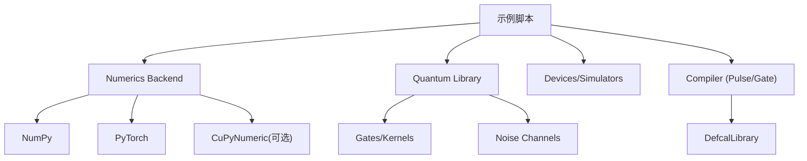

**图表来源**
- [examples/framework_performance_comparison.py:75-108](file://examples/framework_performance_comparison.py#L75-L108)
- [examples/performance_layerwise_optimization.py:46-54](file://examples/performance_layerwise_optimization.py#L46-L54)
- [examples/defcal_performance_analysis.py:30-33](file://examples/defcal_performance_analysis.py#L30-L33)

**章节来源**
- [examples/framework_performance_comparison.py:75-108](file://examples/framework_performance_comparison.py#L75-L108)
- [examples/performance_layerwise_optimization.py:46-54](file://examples/performance_layerwise_optimization.py#L46-L54)
- [examples/defcal_performance_analysis.py:30-33](file://examples/defcal_performance_analysis.py#L30-L33)

## 性能考量与优化建议
- 指标定义
  - 时间：阶段时间（首次运行含 JIT/编译）与运行时间（后续重复）
  - 吞吐：每秒门数/样本数
  - 精度：保真度、能量相对误差、梯度差异
  - 内存：状态向量大小、检查点数量、bond dimension
- 测试环境配置
  - 固定随机种子、后端类型、dtype（complex64/complex128）
  - 明确 shots、repeats、trials 数量
  - 记录硬件信息（CPU/GPU）、驱动版本
- 基准设计原则
  - 控制变量：同一电路、同一参数初始化
  - 重复试验：统计均值与标准差，避免偶然波动
  - 可比性：统一度量（如 TFIM 能量、梯度范数）
- 工具与方法
  - 计时：time.perf_counter/time.time
  - 统计：mean/std、置信区间
  - 可视化：进度条、直方图（计数分布）
- 瓶颈识别
  - 长 JIT 编译：采用分层优化打断计算图
  - 重复电路执行：缓存状态向量或使用 Hamiltonian 对象一次性计算
  - 高 shots：增加并行或减少 term 数量
  - 内存不足：启用检查点或降低 bond dimension
- 优化建议
  - 优先使用 PyTorch backend + autograd（最快）
  - 避免每次 expectation 重新执行电路
  - 合理设置 shots 与 repeats 平衡精度与时间
  - 对深电路使用分层优化与检查点
  - 对低纠缠态使用 MPS 近似

[本节为通用指导，不直接分析具体文件]

## 故障排查指南
- 常见问题
  - 后端不可用：捕获异常并跳过该后端测试
  - 导入失败（Qiskit/PennyLane）：条件导入并输出提示
  - 内存溢出：降低 n_qubits、nlayers、bond dimension 或启用检查点
  - JIT 编译过慢：使用分层优化打断计算图
- 调试步骤
  - 打印关键变量（参数量、shots、后端名）
  - 分段计时定位瓶颈
  - 使用最小可复现示例（小 n、浅层）
  - 对比 exact 与 counts 路径一致性

**章节来源**
- [examples/sample_benchmark.py:51-56](file://examples/sample_benchmark.py#L51-L56)
- [examples/gradient_benchmark.py:18-25](file://examples/gradient_benchmark.py#L18-L25)
- [examples/memory_optimization_checkpointing.py:192-197](file://examples/memory_optimization_checkpointing.py#L192-L197)
- [examples/performance_layerwise_optimization.py:282-295](file://examples/performance_layerwise_optimization.py#L282-L295)

## 结论
- TyxonQ 提供统一的链式 API，支持 shot-based、exact、autograd 等多种执行模式，便于全面性能评估。
- 通过分层优化与检查点，可在深电路与噪声场景中显著改善编译时间与内存占用。
- 框架对比显示，PyTorch backend + autograd 通常最优；但需根据实际硬件约束（shots、噪声）选择合适模式。
- 基准示例覆盖采样、梯度、内存、分层优化、MPS 近似、Defcal 校准等关键主题，形成完整的性能分析与优化闭环。

[本节为总结，不直接分析具体文件]

## 附录
- 推荐实验流程
  - 先运行 sample_benchmark.py 确认后端可用性与基础性能
  - 再运行 gradient_benchmark.py 对比梯度方法
  - 使用 framework_performance_comparison.py 进行端到端对比
  - 针对深电路运行 performance_layerwise_optimization.py 与 memory_optimization_checkpointing.py
  - 结合 barren_plateau_benchmark.py 评估可训练性
  - 使用 mps_approximation_benchmark.py 评估近似质量
  - 使用 defcal_performance_analysis.py 验证硬件感知编译
- 参数调优清单
  - shots：增大以提高精度，但增加时间
  - repeats/trials：提高统计稳定性
  - bond dimension：提升 MPS 精度，但增加内存
  - dtype：complex64 更快，complex128 更精确
  - backend：numpy（稳定）、pytorch（高性能）、cupynumeric（GPU 加速，可选）

[本节为补充说明，不直接分析具体文件]