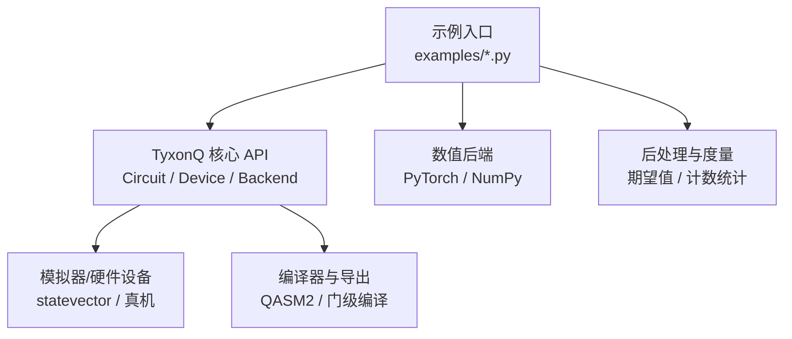
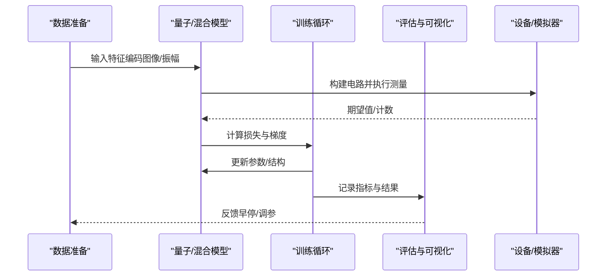
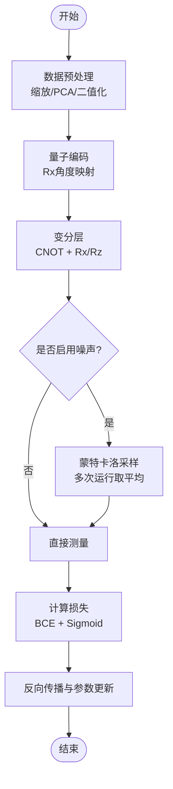
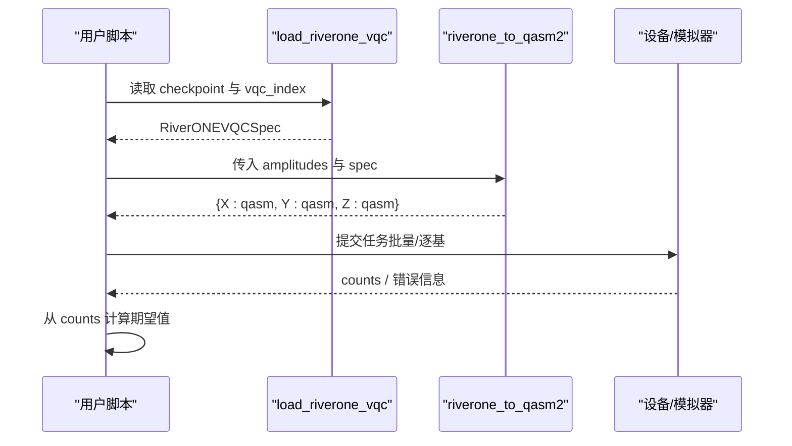
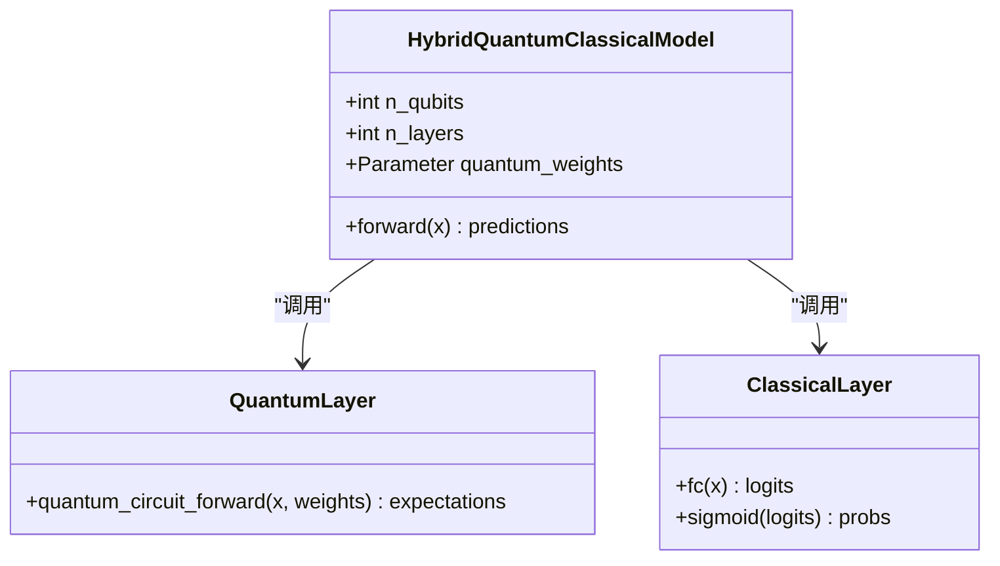
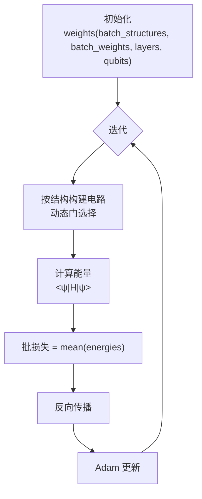
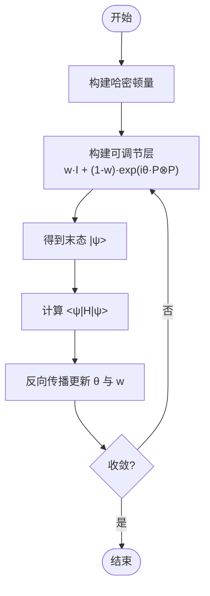
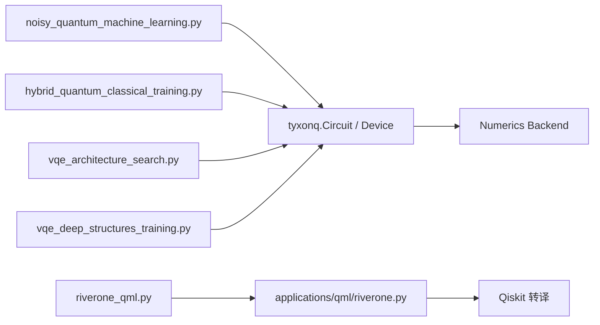

# 机器学习示例

<cite>
**本文引用的文件**
- [noisy_quantum_machine_learning.py](file://examples/noisy_quantum_machine_learning.py)
- [riverone_qml.py](file://examples/riverone_qml.py)
- [hybrid_quantum_classical_training.py](file://examples/hybrid_quantum_classical_training.py)
- [vqe_architecture_search.py](file://examples/vqe_architecture_search.py)
- [vqe_deep_structures_training.py](file://examples/vqe_deep_structures_training.py)
- [noise_controls_demo.py](file://examples/noise_controls_demo.py)
- [riverone.py](file://src/tyxonq/applications/qml/riverone.py)
</cite>

## 目录
1. [简介](#简介)
2. [项目结构](#项目结构)
3. [核心组件](#核心组件)
4. [架构总览](#架构总览)
5. [详细组件分析](#详细组件分析)
6. [依赖关系分析](#依赖关系分析)
7. [性能考量](#性能考量)
8. [故障排查指南](#故障排查指南)
9. [结论](#结论)
10. [附录](#附录)

## 简介
本文件围绕 TyxonQ 的量子机器学习示例，系统阐述噪声环境下的 QML、RiverONE 算法实现与部署、混合量子经典训练、架构搜索、深度结构训练等主题。文档面向不同技术背景的读者，提供从数据预处理、模型构建、训练优化到结果评估的完整工作流说明，并解释量子神经网络的设计原理、训练策略与收敛特性，展示如何在 NISQ 时代利用量子优势处理传统机器学习难以应对的复杂问题。

## 项目结构
仓库中的示例集中在 examples 目录，涵盖噪声 QML、混合训练、VQE 架构搜索与深度结构训练；核心 RiverONE 适配逻辑位于 src/tyxonq/applications/qml/riverone.py。整体组织方式以“示例驱动”为主，每个示例聚焦一个典型场景，便于快速复现与扩展。

图表来源
- [noisy_quantum_machine_learning.py:150-203](file://examples/noisy_quantum_machine_learning.py#L150-L203)
- [hybrid_quantum_classical_training.py:131-182](file://examples/hybrid_quantum_classical_training.py#L131-L182)
- [vqe_architecture_search.py:128-184](file://examples/vqe_architecture_search.py#L128-L184)
- [vqe_deep_structures_training.py:80-165](file://examples/vqe_deep_structures_training.py#L80-L165)
- [riverone.py:228-308](file://src/tyxonq/applications/qml/riverone.py#L228-L308)

章节来源
- [noisy_quantum_machine_learning.py:1-418](file://examples/noisy_quantum_machine_learning.py#L1-L418)
- [hybrid_quantum_classical_training.py:1-344](file://examples/hybrid_quantum_classical_training.py#L1-L344)
- [vqe_architecture_search.py:1-357](file://examples/vqe_architecture_search.py#L1-L357)
- [vqe_deep_structures_training.py:1-278](file://examples/vqe_deep_structures_training.py#L1-L278)
- [riverone.py:1-316](file://src/tyxonq/applications/qml/riverone.py#L1-L316)

## 核心组件
- 噪声量子机器学习（MNIST 二分类）：参数化量子电路（PQC）作为特征映射，结合 PyTorch 进行端到端训练，支持去极化噪声模拟与蒙特卡洛采样。
- RiverONE 算法实现：加载已训练的 TQVQC checkpoint，生成 X/Y/Z 三基的 QASM2，可在本地模拟器或云端设备执行。
- 混合量子经典训练：将量子层嵌入 PyTorch 模型，使用自动微分进行联合优化，演示 GPU 加速与端到端梯度流。
- VQE 架构搜索：在批维度上同时优化多组结构与参数，动态选择门序列，探索全局最优解。
- 深度结构训练：可调节激活的门权重与旋转角度联合优化，学习稀疏且高效的深电路结构。

章节来源
- [noisy_quantum_machine_learning.py:150-203](file://examples/noisy_quantum_machine_learning.py#L150-L203)
- [riverone_qml.py:1-200](file://examples/riverone_qml.py#L1-L200)
- [riverone.py:152-308](file://src/tyxonq/applications/qml/riverone.py#L152-L308)
- [hybrid_quantum_classical_training.py:186-227](file://examples/hybrid_quantum_classical_training.py#L186-L227)
- [vqe_architecture_search.py:89-184](file://examples/vqe_architecture_search.py#L89-L184)
- [vqe_deep_structures_training.py:80-165](file://examples/vqe_deep_structures_training.py#L80-L165)

## 架构总览
下图展示了从数据到训练再到评估的整体流程，以及各示例之间的复用关系。

图表来源
- [noisy_quantum_machine_learning.py:211-250](file://examples/noisy_quantum_machine_learning.py#L211-L250)
- [hybrid_quantum_classical_training.py:231-303](file://examples/hybrid_quantum_classical_training.py#L231-L303)
- [vqe_architecture_search.py:190-214](file://examples/vqe_architecture_search.py#L190-L214)
- [vqe_deep_structures_training.py:121-165](file://examples/vqe_deep_structures_training.py#L121-L165)

## 详细组件分析

### 噪声环境下的量子机器学习（MNIST 二分类）
- 数据预处理：将 MNIST 图像缩放到 3x3 网格或 PCA 降维至 9 维，二值化或反正切编码为量子态角度。
- 量子电路：数据编码层 + 多层变分层（CNOT 纠缠 + Rx/Rz），输出为各比特 Z 期望的平均值。
- 训练策略：二元交叉熵损失 + Adam 优化器，支持去极化噪声注入与蒙特卡洛平均。
- 收敛特性：在低噪声下可达较高准确率；噪声会引入偏差与方差，需通过更多采样或误差缓解提升鲁棒性。

图表来源
- [noisy_quantum_machine_learning.py:155-197](file://examples/noisy_quantum_machine_learning.py#L155-L197)
- [noisy_quantum_machine_learning.py:211-250](file://examples/noisy_quantum_machine_learning.py#L211-L250)

章节来源
- [noisy_quantum_machine_learning.py:75-147](file://examples/noisy_quantum_machine_learning.py#L75-L147)
- [noisy_quantum_machine_learning.py:155-197](file://examples/noisy_quantum_machine_learning.py#L155-L197)
- [noisy_quantum_machine_learning.py:211-250](file://examples/noisy_quantum_machine_learning.py#L211-L250)
- [noisy_quantum_machine_learning.py:266-350](file://examples/noisy_quantum_machine_learning.py#L266-L350)

### RiverONE 算法实现与部署
- 加载 checkpoint：解析 RiverONE 训练后的 TQVQC 参数，校验形状与数值合法性。
- 生成 QASM2：对 X/Y/Z 三种测量基分别生成可执行的 OpenQASM 2 代码，包含振幅编码、变分层与换基测量。
- 执行与结果：支持本地 statevector 模拟器批量提交任务，或在云端设备上执行；从计数中计算单比特期望值。

图表来源
- [riverone.py:152-188](file://src/tyxonq/applications/qml/riverone.py#L152-L188)
- [riverone.py:228-308](file://src/tyxonq/applications/qml/riverone.py#L228-L308)
- [riverone_qml.py:127-195](file://examples/riverone_qml.py#L127-L195)

章节来源
- [riverone_qml.py:24-96](file://examples/riverone_qml.py#L24-L96)
- [riverone_qml.py:127-195](file://examples/riverone_qml.py#L127-L195)
- [riverone.py:80-149](file://src/tyxonq/applications/qml/riverone.py#L80-L149)
- [riverone.py:191-251](file://src/tyxonq/applications/qml/riverone.py#L191-L251)

### 混合量子经典训练（端到端 PyTorch）
- 模型架构：量子 PQC 层 → 经典线性层 → Sigmoid，用于二分类。
- 训练流程：手动批次处理量子电路，使用 PyTorch 自动微分进行端到端优化；支持 GPU 加速。
- 关键点：状态向量构造与门应用保持可微；每样本独立执行量子层，适合小规模演示与教学。

图表来源
- [hybrid_quantum_classical_training.py:186-227](file://examples/hybrid_quantum_classical_training.py#L186-L227)
- [hybrid_quantum_classical_training.py:131-182](file://examples/hybrid_quantum_classical_training.py#L131-L182)

章节来源
- [hybrid_quantum_classical_training.py:72-127](file://examples/hybrid_quantum_classical_training.py#L72-L127)
- [hybrid_quantum_classical_training.py:131-182](file://examples/hybrid_quantum_classical_training.py#L131-L182)
- [hybrid_quantum_classical_training.py:231-303](file://examples/hybrid_quantum_classical_training.py#L231-L303)

### VQE 架构搜索（批维度并行）
- 目标：在多个电路结构与多组随机初始化参数上并行优化，寻找更优的全局能量。
- 方法：动态门库选择（RXX/RYY/RZZ 等），通过 Circuit.unitary 灵活组合；批损失函数对所有配置求均值。
- 适用场景：抗局部极小、超参搜索、量子 NAS。

图表来源
- [vqe_architecture_search.py:89-154](file://examples/vqe_architecture_search.py#L89-L154)
- [vqe_architecture_search.py:161-214](file://examples/vqe_architecture_search.py#L161-L214)
- [vqe_architecture_search.py:247-288](file://examples/vqe_architecture_search.py#L247-L288)

章节来源
- [vqe_architecture_search.py:47-82](file://examples/vqe_architecture_search.py#L47-L82)
- [vqe_architecture_search.py:89-154](file://examples/vqe_architecture_search.py#L89-L154)
- [vqe_architecture_search.py:190-214](file://examples/vqe_architecture_search.py#L190-L214)
- [vqe_architecture_search.py:247-288](file://examples/vqe_architecture_search.py#L247-L288)

### 深度结构训练（可调激活门）
- 设计：交替奇偶层的两比特门（RZZ/RYY/RXX），每个门具有旋转角 θ 与激活权重 w ∈ [0,1]。
- 训练：联合优化角度与结构权重，使电路自然稀疏化，减少门数量并保持精度。
- 优势：结构学习与参数优化一体化，提高资源效率与泛化能力。

图表来源
- [vqe_deep_structures_training.py:25-77](file://examples/vqe_deep_structures_training.py#L25-L77)
- [vqe_deep_structures_training.py:80-118](file://examples/vqe_deep_structures_training.py#L80-L118)
- [vqe_deep_structures_training.py:121-165](file://examples/vqe_deep_structures_training.py#L121-L165)

章节来源
- [vqe_deep_structures_training.py:167-233](file://examples/vqe_deep_structures_training.py#L167-L233)

## 依赖关系分析
- 示例与核心模块耦合度较低，主要通过 TyxonQ 的 Circuit、Device、Backend 接口交互。
- RiverONE 适配器依赖 Qiskit 进行 QASM2 生成与转译，屏蔽了底层细节。
- 数值后端可切换（PyTorch/NumPy），便于在不同环境下验证与调试。

图表来源
- [noisy_quantum_machine_learning.py:150-203](file://examples/noisy_quantum_machine_learning.py#L150-L203)
- [hybrid_quantum_classical_training.py:131-182](file://examples/hybrid_quantum_classical_training.py#L131-L182)
- [vqe_architecture_search.py:128-184](file://examples/vqe_architecture_search.py#L128-L184)
- [vqe_deep_structures_training.py:80-165](file://examples/vqe_deep_structures_training.py#L80-L165)
- [riverone_qml.py:127-195](file://examples/riverone_qml.py#L127-L195)
- [riverone.py:228-308](file://src/tyxonq/applications/qml/riverone.py#L228-L308)

章节来源
- [riverone_qml.py:127-195](file://examples/riverone_qml.py#L127-L195)
- [riverone.py:228-308](file://src/tyxonq/applications/qml/riverone.py#L228-L308)

## 性能考量
- 噪声影响：去极化噪声会降低期望值的准确性，可通过增加 shots 或使用误差缓解技术改善。
- 批处理与向量化：示例采用手动批处理，生产环境建议实现自定义 autograd 或向量化操作以提升吞吐。
- 设备选择：statevector 模拟器适合小规模精确计算；真机执行需考虑拓扑限制与通信开销。
- 内存与复杂度：深层电路与大系统规模会导致指数增长，建议使用 MPS/密度矩阵近似或截断策略。

[本节为通用指导，不直接分析具体文件]

## 故障排查指南
- RiverONE 检查点缺失或格式错误：确保 checkpoint 路径正确且包含所需字段；校验 vqc_index 与层/线数匹配。
- QASM2 生成失败：确认基础门集合合法；若出现非允许操作，调整 transpile 设置或简化电路。
- 噪声开关泄漏：全局噪声开关使用后需恢复默认状态，避免污染后续测试或任务。
- 设备任务异常：检查 provider/device 配置与令牌；查看任务详情中的错误信息定位问题。

章节来源
- [riverone.py:80-149](file://src/tyxonq/applications/qml/riverone.py#L80-L149)
- [riverone.py:283-308](file://src/tyxonq/applications/qml/riverone.py#L283-L308)
- [noise_controls_demo.py:4-46](file://examples/noise_controls_demo.py#L4-L46)

## 结论
本系列示例覆盖了噪声 QML、RiverONE 部署、混合训练、架构搜索与深度结构训练等关键主题，展示了 TyxonQ 在量子机器学习领域的实用能力。通过合理的电路设计、训练策略与误差控制，可以在 NISQ 设备上获得稳健的性能与可扩展的工作流。未来可进一步探索自动化架构搜索、误差缓解与大规模并行优化，以发挥量子优势解决更复杂的实际问题。

[本节为总结性内容，不直接分析具体文件]

## 附录
- 快速上手建议：
  - 从噪声 QML 示例入手，理解数据编码与变分层设计。
  - 使用混合训练示例掌握端到端优化流程。
  - 借助 RiverONE 适配器将已有模型部署到模拟器或真机。
  - 通过 VQE 架构搜索与深度结构训练探索高效电路设计。

[本节为补充说明，不直接分析具体文件]