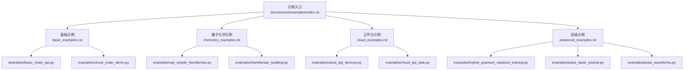
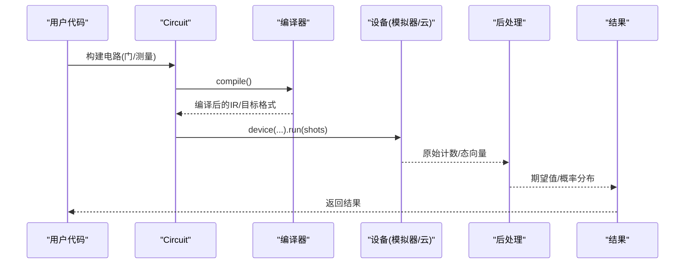
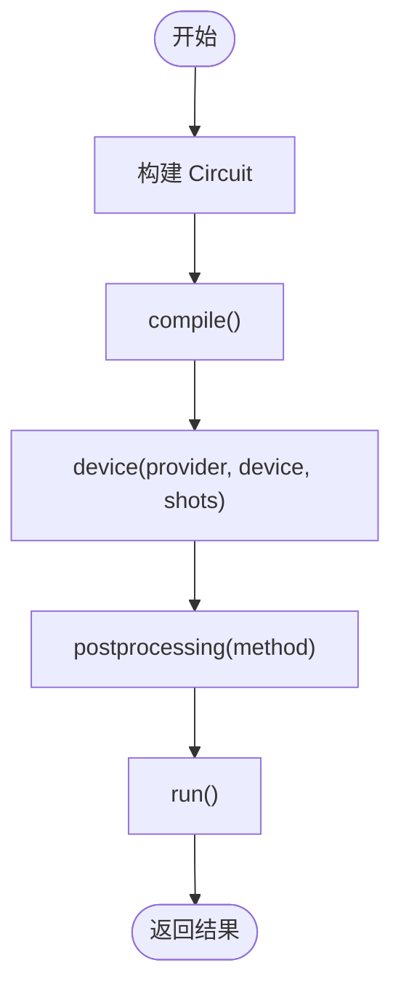
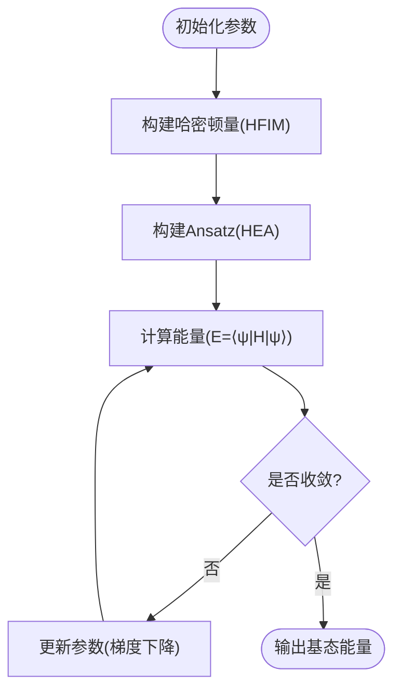
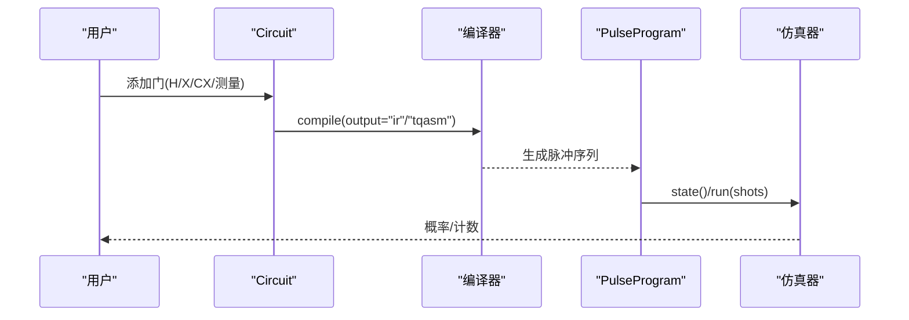
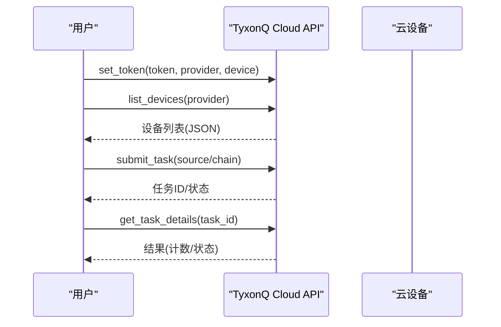
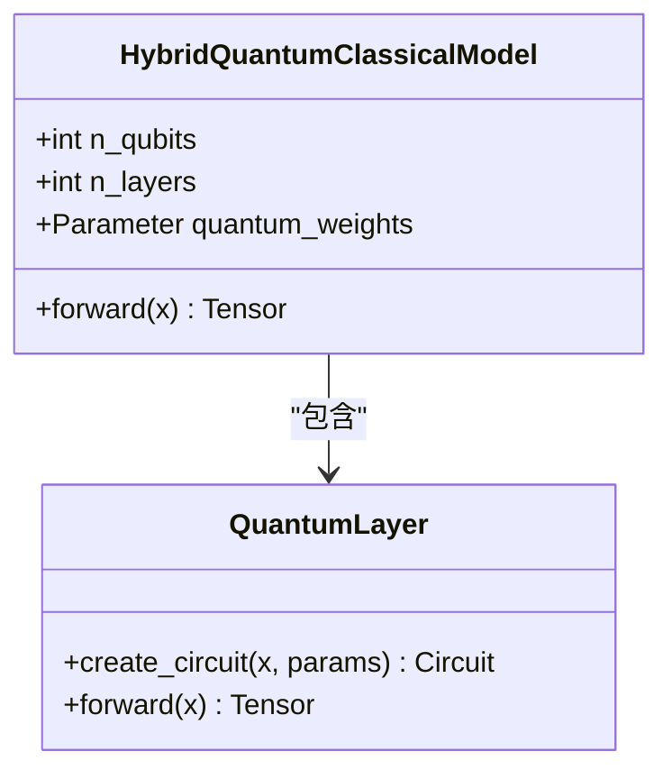
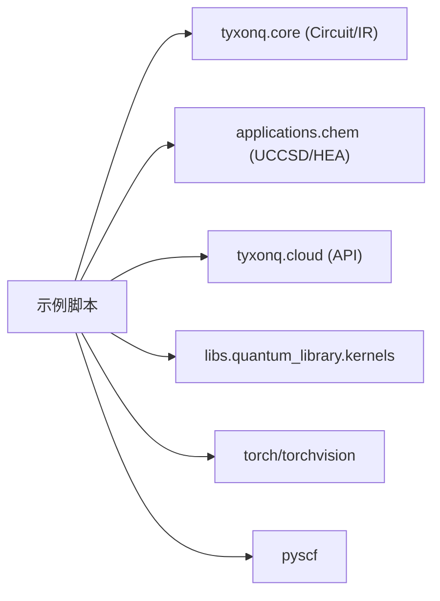

# 示例和教程

<cite>
**本文引用的文件**
- [examples/basic_chain_api.py](file://examples/basic_chain_api.py)
- [examples/circuit_chain_demo.py](file://examples/circuit_chain_demo.py)
- [examples/vqe_simple_hamiltonian.py](file://examples/vqe_simple_hamiltonian.py)
- [examples/pulse_basic_tutorial.py](file://examples/pulse_basic_tutorial.py)
- [examples/pulse_waveforms.py](file://examples/pulse_waveforms.py)
- [examples/cloud_api_devices.py](file://examples/cloud_api_devices.py)
- [examples/cloud_api_task.py](file://examples/cloud_api_task.py)
- [examples/hybrid_quantum_classical_training.py](file://examples/hybrid_quantum_classical_training.py)
- [examples/vqe_extra.py](file://examples/vqe_extra.py)
- [examples/hamiltonian_building.py](file://examples/hamiltonian_building.py)
- [docs/source/examples/index.rst](file://docs/source/examples/index.rst)
- [docs/source/getting_started/quickstart.rst](file://docs/source/getting_started/quickstart.rst)
- [docs/source/examples/basic_examples.rst](file://docs/source/examples/basic_examples.rst)
- [docs/source/examples/chemistry_examples.rst](file://docs/source/examples/chemistry_examples.rst)
- [docs/source/examples/cloud_examples.rst](file://docs/source/examples/cloud_examples.rst)
- [docs/source/examples/advanced_examples.rst](file://docs/source/examples/advanced_examples.rst)
</cite>

## 目录
1. [简介](#简介)
2. [项目结构](#项目结构)
3. [核心组件](#核心组件)
4. [架构总览](#架构总览)
5. [详细组件分析](#详细组件分析)
6. [依赖分析](#依赖分析)
7. [性能考虑](#性能考虑)
8. [故障排除指南](#故障排除指南)
9. [结论](#结论)
10. [附录：学习路径与示例索引](#附录学习路径与示例索引)

## 简介
本文件为 TyxonQ 的“示例和教程”综合文档，围绕 80+ 个高质量示例程序进行系统化组织与讲解。内容覆盖：
- 基础示例：链式 API、简单量子电路、测量与组合
- 量子化学示例：H₂ 分子 VQE、哈密顿量构建、性质计算
- 脉冲编程示例：波形设计、门到脉冲编译、TQASM 导出
- 云平台示例：设备查询、任务提交、异步轮询
每个示例均提供代码路径、关键概念解释、预期输出要点与理论背景说明，并给出逐步学习路径、常见问题与排错建议，帮助新用户快速上手并应用于实际科研与开发。

## 项目结构
TyxonQ 示例按难度与应用域分层组织，便于循序渐进学习：
- 入门与基础：链式 API、Circuit 构建、测量、组合、可视化
- 量子化学：VQE、UCCSD/HEA、活性空间、势能面扫描
- 脉冲编程：波形库、参数化脉冲、门到脉冲编译、TQASM
- 云平台：设备列表、任务提交、结果获取、错误缓解
- 高级应用：混合量子经典训练、噪声模拟、优化策略

**图示来源**
- [docs/source/examples/index.rst:1-19](file://docs/source/examples/index.rst#L1-L19)

**章节来源**
- [docs/source/examples/index.rst:1-19](file://docs/source/examples/index.rst#L1-L19)

## 核心组件
本节聚焦示例中反复出现的核心能力与模式，结合具体示例文件说明其用法与价值。

- 链式 API 与全局配置
  - 通过 compile().device().postprocessing().run() 完成编译、设备选择、后处理与执行；支持全局默认值与自动补全，简化重复配置。
  - 参考：[examples/basic_chain_api.py:22-75](file://examples/basic_chain_api.py#L22-L75)、[examples/circuit_chain_demo.py:46-118](file://examples/circuit_chain_demo.py#L46-L118)

- 多后端与数值计算
  - 支持 NumPy、PyTorch、CuPyNumeric 等后端切换；在 VQE 与混合训练中利用自动微分加速梯度计算。
  - 参考：[examples/basic_chain_api.py:104-124](file://examples/basic_chain_api.py#L104-L124)、[examples/hybrid_quantum_classical_training.py:231-303](file://examples/hybrid_quantum_classical_training.py#L231-L303)

- 量子化学 VQE
  - 使用硬件高效 Ansatz（HEA）或 UCCSD，构建 TFIM 或分子哈密顿量，基于计数或态矢量估计能量与梯度。
  - 参考：[examples/vqe_simple_hamiltonian.py:55-152](file://examples/vqe_simple_hamiltonian.py#L55-L152)、[examples/vqe_extra.py:22-66](file://examples/vqe_extra.py#L22-L66)、[examples/hamiltonian_building.py:18-77](file://examples/hamiltonian_building.py#L18-L77)

- 脉冲编程与波形
  - 演示 DRAG/Gaussian/Blackman 等波形，门到脉冲编译，TQASM 导出，以及参数扫描优化。
  - 参考：[examples/pulse_basic_tutorial.py:34-217](file://examples/pulse_basic_tutorial.py#L34-L217)、[examples/pulse_waveforms.py:40-169](file://examples/pulse_waveforms.py#L40-L169)

- 云平台任务
  - 设备查询、任务提交（OpenQASM 与链式）、异步轮询与结果获取。
  - 参考：[examples/cloud_api_devices.py:16-21](file://examples/cloud_api_devices.py#L16-L21)、[examples/cloud_api_task.py:30-59](file://examples/cloud_api_task.py#L30-L59)

**章节来源**
- [examples/basic_chain_api.py:22-124](file://examples/basic_chain_api.py#L22-L124)
- [examples/circuit_chain_demo.py:46-118](file://examples/circuit_chain_demo.py#L46-L118)
- [examples/vqe_simple_hamiltonian.py:55-152](file://examples/vqe_simple_hamiltonian.py#L55-L152)
- [examples/vqe_extra.py:22-66](file://examples/vqe_extra.py#L22-L66)
- [examples/hamiltonian_building.py:18-77](file://examples/hamiltonian_building.py#L18-L77)
- [examples/pulse_basic_tutorial.py:34-217](file://examples/pulse_basic_tutorial.py#L34-L217)
- [examples/pulse_waveforms.py:40-169](file://examples/pulse_waveforms.py#L40-L169)
- [examples/cloud_api_devices.py:16-21](file://examples/cloud_api_devices.py#L16-L21)
- [examples/cloud_api_task.py:30-59](file://examples/cloud_api_task.py#L30-L59)

## 架构总览
下图展示从用户代码到执行结果的典型数据流：Circuit 构建 → 编译 → 设备选择（模拟器/云）→ 运行 → 后处理与结果。

**图示来源**
- [examples/circuit_chain_demo.py:46-118](file://examples/circuit_chain_demo.py#L46-L118)
- [examples/cloud_api_task.py:52-59](file://examples/cloud_api_task.py#L52-L59)

## 详细组件分析

### 基础示例：链式 API 与电路构建
- 目标：掌握 TyxonQ 的链式编程范式、全局默认配置、自动补全与多后端切换。
- 关键点：
  - 链式调用：compile().device().postprocessing().run()
  - 全局默认：tq.device(...) 设置全局默认，减少重复配置
  - 自动补全：仅指定 shots 时，其他选项智能补齐
  - 多后端：NumPy/PyTorch/CuPyNumeric 无缝切换
- 预期输出要点：
  - 显式链式调用返回计数或状态向量
  - 全局默认生效，简化 run() 调用
  - 自动补全后结果一致
  - 不同后端得到等价数值结果（精度可能略有差异）

**图示来源**
- [examples/basic_chain_api.py:22-75](file://examples/basic_chain_api.py#L22-L75)
- [examples/circuit_chain_demo.py:46-118](file://examples/circuit_chain_demo.py#L46-L118)

**章节来源**
- [examples/basic_chain_api.py:22-124](file://examples/basic_chain_api.py#L22-L124)
- [examples/circuit_chain_demo.py:27-139](file://examples/circuit_chain_demo.py#L27-L139)

### 量子化学示例：TFIM VQE 与哈密顿量构建
- 目标：使用 HEA/UCCSD 求解横向场 Ising 模型基态能量，理解计数与态矢量两种能量估计路径。
- 关键点：
  - 哈密顿量构建：Heisenberg 构建器构造 ZZ 耦合与 X 场项
  - Ansatz：初始 H 层 + 纠缠层(CNOT 阶梯) + 旋转层(RY/RZ)
  - 能量估计：态矢量直接矩阵乘法；或基于计数分别测量 Z_i Z_{i+1} 与 X_i
  - 梯度：value_and_grad 或参数平移法（Parameter Shift）
- 预期输出要点：
  - 收敛至接近精确对角化的基态能量
  - 每步优化时间与误差记录
  - 计数路径与态矢量路径对比

**图示来源**
- [examples/vqe_simple_hamiltonian.py:55-152](file://examples/vqe_simple_hamiltonian.py#L55-L152)
- [examples/vqe_extra.py:22-66](file://examples/vqe_extra.py#L22-L66)
- [examples/hamiltonian_building.py:18-77](file://examples/hamiltonian_building.py#L18-L77)

**章节来源**
- [examples/vqe_simple_hamiltonian.py:55-255](file://examples/vqe_simple_hamiltonian.py#L55-L255)
- [examples/vqe_extra.py:22-168](file://examples/vqe_extra.py#L22-L168)
- [examples/hamiltonian_building.py:18-94](file://examples/hamiltonian_building.py#L18-L94)

### 脉冲编程示例：波形设计与编译
- 目标：掌握脉冲级编程、波形类型、门到脉冲编译与 TQASM 导出。
- 关键点：
  - 波形：Constant/Gaussian/DRAG/Hermite/BlackmanSquare/CosineDrag
  - 单/双量子比特门实现：DRAG 用于单比特旋转；CX/iSWAP/SWAP 通过序列分解
  - 编译：compile(output="ir"/"tqasm") 将门转换为脉冲指令
  - 执行：理想仿真（shots=0）与真实采样（shots>0）对比
- 预期输出要点：
  - 不同包络对泄漏与保真度的影响
  - 参数扫描找到最优振幅与 beta
  - TQASM 代码可用于云端提交

**图示来源**
- [examples/pulse_basic_tutorial.py:154-217](file://examples/pulse_basic_tutorial.py#L154-L217)
- [examples/pulse_waveforms.py:176-322](file://examples/pulse_waveforms.py#L176-L322)

**章节来源**
- [examples/pulse_basic_tutorial.py:34-407](file://examples/pulse_basic_tutorial.py#L34-L407)
- [examples/pulse_waveforms.py:40-578](file://examples/pulse_waveforms.py#L40-L578)

### 云平台示例：设备查询与任务提交
- 目标：使用 TyxonQ 云 API 列出设备、提交任务、轮询结果。
- 关键点：
  - 认证：set_token(provider, device)
  - 设备列表：list_devices(provider)
  - 任务提交：legacy 方式（OPENQASM 源）与 chain 方式（Circuit→compile→submit）
  - 异步轮询：wait_async_result=True 或直接 get_task_details
- 预期输出要点：
  - 设备信息 JSON
  - 任务 ID 与状态
  - 最终计数结果

**图示来源**
- [examples/cloud_api_devices.py:16-21](file://examples/cloud_api_devices.py#L16-L21)
- [examples/cloud_api_task.py:30-59](file://examples/cloud_api_task.py#L30-L59)

**章节来源**
- [examples/cloud_api_devices.py:1-29](file://examples/cloud_api_devices.py#L1-L29)
- [examples/cloud_api_task.py:1-65](file://examples/cloud_api_task.py#L1-L65)

### 混合量子经典训练示例：端到端 PyTorch 集成
- 目标：展示量子电路作为神经网络层的端到端训练，GPU 加速与自动微分。
- 关键点：
  - 数据预处理：MNIST 二分类（1 vs 5），降采样与二值化
  - 量子层：编码层 + 变分层（旋转+纠缠）+ 测量期望
  - 训练循环：BCELoss + Adam，手动批处理量子评估
- 预期输出要点：
  - 损失下降与准确率提升
  - GPU 加速效果显著
  - 量子层可微分，支持反向传播

**图示来源**
- [examples/hybrid_quantum_classical_training.py:131-226](file://examples/hybrid_quantum_classical_training.py#L131-L226)

**章节来源**
- [examples/hybrid_quantum_classical_training.py:72-303](file://examples/hybrid_quantum_classical_training.py#L72-L303)

## 依赖分析
- 模块内聚与耦合：
  - 示例文件主要依赖 tyxonq 核心（Circuit、Hamiltonian、waveforms、compiler.api.compile）与云平台 API（tq.api）。
  - 量子化学示例依赖 applications.chem 中的算法（UCCSD/HEA）与 pyscf 分子定义。
  - 混合训练示例依赖 torch/torchvision 与 tyxonq.libs.quantum_library.kernels。
- 外部依赖：
  - 云平台需要有效 token 与网络访问
  - 量子化学需安装 pyscf
  - 混合训练需 PyTorch 与可选 CUDA

**图示来源**
- [examples/vqe_simple_hamiltonian.py:34-39](file://examples/vqe_simple_hamiltonian.py#L34-L39)
- [examples/hybrid_quantum_classical_training.py:30-50](file://examples/hybrid_quantum_classical_training.py#L30-L50)
- [examples/cloud_api_task.py:10-14](file://examples/cloud_api_task.py#L10-L14)

**章节来源**
- [examples/vqe_simple_hamiltonian.py:34-39](file://examples/vqe_simple_hamiltonian.py#L34-L39)
- [examples/hybrid_quantum_classical_training.py:30-50](file://examples/hybrid_quantum_classical_training.py#L30-L50)
- [examples/cloud_api_task.py:10-14](file://examples/cloud_api_task.py#L10-L14)

## 性能考虑
- 后端选择：
  - NumPy：适合小规模与调试；梯度计算稳定
  - PyTorch：端到端自动微分，GPU 加速显著
  - CuPyNumeric：大规模态矢量与张量运算加速
- 设备选择：
  - statevector：纯态精确仿真，速度快
  - density_matrix：含噪声与混合态，开销较大
  - mps：低纠缠大系统更高效
- 脉冲优化：
  - DRAG 抑制泄漏，beta 参数需校准
  - 包络形状影响频谱与保真度
- 云平台：
  - 先本地/云仿真验证，再上硬件
  - 合理 shots 与批处理降低成本
  - 缓存编译电路与优先级队列管理

[本节为通用指导，不直接分析具体文件]

## 故障排除指南
- 认证失败（云平台）
  - 检查 token 设置与有效期；使用 test_connection 验证
  - 参考：[docs/source/examples/cloud_examples.rst:506-516](file://docs/source/examples/cloud_examples.rst#L506-L516)
- 任务超时
  - 延长 wait_for_completion 超时时间；轮询状态
  - 参考：[docs/source/examples/cloud_examples.rst:518-531](file://docs/source/examples/cloud_examples.rst#L518-L531)
- 电路被拒绝
  - 提交前 validate_circuit；必要时 compile_for_device 转换为本机门集
  - 参考：[docs/source/examples/cloud_examples.rst:532-553](file://docs/source/examples/cloud_examples.rst#L532-L553)
- 优化不收敛（量子化学）
  - 增加 maxiter；尝试 COBYLA/L-BFGS-B；调整 ansatz 深度
  - 参考：[docs/source/examples/chemistry_examples.rst:530-538](file://docs/source/examples/chemistry_examples.rst#L530-L538)
- 内存不足（大电路）
  - 使用 MPS 模拟器；减少 qubits 或 depth
  - 参考：[docs/source/examples/basic_examples.rst:456-463](file://docs/source/examples/basic_examples.rst#L456-L463)

**章节来源**
- [docs/source/examples/cloud_examples.rst:506-553](file://docs/source/examples/cloud_examples.rst#L506-L553)
- [docs/source/examples/chemistry_examples.rst:530-538](file://docs/source/examples/chemistry_examples.rst#L530-L538)
- [docs/source/examples/basic_examples.rst:456-463](file://docs/source/examples/basic_examples.rst#L456-L463)

## 结论
本教程以 TyxonQ 示例为核心，系统梳理了从基础到高级的学习路径与实践方法。通过链式 API、量子化学 VQE、脉冲编程与云平台任务的完整示例，读者可以：
- 快速掌握 TyxonQ 的核心编程范式与工具链
- 在量子化学与机器学习场景中落地实际应用
- 在真实硬件与模拟器之间灵活切换，优化性能与成本
建议结合文档与示例逐步实践，遇到问题优先查阅故障排除指南与社区资源。

[本节为总结性内容，不直接分析具体文件]

## 附录：学习路径与示例索引
- 入门路径
  - 快速开始：创建第一个电路、编译与执行
    - 参考：[docs/source/getting_started/quickstart.rst:16-77](file://docs/source/getting_started/quickstart.rst#L16-L77)
  - 基础示例：Bell/GHZ/QFT/随机电路/组合与可视化
    - 参考：[docs/source/examples/basic_examples.rst:11-259](file://docs/source/examples/basic_examples.rst#L11-L259)
  - 链式 API 全面演示：全局默认、自动补全、多后端、QASM 编译、JSON 序列化
    - 参考：[examples/circuit_chain_demo.py:27-238](file://examples/circuit_chain_demo.py#L27-L238)

- 量子化学路径
  - 首个分子 H₂ 基态能量（UCCSD/HEA）
    - 参考：[docs/source/examples/chemistry_examples.rst:18-85](file://docs/source/examples/chemistry_examples.rst#L18-L85)
  - 哈密顿量构建与计数能量估计
    - 参考：[examples/hamiltonian_building.py:18-94](file://examples/hamiltonian_building.py#L18-L94)
  - VQE 进阶：counts-based 能量与参数平移梯度
    - 参考：[examples/vqe_extra.py:22-66](file://examples/vqe_extra.py#L22-L66)

- 脉冲编程路径
  - 入门教程：Hello World、参数化脉冲、门到脉冲编译、TQASM 导出
    - 参考：[examples/pulse_basic_tutorial.py:34-217](file://examples/pulse_basic_tutorial.py#L34-L217)
  - 波形库与优化：包络比较、单/双比特门实现、参数扫描
    - 参考：[examples/pulse_waveforms.py:40-400](file://examples/pulse_waveforms.py#L40-L400)

- 云平台路径
  - 设备查询与任务提交（legacy 与 chain 两种方式）
    - 参考：[examples/cloud_api_devices.py:16-21](file://examples/cloud_api_devices.py#L16-L21)
    - 参考：[examples/cloud_api_task.py:30-59](file://examples/cloud_api_task.py#L30-L59)
  - 云最佳实践：认证、设备管理、任务生命周期、错误缓解
    - 参考：[docs/source/examples/cloud_examples.rst:14-298](file://docs/source/examples/cloud_examples.rst#L14-L298)

- 高级应用路径
  - 混合量子经典训练：端到端 PyTorch 集成与 GPU 加速
    - 参考：[examples/hybrid_quantum_classical_training.py:72-303](file://examples/hybrid_quantum_classical_training.py#L72-L303)
  - 噪声模拟与 NISQ 算法：不同噪声模型对比、硬件噪声建模
    - 参考：[docs/source/examples/advanced_examples.rst:624-800](file://docs/source/examples/advanced_examples.rst#L624-L800)

**章节来源**
- [docs/source/getting_started/quickstart.rst:16-77](file://docs/source/getting_started/quickstart.rst#L16-L77)
- [docs/source/examples/basic_examples.rst:11-259](file://docs/source/examples/basic_examples.rst#L11-L259)
- [examples/circuit_chain_demo.py:27-238](file://examples/circuit_chain_demo.py#L27-L238)
- [docs/source/examples/chemistry_examples.rst:18-85](file://docs/source/examples/chemistry_examples.rst#L18-L85)
- [examples/hamiltonian_building.py:18-94](file://examples/hamiltonian_building.py#L18-L94)
- [examples/vqe_extra.py:22-66](file://examples/vqe_extra.py#L22-L66)
- [examples/pulse_basic_tutorial.py:34-217](file://examples/pulse_basic_tutorial.py#L34-L217)
- [examples/pulse_waveforms.py:40-400](file://examples/pulse_waveforms.py#L40-L400)
- [examples/cloud_api_devices.py:16-21](file://examples/cloud_api_devices.py#L16-L21)
- [examples/cloud_api_task.py:30-59](file://examples/cloud_api_task.py#L30-L59)
- [docs/source/examples/cloud_examples.rst:14-298](file://docs/source/examples/cloud_examples.rst#L14-L298)
- [examples/hybrid_quantum_classical_training.py:72-303](file://examples/hybrid_quantum_classical_training.py#L72-L303)
- [docs/source/examples/advanced_examples.rst:624-800](file://docs/source/examples/advanced_examples.rst#L624-L800)