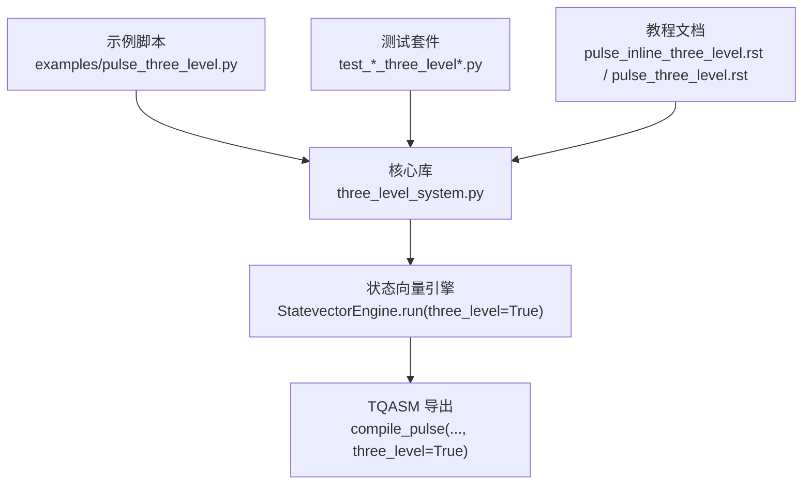
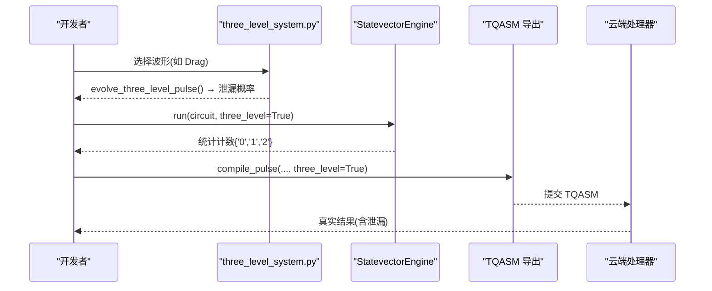
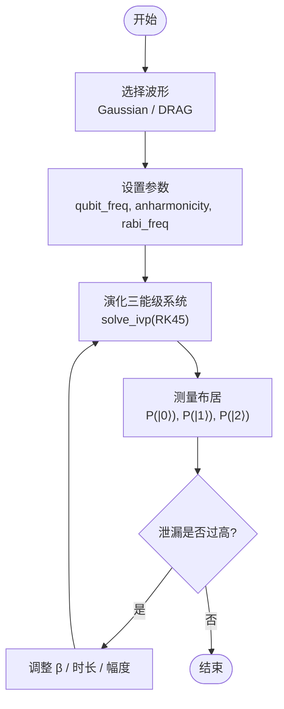
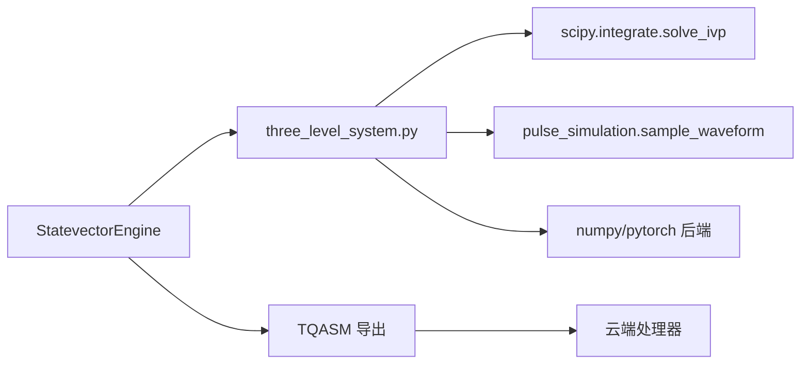

# 三能级系统示例

<cite>
**本文引用的文件**
- [examples/pulse_three_level.py](file://examples/pulse_three_level.py)
- [src/tyxonq/libs/quantum_library/three_level_system.py](file://src/tyxonq/libs/quantum_library/three_level_system.py)
- [tests_core_module/test_three_level_system.py](file://tests_core_module/test_three_level_system.py)
- [tests_core_module/test_pulse_inline_three_level.py](file://tests_core_module/test_pulse_inline_three_level.py)
- [tests_core_module/test_three_level_device.py](file://tests_core_module/test_three_level_device.py)
- [docs/source/tutorials/advanced/pulse_inline_three_level.rst](file://docs/source/tutorials/advanced/pulse_inline_three_level.rst)
- [docs/source/tutorials/advanced/pulse_three_level.rst](file://docs/source/tutorials/advanced/pulse_three_level.rst)
</cite>

## 目录
1. [简介](#简介)
2. [项目结构](#项目结构)
3. [核心组件](#核心组件)
4. [架构总览](#架构总览)
5. [详细组件分析](#详细组件分析)
6. [依赖关系分析](#依赖关系分析)
7. [性能考量](#性能考量)
8. [故障排查指南](#故障排查指南)
9. [结论](#结论)
10. [附录](#附录)

## 简介
本文件面向真实量子硬件上的三能级（qutrit）物理模型与脉冲控制策略，系统性阐述：
- 三能级系统的哈密顿量、能级结构与跃迁过程
- 退相干与泄漏误差的来源及影响
- 使用脉冲序列实现精确量子态操控的方法（单能级旋转、双能级耦合、多能级纠缠）
- 完整的脉冲序列设计流程：能级校准、串扰抑制、泄漏误差抑制
- 噪声建模与误差缓解技术，帮助在实际硬件上获得更优实验结果

TyxonQ 提供了从数值模拟到云端提交的“双链路”能力：本地高精度数值仿真快速优化参数，再导出为 TQASM 在真实处理器上验证。

## 项目结构
围绕三能级系统与脉冲控制的代码与文档主要分布在以下位置：
- 示例脚本：演示三能级基础、泄漏效应、DRAG 抑制、设备对比、内联脉冲与多量子比特扩展
- 核心库：三能级演化、酉矩阵编译、最优 DRAG β 计算、投影到计算基
- 测试套件：覆盖数值方法、设备链式 API、内联脉冲与序列化往返等
- 教程文档：详细说明 pulse_inline 的三能级支持、TQASM 集成、参数扫描与最佳实践

图表来源
- [examples/pulse_three_level.py:1-551](file://examples/pulse_three_level.py#L1-L551)
- [src/tyxonq/libs/quantum_library/three_level_system.py:1-552](file://src/tyxonq/libs/quantum_library/three_level_system.py#L1-L552)
- [docs/source/tutorials/advanced/pulse_inline_three_level.rst:1-718](file://docs/source/tutorials/advanced/pulse_inline_three_level.rst#L1-L718)
- [docs/source/tutorials/advanced/pulse_three_level.rst:1-734](file://docs/source/tutorials/advanced/pulse_three_level.rst#L1-L734)

章节来源
- [examples/pulse_three_level.py:1-551](file://examples/pulse_three_level.py#L1-L551)
- [docs/source/tutorials/advanced/pulse_inline_three_level.rst:1-718](file://docs/source/tutorials/advanced/pulse_inline_three_level.rst#L1-L718)
- [docs/source/tutorials/advanced/pulse_three_level.rst:1-734](file://docs/source/tutorials/advanced/pulse_three_level.rst#L1-L734)

## 核心组件
- 三能级演化与酉编译
  - evolve_three_level_pulse：求解含时薛定谔方程，得到最终态与泄漏概率
  - compile_three_level_unitary：将脉冲编译为 3×3 酉矩阵，用于链式调用与测量
  - optimal_drag_beta：基于非谐性 α 计算最优 DRAG β
  - project_to_two_level：将三能级态投影并归一化到计算基 {|0⟩, |1⟩}
- 波形与脉冲
  - Gaussian、Drag、Constant、Flattop 等波形；DRAG 通过导数项抑制 |1⟩→|2⟩ 泄漏
- 设备与执行
  - StatevectorEngine.run(three_level=True)：启用三能级泄漏建模
  - pulse_inline：自包含的脉冲序列化格式，便于 TQASM 导出与云端提交
- 教程与示例
  - 提供完整工作流：参数扫描、泄漏抑制、设备对比、云提交验证

章节来源
- [src/tyxonq/libs/quantum_library/three_level_system.py:72-284](file://src/tyxonq/libs/quantum_library/three_level_system.py#L72-L284)
- [src/tyxonq/libs/quantum_library/three_level_system.py:287-472](file://src/tyxonq/libs/quantum_library/three_level_system.py#L287-L472)
- [src/tyxonq/libs/quantum_library/three_level_system.py:475-552](file://src/tyxonq/libs/quantum_library/three_level_system.py#L475-L552)
- [docs/source/tutorials/advanced/pulse_inline_three_level.rst:108-174](file://docs/source/tutorials/advanced/pulse_inline_three_level.rst#L108-L174)
- [docs/source/tutorials/advanced/pulse_three_level.rst:22-80](file://docs/source/tutorials/advanced/pulse_three_level.rst#L22-L80)

## 架构总览
TyxonQ 的三能级系统采用“双链路”架构：
- Path B（数值方法）：本地高精度数值仿真，快速进行参数优化与泄漏评估
- Path A（真实硬件）：将优化后的脉冲以 TQASM 形式提交至云端处理器，进行实际验证

图表来源
- [src/tyxonq/libs/quantum_library/three_level_system.py:72-284](file://src/tyxonq/libs/quantum_library/three_level_system.py#L72-L284)
- [docs/source/tutorials/advanced/pulse_inline_three_level.rst:549-603](file://docs/source/tutorials/advanced/pulse_inline_three_level.rst#L549-L603)

## 详细组件分析

### 物理模型：哈密顿量、能级结构与跃迁
- 能级结构
  - |0⟩：基态
  - |1⟩：第一激发态（计算空间）
  - |2⟩：第二激发态（泄漏态）
- 哈密顿量（旋转框架、RWA）
  - H(t) = ω₀₁|1⟩⟨1| + (2ω₀₁+α)|2⟩⟨2| + Ω(t)[|0⟩⟨1| + |1⟩⟨2|]
  - 其中 α 为非谐性（典型值约 -330 MHz），Ω(t) 为脉冲包络
- 跃迁过程
  - |0⟩↔|1⟩：主驱动跃迁
  - |1⟩↔|2⟩：泄漏路径，受 α 与 Ω(t) 共同影响
- 退相干机制
  - T1：能量弛豫时间
  - T2：退相位时间
  - 泄漏误差：脉冲导致布居进入 |2⟩，降低门保真度

章节来源
- [src/tyxonq/libs/quantum_library/three_level_system.py:7-21](file://src/tyxonq/libs/quantum_library/three_level_system.py#L7-L21)
- [docs/source/tutorials/advanced/pulse_three_level.rst:22-80](file://docs/source/tutorials/advanced/pulse_three_level.rst#L22-L80)

### 脉冲控制策略：DRAG 与泄漏抑制
- DRAG（Derivative Removal by Adiabatic Gate）
  - 在包络中加入导数项：Ω_DRAG(t) = Ω_I(t) + iβ·dΩ_I/dt
  - 理论最优 β ≈ -1/(2α)，可显著抑制 |1⟩→|2⟩ 泄漏
- 波形选择
  - Gaussian：平滑包络，减少泄漏但仍有残余
  - DRAG：进一步抑制泄漏，适合高 Rabi 频率场景
- 参数扫描
  - 对 β、rabi_freq、anharmonicity 进行扫描，找到最小泄漏点

图表来源
- [src/tyxonq/libs/quantum_library/three_level_system.py:183-284](file://src/tyxonq/libs/quantum_library/three_level_system.py#L183-L284)
- [docs/source/tutorials/advanced/pulse_three_level.rst:129-216](file://docs/source/tutorials/advanced/pulse_three_level.rst#L129-L216)

### 单能级旋转、双能级耦合与多能级纠缠
- 单能级旋转
  - 通过 X/Y 类脉冲实现 |0⟩↔|1⟩ 旋转，注意泄漏到 |2⟩
- 双能级耦合
  - 两量子比特门（如 CZ/CNOT）需考虑相邻能级的串扰与非谐性
- 多能级纠缠
  - 在三能级系统中，需避免意外激发到 |2⟩，否则破坏纠缠质量
  - 可通过 DRAG、时序优化、频率隔离等手段抑制泄漏与串扰

章节来源
- [examples/pulse_three_level.py:238-444](file://examples/pulse_three_level.py#L238-L444)
- [docs/source/tutorials/advanced/pulse_inline_three_level.rst:356-440](file://docs/source/tutorials/advanced/pulse_inline_three_level.rst#L356-L440)

### 完整脉冲序列设计与校准流程
- 步骤概览
  1) 初始化设备参数：qubit_freq、anharmonicity、T1/T2
  2) 选择波形与初始参数：Gaussian/DRAG，设定 β、duration、sigma
  3) 本地数值仿真：evolve_three_level_pulse 或 StatevectorEngine.run(three_level=True)
  4) 参数扫描：β、rabi_freq、duration，寻找最小泄漏
  5) 导出 TQASM：compile_pulse(..., three_level=True)
  6) 云端验证：比较仿真与真实结果，微调参数
- 关键注意事项
  - 泄漏误差累积会随门数量增加而放大
  - 高 Rabi 频率会增加泄漏，需权衡速度与精度
  - 非谐性越大，泄漏越小；不同器件 α 不同，需实测校准

章节来源
- [docs/source/tutorials/advanced/pulse_inline_three_level.rst:571-603](file://docs/source/tutorials/advanced/pulse_inline_three_level.rst#L571-L603)
- [docs/source/tutorials/advanced/pulse_three_level.rst:333-380](file://docs/source/tutorials/advanced/pulse_three_level.rst#L333-L380)

### 噪声建模与误差缓解
- 噪声建模
  - T1/T2 衰减：在设备运行中引入采样噪声与退相位
  - 泄漏误差：|2⟩ 态布居导致测量分布偏离理想
- 误差缓解
  - 读取误差校正：利用后处理模块进行读出误码校正
  - 泄漏识别与剔除：在统计中识别 |2⟩ 事件，必要时丢弃或修正
  - 参数鲁棒性：通过 DRAG 与参数扫描提升对失谐与功率波动的容忍度

章节来源
- [docs/source/tutorials/advanced/pulse_three_level.rst:336-360](file://docs/source/tutorials/advanced/pulse_three_level.rst#L336-L360)
- [docs/source/tutorials/advanced/pulse_inline_three_level.rst:514-548](file://docs/source/tutorials/advanced/pulse_inline_three_level.rst#L514-L548)

## 依赖关系分析
- 核心依赖
  - scipy.integrate.solve_ivp：用于三能级薛定谔方程数值积分
  - numpy/pytorch：后端数组与梯度传播（可选）
  - pulse_simulation.sample_waveform：采样波形包络
- 组件耦合
  - three_level_system 与 StatevectorEngine：通过 three_level=True 启用泄漏建模
  - pulse_inline 与 TQASM：自包含序列化，便于云端提交
- 外部接口
  - 云端处理器：接收 TQASM 并执行真实三能级物理过程

图表来源
- [src/tyxonq/libs/quantum_library/three_level_system.py:67-70](file://src/tyxonq/libs/quantum_library/three_level_system.py#L67-L70)
- [docs/source/tutorials/advanced/pulse_inline_three_level.rst:549-603](file://docs/source/tutorials/advanced/pulse_inline_three_level.rst#L549-L603)

章节来源
- [src/tyxonq/libs/quantum_library/three_level_system.py:67-70](file://src/tyxonq/libs/quantum_library/three_level_system.py#L67-L70)
- [docs/source/tutorials/advanced/pulse_inline_three_level.rst:549-603](file://docs/source/tutorials/advanced/pulse_inline_three_level.rst#L549-L603)

## 性能考量
- 数值积分开销
  - solve_ivp(RK45) 自适应步长，精度高但耗时；建议仅用于离线优化
- 单位矩阵编译
  - compile_three_level_unitary 对三个基矢分别演化，构建 3×3 酉矩阵
- 多量子比特扩展
  - 当前三能级模拟主要针对单量子比特；多量子比特需谨慎，可能发出警告
- 采样统计
  - shots>0 时存在统计波动；大样本可降低方差但增加时间

章节来源
- [src/tyxonq/libs/quantum_library/three_level_system.py:256-284](file://src/tyxonq/libs/quantum_library/three_level_system.py#L256-L284)
- [tests_core_module/test_three_level_device.py:135-156](file://tests_core_module/test_three_level_device.py#L135-L156)

## 故障排查指南
- 常见问题
  - 出现 '2' 输出：表示泄漏到 |2⟩，属预期现象；使用 DRAG 或增大 |α| 抑制
  - 三能级模式较慢：3×3 酉矩阵比 2×2 慢约 30-50%，建议仅在提交前验证
  - 结果差异：pulse 与 pulse_inline 可能存在微小差异，属数值与统计误差范围
- 定位方法
  - 检查 anharmonicity、rabi_freq、β 设置是否合理
  - 使用 StatevectorEngine.state() 查看中间态，确认泄漏来源
  - 对比 2-level 与 3-level 结果，量化泄漏影响

章节来源
- [docs/source/tutorials/advanced/pulse_inline_three_level.rst:687-703](file://docs/source/tutorials/advanced/pulse_inline_three_level.rst#L687-L703)
- [tests_core_module/test_pulse_inline_three_level.py:201-299](file://tests_core_module/test_pulse_inline_three_level.py#L201-L299)

## 结论
TyxonQ 的三能级系统仿真与脉冲控制工具链，为真实硬件上的量子操作提供了从理论到实践的完整闭环：
- 准确建模泄漏误差，指导脉冲优化
- 双链路架构兼顾效率与准确性
- 丰富的示例与测试保障可靠性
- 结合噪声建模与误差缓解，提升实验成功率

建议在实际项目中：
- 始终使用三能级仿真验证脉冲方案
- 针对具体器件校准 α、β、rabi_freq
- 通过 TQASM 提交云端，对比仿真与真实结果持续迭代

## 附录
- 参考示例与测试
  - 示例脚本：examples/pulse_three_level.py
  - 测试套件：test_three_level_system.py、test_pulse_inline_three_level.py、test_three_level_device.py
- 教程文档
  - pulse_inline 三能级支持：docs/source/tutorials/advanced/pulse_inline_three_level.rst
  - 三能级系统基础：docs/source/tutorials/advanced/pulse_three_level.rst

章节来源
- [examples/pulse_three_level.py:1-551](file://examples/pulse_three_level.py#L1-L551)
- [tests_core_module/test_three_level_system.py:1-223](file://tests_core_module/test_three_level_system.py#L1-L223)
- [tests_core_module/test_pulse_inline_three_level.py:1-486](file://tests_core_module/test_pulse_inline_three_level.py#L1-L486)
- [tests_core_module/test_three_level_device.py:1-267](file://tests_core_module/test_three_level_device.py#L1-L267)
- [docs/source/tutorials/advanced/pulse_inline_three_level.rst:1-718](file://docs/source/tutorials/advanced/pulse_inline_three_level.rst#L1-L718)
- [docs/source/tutorials/advanced/pulse_three_level.rst:1-734](file://docs/source/tutorials/advanced/pulse_three_level.rst#L1-L734)