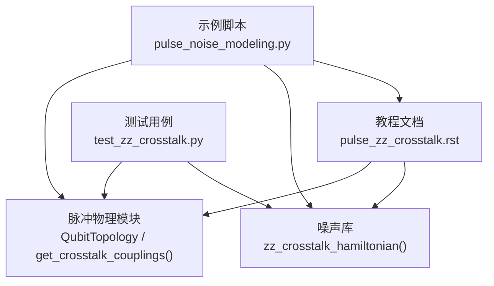
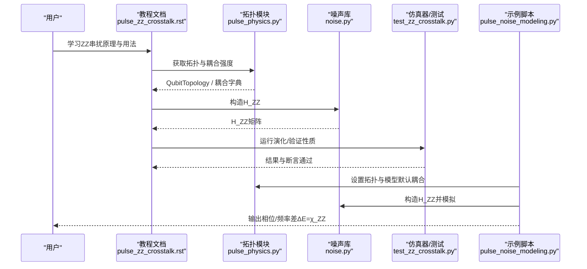
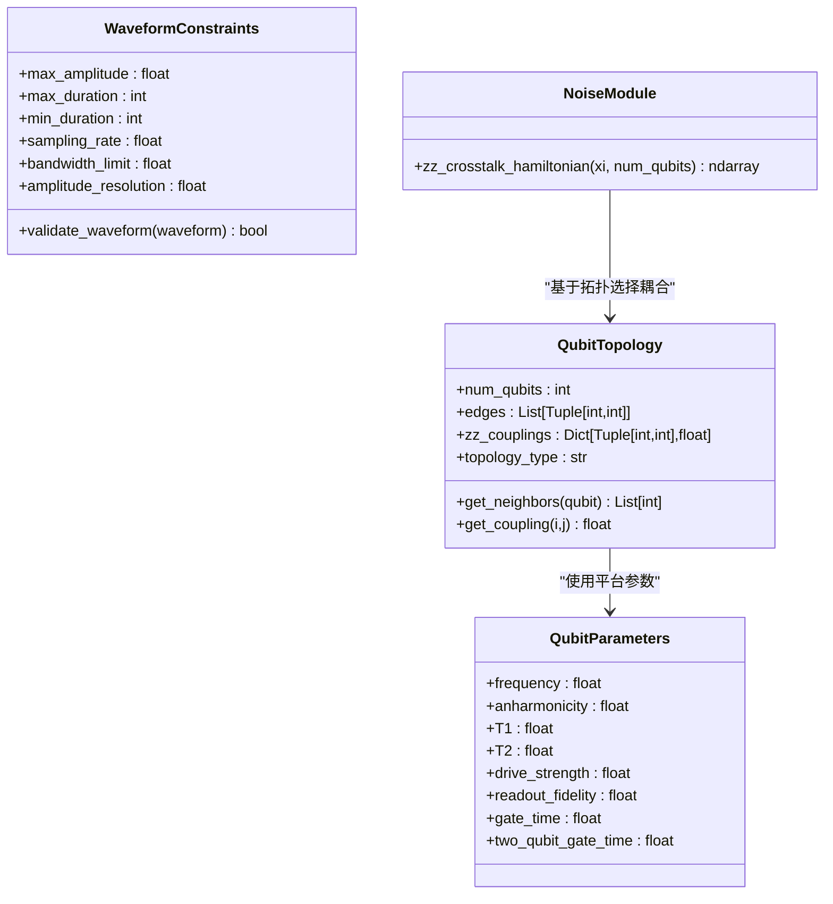
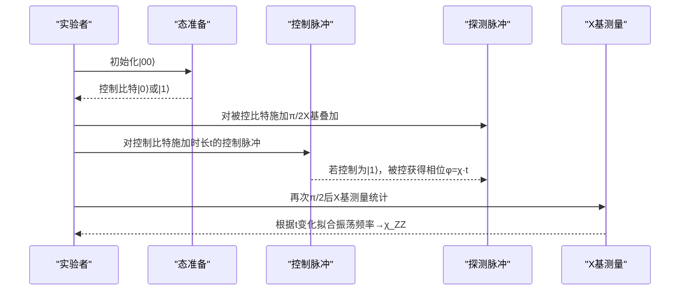
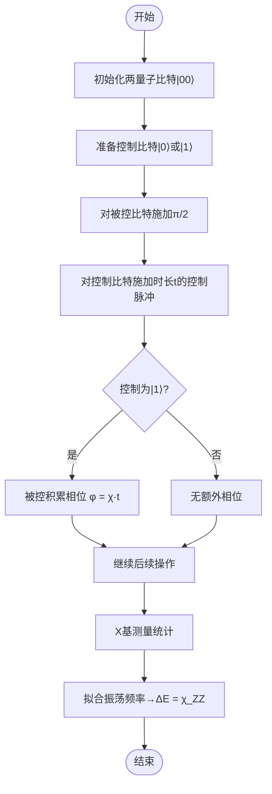
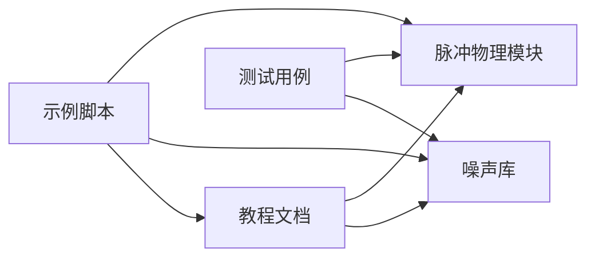

# ZZ串扰基础原理

<cite>
**本文引用的文件**
- [pulse_zz_crosstalk.rst](file://docs/source/tutorials/advanced/pulse_zz_crosstalk.rst)
- [noise.py](file://src/tyxonq/libs/quantum_library/noise.py)
- [pulse_physics.py](file://src/tyxonq/libs/quantum_library/pulse_physics.py)
- [test_zz_crosstalk.py](file://tests_core_module/test_zz_crosstalk.py)
- [pulse_noise_modeling.py](file://examples/pulse_noise_modeling.py)
</cite>

## 目录
1. [简介](#简介)
2. [项目结构](#项目结构)
3. [核心组件](#核心组件)
4. [架构总览](#架构总览)
5. [详细组件分析](#详细组件分析)
6. [依赖关系分析](#依赖关系分析)
7. [性能考量](#性能考量)
8. [故障排查指南](#故障排查指南)
9. [结论](#结论)
10. [附录](#附录)

## 简介
本文件面向超导量子比特中的ZZ串扰（ZZ crosstalk）基础原理，系统阐述其物理机制、数学描述与实验测量流程。重点包括：
- 控制脉冲边带耦合导致的条件相位累积
- 哈密顿量 H_ZZ = χ Z₀ Z₁ 的物理含义与能级偏移
- 从|0⟩/|1⟩态准备到X基测量的完整实验流程，提取ZZ相位
- 硬件参数范围（χ_ZZ典型值1–100 kHz）与量化方法 ΔE = χ_ZZ

## 项目结构
围绕ZZ串扰的文档与实现分布在教程、库函数与测试中：
- 教程文档：系统性讲解ZZ串扰物理、拓扑配置与仿真用法
- 噪声库：提供ZZ哈密顿量构造与演化计算
- 脉冲物理模块：提供不同平台参数、拓扑结构与耦合强度映射
- 测试用例：验证哈密顿量形式、本征值、条件相位等关键性质
- 示例脚本：演示从基础概念到测量提取的全流程

图表来源
- [pulse_zz_crosstalk.rst:1-120](file://docs/source/tutorials/advanced/pulse_zz_crosstalk.rst#L1-L120)
- [noise.py:255-341](file://src/tyxonq/libs/quantum_library/noise.py#L255-L341)
- [pulse_physics.py:341-596](file://src/tyxonq/libs/quantum_library/pulse_physics.py#L341-L596)
- [test_zz_crosstalk.py:19-114](file://tests_core_module/test_zz_crosstalk.py#L19-L114)
- [pulse_noise_modeling.py:50-163](file://examples/pulse_noise_modeling.py#L50-L163)

章节来源
- [pulse_zz_crosstalk.rst:1-120](file://docs/source/tutorials/advanced/pulse_zz_crosstalk.rst#L1-L120)
- [pulse_physics.py:341-596](file://src/tyxonq/libs/quantum_library/pulse_physics.py#L341-L596)

## 核心组件
- ZZ哈密顿量构造：zz_crosstalk_hamiltonian(xi, num_qubits=2)
  - 构建H_ZZ = ξ·σ_z⊗σ_z，支持扩展到多量子比特空间
  - 适用于相邻量子比特间的“常开”耦合，导致条件相位累积
- 拓扑与耦合映射：get_qubit_topology(...) 与 get_crosstalk_couplings(...)
  - 支持线性链、二维网格、IBM Heavy-Hex及自定义拓扑
  - 提供不同平台（IBM/Google/Rigetti/离子阱等）的典型ZZ耦合强度
- 噪声通道与演化：结合时间演化算符U(t)=exp(-i H_ZZ t)，评估相位与保真度影响
- 测试与验证：覆盖矩阵维度、厄米性、本征值、条件相位、负耦合等

章节来源
- [noise.py:255-341](file://src/tyxonq/libs/quantum_library/noise.py#L255-L341)
- [pulse_physics.py:341-596](file://src/tyxonq/libs/quantum_library/pulse_physics.py#L341-L596)
- [test_zz_crosstalk.py:19-114](file://tests_core_module/test_zz_crosstalk.py#L19-L114)

## 架构总览
下图展示ZZ串扰建模在TyxonQ中的整体架构与数据流：

图表来源
- [pulse_zz_crosstalk.rst:81-137](file://docs/source/tutorials/advanced/pulse_zz_crosstalk.rst#L81-L137)
- [pulse_physics.py:384-596](file://src/tyxonq/libs/quantum_library/pulse_physics.py#L384-L596)
- [noise.py:255-341](file://src/tyxonq/libs/quantum_library/noise.py#L255-L341)
- [test_zz_crosstalk.py:19-114](file://tests_core_module/test_zz_crosstalk.py#L19-L114)
- [pulse_noise_modeling.py:50-163](file://examples/pulse_noise_modeling.py#L50-L163)

## 详细组件分析

### 物理机制：控制脉冲边带耦合与状态相关能量偏移
- 控制脉冲具有频谱展宽，其边带可能与邻近量子比特的跃迁频率发生耦合，产生条件性的ZZ相互作用
- 当控制量子比特处于|1⟩时，被控量子比特的有效频率发生偏移；处于|0⟩时无偏移
- 该效应可用H_ZZ = χ Z₀ Z₁描述，其中χ为ZZ耦合强度（典型1–100 kHz），导致条件相位累积φ = χ·t

章节来源
- [pulse_noise_modeling.py:50-101](file://examples/pulse_noise_modeling.py#L50-L101)
- [pulse_zz_crosstalk.rst:17-57](file://docs/source/tutorials/advanced/pulse_zz_crosstalk.rst#L17-L57)

### 哈密顿量描述与能级结构
- H_ZZ = ξ·σ_z⊗σ_z，对两量子比特系统的四个计算基态给出对角能量：
  - |00⟩和|11⟩能量偏移+ξ
  - |01⟩和|10⟩能量偏移-ξ
- 时间演化U(t)=exp(-i H_ZZ t)在|11⟩态上积累条件相位φ=ξ·t
- 多量子比特扩展：作用于特定相邻对，其余量子比特以单位矩阵作用

章节来源
- [noise.py:255-341](file://src/tyxonq/libs/quantum_library/noise.py#L255-L341)
- [test_zz_crosstalk.py:22-71](file://tests_core_module/test_zz_crosstalk.py#L22-L71)

### 实验设置与测量流程（从态准备到X基测量）
- 目标：提取ZZ相位并量化串扰强度ΔE = χ_ZZ
- 步骤：
  1) 初始化两个量子比特于|0⟩
  2) 将控制量子比特置为|0⟩或|1⟩（可选叠加态用于对比）
  3) 对被控量子比特施加π/2脉冲，制备X基叠加态
  4) 对控制量子比特施加控制脉冲（时长t），期间若控制为|1⟩，被控将获得额外相位χ·t
  5) 再次对被控量子比特施加π/2脉冲，将其相位信息转换为布居数差异
  6) 在X基测量统计概率，重复不同控制时长t，拟合振荡频率得到χ_ZZ
- 结果解释：无ZZ时X测量以量子比特频率振荡；有ZZ时，若控制为|1⟩，振荡频率偏移ΔE = χ_ZZ

章节来源
- [pulse_noise_modeling.py:83-163](file://examples/pulse_noise_modeling.py#L83-L163)
- [pulse_zz_crosstalk.rst:108-137](file://docs/source/tutorials/advanced/pulse_zz_crosstalk.rst#L108-L137)

### 硬件参数范围与平台差异
- χ_ZZ典型范围：1–100 kHz（控制脉冲边带耦合引起的条件相位）
- 平台参考（用于拓扑耦合强度映射）：
  - IBM transmon：约1–5 MHz（作为拓扑默认耦合强度参考）
  - Google Sycamore：约0.1–1 MHz（可调耦合器降低ZZ）
  - Rigetti：约2–10 MHz（常开耦合较强）
  - 离子阱：无ZZ串扰（使用运动耦合）
- 注意：上述MHz级别为拓扑建模中常用的“边缘耦合强度”参考；而实际由控制脉冲边带引起的χ_ZZ通常在kHz量级，二者用途不同但共同刻画了设备上的ZZ效应

章节来源
- [pulse_noise_modeling.py:72-81](file://examples/pulse_noise_modeling.py#L72-L81)
- [pulse_physics.py:540-596](file://src/tyxonq/libs/quantum_library/pulse_physics.py#L540-L596)
- [pulse_zz_crosstalk.rst:58-80](file://docs/source/tutorials/advanced/pulse_zz_crosstalk.rst#L58-L80)

### 类图：核心数据结构与方法

图表来源
- [pulse_physics.py:28-118](file://src/tyxonq/libs/quantum_library/pulse_physics.py#L28-L118)
- [pulse_physics.py:250-316](file://src/tyxonq/libs/quantum_library/pulse_physics.py#L250-L316)
- [pulse_physics.py:341-382](file://src/tyxonq/libs/quantum_library/pulse_physics.py#L341-L382)
- [noise.py:255-341](file://src/tyxonq/libs/quantum_library/noise.py#L255-L341)

### 序列图：ZZ相位提取流程

图表来源
- [pulse_noise_modeling.py:83-163](file://examples/pulse_noise_modeling.py#L83-L163)
- [pulse_zz_crosstalk.rst:108-137](file://docs/source/tutorials/advanced/pulse_zz_crosstalk.rst#L108-L137)

### 流程图：条件相位累积与保真度影响

图表来源
- [pulse_noise_modeling.py:83-163](file://examples/pulse_noise_modeling.py#L83-L163)
- [pulse_zz_crosstalk.rst:108-137](file://docs/source/tutorials/advanced/pulse_zz_crosstalk.rst#L108-L137)

## 依赖关系分析
- 教程文档依赖噪声库与脉冲物理模块，提供理论与API说明
- 噪声库提供H_ZZ构造，供仿真与测试使用
- 脉冲物理模块提供拓扑与平台耦合映射，支撑不同设备的ZZ建模
- 测试用例验证H_ZZ的正确性与演化性质
- 示例脚本串联态准备、控制脉冲、探测与测量，演示χ_ZZ提取

图表来源
- [pulse_zz_crosstalk.rst:81-137](file://docs/source/tutorials/advanced/pulse_zz_crosstalk.rst#L81-L137)
- [noise.py:255-341](file://src/tyxonq/libs/quantum_library/noise.py#L255-L341)
- [pulse_physics.py:341-596](file://src/tyxonq/libs/quantum_library/pulse_physics.py#L341-L596)
- [test_zz_crosstalk.py:19-114](file://tests_core_module/test_zz_crosstalk.py#L19-L114)
- [pulse_noise_modeling.py:50-163](file://examples/pulse_noise_modeling.py#L50-L163)

章节来源
- [pulse_zz_crosstalk.rst:81-137](file://docs/source/tutorials/advanced/pulse_zz_crosstalk.rst#L81-L137)
- [pulse_physics.py:341-596](file://src/tyxonq/libs/quantum_library/pulse_physics.py#L341-L596)

## 性能考量
- 局部近似与全局精确模式：
  - 局部近似（local）：假设[H_pulse, H_ZZ]≈0，线性缩放，适合生产仿真与大系统
  - 全局精确（global）：同时演化脉冲与ZZ，指数缩放，适合小系统与基准验证
- 强耦合场景（如Rigetti）建议使用全局模式进行校验
- 对于IBM/Google等中等或较弱ZZ，局部模式通常足够

章节来源
- [pulse_zz_crosstalk.rst:531-596](file://docs/source/tutorials/advanced/pulse_zz_crosstalk.rst#L531-L596)

## 故障排查指南
- 常见错误与检查点：
  - num_qubits < 2：需至少两量子比特才能定义ZZ耦合
  - 拓扑类型未知：仅支持linear/grid/heavy_hex/custom
  - 自定义拓扑缺少edges：必须提供连接列表
  - 耦合强度单位：确保Hz一致，避免混淆MHz与kHz
- 验证建议：
  - 检查H_ZZ是否为厄米矩阵
  - 验证本征值集合是否符合{±ξ}
  - 确认时间演化算符的幺正性
  - 通过不同控制时长拟合χ_ZZ，并与预期范围比对

章节来源
- [noise.py:317-321](file://src/tyxonq/libs/quantum_library/noise.py#L317-L321)
- [pulse_physics.py:476-530](file://src/tyxonq/libs/quantum_library/pulse_physics.py#L476-L530)
- [test_zz_crosstalk.py:93-114](file://tests_core_module/test_zz_crosstalk.py#L93-L114)

## 结论
- ZZ串扰源于控制脉冲边带耦合，导致状态相关的能量偏移与条件相位累积
- H_ZZ = χ Z₀ Z₁提供了简洁而准确的数学描述，可量化串扰强度ΔE = χ_ZZ
- 通过|0⟩/|1⟩态准备、X基测量与时长扫描，可稳定提取χ_ZZ
- TyxonQ提供完整的工具链：拓扑建模、耦合映射、哈密顿量构造与仿真模式选择，便于在不同平台上开展ZZ串扰的表征与缓解

## 附录
- 关键API路径：
  - zz_crosstalk_hamiltonian：[noise.py:255-341](file://src/tyxonq/libs/quantum_library/noise.py#L255-L341)
  - get_qubit_topology/get_crosstalk_couplings：[pulse_physics.py:384-596](file://src/tyxonq/libs/quantum_library/pulse_physics.py#L384-L596)
- 教程与示例：
  - 教程文档：[pulse_zz_crosstalk.rst:1-137](file://docs/source/tutorials/advanced/pulse_zz_crosstalk.rst#L1-L137)
  - 示例脚本：[pulse_noise_modeling.py:50-163](file://examples/pulse_noise_modeling.py#L50-L163)
- 测试用例：
  - 单元测试：[test_zz_crosstalk.py:19-114](file://tests_core_module/test_zz_crosstalk.py#L19-L114)