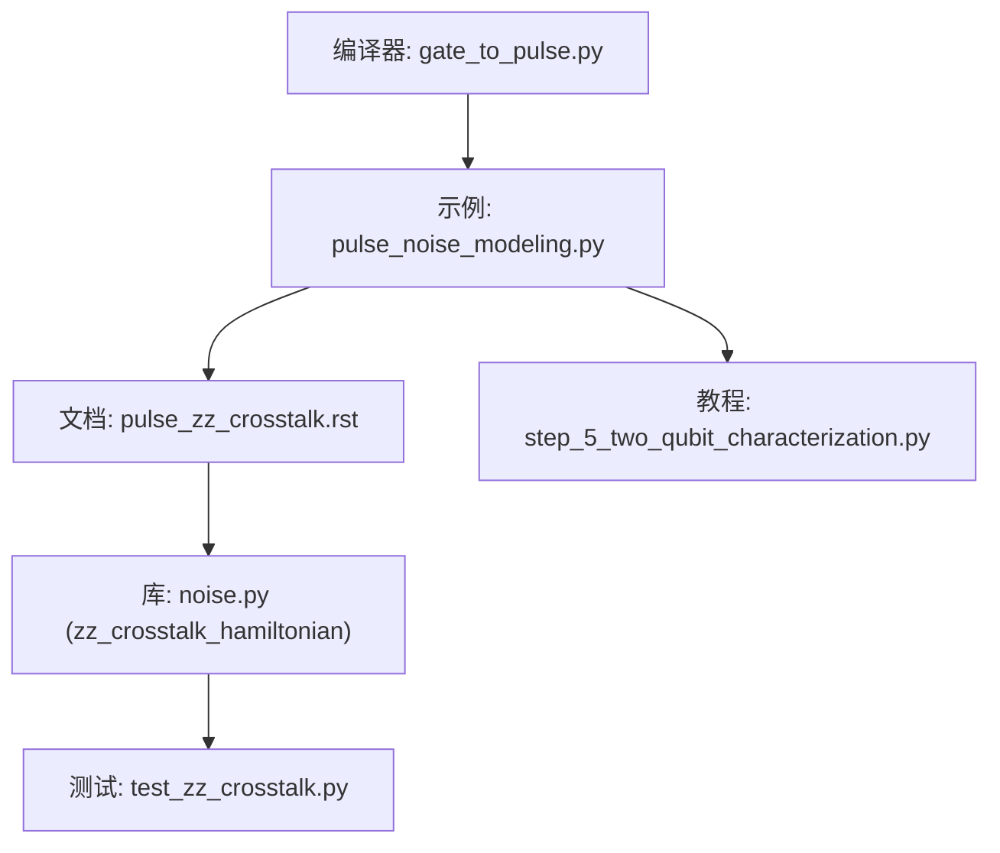
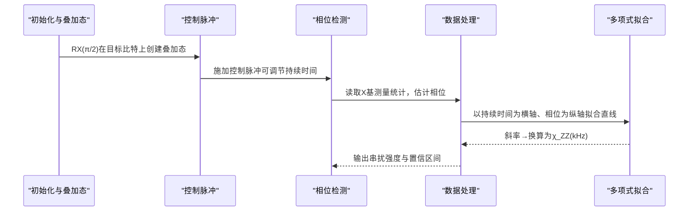
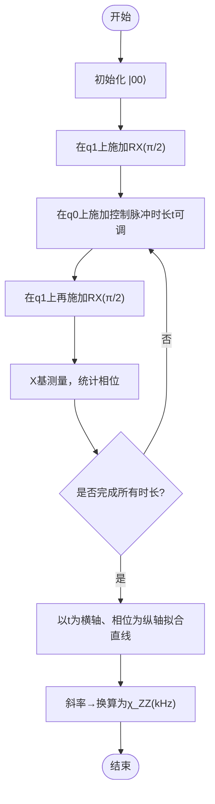
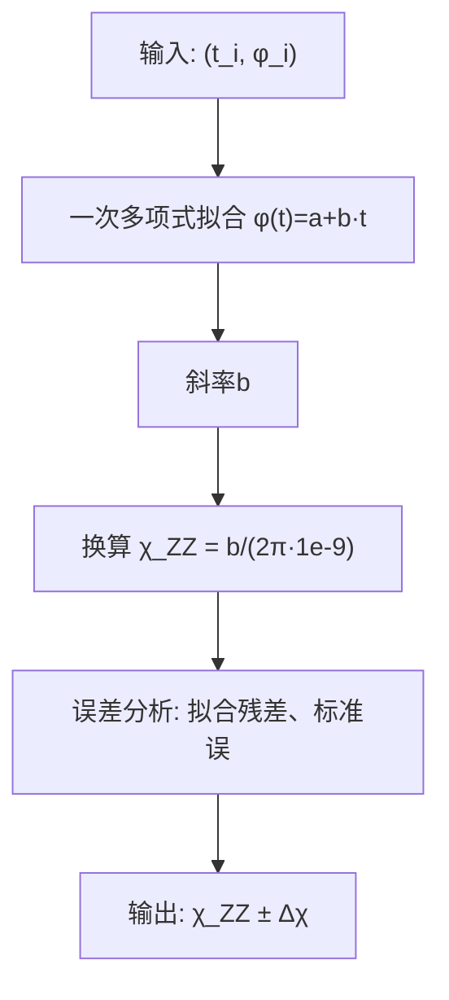
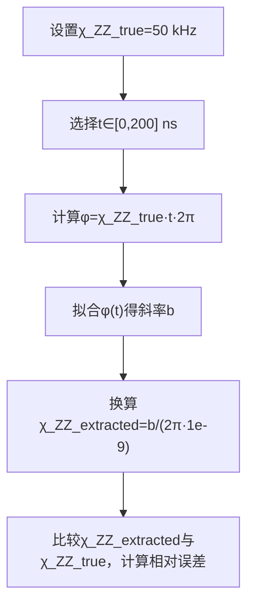
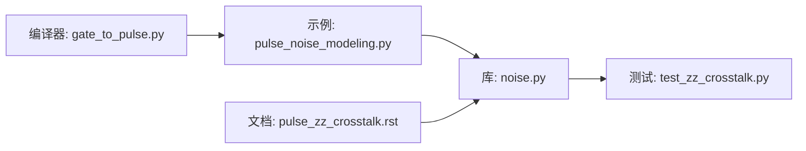

# ZZ强度测量方法

<cite>
**本文引用的文件**
- [examples/pulse_noise_modeling.py](file://examples/pulse_noise_modeling.py)
- [docs/source/tutorials/advanced/pulse_zz_crosstalk.rst](file://docs/source/tutorials/advanced/pulse_zz_crosstalk.rst)
- [src/tyxonq/libs/quantum_library/noise.py](file://src/tyxonq/libs/quantum_library/noise.py)
- [tests_core_module/test_zz_crosstalk.py](file://tests_core_module/test_zz_crosstalk.py)
- [examples/pulse_calibration_tutorial/step_5_two_qubit_characterization.py](file://examples/pulse_calibration_tutorial/step_5_two_qubit_characterization.py)
- [src/tyxonq/compiler/pulse_compiler/native/gate_to_pulse.py](file://src/tyxonq/compiler/pulse_compiler/native/gate_to_pulse.py)
</cite>

## 目录
1. [简介](#简介)
2. [项目结构](#项目结构)
3. [核心组件](#核心组件)
4. [架构总览](#架构总览)
5. [详细组件分析](#详细组件分析)
6. [依赖关系分析](#依赖关系分析)
7. [性能与误差分析](#性能与误差分析)
8. [故障排查指南](#故障排查指南)
9. [结论](#结论)
10. [附录](#附录)

## 简介
本文件面向需要在超导量子处理器上完成“ZZ串扰强度”表征的工程师与研究人员，提供从双量子比特初始化到相位检测的完整实验流程说明。重点包括：
- 使用RX(π/2)创建叠加态、应用控制脉冲（如π脉冲或可变时长控制）引入条件相位
- 通过改变控制脉冲持续时间扫描相位累积，提取线性相位斜率得到χ_ZZ
- 基于多项式拟合（一次多项式）计算斜率，将相位-时间斜率转换为频率单位kHz
- 提供模拟数据示例与数据处理步骤，展示如何从实验数据中准确提取串扰强度
- 给出误差来源分析与精度评估方法，帮助在实际硬件上获得可靠结果

## 项目结构
仓库中与ZZ串扰测量相关的代码与文档主要分布在以下位置：
- 示例与教程：演示ZZ串扰物理机制、测量协议、数据处理与误差分析
- 库实现：提供ZZ哈密顿量构造、拓扑配置等基础工具
- 测试：验证ZZ哈密顿量与拓扑的正确性
- 编译链路：展示如何将逻辑门（如CX）下推到脉冲级，便于理解控制脉冲对目标比特的影响

图表来源
- [examples/pulse_noise_modeling.py:108-163](file://examples/pulse_noise_modeling.py#L108-L163)
- [docs/source/tutorials/advanced/pulse_zz_crosstalk.rst:17-80](file://docs/source/tutorials/advanced/pulse_zz_crosstalk.rst#L17-L80)
- [src/tyxonq/libs/quantum_library/noise.py:255-341](file://src/tyxonq/libs/quantum_library/noise.py#L255-L341)
- [tests_core_module/test_zz_crosstalk.py:19-115](file://tests_core_module/test_zz_crosstalk.py#L19-L115)
- [examples/pulse_calibration_tutorial/step_5_two_qubit_characterization.py:1-57](file://examples/pulse_calibration_tutorial/step_5_two_qubit_characterization.py#L1-L57)
- [src/tyxonq/compiler/pulse_compiler/native/gate_to_pulse.py:426-489](file://src/tyxonq/compiler/pulse_compiler/native/gate_to_pulse.py#L426-L489)

章节来源
- [examples/pulse_noise_modeling.py:108-163](file://examples/pulse_noise_modeling.py#L108-L163)
- [docs/source/tutorials/advanced/pulse_zz_crosstalk.rst:17-80](file://docs/source/tutorials/advanced/pulse_zz_crosstalk.rst#L17-L80)

## 核心组件
- ZZ哈密顿量构造：用于描述相邻量子比特间的始终开启耦合H_ZZ = ξ·σ_z⊗σ_z，支持多量子比特扩展
- 拓扑与耦合配置：提供线性、网格、重六边形等拓扑，以及不同平台（IBM/Google/Rigetti/Ion Trap）的典型耦合强度
- 测量协议与数据处理：通过改变控制脉冲持续时间扫描相位累积，利用一次多项式拟合斜率提取χ_ZZ
- 校准与门下推：展示如何将逻辑门（如CX）分解为脉冲序列，理解控制脉冲对目标比特的影响

章节来源
- [src/tyxonq/libs/quantum_library/noise.py:255-341](file://src/tyxonq/libs/quantum_library/noise.py#L255-L341)
- [docs/source/tutorials/advanced/pulse_zz_crosstalk.rst:138-237](file://docs/source/tutorials/advanced/pulse_zz_crosstalk.rst#L138-L237)
- [examples/pulse_noise_modeling.py:108-163](file://examples/pulse_noise_modeling.py#L108-L163)
- [src/tyxonq/compiler/pulse_compiler/native/gate_to_pulse.py:426-489](file://src/tyxonq/compiler/pulse_compiler/native/gate_to_pulse.py#L426-L489)

## 架构总览
下图展示了ZZ串扰强度测量的端到端流程：从双量子比特初始化、叠加态制备、控制脉冲作用、相位检测到数据处理与参数提取。

图表来源
- [examples/pulse_noise_modeling.py:117-155](file://examples/pulse_noise_modeling.py#L117-L155)
- [docs/source/tutorials/advanced/pulse_zz_crosstalk.rst:17-80](file://docs/source/tutorials/advanced/pulse_zz_crosstalk.rst#L17-L80)

## 详细组件分析

### 物理模型与哈密顿量
- ZZ串扰源于相邻量子比特间的残余电容或电感耦合，产生始终开启的条件相位累积
- 哈密顿量为H_ZZ = ξ·σ_z⊗σ_z，其中ξ为耦合强度（典型范围0.1–10 MHz），在实验中常以kHz为单位标定
- 时间演化算符U_ZZ(t) = exp(-i H_ZZ t)，导致|11⟩态获得额外相位φ = ξ·t

章节来源
- [docs/source/tutorials/advanced/pulse_zz_crosstalk.rst:17-80](file://docs/source/tutorials/advanced/pulse_zz_crosstalk.rst#L17-L80)
- [src/tyxonq/libs/quantum_library/noise.py:255-341](file://src/tyxonq/libs/quantum_library/noise.py#L255-L341)
- [tests_core_module/test_zz_crosstalk.py:19-115](file://tests_core_module/test_zz_crosstalk.py#L19-L115)

### 测量协议与实验流程
- 初始化：两个量子比特置于|00⟩
- 叠加态制备：在目标比特（q1）上施加RX(π/2)，使其进入X基叠加态
- 控制脉冲：在控制比特（q0）上施加π脉冲或可变时长的控制脉冲，使q1根据q0的状态获得条件相位
- 相位检测：在q1上再次施加RX(π/2)，随后进行X基测量，统计得到相位信息
- 重复扫描：改变控制脉冲持续时间，记录对应的相位变化

图表来源
- [examples/pulse_noise_modeling.py:117-155](file://examples/pulse_noise_modeling.py#L117-L155)

章节来源
- [examples/pulse_noise_modeling.py:117-155](file://examples/pulse_noise_modeling.py#L117-L155)

### 数据处理与参数提取
- 数据采集：对于每个控制脉冲持续时间t_i，测量得到相位φ_i
- 线性拟合：使用一次多项式拟合φ(t) = a + b·t，斜率b即为相位随时间的变化率
- 参数换算：χ_ZZ = b / (2π·1e-9)，将弧度/纳秒转换为kHz
- 误差估计：拟合残差与标准误可用于评估χ_ZZ的不确定度；可通过多次重复测量降低统计噪声

图表来源
- [examples/pulse_noise_modeling.py:137-155](file://examples/pulse_noise_modeling.py#L137-L155)

章节来源
- [examples/pulse_noise_modeling.py:137-155](file://examples/pulse_noise_modeling.py#L137-L155)

### 模拟数据示例
- 设定真实χ_ZZ值（例如50 kHz）
- 生成一系列控制脉冲持续时间（如0–200 ns）
- 计算对应相位φ = χ_ZZ·t·2π（弧度）
- 使用一次多项式拟合斜率，反推χ_ZZ并评估误差

图表来源
- [examples/pulse_noise_modeling.py:134-155](file://examples/pulse_noise_modeling.py#L134-L155)

章节来源
- [examples/pulse_noise_modeling.py:134-155](file://examples/pulse_noise_modeling.py#L134-L155)

### 与门下推和脉冲实现的关联
- Cross-Resonance（CR）门由控制比特在目标频率驱动，配合目标比特的旋转与回波脉冲，实现两比特门
- 在CR过程中，控制脉冲可能通过ZZ耦合对目标比特引入条件相位，这正是ZZ串扰的来源之一
- 了解门下推细节有助于设计更鲁棒的测量序列与补偿策略

章节来源
- [src/tyxonq/compiler/pulse_compiler/native/gate_to_pulse.py:426-489](file://src/tyxonq/compiler/pulse_compiler/native/gate_to_pulse.py#L426-L489)

## 依赖关系分析
- 示例与文档依赖库提供的ZZ哈密顿量与拓扑配置，确保物理模型一致
- 测试用例验证哈密顿量的数学性质（厄米性、本征值、条件相位）与拓扑连通性
- 编译器将逻辑门下推为脉冲序列，体现控制脉冲对目标比特的实际影响路径

图表来源
- [examples/pulse_noise_modeling.py:108-163](file://examples/pulse_noise_modeling.py#L108-L163)
- [docs/source/tutorials/advanced/pulse_zz_crosstalk.rst:17-80](file://docs/source/tutorials/advanced/pulse_zz_crosstalk.rst#L17-L80)
- [src/tyxonq/libs/quantum_library/noise.py:255-341](file://src/tyxonq/libs/quantum_library/noise.py#L255-L341)
- [tests_core_module/test_zz_crosstalk.py:19-115](file://tests_core_module/test_zz_crosstalk.py#L19-L115)
- [src/tyxonq/compiler/pulse_compiler/native/gate_to_pulse.py:426-489](file://src/tyxonq/compiler/pulse_compiler/native/gate_to_pulse.py#L426-L489)

章节来源
- [tests_core_module/test_zz_crosstalk.py:19-115](file://tests_core_module/test_zz_crosstalk.py#L19-L115)

## 性能与误差分析
- 统计噪声：测量次数不足会导致相位估计方差增大，建议增加shots数以降低统计误差
- 系统误差：
  - 控制脉冲时长标定偏差会直接影响斜率拟合
  - 频率失谐或振幅不精确会引入额外相位偏移
  - 退相干（T1/T2）会衰减干涉对比度，影响相位提取精度
- 拟合质量：
  - 检查拟合残差分布与R²指标，识别异常点
  - 若存在非线性成分，考虑更高阶拟合或分段拟合
- 精度评估：
  - 使用多次独立测量取平均，报告标准差
  - 结合仪器标定（如单比特门保真度、读出误差）进行误差传播分析

章节来源
- [examples/pulse_noise_modeling.py:137-155](file://examples/pulse_noise_modeling.py#L137-L155)
- [examples/pulse_calibration_tutorial/step_5_two_qubit_characterization.py:262-325](file://examples/pulse_calibration_tutorial/step_5_two_qubit_characterization.py#L262-L325)

## 故障排查指南
- 现象：相位不随控制时长线性变化
  - 检查控制脉冲是否真正作用于目标比特（确认频率与幅度）
  - 检查是否存在其他干扰（如邻近比特同时操作）
- 现象：拟合斜率不稳定或误差大
  - 增加测量次数，减少统计噪声
  - 检查退相干时间与门时长匹配性
- 现象：提取的χ_ZZ与预期不符
  - 核对单位换算（弧度/纳秒→kHz）
  - 检查是否包含非期望的相位贡献（如读出相位偏移）

章节来源
- [examples/pulse_calibration_tutorial/step_5_two_qubit_characterization.py:262-325](file://examples/pulse_calibration_tutorial/step_5_two_qubit_characterization.py#L262-L325)

## 结论
通过双量子比特初始化、RX(π/2)叠加态制备、控制脉冲作用与相位检测，结合控制脉冲持续时间的扫描与一次多项式拟合，可以稳定提取ZZ串扰强度χ_ZZ。该流程在示例与文档中有明确说明，并在库与测试中得到验证。实际应用中需关注统计噪声、系统误差与退相干影响，合理设计测量序列与数据处理流程以获得高精度结果。

## 附录
- 关键参考与实现位置：
  - ZZ串扰物理与建模：见文档与库函数
  - 测量协议与数据处理：见示例中的模拟与拟合流程
  - 门下推与脉冲实现：见编译器中对CR门的脉冲分解

章节来源
- [docs/source/tutorials/advanced/pulse_zz_crosstalk.rst:17-80](file://docs/source/tutorials/advanced/pulse_zz_crosstalk.rst#L17-L80)
- [src/tyxonq/libs/quantum_library/noise.py:255-341](file://src/tyxonq/libs/quantum_library/noise.py#L255-L341)
- [examples/pulse_noise_modeling.py:108-163](file://examples/pulse_noise_modeling.py#L108-L163)
- [src/tyxonq/compiler/pulse_compiler/native/gate_to_pulse.py:426-489](file://src/tyxonq/compiler/pulse_compiler/native/gate_to_pulse.py#L426-L489)