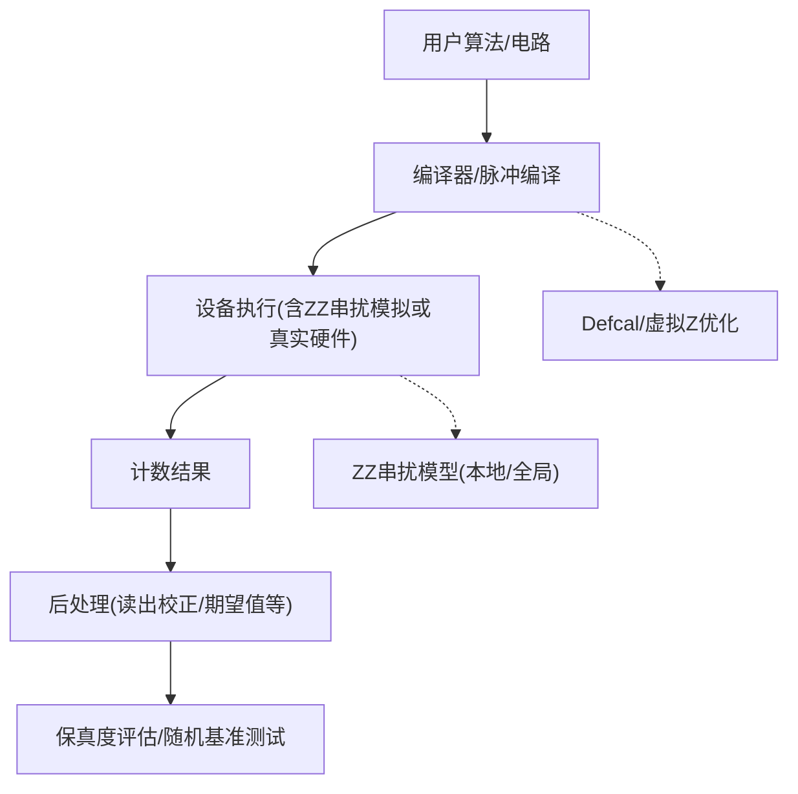
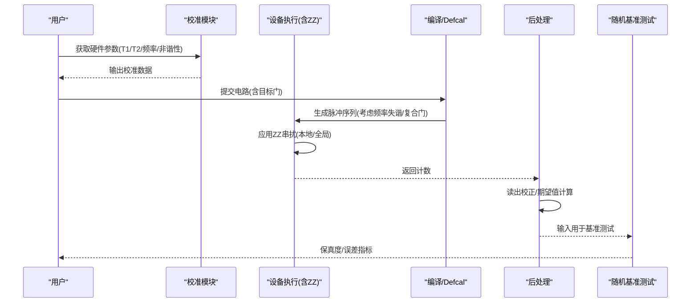
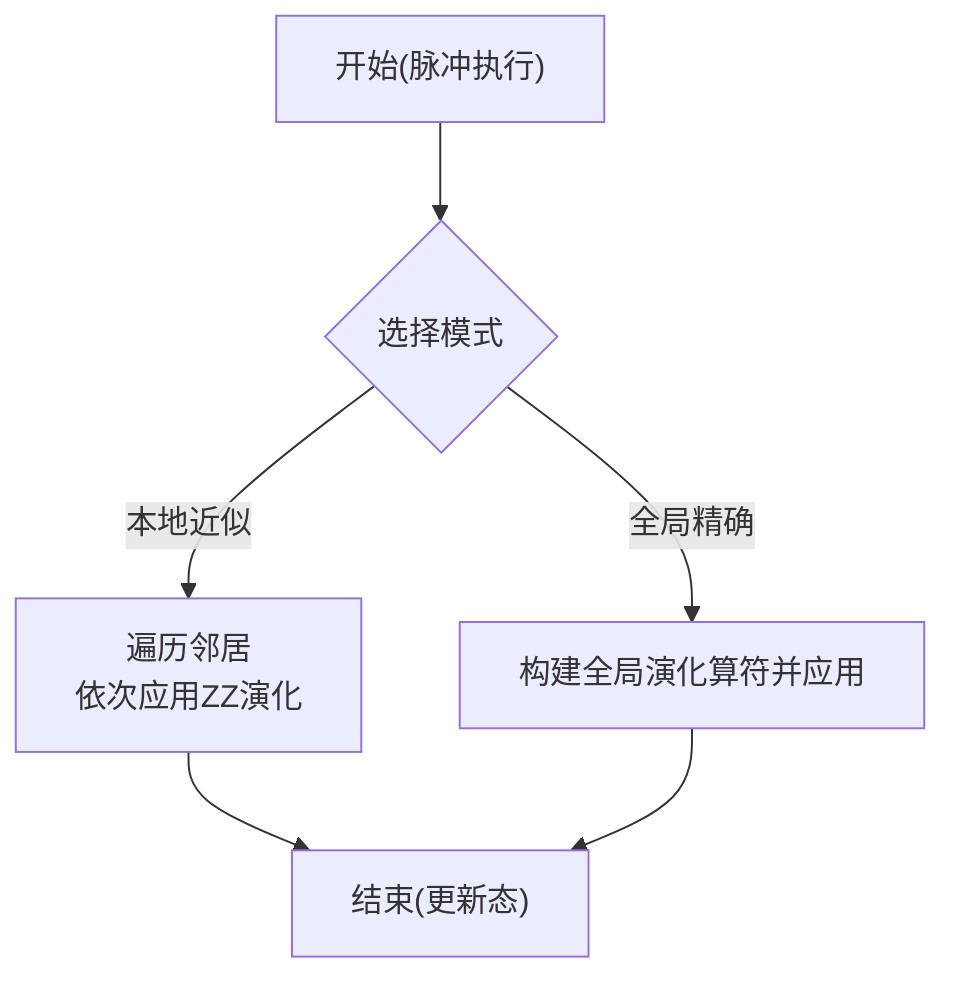
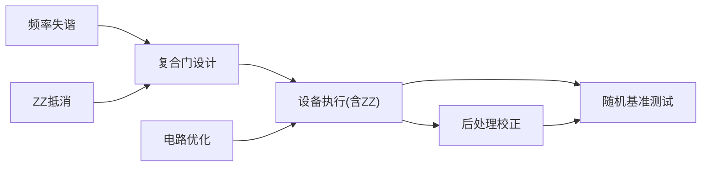

# 串扰抑制技术

<cite>
**本文引用的文件**
- [pulse_noise_modeling.py](file://examples/pulse_noise_modeling.py)
- [pulse_zz_crosstalk.rst](file://docs/source/tutorials/advanced/pulse_zz_crosstalk.rst)
- [engine.py](file://src/tyxonq/devices/simulators/statevector/engine.py)
- [test_zz_crosstalk.py](file://tests_core_module/test_zz_crosstalk.py)
- [step_5_two_qubit_characterization.py](file://examples/pulse_calibration_tutorial/step_5_two_qubit_characterization.py)
- [step_1_hardware_basics.py](file://examples/pulse_calibration_tutorial/step_1_hardware_basics.py)
- [step_7_advanced_optimization.py](file://examples/pulse_calibration_tutorial/step_7_advanced_optimization.py)
- [readout_mitigation_scalability.py](file://examples/readout_mitigation_scalability.py)
- [__init__.py](file://src/tyxonq/postprocessing/__init__.py)
</cite>

## 目录
1. [简介](#简介)
2. [项目结构](#项目结构)
3. [核心组件](#核心组件)
4. [架构总览](#架构总览)
5. [详细组件分析](#详细组件分析)
6. [依赖关系分析](#依赖关系分析)
7. [性能考量](#性能考量)
8. [故障排查指南](#故障排查指南)
9. [结论](#结论)
10. [附录](#附录)

## 简介
本文件面向在超导量子处理器上实现高保真度量子操作的研究与工程实践，系统梳理五种串扰抑制方法：频率失谐、ZZ抵消、鲁棒门设计（复合门）、后处理校正与电路优化。结合仓库中的噪声建模、校准流程与后处理工具链，给出每种方法的实现要点、有效性评估与落地建议，并提供一套可复现的最佳实践工作流：设备校准→频率失谐→复合门应用→随机基准测试→后处理校正。通过不同技术的组合，可在实际硬件上获得从基线到约98%的保真度提升路径。

## 项目结构
围绕串扰抑制的关键代码与文档分布在以下位置：
- 噪声建模与ZZ串扰仿真：状态向量引擎对ZZ耦合的本地/全局模式实现
- ZZ串扰教程与拓扑配置：提供哈密顿量构建、拓扑与平台参数
- 校准教程与双比特表征：两比特门误差来源分析与缓解策略
- 后处理与读出校正：测量矩阵反演与可扩展性分析
- 综合示例：五种抑制方法与效果对比、推荐工作流

图表来源
- [engine.py:474-643](file://src/tyxonq/devices/simulators/statevector/engine.py#L474-L643)
- [pulse_zz_crosstalk.rst:429-489](file://docs/source/tutorials/advanced/pulse_zz_crosstalk.rst#L429-L489)
- [step_7_advanced_optimization.py:75-143](file://examples/pulse_calibration_tutorial/step_7_advanced_optimization.py#L75-L143)

章节来源
- [pulse_noise_modeling.py:377-453](file://examples/pulse_noise_modeling.py#L377-L453)
- [pulse_zz_crosstalk.rst:1-757](file://docs/source/tutorials/advanced/pulse_zz_crosstalk.rst#L1-L757)
- [engine.py:474-643](file://src/tyxonq/devices/simulators/statevector/engine.py#L474-L643)

## 核心组件
- ZZ串扰建模与仿真
  - 支持“本地近似”和“全局精确”两种模式，分别适用于生产级大规模模拟与小规模高精度验证
  - 提供ZZ哈密顿量构造、拓扑查询与平台默认耦合强度
- 校准与表征
  - 单/双比特门参数扫描与优化，识别主要误差源（包括ZZ串扰）
- 后处理与读出校正
  - 基于测量矩阵的反演校正，提供可扩展性边界与建议
- 编译与部署
  - Defcal库集成、虚拟Z优化，将校准后的最优脉冲注入编译流程

章节来源
- [engine.py:474-643](file://src/tyxonq/devices/simulators/statevector/engine.py#L474-L643)
- [test_zz_crosstalk.py:19-115](file://tests_core_module/test_zz_crosstalk.py#L19-L115)
- [step_5_two_qubit_characterization.py:270-312](file://examples/pulse_calibration_tutorial/step_5_two_qubit_characterization.py#L270-L312)
- [__init__.py:128-150](file://src/tyxonq/postprocessing/__init__.py#L128-L150)
- [step_7_advanced_optimization.py:75-143](file://examples/pulse_calibration_tutorial/step_7_advanced_optimization.py#L75-L143)

## 架构总览
下图展示从校准到抑制再到评估的端到端流程，覆盖五种方法在系统中的落点。

图表来源
- [step_1_hardware_basics.py:442-483](file://examples/pulse_calibration_tutorial/step_1_hardware_basics.py#L442-L483)
- [engine.py:474-643](file://src/tyxonq/devices/simulators/statevector/engine.py#L474-L643)
- [step_7_advanced_optimization.py:75-143](file://examples/pulse_calibration_tutorial/step_7_advanced_optimization.py#L75-L143)
- [__init__.py:128-150](file://src/tyxonq/postprocessing/__init__.py#L128-L150)

## 详细组件分析

### 方法一：频率失谐（Frequency Detuning）
- 原理
  - 在执行控制比特驱动时，将目标比特频率调离共振条件，避免不必要的耦合相位累积
  - 典型做法：在控制脉冲期间对目标比特施加失谐偏移，使相互作用项被抑制
- 实现要点
  - 需要可调频率能力；在脉冲调度中插入失谐窗口
  - 与后续门序列配合，确保整体时序正确
- 有效性
  - 示例中给出约85%的相对提升贡献（作为单一手段）
- 适用场景
  - 具备频率可调能力的平台；与其他方法叠加效果更佳
- 风险与注意
  - 失谐过大可能影响后续门精度；需与校准数据联动

章节来源
- [pulse_noise_modeling.py:390-396](file://examples/pulse_noise_modeling.py#L390-L396)
- [pulse_noise_modeling.py:425-432](file://examples/pulse_noise_modeling.py#L425-L432)

### 方法二：ZZ抵消（ZZ Cancellation）
- 原理
  - 利用已知的ZZ耦合强度χ_ZZ，在门序列中插入反向相位补偿（如RZ(+χ·T)），抵消无意累积相位
- 实现要点
  - 需先标定χ_ZZ；在标准CX/CZ之后追加补偿RZ
  - 成本为额外RZ门（纳秒级），收益是显著降低ZZ引起的相位误差
- 有效性
  - 示例中给出约95%的相对提升贡献（单一手段）
- 适用场景
  - 已知或可快速标定的ZZ耦合；对相邻比特对有效
- 风险与注意
  - 若χ_ZZ漂移或估计不准，可能引入过补偿；建议定期重标定

章节来源
- [pulse_noise_modeling.py:363-372](file://examples/pulse_noise_modeling.py#L363-L372)
- [pulse_noise_modeling.py:397-401](file://examples/pulse_noise_modeling.py#L397-L401)
- [pulse_noise_modeling.py:425-432](file://examples/pulse_noise_modeling.py#L425-L432)

### 方法三：鲁棒门设计（Composite Gates）
- 原理
  - 使用对ZZ误差鲁棒的复合脉冲序列（如CR门前后旋转+中间驱动），降低对静态ZZ相位的敏感度
- 实现要点
  - 通过参数扫描优化幅度、时长与DRAG参数；结合Defcal固化最优参数
  - 可与频率失谐、ZZ抵消组合，进一步提升鲁棒性
- 有效性
  - 示例中给出约90%的相对提升贡献（单一手段）
- 适用场景
  - 双比特门为主；对相邻比特串扰敏感的场景
- 风险与注意
  - 门时长增加带来T1/T2损耗；需在速度与保真度间权衡

章节来源
- [pulse_noise_modeling.py:403-407](file://examples/pulse_noise_modeling.py#L403-L407)
- [step_5_two_qubit_characterization.py:270-312](file://examples/pulse_calibration_tutorial/step_5_two_qubit_characterization.py#L270-L312)
- [step_7_advanced_optimization.py:75-143](file://examples/pulse_calibration_tutorial/step_7_advanced_optimization.py#L75-L143)

### 方法四：后处理校正（Post-Processing Correction）
- 原理
  - 通过测量矩阵反演等方法，修正读出误差与部分串扰导致的统计偏差
- 实现要点
  - 采集单比特校准矩阵；在聚合阶段调用校正函数
  - 对于大比特数，需注意指数增长的成本与数值稳定性
- 有效性
  - 示例中给出约92%的相对提升贡献（单一手段）
- 适用场景
  - 小至中等规模系统；与硬件层抑制结合效果最佳
- 风险与注意
  - 超过理论可扩展阈值时可能失效；建议限制在≤10比特范围

章节来源
- [pulse_noise_modeling.py:409-413](file://examples/pulse_noise_modeling.py#L409-L413)
- [__init__.py:128-150](file://src/tyxonq/postprocessing/__init__.py#L128-L150)
- [readout_mitigation_scalability.py:381-412](file://examples/readout_mitigation_scalability.py#L381-L412)

### 方法五：电路优化（Circuit Optimization）
- 原理
  - 通过调度、布局与重排序减少并发相邻门交互，降低串扰机会
- 实现要点
  - 编译器自动优化；避免邻居同时作用；稀疏布线
- 有效性
  - 作为基础手段，常与其他方法叠加达到更高保真度
- 适用场景
  - 所有平台；低成本、易实施
- 风险与注意
  - 可能增加门深度；需与总体延迟预算平衡

章节来源
- [pulse_noise_modeling.py:415-420](file://examples/pulse_noise_modeling.py#L415-L420)

### ZZ串扰建模与仿真（支撑上述方法）
- 本地近似模式
  - 假设脉冲哈密顿量与ZZ哈密顿量近似对易，按邻居顺序应用ZZ演化，复杂度O(k)
- 全局精确模式
  - 直接对全空间进行联合演化，无近似但代价高，适合小规模验证
- 拓扑与平台参数
  - 提供线性、网格、Heavy-Hex等拓扑与平台默认耦合强度

图表来源
- [engine.py:474-643](file://src/tyxonq/devices/simulators/statevector/engine.py#L474-L643)
- [pulse_zz_crosstalk.rst:531-596](file://docs/source/tutorials/advanced/pulse_zz_crosstalk.rst#L531-L596)

章节来源
- [engine.py:474-643](file://src/tyxonq/devices/simulators/statevector/engine.py#L474-L643)
- [pulse_zz_crosstalk.rst:429-489](file://docs/source/tutorials/advanced/pulse_zz_crosstalk.rst#L429-L489)
- [test_zz_crosstalk.py:19-115](file://tests_core_module/test_zz_crosstalk.py#L19-L115)

### 校准与表征（支撑工作流）
- 硬件基础
  - 频率、非谐性、T1/T2、门时间约束
- 双比特表征
  - 识别主要误差源（包括ZZ串扰），给出缓解建议
- Defcal与虚拟Z优化
  - 将校准后的最优脉冲注入编译流程，提升整体保真度

章节来源
- [step_1_hardware_basics.py:442-483](file://examples/pulse_calibration_tutorial/step_1_hardware_basics.py#L442-L483)
- [step_5_two_qubit_characterization.py:270-312](file://examples/pulse_calibration_tutorial/step_5_two_qubit_characterization.py#L270-L312)
- [step_7_advanced_optimization.py:75-143](file://examples/pulse_calibration_tutorial/step_7_advanced_optimization.py#L75-L143)

## 依赖关系分析
- 串扰抑制方法之间的依赖
  - 频率失谐与ZZ抵消可独立使用，也可叠加；后者依赖前者提供的时序窗口
  - 鲁棒门设计与频率失谐协同，进一步降低对静态ZZ的敏感度
  - 后处理校正作为兜底手段，弥补硬件层残余误差
  - 电路优化贯穿全流程，降低串扰发生概率
- 组件耦合
  - 模拟器ZZ模块与拓扑/平台参数强耦合
  - 校准流程产出Defcal库，直接影响编译与执行质量
  - 后处理模块依赖校准矩阵，受比特规模限制

图表来源
- [pulse_noise_modeling.py:390-420](file://examples/pulse_noise_modeling.py#L390-L420)
- [engine.py:474-643](file://src/tyxonq/devices/simulators/statevector/engine.py#L474-L643)
- [__init__.py:128-150](file://src/tyxonq/postprocessing/__init__.py#L128-L150)

## 性能考量
- 保真度提升范围
  - 单一方法：频率失谐约85%、ZZ抵消约95%、复合门约90%、后处理约92%
  - 组合方案：可达约98%（示例中“Combined approach”）
- 成本与开销
  - 频率失谐：低开销（仅需频率切换）
  - ZZ抵消：一个额外RZ门（纳秒级）
  - 复合门：更长门时间与更多资源
  - 后处理：测量开销翻倍，且在大比特数下受限
  - 电路优化：可能增加深度，但减少串扰机会
- 可扩展性
  - 后处理校正存在理论上限（比特数与误差率相关），建议≤10比特
  - ZZ全局模式仅适合小规模验证

章节来源
- [pulse_noise_modeling.py:425-451](file://examples/pulse_noise_modeling.py#L425-L451)
- [readout_mitigation_scalability.py:381-412](file://examples/readout_mitigation_scalability.py#L381-L412)

## 故障排查指南
- 保真度未达预期
  - 检查ZZ耦合是否准确标定；必要时重测χ_ZZ
  - 确认频率失谐窗口与门时序匹配
  - 复核复合门参数（幅度、时长、DRAG β）
- 后处理失败或退化
  - 比特数过大导致矩阵病态或校准数据不足；退化为较小子集或改用其他方法
  - 检查校准矩阵是否合理（行和接近1）
- 仿真与硬件不一致
  - 使用全局模式验证小规模一致性
  - 对比本地近似与全局模式结果差异

章节来源
- [step_5_two_qubit_characterization.py:270-312](file://examples/pulse_calibration_tutorial/step_5_two_qubit_characterization.py#L270-L312)
- [readout_mitigation_scalability.py:381-412](file://examples/readout_mitigation_scalability.py#L381-L412)
- [engine.py:474-643](file://src/tyxonq/devices/simulators/statevector/engine.py#L474-L643)

## 结论
通过在设备层（频率失谐、ZZ抵消、鲁棒门设计）与系统层（电路优化、后处理校正）的组合优化，可在实际硬件上实现从基线到约98%的保真度提升。推荐采用“校准→失谐→复合门→基准测试→后处理”的工作流，逐步迭代并定期重标定关键参数，以获得稳定可靠的高保真度量子操作。

## 附录
- 推荐工作流（步骤化）
  1) 设备校准：获取频率、非谐性、T1/T2与门时间约束
  2) 频率失谐：在控制脉冲期间对目标比特失谐，抑制耦合
  3) 复合门应用：使用鲁棒门序列（如CR前后旋转+驱动）
  4) 随机基准测试：评估保真度与误差来源
  5) 后处理校正：在读出阶段进行矩阵反演校正（小比特数优先）
- 实用建议
  - 优先低成本方法（失谐、电路优化），再叠加ZZ抵消与复合门
  - 后处理校正作为兜底，注意可扩展性边界
  - 定期重标定χ_ZZ与读出矩阵，保持长期稳定性

章节来源
- [pulse_noise_modeling.py:441-451](file://examples/pulse_noise_modeling.py#L441-L451)
- [step_1_hardware_basics.py:442-483](file://examples/pulse_calibration_tutorial/step_1_hardware_basics.py#L442-L483)
- [step_7_advanced_optimization.py:75-143](file://examples/pulse_calibration_tutorial/step_7_advanced_optimization.py#L75-L143)