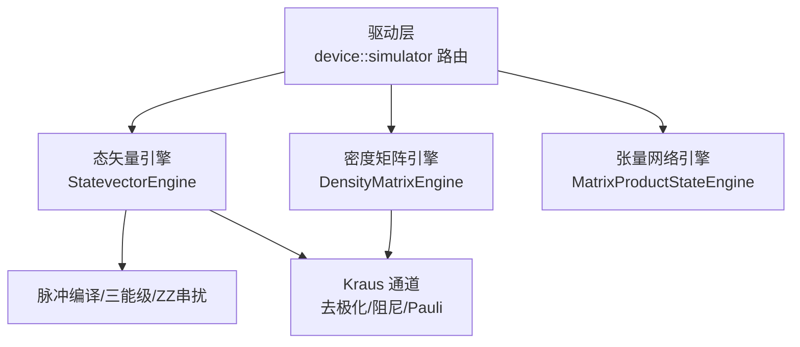
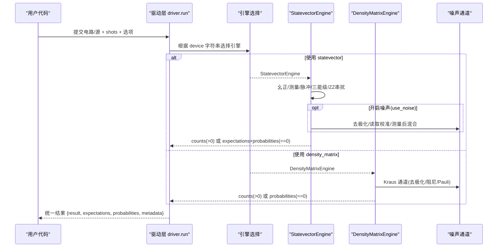
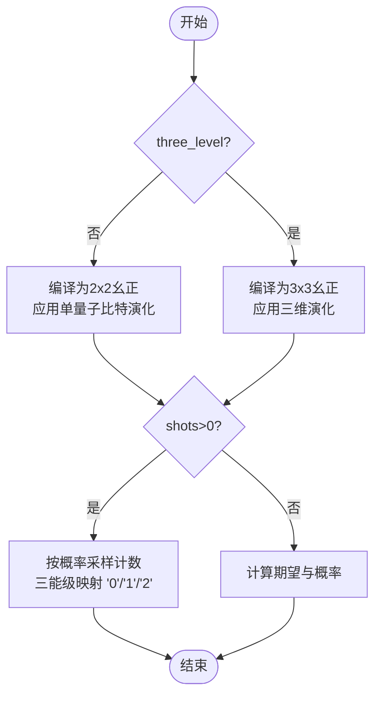
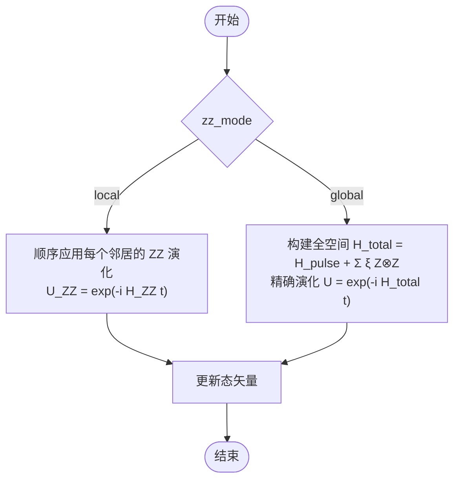
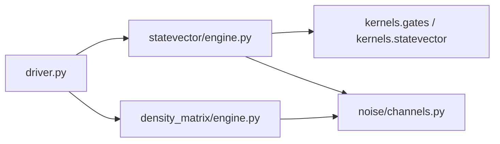
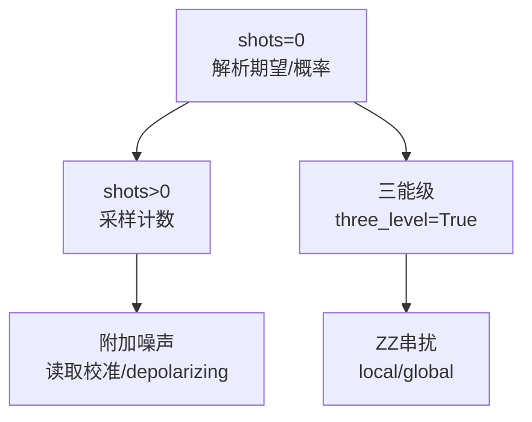

# 仿真模式对比

<cite>
**本文引用的文件**
- [driver.py](file://src/tyxonq/devices/simulators/driver.py)
- [statevector/engine.py](file://src/tyxonq/devices/simulators/statevector/engine.py)
- [density_matrix/engine.py](file://src/tyxonq/devices/simulators/density_matrix/engine.py)
- [channels.py](file://src/tyxonq/devices/simulators/noise/channels.py)
- [noisy_sampling_comparison.py](file://examples/noisy_sampling_comparison.py)
- [pulse_three_level.py](file://examples/pulse_three_level.py)
- [sample_benchmark.py](file://examples/sample_benchmark.py)
- [framework_performance_comparison.py](file://examples/framework_performance_comparison.py)
- [noise_controls_demo.py](file://examples/noise_controls_demo.py)
- [vqe_shot_noise.py](file://examples/vqe_shot_noise.py)
</cite>

## 目录
1. [简介](#简介)
2. [项目结构](#项目结构)
3. [核心组件](#核心组件)
4. [架构总览](#架构总览)
5. [详细组件分析](#详细组件分析)
6. [依赖关系分析](#依赖关系分析)
7. [性能考量](#性能考量)
8. [故障排查指南](#故障排查指南)
9. [结论](#结论)
10. [附录](#附录)

## 简介
本文件系统性对比 TyxonQ 的四种仿真模式，帮助你在算法设计、调试、验证与生产部署中做出正确选择：
- 理想仿真（shots=0）：解析期望值与概率分布，无采样噪声，速度快，适合快速迭代与理论验证。
- 真实采样仿真（shots>0）：基于计数采样的近似结果，包含统计噪声，贴近真实硬件行为。
- 三能级仿真（three_level=True）：在态矢量引擎中对脉冲进行三维演化建模，显式刻画泄漏到 |2⟩ 的物理效应，用于高精度脉冲优化与泄漏评估。
- 全功能仿真（含串扰）：在态矢量引擎中启用 ZZ 串扰等相干噪声，支持“局部近似”和“全局精确”两种模式，用于高保真度器件级仿真。

我们将给出每种模式的准确性、速度、噪声覆盖范围对比表，并给出选择建议与基准参考路径。

## 项目结构
TyxonQ 的仿真由统一的驱动层调度不同后端引擎，核心路径如下：
- 驱动层：统一入口，负责 QASM/IR 转换、设备选择、结果归一化、解析期望与采样输出。
- 引擎层：态矢量、密度矩阵、张量网络（MPS）三种数值后端；其中态矢量引擎支持脉冲级演化、三能级模型与 ZZ 串扰。
- 噪声层：提供去极化、振幅阻尼、相位阻尼、Pauli 通道等标准噪声通道，供密度矩阵引擎直接应用或态矢量引擎以衰减/测量后混合方式模拟。

**图表来源**
- [driver.py:20-38](file://src/tyxonq/devices/simulators/driver.py#L20-L38)
- [statevector/engine.py:46-451](file://src/tyxonq/devices/simulators/statevector/engine.py#L46-L451)
- [density_matrix/engine.py:43-167](file://src/tyxonq/devices/simulators/density_matrix/engine.py#L43-L167)

**章节来源**
- [driver.py:20-38](file://src/tyxonq/devices/simulators/driver.py#L20-L38)
- [statevector/engine.py:46-451](file://src/tyxonq/devices/simulators/statevector/engine.py#L46-L451)
- [density_matrix/engine.py:43-167](file://src/tyxonq/devices/simulators/density_matrix/engine.py#L43-L167)

## 核心组件
- 驱动层（driver）
  - 统一 run/expval 接口，自动识别 QASM/IR，选择具体引擎，标准化输出（counts/expectations/probabilities/statevector）。
  - shots=0 时返回精确概率与态矢（态矢量引擎）或对角概率（密度矩阵引擎），消除二次 state() 调用带来的分叉。
- 态矢量引擎（StatevectorEngine）
  - 支持幺正门、测量、投影、重置、自定义 unitary、Kraus 通道、脉冲操作。
  - 支持 three_level=True 的三能级演化与泄漏建模；支持 ZZ 串扰（local/global）。
  - shots>0 时按概率采样计数；shots=0 时返回期望与概率。
- 密度矩阵引擎（DensityMatrixEngine）
  - 原生 Kraus 通道应用，适合噪声研究；不支持脉冲级演化（需先编译为幺正）。
  - 支持测量与采样；shots=0 返回对角概率与密度矩阵。
- 噪声通道（channels）
  - 提供去极化、振幅阻尼、相位阻尼、Pauli 通道等标准实现，供密度矩阵引擎使用。

**章节来源**
- [driver.py:75-166](file://src/tyxonq/devices/simulators/driver.py#L75-L166)
- [statevector/engine.py:46-451](file://src/tyxonq/devices/simulators/statevector/engine.py#L46-L451)
- [density_matrix/engine.py:43-167](file://src/tyxonq/devices/simulators/density_matrix/engine.py#L43-L167)
- [channels.py:14-41](file://src/tyxonq/devices/simulators/noise/channels.py#L14-L41)

## 架构总览
下图展示从用户代码到仿真结果的完整流程，包括四种模式的分支点与关键参数。

**图表来源**
- [driver.py:75-166](file://src/tyxonq/devices/simulators/driver.py#L75-L166)
- [statevector/engine.py:46-451](file://src/tyxonq/devices/simulators/statevector/engine.py#L46-L451)
- [density_matrix/engine.py:43-167](file://src/tyxonq/devices/simulators/density_matrix/engine.py#L43-L167)
- [channels.py:14-41](file://src/tyxonq/devices/simulators/noise/channels.py#L14-L41)

## 详细组件分析

### 模式一：理想仿真（shots=0）
- 行为
  - 态矢量引擎：计算精确期望值与概率分布，附带 statevector。
  - 密度矩阵引擎：计算精确对角概率与密度矩阵。
- 优点
  - 无采样噪声，结果确定；速度快；便于梯度/优化与理论验证。
- 局限
  - 不体现有限 shot 统计误差；无法模拟硬件上的计数波动。
- 适用场景
  - 算法原型开发、梯度调试、理论收敛性验证、大规模参数扫描。

**章节来源**
- [driver.py:116-137](file://src/tyxonq/devices/simulators/driver.py#L116-L137)
- [statevector/engine.py:435-451](file://src/tyxonq/devices/simulators/statevector/engine.py#L435-L451)
- [density_matrix/engine.py:154-167](file://src/tyxonq/devices/simulators/density_matrix/engine.py#L154-L167)

### 模式二：真实采样仿真（shots>0）
- 行为
  - 依据概率分布采样得到计数；可叠加读取校准或 depolarizing 等噪声。
- 优点
  - 贴近真实量子硬件行为；可用于评估 shot 噪声对算法的影响。
- 局限
  - 结果有统计方差；需要足够 shots 以获得稳定估计。
- 适用场景
  - 算法鲁棒性测试、与硬件对齐的端到端验证、噪声敏感任务评估。

**章节来源**
- [statevector/engine.py:344-433](file://src/tyxonq/devices/simulators/statevector/engine.py#L344-L433)
- [density_matrix/engine.py:111-152](file://src/tyxonq/devices/simulators/density_matrix/engine.py#L111-L152)
- [noisy_sampling_comparison.py:32-81](file://examples/noisy_sampling_comparison.py#L32-L81)

### 模式三：三能级仿真（three_level=True）
- 行为
  - 在态矢量引擎中，将脉冲编译为 3×3 幺正，显式模拟泄漏到 |2⟩；测量时对单量子比特映射到 '0'/'1'/'2'，多量子比特当前采用简化投影。
- 优点
  - 更贴近超导量子比特的物理现实；可用于泄漏评估与 DRAG 脉冲优化。
- 局限
  - 多量子比特下仅受脉冲作用的量子比特具备三维动力学；整体复杂度高于二维态矢量。
- 适用场景
  - 脉冲形状优化、泄漏抑制策略验证、硬件校准前仿真。

**图表来源**
- [statevector/engine.py:119-190](file://src/tyxonq/devices/simulators/statevector/engine.py#L119-L190)
- [statevector/engine.py:205-334](file://src/tyxonq/devices/simulators/statevector/engine.py#L205-L334)
- [statevector/engine.py:392-433](file://src/tyxonq/devices/simulators/statevector/engine.py#L392-L433)

**章节来源**
- [statevector/engine.py:119-190](file://src/tyxonq/devices/simulators/statevector/engine.py#L119-L190)
- [statevector/engine.py:205-334](file://src/tyxonq/devices/simulators/statevector/engine.py#L205-L334)
- [statevector/engine.py:392-433](file://src/tyxonq/devices/simulators/statevector/engine.py#L392-L433)
- [pulse_three_level.py:49-108](file://examples/pulse_three_level.py#L49-L108)

### 模式四：全功能仿真（含串扰）
- 行为
  - 在态矢量引擎中，对脉冲执行期间施加 ZZ 串扰；支持两种模式：
    - local（默认）：将脉冲与 ZZ 演化分解为顺序步骤，效率高，适用于大系统。
    - global：构建全空间哈密顿量并精确演化，精度高但开销大，适用于小系统高精度基准。
- 优点
  - 捕捉相干串扰导致的条件相位累积；可用于器件级精度评估与校准策略验证。
- 局限
  - global 模式内存与时间开销随 qubit 数指数增长；仅在小系统实用。
- 适用场景
  - 高精度器件仿真、强 ZZ 耦合场景、校准与补偿策略验证。

**图表来源**
- [statevector/engine.py:474-725](file://src/tyxonq/devices/simulators/statevector/engine.py#L474-L725)

**章节来源**
- [statevector/engine.py:474-725](file://src/tyxonq/devices/simulators/statevector/engine.py#L474-L725)

## 依赖关系分析
- 驱动层依赖引擎选择逻辑，统一输出格式，屏蔽底层差异。
- 态矢量引擎依赖权威门表与内核，复用同一套幺正解析与应用路径，避免分叉。
- 密度矩阵引擎通过 Kraus 通道直接作用于密度矩阵，适合纯噪声研究。
- 噪声通道模块提供标准通道实现，被密度矩阵引擎与态矢量引擎（测量后混合）共用。

**图表来源**
- [driver.py:20-38](file://src/tyxonq/devices/simulators/driver.py#L20-L38)
- [statevector/engine.py:17-32](file://src/tyxonq/devices/simulators/statevector/engine.py#L17-L32)
- [density_matrix/engine.py:17-30](file://src/tyxonq/devices/simulators/density_matrix/engine.py#L17-L30)
- [channels.py:14-41](file://src/tyxonq/devices/simulators/noise/channels.py#L14-L41)

**章节来源**
- [driver.py:20-38](file://src/tyxonq/devices/simulators/driver.py#L20-L38)
- [statevector/engine.py:17-32](file://src/tyxonq/devices/simulators/statevector/engine.py#L17-L32)
- [density_matrix/engine.py:17-30](file://src/tyxonq/devices/simulators/density_matrix/engine.py#L17-L30)
- [channels.py:14-41](file://src/tyxonq/devices/simulators/noise/channels.py#L14-L41)

## 性能考量
- 速度与规模
  - 理想仿真（shots=0）最快，态矢量 O(2^n)，密度矩阵 O(4^n)。
  - 真实采样（shots>0）额外引入采样开销，时间与 shots 成正比。
  - 三能级仿真增加维度与计算量；多量子比特下仅受脉冲作用位具三维动力学。
  - ZZ 串扰 global 模式需全空间矩阵指数，仅小系统可用。
- 噪声覆盖
  - 密度矩阵引擎：原生 Kraus 通道（去极化、振幅阻尼、相位阻尼、Pauli）。
  - 态矢量引擎：可通过 use_noise 与测量后混合实现读取校准与 depolarizing；同时支持 ZZ 串扰（相干噪声）。
- 基准参考
  - 采样基准脚本展示了不同后端（numpy/pytorch/cupynumeric）下的运行时间对比方法。
  - 框架对比示例展示了三种 TyxonQ 执行模式（shot-based、NumPy 数值梯度、PyTorch autograd）的性能差异与适用性。

**图表来源**
- [statevector/engine.py:46-451](file://src/tyxonq/devices/simulators/statevector/engine.py#L46-L451)
- [density_matrix/engine.py:43-167](file://src/tyxonq/devices/simulators/density_matrix/engine.py#L43-L167)
- [sample_benchmark.py:51-86](file://examples/sample_benchmark.py#L51-L86)
- [framework_performance_comparison.py:12-41](file://examples/framework_performance_comparison.py#L12-L41)

**章节来源**
- [sample_benchmark.py:51-86](file://examples/sample_benchmark.py#L51-L86)
- [framework_performance_comparison.py:12-41](file://examples/framework_performance_comparison.py#L12-L41)

## 故障排查指南
- 未知算符报错
  - 若遇到未支持的 op，引擎会抛出明确错误而非静默跳过，检查是否使用了未被覆盖的门或自定义 op。
- 密度矩阵引擎不支持脉冲
  - 密度矩阵引擎不提供脉冲级演化路径，如需脉冲/三能级/串扰请使用态矢量引擎或将脉冲编译为幺正后再运行。
- 噪声配置影响
  - 全局噪声开关会影响后续仿真，注意在测试结束后恢复默认状态，避免污染其他用例。
- 三能级多量子比特限制
  - 多量子比特下仅受脉冲作用的量子比特具备三维动力学，其他量子比特仍按二维处理；解读结果时需留意此限制。

**章节来源**
- [statevector/engine.py:335-342](file://src/tyxonq/devices/simulators/statevector/engine.py#L335-L342)
- [density_matrix/engine.py:97-102](file://src/tyxonq/devices/simulators/density_matrix/engine.py#L97-L102)
- [noise_controls_demo.py:4-46](file://examples/noise_controls_demo.py#L4-L46)

## 结论
- 选择建议
  - 算法设计与快速调试：优先使用 ideal（shots=0）态矢量仿真，结合 PyTorch autograd 获得最优性能。
  - 噪声敏感性与硬件对齐：使用真实采样（shots>0），必要时叠加读取校准或 depolarizing。
  - 脉冲优化与泄漏评估：启用三能级仿真（three_level=True），配合 DRAG 等波形优化。
  - 高精度器件级仿真：启用 ZZ 串扰，小系统用 global 模式，大系统用 local 模式。
- 实践要点
  - 使用驱动层统一接口，确保输出一致；合理设置 shots 与噪声参数；在测试结束时恢复全局噪声状态。
  - 借助示例脚本进行性能基准与模式对比，指导工程落地。

[无需来源：本节为总结性内容]

## 附录

### 四种模式特性对比表
- 理想仿真（shots=0）
  - 准确性：解析精确（态矢量/密度矩阵对角概率）
  - 速度：快（态矢量 O(2^n)，密度矩阵 O(4^n)）
  - 噪声覆盖：无采样噪声；可通过 use_noise 做衰减/读取校准（态矢量）；密度矩阵原生 Kraus
- 真实采样仿真（shots>0）
  - 准确性：近似（统计方差 ~1/√shots）
  - 速度：中等（与 shots 线性相关）
  - 噪声覆盖：读取校准、depolarizing；可与三能级/串扰组合
- 三能级仿真（three_level=True）
  - 准确性：高（显式泄漏到 |2⟩）
  - 速度：较慢（三维演化，多量子比特受限）
  - 噪声覆盖：泄漏误差；可与 ZZ 串扰（二维模式下）组合
- 全功能仿真（含串扰）
  - 准确性：高（local 近似或 global 精确）
  - 速度：global 慢（全空间演化），local 较快
  - 噪声覆盖：相干 ZZ 串扰；可与采样/三能级组合

[无需来源：本节为汇总说明]

### 何时选择哪种模式
- 算法设计阶段
  - 首选 ideal（shots=0）态矢量，快速验证思路；必要时切换 PyTorch autograd 加速。
- 调试阶段
  - 使用 ideal 态矢量定位问题；若涉及噪声敏感性，加入读取校准或 depolarizing。
- 验证阶段
  - 使用真实采样（shots>0）评估统计误差；对脉冲相关算法启用三能级仿真。
- 生产部署
  - 使用真实采样（shots>0）并结合三能级/串扰进行最终验证；小系统可用 global 串扰，大系统用 local。

[无需来源：本节为实践建议]

### 基准测试参考路径
- 采样基准（不同后端对比）
  - 路径：[sample_benchmark.py](file://examples/sample_benchmark.py)
- 框架与模式性能对比（TyxonQ 三种模式）
  - 路径：[framework_performance_comparison.py](file://examples/framework_performance_comparison.py)
- VQE 有限 shot 噪声与精确路径对比
  - 路径：[vqe_shot_noise.py](file://examples/vqe_shot_noise.py)
- 噪声控制演示（全局开关与设备级覆盖）
  - 路径：[noise_controls_demo.py](file://examples/noise_controls_demo.py)

**章节来源**
- [sample_benchmark.py:51-86](file://examples/sample_benchmark.py#L51-L86)
- [framework_performance_comparison.py:12-41](file://examples/framework_performance_comparison.py#L12-L41)
- [vqe_shot_noise.py:63-117](file://examples/vqe_shot_noise.py#L63-L117)
- [noise_controls_demo.py:4-46](file://examples/noise_controls_demo.py#L4-L46)