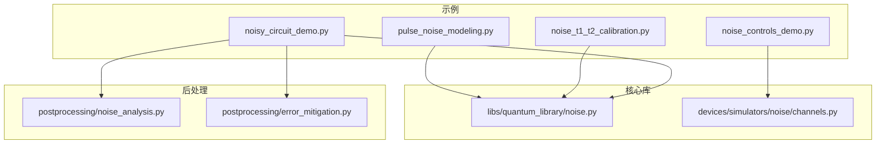
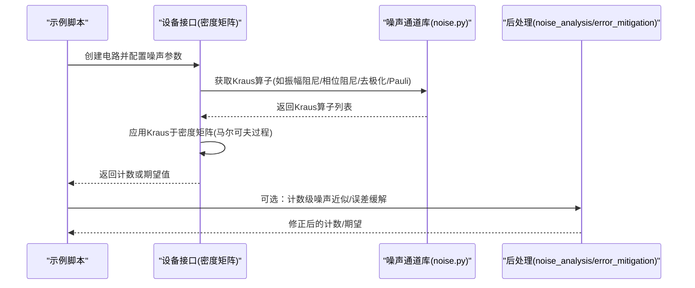
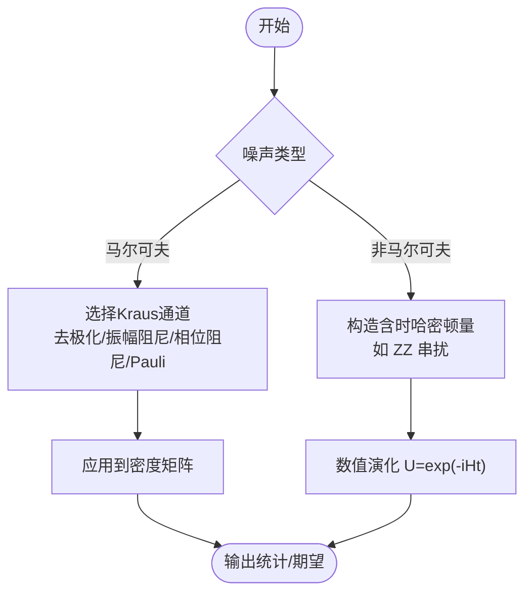
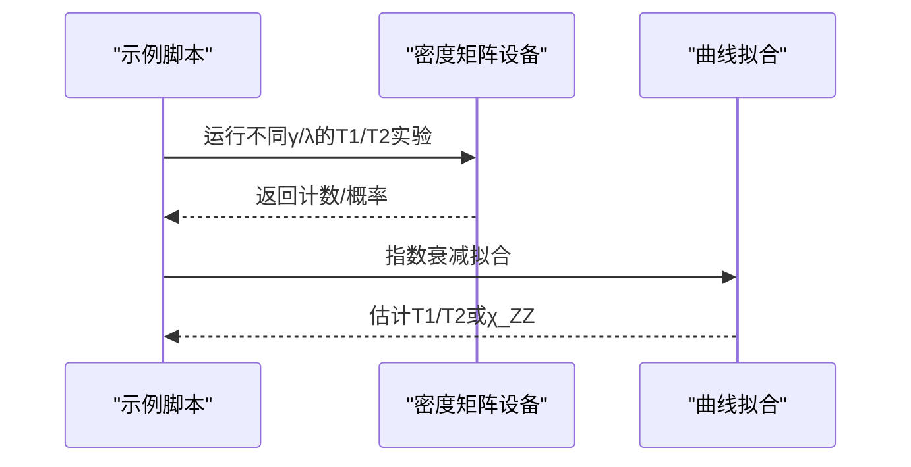
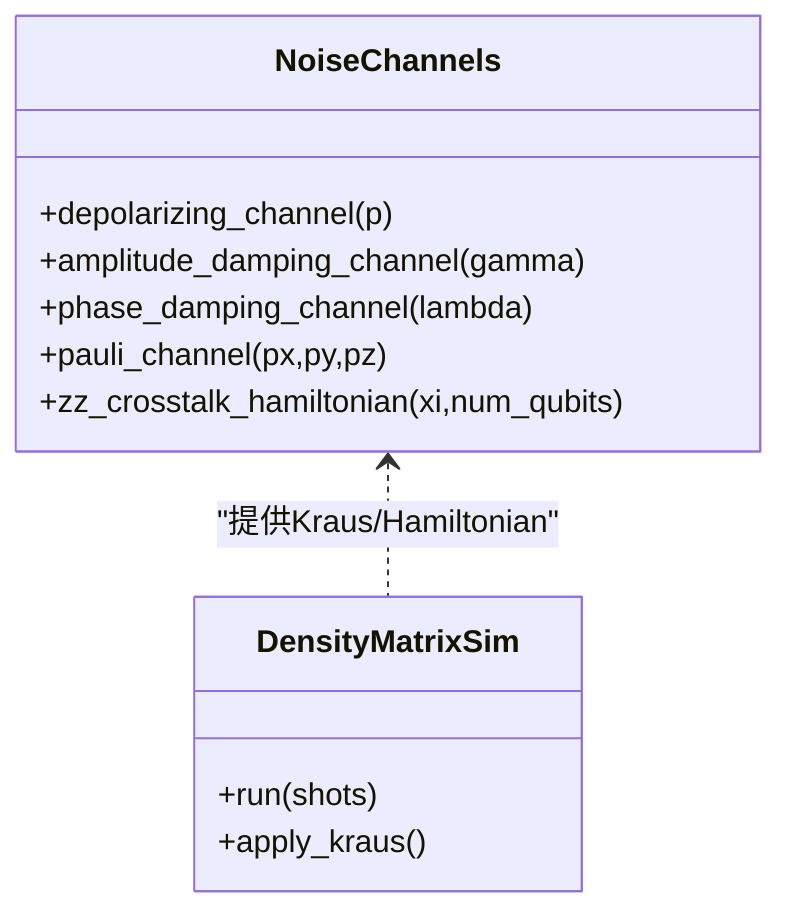
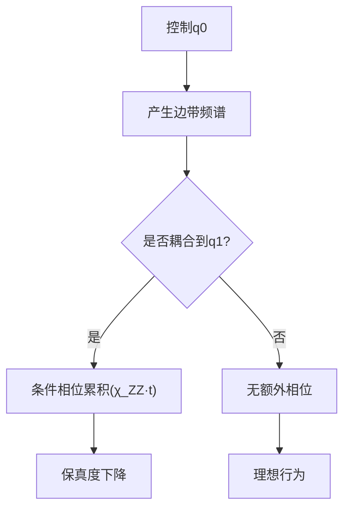
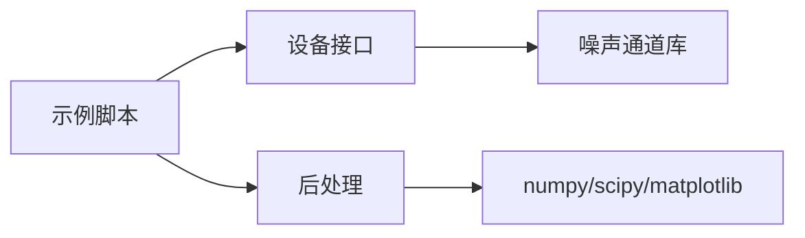

# 噪声建模示例

<cite>
**本文引用的文件**
- [pulse_noise_modeling.py](file://examples/pulse_noise_modeling.py)
- [noise_t1_t2_calibration.py](file://examples/noise_t1_t2_calibration.py)
- [noisy_circuit_demo.py](file://examples/noisy_circuit_demo.py)
- [noise_controls_demo.py](file://examples/noise_controls_demo.py)
- [noise.py](file://src/tyxonq/libs/quantum_library/noise.py)
- [channels.py](file://src/tyxonq/devices/simulators/noise/channels.py)
- [noise_analysis.py](file://src/tyxonq/postprocessing/noise_analysis.py)
- [error_mitigation.py](file://src/tyxonq/postprocessing/error_mitigation.py)
</cite>

## 目录
1. [简介](#简介)
2. [项目结构](#项目结构)
3. [核心组件](#核心组件)
4. [架构总览](#架构总览)
5. [详细组件分析](#详细组件分析)
6. [依赖关系分析](#依赖关系分析)
7. [性能考量](#性能考量)
8. [故障排查指南](#故障排查指南)
9. [结论](#结论)
10. [附录](#附录)

## 简介
本示例文档围绕 TyxonQ 的脉冲级噪声建模与误差分析，系统讲解 T1 弛豫、T2 退相干、脉冲幅度误差、频率失配、串扰（ZZ）等噪声源，演示如何在仿真环境中构建马尔可夫与非马尔可夫噪声过程，提供完整的噪声模拟代码路径与流程，展示如何添加噪声、分析影响、验证算法鲁棒性，并给出参数估计、误差传播分析与抑制策略。同时说明如何将仿真结果与真实硬件数据进行对比验证。

## 项目结构
TyxonQ 在噪声建模方面提供了“标准噪声通道库 + 密度矩阵模拟器 + 后处理工具”的分层能力：
- 标准噪声通道库：提供 Kraus 算子形式的常见噪声模型（去极化、振幅阻尼、相位阻尼、Pauli 通道、测量通道、ZZ 串扰哈密顿量）。
- 密度矩阵模拟器：通过设备接口启用噪声，支持多种噪声类型配置。
- 后处理工具：对计数结果进行比特翻转、去极化近似；提供 ZNE/DD/RC 等误差缓解骨架。
- 示例脚本：覆盖 ZZ 串扰机理、T1/T2 标定、不同噪声模型的对比、噪声开关控制等。

图表来源
- [pulse_noise_modeling.py:1-591](file://examples/pulse_noise_modeling.py#L1-L591)
- [noise_t1_t2_calibration.py:1-427](file://examples/noise_t1_t2_calibration.py#L1-L427)
- [noisy_circuit_demo.py:1-315](file://examples/noisy_circuit_demo.py#L1-L315)
- [noise_controls_demo.py:1-53](file://examples/noise_controls_demo.py#L1-L53)
- [noise.py:1-341](file://src/tyxonq/libs/quantum_library/noise.py#L1-L341)
- [channels.py:1-44](file://src/tyxonq/devices/simulators/noise/channels.py#L1-L44)
- [noise_analysis.py:1-106](file://src/tyxonq/postprocessing/noise_analysis.py#L1-L106)
- [error_mitigation.py:1-82](file://src/tyxonq/postprocessing/error_mitigation.py#L1-L82)

章节来源
- [pulse_noise_modeling.py:1-591](file://examples/pulse_noise_modeling.py#L1-L591)
- [noise_t1_t2_calibration.py:1-427](file://examples/noise_t1_t2_calibration.py#L1-L427)
- [noisy_circuit_demo.py:1-315](file://examples/noisy_circuit_demo.py#L1-L315)
- [noise_controls_demo.py:1-53](file://examples/noise_controls_demo.py#L1-L53)
- [noise.py:1-341](file://src/tyxonq/libs/quantum_library/noise.py#L1-L341)
- [channels.py:1-44](file://src/tyxonq/devices/simulators/noise/channels.py#L1-L44)
- [noise_analysis.py:1-106](file://src/tyxonq/postprocessing/noise_analysis.py#L1-L106)
- [error_mitigation.py:1-82](file://src/tyxonq/postprocessing/error_mitigation.py#L1-L82)

## 核心组件
- 标准噪声通道（Kraus 表示）
  - 去极化通道：各向同性随机 Pauli 错误。
  - 振幅阻尼通道：能量弛豫 |1⟩→|0⟩，对应 T1。
  - 相位阻尼通道：纯退相干，对应 T2。
  - Pauli 通道：非对称 X/Y/Z 错误概率。
  - 测量通道：以概率 p 进行投影测量。
  - ZZ 串扰哈密顿量：相邻量子比特间的恒久耦合 H_ZZ = ξ·σ_z⊗σ_z。
- 密度矩阵模拟器与设备接口
  - 通过 device(..., use_noise=True, noise={...}) 注入噪声。
  - 支持 depolarizing、amplitude_damping、phase_damping、pauli 等类型。
- 后处理与误差缓解
  - 计数级比特翻转与去极化近似。
  - ZNE、DD、RC 的占位实现，便于扩展集成。

章节来源
- [noise.py:29-341](file://src/tyxonq/libs/quantum_library/noise.py#L29-L341)
- [noisy_circuit_demo.py:62-231](file://examples/noisy_circuit_demo.py#L62-L231)
- [noise_analysis.py:24-100](file://src/tyxonq/postprocessing/noise_analysis.py#L24-L100)
- [error_mitigation.py:7-79](file://src/tyxonq/postprocessing/error_mitigation.py#L7-L79)

## 架构总览
下图展示了从示例到核心库再到后处理的调用关系与数据流：

图表来源
- [noisy_circuit_demo.py:62-231](file://examples/noisy_circuit_demo.py#L62-L231)
- [noise.py:29-341](file://src/tyxonq/libs/quantum_library/noise.py#L29-L341)
- [noise_analysis.py:24-100](file://src/tyxonq/postprocessing/noise_analysis.py#L24-L100)
- [error_mitigation.py:7-79](file://src/tyxonq/postprocessing/error_mitigation.py#L7-L79)

## 详细组件分析

### 噪声源与物理机制
- T1 弛豫（振幅阻尼）
  - 描述能量耗散 |1⟩→|0⟩，典型时间 ~80 μs。
  - 使用 amplitude_damping_channel(gamma)，gamma ≈ 1 - exp(-t_gate/T1)。
- T2 退相干（相位阻尼）
  - 描述相位随机化，典型时间 ~120 μs。
  - 使用 phase_damping_channel(lambda)，lambda ≈ 1 - exp(-t_gate/T2)。
- 脉冲幅度误差与频率失配
  - 在脉冲级表现为旋转轴偏差与频偏导致的相位累积误差；可通过校准与脉冲整形（如 DRAG）降低。
- 串扰效应（ZZ）
  - 恒久耦合 H_ZZ = ξ·σ_z⊗σ_z，导致条件相位累积；强度 ξ 通常为 kHz~MHz 量级。
  - 可通过频率失谐、序列补偿、门调度优化等手段缓解。

章节来源
- [noise.py:73-147](file://src/tyxonq/libs/quantum_library/noise.py#L73-L147)
- [noise.py:255-341](file://src/tyxonq/libs/quantum_library/noise.py#L255-L341)
- [pulse_noise_modeling.py:46-163](file://examples/pulse_noise_modeling.py#L46-L163)

### 马尔可夫与非马尔可夫噪声过程
- 马尔可夫噪声
  - 标准通道（去极化、振幅阻尼、相位阻尼、Pauli）均为 CPTP 映射，适用于短时、无记忆环境。
  - 在密度矩阵模拟器中直接应用 Kraus 算子。
- 非马尔可夫噪声
  - 可通过分段演化+中间测量/退相干、或使用含时哈密顿量（如 ZZ）模拟相关性与记忆效应。
  - ZZ 串扰属于相干噪声，可用 zz_crosstalk_hamiltonian 构造演化算符。

图表来源
- [noise.py:29-205](file://src/tyxonq/libs/quantum_library/noise.py#L29-L205)
- [noise.py:255-341](file://src/tyxonq/libs/quantum_library/noise.py#L255-L341)

### 噪声参数估计与标定
- T1/T2 标定流程
  - T1：制备 |1⟩，施加不同 γ 的振幅阻尼，拟合 P₁(γ)=A·exp(-γ·T1)+C。
  - T2：Ramsey 型序列 H-noise-H，拟合 P(λ)=A·exp(-λ·T2)+C。
- ZZ 强度测量
  - 通过控制 q0 的 π 脉冲与 q1 的 Ramsey 干涉提取 χ_ZZ。

图表来源
- [noise_t1_t2_calibration.py:75-222](file://examples/noise_t1_t2_calibration.py#L75-L222)
- [pulse_noise_modeling.py:108-163](file://examples/pulse_noise_modeling.py#L108-L163)

章节来源
- [noise_t1_t2_calibration.py:75-222](file://examples/noise_t1_t2_calibration.py#L75-L222)
- [pulse_noise_modeling.py:108-163](file://examples/pulse_noise_modeling.py#L108-L163)

### 噪声模拟与误差分析
- 不同噪声模型对比
  - 去极化：均匀随机 Pauli 错误，适合各向同性噪声场景。
  - 振幅阻尼：能量损失主导，影响布居数。
  - 相位阻尼：破坏相干性，保持布居数。
  - Pauli 通道：非对称错误率，更贴近实际器件。
- 误差传播与保真度
  - 通过计算理想态与实测分布的保真度评估噪声影响。
  - 多比特 GHZ/Bell 态对噪声敏感，可用于基准测试。

图表来源
- [noise.py:29-341](file://src/tyxonq/libs/quantum_library/noise.py#L29-L341)
- [noisy_circuit_demo.py:62-231](file://examples/noisy_circuit_demo.py#L62-L231)

章节来源
- [noisy_circuit_demo.py:62-231](file://examples/noisy_circuit_demo.py#L62-L231)
- [noise.py:29-341](file://src/tyxonq/libs/quantum_library/noise.py#L29-L341)

### 串扰效应与缓解策略
- ZZ 串扰机理
  - 控制 q0 的脉冲边带耦合到 q1，产生条件相位累积。
  - 强度 χ_ZZ 通常在 kHz 范围，随器件而异。
- 缓解技术
  - 频率失谐：调整目标频率避开共振。
  - ZZ 补偿：在序列末尾附加反向 RZ 相位。
  - 门调度与布局优化：避免并发邻居控制。
  - 复合门设计：对 ZZ 误差鲁棒的门序列。
  - 后处理校正：基于测量的经典矩阵修正。

图表来源
- [pulse_noise_modeling.py:46-163](file://examples/pulse_noise_modeling.py#L46-L163)
- [pulse_noise_modeling.py:294-453](file://examples/pulse_noise_modeling.py#L294-L453)

章节来源
- [pulse_noise_modeling.py:46-163](file://examples/pulse_noise_modeling.py#L46-L163)
- [pulse_noise_modeling.py:294-453](file://examples/pulse_noise_modeling.py#L294-L453)

### 完整噪声模拟工作流（代码路径）
- 基础噪声模拟
  - 参考：[noisy_circuit_demo.py:62-231](file://examples/noisy_circuit_demo.py#L62-L231)
- 全局噪声开关与设备级覆盖
  - 参考：[noise_controls_demo.py:4-46](file://examples/noise_controls_demo.py#L4-L46)
- T1/T2 标定与可视化
  - 参考：[noise_t1_t2_calibration.py:75-222](file://examples/noise_t1_t2_calibration.py#L75-L222)
- ZZ 串扰测量与影响分析
  - 参考：[pulse_noise_modeling.py:108-229](file://examples/pulse_noise_modeling.py#L108-L229)

章节来源
- [noisy_circuit_demo.py:62-231](file://examples/noisy_circuit_demo.py#L62-L231)
- [noise_controls_demo.py:4-46](file://examples/noise_controls_demo.py#L4-L46)
- [noise_t1_t2_calibration.py:75-222](file://examples/noise_t1_t2_calibration.py#L75-L222)
- [pulse_noise_modeling.py:108-229](file://examples/pulse_noise_modeling.py#L108-L229)

### 误差缓解与后处理
- 计数级近似
  - 比特翻转与去极化近似，用于快速 what-if 分析。
  - 参考：[noise_analysis.py:24-100](file://src/tyxonq/postprocessing/noise_analysis.py#L24-L100)
- 误差缓解骨架
  - ZNE、DD、RC 的占位实现，便于后续集成 mitiq 等工具。
  - 参考：[error_mitigation.py:7-79](file://src/tyxonq/postprocessing/error_mitigation.py#L7-L79)

章节来源
- [noise_analysis.py:24-100](file://src/tyxonq/postprocessing/noise_analysis.py#L24-L100)
- [error_mitigation.py:7-79](file://src/tyxonq/postprocessing/error_mitigation.py#L7-L79)

## 依赖关系分析
- 模块耦合
  - 示例脚本依赖设备接口与噪声通道库。
  - 后处理模块独立于模拟器，可直接作用于计数字典。
- 外部依赖
  - 数值后端（numpy）、曲线拟合（scipy.optimize.curve_fit）、可视化（matplotlib）。
- 潜在循环依赖
  - 当前结构清晰，未见循环依赖。

图表来源
- [noisy_circuit_demo.py:1-315](file://examples/noisy_circuit_demo.py#L1-L315)
- [noise_t1_t2_calibration.py:1-427](file://examples/noise_t1_t2_calibration.py#L1-L427)
- [noise.py:1-341](file://src/tyxonq/libs/quantum_library/noise.py#L1-L341)
- [noise_analysis.py:1-106](file://src/tyxonq/postprocessing/noise_analysis.py#L1-L106)

章节来源
- [noisy_circuit_demo.py:1-315](file://examples/noisy_circuit_demo.py#L1-L315)
- [noise_t1_t2_calibration.py:1-427](file://examples/noise_t1_t2_calibration.py#L1-L427)
- [noise.py:1-341](file://src/tyxonq/libs/quantum_library/noise.py#L1-L341)
- [noise_analysis.py:1-106](file://src/tyxonq/postprocessing/noise_analysis.py#L1-L106)

## 性能考量
- 模拟器选择
  - 状态向量：速度快，不支持混合态与噪声。
  - 密度矩阵：支持噪声与混合态，复杂度 O(4^n)。
- 噪声强度与采样次数
  - 高噪声需更多 shots 以获得稳定统计。
- ZZ 串扰与多体演化
  - 含时哈密顿量演化成本较高，建议分块或近似。
- 后处理开销
  - 计数级近似成本低，适合快速迭代；全态模拟成本高。

## 故障排查指南
- 噪声未生效
  - 检查设备接口是否设置 use_noise=True 与正确的噪声类型/参数。
  - 参考：[noisy_circuit_demo.py:80-91](file://examples/noisy_circuit_demo.py#L80-L91)
- 参数越界
  - 确保 p、gamma、lambda 在 [0,1] 范围内。
  - 参考：[noise.py:56-58](file://src/tyxonq/libs/quantum_library/noise.py#L56-L58)、[noise.py:101-103](file://src/tyxonq/libs/quantum_library/noise.py#L101-L103)、[noise.py:140-142](file://src/tyxonq/libs/quantum_library/noise.py#L140-L142)
- 拟合不收敛
  - 调整初始参数与采样点范围，确保动态范围足够。
  - 参考：[noise_t1_t2_calibration.py:197-222](file://examples/noise_t1_t2_calibration.py#L197-L222)
- ZZ 串扰识别
  - 通过 Ramsey 干涉频率差提取 χ_ZZ，确认是否存在异常相位累积。
  - 参考：[pulse_noise_modeling.py:108-163](file://examples/pulse_noise_modeling.py#L108-L163)

章节来源
- [noisy_circuit_demo.py:80-91](file://examples/noisy_circuit_demo.py#L80-L91)
- [noise.py:56-58](file://src/tyxonq/libs/quantum_library/noise.py#L56-L58)
- [noise.py:101-103](file://src/tyxonq/libs/quantum_library/noise.py#L101-L103)
- [noise.py:140-142](file://src/tyxonq/libs/quantum_library/noise.py#L140-L142)
- [noise_t1_t2_calibration.py:197-222](file://examples/noise_t1_t2_calibration.py#L197-L222)
- [pulse_noise_modeling.py:108-163](file://examples/pulse_noise_modeling.py#L108-L163)

## 结论
TyxonQ 提供了从标准噪声通道到密度矩阵模拟、再到后处理与误差缓解的完整噪声建模能力。通过示例脚本，用户可以快速上手 T1/T2 标定、ZZ 串扰测量与缓解、以及不同噪声模型的对比分析。结合真实硬件数据，可进一步校准模型参数、验证算法鲁棒性，并指导脉冲设计与编译优化。

## 附录
- 常用噪声类型与参数
  - 去极化：type="depolarizing", p∈[0,1]
  - 振幅阻尼：type="amplitude_damping", gamma∈[0,1]
  - 相位阻尼：type="phase_damping", lambda∈[0,1]
  - Pauli 通道：type="pauli", px,py,pz≥0 且和≤1
- 关键代码路径
  - 噪声通道定义：[noise.py:29-341](file://src/tyxonq/libs/quantum_library/noise.py#L29-L341)
  - 设备级噪声注入：[noisy_circuit_demo.py:80-91](file://examples/noisy_circuit_demo.py#L80-L91)
  - T1/T2 标定：[noise_t1_t2_calibration.py:75-222](file://examples/noise_t1_t2_calibration.py#L75-L222)
  - ZZ 串扰测量与分析：[pulse_noise_modeling.py:108-229](file://examples/pulse_noise_modeling.py#L108-L229)
  - 后处理近似与缓解：[noise_analysis.py:24-100](file://src/tyxonq/postprocessing/noise_analysis.py#L24-L100), [error_mitigation.py:7-79](file://src/tyxonq/postprocessing/error_mitigation.py#L7-L79)