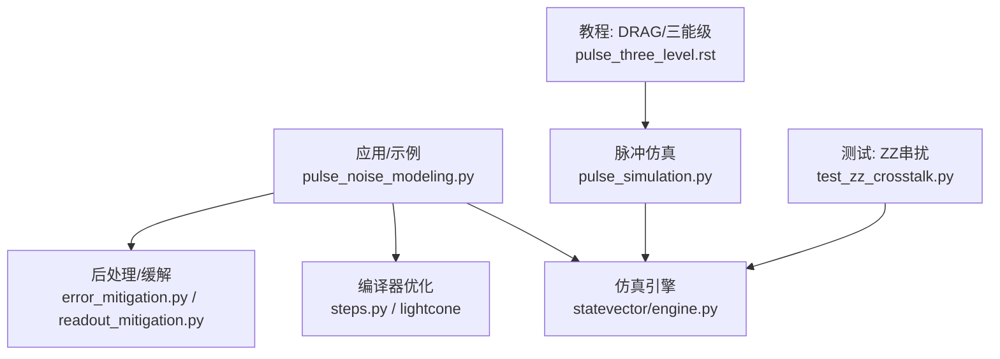
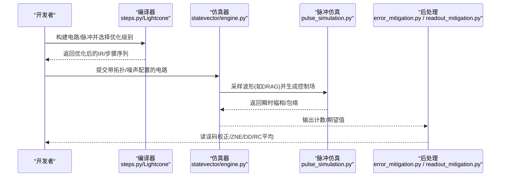
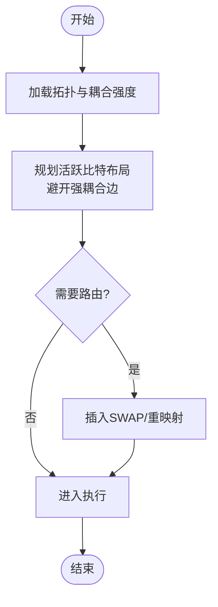
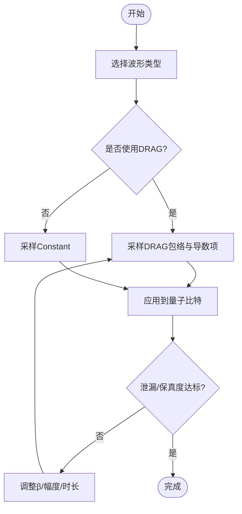
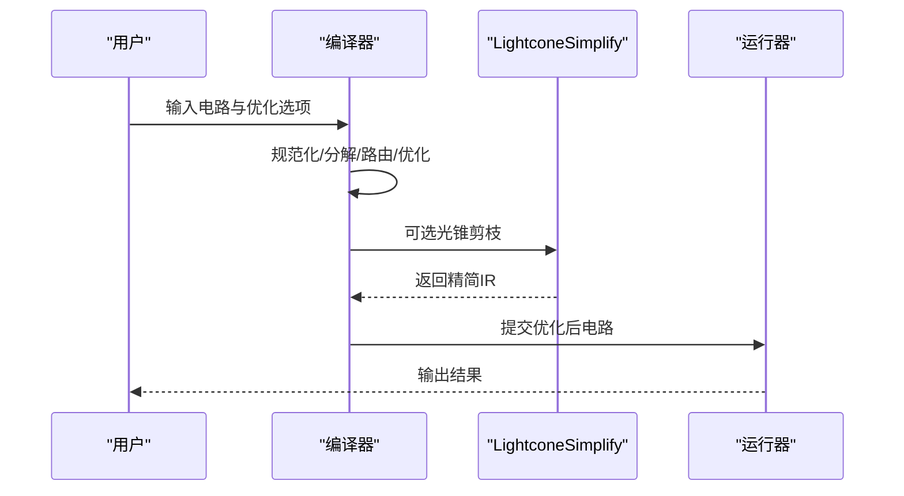
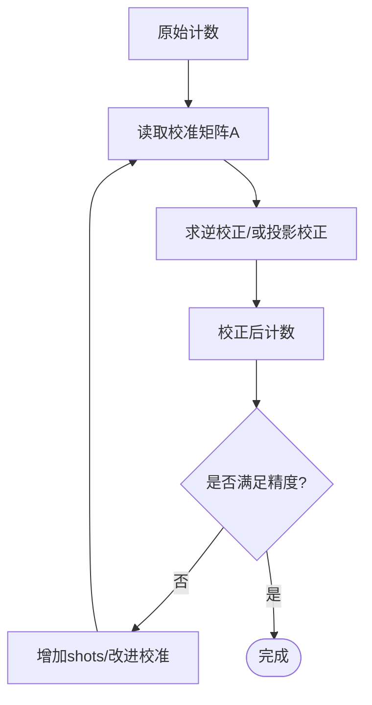
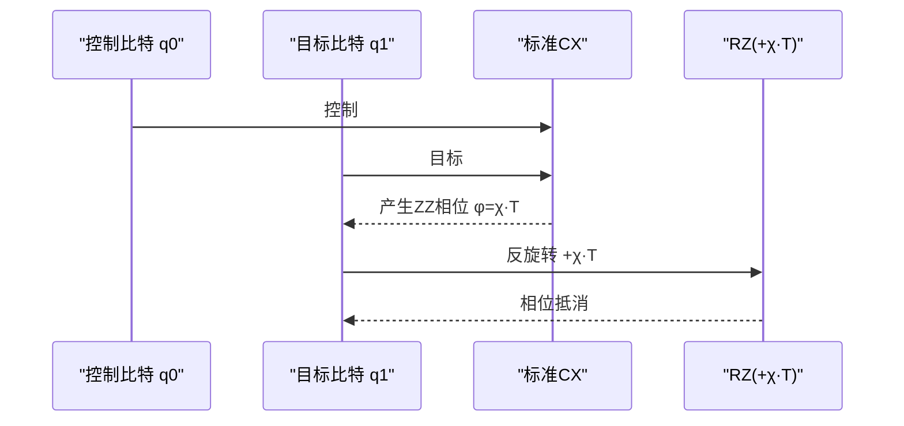
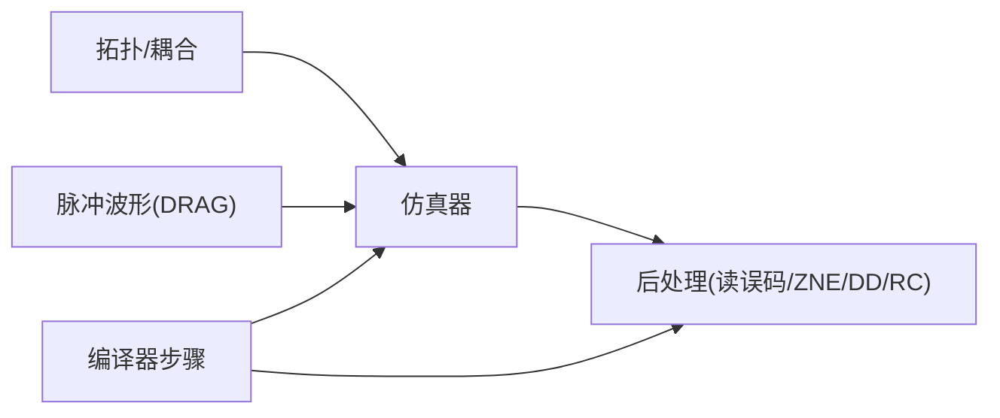

# 抗噪电路设计

<cite>
**本文引用的文件**
- [examples/pulse_noise_modeling.py](file://examples/pulse_noise_modeling.py)
- [tests_core_module/test_zz_crosstalk.py](file://tests_core_module/test_zz_crosstalk.py)
- [src/tyxonq/devices/simulators/statevector/engine.py](file://src/tyxonq/devices/simulators/statevector/engine.py)
- [examples/readout_mitigation.py](file://examples/readout_mitigation.py)
- [src/tyxonq/postprocessing/error_mitigation.py](file://src/tyxonq/postprocessing/error_mitigation.py)
- [examples/compiler_lightcone_optimization.py](file://examples/compiler_lightcone_optimization.py)
- [src/tyxonq/compiler/gate_compiler/steps.py](file://src/tyxonq/compiler/gate_compiler/steps.py)
- [src/tyxonq/libs/quantum_library/pulse_simulation.py](file://src/tyxonq/libs/quantum_library/pulse_simulation.py)
- [examples/pulse_waveforms.py](file://examples/pulse_waveforms.py)
- [docs/source/tutorials/advanced/pulse_three_level.rst](file://docs/source/tutorials/advanced/pulse_three_level.rst)
- [docs/source/tutorials/advanced/pulse_zz_crosstalk.rst](file://docs/source/tutorials/advanced/pulse_zz_crosstalk.rst)
</cite>

## 目录
1. [简介](#简介)
2. [项目结构](#项目结构)
3. [核心组件](#核心组件)
4. [架构总览](#架构总览)
5. [详细组件分析](#详细组件分析)
6. [依赖关系分析](#依赖关系分析)
7. [性能考量](#性能考量)
8. [故障排查指南](#故障排查指南)
9. [结论](#结论)
10. [附录](#附录)

## 简介
本指南面向需要在真实或仿真量子硬件上构建鲁棒电路的开发者，聚焦“最小化串扰影响”的六种主要策略：量子比特布局优化、脉冲整形（以DRAG替代Constant）、门交换与编译优化、误差缓解技术、浅层电路设计、动态解耦。文档结合TyxonQ代码库中的噪声建模、ZZ串扰、读误码缓解、编译器光锥简化、脉冲仿真等实现，给出每种策略的具体做法、收益分析与开销评估，并以“标准CX后加RZ(+χ·T)反旋转抵消ZZ相位”为例，展示可落地的设计原则与实践路径。

## 项目结构
围绕抗噪设计的代码分布在示例、测试、后端仿真、编译器与后处理模块中：
- 噪声建模与串扰：示例演示了ZZ串扰机制、测量方法、算法影响与缓解策略；测试覆盖了ZZ哈密顿量、拓扑结构与耦合强度。
- 脉冲整形：提供DRAG波形采样与三能级泄漏抑制验证，指导用DRAG替代Constant以降低频谱旁瓣与泄漏。
- 编译器优化：光锥简化在期望值计算中大幅减少无关门，降低执行时间与串扰累积窗口。
- 误差缓解：读误码矩阵校正、以及占位符形式的ZNE/DD/RC接口便于后续扩展。
- 仿真引擎：状态向量仿真器集成ZZ串扰模型，支持按拓扑注入条件相位。

图表来源
- [examples/pulse_noise_modeling.py:1-591](file://examples/pulse_noise_modeling.py#L1-L591)
- [src/tyxonq/devices/simulators/statevector/engine.py:553-584](file://src/tyxonq/devices/simulators/statevector/engine.py#L553-L584)
- [src/tyxonq/compiler/gate_compiler/steps.py:38-59](file://src/tyxonq/compiler/gate_compiler/steps.py#L38-L59)
- [examples/compiler_lightcone_optimization.py:1-282](file://examples/compiler_lightcone_optimization.py#L1-L282)
- [src/tyxonq/postprocessing/error_mitigation.py:1-82](file://src/tyxonq/postprocessing/error_mitigation.py#L1-L82)
- [examples/readout_mitigation.py:1-134](file://examples/readout_mitigation.py#L1-L134)
- [src/tyxonq/libs/quantum_library/pulse_simulation.py:83-119](file://src/tyxonq/libs/quantum_library/pulse_simulation.py#L83-L119)
- [docs/source/tutorials/advanced/pulse_three_level.rst:571-620](file://docs/source/tutorials/advanced/pulse_three_level.rst#L571-L620)

章节来源
- [examples/pulse_noise_modeling.py:1-591](file://examples/pulse_noise_modeling.py#L1-L591)
- [tests_core_module/test_zz_crosstalk.py:1-349](file://tests_core_module/test_zz_crosstalk.py#L1-L349)

## 核心组件
- ZZ串扰建模与拓扑：通过ZZ哈密顿量与拓扑边集描述相邻量子比特间的条件相位累积，支持线性、网格、Heavy-Hex等拓扑及自定义耦合强度。
- 仿真引擎串扰注入：在执行脉冲时根据拓扑与模式（local/global）对态矢量施加条件相位演化。
- 脉冲整形（DRAG）：在采样阶段加入导数项抑制泄漏到|2⟩，对比Constant显著降低非对角跃迁。
- 编译器光锥简化：基于测量反向依赖剪枝无关门，缩短有效作用时间，间接降低串扰与退相干影响。
- 误差缓解：读误码矩阵求逆校正；预留ZNE/DD/RC接口用于未来集成mitiq等工具。
- 示例与教程：提供从物理机制、测量协议到缓解策略的完整流程说明。

章节来源
- [tests_core_module/test_zz_crosstalk.py:1-349](file://tests_core_module/test_zz_crosstalk.py#L1-L349)
- [src/tyxonq/devices/simulators/statevector/engine.py:553-584](file://src/tyxonq/devices/simulators/statevector/engine.py#L553-L584)
- [src/tyxonq/libs/quantum_library/pulse_simulation.py:83-119](file://src/tyxonq/libs/quantum_library/pulse_simulation.py#L83-L119)
- [examples/compiler_lightcone_optimization.py:1-282](file://examples/compiler_lightcone_optimization.py#L1-L282)
- [examples/readout_mitigation.py:1-134](file://examples/readout_mitigation.py#L1-L134)
- [src/tyxonq/postprocessing/error_mitigation.py:1-82](file://src/tyxonq/postprocessing/error_mitigation.py#L1-L82)

## 架构总览
下图展示了抗噪电路设计在TyxonQ中的关键数据流与控制流：从电路/脉冲定义，经编译器优化与仿真执行，再到后处理与结果校正。

图表来源
- [src/tyxonq/compiler/gate_compiler/steps.py:38-59](file://src/tyxonq/compiler/gate_compiler/steps.py#L38-L59)
- [src/tyxonq/devices/simulators/statevector/engine.py:553-584](file://src/tyxonq/devices/simulators/statevector/engine.py#L553-L584)
- [src/tyxonq/libs/quantum_library/pulse_simulation.py:83-119](file://src/tyxonq/libs/quantum_library/pulse_simulation.py#L83-L119)
- [examples/readout_mitigation.py:1-134](file://examples/readout_mitigation.py#L1-L134)
- [src/tyxonq/postprocessing/error_mitigation.py:1-82](file://src/tyxonq/postprocessing/error_mitigation.py#L1-L82)

## 详细组件分析

### 策略一：量子比特布局优化（减少串扰）
- 目标：将易受串扰影响的活跃量子比特放置在弱耦合或非相邻位置，降低ZZ相互作用强度。
- 实现要点：
  - 使用拓扑工具获取邻居与耦合强度，优先选择弱耦合边进行路由。
  - 在编译阶段启用路由与优化，避免不必要的相邻交互。
- 收益：直接降低ZZ相位累积速率，提升两量子比特门保真度。
- 开销：可能增加SWAP或路由成本，需权衡深度与串扰。

图表来源
- [tests_core_module/test_zz_crosstalk.py:120-235](file://tests_core_module/test_zz_crosstalk.py#L120-L235)
- [src/tyxonq/compiler/gate_compiler/steps.py:38-59](file://src/tyxonq/compiler/gate_compiler/steps.py#L38-L59)

章节来源
- [tests_core_module/test_zz_crosstalk.py:120-235](file://tests_core_module/test_zz_crosstalk.py#L120-L235)
- [src/tyxonq/compiler/gate_compiler/steps.py:38-59](file://src/tyxonq/compiler/gate_compiler/steps.py#L38-L59)

### 策略二：脉冲整形（DRAG替代Constant）
- 目标：通过平滑包络与导数项抑制高频频谱旁瓣，减少泄漏到|2⟩和串扰耦合。
- 实现要点：
  - 使用DRAG波形采样，设置合适的β参数以匹配硬件非谐性。
  - 在三能级仿真中验证泄漏抑制效果。
- 收益：降低单/双量子比特门的泄漏与串扰，提高保真度。
- 开销：波形更复杂，但通常代价很小；需校准β。

图表来源
- [src/tyxonq/libs/quantum_library/pulse_simulation.py:83-119](file://src/tyxonq/libs/quantum_library/pulse_simulation.py#L83-L119)
- [docs/source/tutorials/advanced/pulse_three_level.rst:571-620](file://docs/source/tutorials/advanced/pulse_three_level.rst#L571-L620)
- [examples/pulse_waveforms.py:436-470](file://examples/pulse_waveforms.py#L436-L470)

章节来源
- [src/tyxonq/libs/quantum_library/pulse_simulation.py:83-119](file://src/tyxonq/libs/quantum_library/pulse_simulation.py#L83-L119)
- [docs/source/tutorials/advanced/pulse_three_level.rst:571-620](file://docs/source/tutorials/advanced/pulse_three_level.rst#L571-L620)
- [examples/pulse_waveforms.py:436-470](file://examples/pulse_waveforms.py#L436-L470)

### 策略三：门交换与编译优化（减少并发串扰）
- 目标：通过门交换、调度与光锥简化，避免相邻量子比特上的并发控制，缩短有效作用时间。
- 实现要点：
  - 使用编译器步骤装配（分解→路由→优化→化简），必要时开启LightconeSimplify。
  - 在期望值计算中利用光锥剪枝无关门，降低串扰累积窗口。
- 收益：减少串扰与退相干时间，提升整体保真度与效率。
- 开销：可能引入额外门或路由成本；需评估问题规模与测量范围。

图表来源
- [src/tyxonq/compiler/gate_compiler/steps.py:38-59](file://src/tyxonq/compiler/gate_compiler/steps.py#L38-L59)
- [examples/compiler_lightcone_optimization.py:1-282](file://examples/compiler_lightcone_optimization.py#L1-L282)

章节来源
- [src/tyxonq/compiler/gate_compiler/steps.py:38-59](file://src/tyxonq/compiler/gate_compiler/steps.py#L38-L59)
- [examples/compiler_lightcone_optimization.py:1-282](file://examples/compiler_lightcone_optimization.py#L1-L282)

### 策略四：误差缓解技术（读误码校正与通用框架）
- 目标：通过后处理校正已知噪声模式，恢复更接近理想的统计分布。
- 实现要点：
  - 读误码：构建每量子比特校准矩阵A，使用求逆法校正计数。
  - 通用框架：预留ZNE/DD/RC接口，便于接入mitiq等工具。
- 收益：显著提升最终结果的准确性，尤其在读误码主导场景。
- 开销：需要校准与多次执行；矩阵求逆复杂度随比特数增长。

图表来源
- [examples/readout_mitigation.py:1-134](file://examples/readout_mitigation.py#L1-L134)
- [src/tyxonq/postprocessing/error_mitigation.py:1-82](file://src/tyxonq/postprocessing/error_mitigation.py#L1-L82)

章节来源
- [examples/readout_mitigation.py:1-134](file://examples/readout_mitigation.py#L1-L134)
- [src/tyxonq/postprocessing/error_mitigation.py:1-82](file://src/tyxonq/postprocessing/error_mitigation.py#L1-L82)

### 策略五：浅层电路设计（减少串扰与退相干时间）
- 目标：尽量降低电路深度与总时长，使串扰与退相干的影响窗口最小化。
- 实现要点：
  - 算法层面合并/近似，减少不必要门。
  - 借助编译器优化与光锥简化进一步裁剪。
- 收益：直接降低串扰累积与退相干损失。
- 开销：取决于问题本身；可能需要近似或分层训练。

章节来源
- [examples/pulse_noise_modeling.py:303-346](file://examples/pulse_noise_modeling.py#L303-L346)
- [examples/compiler_lightcone_optimization.py:1-282](file://examples/compiler_lightcone_optimization.py#L1-L282)

### 策略六：动态解耦（周期性脉冲抑制低频噪声）
- 目标：在空闲时段插入XX/YY脉冲序列，抑制低频噪声与部分串扰效应。
- 实现要点：
  - 在电路中插入DD序列（如XY4/XY8），注意与门调度的协调。
  - 当前提供占位接口，便于后续扩展具体序列与自动插入。
- 收益：对低频噪声和部分串扰有抑制作用。
- 开销：增加脉冲时长与资源占用，需平衡保真度增益。

章节来源
- [src/tyxonq/postprocessing/error_mitigation.py:26-53](file://src/tyxonq/postprocessing/error_mitigation.py#L26-L53)
- [examples/pulse_noise_modeling.py:339-345](file://examples/pulse_noise_modeling.py#L339-L345)

### 实战示例：标准CX后加RZ(+χ·T)抵消ZZ相位
- 背景：在跨共振或类似两量子比特门执行期间，控制脉冲会在邻近量子比特上产生条件ZZ相位φ≈χ·T。通过在目标比特上追加RZ(+χ·T)可实现反旋转抵消。
- 实现思路：
  - 先执行标准CX（或等效CR序列）。
  - 在目标比特上添加RZ(+χ·T)，其中χ为已标定的ZZ强度，T为门持续时间。
  - 若存在多段门或并行控制，需分段估计有效χ·T并累加补偿。
- 收益：几乎消除由ZZ引起的条件相位误差。
- 开销：增加一个RZ门（虚拟Z，无实际脉冲），成本低；前提是准确标定χ。

图表来源
- [examples/pulse_noise_modeling.py:357-372](file://examples/pulse_noise_modeling.py#L357-L372)
- [docs/source/tutorials/advanced/pulse_zz_crosstalk.rst:687-730](file://docs/source/tutorials/advanced/pulse_zz_crosstalk.rst#L687-L730)

章节来源
- [examples/pulse_noise_modeling.py:357-372](file://examples/pulse_noise_modeling.py#L357-L372)
- [docs/source/tutorials/advanced/pulse_zz_crosstalk.rst:687-730](file://docs/source/tutorials/advanced/pulse_zz_crosstalk.rst#L687-L730)

## 依赖关系分析
- 串扰建模依赖拓扑与耦合强度配置，仿真器在脉冲执行时注入条件相位。
- 编译器步骤顺序固定，确保分解早于路由，优化与化简紧随其后。
- 脉冲仿真与三能级模型共同决定泄漏与串扰强度，DRAG参数直接影响保真度。
- 后处理模块独立于前端，可插拔不同缓解策略。

图表来源
- [tests_core_module/test_zz_crosstalk.py:120-235](file://tests_core_module/test_zz_crosstalk.py#L120-L235)
- [src/tyxonq/compiler/gate_compiler/steps.py:38-59](file://src/tyxonq/compiler/gate_compiler/steps.py#L38-L59)
- [src/tyxonq/devices/simulators/statevector/engine.py:553-584](file://src/tyxonq/devices/simulators/statevector/engine.py#L553-L584)
- [src/tyxonq/libs/quantum_library/pulse_simulation.py:83-119](file://src/tyxonq/libs/quantum_library/pulse_simulation.py#L83-L119)
- [examples/readout_mitigation.py:1-134](file://examples/readout_mitigation.py#L1-L134)
- [src/tyxonq/postprocessing/error_mitigation.py:1-82](file://src/tyxonq/postprocessing/error_mitigation.py#L1-L82)

## 性能考量
- 串扰与退相干：门时长越长，累积相位越大；应优先缩短门时长与减少并发控制。
- 脉冲整形：DRAG可降低泄漏与旁瓣，但需校准β；过大的β可能引入其他误差。
- 编译器优化：光锥简化在不改变数学结果的前提下显著减少计算量，特别适合部分测量场景。
- 误差缓解：读误码校正效果好但需校准矩阵；ZNE/DD/RC可通过多次执行换取更高精度。
- 总体建议：组合多种策略（布局+DRAG+光锥+缓解）可获得最佳性价比。

## 故障排查指南
- ZZ相位异常：检查拓扑与耦合强度是否正确；确认χ标定与门时长T一致。
- DRAG未达预期：调整β与幅度；在三能级仿真中观察泄漏比例变化。
- 编译器未生效：确认优化级别与Lightcone开关；检查测量标记是否被正确识别。
- 读误码校正失败：校验校准矩阵行和是否为1；检查求逆稳定性与数值精度。
- DD未改善：确认插入位置与时序；避免与门冲突。

章节来源
- [tests_core_module/test_zz_crosstalk.py:1-349](file://tests_core_module/test_zz_crosstalk.py#L1-L349)
- [docs/source/tutorials/advanced/pulse_three_level.rst:571-620](file://docs/source/tutorials/advanced/pulse_three_level.rst#L571-L620)
- [examples/compiler_lightcone_optimization.py:1-282](file://examples/compiler_lightcone_optimization.py#L1-L282)
- [examples/readout_mitigation.py:1-134](file://examples/readout_mitigation.py#L1-L134)

## 结论
通过系统化的抗噪设计——合理的量子比特布局、DRAG脉冲整形、门交换与编译优化、误差缓解、浅层电路设计与动态解耦——可在真实或仿真环境中显著降低串扰影响。以“CX后加RZ(+χ·T)”为代表的精准相位补偿，配合准确的χ标定与编译器优化，能够在低成本下获得高保真度。建议在工程实践中采用“标定→优化→缓解”的闭环流程，持续评估与迭代。

## 附录
- 实用清单：
  - 标定设备ZZ强度χ，记录各边耦合。
  - 使用DRAG替换Constant，校准β。
  - 启用编译器优化与光锥简化，减少无效门。
  - 在读误码主导场景使用矩阵求逆校正。
  - 在长空闲时段插入DD序列。
  - 对关键两量子比特门实施RZ(+χ·T)反旋转。