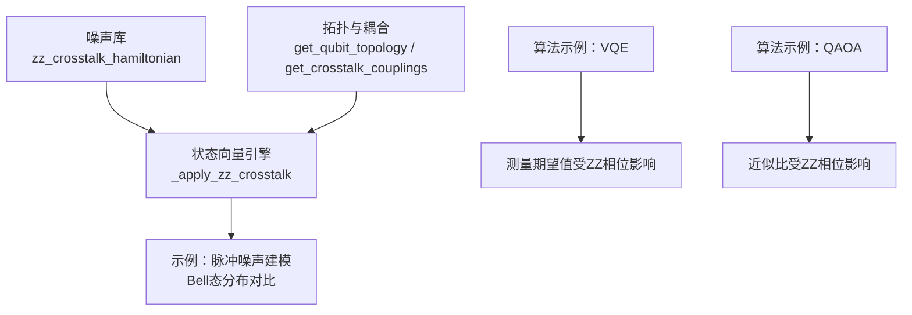
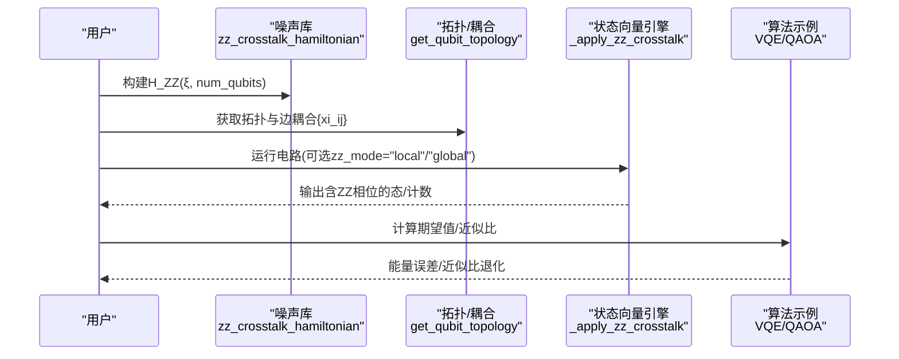
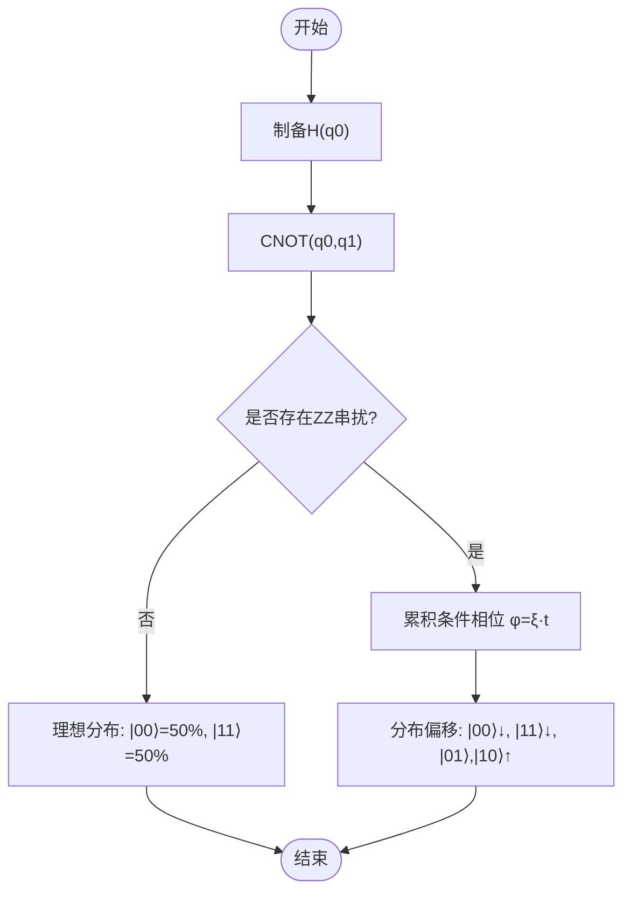
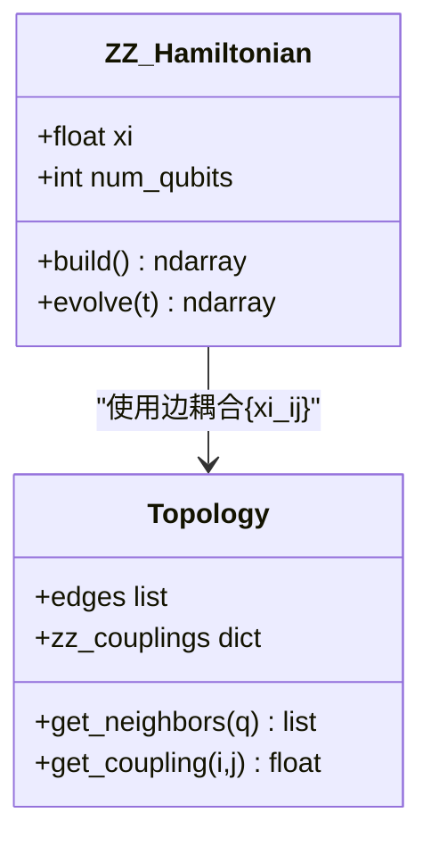
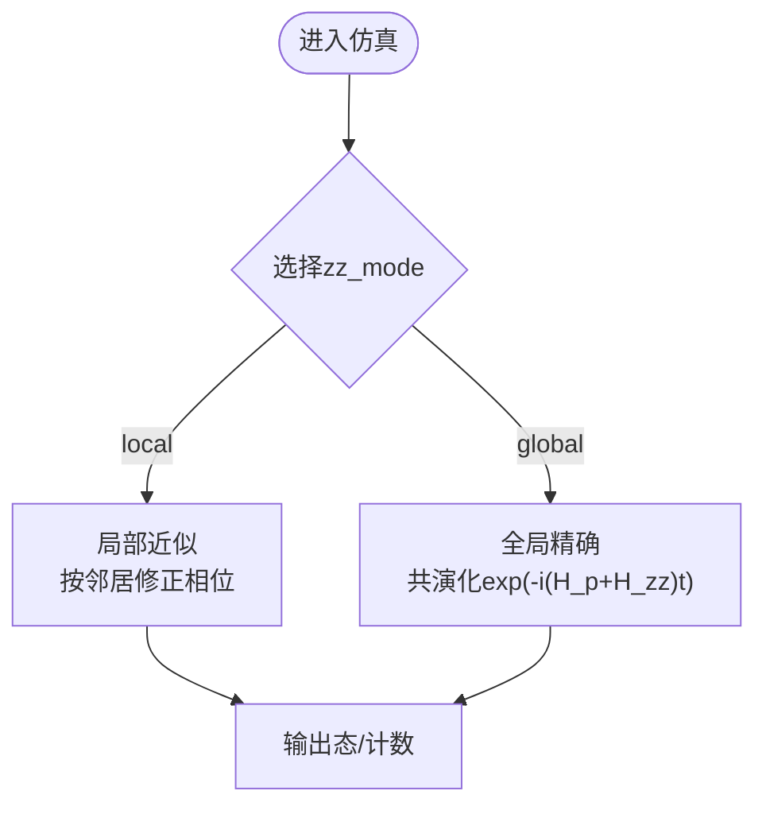
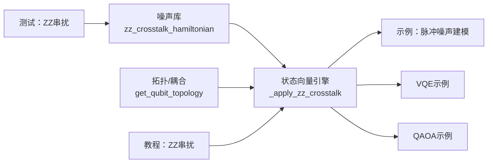

# 算法影响分析

<cite>
**本文引用的文件**
- [src/tyxonq/libs/quantum_library/noise.py](file://src/tyxonq/libs/quantum_library/noise.py)
- [src/tyxonq/devices/simulators/statevector/engine.py](file://src/tyxonq/devices/simulators/statevector/engine.py)
- [tests_core_module/test_zz_crosstalk.py](file://tests_core_module/test_zz_crosstalk.py)
- [docs/source/tutorials/advanced/pulse_zz_crosstalk.rst](file://docs/source/tutorials/advanced/pulse_zz_crosstalk.rst)
- [examples/pulse_noise_modeling.py](file://examples/pulse_noise_modeling.py)
- [examples/simple_qaoa.py](file://examples/simple_qaoa.py)
- [examples/vqe_simple_hamiltonian.py](file://examples/vqe_simple_hamiltonian.py)
</cite>

## 目录
1. [引言](#引言)
2. [项目结构](#项目结构)
3. [核心组件](#核心组件)
4. [架构总览](#架构总览)
5. [详细组件分析](#详细组件分析)
6. [依赖关系分析](#依赖关系分析)
7. [性能考量](#性能考量)
8. [故障排查指南](#故障排查指南)
9. [结论](#结论)
10. [附录](#附录)

## 引言
本文件聚焦于量子算法在ZZ串扰（always-on ZZ耦合）环境下的影响分析，以Bell态创作为具体案例，对比理想情况与存在ZZ串扰时的概率分布差异。我们将解释ZZ串扰如何导致非预期的ZZ相位累积，进而影响纠缠保真度与两量子比特门精度；并进一步分析VQE、QAOA等常见变分算法在串扰环境下的性能退化，包括相位误差对能量测量的影响、近似比的降低等。最后提供深电路中指数级误差增长的定量分析方法与性能基准建议。

## 项目结构
围绕ZZ串扰建模与影响评估，仓库提供了从物理模型到仿真执行、再到算法示例的完整链路：
- 物理模型与工具：ZZ哈密顿量构造、拓扑与耦合强度配置、噪声通道
- 仿真执行：状态向量模拟器中集成ZZ串扰的两种模式（局部近似与全局精确演化）
- 测试与教程：覆盖Hamiltonian正确性、拓扑连通性、平台典型参数与可视化影响
- 算法示例：VQE与QAOA在含噪或无噪环境中的实现与对比

**图表来源**
- [src/tyxonq/libs/quantum_library/noise.py:255-341](file://src/tyxonq/libs/quantum_library/noise.py#L255-L341)
- [src/tyxonq/devices/simulators/statevector/engine.py:474-496](file://src/tyxonq/devices/simulators/statevector/engine.py#L474-L496)
- [docs/source/tutorials/advanced/pulse_zz_crosstalk.rst:81-142](file://docs/source/tutorials/advanced/pulse_zz_crosstalk.rst#L81-L142)
- [examples/pulse_noise_modeling.py:170-215](file://examples/pulse_noise_modeling.py#L170-L215)

**章节来源**
- [src/tyxonq/libs/quantum_library/noise.py:255-341](file://src/tyxonq/libs/quantum_library/noise.py#L255-L341)
- [src/tyxonq/devices/simulators/statevector/engine.py:474-496](file://src/tyxonq/devices/simulators/statevector/engine.py#L474-L496)
- [docs/source/tutorials/advanced/pulse_zz_crosstalk.rst:81-142](file://docs/source/tutorials/advanced/pulse_zz_crosstalk.rst#L81-L142)
- [examples/pulse_noise_modeling.py:170-215](file://examples/pulse_noise_modeling.py#L170-L215)

## 核心组件
- ZZ串扰哈密顿量：以H_ZZ = ξ·σ_z⊗σ_z描述相邻量子比特间的常驻耦合，支持多量子比特扩展至Z⊗Z⊗I…形式，并提供正负耦合的物理含义说明。
- 拓扑与耦合映射：提供线性链、网格、IBM Heavy-Hex及自定义拓扑，以及不同硬件平台的典型ξ取值（如IBM约3 MHz、Google约0.5 MHz、Rigetti约5 MHz）。
- 仿真执行：状态向量引擎在执行脉冲时应用ZZ串扰，支持“local”（快速近似）与“global”（精确共演化）两种模式，兼顾速度与准确性。
- 测试与教程：验证哈密顿量Hermiticity、特征值谱、条件相位累积；演示Bell态保真度损失、Ram干涉对比度下降等可观测效应。
- 算法示例：VQE通过期望值计算能量，QAOA通过层间ZZ相互作用编码目标图，二者均受ZZ相位误差影响。

**章节来源**
- [src/tyxonq/libs/quantum_library/noise.py:255-341](file://src/tyxonq/libs/quantum_library/noise.py#L255-L341)
- [tests_core_module/test_zz_crosstalk.py:22-114](file://tests_core_module/test_zz_crosstalk.py#L22-L114)
- [docs/source/tutorials/advanced/pulse_zz_crosstalk.rst:81-142](file://docs/source/tutorials/advanced/pulse_zz_crosstalk.rst#L81-L142)
- [examples/pulse_noise_modeling.py:170-215](file://examples/pulse_noise_modeling.py#L170-L215)

## 架构总览
下图展示了从物理模型到仿真执行再到算法影响的端到端流程：

**图表来源**
- [src/tyxonq/libs/quantum_library/noise.py:255-341](file://src/tyxonq/libs/quantum_library/noise.py#L255-L341)
- [src/tyxonq/devices/simulators/statevector/engine.py:474-496](file://src/tyxonq/devices/simulators/statevector/engine.py#L474-L496)
- [docs/source/tutorials/advanced/pulse_zz_crosstalk.rst:490-596](file://docs/source/tutorials/advanced/pulse_zz_crosstalk.rst#L490-L596)

## 详细组件分析

### Bell态创建与ZZ串扰的概率分布差异
- 理想情况：H(q0)→CNOT(q0,q1)产生|Φ+⟩=(|00⟩+|11⟩)/√2，测量得到|00⟩与|11⟩各占50%。
- 存在ZZ串扰：控制门期间或空闲期引入额外相位φ=ξ·t，使|11⟩分量获得e^{iφ}相位，导致概率分布偏移与保真度下降。
- 可观测指标：
  - 条件相位φ=ξ·t（弧度）
  - 保真度损失≈(1−cos φ)/2
  - 概率分布偏差随ξ与门时长t增大而增加

**图表来源**
- [examples/pulse_noise_modeling.py:170-215](file://examples/pulse_noise_modeling.py#L170-L215)
- [docs/source/tutorials/advanced/pulse_zz_crosstalk.rst:108-137](file://docs/source/tutorials/advanced/pulse_zz_crosstalk.rst#L108-L137)

**章节来源**
- [examples/pulse_noise_modeling.py:170-215](file://examples/pulse_noise_modeling.py#L170-L215)
- [docs/source/tutorials/advanced/pulse_zz_crosstalk.rst:108-137](file://docs/source/tutorials/advanced/pulse_zz_crosstalk.rst#L108-L137)

### ZZ哈密顿量与时间演化
- 哈密顿量：H_ZZ=ξ·Z⊗Z，特征值谱为{ξ, −ξ, −ξ, ξ}，对应基矢{|00⟩,|01⟩,|10⟩,|11⟩}。
- 时间演化：U_ZZ(t)=exp(−i H_ZZ t)，对|11⟩态产生条件相位e^{−iξt}。
- 多量子比特扩展：对n>2，作用在q0与q1上，其余位元单位矩阵。

**图表来源**
- [src/tyxonq/libs/quantum_library/noise.py:255-341](file://src/tyxonq/libs/quantum_library/noise.py#L255-L341)
- [tests_core_module/test_zz_crosstalk.py:22-114](file://tests_core_module/test_zz_crosstalk.py#L22-L114)

**章节来源**
- [src/tyxonq/libs/quantum_library/noise.py:255-341](file://src/tyxonq/libs/quantum_library/noise.py#L255-L341)
- [tests_core_module/test_zz_crosstalk.py:22-114](file://tests_core_module/test_zz_crosstalk.py#L22-L114)

### 仿真执行：局部近似与全局精确演化
- 局部近似（local）：假设[H_pulse, H_ZZ]≈0，按邻居逐点修正，线性复杂度，适用于生产规模模拟。
- 全局精确（global）：同时求解脉冲与ZZ耦合的时间演化，精确但指数复杂度，适合小系统验证与强ZZ场景。
- 适用建议：
  - IBM/Google（弱-中等ZZ）：优先local
  - Rigetti（强ZZ）：可用local或global校验
  - 10+ qubit：local为主
  - 基准验证：global

**图表来源**
- [docs/source/tutorials/advanced/pulse_zz_crosstalk.rst:531-596](file://docs/source/tutorials/advanced/pulse_zz_crosstalk.rst#L531-L596)
- [src/tyxonq/devices/simulators/statevector/engine.py:474-496](file://src/tyxonq/devices/simulators/statevector/engine.py#L474-L496)

**章节来源**
- [docs/source/tutorials/advanced/pulse_zz_crosstalk.rst:531-596](file://docs/source/tutorials/advanced/pulse_zz_crosstalk.rst#L531-L596)
- [src/tyxonq/devices/simulators/statevector/engine.py:474-496](file://src/tyxonq/devices/simulators/statevector/engine.py#L474-L496)

### VQE在ZZ串扰下的性能退化
- 能量期望值E(θ)=⟨ψ(θ)|H|ψ(θ)⟩对相位敏感，ZZ引起的条件相位会改变叠加态相对相位，导致期望值偏离真实值。
- 退化为能量误差ΔE，随电路深度与层数增加而放大；浅层ansatz更稳健。
- 建议：
  - 使用浅层硬件高效ansatz
  - 结合echo序列或相位补偿减少ZZ相位
  - 在simulator中开启zz_topology进行量化评估

**章节来源**
- [examples/vqe_simple_hamiltonian.py:55-152](file://examples/vqe_simple_hamiltonian.py#L55-L152)
- [docs/source/tutorials/advanced/pulse_zz_crosstalk.rst:108-137](file://docs/source/tutorials/advanced/pulse_zz_crosstalk.rst#L108-L137)

### QAOA在ZZ串扰下的近似比降低
- QAOA通过交替的混合层与ZZ相互作用层编码目标图，ZZ相位误差直接改变代价函数期望值，导致近似比下降。
- 层数p越大，累积相位误差越显著；需权衡p与保真度。
- 建议：
  - 限制p或使用分层优化
  - 在边缘图上避免相邻并行门以减少ZZ干扰
  - 使用global模式对小图做基准验证

**章节来源**
- [examples/simple_qaoa.py:48-83](file://examples/simple_qaoa.py#L48-L83)
- [docs/source/tutorials/advanced/pulse_zz_crosstalk.rst:280-305](file://docs/source/tutorials/advanced/pulse_zz_crosstalk.rst#L280-L305)

## 依赖关系分析
- 噪声库提供H_ZZ与Kraus通道，供仿真器调用。
- 状态向量引擎在脉冲执行阶段注入ZZ串扰，依据拓扑与耦合强度计算条件相位。
- 测试用例确保H_ZZ的正确性与拓扑连通性合理。
- 教程文档给出API用法与平台典型参数，指导实际仿真设置。
- 算法示例将上述能力串联到VQE与QAOA工作流中。

**图表来源**
- [src/tyxonq/libs/quantum_library/noise.py:255-341](file://src/tyxonq/libs/quantum_library/noise.py#L255-L341)
- [src/tyxonq/devices/simulators/statevector/engine.py:474-496](file://src/tyxonq/devices/simulators/statevector/engine.py#L474-L496)
- [tests_core_module/test_zz_crosstalk.py:22-114](file://tests_core_module/test_zz_crosstalk.py#L22-L114)
- [docs/source/tutorials/advanced/pulse_zz_crosstalk.rst:81-142](file://docs/source/tutorials/advanced/pulse_zz_crosstalk.rst#L81-L142)

**章节来源**
- [src/tyxonq/libs/quantum_library/noise.py:255-341](file://src/tyxonq/libs/quantum_library/noise.py#L255-L341)
- [src/tyxonq/devices/simulators/statevector/engine.py:474-496](file://src/tyxonq/devices/simulators/statevector/engine.py#L474-L496)
- [tests_core_module/test_zz_crosstalk.py:22-114](file://tests_core_module/test_zz_crosstalk.py#L22-L114)
- [docs/source/tutorials/advanced/pulse_zz_crosstalk.rst:81-142](file://docs/source/tutorials/advanced/pulse_zz_crosstalk.rst#L81-L142)

## 性能考量
- 误差增长：深电路中ZZ相位累积呈线性叠加，导致保真度指数级下降（F≈∏(1−ε_i)），其中ε_i≈φ_i^2/2。
- 复杂度：
  - local模式：O(N_neighbors)修正，适合大规模系统
  - global模式：O(2^n)演化，仅用于小系统验证
- 平台差异：
  - IBM（~3 MHz）、Google（~0.5 MHz）、Rigetti（~5 MHz）
  - Ion trap无ZZ串扰
- 缓解策略效果（参考）：
  - 布局优化：~5-10%提升
  - 调度优化：~3-7%提升
  - 频率失谐：~85%有效性
  - DRAG脉冲：~10-15%提升
  - ZZ抵消/复合门：~90-95%提升

**章节来源**
- [examples/pulse_noise_modeling.py:500-551](file://examples/pulse_noise_modeling.py#L500-L551)
- [docs/source/tutorials/advanced/pulse_zz_crosstalk.rst:280-335](file://docs/source/tutorials/advanced/pulse_zz_crosstalk.rst#L280-L335)

## 故障排查指南
- 检查H_ZZ是否正确构建：确认Hermiticity与特征值谱符合预期。
- 验证拓扑与耦合：确保边集与耦合强度匹配目标平台。
- 选择合适zz_mode：强ZZ或小系统用global，生产规模用local。
- 校准与测量：通过Ramsey或振荡曲线提取ξ，并与平台典型值对比。
- 算法收敛异常：检查电路深度与层数，考虑echo或相位补偿。

**章节来源**
- [tests_core_module/test_zz_crosstalk.py:22-114](file://tests_core_module/test_zz_crosstalk.py#L22-L114)
- [docs/source/tutorials/advanced/pulse_zz_crosstalk.rst:490-596](file://docs/source/tutorials/advanced/pulse_zz_crosstalk.rst#L490-L596)

## 结论
ZZ串扰在超导量子处理器中是主导误差源之一，会在空闲与门操作期间引入条件相位，破坏叠加与纠缠，导致Bell态保真度下降、两量子比特门精度降低。对VQE而言，相位误差直接影响能量期望值，造成能量误差；对QAOA而言，近似比因ZZ相位累积而降低。深电路中误差呈指数级增长，需通过拓扑优化、调度、频率失谐、DRAG与ZZ抵消等手段缓解。TyxonQ提供local与global两种仿真模式，便于在不同规模与精度需求下开展定量分析与基准测试。

## 附录
- 关键API路径：
  - ZZ哈密顿量：[zz_crosstalk_hamiltonian:255-341](file://src/tyxonq/libs/quantum_library/noise.py#L255-L341)
  - 仿真注入：[_apply_zz_crosstalk:474-496](file://src/tyxonq/devices/simulators/statevector/engine.py#L474-L496)
  - 拓扑与耦合：[get_qubit_topology / get_crosstalk_couplings:451-489](file://docs/source/tutorials/advanced/pulse_zz_crosstalk.rst#L451-L489)
  - 算法示例：
    - VQE：[vqe_simple_hamiltonian.py:55-152](file://examples/vqe_simple_hamiltonian.py#L55-L152)
    - QAOA：[simple_qaoa.py:48-83](file://examples/simple_qaoa.py#L48-L83)
  - 噪声建模示例：[pulse_noise_modeling.py:170-215](file://examples/pulse_noise_modeling.py#L170-215)