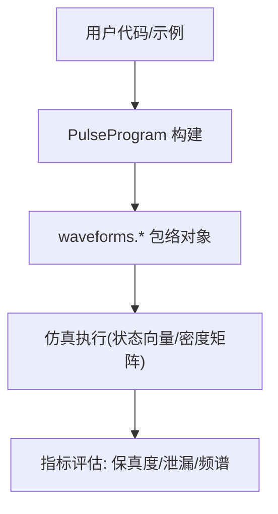
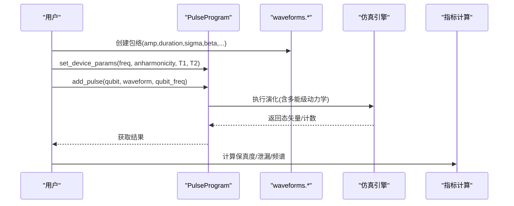
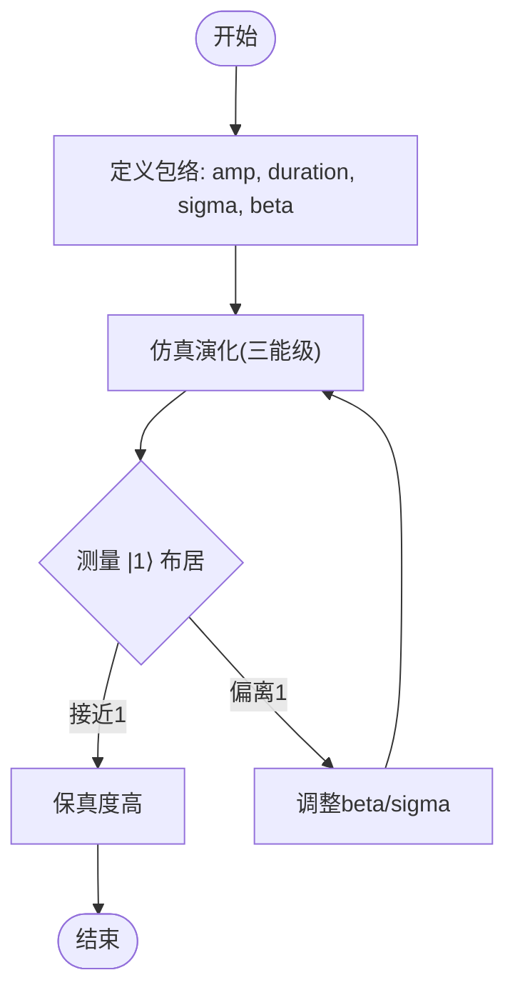
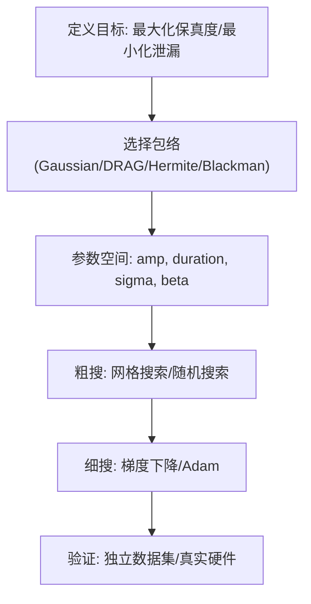
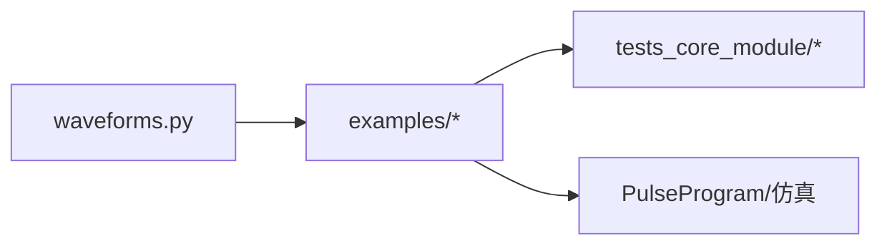

# 包络函数对比

<cite>
**本文引用的文件**
- [waveforms.py](file://src/tyxonq/waveforms.py)
- [pulse_waveforms.py](file://examples/pulse_waveforms.py)
- [pulse_basic_tutorial.py](file://examples/pulse_basic_tutorial.py)
- [step_1_hardware_basics.py](file://examples/pulse_calibration_tutorial/step_1_hardware_basics.py)
- [pulse_optimization_advanced.py](file://examples/pulse_optimization_advanced.py)
- [test_hermite_blackman_waveforms.py](file://tests_core_module/test_hermite_blackman_waveforms.py)
</cite>

## 目录
1. [引言](#引言)
2. [项目结构](#项目结构)
3. [核心组件](#核心组件)
4. [架构总览](#架构总览)
5. [详细组件分析](#详细组件分析)
6. [依赖关系分析](#依赖关系分析)
7. [性能考量](#性能考量)
8. [故障排查指南](#故障排查指南)
9. [结论](#结论)
10. [附录](#附录)

## 引言
本文件围绕TyxonQ中的包络函数（envelope）进行系统对比，重点分析Constant、Gaussian、DRAG等包络对脉冲形状与量子门性能的影响。通过仓库内提供的数值模拟与可视化示例，展示不同包络在时域与频域的表现差异，解释平滑度对频谱旁瓣的影响，并给出基于参数扫描的优化建议，帮助用户根据具体需求选择合适包络，提升门保真度并抑制向更高能级的泄漏。

## 项目结构
本项目将包络函数定义集中在库层，并通过示例与教程演示其在单/双量子比特门中的应用与优化流程：
- 包络定义：位于核心库模块，提供多种可插拔包络类型及其参数接口。
- 示例与教程：提供从基础到高级的脉冲编程、波形对比、优化策略与硬件基线知识。
- 测试用例：覆盖新包络（如Hermite、BlackmanSquare）的功能、集成与物理性质验证。

图表来源
- [pulse_waveforms.py:115-169](file://examples/pulse_waveforms.py#L115-L169)
- [waveforms.py:19-157](file://src/tyxonq/waveforms.py#L19-L157)

章节来源
- [waveforms.py:19-157](file://src/tyxonq/waveforms.py#L19-L157)
- [pulse_waveforms.py:115-169](file://examples/pulse_waveforms.py#L115-L169)

## 核心组件
- 包络类型与参数
  - Constant：矩形包络，快速但频谱宽、泄漏高。
  - Gaussian：光滑高斯包络，降低旁瓣，泄漏中等。
  - Drag：在高斯基础上加入导数项以抑制泄漏，需调优β。
  - Hermite：利用厄米多项式构造平滑包络，低泄漏。
  - BlackmanSquare：Blackman窗+平顶，极佳的频谱抑制特性。
- 使用方式
  - 通过PulseProgram添加脉冲，设置设备参数（频率、非谐性、T1/T2），执行仿真得到态矢量或计数，计算保真度与泄漏。
- 关键指标
  - 保真度：目标态布居或矩阵保真度。
  - 泄漏：跃迁到|2⟩的概率，受包络平滑度与β影响。
  - 频谱旁瓣：包络越平滑，旁瓣越低，泄漏越小。

章节来源
- [waveforms.py:19-157](file://src/tyxonq/waveforms.py#L19-L157)
- [pulse_waveforms.py:115-169](file://examples/pulse_waveforms.py#L115-L169)
- [step_1_hardware_basics.py:98-112](file://examples/pulse_calibration_tutorial/step_1_hardware_basics.py#L98-L112)

## 架构总览
下图展示了从包络定义到仿真评估的端到端流程，以及不同包络在其中的角色。

图表来源
- [pulse_waveforms.py:144-160](file://examples/pulse_waveforms.py#L144-L160)
- [waveforms.py:19-157](file://src/tyxonq/waveforms.py#L19-L157)

## 详细组件分析

### Constant 包络
- 特点：矩形边缘，上升/下降沿不连续，频谱宽，旁瓣高。
- 适用场景：快速原型验证；不适合高精度门。
- 风险：显著泄漏到|2⟩，保真度受限。

章节来源
- [step_1_hardware_basics.py:98-101](file://examples/pulse_calibration_tutorial/step_1_hardware_basics.py#L98-L101)
- [pulse_waveforms.py:49-57](file://examples/pulse_waveforms.py#L49-L57)

### Gaussian 包络
- 特点：光滑指数衰减，频谱较集中，旁瓣较低。
- 适用场景：标准生产环境，平衡速度与泄漏。
- 注意：sigma决定带宽与上升时间；过短易引入高频成分。

章节来源
- [step_1_hardware_basics.py:103-106](file://examples/pulse_calibration_tutorial/step_1_hardware_basics.py#L103-L106)
- [pulse_waveforms.py:58-65](file://examples/pulse_waveforms.py#L58-L65)

### DRAG 包络
- 特点：I(t)=A·exp(-t²/2σ²)，Q(t)=β·dA/dt，导数项补偿绝热误差，抑制泄漏。
- 参数：β控制泄漏抑制强度；过大可能过度校正。
- 适用场景：高保真单比特门，尤其对非谐性敏感的系统。

图表来源
- [pulse_waveforms.py:338-398](file://examples/pulse_waveforms.py#L338-L398)
- [step_1_hardware_basics.py:108-112](file://examples/pulse_calibration_tutorial/step_1_hardware_basics.py#L108-L112)

章节来源
- [pulse_waveforms.py:338-398](file://examples/pulse_waveforms.py#L338-L398)
- [step_1_hardware_basics.py:108-112](file://examples/pulse_calibration_tutorial/step_1_hardware_basics.py#L108-L112)

### Hermite 包络
- 特点：基于概率论厄米多项式的平滑包络，极低频谱泄漏，适合高保真门。
- 优势：比Gaussian更优的频谱抑制；可与BlackmanSquare竞争。
- 使用：order通常取2或3；phase用于相位控制。

章节来源
- [waveforms.py:103-127](file://src/tyxonq/waveforms.py#L103-L127)
- [test_hermite_blackman_waveforms.py:27-120](file://tests_core_module/test_hermite_blackman_waveforms.py#L27-L120)

### BlackmanSquare 包络
- 特点：Blackman窗+平顶，极佳频谱抑制，旁瓣极低，减少串扰。
- 适用：对频谱纯净度要求高的场景；width需小于duration。
- 验证：测试覆盖采样、对称性、能量守恒与保真度比较。

章节来源
- [waveforms.py:128-157](file://src/tyxonq/waveforms.py#L128-L157)
- [test_hermite_blackman_waveforms.py:122-246](file://tests_core_module/test_hermite_blackman_waveforms.py#L122-L246)
- [test_hermite_blackman_waveforms.py:360-405](file://tests_core_module/test_hermite_blackman_waveforms.py#L360-L405)

### 包络对比与泄漏抑制
- 对比要点
  - Constant：泄漏最高，旁瓣最强。
  - Gaussian：泄漏中等，旁瓣较低。
  - DRAG：通过β抑制泄漏，保真度显著提升。
  - Hermite/BlackmanSquare：更优频谱特性，进一步降低泄漏与串扰。
- 实验方法
  - 固定duration与sigma，改变包络类型与β，统计|0⟩、|1⟩布居与泄漏。
  - 参考示例中“Envelope Comparison”与“Beta Scan”。

章节来源
- [pulse_waveforms.py:115-169](file://examples/pulse_waveforms.py#L115-L169)
- [pulse_waveforms.py:338-398](file://examples/pulse_waveforms.py#L338-L398)

### 门操作时间与精度的权衡
- 时间维度
  - 更短的duration更快，但需要更陡峭的边缘，增加高频成分与泄漏。
  - 较长的duration更绝热，降低泄漏，但受T1/T2限制。
- 精度维度
  - 振幅校准决定旋转角；β调节泄漏抑制；sigma控制带宽。
- 实践建议
  - 先用Gaussian定位大致参数，再用DRAG精细优化β。
  - 对高精度需求，考虑Hermite或BlackmanSquare。

章节来源
- [step_1_hardware_basics.py:215-271](file://examples/pulse_calibration_tutorial/step_1_hardware_basics.py#L215-L271)
- [pulse_waveforms.py:483-544](file://examples/pulse_waveforms.py#L483-L544)

### 参数扫描与优化建议
- 振幅扫描：寻找π旋转的最佳振幅，使|1⟩布居接近1。
- β扫描：在给定anharmonicity下，找到最优β以最小化泄漏。
- 网格搜索：同时扫描amp、duration、β，再局部梯度优化。
- 自动微分：结合PSR或AutoGrad进行高效优化。

图表来源
- [pulse_optimization_advanced.py:330-453](file://examples/pulse_optimization_advanced.py#L330-L453)
- [pulse_waveforms.py:338-398](file://examples/pulse_waveforms.py#L338-L398)

章节来源
- [pulse_optimization_advanced.py:330-453](file://examples/pulse_optimization_advanced.py#L330-L453)
- [pulse_waveforms.py:338-398](file://examples/pulse_waveforms.py#L338-L398)

## 依赖关系分析
- 包络模块为纯数据类，无外部运行时依赖，便于扩展与序列化。
- 示例与教程依赖PulseProgram与仿真后端，完成端到端验证。
- 测试用例覆盖新包络的采样、集成与物理性质，确保稳定性。

图表来源
- [waveforms.py:19-157](file://src/tyxonq/waveforms.py#L19-L157)
- [pulse_waveforms.py:1-578](file://examples/pulse_waveforms.py#L1-L578)
- [test_hermite_blackman_waveforms.py:1-474](file://tests_core_module/test_hermite_blackman_waveforms.py#L1-L474)

章节来源
- [waveforms.py:19-157](file://src/tyxonq/waveforms.py#L19-L157)
- [pulse_waveforms.py:1-578](file://examples/pulse_waveforms.py#L1-L578)
- [test_hermite_blackman_waveforms.py:1-474](file://tests_core_module/test_hermite_blackman_waveforms.py#L1-L474)

## 性能考量
- 频谱旁瓣与泄漏
  - 包络越平滑，旁瓣越低，泄漏越小；DRAG通过导数项进一步抑制泄漏。
- 门速度 vs 保真度
  - 更快的门（短duration）更易受噪声与非谐性影响；更长门受T1/T2限制。
- 硬件约束
  - 频率失配、非谐性大小、驱动幅度上限都会影响最佳包络选择与参数范围。
- 推荐策略
  - 初期Constant快速验证；中期Gaussian平衡速度与泄漏；后期DRAG/Hermite/BlackmanSquare追求高保真。

[本节为通用指导，不直接分析具体文件]

## 故障排查指南
- 泄漏偏高
  - 检查β是否过小或过大；尝试增大sigma以降低带宽；切换至DRAG或BlackmanSquare。
- 保真度不足
  - 重新校准振幅；缩短或延长duration以匹配目标旋转角；确认设备参数（频率、非谐性）准确。
- 频谱异常
  - 观察包络边缘是否过于陡峭；必要时采用更平滑的包络（Hermite/Blackman）。
- 优化不收敛
  - 扩大搜索范围；先网格后梯度；检查学习率与约束边界。

章节来源
- [pulse_waveforms.py:338-398](file://examples/pulse_waveforms.py#L338-L398)
- [pulse_optimization_advanced.py:330-453](file://examples/pulse_optimization_advanced.py#L330-L453)
- [step_1_hardware_basics.py:425-479](file://examples/pulse_calibration_tutorial/step_1_hardware_basics.py#L425-L479)

## 结论
- Constant包络简单快捷但泄漏高，仅适合早期验证。
- Gaussian包络在速度与泄漏间取得良好平衡，是常用起点。
- DRAG通过导数项有效抑制泄漏，需针对硬件非谐性优化β。
- Hermite与BlackmanSquare提供更优频谱特性，适合高精度与低串扰场景。
- 通过振幅、duration、sigma、β的参数扫描与优化，可在门速度与保真度之间找到最佳折衷。

[本节为总结性内容，不直接分析具体文件]

## 附录
- 快速上手
  - 参考基础教程了解脉冲编程与包络选择。
- 进阶优化
  - 使用自动微分与参数平移规则进行高效优化。
- 验证与回归
  - 运行测试用例确保新包络的正确性与稳定性。

章节来源
- [pulse_basic_tutorial.py:1-407](file://examples/pulse_basic_tutorial.py#L1-L407)
- [pulse_optimization_advanced.py:1-582](file://examples/pulse_optimization_advanced.py#L1-L582)
- [test_hermite_blackman_waveforms.py:1-474](file://tests_core_module/test_hermite_blackman_waveforms.py#L1-L474)