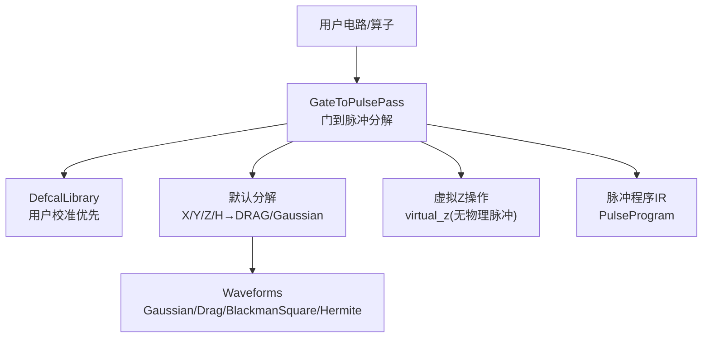
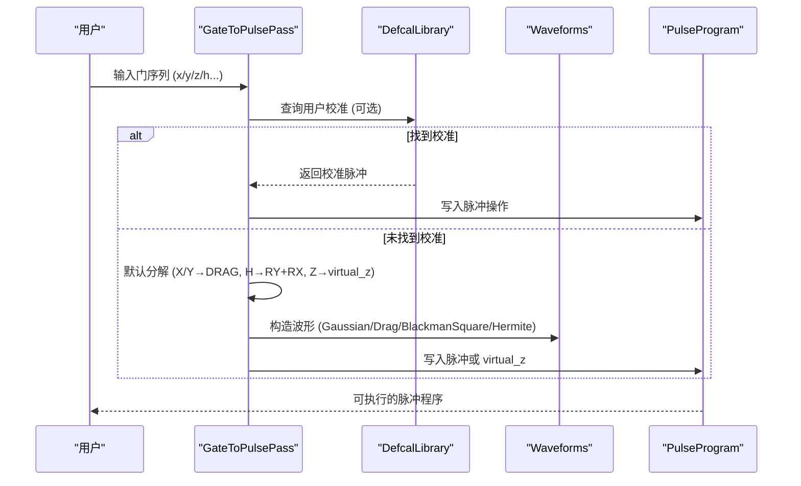
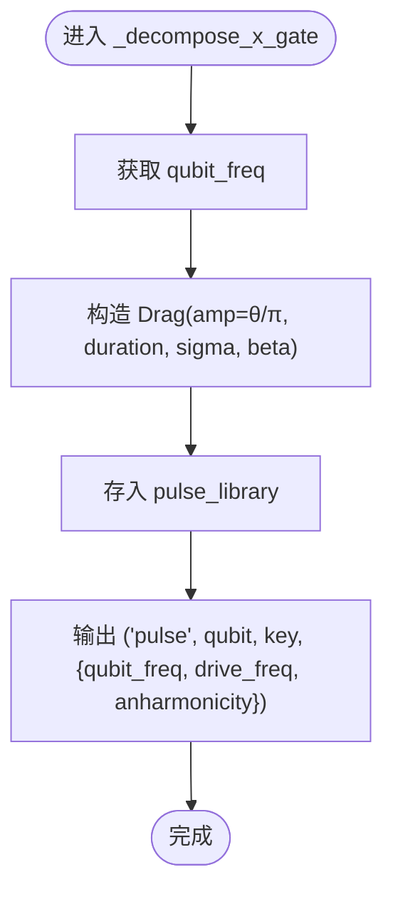
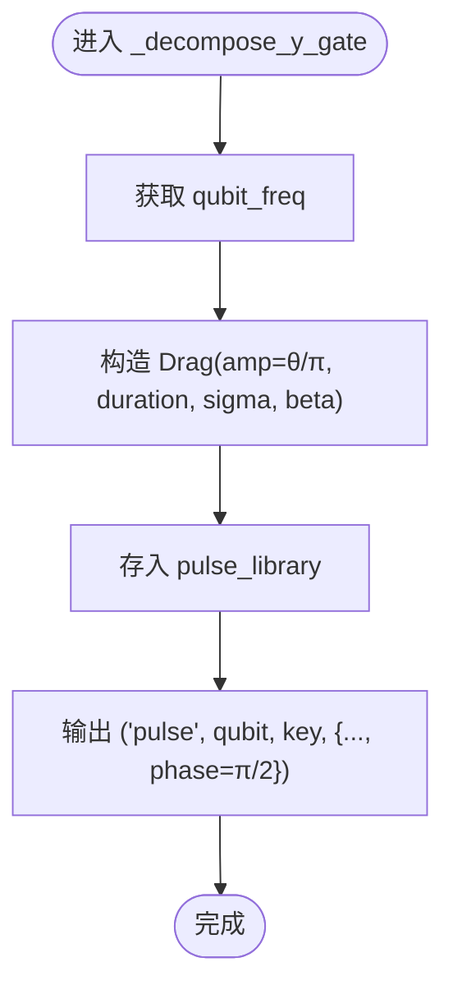
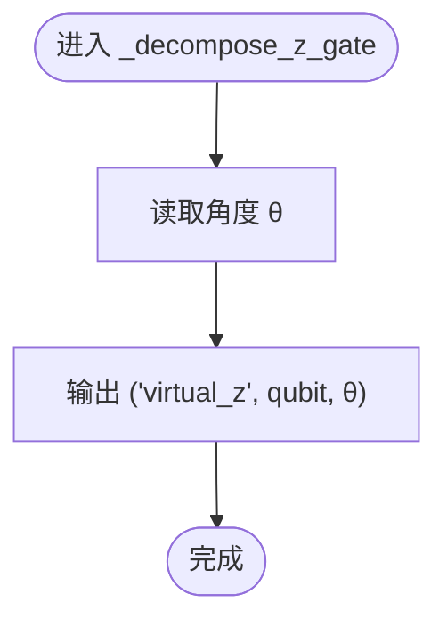
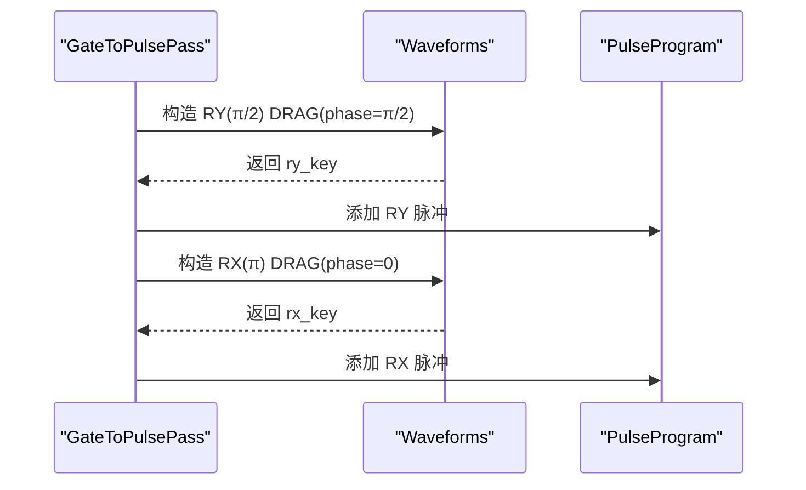
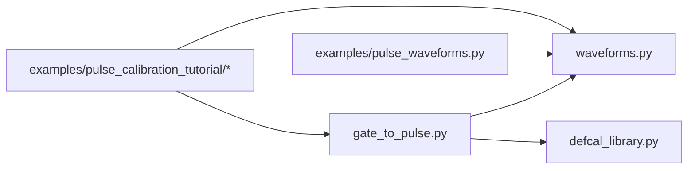

# 单量子比特门实现

<cite>
**本文引用的文件**
- [src/tyxonq/waveforms.py](file://src/tyxonq/waveforms.py)
- [src/tyxonq/compiler/pulse_compiler/native/gate_to_pulse.py](file://src/tyxonq/compiler/pulse_compiler/native/gate_to_pulse.py)
- [src/tyxonq/compiler/pulse_compiler/defcal_library.py](file://src/tyxonq/compiler/pulse_compiler/defcal_library.py)
- [examples/pulse_waveforms.py](file://examples/pulse_waveforms.py)
- [examples/pulse_calibration_tutorial/step_2_single_qubit_coarse_tuning.py](file://examples/pulse_calibration_tutorial/step_2_single_qubit_coarse_tuning.py)
- [examples/pulse_calibration_tutorial/step_3_single_qubit_fine_tuning.py](file://examples/pulse_calibration_tutorial/step_3_single_qubit_fine_tuning.py)
- [examples/pulse_gate_calibration.py](file://examples/pulse_gate_calibration.py)
</cite>

## 目录
1. [简介](#简介)
2. [项目结构](#项目结构)
3. [核心组件](#核心组件)
4. [架构总览](#架构总览)
5. [详细组件分析](#详细组件分析)
6. [依赖关系分析](#依赖关系分析)
7. [性能与保真度](#性能与保真度)
8. [故障排查指南](#故障排查指南)
9. [结论](#结论)
10. [附录：代码示例路径](#附录代码示例路径)

## 简介
本文件面向希望在 TyxonQ 中通过脉冲级实现单量子比特门（X、Y、Z、Hadamard 等）的读者，系统讲解：
- 不同波形（Gaussian、DRAG、BlackmanSquare、Hermite 等）的选择与参数调优
- X/Y/Z/H 门的脉冲级实现方法与相位控制
- 虚拟 Z 门的软件实现原理及为何无需物理脉冲
- 如何通过振幅、持续时间、DRAG 系数进行精确旋转
- 门保真度分析与误差来源讨论
- 针对不同硬件特性的优化策略

## 项目结构
围绕单量子比特门实现的代码主要分布在以下位置：
- 波形定义：waveforms.py
- 门到脉冲分解：gate_to_pulse.py
- 用户校准库：defcal_library.py
- 示例与教程：examples/pulse_waveforms.py、pulse_calibration_tutorial/*、pulse_gate_calibration.py

图表来源
- [src/tyxonq/compiler/pulse_compiler/native/gate_to_pulse.py:38-115](file://src/tyxonq/compiler/pulse_compiler/native/gate_to_pulse.py#L38-L115)
- [src/tyxonq/compiler/pulse_compiler/defcal_library.py:153-205](file://src/tyxonq/compiler/pulse_compiler/defcal_library.py#L153-L205)
- [src/tyxonq/waveforms.py:19-157](file://src/tyxonq/waveforms.py#L19-L157)

章节来源
- [src/tyxonq/compiler/pulse_compiler/native/gate_to_pulse.py:38-115](file://src/tyxonq/compiler/pulse_compiler/native/gate_to_pulse.py#L38-L115)
- [src/tyxonq/waveforms.py:19-157](file://src/tyxonq/waveforms.py#L19-L157)

## 核心组件
- 波形模块 waveforms：提供多种包络（Constant、Gaussian、Drag、Hermite、BlackmanSquare、CosineDrag），支持相位偏移与参数序列化。
- 门到脉冲分解 GateToPulsePass：将标准门（X/Y/Z/H/CX/CZ/iSWAP/SWAP）转换为脉冲序列；优先使用用户 defcal，否则采用默认物理分解；对 Z/RZ 生成 virtual_z 操作。
- 校准库 DefcalLibrary：管理硬件相关的门校准数据，支持增删查改、JSON 持久化与校验。
- 示例与教程：演示波形选择、单比特门粗调/细调、Rabi 表征与保真度估计。

章节来源
- [src/tyxonq/waveforms.py:19-157](file://src/tyxonq/waveforms.py#L19-L157)
- [src/tyxonq/compiler/pulse_compiler/native/gate_to_pulse.py:38-115](file://src/tyxonq/compiler/pulse_compiler/native/gate_to_pulse.py#L38-L115)
- [src/tyxonq/compiler/pulse_compiler/defcal_library.py:153-205](file://src/tyxonq/compiler/pulse_compiler/defcal_library.py#L153-L205)

## 架构总览
下图展示了从高层门到低层脉冲的关键流程，包括虚拟 Z 的零时延特性与 DRAG 泄漏抑制机制。

图表来源
- [src/tyxonq/compiler/pulse_compiler/native/gate_to_pulse.py:64-115](file://src/tyxonq/compiler/pulse_compiler/native/gate_to_pulse.py#L64-L115)
- [src/tyxonq/compiler/pulse_compiler/native/gate_to_pulse.py:194-379](file://src/tyxonq/compiler/pulse_compiler/native/gate_to_pulse.py#L194-L379)
- [src/tyxonq/compiler/pulse_compiler/defcal_library.py:206-303](file://src/tyxonq/compiler/pulse_compiler/defcal_library.py#L206-L303)
- [src/tyxonq/waveforms.py:19-157](file://src/tyxonq/waveforms.py#L19-L157)

## 详细组件分析

### X 门（RX）脉冲实现
- 物理原理：在共振驱动下，通过 Rabi 旋转实现绕 X 轴的旋转。幅度与时长共同决定旋转角。
- 默认实现：使用 DRAG 波形，幅度按旋转角度缩放，典型持续时间和 sigma 用于平滑边缘，beta 抑制向 |2⟩ 的泄漏。
- 相位控制：X 门对应相位为 0（相对于参考轴）。

图表来源
- [src/tyxonq/compiler/pulse_compiler/native/gate_to_pulse.py:194-225](file://src/tyxonq/compiler/pulse_compiler/native/gate_to_pulse.py#L194-L225)
- [src/tyxonq/waveforms.py:41-51](file://src/tyxonq/waveforms.py#L41-L51)

章节来源
- [src/tyxonq/compiler/pulse_compiler/native/gate_to_pulse.py:194-225](file://src/tyxonq/compiler/pulse_compiler/native/gate_to_pulse.py#L194-L225)
- [src/tyxonq/waveforms.py:41-51](file://src/tyxonq/waveforms.py#L41-L51)

### Y 门（RY）脉冲实现
- 物理原理：Y 旋转等价于 X 旋转加上 π/2 的相位偏移。
- 默认实现：构造 DRAG 波形，并在元数据中标注 phase=π/2。
- 相位控制：通过相位元数据实现，不改变波形形状。

图表来源
- [src/tyxonq/compiler/pulse_compiler/native/gate_to_pulse.py:227-276](file://src/tyxonq/compiler/pulse_compiler/native/gate_to_pulse.py#L227-L276)
- [src/tyxonq/waveforms.py:41-51](file://src/tyxonq/waveforms.py#L41-L51)

章节来源
- [src/tyxonq/compiler/pulse_compiler/native/gate_to_pulse.py:227-276](file://src/tyxonq/compiler/pulse_compiler/native/gate_to_pulse.py#L227-L276)
- [src/tyxonq/waveforms.py:41-51](file://src/tyxonq/waveforms.py#L41-L51)

### Z 门（RZ）与虚拟 Z
- 物理原理：在旋转框架下，Z 旋转可与后续旋转交换顺序，因此可通过更新相位框架实现，无需物理脉冲。
- 默认实现：生成 ("virtual_z", qubit, angle) 操作，零时间开销。
- 优势：显著缩短电路总时长，减少退相干影响。

图表来源
- [src/tyxonq/compiler/pulse_compiler/native/gate_to_pulse.py:278-312](file://src/tyxonq/compiler/pulse_compiler/native/gate_to_pulse.py#L278-L312)

章节来源
- [src/tyxonq/compiler/pulse_compiler/native/gate_to_pulse.py:278-312](file://src/tyxonq/compiler/pulse_compiler/native/gate_to_pulse.py#L278-L312)

### Hadamard 门（H）脉冲实现
- 物理分解：H = RY(π/2) · RX(π)，或等效形式。默认实现采用先 RY(π/2) 再 RX(π) 的两步序列。
- 波形选择：两步均使用 DRAG 波形，分别设置相位 π/2 和 0。
- 时序：两个 DRAG 脉冲串联，总时长约为两倍单脉冲时长。

图表来源
- [src/tyxonq/compiler/pulse_compiler/native/gate_to_pulse.py:314-379](file://src/tyxonq/compiler/pulse_compiler/native/gate_to_pulse.py#L314-L379)
- [src/tyxonq/waveforms.py:41-51](file://src/tyxonq/waveforms.py#L41-L51)

章节来源
- [src/tyxonq/compiler/pulse_compiler/native/gate_to_pulse.py:314-379](file://src/tyxonq/compiler/pulse_compiler/native/gate_to_pulse.py#L314-L379)
- [src/tyxonq/waveforms.py:41-51](file://src/tyxonq/waveforms.py#L41-L51)

### 波形族与参数选择
- Gaussian：平滑包络，降低频谱旁瓣，适合通用场景。
- DRAG：在高斯基础上加入导数项，抑制向 |2⟩ 的泄漏，关键参数 β。
- BlackmanSquare：Blackman 窗 + 平顶，频谱泄漏极低，适合高精度门。
- Hermite：高阶多项式包络，进一步改善频谱特性。
- CosineDrag：余弦调制 DRAG，灵活相位控制。
- Constant：矩形脉冲，边沿陡峭但频谱宽、泄漏高。

章节来源
- [src/tyxonq/waveforms.py:19-157](file://src/tyxonq/waveforms.py#L19-L157)
- [examples/pulse_waveforms.py:40-108](file://examples/pulse_waveforms.py#L40-L108)

### 用户校准与优先级
- 优先级：用户 defcal > 元数据校准 > 默认物理分解。
- 管理：DefcalLibrary 支持按门名与量子比特索引存取、导出 JSON、校验一致性。
- 适用：不同硬件/量子比特具有不同的最优参数，需单独标定。

章节来源
- [src/tyxonq/compiler/pulse_compiler/native/gate_to_pulse.py:137-192](file://src/tyxonq/compiler/pulse_compiler/native/gate_to_pulse.py#L137-L192)
- [src/tyxonq/compiler/pulse_compiler/defcal_library.py:153-303](file://src/tyxonq/compiler/pulse_compiler/defcal_library.py#L153-L303)

## 依赖关系分析
- GateToPulsePass 依赖 waveforms 构建具体波形，并依赖 DefcalLibrary 获取用户校准。
- 示例脚本通过 PulseProgram 执行仿真，验证不同波形的效果与参数敏感性。

图表来源
- [src/tyxonq/compiler/pulse_compiler/native/gate_to_pulse.py:31-35](file://src/tyxonq/compiler/pulse_compiler/native/gate_to_pulse.py#L31-L35)
- [src/tyxonq/compiler/pulse_compiler/native/gate_to_pulse.py:163-171](file://src/tyxonq/compiler/pulse_compiler/native/gate_to_pulse.py#L163-L171)
- [examples/pulse_waveforms.py:30-33](file://examples/pulse_waveforms.py#L30-L33)

章节来源
- [src/tyxonq/compiler/pulse_compiler/native/gate_to_pulse.py:31-35](file://src/tyxonq/compiler/pulse_compiler/native/gate_to_pulse.py#L31-L35)
- [src/tyxonq/compiler/pulse_compiler/native/gate_to_pulse.py:163-171](file://src/tyxonq/compiler/pulse_compiler/native/gate_to_pulse.py#L163-L171)
- [examples/pulse_waveforms.py:30-33](file://examples/pulse_waveforms.py#L30-L33)

## 性能与保真度
- 泄漏抑制：DRAG 的 β 参数可有效抑制向 |2⟩ 的跃迁，提升保真度。
- 频谱泄漏：BlackmanSquare/Hermite 提供更优频谱特性，减少串扰。
- 时间开销：虚拟 Z 零时延，避免额外退相干；H 门由两段 DRAG 组成，总时长约两倍单脉冲。
- 误差来源：
  - 振幅/时长偏差导致旋转角误差
  - β 不当引起过补偿或欠补偿
  - 非谐性失配导致泄漏
  - T1/T2 限制下的退相干
- 优化建议：
  - 基于 Rabi 扫描确定最佳振幅/时长组合
  - 精细扫描 β 以最小化泄漏
  - 根据硬件非谐性与带宽选择合适波形
  - 利用虚拟 Z 合并相邻 RZ，减少总时长

章节来源
- [examples/pulse_calibration_tutorial/step_2_single_qubit_coarse_tuning.py:121-303](file://examples/pulse_calibration_tutorial/step_2_single_qubit_coarse_tuning.py#L121-L303)
- [examples/pulse_calibration_tutorial/step_3_single_qubit_fine_tuning.py:30-122](file://examples/pulse_calibration_tutorial/step_3_single_qubit_fine_tuning.py#L30-L122)
- [examples/pulse_waveforms.py:115-169](file://examples/pulse_waveforms.py#L115-L169)

## 故障排查指南
- 无法转换为目标脉冲：检查模式（pulse_only/auto_lower/hybrid）与门类型是否受支持。
- 保真度不达标：确认振幅/时长/β 是否经过扫描优化；核对设备非谐性与频率。
- 泄漏偏高：尝试增大 β 或更换更优波形（如 BlackmanSquare/Hermite）。
- 相位错误：检查 Y/X 相位元数据是否正确设置。
- 虚拟 Z 未生效：确认编译后是否存在 shift_phase 指令或 virtual_z 操作。

章节来源
- [src/tyxonq/compiler/pulse_compiler/native/gate_to_pulse.py:64-115](file://src/tyxonq/compiler/pulse_compiler/native/gate_to_pulse.py#L64-L115)
- [examples/pulse_gate_calibration.py:138-160](file://examples/pulse_gate_calibration.py#L138-L160)

## 结论
TyxonQ 提供了完整的单量子比特门脉冲级实现路径：通过 GateToPulsePass 将抽象门转换为具体波形，结合 DefcalLibrary 的用户校准与默认物理分解，实现对 X/Y/Z/H 的高保真控制。虚拟 Z 的零时延特性显著优化了电路效率。配合波形族与参数扫描（振幅、时长、β），可在不同硬件上达到接近 99.9% 的保真度目标。

## 附录：代码示例路径
- 波形概览与对比：[examples/pulse_waveforms.py:40-108](file://examples/pulse_waveforms.py#L40-L108)、[examples/pulse_waveforms.py:115-169](file://examples/pulse_waveforms.py#L115-L169)
- 单比特门粗调（X 门）：[examples/pulse_calibration_tutorial/step_2_single_qubit_coarse_tuning.py:121-303](file://examples/pulse_calibration_tutorial/step_2_single_qubit_coarse_tuning.py#L121-L303)
- 单比特门细调与 Rabi 表征：[examples/pulse_calibration_tutorial/step_3_single_qubit_fine_tuning.py:30-200](file://examples/pulse_calibration_tutorial/step_3_single_qubit_fine_tuning.py#L30-L200)
- 虚拟 Z 与时间收益说明：[examples/pulse_gate_calibration.py:138-160](file://examples/pulse_gate_calibration.py#L138-L160)
- 门到脉冲分解（X/Y/Z/H）：[src/tyxonq/compiler/pulse_compiler/native/gate_to_pulse.py:194-379](file://src/tyxonq/compiler/pulse_compiler/native/gate_to_pulse.py#L194-L379)
- 波形定义（含相位）：[src/tyxonq/waveforms.py:19-157](file://src/tyxonq/waveforms.py#L19-L157)
- 用户校准库接口：[src/tyxonq/compiler/pulse_compiler/defcal_library.py:153-303](file://src/tyxonq/compiler/pulse_compiler/defcal_library.py#L153-L303)