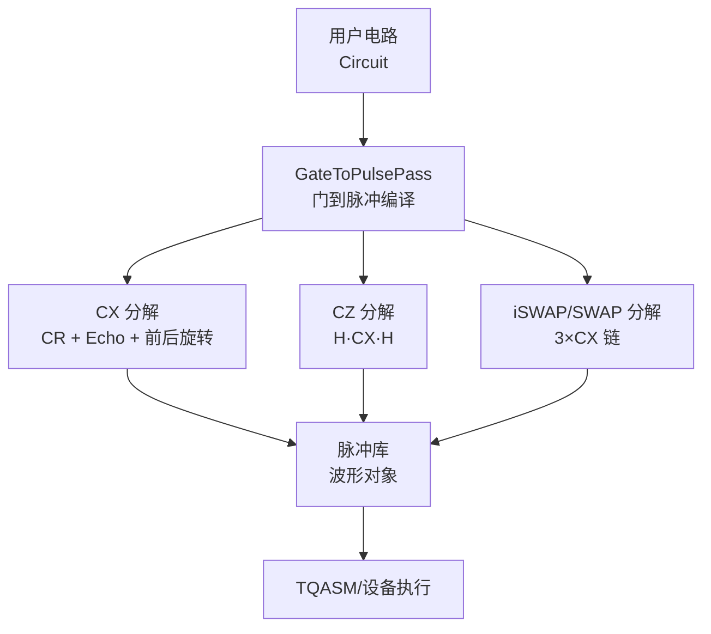
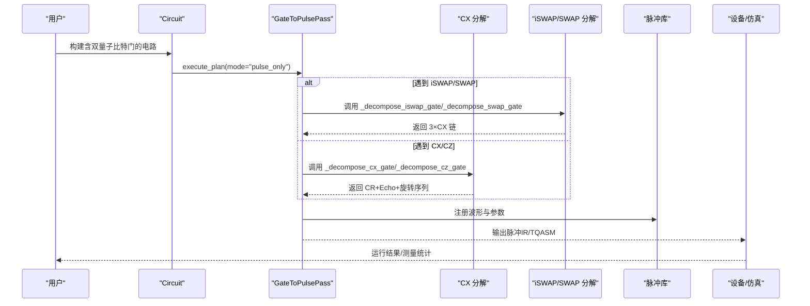
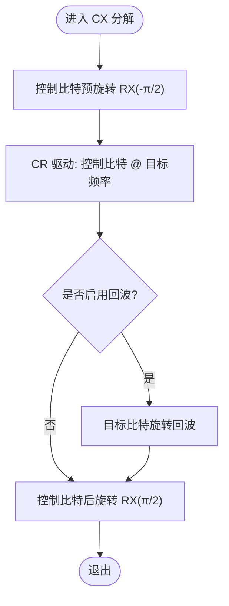
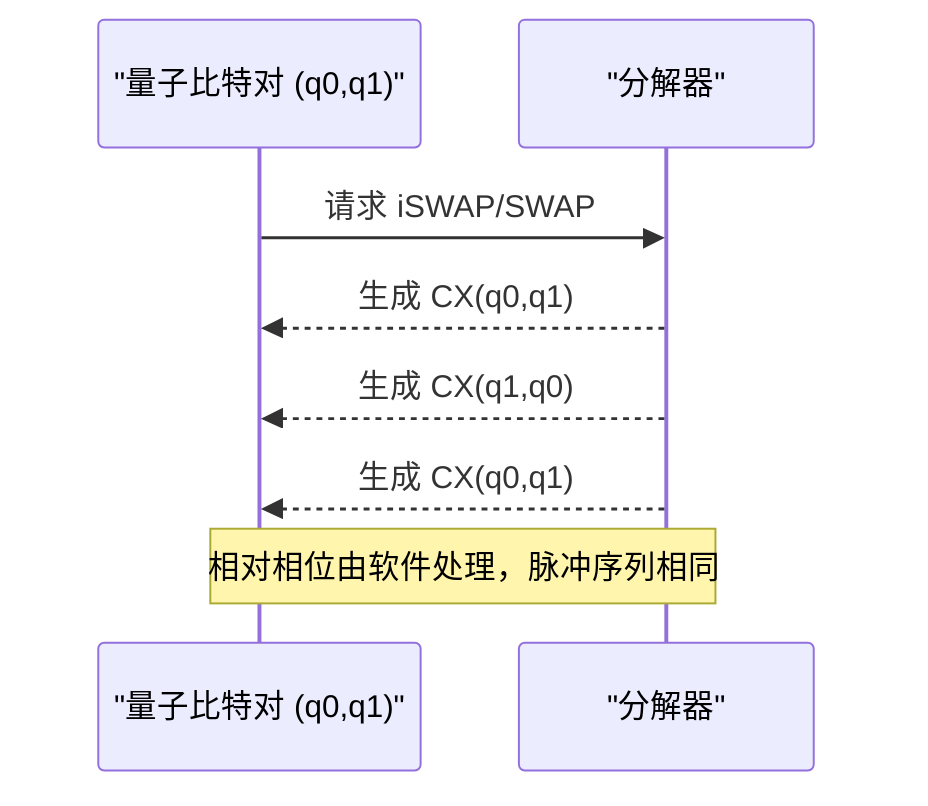
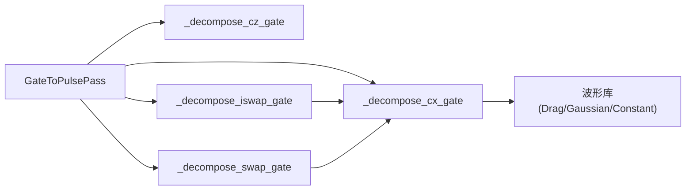

# 双量子比特门分解

<cite>
**本文引用的文件**
- [gate_to_pulse.py](file://src/tyxonq/compiler/pulse_compiler/native/gate_to_pulse.py)
- [pulse_iswap_swap_decomposition.rst](file://docs/source/tutorials/advanced/pulse_iswap_swap_decomposition.rst)
- [pulse_programming_basics.rst](file://docs/source/tutorials/intermediate/pulse_programming_basics.rst)
- [TYXONQ_TECHNICAL_WHITEPAPER.md](file://TYXONQ_TECHNICAL_WHITEPAPER.md)
- [pulse_iswap_swap_decomposition.py](file://examples/pulse_iswap_swap_decomposition.py)
- [pulse_waveforms.py](file://examples/pulse_waveforms.py)
- [test_two_qubit_pulse_decomposition.py](file://tests_core_module/test_two_qubit_pulse_decomposition.py)
- [test_multi_qubit_pulse_simulation.py](file://tests_core_module/test_multi_qubit_pulse_simulation.py)
- [test_gate_to_pulse_enhanced.py](file://tests_core_module/test_gate_to_pulse_enhanced.py)
</cite>

## 目录
1. [简介](#简介)
2. [项目结构](#项目结构)
3. [核心组件](#核心组件)
4. [架构总览](#架构总览)
5. [详细组件分析](#详细组件分析)
6. [依赖关系分析](#依赖关系分析)
7. [性能考量](#性能考量)
8. [故障排查指南](#故障排查指南)
9. [结论](#结论)
10. [附录](#附录)

## 简介
本文件系统性讲解双量子比特门的脉冲级实现与分解策略，重点覆盖：
- CX（受控非）、CZ、iSWAP、SWAP 的物理实现与分解方案
- 交叉共振（Cross-Resonance, CR）序列与旋转回波（Rotary Echo）技术
- 不同双量子比特门的时序安排与硬件优化要点
- 在 TyxonQ 中构建复杂双量子比特门序列的完整示例与状态演化分析
- 各分解方法的优缺点与针对特定拓扑结构的优化策略

## 项目结构
TyxonQ 将“门到脉冲”的编译逻辑集中在脉冲编译器模块中，并通过教程、示例与测试提供端到端验证。关键路径如下：
- 脉冲编译器：将高级门（CX/CZ/iSWAP/SWAP）分解为底层脉冲序列
- 文档与教程：解释物理原理、分解策略与使用方式
- 示例：演示 iSWAP/SWAP 的脉冲级实现与 TQASM 导出
- 测试：验证 CR 驱动频率、脉冲计数、三能级泄漏等特性

图表来源
- [gate_to_pulse.py:400-599](file://src/tyxonq/compiler/pulse_compiler/native/gate_to_pulse.py#L400-L599)
- [pulse_iswap_swap_decomposition.rst:111-174](file://docs/source/tutorials/advanced/pulse_iswap_swap_decomposition.rst#L111-L174)

章节来源
- [gate_to_pulse.py:400-599](file://src/tyxonq/compiler/pulse_compiler/native/gate_to_pulse.py#L400-L599)
- [pulse_iswap_swap_decomposition.rst:111-174](file://docs/source/tutorials/advanced/pulse_iswap_swap_decomposition.rst#L111-L174)

## 核心组件
- GateToPulsePass：负责将门操作转换为脉冲操作，维护脉冲库并生成可执行的脉冲 IR
- 双量子比特门分解器：
  - CX：基于交叉共振（CR）的四脉冲序列（预旋转、CR 驱动、目标回波、后旋转）
  - CZ：通过 H·CX·H 分解复用 CX 实现
  - iSWAP/SWAP：统一采用 3×CX 链分解，相位差异由软件处理
- 波形与参数：DRAG、Gaussian、Constant 等波形；设备参数包括 qubit_freq、anharmonicity、cr_amplitude、cx_duration 等

章节来源
- [gate_to_pulse.py:400-599](file://src/tyxonq/compiler/pulse_compiler/native/gate_to_pulse.py#L400-L599)
- [pulse_iswap_swap_decomposition.rst:111-174](file://docs/source/tutorials/advanced/pulse_iswap_swap_decomposition.rst#L111-L174)

## 架构总览
下图展示从高层门到脉冲序列的编译流程，以及关键物理机制（CR 驱动、旋转回波）。

图表来源
- [gate_to_pulse.py:400-599](file://src/tyxonq/compiler/pulse_compiler/native/gate_to_pulse.py#L400-L599)
- [pulse_iswap_swap_decomposition.rst:111-174](file://docs/source/tutorials/advanced/pulse_iswap_swap_decomposition.rst#L111-L174)

## 详细组件分析

### CX 门：交叉共振（CR）四脉冲序列
- 物理机制：在控制量子比特上施加频率为目标量子比特频率的驱动，产生 ZX 耦合项，配合旋转回波抑制无关项
- 脉冲序列：
  1) 控制比特预旋转 RX(-π/2)
  2) CR 驱动（高斯包络，时长由 cx_duration 决定）
  3) 目标比特旋转回波（可选，抑制 ZI/IX 误差）
  4) 控制比特后旋转 RX(π/2)
- 关键参数：
  - drive_freq = target_freq（CR 驱动频率必须等于目标频率）
  - cr_amplitude、cx_duration、echo_amplitude
- 参考实现与验证：
  - 实现位于 gate_to_pulse.py 的 CX 分解函数
  - 测试用例验证 CR 驱动频率与脉冲计数

图表来源
- [gate_to_pulse.py:433-495](file://src/tyxonq/compiler/pulse_compiler/native/gate_to_pulse.py#L433-L495)
- [test_gate_to_pulse_enhanced.py:605-616](file://tests_core_module/test_gate_to_pulse_enhanced.py#L605-L616)

章节来源
- [gate_to_pulse.py:433-495](file://src/tyxonq/compiler/pulse_compiler/native/gate_to_pulse.py#L433-L495)
- [test_gate_to_pulse_enhanced.py:605-616](file://tests_core_module/test_gate_to_pulse_enhanced.py#L605-L616)
- [test_two_qubit_pulse_decomposition.py:102-130](file://tests_core_module/test_two_qubit_pulse_decomposition.py#L102-L130)

### CZ 门：H·CX·H 分解
- 策略：在目标比特上施加 Hadamard 门将 Z 基变换到 X 基，从而复用 CX 实现 CZ
- 脉冲序列：H_target → CX(control, target) → H_target
- 优势：无需新增原生 CZ 脉冲，保持实现简洁与一致性

章节来源
- [gate_to_pulse.py:497-577](file://src/tyxonq/compiler/pulse_compiler/native/gate_to_pulse.py#L497-L577)

### iSWAP 与 SWAP 门：3×CX 链分解
- 数学定义与性质：
  - iSWAP：交换态并附加相对相位 i（适用于 XX 耦合模拟）
  - SWAP：纯态交换，无相对相位（常用于路由与布局优化）
- 分解策略：iSWAP/SWAP 均等价于 CX(q0,q1) · CX(q1,q0) · CX(q0,q1)，相位差异在软件层处理
- 脉冲级实现：每个 CX 分解为 CR 四脉冲序列，整体约 12 个脉冲（经优化后）
- 适用性：通用拓扑兼容，不依赖原生 iSWAP/SWAP 硬件

图表来源
- [gate_to_pulse.py:579-732](file://src/tyxonq/compiler/pulse_compiler/native/gate_to_pulse.py#L579-L732)
- [pulse_iswap_swap_decomposition.rst:117-174](file://docs/source/tutorials/advanced/pulse_iswap_swap_decomposition.rst#L117-L174)

章节来源
- [gate_to_pulse.py:579-732](file://src/tyxonq/compiler/pulse_compiler/native/gate_to_pulse.py#L579-L732)
- [pulse_iswap_swap_decomposition.rst:117-174](file://docs/source/tutorials/advanced/pulse_iswap_swap_decomposition.rst#L117-L174)
- [test_iswap_swap_pulse_decomposition.py:82-112](file://tests_core_module/test_iswap_swap_pulse_decomposition.py#L82-L112)

### 交叉共振（CR）与旋转回波（Rotary Echo）详解
- CR 驱动：在控制比特上以目标频率驱动，产生 ZX 相互作用，实现受控门
- 旋转回波：在目标比特上施加 π 脉冲或常数脉冲，抵消哈密顿量中的无关项（ZI、IX），提升保真度
- 典型时序：预旋转 → CR 驱动 → 回波 → 后旋转，总时长约 200–400 ns
- 参考实现与对比：
  - 白皮书给出 CR 四脉冲序列与物理说明
  - 教程与测试验证频率设置与脉冲结构

章节来源
- [TYXONQ_TECHNICAL_WHITEPAPER.md:1697-1741](file://TYXONQ_TECHNICAL_WHITEPAPER.md#L1697-L1741)
- [pulse_programming_basics.rst:150-187](file://docs/source/tutorials/intermediate/pulse_programming_basics.rst#L150-L187)
- [test_multi_qubit_pulse_simulation.py:146-193](file://tests_core_module/test_multi_qubit_pulse_simulation.py#L146-L193)

### 复杂序列构建与状态演化示例
- 示例：在 VQE 中使用 iSWAP 作为纠缠层，或在 Hubbard 模型中用 iSWAP 表示跃迁项
- 步骤：
  1) 构建 Circuit，添加单比特旋转与 iSWAP/SWAP
  2) 使用 GateToPulsePass 编译为脉冲 IR
  3) 导出 TQASM 并提交云端或本地仿真
  4) 分析测量分布与态矢量范数，验证正确性
- 关键点：
  - iSWAP/SWAP 脉冲序列相同，相位差异由软件处理
  - 可通过调节 cr_amplitude、cx_duration、beta（DRAG）优化保真度与泄漏

章节来源
- [pulse_iswap_swap_decomposition.py:56-250](file://examples/pulse_iswap_swap_decomposition.py#L56-L250)
- [pulse_waveforms.py:237-321](file://examples/pulse_waveforms.py#L237-L321)

## 依赖关系分析
- GateToPulsePass 依赖设备参数（qubit_freq、anharmonicity、cr_amplitude、cx_duration）
- CX 分解依赖波形库（Drag、Gaussian、Constant）
- iSWAP/SWAP 分解依赖 CX 分解，形成组合依赖
- 测试用例验证 CR 驱动频率、脉冲计数与三能级泄漏行为

图表来源
- [gate_to_pulse.py:400-732](file://src/tyxonq/compiler/pulse_compiler/native/gate_to_pulse.py#L400-L732)

章节来源
- [gate_to_pulse.py:400-732](file://src/tyxonq/compiler/pulse_compiler/native/gate_to_pulse.py#L400-L732)

## 性能考量
- 门级 vs 脉冲级：
  - iSWAP/SWAP 分解为 3×CX，每 CX 约 4 个脉冲，总计约 12 个脉冲
  - 相比原生单脉冲门，执行时间增加约 3–5 倍
- 波形优化：
  - DRAG beta 参数影响泄漏抑制；幅度与时长影响保真度与速度
  - Gaussian 包络减少频谱泄漏；Constant 用于回波
- 拓扑优化：
  - 若硬件支持可调 XX 耦合（如某些平台），可直接实现 iSWAP，避免 3×CX 链
  - 在无原生 iSWAP 的拓扑上，3×CX 链具有通用性与兼容性

[本节为一般性指导，不直接分析具体文件]

## 故障排查指南
- CR 驱动频率错误：
  - 症状：门保真度低或状态不正确
  - 检查：确保 CR 驱动频率等于目标比特频率
  - 参考：测试用例断言 drive_freq == target_freq
- 脉冲计数异常：
  - 症状：预期 3×CX 但脉冲数量不符
  - 检查：确认 iSWAP/SWAP 分解调用三次 CX 分解
- 三能级泄漏：
  - 症状：three_level=True 时出现 |2⟩ 态测量
  - 缓解：调整 DRAG beta、降低幅度、延长脉冲时长或使用校准优化的波形
- 回波未生效：
  - 检查：cr_echo 开关与 echo_amplitude 设置
  - 参考：CX 分解中可选的回波脉冲

章节来源
- [test_gate_to_pulse_enhanced.py:605-616](file://tests_core_module/test_gate_to_pulse_enhanced.py#L605-L616)
- [test_two_qubit_pulse_decomposition.py:102-130](file://tests_core_module/test_two_qubit_pulse_decomposition.py#L102-L130)
- [pulse_iswap_swap_decomposition.rst:498-523](file://docs/source/tutorials/advanced/pulse_iswap_swap_decomposition.rst#L498-L523)

## 结论
- TyxonQ 通过 GateToPulsePass 实现了双量子比特门的脉冲级分解：
  - CX 基于交叉共振（CR）与旋转回波，具备良好保真度与通用性
  - CZ 通过 H·CX·H 复用 CX 实现，简化实现复杂度
  - iSWAP/SWAP 统一采用 3×CX 链，相位差异由软件处理，适配任意拓扑
- 通过波形优化与参数调优，可在实际硬件上进一步提升性能
- 示例与测试提供了端到端的验证路径，便于用户快速上手与扩展

[本节为总结性内容，不直接分析具体文件]

## 附录
- 常用设备参数：
  - qubit_freq：量子比特频率列表
  - anharmonicity：非谐性
  - cr_amplitude：CR 驱动幅度
  - cx_duration：CX 门时长
  - cr_echo：是否启用回波
- 推荐实践：
  - 优先使用 CX 进行通用分解；在需要能量守恒相互作用时使用 iSWAP
  - 对性能敏感场景，评估是否可用原生 iSWAP（若硬件支持）
  - 使用 DRAG 与 Gaussian 波形平衡速度与泄漏

[本节为补充信息，不直接分析具体文件]