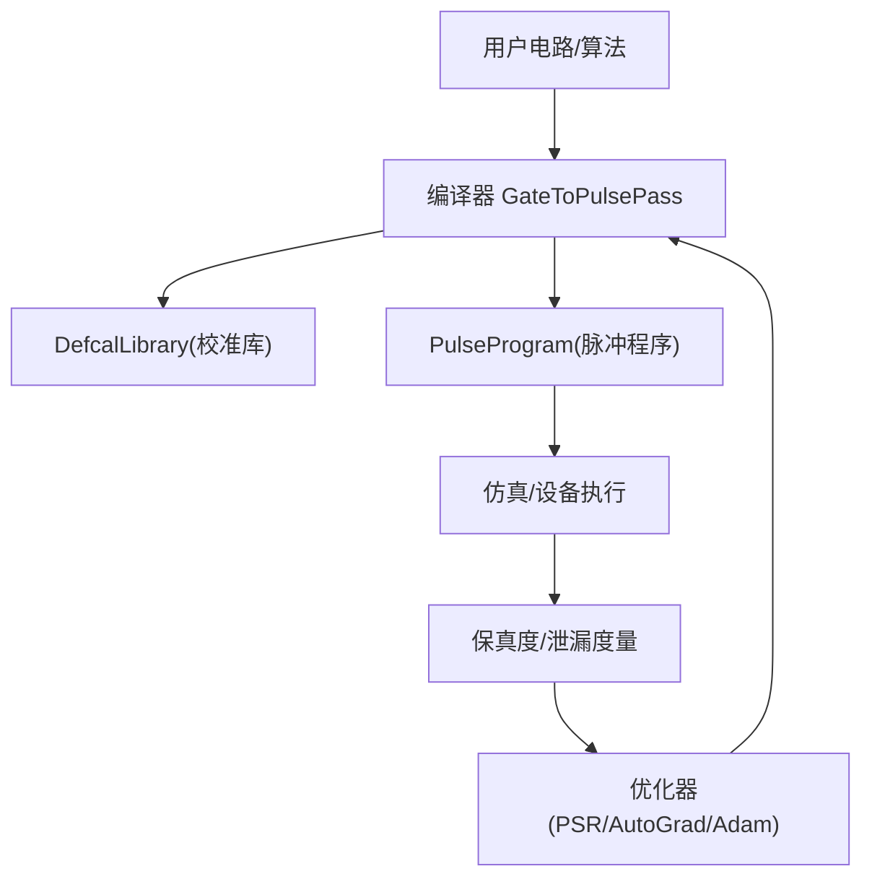
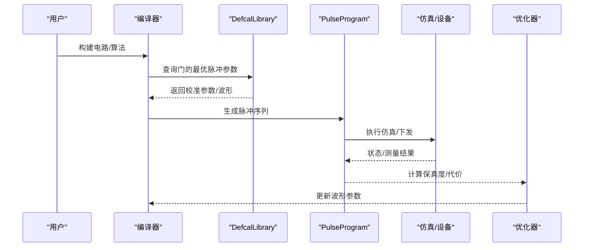
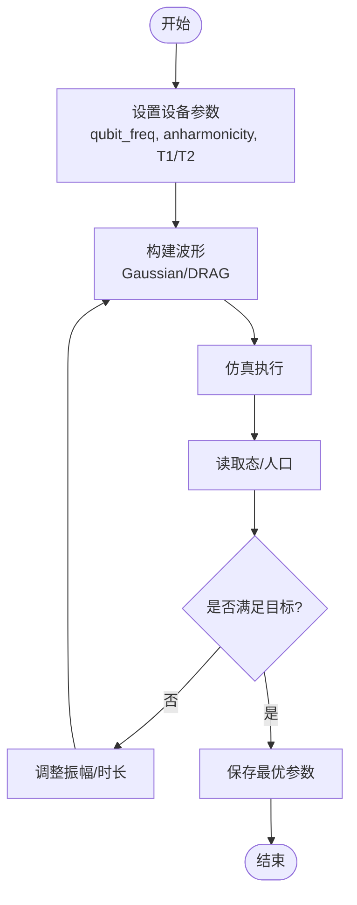
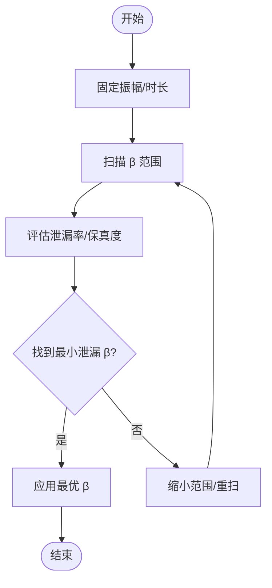
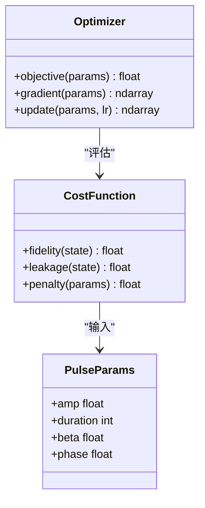
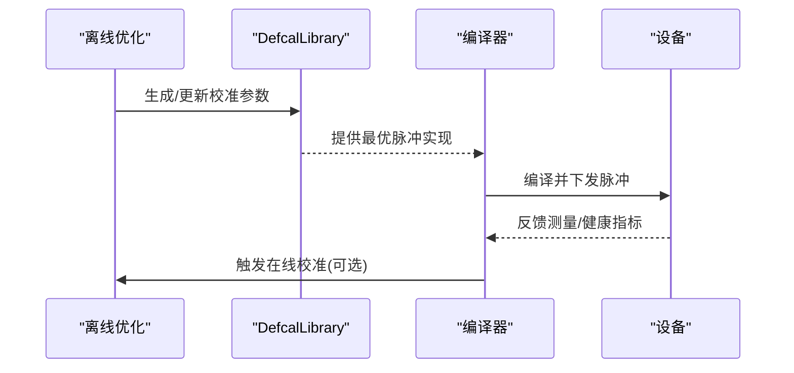
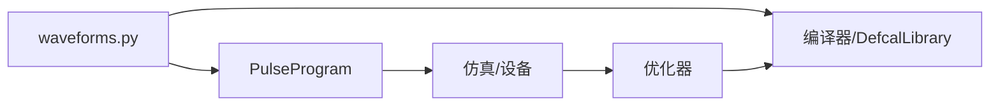

# 波形参数优化

<cite>
**本文引用的文件**
- [waveforms.py](file://src/tyxonq/waveforms.py)
- [step_2_single_qubit_coarse_tuning.py](file://examples/pulse_calibration_tutorial/step_2_single_qubit_coarse_tuning.py)
- [step_3_single_qubit_fine_tuning.py](file://examples/pulse_calibration_tutorial/step_3_single_qubit_fine_tuning.py)
- [step_7_advanced_optimization.py](file://examples/pulse_calibration_tutorial/step_7_advanced_optimization.py)
- [pulse_gate_calibration.py](file://examples/pulse_gate_calibration.py)
- [pulse_waveforms.py](file://examples/pulse_waveforms.py)
- [pulse_optimization_advanced.py](file://examples/pulse_optimization_advanced.py)
- [pulse_variational_algorithms.py](file://examples/pulse_variational_algorithms.py)
</cite>

## 目录
1. [引言](#引言)
2. [项目结构](#项目结构)
3. [核心组件](#核心组件)
4. [架构总览](#架构总览)
5. [详细组件分析](#详细组件分析)
6. [依赖关系分析](#依赖关系分析)
7. [性能考量](#性能考量)
8. [故障排查指南](#故障排查指南)
9. [结论](#结论)
10. [附录](#附录)

## 引言
本文件系统性阐述如何通过波形参数调优提升量子门保真度，覆盖振幅扫描、持续时间优化、DRAG系数（beta）调优等关键技术；给出完整的参数扫描与自动寻优示例路径；解释不同参数对旋转角度精度、泄漏抑制与噪声鲁棒性的影响机制；提供多目标优化策略以平衡门速度、保真度与硬件约束；并讨论在线校准与离线优化的方法以及自适应优化技术的应用。

## 项目结构
围绕波形参数优化，仓库提供了从基础波形定义到完整校准工作流的多层实现：
- 波形原语与数据类：集中定义多种脉冲包络（Gaussian、Drag、Hermite、BlackmanSquare 等），便于统一建模与编译。
- 单比特门粗调与细调教程：演示从理论估计到参数扫描、Rabi 表征与 H/X 门精细优化。
- 高级优化示例：涵盖参数平移法（PSR）、自动微分（AutoGrad）、梯度下降与 Adam 等优化器，支持多参数联合优化。
- 门校准与导出：展示 DRAG beta 调优、Virtual-Z 零时间 Z 旋转、CX 门 Cross-Resonance 优化、参数扫描与 TQASM defcal 导出。
- 变分算法集成：将优化后的脉冲级门用于 VQE/QAOA，体现“算法—脉冲”协同优化收益。

图表来源
- [step_7_advanced_optimization.py:160-248](file://examples/pulse_calibration_tutorial/step_7_advanced_optimization.py#L160-L248)
- [pulse_gate_calibration.py:102-160](file://examples/pulse_gate_calibration.py#L102-L160)
- [pulse_optimization_advanced.py:46-114](file://examples/pulse_optimization_advanced.py#L46-L114)

章节来源
- [step_2_single_qubit_coarse_tuning.py:1-356](file://examples/pulse_calibration_tutorial/step_2_single_qubit_coarse_tuning.py#L1-L356)
- [step_3_single_qubit_fine_tuning.py:1-306](file://examples/pulse_calibration_tutorial/step_3_single_qubit_fine_tuning.py#L1-L306)
- [pulse_gate_calibration.py:1-400](file://examples/pulse_gate_calibration.py#L1-L400)
- [pulse_waveforms.py:1-578](file://examples/pulse_waveforms.py#L1-L578)
- [pulse_optimization_advanced.py:1-582](file://examples/pulse_optimization_advanced.py#L1-L582)
- [waveforms.py:1-157](file://src/tyxonq/waveforms.py#L1-L157)

## 核心组件
- 波形数据类：封装不同包络的参数与序列化信息，如 Gaussian、Drag、Hermite、BlackmanSquare 等，提供统一的 to_args/qasm_name 接口，便于编译器与后端处理。
- 脉冲程序：通过 PulseProgram 添加具体波形、设置设备参数（qubit_freq、anharmonicity、T1/T2），并执行仿真或下发设备。
- 校准与编译：GateToPulsePass 在编译时查询 DefcalLibrary，选择最优脉冲实现；Virtual-Z 将 RZ 转换为帧更新，零物理时间。
- 优化流程：基于 PSR 或 AutoGrad 计算梯度，使用梯度下降/Adam 进行参数更新；结合网格搜索与局部优化形成“粗—精—微调”流水线。

章节来源
- [waveforms.py:19-157](file://src/tyxonq/waveforms.py#L19-L157)
- [pulse_gate_calibration.py:43-160](file://examples/pulse_gate_calibration.py#L43-L160)
- [step_7_advanced_optimization.py:160-248](file://examples/pulse_calibration_tutorial/step_7_advanced_optimization.py#L160-L248)
- [pulse_optimization_advanced.py:46-114](file://examples/pulse_optimization_advanced.py#L46-L114)

## 架构总览
下图展示了从用户逻辑到脉冲执行的端到端链路，以及优化闭环如何嵌入其中：

图表来源
- [step_7_advanced_optimization.py:160-248](file://examples/pulse_calibration_tutorial/step_7_advanced_optimization.py#L160-L248)
- [pulse_gate_calibration.py:102-160](file://examples/pulse_gate_calibration.py#L102-L160)
- [pulse_optimization_advanced.py:46-114](file://examples/pulse_optimization_advanced.py#L46-L114)

## 详细组件分析

### 振幅扫描与持续时间优化
- 振幅扫描：固定时长与包络形状，扫描幅度以逼近目标旋转角（如 π）。典型流程包括设定设备参数、构造 DRAG/Gaussian 脉冲、执行仿真、提取 |1⟩ 人口并评估误差。
- 持续时间优化：固定振幅，扫描时长以获得目标旋转（Rabi 振荡），从而精确标定 Rabi 频率与门时间。
- 实践参考：
  - 单比特门粗调中的振幅扫描与初步 DRAG β 优化。
  - 单比特门细调中的精细振幅调整与 Rabi 表征。
  - 门校准示例中的参数扫描与 Top-N 结果筛选。

图表来源
- [step_2_single_qubit_coarse_tuning.py:121-216](file://examples/pulse_calibration_tutorial/step_2_single_qubit_coarse_tuning.py#L121-L216)
- [step_3_single_qubit_fine_tuning.py:29-122](file://examples/pulse_calibration_tutorial/step_3_single_qubit_fine_tuning.py#L29-L122)
- [pulse_gate_calibration.py:225-277](file://examples/pulse_gate_calibration.py#L225-L277)

章节来源
- [step_2_single_qubit_coarse_tuning.py:50-216](file://examples/pulse_calibration_tutorial/step_2_single_qubit_coarse_tuning.py#L50-L216)
- [step_3_single_qubit_fine_tuning.py:29-205](file://examples/pulse_calibration_tutorial/step_3_single_qubit_fine_tuning.py#L29-L205)
- [pulse_gate_calibration.py:225-277](file://examples/pulse_gate_calibration.py#L225-L277)

### DRAG 系数（β）调优与泄漏抑制
- 作用机制：DRAG 通过在正交分量加入包络导数项，抑制向 |2⟩ 的泄漏，提高旋转保真度。β 越大，泄漏抑制越强，但需避免过调导致额外误差。
- 实践要点：
  - 先确定最佳振幅与时长，再扫描 β 寻找最小泄漏点。
  - 结合非谐性（anharmonicity）与 T1/T2 评估泄漏与退相干影响。
  - 在不同包络（Gaussian vs DRAG）下对比泄漏与保真度。
- 实践参考：
  - 粗调阶段的 β 扫描与评价。
  - 波形对比中不同 β 的效果。
  - 门校准中对 X 门的 β 调优。

图表来源
- [step_2_single_qubit_coarse_tuning.py:217-303](file://examples/pulse_calibration_tutorial/step_2_single_qubit_coarse_tuning.py#L217-L303)
- [pulse_waveforms.py:329-399](file://examples/pulse_waveforms.py#L329-L399)
- [pulse_gate_calibration.py:43-99](file://examples/pulse_gate_calibration.py#L43-L99)

章节来源
- [step_2_single_qubit_coarse_tuning.py:217-303](file://examples/pulse_calibration_tutorial/step_2_single_qubit_coarse_tuning.py#L217-L303)
- [pulse_waveforms.py:329-399](file://examples/pulse_waveforms.py#L329-L399)
- [pulse_gate_calibration.py:43-99](file://examples/pulse_gate_calibration.py#L43-L99)

### 多目标优化：速度、保真度与硬件约束
- 目标函数设计：
  - 保真度最大化（如 |1⟩ 人口接近 1）。
  - 泄漏抑制最小化（|2⟩ 泄漏 < 阈值）。
  - 门时间最短（受限于 T1/T2 与非谐性）。
  - 硬件约束（最大振幅、带宽、采样率）。
- 优化策略：
  - 网格搜索（粗）+ 梯度下降/Adam（精）组合。
  - 多参数同时优化（振幅、时长、β、相位）。
  - 约束优化：边界限制与惩罚项。
- 实践参考：
  - 高级优化示例中的 PSR、AutoGrad、Adam 与多参数优化。
  - 变分算法中“脉冲级优化 + 算法参数”的协同。

图表来源
- [pulse_optimization_advanced.py:46-114](file://examples/pulse_optimization_advanced.py#L46-L114)
- [pulse_optimization_advanced.py:388-453](file://examples/pulse_optimization_advanced.py#L388-L453)
- [pulse_variational_algorithms.py:316-387](file://examples/pulse_variational_algorithms.py#L316-L387)

章节来源
- [pulse_optimization_advanced.py:46-114](file://examples/pulse_optimization_advanced.py#L46-L114)
- [pulse_optimization_advanced.py:388-453](file://examples/pulse_optimization_advanced.py#L388-L453)
- [pulse_variational_algorithms.py:316-387](file://examples/pulse_variational_algorithms.py#L316-L387)

### 在线校准与离线优化
- 离线优化：
  - 在仿真或批量实验中完成参数扫描与优化，生成 DefcalLibrary。
  - 优点：可充分探索参数空间，稳定收敛。
- 在线校准：
  - 在设备运行过程中动态更新参数（如漂移补偿）。
  - 结合 Virtual-Z 减少额外开销，快速迭代。
- 实践参考：
  - 高级教程中 Defcal 的工作流与云端部署。
  - 门校准示例中的 TQASM defcal 导出与复用。

图表来源
- [step_7_advanced_optimization.py:160-248](file://examples/pulse_calibration_tutorial/step_7_advanced_optimization.py#L160-L248)
- [pulse_gate_calibration.py:280-327](file://examples/pulse_gate_calibration.py#L280-L327)

章节来源
- [step_7_advanced_optimization.py:160-248](file://examples/pulse_calibration_tutorial/step_7_advanced_optimization.py#L160-L248)
- [pulse_gate_calibration.py:280-327](file://examples/pulse_gate_calibration.py#L280-L327)

### 自适应优化技术
- 自适应学习率：Adam 等优化器根据历史梯度自适应调节步长，加速收敛并缓解平坦区域问题。
- 参数分组优化：将耦合强的参数（如振幅与 β）分组优化，降低维度灾难。
- 早停与回退：当验证集指标不再提升时停止或回退至上一轮最优。
- 实践参考：
  - 高级优化示例中的 Adam 与多参数优化流程。
  - 变分算法中结合脉冲优化与算法参数的混合策略。

章节来源
- [pulse_optimization_advanced.py:46-114](file://examples/pulse_optimization_advanced.py#L46-L114)
- [pulse_optimization_advanced.py:388-453](file://examples/pulse_optimization_advanced.py#L388-L453)
- [pulse_variational_algorithms.py:316-387](file://examples/pulse_variational_algorithms.py#L316-L387)

## 依赖关系分析
- 波形模块为所有优化提供基础数据结构，确保一致的参数表示与序列化。
- 校准教程与示例依赖波形模块与脉冲程序，形成“参数—仿真—度量—优化”的闭环。
- 编译器与 DefcalLibrary 将优化结果固化为可复用的校准库，支撑线上部署。

图表来源
- [waveforms.py:19-157](file://src/tyxonq/waveforms.py#L19-L157)
- [pulse_gate_calibration.py:43-160](file://examples/pulse_gate_calibration.py#L43-L160)
- [step_7_advanced_optimization.py:160-248](file://examples/pulse_calibration_tutorial/step_7_advanced_optimization.py#L160-L248)

章节来源
- [waveforms.py:19-157](file://src/tyxonq/waveforms.py#L19-L157)
- [pulse_gate_calibration.py:43-160](file://examples/pulse_gate_calibration.py#L43-L160)
- [step_7_advanced_optimization.py:160-248](file://examples/pulse_calibration_tutorial/step_7_advanced_optimization.py#L160-L248)

## 性能考量
- 包络选择：DRAG 通常优于 Gaussian 在泄漏抑制方面；Hermite/BlackmanSquare 适合更高阶修正与频谱控制。
- 门速度与保真度权衡：更短的门时间可能增加噪声敏感性；更长门时间受 T1/T2 限制。
- 泄漏抑制：β 调优需结合非谐性与驱动带宽，避免过调。
- 优化成本：PSR 每次评估两个点，AutoGrad 一次反向传播更高效；网格搜索适合粗探，梯度法适合精调。
- 硬件约束：振幅上限、采样率、滤波器响应需纳入优化约束。

[本节为通用指导，不直接分析具体文件]

## 故障排查指南
- 保真度不达标：
  - 检查振幅是否达到目标旋转（参考 Rabi 曲线）。
  - 确认 β 是否合适（过大或过小都会影响泄漏与保真度）。
  - 核对设备参数（qubit_freq、anharmonicity、T1/T2）是否与真实硬件一致。
- 泄漏偏高：
  - 增大 β 或改用高阶包络（Hermite/BlackmanSquare）。
  - 缩短门时间以减少退相干影响。
- 优化不收敛：
  - 调整学习率或使用 Adam。
  - 扩大搜索范围或采用多起点优化。
- 在线漂移：
  - 定期重新校准，必要时启用在线校准流程。

章节来源
- [step_2_single_qubit_coarse_tuning.py:217-303](file://examples/pulse_calibration_tutorial/step_2_single_qubit_coarse_tuning.py#L217-L303)
- [step_3_single_qubit_fine_tuning.py:124-205](file://examples/pulse_calibration_tutorial/step_3_single_qubit_fine_tuning.py#L124-L205)
- [pulse_gate_calibration.py:225-277](file://examples/pulse_gate_calibration.py#L225-L277)
- [pulse_optimization_advanced.py:46-114](file://examples/pulse_optimization_advanced.py#L46-L114)

## 结论
通过系统化的振幅扫描、持续时间优化与 DRAG β 调优，结合 PSR/AutoGrad 与 Adam 等优化器，可在 TyxonQ 框架内实现高保真度的单/双比特门。利用 DefcalLibrary 将优化结果固化并在线复用，能有效提升算法级性能（VQE/QAOA）。在多目标优化中，应平衡门速度、保真度与硬件约束，采用“粗—精—微调”的流水线与自适应策略，获得稳健且高效的校准方案。

[本节为总结性内容，不直接分析具体文件]

## 附录
- 关键示例路径（可直接参考实现）：
  - 单比特门粗调与 β 优化：[step_2_single_qubit_coarse_tuning.py:1-356](file://examples/pulse_calibration_tutorial/step_2_single_qubit_coarse_tuning.py#L1-L356)
  - 单比特门细调与 Rabi 表征：[step_3_single_qubit_fine_tuning.py:1-306](file://examples/pulse_calibration_tutorial/step_3_single_qubit_fine_tuning.py#L1-L306)
  - 高级优化（PSR/AutoGrad/Adam）：[pulse_optimization_advanced.py:1-582](file://examples/pulse_optimization_advanced.py#L1-L582)
  - 门校准与 defcal 导出：[pulse_gate_calibration.py:1-400](file://examples/pulse_gate_calibration.py#L1-L400)
  - 波形类型与对比：[pulse_waveforms.py:1-578](file://examples/pulse_waveforms.py#L1-L578)
  - 波形数据类定义：[waveforms.py:1-157](file://src/tyxonq/waveforms.py#L1-L157)
  - 变分算法与脉冲优化集成：[pulse_variational_algorithms.py:1-672](file://examples/pulse_variational_algorithms.py#L1-L672)

[本节为索引性内容，不直接分析具体文件]