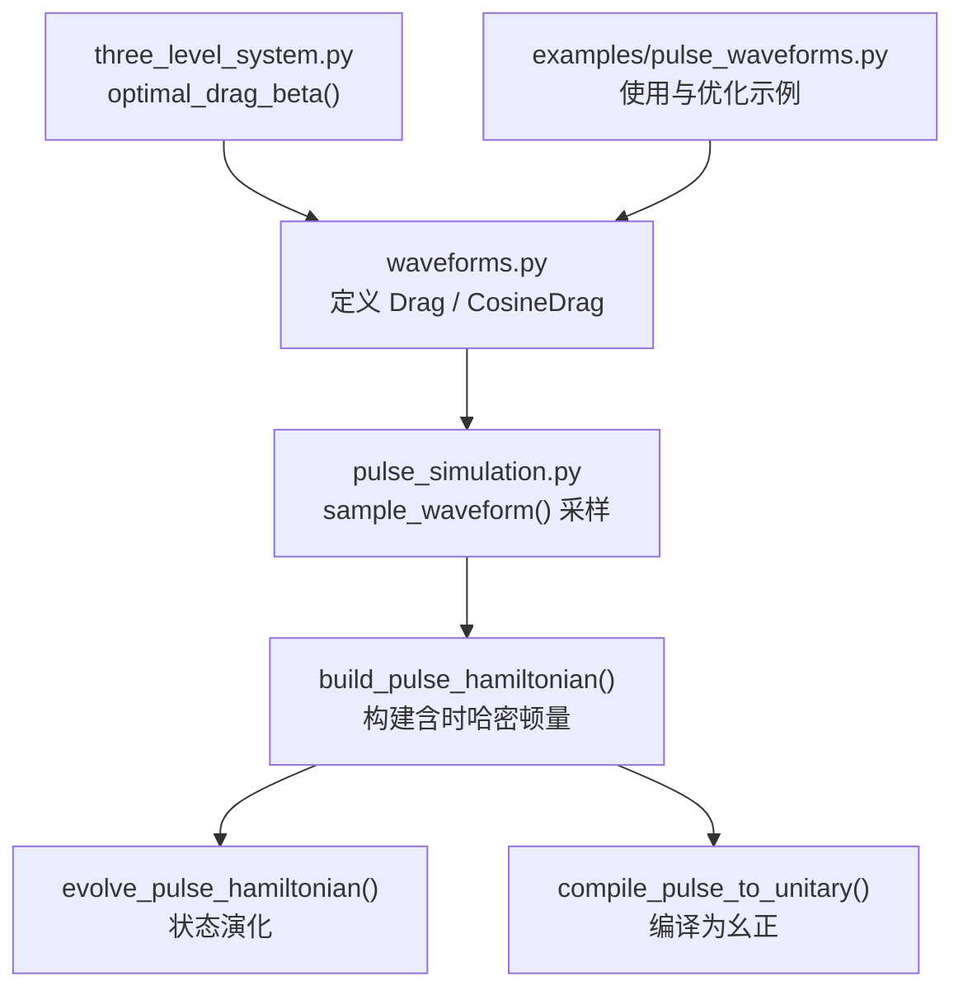
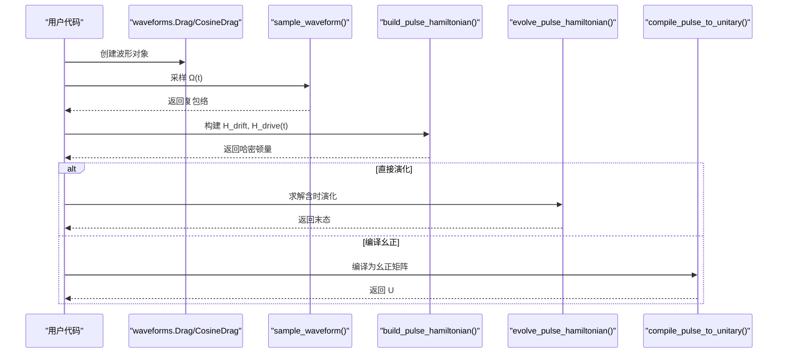
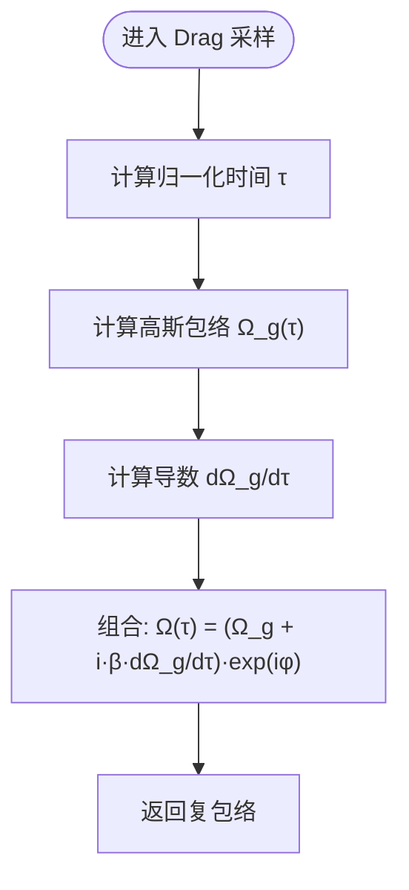
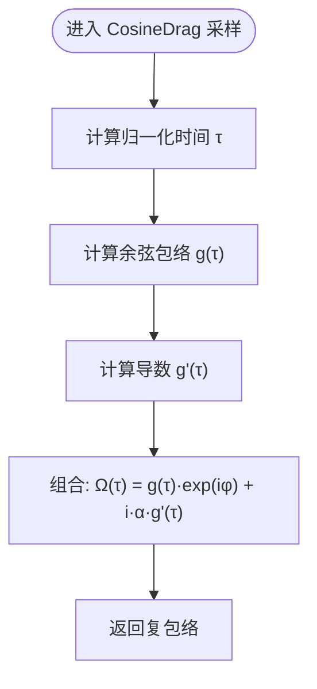
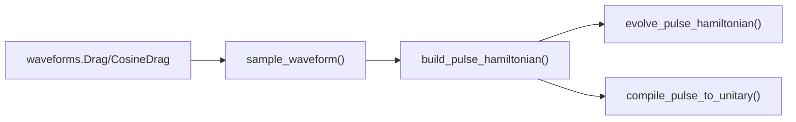

# DRAG波形

<cite>
**本文引用的文件**
- [waveforms.py](file://src/tyxonq/waveforms.py)
- [pulse_simulation.py](file://src/tyxonq/libs/quantum_library/pulse_simulation.py)
- [three_level_system.py](file://src/tyxonq/libs/quantum_library/three_level_system.py)
- [pulse_waveforms.py](file://examples/pulse_waveforms.py)
- [test_hermite_blackman_waveforms.py](file://tests_core_module/test_hermite_blackman_waveforms.py)
</cite>

## 目录
1. [简介](#简介)
2. [项目结构](#项目结构)
3. [核心组件](#核心组件)
4. [架构总览](#架构总览)
5. [详细组件分析](#详细组件分析)
6. [依赖关系分析](#依赖关系分析)
7. [性能考量](#性能考量)
8. [故障排查指南](#故障排查指南)
9. [结论](#结论)
10. [附录](#附录)

## 简介
本文件系统性阐述 TyxonQ 中的 DRAG（Derivative Removal by Adiabatic Gate，绝热门导数消除）波形技术，覆盖两种实现：Drag 与 CosineDrag。文档从数学原理出发，解释如何通过引入导数项补偿能级泄漏以提升量子门保真度；详细说明参数配置（振幅、持续时间、标准差、β/α、相位等）的作用与调优方法；对比 Drag 与 CosineDrag 的差异并解释余弦调制 DRAG 的优势；最后给出实际使用示例、参数优化策略与性能评估方法。

## 项目结构
TyxonQ 的 DRAG 相关代码主要分布在以下模块：
- 波形定义：waveforms.py 定义了 Drag 与 CosineDrag 的数据类及序列化接口。
- 采样与仿真：pulse_simulation.py 提供 sample_waveform 对各类波形进行时间域采样，并构建含时哈密顿量以进行演化或编译为幺正矩阵。
- 理论工具：three_level_system.py 提供基于微扰论的最优 β 估算函数 optimal_drag_beta。
- 示例与测试：examples/pulse_waveforms.py 展示多种波形的使用方法与优化流程；tests_core_module/test_hermite_blackman_waveforms.py 展示了波形采样与物理验证的测试范式。

图表来源
- [waveforms.py:42-91](file://src/tyxonq/waveforms.py#L42-L91)
- [pulse_simulation.py:44-145](file://src/tyxonq/libs/quantum_library/pulse_simulation.py#L44-L145)
- [pulse_simulation.py:297-383](file://src/tyxonq/libs/quantum_library/pulse_simulation.py#L297-L383)
- [pulse_simulation.py:386-524](file://src/tyxonq/libs/quantum_library/pulse_simulation.py#L386-L524)
- [pulse_simulation.py:527-594](file://src/tyxonq/libs/quantum_library/pulse_simulation.py#L527-L594)
- [three_level_system.py:525-551](file://src/tyxonq/libs/quantum_library/three_level_system.py#L525-L551)
- [pulse_waveforms.py:176-230](file://examples/pulse_waveforms.py#L176-L230)

章节来源
- [waveforms.py:42-91](file://src/tyxonq/waveforms.py#L42-L91)
- [pulse_simulation.py:44-145](file://src/tyxonq/libs/quantum_library/pulse_simulation.py#L44-L145)
- [three_level_system.py:525-551](file://src/tyxonq/libs/quantum_library/three_level_system.py#L525-L551)
- [pulse_waveforms.py:176-230](file://examples/pulse_waveforms.py#L176-L230)

## 核心组件
- Drag（高斯包络 + 导数修正）
  - 参数：amp（振幅）、duration（持续时间）、sigma（标准差）、beta（DRAG 导数系数）、phase（相位）。
  - 作用：在高斯包络基础上叠加 i·β·dΩ/dt 项，抑制向 |2⟩ 的泄漏。
- CosineDrag（余弦包络 + 导数修正）
  - 参数：amp（振幅）、duration（持续时间）、alpha（DRAG 导数系数）、phase（相位）。
  - 作用：采用余弦调制包络 g(τ)，并叠加 i·α·g'(τ) 项，进一步抑制泄漏并改善频谱特性。

章节来源
- [waveforms.py:42-91](file://src/tyxonq/waveforms.py#L42-L91)
- [pulse_simulation.py:96-145](file://src/tyxonq/libs/quantum_library/pulse_simulation.py#L96-L145)

## 架构总览
DRAG 波形的执行路径如下：
- 用户通过 waveforms.Drag 或 waveforms.CosineDrag 构造脉冲对象。
- 仿真引擎在 sample_waveform 中根据波形类型计算瞬时复包络 Ω(t)。
- build_pulse_hamiltonian 将 Ω(t) 映射到旋转框架下的驱动哈密顿量 H_drive(t)。
- evolve_pulse_hamiltonian 求解含时薛定谔方程得到末态；或 compile_pulse_to_unitary 将脉冲编译为幺正矩阵用于链式 API。

图表来源
- [pulse_simulation.py:44-145](file://src/tyxonq/libs/quantum_library/pulse_simulation.py#L44-L145)
- [pulse_simulation.py:297-383](file://src/tyxonq/libs/quantum_library/pulse_simulation.py#L297-L383)
- [pulse_simulation.py:386-524](file://src/tyxonq/libs/quantum_library/pulse_simulation.py#L386-L524)
- [pulse_simulation.py:527-594](file://src/tyxonq/libs/quantum_library/pulse_simulation.py#L527-L594)

## 详细组件分析

### Drag 波形（高斯包络 + 导数修正）
- 数学形式
  - 包络：Ω_g(τ) = A·exp(-(τ-0.5)²/(2σ²))
  - 导数项：dΩ_g/dτ = Ω_g · (-(τ-0.5)/σ²)
  - 复包络：Ω(τ) = [Ω_g(τ) + i·β·dΩ_g/dτ]·exp(iφ)
- 物理意义
  - 导数项抵消由快速上升/下降引起的非绝热跃迁，抑制向 |2⟩ 的泄漏。
  - β 的正负与大小决定补偿强度；通常取正值以抑制泄漏。
- 参数说明
  - amp：控制 Rabi 频率幅度，影响旋转角度与速度。
  - duration：脉冲时长，越长越接近绝热但受 T1/T2 限制。
  - sigma：高斯宽度，影响频谱宽度与边带泄漏。
  - beta：DRAG 导数系数，典型值约 0.1–0.3，可通过最优公式估算。
  - phase：相位偏移，用于实现不同轴旋转（如 X/Y）。
- 实现要点
  - 在 pulse_simulation.py 中对 drag 类型进行分支处理，分别支持 NumPy 与 PyTorch 后端。
  - 采样时按归一化时间 τ ∈ [0,1] 计算包络与导数。

图表来源
- [pulse_simulation.py:116-145](file://src/tyxonq/libs/quantum_library/pulse_simulation.py#L116-L145)

章节来源
- [waveforms.py:42-51](file://src/tyxonq/waveforms.py#L42-L51)
- [pulse_simulation.py:116-145](file://src/tyxonq/libs/quantum_library/pulse_simulation.py#L116-L145)

### CosineDrag 波形（余弦包络 + 导数修正）
- 数学形式
  - 包络：g(τ) = (A/2)[cos(2πτ - π) + 1]
  - 导数项：g'(τ) = -(A·π)·sin(2πτ - π)
  - 复包络：Ω(τ) = g(τ)·exp(iφ) + i·α·g'(τ)
- 优势
  - 余弦包络在起止点更平滑，频谱旁瓣更低，有助于减少泄漏和串扰。
  - 通过 α 调节导数修正强度，适合需要精细相位控制的场景。
- 参数说明
  - amp：振幅，控制峰值 Rabi 频率。
  - duration：持续时间。
  - alpha：DRAG 导数系数，类似 β 但针对余弦包络。
  - phase：相位，用于旋转轴选择。
- 实现要点
  - 在 pulse_simulation.py 中对 cosinedrag 类型进行分支处理，计算包络与导数后叠加修正项。

图表来源
- [pulse_simulation.py:96-114](file://src/tyxonq/libs/quantum_library/pulse_simulation.py#L96-L114)

章节来源
- [waveforms.py:82-91](file://src/tyxonq/waveforms.py#L82-L91)
- [pulse_simulation.py:96-114](file://src/tyxonq/libs/quantum_library/pulse_simulation.py#L96-L114)

### 最优 β 的理论估算
- 公式：β_opt ≈ -1/(2α_anharm)，其中 α_anharm 为量子比特非谐性（Hz）。
- 用途：为 Drag 波形的 β 提供初始猜测，再结合扫描或优化微调。
- 参考：基于一级微扰理论的泄漏抑制推导。

章节来源
- [three_level_system.py:525-551](file://src/tyxonq/libs/quantum_library/three_level_system.py#L525-L551)

### 单量子比特门实现与示例
- X 门：π 旋转，常用 Drag，β≈0.2，相位=0。
- Y 门：π 旋转，相位=π/2。
- Hadamard：π/√2 旋转，适当缩放 amp 与 duration。
- Z 门：虚拟 Z，无需物理脉冲。

章节来源
- [pulse_waveforms.py:176-230](file://examples/pulse_waveforms.py#L176-L230)

## 依赖关系分析
- 耦合关系
  - waveforms.Drag/CosineDrag 被 pulse_simulation.sample_waveform 识别并采样。
  - sample_waveform 的输出作为 H_drive(t) 的输入，参与构建含时哈密顿量。
  - evolve_pulse_hamiltonian 与 compile_pulse_to_unitary 依赖上述哈密顿量完成演化或编译。
- 外部依赖
  - 数值后端：NumPy/PyTorch/CuPy，通过 get_backend 动态切换。
  - 积分器：scipy.integrate.solve_ivp（RK45），用于高精度演化。
- 潜在循环依赖
  - 当前实现无循环依赖；waveforms 仅定义数据类，仿真逻辑集中在 pulse_simulation。

图表来源
- [waveforms.py:42-91](file://src/tyxonq/waveforms.py#L42-L91)
- [pulse_simulation.py:44-145](file://src/tyxonq/libs/quantum_library/pulse_simulation.py#L44-L145)
- [pulse_simulation.py:297-383](file://src/tyxonq/libs/quantum_library/pulse_simulation.py#L297-L383)
- [pulse_simulation.py:386-524](file://src/tyxonq/libs/quantum_library/pulse_simulation.py#L386-L524)
- [pulse_simulation.py:527-594](file://src/tyxonq/libs/quantum_library/pulse_simulation.py#L527-L594)

章节来源
- [waveforms.py:42-91](file://src/tyxonq/waveforms.py#L42-L91)
- [pulse_simulation.py:44-145](file://src/tyxonq/libs/quantum_library/pulse_simulation.py#L44-L145)

## 性能考量
- 采样率与步长
  - 默认采样率 2 GHz，duration 以纳秒为单位；过短可能导致数值误差。
- 积分精度
  - solve_ivp 使用 RK45，rtol/atol 设置影响精度与耗时；可根据需求调整。
- 后端选择
  - NumPy：精度高，适合离线仿真。
  - PyTorch：支持自动微分，适合参数优化与梯度传播。
- 泄漏与保真度权衡
  - 增大 beta/alpha 可抑制泄漏，但可能引入额外相位误差；需结合目标门类型调优。
  - 增加 duration 提高绝热性，但受限于退相干时间。

[本节为通用指导，不直接分析具体文件]

## 故障排查指南
- 波形未生效
  - 检查 waveform.__class__.__name__.lower() 是否匹配 "drag" 或 "cosinedrag"。
  - 确认 duration > 0，且 t 落在 [0, duration/SAMPLING_RATE] 范围内。
- 泄漏过高
  - 使用 optimal_drag_beta 估算 β 初值，再进行 β 扫描。
  - 尝试 CosineDrag 以获得更优频谱特性。
- 相位错误
  - 核对 phase 参数；X/Y/H 等不同门对应不同相位。
- 数值不稳定
  - 降低 dt 或提高 solve_ivp 精度；检查 amp 是否过大导致强驱动。

章节来源
- [pulse_simulation.py:96-145](file://src/tyxonq/libs/quantum_library/pulse_simulation.py#L96-L145)
- [three_level_system.py:525-551](file://src/tyxonq/libs/quantum_library/three_level_system.py#L525-L551)

## 结论
- Drag 与 CosineDrag 均通过导数项抑制泄漏，提升门保真度；前者基于高斯包络，后者基于余弦包络。
- 参数调优建议：先以 optimal_drag_beta 估算 β，再进行 β/amp/sigma 扫描；对相位敏感的门，优先选择 CosineDrag。
- 工程实践：利用示例脚本进行端到端验证，结合仿真与硬件校准迭代优化。

[本节为总结，不直接分析具体文件]

## 附录

### 参数对照表
- Drag
  - amp：Rabi 幅度，控制旋转速度与角度。
  - duration：脉冲时长，影响绝热性与噪声敏感性。
  - sigma：高斯宽度，控制频谱宽度与边带泄漏。
  - beta：导数修正强度，典型 0.1–0.3。
  - phase：旋转轴相位，0→X，π/2→Y。
- CosineDrag
  - amp：Rabi 幅度。
  - duration：脉冲时长。
  - alpha：导数修正强度，类似 β。
  - phase：旋转轴相位。

章节来源
- [waveforms.py:42-91](file://src/tyxonq/waveforms.py#L42-L91)

### 使用示例路径
- 单量子比特门实现与比较：[pulse_waveforms.py:176-230](file://examples/pulse_waveforms.py#L176-L230)
- 波形参数优化（β 扫描）：[pulse_waveforms.py:329-399](file://examples/pulse_waveforms.py#L329-L399)
- 高级脉冲整形与复合脉冲：[pulse_waveforms.py:406-470](file://examples/pulse_waveforms.py#L406-L470)

章节来源
- [pulse_waveforms.py:176-230](file://examples/pulse_waveforms.py#L176-L230)
- [pulse_waveforms.py:329-399](file://examples/pulse_waveforms.py#L329-L399)
- [pulse_waveforms.py:406-470](file://examples/pulse_waveforms.py#L406-L470)

### 性能评估方法
- 泄漏度量：leakage = 1 - P0 - P1，越小越好。
- 保真度：对于 π 门，F ≈ P1；对于任意门，可用目标幺正与实测幺正的重叠度量。
- 优化流程：固定 duration/sigma，扫描 amp/beta（或 alpha），选取最小泄漏或最高保真度的参数组合。

章节来源
- [pulse_waveforms.py:140-169](file://examples/pulse_waveforms.py#L140-L169)
- [pulse_waveforms.py:329-399](file://examples/pulse_waveforms.py#L329-L399)