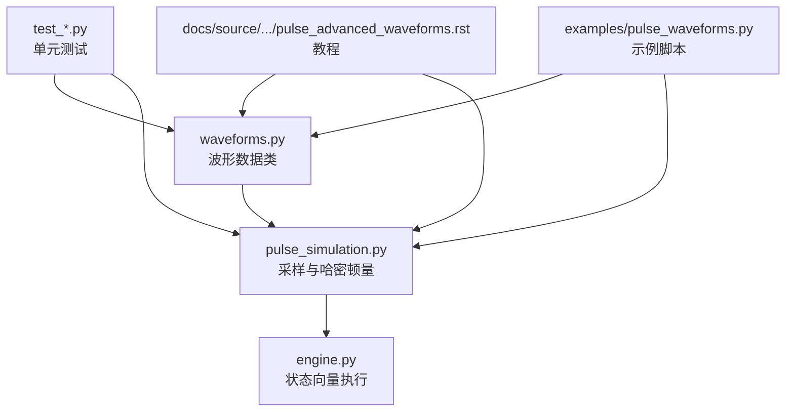
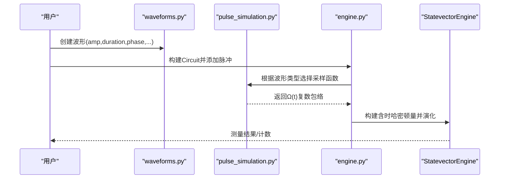
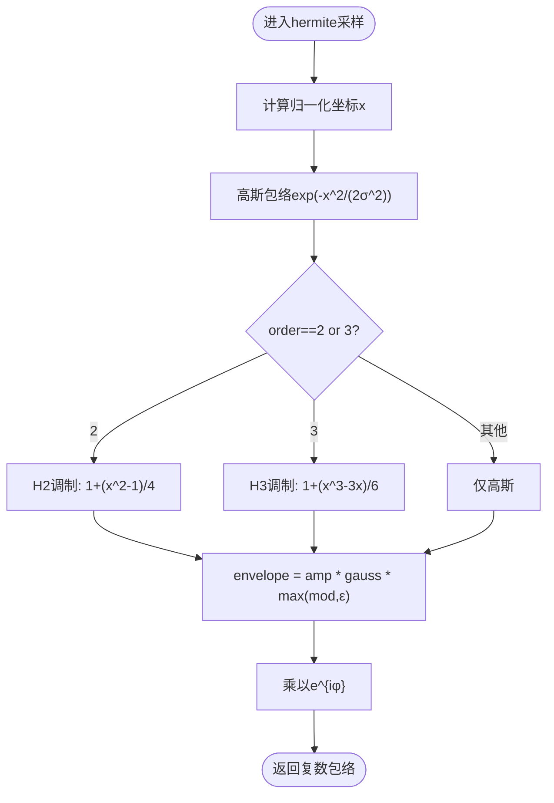
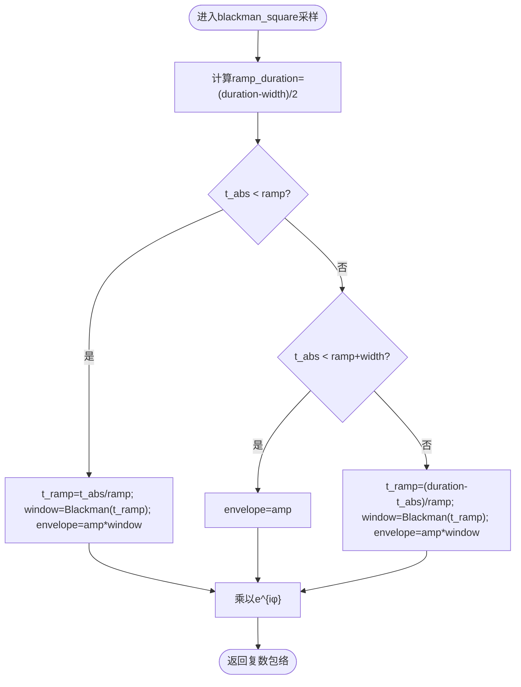
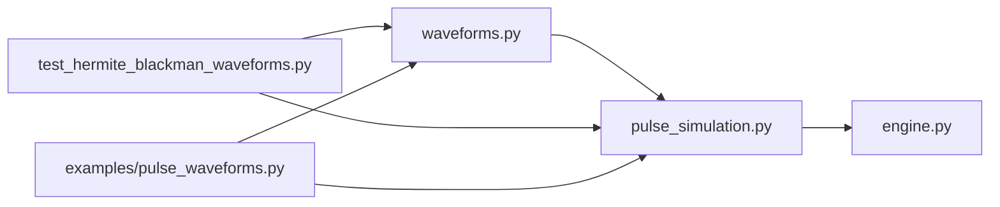

# 专用波形

<cite>
**本文引用的文件**
- [waveforms.py](file://src/tyxonq/waveforms.py)
- [pulse_simulation.py](file://src/tyxonq/libs/quantum_library/pulse_simulation.py)
- [engine.py](file://src/tyxonq/devices/simulators/statevector/engine.py)
- [test_hermite_blackman_waveforms.py](file://tests_core_module/test_hermite_blackman_waveforms.py)
- [pulse_waveforms.py](file://examples/pulse_waveforms.py)
- [pulse_advanced_waveforms.rst](file://docs/source/tutorials/advanced/pulse_advanced_waveforms.rst)
</cite>

## 目录
1. [简介](#简介)
2. [项目结构](#项目结构)
3. [核心组件](#核心组件)
4. [架构总览](#架构总览)
5. [详细组件分析](#详细组件分析)
6. [依赖关系分析](#依赖关系分析)
7. [性能考量](#性能考量)
8. [故障排查指南](#故障排查指南)
9. [结论](#结论)
10. [附录](#附录)

## 简介
本文件聚焦 TyxonQ 中的专用波形：Hermite、BlackmanSquare、Flattop，系统阐述其数学构造原理、设计目标与适用场景。重点说明 Hermite 多项式包络的频谱特性、Blackman 窗函数的旁瓣抑制能力、平顶波形的精确控制优势，并给出参数配置示例、使用指导、最佳实践与性能注意事项。内容基于仓库中源码与测试用例，确保可追溯与可验证。

## 项目结构
TyxonQ 将波形定义、采样生成、仿真执行与文档教程分层组织：
- 波形数据类定义位于 waveforms.py，提供 Hermite、BlackmanSquare、Flattop 等统一接口（名称映射、参数序列化）。
- 脉冲采样与哈密顿量构建位于 pulse_simulation.py，实现各波形的时域包络生成与物理模型。
- 状态向量引擎在 engine.py 中注册波形类型，支持电路级调用与 inline 序列化。
- 测试覆盖波形实例化、采样性质、集成执行与保真度对比。
- 教程与示例提供使用流程、参数优化思路与部署建议。

**图表来源**
- [waveforms.py:94-156](file://src/tyxonq/waveforms.py#L94-L156)
- [pulse_simulation.py:216-291](file://src/tyxonq/libs/quantum_library/pulse_simulation.py#L216-L291)
- [engine.py:955-986](file://src/tyxonq/devices/simulators/statevector/engine.py#L955-L986)

**章节来源**
- [waveforms.py:1-157](file://src/tyxonq/waveforms.py#L1-L157)
- [pulse_simulation.py:200-399](file://src/tyxonq/libs/quantum_library/pulse_simulation.py#L200-L399)
- [engine.py:955-986](file://src/tyxonq/devices/simulators/statevector/engine.py#L955-L986)

## 核心组件
- Hermite 波形：以概率论 Hermite 多项式调制高斯包络，降低频谱泄漏，适用于对频谱隔离有更高要求的单量子比特门。
- BlackmanSquare 波形：采用 Blackman 窗函数作为上升/下降沿，中间为平顶平台，具备极低的旁瓣电平，适合多量子比特串扰敏感场景。
- Flattop 波形：具有可控的平顶宽度与边缘过渡，便于精确控制脉冲能量与时间积分，常用于需要严格幅值平台的门操作。

上述三类波形均通过统一的 dataclass 接口暴露 amp、duration、phase 等参数，并提供 qasm_name() 与 to_args() 用于序列化与编译。

**章节来源**
- [waveforms.py:94-156](file://src/tyxonq/waveforms.py#L94-L156)

## 架构总览
波形从定义到执行的典型路径：
1. 用户创建波形对象（如 Hermite、BlackmanSquare、Flattop）。
2. 在电路中注册或内联使用波形，引擎根据波形类型选择采样函数。
3. 采样函数按时间 t 计算复数包络 Ω(t)，并转换为驱动哈密顿量项。
4. 状态向量演化求解含时薛定谔方程，得到门操作结果。

**图表来源**
- [waveforms.py:94-156](file://src/tyxonq/waveforms.py#L94-L156)
- [pulse_simulation.py:216-291](file://src/tyxonq/libs/quantum_library/pulse_simulation.py#L216-L291)
- [engine.py:955-986](file://src/tyxonq/devices/simulators/statevector/engine.py#L955-L986)

## 详细组件分析

### Hermite 波形
- 数学构造：在高斯包络基础上乘以归一化的 Hermite 多项式调制项。实现中采用中心坐标 x=(τ−0.5)×缩放因子，并以 order=2/3 分别对应 H₂(x)=x²−1 与 H₃(x)=x³−3x 的归一化形式；为避免零值导致数值问题，取 max(mod, ε)。
- 设计目标：利用多项式调制改善频谱形状，减少旁瓣泄漏，提升单量子比特门的保真度与频率选择性。
- 关键参数：amp（幅度）、duration（时长）、order（阶数，默认2）、phase（相位偏移）。
- 使用要点：
  - 阶数越高，频谱整形更强但计算更复杂；通常 order=2 已能显著改善泄漏。
  - 相位可用于实现不同轴旋转（配合驱动频率与失谐）。
  - 与 DRAG 相比，Hermite 侧重包络整形而非导数补偿，二者可互补。

**图表来源**
- [pulse_simulation.py:216-252](file://src/tyxonq/libs/quantum_library/pulse_simulation.py#L216-L252)

**章节来源**
- [waveforms.py:104-127](file://src/tyxonq/waveforms.py#L104-L127)
- [pulse_simulation.py:216-252](file://src/tyxonq/libs/quantum_library/pulse_simulation.py#L216-L252)
- [test_hermite_blackman_waveforms.py:30-120](file://tests_core_module/test_hermite_blackman_waveforms.py#L30-L120)

### BlackmanSquare 波形
- 数学构造：三段式结构——上升沿、平顶平台、下降沿。上升/下降沿采用标准 Blackman 窗 w(t)=0.42−0.5cos(2πt/T)+0.08cos(4πt/T)，平台区保持恒定幅值。
- 设计目标：凭借 Blackman 窗极低的旁瓣电平（理论约 −58 dB）与较陡滚降（理论约 −60 dB/倍频程），有效抑制频谱泄漏与串扰，适合密集耦合或多量子比特系统。
- 关键参数：amp、duration、width（平台宽度，需小于 duration）、phase。
- 使用要点：
  - 平台宽度占比影响能量分布与门精度；常见经验范围为 0.5–0.8 倍 duration。
  - 对称性良好，上升/下降沿镜像，利于稳定控制。
  - 对于两量子比特门（如交叉共振 CR），适当降低幅值并延长时长可获得更好的隔离与保真度。

**图表来源**
- [pulse_simulation.py:254-291](file://src/tyxonq/libs/quantum_library/pulse_simulation.py#L254-L291)

**章节来源**
- [waveforms.py:129-156](file://src/tyxonq/waveforms.py#L129-L156)
- [pulse_simulation.py:254-291](file://src/tyxonq/libs/quantum_library/pulse_simulation.py#L254-L291)
- [test_hermite_blackman_waveforms.py:125-246](file://tests_core_module/test_hermite_blackman_waveforms.py#L125-L246)

### Flattop 波形
- 数学构造：具有明确平台宽度与可控边缘过渡的平顶脉冲，便于精确控制脉冲能量与时间积分，常用于需要严格幅值平台的门操作。
- 设计目标：在保证快速切换的同时维持稳定的平台幅值，提高门操作的确定性与时序对齐能力。
- 关键参数：amp、width（平台宽度）、duration（总时长）。
- 使用要点：
  - 平台宽度与边缘过渡需满足硬件约束（例如 edge 范围限制）。
  - 与 BlackmanSquare 相比，Flattop 更强调“平台”的稳定性，而 Blackman 更强调“频谱抑制”。

**章节来源**
- [waveforms.py:94-101](file://src/tyxonq/waveforms.py#L94-L101)
- [engine.py:955-986](file://src/tyxonq/devices/simulators/statevector/engine.py#L955-L986)

## 依赖关系分析
- 波形定义（waveforms.py）被采样模块（pulse_simulation.py）引用，依据波形类型分派至具体实现。
- 状态向量引擎（engine.py）维护波形类型到类的映射，支持电路级扩展与 inline 序列化。
- 测试用例覆盖实例化、采样边界、相位旋转、保真度对比与能量守恒等属性。

**图表来源**
- [waveforms.py:1-157](file://src/tyxonq/waveforms.py#L1-L157)
- [pulse_simulation.py:200-399](file://src/tyxonq/libs/quantum_library/pulse_simulation.py#L200-L399)
- [engine.py:955-986](file://src/tyxonq/devices/simulators/statevector/engine.py#L955-L986)
- [test_hermite_blackman_waveforms.py:1-474](file://tests_core_module/test_hermite_blackman_waveforms.py#L1-L474)
- [pulse_waveforms.py:1-578](file://examples/pulse_waveforms.py#L1-L578)

**章节来源**
- [waveforms.py:1-157](file://src/tyxonq/waveforms.py#L1-L157)
- [pulse_simulation.py:200-399](file://src/tyxonq/libs/quantum_library/pulse_simulation.py#L200-L399)
- [engine.py:955-986](file://src/tyxonq/devices/simulators/statevector/engine.py#L955-L986)
- [test_hermite_blackman_waveforms.py:1-474](file://tests_core_module/test_hermite_blackman_waveforms.py#L1-L474)
- [pulse_waveforms.py:1-578](file://examples/pulse_waveforms.py#L1-L578)

## 性能考量
- 频谱泄漏与串扰：
  - Hermite 通过多项式调制改善频谱形状，降低旁瓣泄漏，适合中等隔离需求的单量子比特门。
  - BlackmanSquare 具备极低的旁瓣电平与陡峭滚降，适合多量子比特串扰敏感场景。
- 时间与能量：
  - 平台宽度（BlackmanSquare/Flattop）影响能量分布与门精度；过短可能导致不完整的旋转，过长增加退相干风险。
  - 幅度与时长共同决定 Rabi 角；需结合设备参数（失谐、非谐性、Rabi 频率）校准。
- 数值稳定性：
  - Hermite 实现中对调制项取 max(mod, ε) 避免零值；采样时应检查边界与无穷大。
  - Blackman 窗在上升/下降沿平滑过渡，注意平台与边缘的衔接点。
- 仿真与硬件差异：
  - 教程强调理论与仿真结果需在真实硬件上验证；实际串扰抑制受传输线、带宽与器件漂移影响。

[本节提供通用指导，无需特定文件引用]

## 故障排查指南
- 波形未识别或类型错误：
  - 确认波形类型名称与引擎映射一致（如 hermite、blackman_square/blackmansquare、flattop）。
  - 参考引擎中的类型映射表进行修正。
- 采样异常或溢出：
  - 检查幅度与平台宽度是否合理；确保 width < duration。
  - 验证相位与频率设置是否与设备参数匹配。
- 保真度低于预期：
  - 调整 amplitude/duration/width；对 BlackmanSquare 尝试不同平台比例。
  - 对比 Hermite 与 BlackmanSquare 的保真度，选择更适合硬件特性的波形。
- 能量与边界检查：
  - 使用测试方法验证采样边界（脉冲前后应为近零值）与能量守恒。

**章节来源**
- [engine.py:955-986](file://src/tyxonq/devices/simulators/statevector/engine.py#L955-L986)
- [test_hermite_blackman_waveforms.py:61-120](file://tests_core_module/test_hermite_blackman_waveforms.py#L61-L120)
- [test_hermite_blackman_waveforms.py:153-246](file://tests_core_module/test_hermite_blackman_waveforms.py#L153-L246)

## 结论
TyxonQ 提供的 Hermite、BlackmanSquare、Flattop 三种专用波形，分别在频谱整形、旁瓣抑制与平台精确控制方面具备优势。Hermite 通过多项式调制改善泄漏，BlackmanSquare 以 Blackman 窗实现极低旁瓣与陡峭滚降，Flattop 提供稳定平台以增强门操作的确定性。结合参数优化与硬件验证，可在高精度量子门操作、减少串扰与提高保真度等方面取得显著收益。建议在仿真阶段筛选参数，并在真实设备上完成最终验证与部署。

[本节总结性内容，无需特定文件引用]

## 附录

### 参数配置示例与使用指导
- Hermite：
  - 参数：amp、duration、order（2/3）、phase。
  - 建议：order=2 起步，逐步尝试 order=3；相位用于轴选择。
  - 参考：[waveforms.py:104-127](file://src/tyxonq/waveforms.py#L104-L127)、[pulse_simulation.py:216-252](file://src/tyxonq/libs/quantum_library/pulse_simulation.py#L216-L252)
- BlackmanSquare：
  - 参数：amp、duration、width（< duration）、phase。
  - 建议：width/duration 在 0.5–0.8 之间扫描；两量子比特门降低幅值并延长时间。
  - 参考：[waveforms.py:129-156](file://src/tyxonq/waveforms.py#L129-L156)、[pulse_simulation.py:254-291](file://src/tyxonq/libs/quantum_library/pulse_simulation.py#L254-L291)
- Flattop：
  - 参数：amp、width、duration。
  - 建议：确保边缘过渡满足硬件约束；平台宽度影响能量与门精度。
  - 参考：[waveforms.py:94-101](file://src/tyxonq/waveforms.py#L94-L101)、[engine.py:955-986](file://src/tyxonq/devices/simulators/statevector/engine.py#L955-L986)

### 最佳实践
- 先仿真后硬件：在 StatevectorEngine 中比较不同波形的保真度，再在真实设备上验证。
- 参数扫描：对 amplitude、duration、width 进行网格搜索或优化算法调参。
- 混合策略：单量子比特门可用 Hermite，两量子比特门用 BlackmanSquare 抑制串扰。
- 版本管理：记录波形参数与设备标定，便于回溯与回滚。

[本节提供通用指导，无需特定文件引用]