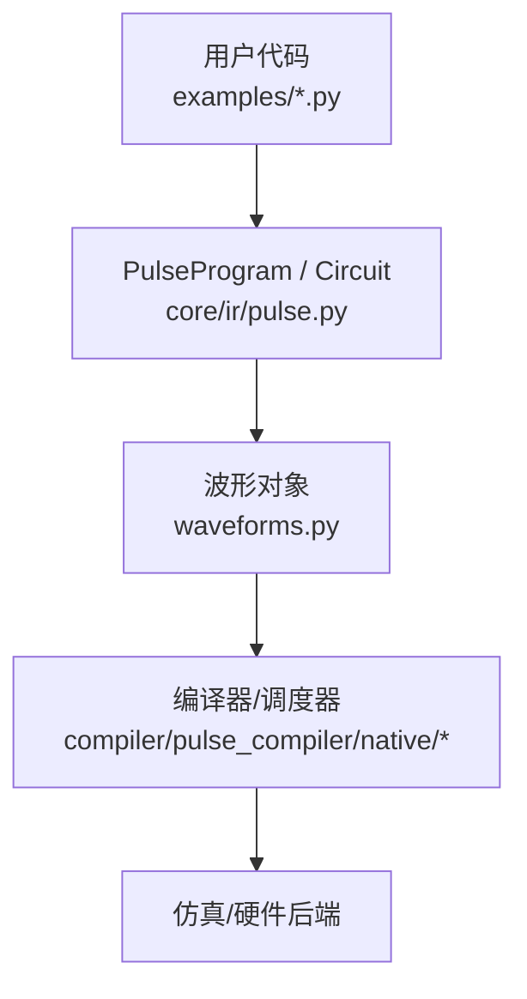
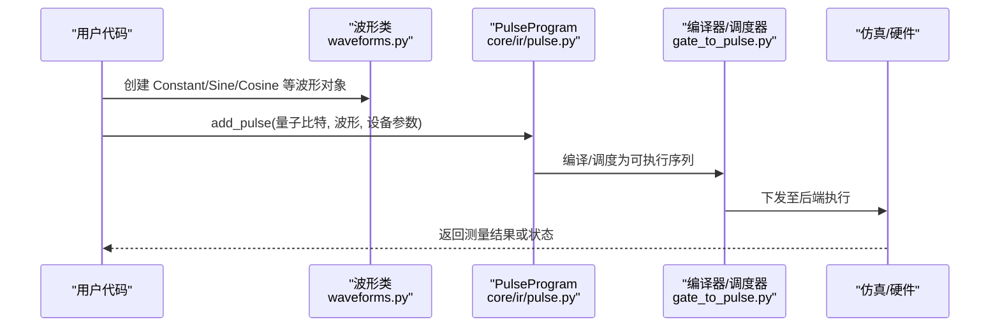
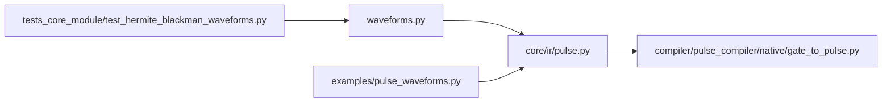

# 基础波形

<cite>
**本文引用的文件**
- [waveforms.py](file://src/tyxonq/waveforms.py)
- [pulse_waveforms.py](file://examples/pulse_waveforms.py)
- [pulse_basic_tutorial.py](file://examples/pulse_basic_tutorial.py)
- [test_hermite_blackman_waveforms.py](file://tests_core_module/test_hermite_blackman_waveforms.py)
- [gate_to_pulse.py](file://src/tyxonq/compiler/pulse_compiler/native/gate_to_pulse.py)
- [pulse_ir.py](file://src/tyxonq/core/ir/pulse.py)
</cite>

## 目录
1. [简介](#简介)
2. [项目结构](#项目结构)
3. [核心组件](#核心组件)
4. [架构总览](#架构总览)
5. [详细组件分析](#详细组件分析)
6. [依赖关系分析](#依赖关系分析)
7. [性能考量](#性能考量)
8. [故障排查指南](#故障排查指南)
9. [结论](#结论)
10. [附录：代码示例与使用路径](#附录代码示例与使用路径)

## 简介
本文件聚焦 TyxonQ 中的基础波形类型，包括 Constant、Sine、Cosine 等，系统阐述其数学定义、参数配置、典型应用场景（如简单脉冲操作、频率调制、相干控制），并说明它们与更复杂波形（Gaussian、Drag、Hermite、BlackmanSquare、CosineDrag、Flattop）的关系以及在波形组合与调制中的应用。文档同时提供完整的代码示例路径，便于读者在仓库中直接定位和运行相关演示。

## 项目结构
TyxonQ 的波形定义集中在统一的模块中，并通过脉冲编程接口与编译链路集成到电路执行流程。关键位置如下：
- 波形数据类定义：src/tyxonq/waveforms.py
- 脉冲程序与 IR：src/tyxonq/core/ir/pulse.py
- 门到脉冲的分解与调度：src/tyxonq/compiler/pulse_compiler/native/gate_to_pulse.py
- 综合示例与教程：examples/pulse_waveforms.py、examples/pulse_basic_tutorial.py
- 高级波形测试用例：tests_core_module/test_hermite_blackman_waveforms.py

图表来源
- [pulse_waveforms.py:1-35](file://examples/pulse_waveforms.py#L1-L35)
- [pulse_ir.py:260-280](file://src/tyxonq/core/ir/pulse.py#L260-L280)
- [gate_to_pulse.py:460-475](file://src/tyxonq/compiler/pulse_compiler/native/gate_to_pulse.py#L460-L475)

章节来源
- [waveforms.py:1-157](file://src/tyxonq/waveforms.py#L1-L157)
- [pulse_waveforms.py:1-50](file://examples/pulse_waveforms.py#L1-L50)
- [pulse_basic_tutorial.py:1-40](file://examples/pulse_basic_tutorial.py#L1-L40)

## 核心组件
- 基础波形数据类：Constant、Sine、Cosine
- 扩展波形数据类：Gaussian、Drag、CosineDrag、Flattop、Hermite、BlackmanSquare
- 统一接口：每个波形类提供 qasm_name() 与 to_args()，用于序列化与导出
- 脉冲程序：通过 PulseProgram.add_pulse 等方法将波形应用到量子比特上，支持设备参数设置与状态演化

章节来源
- [waveforms.py:19-157](file://src/tyxonq/waveforms.py#L19-L157)
- [pulse_waveforms.py:130-170](file://examples/pulse_waveforms.py#L130-L170)
- [pulse_ir.py:260-280](file://src/tyxonq/core/ir/pulse.py#L260-L280)

## 架构总览
下图展示了从用户代码到波形实例化、再到脉冲程序执行的完整调用链。

图表来源
- [pulse_waveforms.py:140-160](file://examples/pulse_waveforms.py#L140-L160)
- [pulse_ir.py:260-280](file://src/tyxonq/core/ir/pulse.py#L260-L280)
- [gate_to_pulse.py:460-475](file://src/tyxonq/compiler/pulse_compiler/native/gate_to_pulse.py#L460-L475)

## 详细组件分析

### Constant 波形
- 数学定义
  - 时域包络：A(t) = A（常数幅度）
  - 持续时间：duration（纳秒）
  - 相位：默认 0（可通过上层方法叠加）
- 参数配置
  - amp：幅度
  - duration：持续时间（整数 ns）
- 使用场景
  - 简单脉冲操作与基线对比（例如回波、参考脉冲）
  - 快速验证概念与硬件连通性
- 注意事项
  - 频谱较宽，易引起泄漏到更高能级；在高保真度场景中通常被平滑包络替代
- 代码示例路径
  - 创建与比较不同包络：[pulse_waveforms.py:130-170](file://examples/pulse_waveforms.py#L130-L170)
  - 两量子比特门分解中使用 Constant 作为回波：[pulse_waveforms.py:255-266](file://examples/pulse_waveforms.py#L255-L266)
  - 编译器内部生成回波 Constant：[gate_to_pulse.py:460-475](file://src/tyxonq/compiler/pulse_compiler/native/gate_to_pulse.py#L460-L475)

章节来源
- [waveforms.py:53-61](file://src/tyxonq/waveforms.py#L53-L61)
- [pulse_waveforms.py:130-170](file://examples/pulse_waveforms.py#L130-L170)
- [pulse_waveforms.py:255-266](file://examples/pulse_waveforms.py#L255-L266)
- [gate_to_pulse.py:460-475](file://src/tyxonq/compiler/pulse_compiler/native/gate_to_pulse.py#L460-L475)

### Sine 波形
- 数学定义
  - 时域包络：A(t)·sin(2π·f·t + φ)，其中 f 为频率，φ 为相位（可由上层叠加）
  - 持续时间：duration
- 参数配置
  - amp：幅度
  - frequency：频率（Hz）
  - duration：持续时间（ns）
- 使用场景
  - 频率调制（FM）：通过改变频率实现谱选择或动态解耦
  - 相干控制：与驱动场相位配合进行旋转轴控制
- 代码示例路径
  - 波形类定义与参数：[waveforms.py:62-71](file://src/tyxonq/waveforms.py#L62-L71)
  - 在脉冲程序中应用正弦/余弦调制的思路可参考教程中对频率与相位的讨论：[pulse_basic_tutorial.py:40-60](file://examples/pulse_basic_tutorial.py#L40-L60)

章节来源
- [waveforms.py:62-71](file://src/tyxonq/waveforms.py#L62-L71)
- [pulse_basic_tutorial.py:40-60](file://examples/pulse_basic_tutorial.py#L40-L60)

### Cosine 波形
- 数学定义
  - 时域包络：A(t)·cos(2π·f·t + φ)
  - 持续时间：duration
- 参数配置
  - amp：幅度
  - frequency：频率（Hz）
  - duration：持续时间（ns）
- 使用场景
  - 频率调制与相干控制中与 Sine 互补，常用于正交分量 I/Q 调制
  - 与 DRAG/Gaussian 等包络结合形成复合波形
- 代码示例路径
  - 波形类定义与参数：[waveforms.py:72-81](file://src/tyxonq/waveforms.py#L72-L81)
  - 与 DRAG/Gaussian 的比较与优化思路：[pulse_waveforms.py:130-170](file://examples/pulse_waveforms.py#L130-L170)

章节来源
- [waveforms.py:72-81](file://src/tyxonq/waveforms.py#L72-L81)
- [pulse_waveforms.py:130-170](file://examples/pulse_waveforms.py#L130-L170)

### 与其他复杂波形的关系
- 平滑包络（Gaussian、Hermite、BlackmanSquare）
  - 相比 Constant，减少频谱旁瓣，降低泄漏，提高保真度
  - 适用于高精度单量子比特门与双量子比特门序列
- DRAG（Drag、CosineDrag）
  - 在 Gaussian/余弦基础上加入导数项抑制泄漏，适合非谐振荡器体系
- Flattop
  - 平坦顶部包络，适合需要稳定幅度的控制场景
- 组合与调制
  - 可将 Sine/Cosine 作为载波，与上述包络函数相乘实现 AM/FM
  - 在脉冲程序中通过相位与频率参数实现相干控制

章节来源
- [waveforms.py:19-157](file://src/tyxonq/waveforms.py#L19-L157)
- [pulse_waveforms.py:130-170](file://examples/pulse_waveforms.py#L130-L170)

## 依赖关系分析
- 波形模块 waveforms.py 无外部库依赖，仅使用 dataclass 与类型提示
- 脉冲程序 core/ir/pulse.py 在添加 Constant 等波形时引用 waveforms.Constant
- 编译器 gate_to_pulse.py 在特定门分解中生成 Constant 作为回波脉冲
- 示例与测试广泛使用 waveforms 模块构建脉冲序列并进行仿真

图表来源
- [pulse_ir.py:260-280](file://src/tyxonq/core/ir/pulse.py#L260-L280)
- [gate_to_pulse.py:460-475](file://src/tyxonq/compiler/pulse_compiler/native/gate_to_pulse.py#L460-L475)
- [pulse_waveforms.py:130-170](file://examples/pulse_waveforms.py#L130-L170)
- [test_hermite_blackman_waveforms.py:248-302](file://tests_core_module/test_hermite_blackman_waveforms.py#L248-L302)

章节来源
- [waveforms.py:1-157](file://src/tyxonq/waveforms.py#L1-L157)
- [pulse_ir.py:260-280](file://src/tyxonq/core/ir/pulse.py#L260-L280)
- [gate_to_pulse.py:460-475](file://src/tyxonq/compiler/pulse_compiler/native/gate_to_pulse.py#L460-L475)
- [pulse_waveforms.py:130-170](file://examples/pulse_waveforms.py#L130-L170)
- [test_hermite_blackman_waveforms.py:248-302](file://tests_core_module/test_hermite_blackman_waveforms.py#L248-L302)

## 性能考量
- Constant 波形具有陡峭边沿，频谱宽，易导致泄漏到 |2⟩ 等高阶态；在高保真度任务中建议优先使用 Gaussian、DRAG、Hermite、BlackmanSquare 等平滑包络
- 频率调制（Sine/Cosine）需合理选择频率以避免与杂散谱重叠；结合包络函数可降低旁瓣能量
- 参数扫描（幅度、beta、sigma、width）是校准的关键步骤；示例中提供了系统化的扫描与评估方法
- 在双量子比特门分解中，Constant 常用作回波以补偿相位误差，但整体保真度仍受其他脉冲形状影响

章节来源
- [pulse_waveforms.py:130-170](file://examples/pulse_waveforms.py#L130-L170)
- [pulse_waveforms.py:329-400](file://examples/pulse_waveforms.py#L329-L400)
- [test_hermite_blackman_waveforms.py:360-422](file://tests_core_module/test_hermite_blackman_waveforms.py#L360-L422)

## 故障排查指南
- 若发现泄漏严重或保真度低：
  - 检查是否误用 Constant 作为主控制脉冲；尝试切换为 DRAG 或 Hermite
  - 调整 beta（DRAG）或 sigma（Gaussian/Hermite）以平衡速度与泄漏
- 频率调制异常：
  - 确认频率单位与采样率匹配；避免频率过高导致带宽不足
  - 检查相位设置是否与目标旋转轴一致
- 回波无效：
  - 确认 Constant 的幅度与持续时间与相邻脉冲匹配；必要时调整相位
- 参考路径
  - 波形选择与优化策略：[pulse_waveforms.py:477-545](file://examples/pulse_waveforms.py#L477-L545)
  - 高级波形测试与属性校验：[test_hermite_blackman_waveforms.py:424-470](file://tests_core_module/test_hermite_blackman_waveforms.py#L424-L470)

章节来源
- [pulse_waveforms.py:477-545](file://examples/pulse_waveforms.py#L477-L545)
- [test_hermite_blackman_waveforms.py:424-470](file://tests_core_module/test_hermite_blackman_waveforms.py#L424-L470)

## 结论
Constant、Sine、Cosine 是 TyxonQ 中最基础的波形类型，分别对应矩形脉冲与正弦/余弦载波。它们在简单脉冲操作、频率调制与相干控制中发挥重要作用。实际应用中，通常将它们与平滑包络（Gaussian、DRAG、Hermite、BlackmanSquare）组合以实现高保真度控制。通过示例与测试路径，读者可以快速上手并深入理解波形选择与参数调优的实践方法。

## 附录：代码示例与使用路径
- 基础波形类型与属性展示
  - [examples/pulse_waveforms.py:40-108](file://examples/pulse_waveforms.py#L40-L108)
- 不同包络的比较与泄漏评估
  - [examples/pulse_waveforms.py:115-170](file://examples/pulse_waveforms.py#L115-L170)
- 单量子比特门实现（X/Y/H 等）
  - [examples/pulse_waveforms.py:176-230](file://examples/pulse_waveforms.py#L176-L230)
- 双量子比特门分解（CX/iSWAP/SWAP）
  - [examples/pulse_waveforms.py:237-322](file://examples/pulse_waveforms.py#L237-L322)
- 波形参数优化（幅度与 beta 扫描）
  - [examples/pulse_waveforms.py:329-400](file://examples/pulse_waveforms.py#L329-L400)
- 高级脉冲整形技术（复合脉冲、导数调制、门专用波形）
  - [examples/pulse_waveforms.py:406-470](file://examples/pulse_waveforms.py#L406-L470)
- 入门教程（Hello World、参数化脉冲、门到脉冲转换）
  - [examples/pulse_basic_tutorial.py:34-96](file://examples/pulse_basic_tutorial.py#L34-L96)
  - [examples/pulse_basic_tutorial.py:100-200](file://examples/pulse_basic_tutorial.py#L100-L200)
- 高级波形测试（Hermite/BlackmanSquare 的属性与集成）
  - [tests_core_module/test_hermite_blackman_waveforms.py:27-120](file://tests_core_module/test_hermite_blackman_waveforms.py#L27-L120)
  - [tests_core_module/test_hermite_blackman_waveforms.py:122-246](file://tests_core_module/test_hermite_blackman_waveforms.py#L122-L246)
  - [tests_core_module/test_hermite_blackman_waveforms.py:248-358](file://tests_core_module/test_hermite_blackman_waveforms.py#L248-L358)
  - [tests_core_module/test_hermite_blackman_waveforms.py:360-470](file://tests_core_module/test_hermite_blackman_waveforms.py#L360-L470)