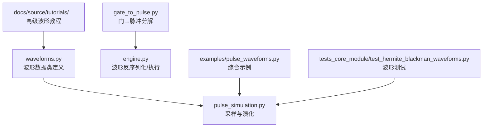
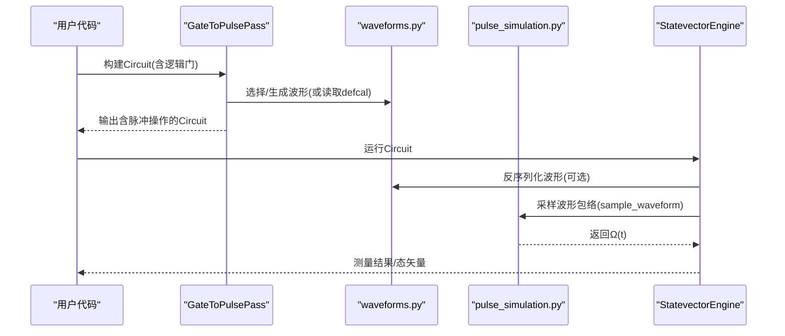
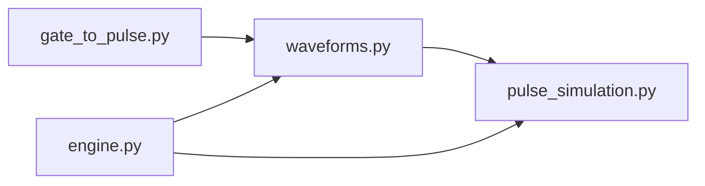

# 波形类型概览

<cite>
**本文引用的文件**
- [src/tyxonq/waveforms.py](file://src/tyxonq/waveforms.py)
- [examples/pulse_waveforms.py](file://examples/pulse_waveforms.py)
- [tests_core_module/test_hermite_blackman_waveforms.py](file://tests_core_module/test_hermite_blackman_waveforms.py)
- [docs/source/tutorials/advanced/pulse_advanced_waveforms.rst](file://docs/source/tutorials/advanced/pulse_advanced_waveforms.rst)
- [src/tyxonq/libs/quantum_library/pulse_simulation.py](file://src/tyxonq/libs/quantum_library/pulse_simulation.py)
- [src/tyxonq/devices/simulators/statevector/engine.py](file://src/tyxonq/devices/simulators/statevector/engine.py)
- [src/tyxonq/compiler/pulse_compiler/native/gate_to_pulse.py](file://src/tyxonq/compiler/pulse_compiler/native/gate_to_pulse.py)
</cite>

## 目录
1. [简介](#简介)
2. [项目结构](#项目结构)
3. [核心组件](#核心组件)
4. [架构总览](#架构总览)
5. [详细组件分析](#详细组件分析)
6. [依赖关系分析](#依赖关系分析)
7. [性能考量](#性能考量)
8. [故障排查指南](#故障排查指南)
9. [结论](#结论)
10. [附录](#附录)

## 简介
本文件面向TyxonQ框架中的脉冲波形系统，系统性梳理并对比支持的波形类型：Constant、Gaussian、Drag、Hermite、BlackmanSquare、CosineDrag等。文档从数学原理、参数配置、使用场景、优缺点（频谱特性、泄漏抑制、计算复杂度）到保真度影响与硬件选择建议，提供完整的技术说明与实践指导。同时给出代码级参考路径，便于读者在仓库中快速定位实现与示例。

## 项目结构
TyxonQ的波形定义集中在统一模块中，仿真采样与物理演化由独立库模块提供，编译器将逻辑门分解为脉冲序列，状态向量引擎支持波形反序列化与执行。整体组织如下：
- 波形定义：waveforms.py
- 仿真采样与演化：pulse_simulation.py
- 门到脉冲编译：gate_to_pulse.py
- 状态向量引擎集成：engine.py
- 教程与示例：docs/source/tutorials/... 与 examples/pulse_waveforms.py
- 测试用例：test_hermite_blackman_waveforms.py

图表来源
- [src/tyxonq/waveforms.py:1-157](file://src/tyxonq/waveforms.py#L1-L157)
- [src/tyxonq/libs/quantum_library/pulse_simulation.py:44-200](file://src/tyxonq/libs/quantum_library/pulse_simulation.py#L44-L200)
- [src/tyxonq/compiler/pulse_compiler/native/gate_to_pulse.py:1-200](file://src/tyxonq/compiler/pulse_compiler/native/gate_to_pulse.py#L1-L200)
- [src/tyxonq/devices/simulators/statevector/engine.py:953-999](file://src/tyxonq/devices/simulators/statevector/engine.py#L953-L999)

章节来源
- [src/tyxonq/waveforms.py:1-157](file://src/tyxonq/waveforms.py#L1-L157)
- [src/tyxonq/libs/quantum_library/pulse_simulation.py:44-200](file://src/tyxonq/libs/quantum_library/pulse_simulation.py#L44-L200)
- [src/tyxonq/compiler/pulse_compiler/native/gate_to_pulse.py:1-200](file://src/tyxonq/compiler/pulse_compiler/native/gate_to_pulse.py#L1-L200)
- [src/tyxonq/devices/simulators/statevector/engine.py:953-999](file://src/tyxonq/devices/simulators/statevector/engine.py#L953-L999)

## 核心组件
- 波形数据类：每个波形以dataclass形式定义，包含amp、duration及波形特有参数；提供qasm_name()与to_args()用于序列化与导出。
- 采样与演化：统一的sample_waveform函数根据波形类型返回时域包络；内部对DRAG、Gaussian、Flattop、Sine/Cosine、CosineDrag等进行公式化实现，并支持PyTorch后端。
- 门到脉冲编译：GateToPulsePass将标准量子门转换为脉冲序列，优先使用用户校准（defcal），否则回退到默认物理分解。
- 状态向量引擎：支持从字典反序列化波形对象，并在电路执行中调用。

章节来源
- [src/tyxonq/waveforms.py:1-157](file://src/tyxonq/waveforms.py#L1-L157)
- [src/tyxonq/libs/quantum_library/pulse_simulation.py:44-200](file://src/tyxonq/libs/quantum_library/pulse_simulation.py#L44-L200)
- [src/tyxonq/compiler/pulse_compiler/native/gate_to_pulse.py:1-200](file://src/tyxonq/compiler/pulse_compiler/native/gate_to_pulse.py#L1-L200)
- [src/tyxonq/devices/simulators/statevector/engine.py:953-999](file://src/tyxonq/devices/simulators/statevector/engine.py#L953-L999)

## 架构总览
下图展示了从“逻辑门”到“脉冲波形”再到“状态演化”的端到端流程，以及波形在仿真与执行中的关键节点。

图表来源
- [src/tyxonq/compiler/pulse_compiler/native/gate_to_pulse.py:1-200](file://src/tyxonq/compiler/pulse_compiler/native/gate_to_pulse.py#L1-L200)
- [src/tyxonq/waveforms.py:1-157](file://src/tyxonq/waveforms.py#L1-L157)
- [src/tyxonq/libs/quantum_library/pulse_simulation.py:44-200](file://src/tyxonq/libs/quantum_library/pulse_simulation.py#L44-L200)
- [src/tyxonq/devices/simulators/statevector/engine.py:953-999](file://src/tyxonq/devices/simulators/statevector/engine.py#L953-L999)

## 详细组件分析

### Constant（常数矩形脉冲）
- 数学原理：恒定幅度包络，无平滑过渡。
- 参数：amp、duration。
- 使用场景：基准对比、快速测试、对频谱要求不高的简单驱动。
- 优点：实现简单、计算开销低、上升沿极快。
- 缺点：频谱旁瓣高、易引起泄漏与串扰，保真度受限。
- 保真度影响：通常较低，尤其在多量子比特系统中。
- 参考路径
  - 定义：[src/tyxonq/waveforms.py:54-60](file://src/tyxonq/waveforms.py#L54-L60)
  - 示例用法：[examples/pulse_waveforms.py:133-138](file://examples/pulse_waveforms.py#L133-L138)

章节来源
- [src/tyxonq/waveforms.py:54-60](file://src/tyxonq/waveforms.py#L54-L60)
- [examples/pulse_waveforms.py:133-138](file://examples/pulse_waveforms.py#L133-L138)

### Gaussian（高斯包络）
- 数学原理：Ω(t)=A·exp(-(t-T/2)^2/(2σ^2))·exp(iφ)。
- 参数：amp、duration、sigma、phase（可选）。
- 使用场景：单量子比特旋转、通用平滑包络。
- 优点：平滑、旁瓣低于矩形、易于调参。
- 缺点：滚降速率有限，泄漏抑制不如DRAG/Blackman。
- 保真度影响：中等偏上，适合大多数单量子比特门。
- 参考路径
  - 定义：[src/tyxonq/waveforms.py:20-28](file://src/tyxonq/waveforms.py#L20-L28)
  - 采样实现：[src/tyxonq/libs/quantum_library/pulse_simulation.py:147-169](file://src/tyxonq/libs/quantum_library/pulse_simulation.py#L147-L169)
  - 示例用法：[examples/pulse_waveforms.py:133-138](file://examples/pulse_waveforms.py#L133-L138)

章节来源
- [src/tyxonq/waveforms.py:20-28](file://src/tyxonq/waveforms.py#L20-L28)
- [src/tyxonq/libs/quantum_library/pulse_simulation.py:147-169](file://src/tyxonq/libs/quantum_library/pulse_simulation.py#L147-L169)
- [examples/pulse_waveforms.py:133-138](file://examples/pulse_waveforms.py#L133-L138)

### Drag（DRAG：绝热门导数消除）
- 数学原理：Ω(τ)=[A·exp(-(τ-0.5)^2/(2σ^2)) + iβ·dΩ/dτ]·exp(iφ)。通过加入包络导数项抑制向|2⟩的泄漏。
- 参数：amp、duration、sigma、beta、phase（可选）。
- 使用场景：需要抑制泄漏的单量子比特门（X/Y/H/T等）。
- 优点：有效降低泄漏，提升保真度；兼容高斯基包络。
- 缺点：需调优beta；计算略高于纯高斯。
- 保真度影响：显著提升，尤其对非谐性较大的器件。
- 参考路径
  - 定义：[src/tyxonq/waveforms.py:42-51](file://src/tyxonq/waveforms.py#L42-L51)
  - 采样实现：[src/tyxonq/libs/quantum_library/pulse_simulation.py:116-145](file://src/tyxonq/libs/quantum_library/pulse_simulation.py#L116-L145)
  - 优化示例（振幅/β扫描）：[examples/pulse_waveforms.py:338-399](file://examples/pulse_waveforms.py#L338-L399)

章节来源
- [src/tyxonq/waveforms.py:42-51](file://src/tyxonq/waveforms.py#L42-L51)
- [src/tyxonq/libs/quantum_library/pulse_simulation.py:116-145](file://src/tyxonq/libs/quantum_library/pulse_simulation.py#L116-L145)
- [examples/pulse_waveforms.py:338-399](file://examples/pulse_waveforms.py#L338-L399)

### Hermite（厄米多项式包络）
- 数学原理：在高斯基包络上乘厄米多项式调制，形成更优频谱形状；官方注释强调“最小频率谱泄漏”，适用于高保真门。
- 参数：amp、duration、order（典型2或3）、phase（可选）。
- 使用场景：介于高斯与Blackman之间的折中方案，追求更好频谱抑制但不过度复杂。
- 优点：比高斯更好的旁瓣抑制；仍保持平滑与可微。
- 缺点：计算复杂度高于高斯；需选择合适阶数。
- 保真度影响：在仿真中常优于高斯，接近Blackman。
- 参考路径
  - 定义与注释：[src/tyxonq/waveforms.py:104-126](file://src/tyxonq/waveforms.py#L104-L126)
  - 教程理论：[docs/source/tutorials/advanced/pulse_advanced_waveforms.rst:40-90](file://docs/source/tutorials/advanced/pulse_advanced_waveforms.rst#L40-L90)
  - 测试验证（采样/相位/能量）：[tests_core_module/test_hermite_blackman_waveforms.py:27-119](file://tests_core_module/test_hermite_blackman_waveforms.py#L27-L119)

章节来源
- [src/tyxonq/waveforms.py:104-126](file://src/tyxonq/waveforms.py#L104-L126)
- [docs/source/tutorials/advanced/pulse_advanced_waveforms.rst:40-90](file://docs/source/tutorials/advanced/pulse_advanced_waveforms.rst#L40-L90)
- [tests_core_module/test_hermite_blackman_waveforms.py:27-119](file://tests_core_module/test_hermite_blackman_waveforms.py#L27-L119)

### BlackmanSquare（布莱克曼窗+平顶）
- 数学原理：采用布莱克曼窗作为包络，具有优异的频谱抑制能力；结合平顶区域实现高精度门驱动。
- 参数：amp、duration、width（平顶宽度）、phase（可选）。
- 使用场景：多量子比特系统、密集耦合阵列、对串扰敏感的两量子比特门。
- 优点：极低旁瓣、滚降更快、对称性好；适合生产环境的高保真需求。
- 缺点：参数更多（width需合理设置）；计算复杂度较高。
- 保真度影响：在仿真中表现优异，适合严格串扰控制。
- 参考路径
  - 定义与注释：[src/tyxonq/waveforms.py:129-156](file://src/tyxonq/waveforms.py#L129-L156)
  - 教程理论（窗函数、三段结构、滚降率）：[docs/source/tutorials/advanced/pulse_advanced_waveforms.rst:191-247](file://docs/source/tutorials/advanced/pulse_advanced_waveforms.rst#L191-L247)
  - 测试验证（斜坡/平台/对称性/相位）：[tests_core_module/test_hermite_blackman_waveforms.py:122-246](file://tests_core_module/test_hermite_blackman_waveforms.py#L122-L246)

章节来源
- [src/tyxonq/waveforms.py:129-156](file://src/tyxonq/waveforms.py#L129-L156)
- [docs/source/tutorials/advanced/pulse_advanced_waveforms.rst:191-247](file://docs/source/tutorials/advanced/pulse_advanced_waveforms.rst#L191-L247)
- [tests_core_module/test_hermite_blackman_waveforms.py:122-246](file://tests_core_module/test_hermite_blackman_waveforms.py#L122-L246)

### CosineDrag（余弦调制DRAG）
- 数学原理：基于余弦包络的DRAG形式，Ω(τ)=g(τ)+iα·g'(τ)，其中g(τ)为余弦调制包络，α为DRAG系数。
- 参数：amp、duration、phase、alpha。
- 使用场景：需要相位调制与泄漏抑制的组合应用。
- 优点：灵活相位控制；具备DRAG泄漏抑制能力。
- 缺点：专用性强；需调优alpha与相位。
- 保真度影响：在特定硬件条件下可优于普通高斯/DRAG。
- 参考路径
  - 定义：[src/tyxonq/waveforms.py:83-91](file://src/tyxonq/waveforms.py#L83-L91)
  - 采样实现：[src/tyxonq/libs/quantum_library/pulse_simulation.py:96-114](file://src/tyxonq/libs/quantum_library/pulse_simulation.py#L96-L114)
  - 示例用法：[examples/pulse_waveforms.py:46-98](file://examples/pulse_waveforms.py#L46-L98)

章节来源
- [src/tyxonq/waveforms.py:83-91](file://src/tyxonq/waveforms.py#L83-L91)
- [src/tyxonq/libs/quantum_library/pulse_simulation.py:96-114](file://src/tyxonq/libs/quantum_library/pulse_simulation.py#L96-L114)
- [examples/pulse_waveforms.py:46-98](file://examples/pulse_waveforms.py#L46-L98)

### 其他波形（Sine、Cosine、Flattop、GaussianSquare）
- Sine/Cosine：周期性振荡包络，适用于特定驱动或教学演示。
- Flattop：误差函数组合的平顶脉冲，适合需要稳定平台的场景。
- GaussianSquare：高斯边缘+平顶，兼顾平滑与平台稳定性。
- 参考路径
  - 定义：[src/tyxonq/waveforms.py:62-101](file://src/tyxonq/waveforms.py#L62-L101)
  - 采样实现（Flattop/Sine/Cosine）：[src/tyxonq/libs/quantum_library/pulse_simulation.py:171-200](file://src/tyxonq/libs/quantum_library/pulse_simulation.py#L171-L200)

章节来源
- [src/tyxonq/waveforms.py:62-101](file://src/tyxonq/waveforms.py#L62-L101)
- [src/tyxonq/libs/quantum_library/pulse_simulation.py:171-200](file://src/tyxonq/libs/quantum_library/pulse_simulation.py#L171-L200)

## 依赖关系分析
- waveforms.py仅暴露数据类与接口方法，无外部依赖，保证轻量与可移植。
- pulse_simulation.py依赖数值后端（NumPy/PyTorch）与SciPy积分器进行演化；提供统一的采样入口。
- gate_to_pulse.py依赖waveforms与设备参数，负责将逻辑门映射为脉冲序列。
- engine.py支持从字典反序列化波形，打通云端/离线执行链路。

图表来源
- [src/tyxonq/waveforms.py:1-157](file://src/tyxonq/waveforms.py#L1-L157)
- [src/tyxonq/libs/quantum_library/pulse_simulation.py:44-200](file://src/tyxonq/libs/quantum_library/pulse_simulation.py#L44-L200)
- [src/tyxonq/compiler/pulse_compiler/native/gate_to_pulse.py:1-200](file://src/tyxonq/compiler/pulse_compiler/native/gate_to_pulse.py#L1-L200)
- [src/tyxonq/devices/simulators/statevector/engine.py:953-999](file://src/tyxonq/devices/simulators/statevector/engine.py#L953-L999)

章节来源
- [src/tyxonq/waveforms.py:1-157](file://src/tyxonq/waveforms.py#L1-L157)
- [src/tyxonq/libs/quantum_library/pulse_simulation.py:44-200](file://src/tyxonq/libs/quantum_library/pulse_simulation.py#L44-L200)
- [src/tyxonq/compiler/pulse_compiler/native/gate_to_pulse.py:1-200](file://src/tyxonq/compiler/pulse_compiler/native/gate_to_pulse.py#L1-L200)
- [src/tyxonq/devices/simulators/statevector/engine.py:953-999](file://src/tyxonq/devices/simulators/statevector/engine.py#L953-L999)

## 性能考量
- 频谱特性
  - Constant：旁瓣高，泄漏严重，保真度最低。
  - Gaussian：旁瓣适中，滚降约-40 dB/倍频程（依据教程理论标注）。
  - DRAG：通过导数项抑制泄漏，保真度显著提升。
  - Hermite：在高斯基础上多项式调制，仿真显示更低旁瓣。
  - BlackmanSquare：工业级窗函数，理论旁瓣抑制更强，滚降更快。
  - CosineDrag：兼具余弦调制与DRAG抑制，适用相位敏感场景。
- 泄漏抑制能力
  - DRAG与BlackmanSquare在抑制向|2⟩泄漏方面表现突出；Hermite次之但仍优于高斯。
- 计算复杂度
  - Constant/Gaussian最轻；DRAG需计算导数；Hermite/Blackman涉及多项式/窗函数，开销更高。
- 保真度影响
  - 仿真中，Blackman与Hermite常优于高斯；DRAG在多数单量子比特门中表现稳健。
- 参考路径
  - 教程对比与选择建议：[docs/source/tutorials/advanced/pulse_advanced_waveforms.rst:381-464](file://docs/source/tutorials/advanced/pulse_advanced_waveforms.rst#L381-L464)
  - 仿真比较示例：[tests_core_module/test_hermite_blackman_waveforms.py:360-405](file://tests_core_module/test_hermite_blackman_waveforms.py#L360-L405)

章节来源
- [docs/source/tutorials/advanced/pulse_advanced_waveforms.rst:381-464](file://docs/source/tutorials/advanced/pulse_advanced_waveforms.rst#L381-L464)
- [tests_core_module/test_hermite_blackman_waveforms.py:360-405](file://tests_core_module/test_hermite_blackman_waveforms.py#L360-L405)

## 故障排查指南
- 波形未生效
  - 检查是否在Circuit元数据中注册了pulse_library或使用pulse_inline格式。
  - 确认engine的反序列化映射包含目标波形类型。
  - 参考路径：[src/tyxonq/devices/simulators/statevector/engine.py:953-999](file://src/tyxonq/devices/simulators/statevector/engine.py#L953-L999)
- 采样异常或NaN/Inf
  - 检查duration、sigma、width等参数是否合理；确保时间范围在脉冲窗口内。
  - 参考路径：[tests_core_module/test_hermite_blackman_waveforms.py:406-421](file://tests_core_module/test_hermite_blackman_waveforms.py#L406-L421)
- 保真度不达预期
  - 调整beta（DRAG）或width（Blackman）；进行振幅/时长扫描。
  - 参考路径：[examples/pulse_waveforms.py:338-399](file://examples/pulse_waveforms.py#L338-L399)
- 两量子比特门串扰
  - 优先尝试BlackmanSquare；必要时混合不同波形（单量子用Hermite，两量子用Blackman）。
  - 参考路径：[docs/source/tutorials/advanced/pulse_advanced_waveforms.rst:527-557](file://docs/source/tutorials/advanced/pulse_advanced_waveforms.rst#L527-L557)

章节来源
- [src/tyxonq/devices/simulators/statevector/engine.py:953-999](file://src/tyxonq/devices/simulators/statevector/engine.py#L953-L999)
- [tests_core_module/test_hermite_blackman_waveforms.py:406-421](file://tests_core_module/test_hermite_blackman_waveforms.py#L406-L421)
- [examples/pulse_waveforms.py:338-399](file://examples/pulse_waveforms.py#L338-L399)
- [docs/source/tutorials/advanced/pulse_advanced_waveforms.rst:527-557](file://docs/source/tutorials/advanced/pulse_advanced_waveforms.rst#L527-L557)

## 结论
- 若追求简单与速度：Constant/Gaussian可作为基线。
- 若需抑制泄漏并提升保真度：优先DRAG；对频谱要求更高时考虑Hermite或BlackmanSquare。
- 对多量子比特串扰敏感的场景：BlackmanSquare是首选；Hermite可作为折中。
- 实际部署前务必在真实硬件上进行校准与验证，仿真结果仅作参考。

## 附录

### 各波形的创建与配置参考路径
- 基础波形与对比
  - [examples/pulse_waveforms.py:40-108](file://examples/pulse_waveforms.py#L40-L108)
- 单量子比特门实现
  - [examples/pulse_waveforms.py:176-230](file://examples/pulse_waveforms.py#L176-L230)
- 两量子比特门分解
  - [examples/pulse_waveforms.py:237-322](file://examples/pulse_waveforms.py#L237-L322)
- 参数优化（振幅/β扫描）
  - [examples/pulse_waveforms.py:329-399](file://examples/pulse_waveforms.py#L329-L399)
- 高级技术（复合脉冲、导数调制、门特定整形）
  - [examples/pulse_waveforms.py:406-470](file://examples/pulse_waveforms.py#L406-L470)

### 波形采样与演化的关键实现
- 采样入口与公式
  - [src/tyxonq/libs/quantum_library/pulse_simulation.py:44-200](file://src/tyxonq/libs/quantum_library/pulse_simulation.py#L44-L200)
- 波形反序列化与执行
  - [src/tyxonq/devices/simulators/statevector/engine.py:953-999](file://src/tyxonq/devices/simulators/statevector/engine.py#L953-L999)

### 门到脉冲编译流程
- 门→脉冲转换策略与优先级
  - [src/tyxonq/compiler/pulse_compiler/native/gate_to_pulse.py:1-200](file://src/tyxonq/compiler/pulse_compiler/native/gate_to_pulse.py#L1-L200)